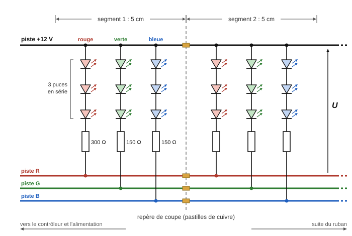
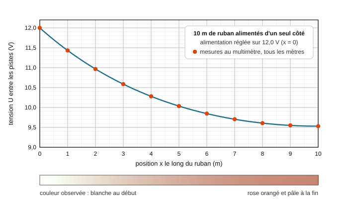
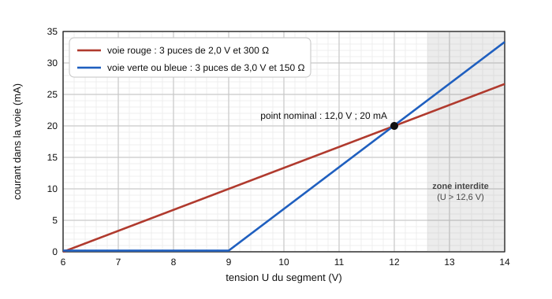
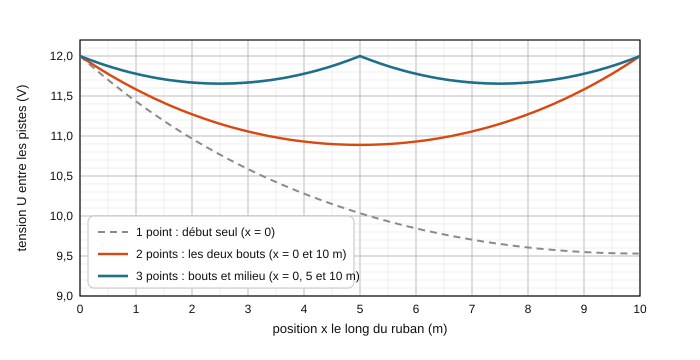
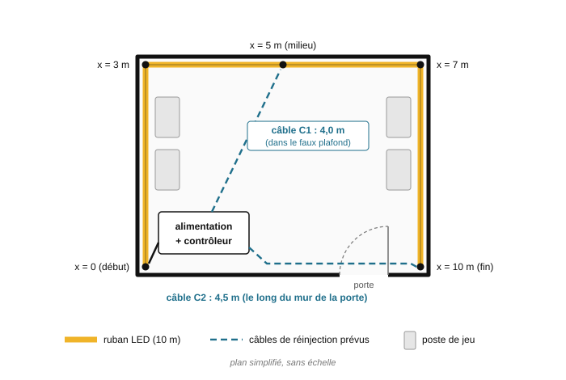

# Devoir maison : le ruban qui rougissait

BTS CIEL 1 · Physique · Chapitre 1 : électricité et optoélectronique

> Devoir à faire à la maison, à rendre à la date indiquée par le formateur · Calculatrice autorisée · Vous pouvez chercher à plusieurs, mais la rédaction doit être personnelle.
>
> Les trois parties notées (A, B et C) sont **indépendantes** : chacune rappelle les données dont elle a besoin, et les résultats utiles des parties précédentes sont redonnés. À l'intérieur de chaque partie, les questions vont du plus simple au plus difficile. La dernière partie, « Défi », est **facultative** : elle rapporte des points de bonus (note plafonnée à 20).
>
> Pour chaque calcul : écrire la formule littérale, convertir les grandeurs, faire l'application numérique, donner le résultat avec son unité, puis conclure par une phrase.
>
> Les caractéristiques des matériels sont des **ordres de grandeur réalistes**, arrondis pour les besoins du sujet. L'association Critical Hit, ses membres et les références de matériel sont fictifs.

| Partie | Contenu | Points | Temps conseillé |
|---|---|---|---|
| A | Dans un segment du ruban : LED, photons et résistances (document en anglais) | 6 | 27 min |
| B | Enquête : pourquoi le bout du ruban rougit | 6 | 27 min |
| C | Réparer pour de bon : réinjection, alimentation, câbles et facture | 8 | 36 min |
| | **Total** | **20** | **1 h 30** |
| Défi | 12 V ou 24 V : jusqu'où sans réinjecter ? (facultatif) | +2 (bonus) | environ 20 min |

## Rappel de formules

> Comme à l'épreuve du BTS, les formules sont **données** : inutile de les apprendre par cœur. Ce qui est évalué, c'est votre capacité à **choisir la bonne formule**, à **identifier chaque grandeur**, à **convertir les unités** avant le calcul et à **interpréter** le résultat.

| Notion | Formule |
|---|---|
| Loi d'Ohm (résistance) | $U = R \times I$ |
| Puissance électrique | $P = U \times I$ ; dans une résistance : $P = R \times I^2$ |
| Loi des mailles | la somme algébrique des tensions le long d'une maille fermée est nulle |
| Loi des nœuds | somme des courants qui arrivent sur un nœud = somme des courants qui en repartent |
| LED (modèle à seuil) | une LED allumée a toujours la tension $V_F$ à ses bornes ; si la tension disponible est inférieure à $V_F$, elle reste éteinte ($I = 0$) |
| Énergie d'un photon | $E = \dfrac{h\, c_0}{\lambda}$ (en J) ; en électronvolt : $E_{(eV)} = \dfrac{E_{(J)}}{1{,}6 \times 10^{-19}}$ |
| Rendement d'un appareil | $\eta = \dfrac{P_{utile}}{P_{absorbée}}$ |
| Énergie consommée | $E = P \times t$ (en kWh si $P$ est en kW et $t$ en h) |
| Pourcentage | $p = \dfrac{\text{valeur}}{\text{valeur de référence}} \times 100$ |

*Données : $h = 6{,}63 \times 10^{-34}$ J·s ; $c_0 = 3{,}00 \times 10^8$ m/s ; $1$ eV $= 1{,}6 \times 10^{-19}$ J.*

| Préfixe ou unité | Signification | Exemples utiles dans ce devoir |
|---|---|---|
| m (milli) | $\times 10^{-3}$ | 20 mA $= 0{,}020$ A ; 52 mΩ $= 0{,}052$ Ω |
| n (nano) | $\times 10^{-9}$ | 465 nm $= 465 \times 10^{-9}$ m |
| c (centi) | $\times 10^{-2}$ | 5 cm $= 0{,}05$ m |
| k (kilo) | $\times 10^{3}$ | 1 kW $= 1\,000$ W, donc 150 W $= 0{,}150$ kW |
| kWh (kilowattheure) | énergie consommée par un appareil de 1 kW allumé pendant 1 h | unité de la facture d'électricité |
| mm² | section d'un fil : surface du cuivre vu en coupe | plus la section est grande, moins le fil est résistant |

---

## Mise en situation

L'association **Critical Hit**, le club d'e-sport de la ville, vient d'aménager sa salle de jeu : des postes de jeu, un grand écran pour les tournois et, pour l'ambiance, 10 m de ruban LED RGB 12 V collés en haut de trois murs. Inès, bénévole, a tout installé elle-même : deux rouleaux de 5 m raboutés, branchés d'un seul côté sur une alimentation 12 V de 100 W, avec un petit contrôleur Wi-Fi qui choisit la couleur.

Le soir de l'inauguration, ruban réglé sur « blanc », surprise : le début est d'un blanc éclatant, puis la lumière pâlit et vire au rose orangé au fil des murs. Aucune LED n'est grillée, et un morceau du même ruban, branché seul, est parfaitement blanc. Pourquoi le ruban « rougit »-il au bout ?

Vous êtes technicien(ne) chez un installateur. Votre mission : comprendre le ruban (partie A), trouver la cause du défaut (partie B), puis proposer une installation qui fonctionne, sans danger et chiffrée (partie C).

## Partie A : Dans un segment du ruban (6 points)

**Document 1 : ce qu'il y a dans le ruban**

Le ruban est un circuit imprimé souple de 10 mm de large. Quatre **pistes** de cuivre (de fines bandes de cuivre qui jouent le rôle de fils) le parcourent sur toute sa longueur : la piste +12 V et les pistes R, G et B, une par couleur (*red*, *green*, *blue*). Le contrôleur relie à la masse (0 V) les pistes des couleurs allumées ; en « blanc », les trois. Tous les 5 cm, un **segment** de 3 LED est relié aux pistes. Chaque LED est un petit boîtier qui contient trois **puces**, les minuscules morceaux de semi-conducteur qui émettent la lumière : une rouge, une verte et une bleue.

<em>Figure 1 : Schéma électrique de deux segments voisins. Dans chaque segment, une voie par couleur : 3 puces en série et une résistance de limitation. On note U la tension entre la piste +12 V et les pistes de couleur, à l'endroit du segment.</em>

| Couleur de la puce | Longueur d'onde $\lambda$ | Matériau semi-conducteur | Tension directe $V_F$ d'une puce | Résistance de la voie |
|---|---|---|---|---|
| rouge | 625 nm | AlGaInP | 2,0 V | $R_R = 300$ Ω |
| verte | 525 nm | InGaN | 3,0 V | $R_G = 150$ Ω |
| bleue | 465 nm | InGaN | 3,0 V | $R_B = 150$ Ω |

**Document 2 : extrait de la fiche technique du ruban (en anglais)**

> **RGB LED strip, 5050 SMD, 12 V DC**
>
> - Operating voltage: 12 V DC (max. 12.6 V). Power: 14.4 W/m, all colours on at full brightness.
> - 60 LEDs/m. Each LED package holds a red, a green and a blue chip.
> - Cuttable every 3 LEDs (50 mm), on the cut marks only.
> - Max. run length from a single feed point: 5 m. For longer runs, inject power at both ends or every 5 m.
> - Choose a power supply rated at least 20 % above the total load.
>
> *Vocabulaire : 5050 SMD : LED en boîtier de 5,0 mm × 5,0 mm, soudée en surface ; operating voltage : tension de fonctionnement ; full brightness : pleine luminosité ; package : boîtier ; chip : puce ; cuttable : que l'on peut couper ; cut marks : repères de coupe ; run length : longueur posée d'un seul tenant ; feed point : point d'alimentation ; to inject power : réinjecter l'alimentation ; rated : prévu(e) pour ; load : charge (l'ensemble de ce qui est alimenté).*

**A1.** Lecture de la figure 1.

a) Combien de puces sont montées en série dans une voie ?

b) Les segments sont-ils branchés en série ou en parallèle entre les pistes ? Justifier en une phrase, puis expliquer pourquoi on peut couper le ruban sur un repère de coupe sans éteindre les segments qui restent.

**A2.** Calculer le nombre de segments, puis le nombre de LED (boîtiers), sur les 10 m de ruban. Vérifier la cohérence avec le document 2.

**A3.** Calculer l'énergie d'un photon émis par la puce bleue, en joule puis en électronvolt. Faire de même pour la puce rouge. Comparer ces énergies (en eV) aux tensions directes $V_F$ du document 1 (en V) : quelle puce a besoin de la plus grande tension pour s'allumer ?

> **Méthode.** Convertir d'abord la longueur d'onde en mètres ($\lambda = 465 \times 10^{-9}$ m), écrire la formule littérale, faire l'application numérique, puis donner l'unité.

**A4.** On étudie la voie rouge d'un segment alimenté sous $U = 12{,}0$ V.

a) À quoi sert la résistance $R_R$ ?

b) Écrire la loi des mailles dans la voie rouge et en déduire la tension $U_{R_R}$ aux bornes de la résistance. Calculer le courant $I_R$ dans la voie rouge, en ampère puis en milliampère.

> **Méthode.** Dans une voie, les 3 puces et la résistance sont en série : la tension $U$ du segment se partage entre elles. Écrire d'abord la relation littérale, isoler $U_{R_R}$, puis faire l'application numérique.

**A5.** Même travail pour la voie bleue : calculer la tension $U_{R_B}$ aux bornes de $R_B$, puis le courant $I_B$. Vérifier qu'on trouve aussi 20 mA.

**A6.** a) Calculer le courant total absorbé par un segment, puis sa puissance $P_{seg}$ sous 12,0 V.

b) En déduire la puissance d'un mètre de ruban et la comparer à la valeur du document 2.

c) Calculer la puissance nominale et le courant nominal des 10 m de ruban.

**A7.** Décision. D'après le document 2 et vos résultats, l'installation d'Inès (10 m branchés d'un seul côté sur une alimentation de 100 W) est-elle conforme ? Relever deux non-conformités.

## Partie B : Enquête : pourquoi le bout du ruban rougit (6 points)

*Résultats utiles de la partie A : sous $U = 12{,}0$ V, chaque voie d'un segment est parcourue par 20 mA. La voie rouge comporte 3 puces de 2,0 V et $R_R = 300$ Ω ; les voies verte et bleue comportent chacune 3 puces de 3,0 V et une résistance de 150 Ω. Les segments sont en parallèle entre les pistes (figure 1). Les 10 m de ruban devraient absorber 12 A, soit 144 W.*

**Document 3 : mesures sur l'installation d'Inès**

Le ruban (10 m, branché d'un seul côté) est réglé en « blanc ». L'alimentation affiche 12,0 V et un courant débité $I_0 = 6{,}2$ A. Au multimètre, vous mesurez la tension $U$ entre la piste +12 V et les pistes de couleur, mètre par mètre (figure 2).

<em>Figure 2 : Tension U entre les pistes le long du ruban alimenté d'un seul côté, et couleur observée en mode « blanc ».</em>

Les pistes de cuivre ne sont pas des conducteurs parfaits : leur **résistance de boucle** (résistance du trajet aller par la piste +12 V, puis retour par les pistes de couleur) vaut $r = 0{,}10$ Ω par mètre de ruban.

**Document 4 : courant dans une voie en fonction de la tension du segment**

<em>Figure 3 : Courant dans une voie d'un segment en fonction de la tension U du segment (modèle à seuil des LED).</em>

On admet que la lumière émise par une puce est proportionnelle au courant qui la traverse.

**B1.** Lire sur la figure 2 la tension $U$ au début ($x = 0$), au milieu ($x = 5$ m) et à la fin ($x = 10$ m) du ruban. Calculer la chute de tension entre le début et la fin.

**B2.** Lire sur la figure 3 le courant dans la voie rouge et dans la voie bleue d'un segment situé à la fin du ruban ($U = 9{,}5$ V). Exprimer chacun en pourcentage de sa valeur nominale (20 mA).

**B3.** À l'aide de B2, expliquer en deux phrases pourquoi la fin du ruban paraît rose orangé et pâle au lieu de blanche.

**B4.** Pourquoi le bleu (et le vert) faiblit-il plus vite que le rouge ?

a) Pour un segment où $U = 11{,}0$ V, calculer la tension aux bornes de la résistance puis le courant, dans la voie rouge et dans la voie bleue.

b) De combien de pourcents chaque courant a-t-il baissé par rapport à 20 mA ?

c) Relier ce résultat à la question A3 : pourquoi les puces qui émettent les photons les plus énergétiques sont-elles les plus sensibles à une baisse de tension ?

**B5.** Le courant dans les pistes.

a) À l'aide de la loi des nœuds et de la figure 1, expliquer pourquoi le courant dans les pistes vaut 6,2 A au début du ruban, puis diminue tout au long du ruban. Que vaut-il après le dernier segment ?

b) Lire sur la figure 2 la chute de tension $\Delta U_1$ sur le premier mètre de ruban. En appliquant la loi d'Ohm aux pistes de ce mètre ($r = 0{,}10$ Ω), calculer le courant moyen qui les traverse et le comparer à 6,2 A. Expliquer pourquoi la courbe de la figure 2 est beaucoup plus pentue au début qu'à la fin.

**B6.** a) Calculer la puissance fournie par l'alimentation. La comparer à la puissance nominale du ruban (144 W).

b) L'alimentation d'Inès (100 W) n'est pas surchargée. Expliquer pourquoi, alors que le ruban est annoncé à 144 W.

**B7.** Décision. Inès propose trois solutions :

1. remplacer l'alimentation de 100 W par un modèle de 200 W, sans rien changer au câblage ;
2. tourner le potentiomètre de réglage de l'alimentation (petite vis de réglage de la tension de sortie) pour monter sa tension à 13,8 V ;
3. alimenter le ruban en plusieurs points (réinjection).

Pour la solution 2, calculer (ou lire sur la figure 3) le courant dans la voie bleue du premier segment, puis conclure à l'aide du document 2. Choisir la solution à retenir et justifier en écartant les deux autres.

## Partie C : Réparer pour de bon : réinjection, alimentation, câbles et facture (8 points)

*Résultats utiles des parties précédentes : dans un segment, la voie bleue (ou verte) comporte 3 puces de 3,0 V et une résistance de 150 Ω ; son courant vaut 20 mA sous 12,0 V. Puissance nominale des 10 m de ruban : 144 W (12 A sous 12,0 V). Alimentation actuelle : 12 V, 100 W. Solution retenue : la **réinjection**, qui consiste à amener l'alimentation en plusieurs points du ruban.*

**Document 5 : cahier des charges du club**

La teinte doit paraître uniforme sur toute la longueur. On considère que c'est le cas si, dans chaque segment, le courant de la voie bleue reste au moins égal à 80 % de sa valeur nominale.

**Document 6 : trois façons d'alimenter le ruban**

Le bureau d'études a calculé la tension le long du ruban pour trois stratégies (figure 4), en supposant que chaque point d'injection reçoit exactement 12,0 V. Avec trois points d'injection, il prévoit un courant total de 11,2 A, dont 5,6 A dans le câble C1 qui alimente le milieu du ruban.

<em>Figure 4 : Tension U le long du ruban de 10 m selon le nombre et la position des points d'injection.</em>

**Document 7 : plan de la salle et câbles de réinjection**

<em>Figure 5 : Plan simplifié de la salle et trajets prévus des câbles de réinjection.</em>

Pour un ruban RGB, un câble de réinjection relie le point d'injection à la sortie du contrôleur par quatre conducteurs (+12 V, R, G et B). Le tableau donne sa **résistance de boucle** en « blanc » (trajet aller puis retour du courant) par mètre de câble. Pour que la tension reste partout conforme au document 5, la **chute de tension dans le câble C1 ne doit pas dépasser 0,30 V**, et le courant ne doit pas dépasser le courant maximal admissible.

| Câble souple 4 conducteurs : section de chaque conducteur | Résistance de boucle en « blanc », par mètre de câble | Courant maximal admissible (au-delà, le câble chauffe dangereusement) |
|---|---|---|
| 0,5 mm² | 52 mΩ/m | 3 A |
| 0,75 mm² | 35 mΩ/m | 6 A |
| 1,5 mm² | 18 mΩ/m | 16 A |
| 2,5 mm² | 11 mΩ/m | 25 A |

**Document 8 : catalogue d'alimentations 12 V (extrait) et utilisation**

| Référence | LX-12-060 | LX-12-100 | LX-12-150 | LX-12-200 | LX-12-350 |
|---|---|---|---|---|---|
| Puissance maximale | 60 W | 100 W | 150 W | 200 W | 350 W |
| Courant maximal | 5,0 A | 8,3 A | 12,5 A | 16,7 A | 29,2 A |
| Rendement | 88 % | 90 % | 90 % | 90 % | 91 % |
| Prix | 15 € | 19 € | 24 € | 29 € | 39 € |

Le club allume le ruban environ 5 h par jour, 300 jours par an. Prix de l'électricité : environ 0,20 € par kWh.

**C1.** Calculer le courant minimal de la voie bleue imposé par le document 5. En déduire la tension minimale $U_{min}$ que doit recevoir chaque segment. Vérifier qu'on trouve $U_{min} = 11{,}4$ V.

> **Méthode.** Loi des mailles dans la voie bleue : $U = 3 \times V_F + R_B \times I_B$, avec $I_B$ en ampères.

**C2.** Pour chacune des trois stratégies de la figure 4, lire la tension la plus basse le long du ruban et l'endroit où elle se trouve. Quelle stratégie respecte le cahier des charges ? Justifier.

**C3.** Avec la stratégie retenue, calculer la puissance que doit fournir l'alimentation (document 6). L'alimentation d'Inès (100 W) peut-elle être conservée ? Que risque-t-il de se passer si on la garde ?

**C4.** Décision. Choisir l'alimentation à commander dans le catalogue (document 8), en appliquant la règle de marge du document 2 à la puissance nominale du ruban. Justifier par un calcul.

**C5.** Pour le câble C1, Inès voulait utiliser une rallonge 4 conducteurs de 0,5 mm² livrée avec le kit. Le câble C1 mesure 4,0 m et transporte 5,6 A.

a) Calculer sa résistance de boucle, la chute de tension dans ce câble et la puissance perdue en chaleur.

> **Méthode.** La résistance d'un câble est proportionnelle à sa longueur : $R_c = (\text{résistance par mètre}) \times (\text{longueur})$. Convertir d'abord les mΩ en Ω.

b) Comparer le courant au courant maximal admissible. Conclure : quels sont les deux problèmes de cette rallonge ?

**C6.** Décision. Reprendre le calcul de la chute de tension dans le câble C1 (4,0 m, 5,6 A) pour les sections 0,75 mm², 1,5 mm² et 2,5 mm², en présentant les résultats dans un tableau. Choisir la section à commander en vérifiant les deux critères du document 7.

**C7.** Le coût sur une année. Avec la nouvelle installation, l'alimentation fournit au ruban une puissance utile de 134 W.

a) À l'aide du rendement de l'alimentation choisie en C4, calculer la puissance absorbée sur le secteur.

b) Calculer l'énergie consommée en un an, en kWh, puis le coût annuel de l'éclairage.

## Défi : 12 V ou 24 V : jusqu'où sans réinjecter ? (bonus, +2 points)

*Partie facultative, à aborder une fois les parties A à C terminées.*

Le fournisseur propose le même ruban en version 24 V : chaque voie contient 6 puces en série (au lieu de 3), avec $R_R = 600$ Ω et $R_B = R_G = 300$ Ω ; on peut le couper tous les 10 cm ; la puissance reste de 14,4 W/m et les pistes ont la même résistance de boucle $r = 0{,}10$ Ω par mètre.

Pour un ruban de longueur $L$ alimenté par un seul bout, qui absorbe un courant $i$ par mètre (en A/m), on admet que la chute de tension entre le début et la fin vaut environ :

$$\Delta U \approx \dfrac{r \times i \times L^2}{2}$$

Tout se passe comme si tout le courant du ruban parcourait la moitié de sa longueur.

a) Version 12 V : $i = 1{,}2$ A/m, et la chute admissible vaut $12{,}0 - 11{,}4 = 0{,}6$ V (question C1). Calculer la longueur maximale qu'on peut alimenter par un seul bout en respectant le cahier des charges du club. Comparer aux 5 m du document 2 et commenter.

b) Version 24 V : calculer le courant par mètre $i$, puis la tension minimale d'un segment pour que la voie bleue garde 80 % de ses 20 mA. En déduire la chute admissible et la longueur maximale alimentée par un seul bout.

c) Conclure : pour les 10 m de ruban du club, combien de points d'injection faudrait-il en 24 V, et où ? Citer deux autres avantages du 24 V pour l'installation.

> **Coup de pouce.**
> - Isoler $L$ dans la formule : $L = \sqrt{\dfrac{2\, \Delta U}{r \times i}}$.
> - À puissance égale, doubler la tension divise le courant par 2 ($P = U \times I$).
> - En 24 V, la voie bleue compte 6 puces de 3,0 V : écrire la loi des mailles comme en C1.
> - Alimenté par les deux bouts, un ruban de 10 m se comporte comme deux rubans de 5 m alimentés chacun par un seul bout.

## Sources

- Lucky Light Electronics, « LED Light Strip Lamp Series LS-5050F60R-2, DC12V 14.4W/M : Data Sheet », fiche technique diffusée par TME, 7 mars 2016. <https://www.tme.com/Document/04047208d01fc12b43186bdc4483a7c3/LS-5050F60R-2.pdf>
- Commission de régulation de l'énergie, « Comprendre les tarifs réglementés de vente d'électricité (TRVE) », cre.fr, page mise à jour le 20 janvier 2026. <https://www.cre.fr/consommateurs/comprendre-les-tarifs-reglementes-de-vente-delectricite-trve.html>

Document 2 : fiche technique rédigée pour le sujet, avec les valeurs courantes des rubans 5050 RGB 12 V du commerce (voir la première source).
