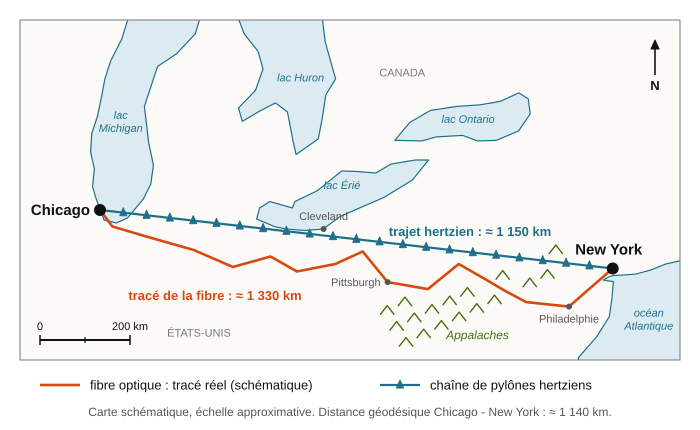
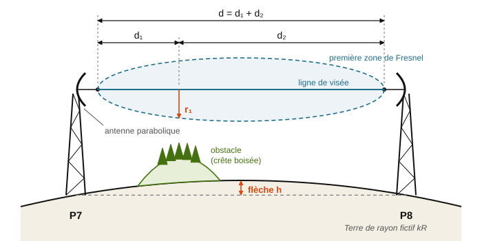
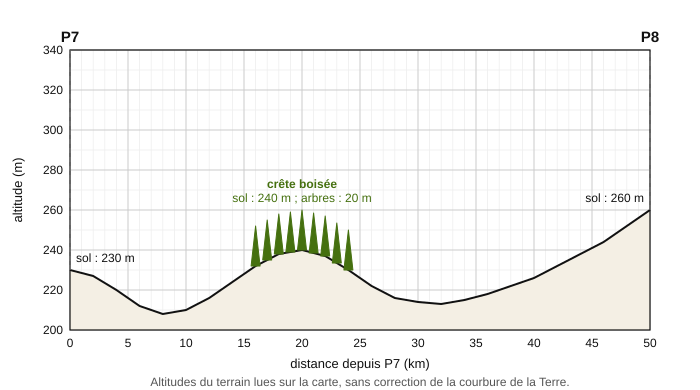
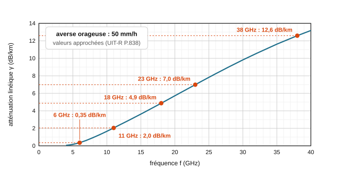
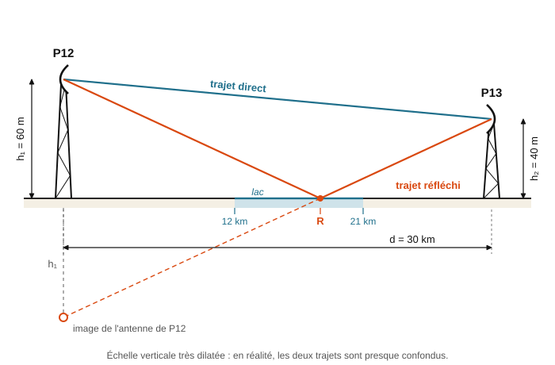
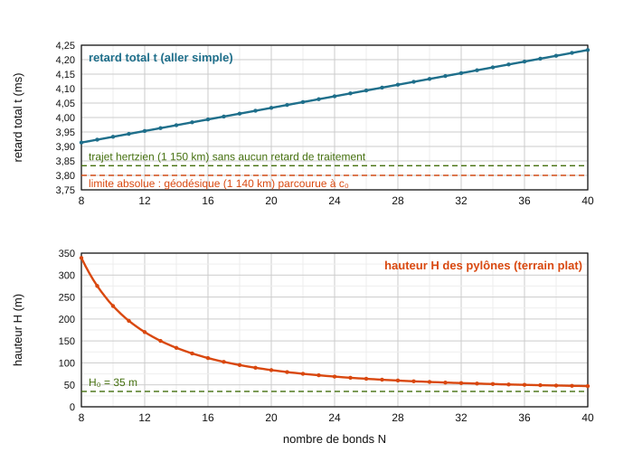

# Devoir maison : la course à la milliseconde

BTS CIEL 2 · Physique · Chapitre 3 : ondes et propagation

> Devoir à faire à la maison, à rendre à la date indiquée par le formateur · Calculatrice et tableur autorisés · Vous pouvez chercher à plusieurs, mais la rédaction doit être personnelle.
>
> Les quatre parties notées (A à D) sont **indépendantes** : chacune rappelle les données dont elle a besoin, et les résultats utiles des parties précédentes sont redonnés. À l'intérieur de chaque partie, les questions vont du plus simple au plus approfondi. La partie E, **facultative**, propose des questions d'ingénieur, guidées par des coups de pouce : elle rapporte des points de bonus (note plafonnée à 20).
>
> Les distances, les coûts et les caractéristiques des matériels sont des **ordres de grandeur réalistes**, arrondis pour les besoins du sujet. La société Kairos Links est fictive.

| Partie | Contenu | Points | Temps conseillé |
|---|---|---|---|
| A | Fibre ou ondes radio : qui arrive le premier ? (document en anglais) | 4 | 30 min |
| B | Bilan de liaison d'un bond hertzien (document en anglais) | 5 | 40 min |
| C | Dégager le faisceau : zone de Fresnel et courbure de la Terre | 6 | 45 min |
| D | Propagation réelle : pluie, débit et trajets multiples | 5 | 40 min |
| | **Total** | **20** | **2 h 35** |
| E | Pour aller plus loin : questions d'ingénieur (facultatif) | +4 (bonus) | 45 min |

## Rappel de formules

> Comme à l'épreuve du BTS, les formules sont **données** : inutile de les apprendre par cœur. Ce qui est évalué, c'est votre capacité à **choisir la bonne formule**, à **identifier chaque grandeur**, à **convertir les unités** avant le calcul et à **interpréter** le résultat. Les formules propres à chaque partie figurent dans ses documents.

| Notion | Formule |
|---|---|
| Durée de propagation | $t = \dfrac{d}{v}$ |
| Célérité dans un milieu d'indice $n$ | $v = \dfrac{c_0}{n}$ |
| Longueur d'onde | $\lambda = \dfrac{v}{f}$ |
| Déphasage dû à un retard $\Delta t$ | $\varphi_{(°)} = 360 \times \dfrac{\Delta t}{T}$, soit, pour une différence de trajet $\Delta$ : $\varphi_{(°)} = 360 \times \dfrac{\Delta}{\lambda}$ |
| Décibels | puissances : $10 \log_{10}\left(\dfrac{P_2}{P_1}\right)$ ; amplitudes : $20 \log_{10}\left(\dfrac{A_2}{A_1}\right)$ ; $P_{(dBm)} = 10 \log_{10}\left(\dfrac{P}{1\ \text{mW}}\right)$ |
| Bilan de liaison | $P_{r(dBm)} = P_{e(dBm)} + \sum \text{gains}_{(dB)} - \sum \text{pertes}_{(dB)}$ |
| PIRE (puissance isotrope rayonnée équivalente) | $PIRE_{(dBm)} = P_{e(dBm)} - \text{pertes}_{(dB)} + G_{(dBi)}$ |
| Marge d'une liaison | $M_{(dB)} = P_{r(dBm)} - S_{(dBm)}$, avec $S$ la sensibilité du récepteur |

*Données : $c_0 = 3{,}00 \times 10^8$ m/s ; rayon de la Terre $R = 6\,370$ km ; 1 ms $= 10^{-3}$ s ; 1 µs $= 10^{-6}$ s ; 1 octet $= 8$ bits.*

---

## Mise en situation

À Chicago s'échangent les contrats à terme sur les grands indices boursiers américains ; à New York, à plus de 1 100 km de là, s'échangent les actions qui composent ces indices. Les deux prix sont liés : quand l'un bouge, l'autre suit, avec le retard qu'il faut à l'information pour voyager d'une ville à l'autre. Une société de trading qui connaît le mouvement de Chicago avant ses concurrents peut acheter ou vendre à New York avant que les prix ne s'ajustent.

En 2010, une entreprise a creusé une tranchée presque rectiligne à travers les Appalaches pour y poser une fibre optique plus courte que toutes les autres. Deux ans plus tard, elle était déjà battue par des pylônes radio, une technologie des années 1950. C'est ce paradoxe que vous allez comprendre : comment une vieille technique hertzienne peut-elle battre la lumière qui circule dans une fibre ?

Vous êtes recruté(e) chez **Kairos Links**, une société qui construit sa propre chaîne de faisceaux hertziens entre Chicago et New York. Vous commencez comme technicien(ne) (parties A à D) et vous terminez avec les questions qu'un ingénieur se pose avant d'engager des millions d'euros (partie E).

## Partie A : Fibre ou ondes radio : qui arrive le premier ? (4 points)

**Document 1 : deux chemins entre Chicago et New York**

<em>Figure 1 : Carte schématique du tracé de la fibre optique et de la chaîne de pylônes hertziens entre Chicago et New York.</em>

| Trajet entre Chicago et New York | Longueur approximative |
|---|---|
| Distance géodésique (plus court chemin à la surface de la Terre) | 1 140 km |
| Tracé de la fibre optique la plus directe (posée en 2010) | 1 330 km |
| Trajet hertzien (chaîne de pylônes presque alignés) | 1 150 km |

**Document 2 : les milieux de propagation**

- Dans une fibre optique monomode, la lumière infrarouge ($\lambda_0 = 1\,550$ nm) se propage dans un cœur en silice d'indice $n_f = 1{,}47$.
- Les faisceaux hertziens se propagent dans l'air, d'indice $n_{air} = 1{,}000\,3$ au niveau du sol.
- Bandes de fréquences utilisées par les faisceaux hertziens du réseau : 6 GHz, 11 GHz et 18 GHz.

**Document 3 : « The race to the millisecond » (texte en anglais)**

> In 2010, a little-known company spent hundreds of millions of dollars to lay a new fibre-optic cable between Chicago and New York, cutting almost straight through the Appalachian Mountains. It shaved more than a millisecond off the round-trip time, down to about 13 ms, and trading firms rushed to rent it. Two years later, it was already beaten: chains of microwave towers, a technology from the 1950s, offered round trips just under 9 ms.
>
> Why such a race? Futures on US stock indices are traded in Chicago, while the shares themselves are traded in New York. When prices move in Chicago, New York prices follow a few milliseconds later. Whoever learns it first can buy or sell before everyone else. In this game, the second-fastest trader often earns nothing.
>
> *Vocabulaire : round trip : aller-retour ; to shave : rogner ; futures : contrats à terme ; shares : actions ; whoever : quiconque, celui qui.*

**A1.** Calculer la célérité $v_f$ de la lumière dans la fibre optique.

**A2.** Calculer la durée $t_f$ du trajet de Chicago à New York par la fibre, puis la durée d'un aller-retour. Comparer à la valeur annoncée par le document 3.

**A3.** Calculer la durée $t_h$ du trajet hertzien, d'abord en prenant la célérité $c_0$, puis en tenant compte de l'indice de l'air. Montrer que l'air ne modifie cette durée que d'environ une microseconde.

**A4.** a) Calculer le gain de temps de la liaison hertzienne sur la fibre, pour un aller simple puis pour un aller-retour.

b) Ce gain a deux causes : l'onde radio va plus vite dans l'air que la lumière dans la silice, et son trajet est plus court. Pour séparer les deux effets, calculer la durée qu'il faudrait à la lumière dans une fibre imaginaire qui suivrait exactement le trajet hertzien (1 150 km). En déduire la part du gain due au trajet plus court et la part due à la célérité plus grande. Laquelle domine ?

**A5.** Calculer la longueur d'onde dans l'air (on prendra $v = c_0$) pour chacune des trois bandes du document 2. Dans quel domaine du spectre électromagnétique ces ondes se situent-elles ?

**A6.** a) D'après le document 3, expliquer en français, en deux ou trois phrases, pourquoi quelques millisecondes valent autant d'argent.

b) Le document 3 annonce des allers-retours hertziens « just under 9 ms », alors que le calcul de la question A3 donne moins. Proposer deux raisons physiques ou techniques de cet écart.

## Partie B : Bilan de liaison d'un bond hertzien (5 points)

*Kairos Links étudie le bond n° 7 de son réseau, entre les pylônes P7 et P8, distants de $d = 50$ km. Pour limiter les pertes et la latence, chaque radio est installée en haut du pylône, juste derrière son antenne.*

**Document 4 : le bond hertzien et ses antennes**

<em>Figure 2 : Un bond hertzien : antennes paraboliques en vis-à-vis, ligne de visée, première zone de Fresnel et flèche due à la courbure de la Terre (échelle verticale très dilatée).</em>

- Antennes paraboliques de diamètre $D = 3{,}0$ m et de rendement $\eta = 0{,}55$. Gain (sans unité) : $G = \eta \left(\dfrac{\pi D}{\lambda}\right)^2$, soit en décibels : $G_{(dBi)} = 10 \log_{10}(G)$.
- Angle d'ouverture du faisceau (à −3 dB) : $\theta_{(°)} \approx 70 \times \dfrac{\lambda}{D}$.
- Une antenne dépointée d'un petit angle $\alpha$ (inférieur à $\theta$) perd environ $A_{p(dB)} \approx 12 \left(\dfrac{\alpha}{\theta}\right)^2$.
- Affaiblissement en espace libre (formule de Friis) : $FSL_{(dB)} = 32{,}45 + 20 \log_{10}(f_{MHz}) + 20 \log_{10}(d_{km})$, avec $f$ en MHz et $d$ en km.
- Pertes de raccordement entre chaque radio et son antenne : 1,0 dB, de chaque côté.
- Cahier des charges : marge d'au moins 40 dB par rapport à la sensibilité du récepteur, pour résister aux évanouissements du signal (voir partie D).

**Document 5 : extrait de la fiche technique de la radio (en anglais)**

| Parameter | 6 GHz band | 11 GHz band | 18 GHz band |
|---|---|---|---|
| Max. output power | +30 dBm | +27 dBm | +24 dBm |
| Channel bandwidth | 30 MHz | 40 MHz | 80 MHz |
| Rx sensitivity, QPSK | −88 dBm | −87 dBm | −84 dBm |
| Rx sensitivity, 16-QAM | −82 dBm | −81 dBm | −78 dBm |
| Rx sensitivity, 64-QAM | −76 dBm | −75 dBm | −72 dBm |
| Rx sensitivity, 256-QAM | −69 dBm | −68 dBm | −65 dBm |
| Throughput (QPSK / 16-QAM / 64-QAM / 256-QAM) | 45 / 90 / 135 / 180 Mbit/s | 60 / 120 / 180 / 240 Mbit/s | 120 / 240 / 360 / 480 Mbit/s |
| Processing latency (per hop) | 10 µs | 10 µs | 10 µs |

*Rx sensitivity: minimum received power for a bit error ratio of $10^{-6}$. The higher the modulation order (QPSK, then 16-QAM, 64-QAM and 256-QAM), the more bits each symbol carries: the throughput increases, but a stronger received signal is required.*

**B1.** Calculer la longueur d'onde à 6,0 GHz, puis le gain d'une antenne parabolique, sans unité puis en dBi.

**B2.** Calculer l'affaiblissement en espace libre du bond à 6,0 GHz. Vérifier qu'il vaut environ 142 dB.

**B3.** La radio de P7 émet à sa puissance maximale. Calculer la PIRE en dBm, puis en watts. Calculer la puissance $P_r$ reçue par la radio de P8.

**B4.** Calculer la marge pour chacune des quatre modulations. Quelle est la modulation la plus performante qui respecte le cahier des charges ? Quel débit permet-elle ?

**B5.** On envisage d'utiliser la bande des 18 GHz sur ce même bond, avec les mêmes paraboles de 3,0 m. Calculer le nouveau gain des antennes, le nouvel affaiblissement en espace libre et la nouvelle puissance reçue (la radio émettant à sa puissance maximale à 18 GHz). Comparer au résultat de B3. Ce résultat est-il surprenant ? L'expliquer en comparant comment évoluent l'affaiblissement en espace libre et le gain des deux antennes quand la fréquence est multipliée par 3.

**B6.** Par grand vent, le sommet d'un pylône peut se vriller de $\alpha = 0{,}3°$. Calculer l'angle d'ouverture $\theta$ des antennes à 6 GHz puis à 18 GHz, et la perte de pointage d'une antenne dans chaque cas. Pourquoi les pylônes des réseaux de trading sont-ils si massifs ?

## Partie C : Dégager le faisceau : zone de Fresnel et courbure de la Terre (6 points)

*Sur 50 km, la Terre n'est pas plate et les ondes ne voyagent pas sur un fil : il faut choisir la hauteur des pylônes P7 et P8 pour que le faisceau passe librement au-dessus du relief. On travaille à $f = 6{,}0$ GHz, soit $\lambda = 5{,}0$ cm.*

**Document 6 : zone de Fresnel et courbure apparente de la Terre**

- *Première zone de Fresnel.* L'énergie d'une onde ne voyage pas sur une ligne infiniment fine : l'essentiel de la puissance utile passe dans un volume en forme de cigare autour de la ligne de visée, la première zone de Fresnel (figure 2). En un point situé à $d_1$ de l'émetteur et à $d_2$ du récepteur ($d = d_1 + d_2$), son rayon vaut, toutes les longueurs étant en mètres :

$$r_1 = \sqrt{\dfrac{\lambda\, d_1\, d_2}{d}}$$

- *Règle de dégagement.* Le sommet de tout obstacle doit rester au moins à $0{,}6\, r_1$ sous la ligne de visée. Un obstacle qui entre davantage dans la zone de Fresnel affaiblit le signal par diffraction (document 8).
- *Flèche.* Entre deux points au niveau du sol distants de $d$, la Terre « bombe » : en un point situé à $d_1$ et $d_2$ des extrémités, le sol est surélevé, par rapport à la droite qui joint les extrémités, de la flèche :

$$h = \dfrac{d_1\, d_2}{2\, k\, R} \qquad \text{soit, au milieu du bond :} \qquad h = \dfrac{d^2}{8\, k\, R}$$

- *Facteur $k$.* L'indice de l'air diminue légèrement avec l'altitude, car l'air est moins dense et moins humide en hauteur. Or une onde qui traverse un milieu d'indice variable est déviée vers les zones d'indice le plus élevé : le faisceau se courbe donc légèrement vers le sol et « suit » en partie la courbure de la Terre. On en tient compte en traçant le faisceau en ligne droite au-dessus d'une Terre fictive, plus plate, de rayon $kR$. Sans atmosphère, $k = 1$ ; en atmosphère standard, $k = 4/3$. Dans certaines conditions météorologiques (souvent au petit matin, quand l'humidité augmente avec l'altitude), $k$ peut descendre jusqu'à $2/3$ : le faisceau se courbe alors vers le haut.
- *Méthode.* Sur un profil de terrain tracé sans courbure (figure 3), on tient compte de la courbure en **ajoutant la flèche** à l'altitude de chaque obstacle, puis on trace la ligne de visée comme une droite entre les deux antennes.

**Document 7 : profil du bond P7 - P8**

<em>Figure 3 : Profil du terrain entre P7 et P8 (altitudes lues sur la carte, sans correction de la courbure de la Terre).</em>

**Document 8 : perte par diffraction sur un obstacle (modèle simplifié)**

| Sommet de l'obstacle par rapport à la ligne de visée | au moins $0{,}6\, r_1$ sous la ligne | sur la ligne | $0{,}5\, r_1$ au-dessus | $r_1$ au-dessus | $1{,}5\, r_1$ au-dessus |
|---|---|---|---|---|---|
| Perte supplémentaire | ≈ 0 dB | ≈ 6 dB | ≈ 12 dB | ≈ 16 dB | ≈ 20 dB |

**C1.** Calculer le rayon $r_1$ de la première zone de Fresnel au milieu du bond, à 6,0 GHz puis à 18 GHz. Pourquoi un faisceau de plus basse fréquence demande-t-il plus de place autour de la ligne de visée ?

**C2.** a) Calculer la flèche au milieu du bond en l'absence d'atmosphère ($k = 1$).

b) Expliquer avec vos mots, à l'aide du document 6, pourquoi l'atmosphère standard « aplatit » la Terre pour les ondes radio. Calculer la flèche au milieu du bond avec $k = 4/3$. Quel est l'intérêt pour l'installateur ?

**C3.** a) Relever sur la figure 3 l'altitude du sol au pied de P7, au pied de P8 et au sommet de la crête, ainsi que la position de la crête. En déduire l'altitude de la cime des arbres sur la crête.

b) Au niveau de la crête, calculer la flèche ($k = 4/3$), le rayon $r_1$ et la distance $0{,}6\, r_1$.

c) En déduire l'altitude minimale que doit avoir la ligne de visée au-dessus de la crête.

**C4.** Les antennes de P7 et de P8 sont placées à la même hauteur $h$ au-dessus du sol. La ligne de visée est la droite qui joint les deux antennes. Exprimer son altitude à 20 km de P7 en fonction de $h$, puis calculer la hauteur minimale $h$ des antennes.

**C5.** Un matin, le facteur $k$ descend à $2/3$. Les antennes sont à la hauteur trouvée en C4.

a) Calculer la nouvelle flèche au niveau de la crête.

b) De combien la cime « corrigée » des arbres dépasse-t-elle maintenant la ligne de visée ? Exprimer ce dépassement en fraction de $r_1$.

c) Estimer la perte par diffraction à l'aide du document 8. Sachant que la marge de ce bond en ciel clair est d'environ 48 dB (partie B), la liaison est-elle coupée ? Quel risque prend-on ce matin-là ?

## Partie D : Propagation réelle : pluie, débit et trajets multiples (5 points)

*Une liaison bien dégagée peut encore être perturbée par la météo et par les réflexions. Résultats utiles des parties précédentes : niveaux reçus en ciel clair sur le bond P7 - P8 de 50 km, à puissance maximale et avec des paraboles de 3,0 m : $-28{,}2$ dBm à 6 GHz ; $-25{,}9$ dBm à 11 GHz ; $-24{,}6$ dBm à 18 GHz. Sensibilités et débits : document 5 (partie B).*

**Document 9 : atténuation par la pluie**

Les gouttes de pluie absorbent et diffusent les micro-ondes, d'autant plus que la longueur d'onde se rapproche de la taille des gouttes (quelques millimètres). Le tableau et la figure 4 donnent l'atténuation linéique $\gamma$ pour une averse orageuse de 50 mm/h.

| Fréquence | 6 GHz | 11 GHz | 18 GHz | 23 GHz | 38 GHz |
|---|---|---|---|---|---|
| $\gamma$ (dB/km) | 0,35 | 2,0 | 4,9 | 7,0 | 12,6 |

<em>Figure 4 : Atténuation linéique due à une pluie de 50 mm/h en fonction de la fréquence.</em>

Une cellule orageuse n'occupe qu'une partie d'un bond de 50 km : on admet que l'atténuation totale due à l'averse vaut $A_{pluie} = \gamma \times L_{eff}$, avec une longueur efficace $L_{eff} = 15$ km.

**D1.** Calculer l'atténuation due à l'averse sur le bond P7 - P8 à 6 GHz, à 11 GHz et à 18 GHz.

**D2.** Pour chaque bande, calculer la puissance reçue pendant l'averse. La liaison est-elle maintenue ? Si oui, avec quelle modulation au mieux et quel débit ?

**D3.** Un message de cotation boursière occupe environ 100 octets.

a) Calculer la durée d'émission de ce message à 180 Mbit/s (6 GHz en 256-QAM), puis à 480 Mbit/s (18 GHz en 256-QAM).

b) Comparer ces durées à la durée de propagation sur un bond de 50 km.

c) En vous appuyant sur les parties B et D, expliquer pourquoi les réseaux de trading utilisent surtout la bande des 6 GHz, malgré son débit plus faible et ses grandes antennes. Formuler le compromis entre fréquence, débit et fiabilité.

**Document 10 : réflexion sur un lac (bond P12 - P13)**

<em>Figure 5 : Trajet direct et trajet réfléchi sur le lac. L'antenne image est le symétrique de l'antenne de P12 par rapport à la surface de l'eau.</em>

- Bond P12 - P13 : $d = 30$ km, $f = 6{,}0$ GHz ($\lambda = 5{,}0$ cm). Un lac de barrage s'étend entre 12 km et 21 km de P12.
- Hauteurs des antennes au-dessus du niveau de l'eau, déjà corrigées de la courbure de la Terre : $h_1 = 60$ m pour P12 et $h_2 = 40$ m pour P13.
- Par temps calme, l'eau se comporte comme un miroir : l'antenne de P13 reçoit l'onde directe et une onde réfléchie.
- Différence de longueur entre le trajet réfléchi et le trajet direct : $\Delta \approx \dfrac{2\, h_1\, h_2}{d}$.
- À incidence rasante, la réflexion sur l'eau inverse l'onde (déphasage supplémentaire de 180°) et conserve environ 90 % de son amplitude.
- Deux ondes de même fréquence qui se superposent interfèrent : leurs amplitudes s'ajoutent si elles arrivent en phase (déphasage total multiple de 360°) ; elles se retranchent si elles arrivent en opposition de phase (déphasage total égal à 180° plus un multiple de 360°).

**D4.** a) À l'aide de l'antenne image de la figure 5 et de triangles semblables, montrer que le point de réflexion R se trouve à la distance $d_R = d \times \dfrac{h_1}{h_1 + h_2}$ de P12. Calculer $d_R$. La réflexion a-t-elle lieu sur le lac ?

b) Calculer la différence de trajet $\Delta$, le rapport $\Delta / \lambda$, puis le retard de l'onde réfléchie sur l'onde directe.

**D5.** Au petit matin, la courbure des rayons change : tout se passe comme si la hauteur effective $h_2$ passait à 37,5 m. Calculer la nouvelle différence de trajet, puis le déphasage total entre l'onde réfléchie et l'onde directe. Montrer que les deux ondes arrivent en opposition de phase. Calculer, en dB, l'affaiblissement du signal reçu dû à cette interférence : c'est un **évanouissement**.

**D6.** Pour se protéger des évanouissements, on installe sur P13 une seconde antenne, placée à la hauteur $h_2 + \delta h$ ; le récepteur utilise à chaque instant la meilleure des deux antennes (diversité d'espace).

a) De combien la différence de trajet doit-elle varier pour que la seconde antenne reçoive les deux ondes en phase quand la première les reçoit en opposition de phase ?

b) En déduire l'écart de hauteur $\delta h$ entre les deux antennes.

c) Pourquoi ne suffit-il pas de déplacer l'unique antenne à la « bonne » hauteur ?

## Partie E : Pour aller plus loin : questions d'ingénieur (bonus, +4 points)

*Partie facultative, à aborder une fois les parties A à D terminées. Les questions sont guidées : servez-vous des coups de pouce, et convertissez toutes les longueurs en mètres.*

Un ingénieur ne se demande plus seulement « la liaison fonctionne-t-elle ? », mais « quel est le meilleur réseau possible, et à quel prix ? ». Combien de pylônes faut-il construire ? Plus il y a de bonds, plus il y a de radios qui retardent le signal ; moins il y en a, plus les bonds sont longs et plus les pylônes doivent être hauts. Il existe donc un compromis : à vous de le trouver.

**Document 11 : modèle simplifié du réseau Kairos Links**

- Le trajet hertzien, de longueur $L = 1\,150$ km, est découpé en $N$ bonds de même longueur $d = \dfrac{L}{N}$.
- Chaque bond ajoute un retard de traitement $\tau = 10$ µs (démodulation puis remodulation par les radios, document 5).
- Le terrain est supposé plat. Pour dégager un bond de longueur $d$, les pylônes doivent dépasser la flèche au milieu du bond ($k = 4/3$) d'une hauteur $H_0 = 35$ m (cime des arbres et 60 % de la zone de Fresnel) : $H = \dfrac{d^2}{8kR} + H_0$.
- Coût d'un pylône équipé de hauteur $H$ : $C_s + a \times H$, avec $C_s = 150$ k€ (terrain, abri, énergie, radios) et $a = 4$ k€ par mètre de pylône. On compte un pylône par bond, le premier site existant déjà. Les montants sont convertis en euros.
- La société estime qu'une microseconde gagnée sur l'aller simple vaut $V = 25$ k€ (gains de trading cumulés sur la durée de vie du réseau).

<em>Figure 6 : Retard total d'un aller simple (en haut) et hauteur des pylônes (en bas) en fonction du nombre de bonds N, d'après le modèle du document 11.</em>

**E1. Le retard.** a) Montrer que le retard total d'un aller simple s'écrit $t(N) = \dfrac{L}{c_0} + N\tau$. Calculer $t$ pour $N = 12$ et pour $N = 20$, et vérifier sur la figure 6.

b) Quelle distance la lumière parcourt-elle dans le vide pendant la durée $\tau$ ? Compléter la phrase : « pour la latence, un répéteur coûte autant qu'un détour de … km ».

c) Si l'on ne regardait que le retard, quel nombre de bonds choisirait-on ? Pourquoi est-ce impossible ?

> **Coup de pouce.** Le retard total est la somme de la durée de propagation sur tout le trajet et des retards de traitement de tous les bonds.

**E2. La hauteur.** a) Montrer que $H(N) = \dfrac{L^2}{8kR} \times \dfrac{1}{N^2} + H_0$ et calculer le coefficient $\dfrac{L^2}{8kR}$ en mètres.

b) Calculer $H$ pour $N = 12$, $N = 20$ et $N = 1$. Commenter la dernière valeur.

> **Coup de pouce.** Remplacez $d$ par $\dfrac{L}{N}$ dans l'expression de $H$. Attention : $L$ et $R$ doivent être en mètres.

**E3. L'optimum.** a) Montrer que le coût de construction du réseau s'écrit $C(N) = A \times N + \dfrac{B}{N}$, avec $A = C_s + a H_0$ et $B = a \times \dfrac{L^2}{8kR}$. Calculer $A$ et $B$ en k€.

b) Trouver le nombre de bonds $N$ qui rend ce coût minimal. Donner la hauteur des pylônes, le coût du réseau et le retard total correspondants.

c) La société veut maintenant tenir compte de la valeur du temps : elle cherche à minimiser $C'(N) = C(N) + V \times N\tau$ (avec $\tau$ en µs). Montrer que cela revient à remplacer $A$ par $A' = A + V\tau$, puis trouver le nouvel optimum. Combien de microsecondes gagne-t-on par rapport à b) ? Combien coûte le surplus de construction, et combien vaut le gain de temps ? Conclure : quel type de pylônes les sociétés de trading ont-elles intérêt à rechercher ?

> **Coups de pouce.**
> - Dans $C(N) = N \times (C_s + a H)$, remplacez $H$ par son expression de E2, puis développez.
> - La dérivée de $A N + \dfrac{B}{N}$ par rapport à $N$ vaut $A - \dfrac{B}{N^2}$ : elle s'annule pour $N^* = \sqrt{\dfrac{B}{A}}$. À l'optimum, les deux termes $A N$ et $\dfrac{B}{N}$ sont égaux.
> - $N$ doit être entier : comparez le coût pour les deux entiers qui encadrent $N^*$.
> - Sans dérivée, un tableau de valeurs de $C(N)$ pour $N = 10$, 12, 14, 16, 18 et 20 (à la calculatrice ou au tableur) suffit.

**E4. La limite ultime.** Aucune information ne peut aller plus vite que la lumière dans le vide, ni emprunter un chemin plus court que la géodésique. Calculer la durée minimale absolue d'un aller simple entre Chicago et New York. Calculer l'écart entre cette limite et le retard total du réseau optimal de la question E3 c), puis décomposer cet écart en deux contributions. Sur quoi les ingénieurs doivent-ils travailler en priorité ?

> **Coup de pouce.** Le trajet hertzien fait 10 km de plus que la géodésique, et chaque bond ajoute $\tau$.

**E5. Ouverture : plus haut, plus loin.** a) Des constellations de satellites en orbite basse (altitude $h = 550$ km), reliés entre eux par laser, sont étudiées pour le trading intercontinental. Modèle simple : la durée du trajet par satellite vaut $t_{sat} \approx \dfrac{D + 2h}{c_0}$ (montée, trajet en altitude, descente), contre $t_{fibre} = \dfrac{n_f D}{c_0}$ pour une fibre idéale en ligne droite de longueur $D$. Montrer que le satellite est plus rapide dès que $D > \dfrac{2h}{n_f - 1}$, et calculer cette distance. Le satellite est-il intéressant entre Chicago et New York ? Entre Londres et New York ($D \approx 5\,570$ km) ?

b) Sur Terre, des liaisons laser en espace libre (infrarouge, $\lambda \approx 1{,}55$ µm) sont aussi étudiées. Citer deux avantages d'une onde de fréquence aussi élevée. Sachant qu'un brouillard dense atténue un faisceau infrarouge de plusieurs dizaines à plusieurs centaines de dB/km, alors qu'il est sans effet notable à 6 GHz, expliquer pourquoi ces liaisons laser ne remplacent pas les faisceaux hertziens, mais les complètent.

> **Coup de pouce.** Calculez la fréquence d'une onde de longueur d'onde 1,55 µm et comparez-la à 6 GHz : que devient le débit possible ? Et l'ouverture du faisceau, $\theta \approx 70 \times \dfrac{\lambda}{D}$, pour une optique de quelques centimètres ?

## Sources

- C. Steiner, « Wall Street's Speed War », Forbes, 9 septembre 2010. <https://www.forbes.com/forbes/2010/0927/outfront-netscape-jim-barksdale-daniel-spivey-wall-street-speed-war.html>
- D. Schneider, « Wall Street Tries Shortwave Radio to Make High-Frequency Trades Across the Atlantic », IEEE Spectrum, 1er juin 2018. <https://spectrum.ieee.org/wall-street-tries-shortwave-radio-to-make-highfrequency-trades-across-the-atlantic>
- G. Laughlin, A. Aguirre et J. Grundfest, « Information Transmission Between Financial Markets in Chicago and New York », arXiv:1302.5966, février 2013 (publié dans The Financial Review en 2014). <https://arxiv.org/pdf/1302.5966>
- D. Olds, « Microwaves thrash fibre on speed... if you like two-nines uptime », The Register, 27 février 2013. <https://www.theregister.com/2013/02/27/microwave_versus_fibre/>
- D. Bhattacherjee et al., « cISP: A Speed-of-Light Internet Service Provider », USENIX NSDI '22, avril 2022. <https://www.usenix.org/conference/nsdi22/presentation/bhattacherjee>
- UIT-R, « Recommandation P.838-3 : Specific attenuation model for rain for use in prediction methods », mars 2005 (valeurs du document 9 calculées avec ce modèle, polarisation horizontale). <https://www.itu.int/dms_pubrec/itu-r/rec/p/R-REC-P.838-3-200503-I!!PDF-E.pdf>
- A. U. Chaudhry et H. Yanikomeroglu, « Optical Wireless Satellite Networks versus Optical Fiber Terrestrial Networks: The Latency Perspective », 30th Biennial Symposium on Communications, 2021, arXiv:2106.07737. <https://arxiv.org/abs/2106.07737>
- UIT-R, « Recommandation P.1814-1 : Prediction methods required for the design of terrestrial free-space optical links », septembre 2025. <https://www.itu.int/dms_pubrec/itu-r/rec/p/R-REC-P.1814-1-202509-I!!PDF-E.pdf>

Document 3 : texte rédigé pour le sujet d'après Steiner (Forbes, 2010), Schneider (IEEE Spectrum, 2018) et Laughlin, Aguirre et Grundfest (2013).
