# BTS CIEL : Physique

## Recueil de cours

## Table des matières

- [BTS CIEL : Physique](#bts-ciel--physique)
  - [Recueil de cours](#recueil-de-cours)
  - [Table des matières](#table-des-matières)
  - [0. Aide-mémoire : unités et équivalences](#0-aide-mémoire--unités-et-équivalences)
    - [Préfixes multiplicateurs (à connaître par cœur)](#préfixes-multiplicateurs-à-connaître-par-cœur)
    - [Grandeurs, symboles et unités SI utilisées dans ce dossier](#grandeurs-symboles-et-unités-si-utilisées-dans-ce-dossier)
    - [Conversions rapides fréquemment nécessaires](#conversions-rapides-fréquemment-nécessaires)
  - [Chapitre 1 : Électricité et optoélectronique](#chapitre-1--électricité-et-optoélectronique)
    - [1.1 Bases de l'électricité](#11-bases-de-lélectricité)
    - [1.2 Circuits linéaires en régime sinusoïdal (systèmes linéaires)](#12-circuits-linéaires-en-régime-sinusoïdal-systèmes-linéaires)
    - [1.3 Puissances, décibels, atténuation et gains](#13-puissances-décibels-atténuation-et-gains)
    - [1.4 Semi-conducteurs : la jonction PN et la diode](#14-semi-conducteurs--la-jonction-pn-et-la-diode)
    - [1.5 Bandes d'énergie et photons](#15-bandes-dénergie-et-photons)
      - [Les photons et l'échange d'énergie avec la matière](#les-photons-et-léchange-dénergie-avec-la-matière)
    - [1.6 La diode électroluminescente (DEL/LED)](#16-la-diode-électroluminescente-delled)
    - [1.7 La diode laser](#17-la-diode-laser)
    - [1.8 La photodiode](#18-la-photodiode)
    - [1.9 Le capteur CCD (Charge-Coupled Device)](#19-le-capteur-ccd-charge-coupled-device)
    - [Erreurs fréquentes des étudiants](#erreurs-fréquentes-des-étudiants)
  - [Chapitre 2 : Mesures et incertitudes](#chapitre-2--mesures-et-incertitudes)
    - [2.1 Notions fondamentales et incertitudes de mesure](#21-notions-fondamentales-et-incertitudes-de-mesure)
    - [2.2 Le bruit : une source d'incertitude sur tout signal mesuré](#22-le-bruit--une-source-dincertitude-sur-tout-signal-mesuré)
  - [Chapitre 3 : Ondes et propagation](#chapitre-3--ondes-et-propagation)
    - [3.1 Ondes mécaniques progressives](#31-ondes-mécaniques-progressives)
    - [3.2 Ondes progressives sinusoïdales](#32-ondes-progressives-sinusoïdales)
    - [3.3 Lecture d'une onde à l'oscilloscope et déphasage](#33-lecture-dune-onde-à-loscilloscope-et-déphasage)
    - [3.4 Ondes sonores et effet Doppler](#34-ondes-sonores-et-effet-doppler)
    - [3.5 Ondes électromagnétiques : propriétés](#35-ondes-électromagnétiques--propriétés)
    - [3.6 Classification du spectre électromagnétique](#36-classification-du-spectre-électromagnétique)
    - [3.7 Polarisation d'une onde électromagnétique](#37-polarisation-dune-onde-électromagnétique)
      - [Mise en équation de la polarisation](#mise-en-équation-de-la-polarisation)
      - [Recevoir une onde polarisée : loi de Malus et pertes de polarisation](#recevoir-une-onde-polarisée--loi-de-malus-et-pertes-de-polarisation)
      - [Conséquences et applications de la polarisation](#conséquences-et-applications-de-la-polarisation)
    - [3.8 Antennes, réflexion et réfraction en espace libre](#38-antennes-réflexion-et-réfraction-en-espace-libre)
      - [L'antenne quart d'onde : pourquoi la longueur d'une antenne dépend de λ](#lantenne-quart-donde--pourquoi-la-longueur-dune-antenne-dépend-de-λ)
    - [3.9 Liaison hertzienne](#39-liaison-hertzienne)
      - [LoRa et LoRaWAN : un réseau radio longue portée pour l'IoT](#lora-et-lorawan--un-réseau-radio-longue-portée-pour-liot)
    - [3.10 Modélisation d'une ligne de transmission](#310-modélisation-dune-ligne-de-transmission)
    - [3.11 Propagation impulsionnelle et réflexions](#311-propagation-impulsionnelle-et-réflexions)
      - [Coefficient de vélocité, célérité et retard dans un câble](#coefficient-de-vélocité-célérité-et-retard-dans-un-câble)
      - [Le réflectomètre (TDR) : localiser un défaut par son écho](#le-réflectomètre-tdr--localiser-un-défaut-par-son-écho)
      - [Lire un écho : signe et amplitude selon la charge](#lire-un-écho--signe-et-amplitude-selon-la-charge)
    - [3.12 Taux d'ondes stationnaires (TOS) et atténuation linéique](#312-taux-dondes-stationnaires-tos-et-atténuation-linéique)
      - [D'où vient le TOS : ondes incidente, réfléchie et stationnaire](#doù-vient-le-tos--ondes-incidente-réfléchie-et-stationnaire)
      - [Interpréter un TOS : valeurs repères et puissance réfléchie](#interpréter-un-tos--valeurs-repères-et-puissance-réfléchie)
      - [Atténuation linéique : mesurer, calculer, convertir](#atténuation-linéique--mesurer-calculer-convertir)
      - [Exemple résolu complet : diagnostic du câble d'une antenne](#exemple-résolu-complet--diagnostic-du-câble-dune-antenne)
    - [Erreurs fréquentes des étudiants](#erreurs-fréquentes-des-étudiants-1)
  - [Chapitre 4 : Systèmes bouclés et asservissement](#chapitre-4--systèmes-bouclés-et-asservissement)
    - [4.1 Boucle ouverte, boucle fermée : vocabulaire et principes](#41-boucle-ouverte-boucle-fermée--vocabulaire-et-principes)
    - [4.2 Modélisation d'un système linéaire](#42-modélisation-dun-système-linéaire)
    - [4.3 Les systèmes du premier ordre](#43-les-systèmes-du-premier-ordre)
    - [4.4 Les systèmes du second ordre](#44-les-systèmes-du-second-ordre)
    - [4.5 De l'équation différentielle à la transmittance (fonction de transfert)](#45-de-léquation-différentielle-à-la-transmittance-fonction-de-transfert)
    - [4.6 Réponse temporelle : la réponse à un échelon](#46-réponse-temporelle--la-réponse-à-un-échelon)
    - [4.7 Identifier la nature d'un système à partir de sa réponse à un échelon](#47-identifier-la-nature-dun-système-à-partir-de-sa-réponse-à-un-échelon)
    - [Erreurs fréquentes des étudiants](#erreurs-fréquentes-des-étudiants-2)
  - [Chapitre 5 : Traitement du signal](#chapitre-5--traitement-du-signal)
    - [5.1 Analyse temporelle des signaux](#51-analyse-temporelle-des-signaux)
    - [5.2 Analyse fréquentielle des signaux](#52-analyse-fréquentielle-des-signaux)
    - [5.3 Réponse fréquentielle : transmittance et diagramme de Bode](#53-réponse-fréquentielle--transmittance-et-diagramme-de-bode)
    - [5.4 Amplification](#54-amplification)
    - [5.5 Filtrage analogique](#55-filtrage-analogique)
    - [5.6 Numérisation des signaux analogiques et restitution](#56-numérisation-des-signaux-analogiques-et-restitution)
    - [Erreurs fréquentes des étudiants](#erreurs-fréquentes-des-étudiants-3)
  - [Chapitre 6 : Optique](#chapitre-6--optique)
    - [6.1 Indice de réfraction et propagation de la lumière](#61-indice-de-réfraction-et-propagation-de-la-lumière)
    - [6.2 Réflexion, réfraction et réflexion totale](#62-réflexion-réfraction-et-réflexion-totale)
    - [6.3 La fibre optique : structure et principe](#63-la-fibre-optique--structure-et-principe)
      - [Choisir une fibre : critères et conséquences](#choisir-une-fibre--critères-et-conséquences)
    - [6.4 Dispersion, bande passante et atténuation d'une fibre optique](#64-dispersion-bande-passante-et-atténuation-dune-fibre-optique)
    - [6.5 Le spectre optique : infrarouge, visible, ultraviolet](#65-le-spectre-optique--infrarouge-visible-ultraviolet)
    - [Erreurs fréquentes des étudiants](#erreurs-fréquentes-des-étudiants-4)
  - [Chapitre 7 : Préparation à l'épreuve](#chapitre-7--préparation-à-lépreuve)
  - [Bibliographie et ressources pour aller plus loin](#bibliographie-et-ressources-pour-aller-plus-loin)
    - [Références techniques par thème](#références-techniques-par-thème)
    - [Pour la culture scientifique et donner du sens (à recommander aux étudiants curieux)](#pour-la-culture-scientifique-et-donner-du-sens-à-recommander-aux-étudiants-curieux)
    - [Ressources numériques et normatives (gratuites)](#ressources-numériques-et-normatives-gratuites)
  - [Glossaire des formules](#glossaire-des-formules)
  - [Glossaire du vocabulaire technique](#glossaire-du-vocabulaire-technique)

---

## 0. Aide-mémoire : unités et équivalences

À distribuer ou projeter en permanence pendant la séance : beaucoup d'erreurs de calcul viennent d'une conversion d'unité oubliée (mA ↔ A, kΩ ↔ Ω, ms ↔ s…).

### Préfixes multiplicateurs (à connaître par cœur)

| Préfixe | Symbole | Facteur | Exemple d'usage |
|---|---|---|---|
| giga | G | ×10⁹ | GHz (fréquence radio) |
| méga | M | ×10⁶ | MΩ, MHz |
| kilo | k | ×10³ | kΩ, kHz |
| : | (unité) | ×10⁰ | V, A, Ω, s, Hz |
| déci | d | ×10⁻¹ | dB (échelle log, à part) |
| centi | c | ×10⁻² | cm |
| milli | m | ×10⁻³ | mV, mA, ms |
| micro | µ | ×10⁻⁶ | µV, µA, µF |
| nano | n | ×10⁻⁹ | ns, nF |
| pico | p | ×10⁻¹² | pF |

### Grandeurs, symboles et unités SI utilisées dans ce dossier

| Grandeur | Symbole | Unité SI | Symbole unité | Équivalences usuelles |
|---|---|---|---|---|
| Tension électrique | U, V | volt | V | 1 kV = 10³ V ; 1 mV = 10⁻³ V |
| Intensité du courant | I | ampère | A | 1 mA = 10⁻³ A ; 1 µA = 10⁻⁶ A |
| Résistance électrique | R | ohm | Ω | 1 kΩ = 10³ Ω ; 1 MΩ = 10⁶ Ω |
| Puissance | P | watt | W | 1 mW = 10⁻³ W ; 1 kW = 10³ W |
| Énergie | E, W | joule | J | 1 kWh = 3,6.10⁶ J |
| Temps, période | t, T | seconde | s | 1 ms = 10⁻³ s ; 1 µs = 10⁻⁶ s ; 1 ns = 10⁻⁹ s |
| Fréquence | f | hertz | Hz | 1 kHz = 10³ Hz ; 1 MHz = 10⁶ Hz ; 1 GHz = 10⁹ Hz |
| Longueur, longueur d'onde | l, λ | mètre | m | 1 cm = 10⁻² m ; 1 mm = 10⁻³ m |
| Vitesse, célérité | v, c | mètre par seconde | m/s | 1 km/h ≈ 0,278 m/s |
| Capacité électrique | C | farad | F | 1 µF = 10⁻⁶ F ; 1 nF = 10⁻⁹ F ; 1 pF = 10⁻¹² F |
| Charge électrique | Q | coulomb | C | : |
| Angle, déphasage | φ, θ | radian | rad | 2π rad = 360° ; 1 rad ≈ 57,3° |
| Température | θ, T | degré Celsius / kelvin | °C / K | T(K) = θ(°C) + 273,15 |
| Rapport de puissance (atténuation, gain) | A, G | décibel (sans dimension) | dB | A(dB) = 10·log₁₀(P_s/P_e) |

### Conversions rapides fréquemment nécessaires

| Conversion | Méthode | Exemple |
|---|---|---|
| mA → A | ÷ 1000 | 25 mA = 0,025 A |
| kΩ → Ω | × 1000 | 4,7 kΩ = 4700 Ω |
| ms → s | ÷ 1000 | 0,5 ms = 0,0005 s |
| kHz → Hz | × 1000 | 100 kHz = 100 000 Hz |
| nF → F | ÷ 10⁹ | 100 nF = 100.10⁻⁹ F |
| Fréquence ↔ période | f = 1/T ; T = 1/f | 1 kHz ↔ 1 ms |
| Puissance ↔ dB | A(dB) = 10·log₁₀(P₂/P₁) | ratio 2 ↔ ≈ 3 dB ; ratio 10 ↔ 10 dB |

---

## Chapitre 1 : Électricité et optoélectronique

### 1.1 Bases de l'électricité `BTS1` `BTS2`

**Le circuit électrique**

Un circuit électrique est une **boucle fermée** de dipôles reliés par des fils. Le générateur (pile, alimentation) fournit l'énergie ; les récepteurs (résistance, lampe, moteur, LED) la consomment.

- Le **courant électrique** est un déplacement d'ensemble de charges électriques (des électrons dans les métaux). Par convention, on l'oriente du **+ vers le −** à l'extérieur du générateur. Les électrons, eux, circulent en sens inverse : c'est un choix historique, qui ne change rien aux calculs.
- La **tension** est ce qui met les charges en mouvement. Elle existe **entre deux points** : parler de « la tension en un point » n'a pas de sens, sauf si l'on sous-entend « par rapport à la masse ».
- **Pas de boucle fermée, pas de courant** : si un interrupteur est ouvert ou un fil débranché, I = 0 dans toute la boucle, même si le générateur est branché et qu'une tension existe à ses bornes.

L'**analogie hydraulique** aide à fixer les idées :

| Électricité | Circuit d'eau |
|---|---|
| Générateur | Pompe |
| Tension U | Différence de pression entre deux points |
| Courant I | Débit d'eau |
| Résistance R | Tuyau étroit qui freine l'écoulement |
| Interrupteur | Vanne |

L'analogie a ses limites : le courant ne « s'use » pas en traversant un récepteur. Il est le même avant et après une résistance en série ; c'est l'énergie qui est consommée.

**Grandeurs et conventions**

- Tension U (volt, V) : différence de potentiel entre deux points, toujours mesurée entre deux bornes (en parallèle sur le dipôle). Symbole du voltmètre : 
- Intensité I (ampère, A) : débit de charges électriques, mesurée en série dans le circuit. Symbole de l'ampèremètre : 
- Résistance R (ohm, Ω) : caractérise l'opposition d'un dipôle au passage du courant. Symbole (norme IEC) : 
- **Convention récepteur** (celle utilisée pour une résistance, une lampe, un moteur en fonctionnement normal) : U et I sont fléchés en sens opposés sur le dipôle. C'est la convention à utiliser presque systématiquement en TP sur des composants passifs.
- **Convention générateur** (pile, alimentation) : U et I sont fléchés dans le même sens. Symbole d'un générateur de tension continue :

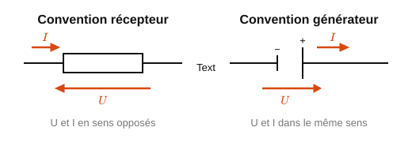

<em>Figure 1 : Convention récepteur vs convention générateur.</em>

**Mesurer avec un multimètre**

Le multimètre regroupe trois appareils. La borne **COM** est toujours utilisée ; on choisit la seconde borne selon la grandeur mesurée.

| Appareil | Bornes | Branchement | Précaution |
|---|---|---|---|
| Voltmètre | V et COM | **En parallèle** sur le dipôle | Le circuit doit être alimenté |
| Ampèremètre | mA (ou A) et COM | **En série** : on ouvre le circuit pour insérer l'appareil | Ne jamais le brancher en parallèle |
| Ohmmètre | Ω et COM | Aux bornes du composant | Composant **hors circuit**, alimentation coupée |

Méthode de mesure :

1. Choisir le mode **DC** (continu, symbole ⎓) ou **AC** (alternatif, symbole ~).
2. Commencer par le **plus grand calibre**, puis descendre tant que la valeur ne dépasse pas le calibre : on gagne des chiffres significatifs.
3. Lire la valeur avec son unité, en tenant compte du calibre (mV ou V, mA ou A).

Une **valeur négative** n'est pas une erreur : l'appareil est simplement branché à l'envers par rapport au sens choisi pour la grandeur. Il suffit d'inverser les fils ou de garder le signe dans les calculs.

**Sécurité :** un ampèremètre a une résistance interne presque nulle. Branché en parallèle, il court-circuite le dipôle : un courant très fort le traverse et son fusible interne fond.

> → **Application concrète :** dans une baie réseau, le technicien vérifie au multimètre la tension d'alimentation d'un switch PoE (48 V DC) avant de suspecter une panne logicielle.

**Loi d'Ohm**

Pour un conducteur ohmique (résistance) :

$$U = R \times I \tag{1}$$

*Exemple résolu :* une résistance R = 470 Ω est parcourue par I = 12 mA.
U = 470 × 0,012 = 5,64 V

**Puissance électrique**

P = U × I = R × I² = U² / R (en watt, W)

*Exemple résolu (suite) :* P = U × I = 5,64 × 0,012 ≈ 68 mW, ou P = R×I² = 470 × 0,012² ≈ 68 mW.

**Caractéristique U(I) d'un dipôle**

La **caractéristique** d'un dipôle est la courbe qui donne la tension U à ses bornes en fonction du courant I qui le traverse. On la trace en TP point par point : on fait varier I, on relève U.

| Dipôle | Allure de U(I) | Équation |
|---|---|---|
| Conducteur ohmique (résistance) | Droite passant par l'origine | U = R × I : la pente vaut R |
| Générateur réel (pile) | Droite qui descend | U = E − r × I : E est la tension à vide, r la résistance interne |
| Diode, lampe | Courbe, pas une droite | Pas de formule simple : ces dipôles ne sont pas ohmiques |

On en tire deux conséquences pratiques :

- la loi d'Ohm U = R × I **ne s'applique qu'aux conducteurs ohmiques** ; l'appliquer à une diode donne un résultat faux ;
- un générateur réel **perd de la tension quand il débite** : une pile qui affiche 9 V à vide peut ne fournir que 7 V à une charge qui consomme beaucoup.

*Exemple résolu :* une pile de f.é.m. E = 9,0 V et de résistance interne r = 2,0 Ω débite I = 0,50 A. Tension à ses bornes : U = 9,0 − 2,0 × 0,50 = **8,0 V**.

**Lois de Kirchhoff**

- **Loi des nœuds :** la somme des courants entrant dans un nœud est égale à la somme des courants sortants.
  Exemple : si I1 = 3 A et I2 = 2 A arrivent sur un nœud d'où repart I3, alors I3 = I1 + I2 = 5 A.

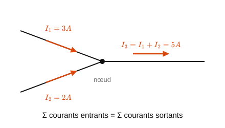

<em>Figure 2 : Loi des nœuds.</em>

- **Loi des mailles :** la somme algébrique des tensions le long d'une maille fermée est nulle (en respectant un sens de parcours et le signe de chaque tension selon son orientation).
  Exemple : un générateur E = 9 V alimente en série R1 et R2. En parcourant la maille : E − U(R1) − U(R2) = 0, donc U(R1) + U(R2) = E.

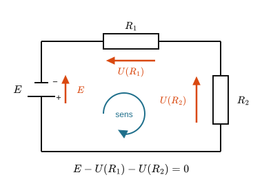

<em>Figure 3 : Loi des mailles.</em>

**Associations de résistances**

- Série : $R_{éq} = R_1 + R_2 + \dots + R_n$ (le courant est le même dans chaque résistance)
- Parallèle : $\dfrac{1}{R_{éq}} = \dfrac{1}{R_1} + \dfrac{1}{R_2} + \dots + \dfrac{1}{R_n}$ (la tension est la même aux bornes de chaque résistance)
- Cas particulier utile : deux résistances égales R en parallèle donnent R_éq = R/2.

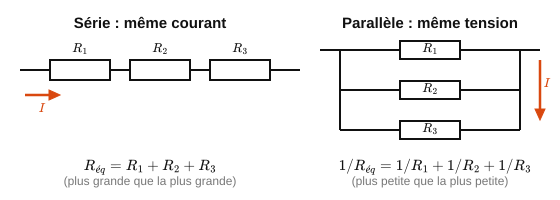

<em>Figure 4 : Associations de résistances (série/parallèle).</em>

**Diviseur de tension et diviseur de courant**

- Diviseur de tension (R1 en haut, R2 en bas, alimentation U) :

$$U(R_2) = U \times \dfrac{R_2}{R_1 + R_2} \tag{2}$$

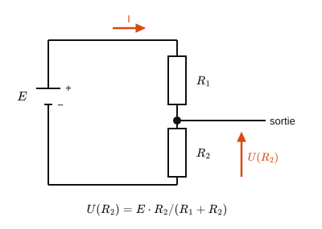

<em>Figure 5 a : Pont diviseur de tension.</em>

> **Démonstration.** R₁ et R₂ sont en série : elles sont traversées par le **même courant** I.
>
> D'après la loi des mailles, la tension d'alimentation se répartit entre les deux résistances : $U = U(R_1) + U(R_2)$.
>
> D'après la loi d'Ohm appliquée à chacune : $U(R_1) = R_1 I$ et $U(R_2) = R_2 I$, d'où $U = (R_1 + R_2)\,I$, soit $I = \dfrac{U}{R_1 + R_2}$.
>
> En réinjectant dans $U(R_2) = R_2 I$ : $U(R_2) = U \times \dfrac{R_2}{R_1 + R_2}$. ∎
>
> *Remarque : la tension se répartit proportionnellement aux résistances, la plus grande résistance recevant la plus grande part de la tension.*

- Diviseur de courant (R1 et R2 en parallèle, courant total I) : $I(R_2) = I \times \dfrac{R_1}{R_1 + R_2}$ (le courant se répartit à l'inverse des résistances : plus une branche est résistante, moins elle reçoit de courant)

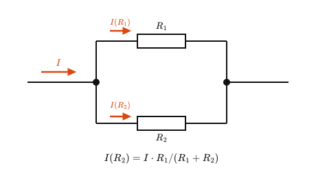

<em>Figure 5 b : Pont diviseur de courant.</em>

> **Démonstration.** R₁ et R₂ sont en parallèle : elles sont soumises à la **même tension** U.
>
> D'après la loi des nœuds, le courant total se partage entre les deux branches : $I = I_1 + I_2$.
>
> D'après la loi d'Ohm : $U = R_1 I_1 = R_2 I_2$. La résistance équivalente des deux branches vaut $R_{éq} = \dfrac{R_1 R_2}{R_1 + R_2}$, donc $U = R_{éq}\,I = I \times \dfrac{R_1 R_2}{R_1 + R_2}$.
>
> En réinjectant dans $I_2 = \dfrac{U}{R_2}$ : $I(R_2) = I \times \dfrac{R_1}{R_1 + R_2}$. ∎
>
> *Remarque : c'est bien R₁ (la résistance de l'**autre** branche) qui apparaît au numérateur : le courant privilégie la branche la moins résistante.*

**Court-circuit et circuit ouvert**

- Court-circuit : U = 0 quelle que soit l'intensité (résistance nulle) : attention, danger en pratique si non protégé.
- Circuit ouvert : I = 0 quelle que soit la tension (résistance infinie).

**Erreurs fréquentes des étudiants**

- Confondre mesure en série (ampèremètre) et mesure en parallèle (voltmètre).
- Oublier qu'en série c'est le courant qui est commun, en parallèle c'est la tension.
- Mélanger résistance équivalente série (toujours plus grande que la plus grande des résistances) et parallèle (toujours plus petite que la plus petite).
- Appliquer la loi d'Ohm sur un générateur ou une diode (non ohmiques).

> → **Application concrète :** **Le capteur de courant d'une alimentation d'ordinateur (shunt).** Pour mesurer le courant consommé par un processeur ou une carte, on intercale en série une résistance de très faible valeur (le *shunt*, quelques milliohms) et on mesure la tension à ses bornes : d'après la loi d'Ohm, $I = U/R$. Les cartes mères, les chargeurs USB-C et les alimentations de serveurs utilisent ce principe pour surveiller la consommation et couper en cas de surintensité. Le pont diviseur de tension, lui, sert partout où un microcontrôleur (3,3 V) doit lire une tension plus élevée sans être détruit.

---

### 1.2 Circuits linéaires en régime sinusoïdal (systèmes linéaires) `BTS2`

**Notation complexe**

En régime sinusoïdal établi, on associe à tout signal s(t) = S√2·sin(2πft+φ) un nombre complexe $\underline{S} = S \, e^{j\varphi}$, dont le module est la valeur efficace et l'argument la phase à l'origine. En notation complexe, dériver par rapport au temps revient à multiplier par jω.

**Impédance et admittance complexes**

Pour un dipôle traversé par i(t) et soumis à u(t), on définit par analogie avec la loi d'Ohm : $\underline{U} = \underline{Z} \cdot \underline{I}$, où $\underline{Z} = \dfrac{\underline{U}}{\underline{I}}$ est l'impédance complexe (en Ω). L'**admittance** est son inverse : $\underline{Y} = \dfrac{1}{\underline{Z}}$ (en siemens, S).

**Associations de dipôles**

- Impédances en série : $\underline{Z}_{éq} = \underline{Z}_1 + \underline{Z}_2 + \dots + \underline{Z}_n$ (généralise le cas des résistances).
- Admittances en parallèle : $\underline{Y}_{éq} = \underline{Y}_1 + \underline{Y}_2 + \dots + \underline{Y}_n$. Pour deux dipôles en parallèle : $\underline{Z}_{éq} = \dfrac{\underline{Z}_1 \underline{Z}_2}{\underline{Z}_1 + \underline{Z}_2}$.

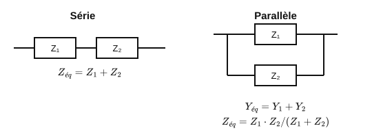

<em>Figure 7 : Association d'impédances (série/parallèle).</em>

**Le dipôle RLC série : impédance et résonance**

Un dipôle RLC série associe une résistance R, une bobine d'inductance L et un condensateur de capacité C, traversés par le même courant. Les impédances complexes élémentaires sont :

- Résistance : $\underline{Z}_R = R$ (réelle, pas de déphasage).
- Bobine : $\underline{Z}_L = jL\omega$ (la tension est en avance de 90° sur le courant).
- Condensateur : $\underline{Z}_C = \dfrac{1}{jC\omega} = -\dfrac{j}{C\omega}$ (la tension est en retard de 90° sur le courant).

En série, les impédances s'ajoutent :

$$\underline{Z} = R + j\left(L\omega - \dfrac{1}{C\omega}\right)$$

Le module de l'impédance vaut donc $|\underline{Z}| = \sqrt{R^2 + \left(L\omega - \dfrac{1}{C\omega}\right)^2}$. On observe trois régimes selon la fréquence :

| Fréquence | Terme dominant | Comportement du dipôle |
|---|---|---|
| Basse fréquence (ω petit) | $\dfrac{1}{C\omega}$ grand | Comportement **capacitif** : l'impédance est élevée, le courant est en avance sur la tension |
| Fréquence de résonance ω₀ | $L\omega_0 = \dfrac{1}{C\omega_0}$ | Comportement **purement résistif** : $\underline{Z} = R$, impédance **minimale**, courant **maximal**, tension et courant en phase |
| Haute fréquence (ω grand) | $L\omega$ grand | Comportement **inductif** : l'impédance est élevée, le courant est en retard sur la tension |

**Résonance d'un dipôle RLC**

La résonance se produit lorsque les effets de la bobine et du condensateur se compensent exactement ($L\omega_0 = 1/(C\omega_0)$, soit $LC\omega_0^2 = 1$), ce qui donne la **fréquence de résonance** :

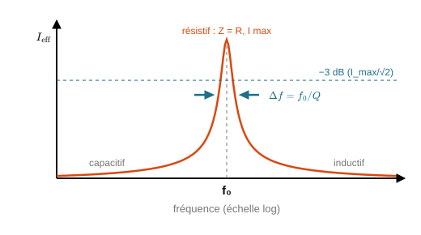

<em>Figure 6 : Diagramme de Bode d'un circuit RLC (résonance).</em>

$$f_0 = \dfrac{1}{2\pi\sqrt{LC}} \tag{3}$$

> **Démonstration.** Le dipôle est purement résistif lorsque la partie imaginaire de $\underline{Z}$ s'annule : $L\omega_0 - \dfrac{1}{C\omega_0} = 0$, soit $L\omega_0 = \dfrac{1}{C\omega_0}$, donc $\omega_0^2 = \dfrac{1}{LC}$ et $\omega_0 = \dfrac{1}{\sqrt{LC}}$. Comme $\omega_0 = 2\pi f_0$, on obtient $f_0 = \dfrac{1}{2\pi\sqrt{LC}}$. ∎

À cette fréquence, l'intensité efficace dans un RLC série (alimenté en tension) est maximale ; la tension efficace aux bornes d'un RLC parallèle (alimenté en courant) est maximale.

**Facteur de qualité et sélectivité**

La "finesse" de la résonance se caractérise par le **facteur de qualité** :

$$Q = \dfrac{L\omega_0}{R} = \dfrac{1}{RC\omega_0} = \dfrac{1}{R}\sqrt{\dfrac{L}{C}}$$

- Un Q élevé (R faible) donne une résonance **étroite et prononcée** : le dipôle ne "répond" fortement que dans une bande de fréquences très resserrée autour de f₀. On parle de dipôle **sélectif**.
- Un Q faible (R élevée) donne une résonance **large et amortie**.
- La **bande passante à −3 dB** est reliée à Q par : $\Delta f = \dfrac{f_0}{Q}$.

*Exemple résolu :* L = 10 mH, C = 100 nF, R = 20 Ω.
$f_0 = \dfrac{1}{2\pi\sqrt{10^{-2} \times 10^{-7}}} = \dfrac{1}{2\pi\sqrt{10^{-9}}} \approx \dfrac{1}{2\pi \times 3{,}16 \times 10^{-5}} \approx 5{,}03$ kHz.
$Q = \dfrac{1}{R}\sqrt{\dfrac{L}{C}} = \dfrac{1}{20}\sqrt{\dfrac{10^{-2}}{10^{-7}}} = \dfrac{1}{20} \times 316 \approx 15{,}8$.
$\Delta f = \dfrac{f_0}{Q} \approx \dfrac{5030}{15{,}8} \approx 318$ Hz : le dipôle est sélectif, il ne laisse passer efficacement qu'une bande d'environ 300 Hz autour de 5 kHz.

**Surtension à la résonance**

À la résonance, la tension aux bornes de L (ou de C) peut être **beaucoup plus grande** que la tension d'alimentation : $U_L = U_C = Q \times U$. Avec Q = 15,8 dans l'exemple précédent, une alimentation de 1 V produit près de 16 V aux bornes du condensateur : d'où le nom de **surtension**, et la nécessité de choisir des composants dont la tenue en tension est suffisante.

**Le dipôle RLC parallèle (anti-résonance)**

Lorsque R, L et C sont en parallèle (soumis à la même tension), le raisonnement se fait sur les admittances, qui s'ajoutent : $\underline{Y} = \dfrac{1}{R} + j\left(C\omega - \dfrac{1}{L\omega}\right)$. La fréquence de résonance est la **même** ($f_0 = 1/(2\pi\sqrt{LC})$), mais le comportement est inversé : à f₀, l'admittance est **minimale**, donc l'impédance est **maximale** et le dipôle absorbe un courant minimal. On parle parfois d'**anti-résonance** (ou circuit bouchon), utilisée pour bloquer une fréquence précise.

> → **Application concrète :** **Le circuit d'accord d'un récepteur radio ou d'une carte RFID/NFC.** Un lecteur NFC (badge d'accès, paiement sans contact, comme dans l'annale 2026) utilise une antenne en boucle (inductance L) associée à un condensateur C, réglés pour résonner exactement à 13,56 MHz. Grâce à un facteur de qualité élevé, l'antenne ne "voit" que cette fréquence et rejette les autres : c'est ce qui permet au lecteur de capter un signal très faible venant d'un badge passif, tout en ignorant le bruit électromagnétique ambiant. Le même principe sert à sélectionner une station FM ou un canal Wi-Fi dans un étage radiofréquence.

**Théorèmes utiles**

- Les lois des nœuds et des mailles s'appliquent sans restriction en notation complexe (comme en continu).
- **Théorème de superposition :** la réponse d'un réseau linéaire contenant plusieurs sources indépendantes est la somme des réponses dues à chaque source agissant seule (les autres étant éteintes).

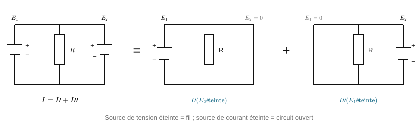

<em>Figure 8 : Théorème de superposition.</em>

- **Théorèmes de Thévenin et de Norton :** tout dipôle actif linéaire peut être remplacé par un générateur de tension équivalent en série avec une résistance (modèle de Thévenin), ou par un générateur de courant équivalent en parallèle avec une résistance (modèle de Norton) : les deux modèles étant équivalents entre eux.

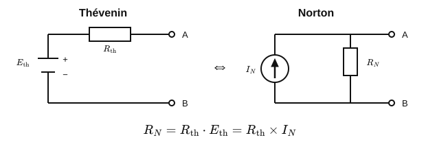

<em>Figure 9 : Modèle de Thévenin et de Norton.</em>

---

### 1.3 Puissances, décibels, atténuation et gains `BTS1` `BTS2`

**Rappel : puissance en régime sinusoïdal**

- Un signal sinusoïdal s'écrit u(t) = U_max·sin(ωt). Sa valeur efficace (RMS) est :

$$U_{eff} = \dfrac{U_{max}}{\sqrt{2}} \approx 0{,}707 \times U_{max} \tag{4}$$

- Puissance moyenne dissipée dans une résistance R :

$$P = \dfrac{U_{eff}^2}{R} = R \times I_{eff}^2 = U_{eff} \times I_{eff} \tag{5}$$

*Exemple résolu :* un signal sinusoïdal d'amplitude U_max = 5 V attaque une résistance R = 50 Ω.
U_eff = 5/√2 ≈ 3,54 V. P = U_eff²/R = 3,54²/50 ≈ 0,25 W.

**Gain et atténuation en linéaire**

- Gain en puissance : $G = \dfrac{P_s}{P_e}$ (sans unité ; G > 1 = amplification, G < 1 = atténuation).
- Gain en tension (mêmes impédances d'entrée et de sortie) :

$$A_v = \dfrac{V_s}{V_e} \tag{6}$$

**Le décibel (dB) : pourquoi et comment**

Le décibel est une échelle logarithmique, utilisée en électronique et en télécoms pour deux raisons : elle permet de manipuler des rapports qui varient sur plusieurs ordres de grandeur (ex. puissance très faible reçue par une antenne), et elle transforme les produits de gains successifs (cascade de quadripôles) en simples additions.

- Définition en puissance :

$$A_{(dB)} = 10 \times \log_{10}\!\left(\dfrac{P_2}{P_1}\right) \tag{7}$$

- Définition en tension, à impédances égales : $A_{(dB)} = 20 \times \log_{10}\!\left(\dfrac{U_2}{U_1}\right)$ (le facteur 20 vient de P ∝ U², donc log(U²) = 2log(U))
- Un gain positif correspond à une amplification ; un gain négatif correspond à une perte, que l'on appelle alors une **atténuation** (parfois notée positivement en valeur absolue : "atténuation de 6 dB" = gain de −6 dB).

**Valeurs remarquables à connaître par cœur**

| Rapport de puissance | En dB |
|---|---|
| ×1 (inchangé) | 0 dB |
| ×2 | +3 dB |
| ÷2 | −3 dB |
| ×10 | +10 dB |
| ÷10 | −10 dB |
| ×100 | +20 dB |
| ÷100 | −20 dB |
| ×1000 | +30 dB |

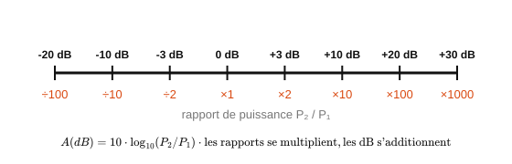

<em>Figure 10 : Échelle des décibels.</em>

*Exemple résolu :* P_e = 2,0 mW, P_s = 0,5 mW. A = 10×log₁₀(0,5/2,0) = 10×log₁₀(0,25) ≈ −6,02 dB (cohérent avec ÷4 ≈ deux fois ÷2, soit environ −3 −3 = −6 dB).

**Cascade de quadripôles (chaîne de transmission)**

Propriété clé du dB : en cascade, les gains et pertes **s'additionnent** en dB (alors qu'il faudrait les multiplier en linéaire) :

$$G_{total(dB)} = G_{1(dB)} + G_{2(dB)} + \dots + G_{n(dB)} \tag{8}$$

*Exemple résolu :* un amplificateur de +12 dB, suivi d'un câble de −4 dB, suivi d'un connecteur de −0,5 dB.
G_total = 12 − 4 − 0,5 = **+7,5 dB**.

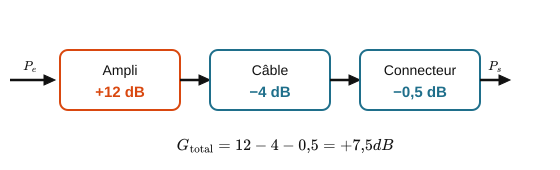

<em>Figure 11 : Chaîne de transmission en cascade.</em>

**Le dBm : une unité absolue de puissance**

Le dB seul exprime un **rapport** (sans dimension) entre deux puissances. Le **dBm** exprime au contraire une puissance **absolue**, rapportée à une référence de 1 mW :

$$P_{(dBm)} = 10 \times \log_{10}\!\left(\dfrac{P}{1\ \text{mW}}\right) \tag{9}$$

Valeurs repères à connaître : 0 dBm = 1 mW ; +10 dBm = 10 mW ; +20 dBm = 100 mW ; −10 dBm = 0,1 mW ; −30 dBm = 1 µW.

*Usage typique CIEL :* le dBm est la norme pour exprimer un niveau de signal Wi-Fi, un niveau reçu en fibre optique, ou la puissance d'émission d'un module radio.

**Bilan de liaison (budget de liaison)**

Comme les gains et pertes s'additionnent en dB, on peut ajouter directement des dB à une puissance en dBm pour suivre un signal tout au long d'une chaîne de transmission :

$$P_{s(dBm)} = P_{e(dBm)} + \sum \text{gains}_{(dB)} - \sum \text{pertes}_{(dB)} \tag{10}$$

*Exemple résolu :* un émetteur Wi-Fi sort à +20 dBm. Le signal traverse un câble (−2 dB), une antenne avec un gain de +5 dB, puis un trajet en espace libre qui atténue de 60 dB.
P_reçue = 20 − 2 + 5 − 60 = **−37 dBm** (soit environ 2.10⁻⁴ mW, un niveau de réception Wi-Fi tout à fait réaliste).

**D'autres échelles en dB, à connaître**

- **dBV** (décibel par rapport au volt) : $V_{dBV} = 20 \times \log_{10}\!\left(\dfrac{V_{eff}}{1\ \text{V}}\right)$. Un signal de 0 dBV a une amplitude efficace de 1 V.
- **dBµV** (décibel par rapport au microvolt) : même principe, référencé à 1 µV : pratique pour les signaux radiofréquence très faibles.
- Lien entre puissance et tension à impédance connue (utile en RF, où Z est normalisée à 50 Ω ou 75 Ω) :

$$P = \dfrac{U_{eff}^2}{Z} \tag{11}$$

**Erreurs fréquentes des étudiants**

- Confondre le facteur 10 (pour les puissances) et le facteur 20 (pour les tensions) dans la formule du dB.
- Traiter le dB comme une unité absolue de puissance, alors que c'est un rapport sans dimension : seul le **dBm** est absolu.
- Additionner directement deux niveaux exprimés en dBm comme s'il s'agissait de puissances linéaires (il faut repasser en mW pour sommer des puissances) : en revanche, on additionne bien un gain en dB à une puissance en dBm.

> → **Application concrète :** **Le niveau de réception Wi-Fi affiché par un ordinateur (RSSI).** La "force du signal" que rapporte une carte Wi-Fi est un niveau en dBm (typiquement de −30 dBm, excellent, à −90 dBm, inutilisable). Un administrateur réseau utilise ces valeurs, ainsi que les gains d'antenne en dBi et les pertes de câble en dB, pour dimensionner la couverture d'un bâtiment : c'est un bilan de liaison appliqué au quotidien. Le même calcul en dB sert à qualifier une liaison fibre optique (budget optique) avant sa mise en service.

---

### 1.4 Semi-conducteurs : la jonction PN et la diode `BTS1` `BTS2`

**La jonction PN**

- Un semi-conducteur dopé N présente un excès d'électrons libres ; un semi-conducteur dopé P présente un déficit d'électrons (des "trous"). Au contact des deux, une jonction PN se forme, avec une zone de déplétion qui bloque naturellement le passage du courant dans un sens.
- **Sens passant :** le courant circule facilement au-delà d'une tension de seuil.
- **Sens bloqué :** le courant reste quasi nul (hors courant de fuite négligeable), quelle que soit la tension appliquée (dans la limite de la tenue en tension inverse du composant).

**La diode et sa caractéristique**

- Tension de seuil typique pour le silicium : 0,6 à 0,7 V (le germanium, moins utilisé aujourd'hui, serait plutôt autour de 0,2-0,3 V).
- Caractéristique I(V) fortement non linéaire : croissance quasi exponentielle du courant au-delà du seuil, courant quasi nul en dessous et en sens bloqué.

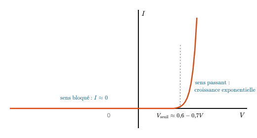

<em>Figure 12 : Caractéristique I(V) d'une diode.</em>

- **Modèle simplifié "diode idéale + seuil"**, très utile pour les calculs de première approche : en sens passant, on approxime V_diode ≈ 0,6-0,7 V quel que soit le courant ; en sens bloqué, I ≈ 0.

*Exemple résolu :* une diode silicium est montée en série avec une résistance de protection R = 1 kΩ sous une alimentation E = 5 V.
Avec le modèle simplifié : V_diode ≈ 0,7 V, donc U_R = E − V_diode = 5 − 0,7 = 4,3 V, et I = U_R/R = 4,3/1000 = 4,3 mA.

**Applications courantes**

- **Redressement :** transformer un signal alternatif en signal unidirectionnel (une diode simple pour le redressement simple alternance, un pont de 4 diodes pour le redressement double alternance).
- **Protection :** diode "de roue libre" en parallèle d'une bobine (relais, moteur) pour absorber la surtension à la coupure.
- **Indication/signalisation :** la LED, une diode électroluminescente, sera étudiée plus en détail dans la partie composants optoélectroniques.

**Erreurs fréquentes des étudiants**

- Appliquer la loi d'Ohm (U = R×I) directement sur une diode : elle n'est pas un composant linéaire, cette loi ne s'applique pas.
- Oublier la résistance de protection en série, ce qui peut détruire la diode (courant non limité).
- Se tromper de sens de montage : une diode montée à l'envers reste bloquée et ne laisse rien passer.

> → **Application concrète :** **La protection des ports d'entrée d'une carte électronique.** Les entrées d'un microcontrôleur ou d'une carte réseau sont protégées par des diodes dites "d'écrêtage" (ou TVS) : normalement bloquées, elles deviennent passantes dès que la tension dépasse un seuil, et détournent ainsi vers la masse les surtensions (décharge électrostatique, parasite sur un câble Ethernet) qui détruiraient le circuit. C'est aussi la fonction de la diode de roue libre qui protège un transistor commandant un relais (cf. TP mémoire).

---

### 1.5 Bandes d'énergie et photons `BTS1` `BTS2`

- Dans un cristal semi-conducteur (silicium, germanium), les niveaux d'énergie possibles pour les électrons se regroupent en bandes.
  - La **bande de valence** : les électrons y sont liés aux atomes et ne participent pas à la conduction.
  - La **bande de conduction** : les électrons y sont libres et peuvent se déplacer sous l'effet d'un champ électrique.
- On appelle **gap** (ou bande interdite) l'écart d'énergie ΔE entre ces deux bandes. Il dépend du matériau : pour le silicium, ΔE ≈ 1,1 eV.

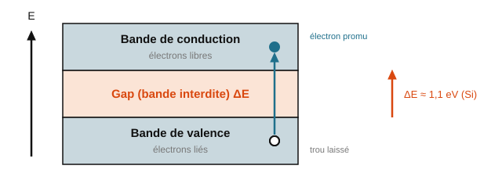

<em>Figure 13 : Bandes d'énergie dans un semi-conducteur.</em>

- Un semi-conducteur dopé N a un excès d'électrons libres ; un semi-conducteur dopé P a un déficit d'électrons (des « trous », qui se comportent comme des charges positives mobiles). La jonction PN est le contact entre les deux.

#### Les photons et l'échange d'énergie avec la matière

- La lumière visible, l'infrarouge, l'ultraviolet, les rayons X et gamma sont des ondes électromagnétiques caractérisées par leur fréquence ν. On peut aussi les décrire comme un flux de corpuscules appelés **photons**, chacun transportant une énergie :

$$E = h\nu = \dfrac{h c_0}{\lambda} \tag{12}$$

  avec h la constante de Planck (h ≈ 6,63×10⁻³⁴ J·s), c₀ la célérité de la lumière dans le vide et λ la longueur d'onde. On exprime souvent E en électronvolt (1 eV = 1,6×10⁻¹⁹ J).

- Les niveaux d'énergie d'un atome (E₁, E₂, E₃...) sont quantifiés : ils ne prennent que des valeurs précises, caractéristiques de l'atome.
- Un atome peut passer d'un niveau fondamental E₁ à un niveau excité E₂ en **absorbant** un photon d'énergie hν = E₂ − E₁. Inversement, il peut revenir de E₂ à E₁ en **émettant** un photon de cette même énergie. C'est ce second mécanisme qui est à l'œuvre dans une LED ou un laser.

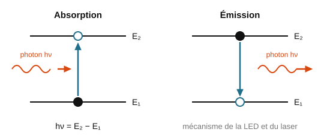

<em>Figure 14 : Absorption/émission d'un photon par un atome.</em>

*Exemple résolu :* quelle est l'énergie d'un photon de longueur d'onde λ = 650 nm (rouge) ?
E = hc₀/λ = (6,63×10⁻³⁴ × 3,0×10⁸) / (650×10⁻⁹) ≈ 3,06×10⁻¹⁹ J ≈ 1,91 eV.

> → **Application concrète :** **Le capteur d'image d'un smartphone ou d'une webcam.** Chaque pixel d'un capteur CMOS convertit les photons reçus en charges électriques, exactement selon le mécanisme d'absorption d'un photon par un semi-conducteur (le photon fournit l'énergie ΔE nécessaire pour faire passer un électron dans la bande de conduction). La sensibilité du capteur dans le visible, et son insensibilité aux ondes radio, s'expliquent directement par la relation $E = h\nu$ : seuls les photons suffisamment énergétiques peuvent franchir le gap du silicium.

### 1.6 La diode électroluminescente (DEL/LED) `BTS1` `BTS2`

- Une DEL est une diode qui émet de la lumière lorsqu'elle est polarisée en direct (anode +, cathode −) et parcourue par un courant.
- Les électrons qui traversent la jonction se recombinent avec des trous : ils passent de la bande de conduction à la bande de valence et libèrent leur énergie sous forme de photons.

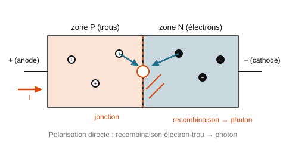

<em>Figure 15 : Structure d'une LED et recombinaison électron-trou.</em>

- La longueur d'onde émise est directement liée à la largeur du gap ΔE du matériau utilisé :

$$\nu = \dfrac{c_0}{\lambda} = \dfrac{\Delta E}{h} \tag{13}$$

  Un gap plus grand donne une lumière plus énergétique (donc plus proche du bleu/UV) ; un gap plus petit donne une lumière moins énergétique (plus proche du rouge/IR). C'est pourquoi on choisit un matériau semi-conducteur différent selon la couleur de LED souhaitée.

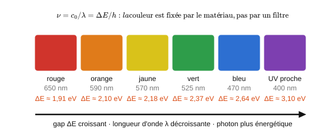

<em>Figure 16 : Relation gap / couleur émise.</em>

*Exemple résolu :* une LED rouge émet à λ ≈ 650 nm. Le gap du matériau utilisé vaut donc ΔE = hc₀/λ ≈ 1,91 eV (calcul identique à l'exemple précédent, puisque ΔE = E du photon émis).

> → **Application concrète :** **Les voyants d'état et les liaisons optiques d'un équipement réseau.** Les LED de face avant d'un switch (lien actif, activité, vitesse) sont des DEL de couleurs différentes obtenues avec des matériaux à gap différent. Plus important encore : les modules SFP des liaisons courtes (jusqu'à quelques centaines de mètres) utilisent une LED infrarouge à 850 nm comme émetteur, dont la longueur d'onde est fixée par le gap du semi-conducteur utilisé.

### 1.7 La diode laser `BTS2`

- Une diode laser est une diode dont la région active forme une cavité résonnante. Le courant injecté maintient la majorité des atomes dans un état excité.
- Chaque photon interagissant avec un atome excité provoque l'émission d'un second photon **identique** (même énergie, même phase) : c'est l'émission stimulée, à l'origine du terme LASER (*Light Amplification by Stimulated Emission of Radiation*).

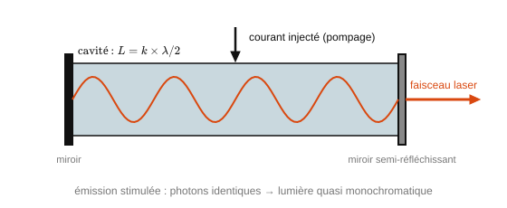

<em>Figure 17 : Cavité résonnante d'une diode laser.</em>

- La longueur de la cavité est un multiple de λ/2, ce qui sélectionne précisément la longueur d'onde émise.
- Par rapport à une LED classique, une diode laser délivre une puissance lumineuse plus importante et un rayonnement quasi monochromatique (une seule longueur d'onde bien définie) : c'est ce qui la rend indispensable pour les transmissions par fibre optique longue distance.

> → **Application concrète :** **Le module SFP d'une liaison fibre longue distance.** Pour transmettre sur plusieurs kilomètres (liaison entre deux sites d'une entreprise, épine dorsale d'un réseau opérateur), une LED ne suffit plus : le module émetteur utilise une diode laser à 1310 ou 1550 nm, quasi monochromatique, ce qui limite la dispersion chromatique dans la fibre et permet des débits de 10 Gbit/s et au-delà. Les lecteurs de codes-barres et les souris optiques laser reposent sur le même composant.

### 1.8 La photodiode `BTS1` `BTS2`

- Une photodiode convertit l'énergie lumineuse reçue en énergie électrique. Les photons absorbés créent des paires électron-trou, qui produisent un courant inverse (i < 0).
- **Mode photoconducteur :** la diode est polarisée en inverse par une tension continue. Le courant inverse ne dépend pas de la tension appliquée : il est proportionnel au flux lumineux reçu. C'est le mode utilisé pour un capteur de lumière ou un récepteur de liaison optique.
- **Mode photovoltaïque :** la diode n'est pas polarisée. Éclairée, elle se comporte comme un générateur : c'est le principe d'une cellule photovoltaïque.

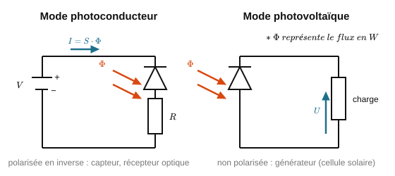

<em>Figure 18 : Photodiode : mode photoconducteur vs photovoltaïque.</em>

> → **Application concrète :** **Le récepteur d'une liaison fibre optique et les capteurs de présence.** À l'autre bout d'une liaison fibre, une photodiode (en mode photoconducteur) convertit les impulsions lumineuses en impulsions électriques, à des cadences de plusieurs milliards par seconde. Le même composant, associé à une LED infrarouge, forme les barrières optiques (détection d'un objet interrompant le faisceau) et les capteurs de proximité d'un smartphone qui éteignent l'écran pendant un appel.

### 1.9 Le capteur CCD (Charge-Coupled Device) `BTS2`

- Un capteur CCD est une matrice de photodiodes, chacune correspondant à un pixel de l'image.
- Lorsque le capteur est exposé à la lumière, chaque photodiode accumule une charge électrique proportionnelle au flux lumineux reçu.
- Les charges sont transférées ligne par ligne vers un registre, qui les envoie successivement à un convertisseur analogique-numérique (CAN) pour reconstituer l'image numérique.

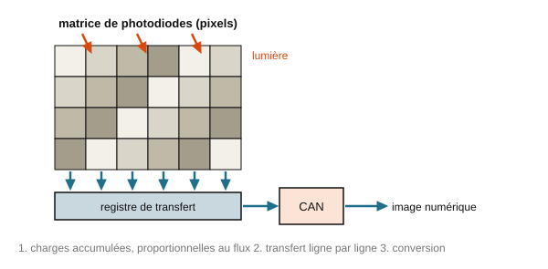

<em>Figure 19 : Principe d'un capteur CCD.</em>

> → **Application concrète :** **Les scanners de documents et les caméras de vidéosurveillance IP.** Un scanner à plat utilise une barrette CCD linéaire déplacée le long du document ; une caméra IP utilise une matrice CCD ou CMOS suivie d'un CAN, puis d'un compresseur vidéo qui envoie le flux sur le réseau. Toute la chaîne (capteur optique → conversion analogique-numérique → réseau) mobilise successivement les Chapitres 1, 5 et 3 de ce recueil.

### Erreurs fréquentes des étudiants `BTS1` `BTS2`
- Confondre le sens de polarisation d'une LED (elle n'émet qu'en direct) avec celui d'une photodiode utilisée en capteur (généralement polarisée en inverse).
- Croire qu'une diode laser et une LED fonctionnent sur des principes totalement différents : les deux reposent sur la recombinaison électron-trou dans une jonction PN ; seule l'émission stimulée (cavité résonnante) distingue le laser.
- Oublier que la couleur émise par une LED dépend du matériau (donc du gap), pas d'un filtre coloré appliqué après coup.

---

## Chapitre 2 : Mesures et incertitudes

### 2.1 Notions fondamentales et incertitudes de mesure

**Vocabulaire de base**

- *Mesurande* : la grandeur que l'on cherche à mesurer.
- *Justesse* : capacité d'un appareil à donner une valeur proche de la valeur vraie, en moyenne (absence d'erreur systématique).
- *Fidélité* : capacité à donner des valeurs proches les unes des autres lors de mesures répétées (dispersion faible).

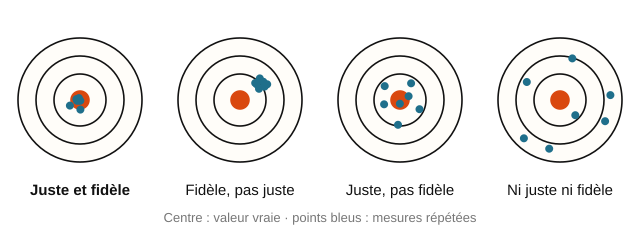

<em>Figure 20 : Justesse vs fidélité.</em>

- *Exactitude* = justesse + fidélité.
- *Erreur systématique* : biais reproductible (ex. mauvais étalonnage, offset) : ne se réduit pas en répétant les mesures.
- *Erreur aléatoire* : fluctuation imprévisible d'une mesure à l'autre : se réduit statistiquement en répétant les mesures.

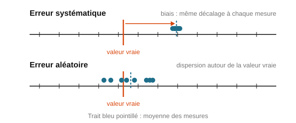

<em>Figure 21 : Erreur systématique vs erreur aléatoire.</em>

**Pourquoi une incertitude ?**

Toute mesure est entachée d'un doute : on ne connaît jamais la valeur vraie d'une grandeur, seulement une estimation encadrée par une incertitude qui exprime ce doute de façon quantifiée.

**Incertitude-type de type A (statistique)**

À partir d'une série de n mesures répétées x1, x2, …, xn :

- Valeur moyenne : x̄ = (Σxᵢ) / n
- Écart-type de la série : $\sigma = √[ Σ(xᵢ − x̄)² / (n−1) ]$
- Incertitude-type de type A :

$$u_A = \dfrac{\sigma}{\sqrt{n}} \tag{14}$$

*Exemple résolu :* 5 mesures d'une résistance donnent 220, 218, 221, 219, 222 Ω.
x̄ = 220 Ω. s ≈ 1,58 Ω. u_A = 1,58/√5 ≈ 0,71 Ω.

<em>Figure 23 : Distribution des mesures répétées (histogramme).</em>

**Incertitude-type de type B (non statistique)**

- Pour un appareil numérique de résolution (dernier digit) δ : **u_B ≈ δ / √12** (on suppose une loi de probabilité uniforme sur l'intervalle de résolution).
- Pour un appareil analogique (à aiguille) de classe c et de calibre C : $u_{B} ≈ (c × C) / (100 × √3)$. Les deux grandeurs se lisent sur l'appareil :
  - le **calibre C** est la valeur de pleine échelle choisie avec le sélecteur : c'est la plus grande valeur que l'appareil peut afficher sur cette position (par exemple 10 V : l'aiguille en butée indique 10 V) ;
  - la **classe c** est un nombre inscrit sur le cadran (1 ; 1,5 ; 2,5…). C'est la garantie du constructeur : l'erreur ne dépasse jamais **c % du calibre**, quelle que soit la position de l'aiguille.

  L'erreur maximale vaut donc $\Delta = \dfrac{c \times C}{100}$. Comme on ne sait pas où se situe l'erreur dans l'intervalle $[-\Delta\ ;\ +\Delta]$, on suppose toutes les positions équiprobables (loi uniforme), ce qui donne l'incertitude-type en divisant par $\sqrt{3}$ :

  $$u_B = \dfrac{\Delta}{\sqrt{3}} = \dfrac{c \times C}{100 \times \sqrt{3}}$$

  *Exemple résolu :* un voltmètre de classe 1,5 sur le calibre 10 V lit 6,20 V. Erreur maximale : $\Delta = 1{,}5 \times 10 / 100 = 0{,}15$ V, donc $u_B = 0{,}15 / \sqrt{3} \approx 0{,}087$ V.

  Conséquence pratique : l'incertitude dépend du **calibre**, pas de la valeur lue. La même tension de 6,20 V lue sur le calibre 30 V aurait une incertitude trois fois plus grande (0,26 V). On choisit donc toujours **le plus petit calibre qui contient la valeur à mesurer**, pour que l'aiguille dévie le plus possible.
- Pour une valeur donnée avec une tolérance constructeur ±a (ex. résistance à 5 %) : u_B ≈ a / √3.

*Exemple résolu :* multimètre numérique, résolution 0,01 V ⇒ u_B = 0,01/√12 ≈ 0,0029 V.

**Composer deux incertitudes**

Deux sources d'incertitude indépendantes se composent quadratiquement (pas en les additionnant simplement) :

$$u = \sqrt{u_A^2 + u_B^2} \tag{15}$$

*Exemple résolu (suite) :* u = √(0,71² + 0,0029²) ≈ 0,71 Ω (ici $u_{B}$ est négligeable devant $u_{A}$).

**Propagation des incertitudes sur une grandeur calculée**

- Pour une somme/différence (ex. z = x + y ou z = x − y) : les incertitudes absolues se composent quadratiquement :

$$u(z) = \sqrt{u(x)^2 + u(y)^2} \tag{16}$$

- Pour un produit/quotient (ex. z = x × y ou z = x / y) : ce sont les incertitudes **relatives** qui se composent quadratiquement :

$$\dfrac{u(z)}{z} = \sqrt{\left(\dfrac{u(x)}{x}\right)^2 + \left(\dfrac{u(y)}{y}\right)^2} \tag{17}$$

*Exemple résolu :* U = R × I avec R = (220 ± 0,7) Ω et I = (12,0 ± 0,2) mA.
u(R)/R = 0,7/220 ≈ 0,32 %. u(I)/I = 0,2/12,0 ≈ 1,67 %.
u(U)/U = √(0,32² + 1,67²) % ≈ 1,70 %.
U = R×I = 2,64 V ⇒ u(U) ≈ 0,045 V.

> **Le facteur d'élargissement k**
>
> L'incertitude-type $u$ est un écart-type : elle décrit la dispersion « typique » des valeurs possibles autour de la mesure. Mais l'intervalle $\bar{x} \pm u$ n'a qu'environ 68 % de chances de contenir la valeur vraie. Pour annoncer un résultat avec un niveau de confiance plus élevé, on **élargit** l'intervalle en multipliant $u$ par un facteur $k$ :
>
> $$U = k \times u \qquad \text{puis} \qquad x = \bar{x} \pm U$$
>
> | $k$ | Intervalle | Niveau de confiance |
> |---|---|---|
> | 1 | $\bar{x} \pm u$ | ≈ 68 % |
> | **2** | $\bar{x} \pm 2u$ | **≈ 95 %** (convention usuelle) |
> | 3 | $\bar{x} \pm 3u$ | ≈ 99,7 % |
>
> **Convention :** sauf indication contraire, on prend $k = 2$. Quand un énoncé parle d'« incertitude élargie » sans préciser, c'est $k = 2$.
>
> **Exemple :** un multimètre donne $\bar{U} = 4{,}52$ V et la composition des incertitudes-types (type A et type B) aboutit à $u = 0{,}015$ V. Alors $U = 2 \times 0{,}015 = 0{,}03$ V et on écrit $U = (4{,}52 \pm 0{,}03)$ V : il y a environ 95 % de chances que la tension vraie soit comprise entre 4,49 V et 4,55 V.
>
>

**Écrire un résultat de mesure**

- Format final : $x = \bar{x} \pm U(x)\ [\text{unité}]$, avec l'incertitude élargie $U = k \times u$ (k = 2 pour un niveau de confiance d'environ 95 %).
- Règle d'arrondi : arrondir d'abord l'incertitude à 1, exceptionnellement 2 chiffres significatifs, puis aligner la valeur moyenne sur la même décimale.
- Compatibilité avec une valeur de référence x_réf : le résultat est **compatible** si |x̄ − x_réf| ≤ U(x).

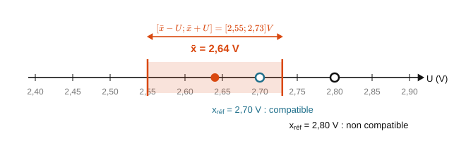

<em>Figure 22 : Intervalle de confiance sur un axe gradué.</em>

*Exemple résolu (suite du cas U = RI) :* U(U) = 2×0,045 ≈ 0,09 V ⇒ résultat final :

$$U_{mesurée} = (2{,}64 \pm 0{,}09)\ \text{V} \tag{18}$$

**Erreurs fréquentes des étudiants**

- Donner une incertitude avec 4-5 chiffres significatifs (ex. ± 0,0713268 Ω) au lieu d'arrondir à 1-2 chiffres.
- Additionner directement des incertitudes relatives et absolues sans convertir dans la même forme.
- Oublier le facteur k dans l'incertitude élargie et confondre u et U.
- Conclure "la mesure est fausse" au lieu de "la mesure n'est pas compatible avec la valeur de référence, à ce niveau de confiance".

> → **Application concrète :** **La calibration d'un capteur de température dans un datacenter.** Les sondes de température qui surveillent les baies de serveurs sont vendues avec une incertitude constructeur (type B, par exemple ±0,5 °C) ; pour un suivi fin, un administrateur compare plusieurs sondes et réalise des mesures répétées (type A). Savoir écrire correctement un résultat (x̄ ± U) et juger de la compatibilité de deux capteurs évite de déclencher une alerte de surchauffe sur une simple différence d'incertitude, ou au contraire de la manquer.

---

### 2.2 Le bruit : une source d'incertitude sur tout signal mesuré

**Le bruit**

Tout signal réel est affecté d'une fluctuation aléatoire appelée bruit : de valeur moyenne nulle mais de valeur efficace B = √⟨b²(t)⟩ non nulle. Il peut être **interne** (composants électroniques) ou **externe** (perturbations électromagnétiques captées par un câble ou une antenne).

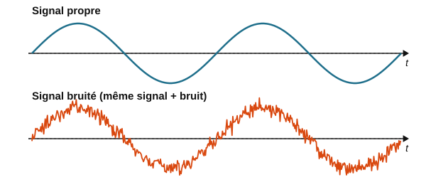

<em>Figure 24 : Signal bruité vs signal propre.</em>

**Densité spectrale de puissance (DSP)**

Le bruit étant aléatoire, on le caractérise par la répartition de sa puissance sur une bande de fréquence (DSP, en dBm/Hz, mesurée à l'analyseur de spectre). Le niveau de puissance sur une bande Δf vaut :

$$P_{(dBm)} = DSP + 10 \times \log_{10}(\Delta f) \tag{19}$$

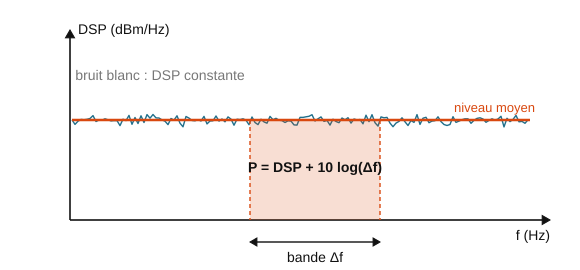

<em>Figure 25 : Densité spectrale de puissance (DSP) d'un bruit.</em>

**Les grands types de bruit**

| Type | Origine | Remarque |
|---|---|---|
| Bruit blanc | DSP constante sur une bande de fréquence | Modèle de référence |
| Bruit thermique (Johnson) | Agitation thermique des porteurs de charge dans une résistance | $B_{eff} = \sqrt{4 k_B T R \Delta f}$. Plus R est grande, plus le bruit est important. |
| Bruit de grenaille | Déplacement des porteurs dans une jonction (diode, transistor) | Augmente avec le courant qui traverse la jonction |
| Bruit en 1/f | Semi-conducteurs, composants actifs, résistances | Densité spectrale plus forte à basse fréquence |
| Bruit de quantification | Erreur de codage lors de la conversion analogique-numérique | Voir Chapitre 5, §5.6 |

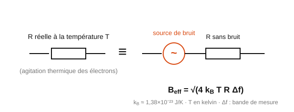

<em>Figure 66 : Bruit thermique dans une résistance.</em>

**Rapport signal sur bruit (SNR)**

Il compare la puissance du signal utile à celle du bruit :

$$SNR_{(dB)} = 10 \times \log_{10}\!\left(\dfrac{P_{signal}}{P_{bruit}}\right) = 20 \times \log_{10}\!\left(\dfrac{S}{B}\right) \tag{20}$$

où S et B sont les valeurs efficaces du signal et du bruit. Plus le SNR est grand, plus le signal est de bonne qualité (moins dégradé par le bruit).

**Lire un SNR**

- **Pourquoi 10 ou 20 ?** On compare des puissances, d'où le facteur 10. Si l'on part des tensions efficaces, la puissance étant proportionnelle au carré de la tension, le facteur devient 20 (même règle qu'au §1.3).
- **Ordres de grandeur** : un SNR de 0 dB signifie que le bruit est aussi puissant que le signal, et le signal est alors inexploitable. À 10 dB, le signal est 10 fois plus puissant que le bruit ; à 20 dB, 100 fois ; à 30 dB, 1 000 fois.
- **Avec des niveaux en dBm**, le calcul devient une simple soustraction : $SNR_{(dB)} = P_{signal\,(dBm)} - P_{bruit\,(dBm)}$.

*Exemple résolu :* une carte Wi-Fi reçoit le signal de la borne à −65 dBm, et le bruit ambiant est mesuré à −90 dBm. SNR = −65 − (−90) = **25 dB** : le signal est environ 300 fois plus puissant que le bruit, la liaison est de bonne qualité. Si l'on s'éloigne et que le signal tombe à −82 dBm, le SNR n'est plus que de 8 dB : la connexion devient instable et le débit s'effondre.

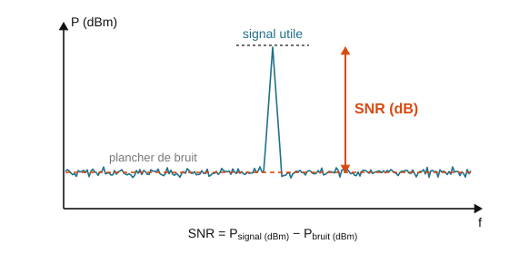

<em>Figure 26 : SNR : signal utile et niveau de bruit.</em>

> → **Application concrète :** **La limite de débit d'une liaison réseau (théorème de Shannon-Hartley).** Le débit maximal d'un canal de transmission (Wi-Fi, ADSL, fibre) n'est pas seulement limité par la bande passante, mais aussi par le rapport signal sur bruit : $C = B \times \log_2(1 + SNR)$. C'est pourquoi une connexion Wi-Fi ralentit quand on s'éloigne de la borne (le SNR chute) et pourquoi les câbles réseau blindés (STP) existent : réduire le bruit capté permet d'augmenter le débit exploitable.

---

## Chapitre 3 : Ondes et propagation

### 3.1 Ondes mécaniques progressives

- Une onde mécanique est une perturbation qui se propage dans un milieu élastique, avec transport d'énergie mais **sans transport de matière**.
- On distingue les ondes **transversales** (la perturbation est perpendiculaire à la direction de propagation, ex. onde sur une corde) des ondes **longitudinales** (la perturbation est parallèle à la direction de propagation, ex. onde sonore).

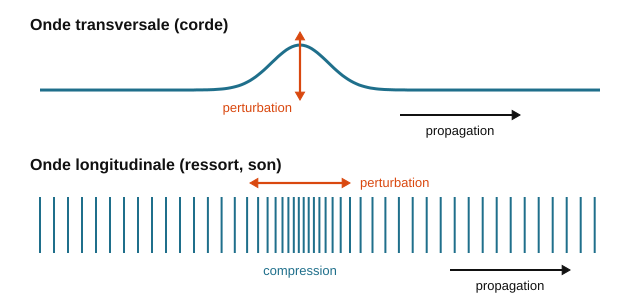

<em>Figure 27 : Onde transversale vs onde longitudinale.</em>

- Un **front d'onde** est une surface regroupant tous les points ayant le même temps de parcours depuis la source. On distingue les ondes **planes** (fronts d'onde plans, loin de la source) des ondes **sphériques** (fronts d'onde sphériques, près d'une source ponctuelle).

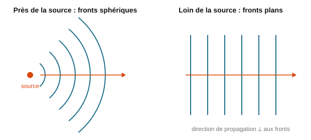

<em>Figure 28 : Front d'onde plan vs front d'onde sphérique.</em>

- La **célérité** c d'une onde ne dépend que du milieu de propagation : $c = \dfrac{d}{t}$ (d : distance parcourue, t : durée).

> → **Application concrète :** **Les capteurs à ultrasons de détection de présence et de niveau.** Un capteur à ultrasons (parking, robot, mesure de niveau de cuve) émet une onde mécanique longitudinale dans l'air et mesure le temps de retour de l'écho : la distance vaut $d = c \times t/2$. La célérité du son étant fixée par le milieu, le système doit parfois compenser la température ambiante, qui modifie légèrement c.

### 3.2 Ondes progressives sinusoïdales

Pour une onde sinusoïdale d'amplitude A et de période T se propageant vers les x positifs à la célérité c :

$$y(x,t) = A \sin\!\left[\dfrac{2\pi}{T}\left(t - \dfrac{x}{c}\right)\right] \tag{21}$$

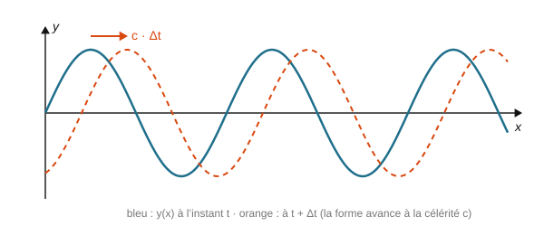

<em>Figure 29 : Onde progressive sinusoïdale y(x,t).</em>

- Pendant une période T, l'onde parcourt une distance λ appelée **longueur d'onde** :

$$\lambda = c \cdot T = \dfrac{c}{f} \tag{22}$$

<em>Figure 30 : Longueur d'onde sur une représentation spatiale.</em>

- La **fréquence** f est une propriété de la source : elle ne dépend pas du milieu. En revanche, λ et c dépendent tous deux du milieu de propagation.
- **Dispersion :** lorsque les différentes fréquences composant une onde ne se propagent pas à la même vitesse dans un milieu, ce milieu est dit dispersif (cas des vagues à la surface de l'eau, ou de certains milieux optiques : voir Chapitre 6).

> → **Application concrète :** **La synchronisation des horloges dans un réseau (NTP, PTP).** Une trame envoyée sur un câble se propage à une célérité finie ; sur une liaison de 100 km en fibre, le retard de propagation atteint environ 0,5 ms. Les protocoles de synchronisation d'horloge (NTP, et surtout PTP pour l'industrie et la finance) doivent estimer et compenser précisément ce temps de propagation, directement issu de la relation $c = d/t$, pour maintenir les serveurs à l'heure à quelques microsecondes près.

### 3.3 Lecture d'une onde à l'oscilloscope et déphasage

**Lecture sur oscilloscope**

- Période : T = (nombre de divisions occupées par un motif) × (base de temps en s/div)
- Amplitude : A = (nombre de divisions) × (sensibilité verticale en V/div)

<em>Figure 31 : Lecture d'une période à l'oscilloscope.</em>

*Exemple résolu :* base de temps 0,5 ms/div, une période occupe 4 div.
T = 4 × 0,5.10⁻³ = 2.10⁻³ s ⇒ f = 1/T = 500 Hz.

**Déphasage entre deux signaux**

- Deux signaux sont **en phase** si leurs maximums coïncident dans le temps ; **en opposition de phase** s'ils sont décalés d'une demi-période.
- Un décalage temporel Δt entre deux signaux de même période T correspond à un déphasage :
  $\varphi_{(rad)} = 2\pi \times \dfrac{\Delta t}{T}$, ou $\varphi_{(°)} = 360 \times \dfrac{\Delta t}{T}$

*Exemple résolu :* deux signaux de période T = 2 ms sont décalés de Δt = 0,5 ms.
φ = 360 × 0,5/2 = 90° (quadrature de phase).

<em>Figure 32 : Déphasage entre deux signaux.</em>

> → **Application concrète :** **Le diagnostic d'une liaison série ou d'un bus de terrain à l'oscilloscope.** Face à un bus RS485 ou un lien I²C qui ne fonctionne pas (comme dans l'annale 2025), le technicien branche un oscilloscope et lit directement la période des bits pour vérifier le débit configuré (9600 bauds, 115200 bauds...). Un déphasage anormal entre le signal d'horloge et le signal de données d'un bus SPI est aussi une cause classique de communication défaillante entre un microcontrôleur et un capteur.

---

### 3.4 Ondes sonores et effet Doppler

- Une onde sonore est une onde mécanique longitudinale, correspondant à une variation locale de pression (surpression acoustique). La puissance moyenne transportée par unité de surface vaut $P = \dfrac{A^2}{2Z}$, avec A la surpression acoustique et Z l'impédance acoustique du milieu.

**L'impédance acoustique Z**

L'impédance acoustique d'un milieu mesure sa **résistance à être mis en vibration** par une onde sonore. Elle compare la surpression acoustique p à la vitesse v de vibration des particules du milieu, comme l'impédance électrique compare une tension à un courant :

$$Z = \dfrac{p}{v} = \rho \times c$$

avec ρ la masse volumique du milieu (kg/m³) et c la célérité du son dans ce milieu (m/s). Z s'exprime en kg·m⁻²·s⁻¹ (unité parfois appelée « rayl »).

| Milieu | ρ (kg/m³) | c (m/s) | Z = ρ × c (kg·m⁻²·s⁻¹) |
|---|---|---|---|
| Air (20 °C) | 1,2 | 343 | ≈ 410 |
| Eau | 1 000 | 1 480 | ≈ 1,5 × 10⁶ |
| Tissus du corps humain | ≈ 1 060 | ≈ 1 540 | ≈ 1,6 × 10⁶ |
| Acier | 7 800 | ≈ 5 900 | ≈ 4,6 × 10⁷ |

Quand une onde sonore passe d'un milieu d'impédance Z₁ à un milieu d'impédance Z₂, une partie de l'énergie est **réfléchie** à l'interface. La fraction d'intensité réfléchie vaut :

$$R = \left(\dfrac{Z_2 - Z_1}{Z_2 + Z_1}\right)^{2}$$

Plus les impédances sont différentes, plus la réflexion est forte. C'est la même idée que l'adaptation d'impédance d'une ligne de transmission (§3.10 à 3.12) : pour transmettre, il faut des impédances proches ; pour réfléchir, il faut des impédances très différentes.

*Exemple résolu :* passage de l'air (Z₁ ≈ 410) à l'eau (Z₂ ≈ 1,5 × 10⁶). R = ((1,5 × 10⁶ − 410) / (1,5 × 10⁶ + 410))² ≈ 0,999 : **99,9 % de l'énergie est réfléchie**. C'est pour cela qu'on entend très mal sous l'eau les bruits venant de l'air.

> → **Application concrète :** **Capteurs à ultrasons et échographie.** Un capteur de distance à ultrasons (aide au stationnement, mesure de niveau dans une cuve) fonctionne justement parce que l'écart d'impédance entre l'air et un obstacle solide renvoie presque toute l'onde : l'écho est fort. À l'inverse, en échographie, on applique un gel entre la sonde et la peau pour supprimer la couche d'air : sans gel, l'onde serait presque entièrement réfléchie avant d'entrer dans le corps.
- La hauteur d'un son (aigu/grave) dépend de sa fréquence ; son timbre dépend de sa composition spectrale (fondamental + harmoniques).
- **Effet Doppler :** décalage entre la fréquence perçue par un récepteur et la fréquence réellement émise par la source, lorsque l'un des deux est en mouvement. Pour un récepteur immobile et une source en mouvement à la vitesse v_S :

$$\Delta f = f_R - f_S = f_S \times \dfrac{v_S}{c - v_S} \tag{23}$$

  (v_S compté positivement si la source se rapproche). Cet effet est exploité par les radars de mesure de vitesse.

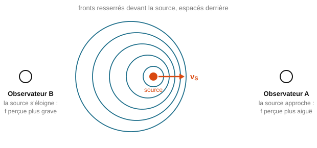

<em>Figure 33 : Effet Doppler.</em>

> → **Application concrète :** **Les radars de vitesse et les capteurs de mouvement à micro-ondes.** Les détecteurs de présence utilisés en domotique et en sécurité (éclairage automatique, alarme) émettent une onde et mesurent le décalage Doppler du signal réfléchi par une personne en mouvement : un objet immobile ne produit aucun décalage, seul un déplacement déclenche l'alerte. Le même principe sert aux radars routiers et aux capteurs de vitesse des véhicules connectés.

### 3.5 Ondes électromagnétiques : propriétés

- Une onde électromagnétique (OEM) est la propagation couplée d'un champ électrique **E** et d'un champ magnétique **B**, perpendiculaires entre eux et à la direction de propagation (onde transversale). Elle ne nécessite **aucun milieu matériel** pour se propager (elle se propage dans le vide).

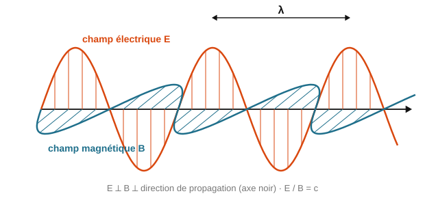

<em>Figure 34 : Structure d'une onde électromagnétique.</em>

- Le rapport entre les intensités efficaces des deux champs est constant et égal à la célérité :

$$\dfrac{E}{B} = c \tag{24}$$

- La **densité surfacique de puissance** transportée (en W/m²) vaut : $p = \dfrac{E^2}{Z_0}$, avec $Z_0 = \sqrt{\dfrac{\mu_0}{\varepsilon_0}} \approx 120\pi \approx 377\ \Omega$, l'impédance caractéristique du vide.
- La **célérité** d'une OEM dans un milieu dépend de l'**indice de réfraction** n de ce milieu : $c_{milieu} = \dfrac{c_0}{n}$ (voir aussi Chapitre 6 pour l'application à l'optique). Rappel : c₀ ≈ 3,0×10⁸ m/s dans le vide.

> → **Application concrète :** **La compatibilité électromagnétique (CEM) d'un équipement informatique.** Tout équipement numérique rayonne des ondes électromagnétiques (horloges, bus rapides). Les normes de CEM imposent des limites de rayonnement, et les câbles réseau blindés, les boîtiers métalliques ou les ferrites sur les câbles USB servent précisément à contenir ces champs E et B. En cybersécurité, ce rayonnement est aussi un risque : les attaques par canal auxiliaire ("TEMPEST") exploitent les émissions électromagnétiques d'un écran ou d'un clavier pour reconstituer l'information affichée ou tapée.

### 3.6 Classification du spectre électromagnétique

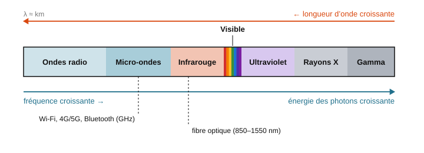

<em>Figure 35 : Spectre électromagnétique complet.</em>

**Le spectre électromagnétique**

Le classement se fait uniquement selon la fréquence (ou la longueur d'onde), du plus grand λ au plus petit : ondes radio, micro-ondes, infrarouge, visible, ultraviolet, rayons X, rayons gamma. Les réseaux sans fil (Wi-Fi, Bluetooth, 4G/5G) utilisent la partie micro-ondes du spectre (de l'ordre du GHz).

> → **Application concrète :** **Le choix des bandes de fréquence des réseaux sans fil.** Le Wi-Fi utilise 2,4 GHz et 5 GHz (micro-ondes), le Bluetooth 2,4 GHz, la 4G/5G des bandes de 700 MHz à plusieurs GHz, la fibre optique le proche infrarouge : chaque technologie occupe une zone précise du spectre, choisie pour ses propriétés de propagation (portée, pénétration des murs, débit possible). Comprendre le spectre permet par exemple de saisir pourquoi le 2,4 GHz traverse mieux les murs que le 5 GHz, mais offre moins de débit.

---

### 3.7 Polarisation d'une onde électromagnétique

- La **polarisation** correspond à l'orientation du champ électrique **E** dans le plan perpendiculaire à la direction de propagation.
- **Polarisation linéaire :** le champ électrique garde une direction fixe au cours de la propagation.
- **Polarisation elliptique (ou circulaire) :** la direction du champ électrique tourne au cours de la propagation.

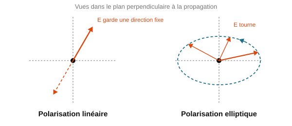

<em>Figure 36 : Polarisation linéaire vs elliptique.</em>

> → **Application concrète :** **Les antennes à double polarisation des points d'accès Wi-Fi et de la 5G.** Pour doubler le débit sans élargir la bande de fréquence, les équipements MIMO émettent simultanément deux flux sur deux polarisations orthogonales (horizontale et verticale) : le récepteur les sépare grâce à leurs polarisations différentes. C'est aussi pour cette raison que l'orientation des antennes d'un point d'accès n'est pas anodine.

#### Mise en équation de la polarisation

- Considérons une onde qui se propage selon l'axe z. Ses champs $\vec{E}$ et $\vec{B}$ restent dans le plan (x, y), perpendiculaire à la direction de propagation (§3.5). **La polarisation est la direction du champ électrique $\vec{E}$ dans ce plan, et la façon dont cette direction évolue au cours du temps.** On suit toujours $\vec{E}$ : le champ $\vec{B}$ s'en déduit, puisqu'il lui est perpendiculaire et que B = E/c (équation (24)).
- Le champ électrique se décompose sur les deux axes x et y du plan. Chaque composante est une onde sinusoïdale (§3.2) ; elles ont la même fréquence, mais peuvent avoir des amplitudes et des phases différentes :

$$\vec{E}(z,t) = E_x \cos(\omega t - kz)\,\vec{u}_x + E_y \cos(\omega t - kz + \varphi)\,\vec{u}_y \tag{24a}$$

  avec ω = 2πf la pulsation (rad/s), k = 2π/λ le nombre d'onde (rad/m ; à ne pas confondre avec le coefficient de vélocité k d'un câble, §3.11), E_x et E_y les amplitudes des deux composantes (V/m), $\vec{u}_x$ et $\vec{u}_y$ les vecteurs unitaires des axes, et φ le **déphasage** entre les deux composantes (rad).

- Pour « voir » la polarisation, on se place en un point fixe (par exemple z = 0) et on suit l'extrémité du vecteur $\vec{E}$ pendant une période. Tout dépend du déphasage φ (Figure 83).

**Cas φ = 0 ou φ = π : polarisation rectiligne.** Les deux composantes passent par zéro en même temps et gardent un rapport constant : $\vec{E}$ oscille le long d'une droite fixe, qui fait avec l'axe x l'angle :

$$\theta = \arctan\!\left(\dfrac{E_y}{E_x}\right) \tag{24b}$$

Pour φ = π, la droite est symétrique, d'angle −θ. Cas particuliers : E_y = 0 donne une polarisation selon x, E_x = 0 une polarisation selon y. Pour une antenne, on parle de polarisation **verticale** ou **horizontale** selon l'orientation de $\vec{E}$ par rapport au sol.

**Cas φ = ±π/2 avec E_x = E_y = E₀ : polarisation circulaire.** Avec φ = −π/2, en z = 0 : E_x = E₀ cos(ωt) et E_y = E₀ cos(ωt − π/2) = E₀ sin(ωt). La norme $\sqrt{E_x^2 + E_y^2} = E_0$ reste constante et l'extrémité de $\vec{E}$ décrit un cercle, à raison d'un tour par période. Le signe de φ fixe le sens de rotation : avec φ = −π/2, $\vec{E}$ tourne de $\vec{u}_x$ vers $\vec{u}_y$ ; c'est la polarisation circulaire **droite** au sens des télécommunications (règle de la main droite : pouce dans le sens de propagation, les doigts indiquent le sens de rotation), notée RHCP (*Right Hand Circular Polarization*). Avec φ = +π/2, $\vec{E}$ tourne en sens inverse : polarisation circulaire **gauche** (LHCP). Certains ouvrages d'optique utilisent la convention inverse : on précise donc toujours la convention, ou l'on emploie les sigles RHCP et LHCP des fiches techniques.

**Cas général : polarisation elliptique.** Pour toute autre valeur du déphasage (ou pour φ = ±π/2 avec E_x ≠ E_y), l'extrémité de $\vec{E}$ décrit une ellipse : $\vec{E}$ tourne et sa norme varie. Les polarisations rectiligne et circulaire sont des cas particuliers de la polarisation elliptique (ellipse aplatie en segment, ou ellipse devenue cercle).

| Déphasage φ | Amplitudes | Trajectoire de l'extrémité de $\vec{E}$ | Polarisation |
|---|---|---|---|
| 0 ou π | quelconques | segment de droite d'angle θ | rectiligne |
| ±π/2 | E_x = E_y | cercle | circulaire (droite ou gauche selon le signe de φ) |
| autre valeur | quelconques | ellipse | elliptique |

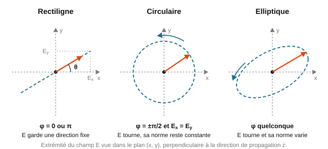

<em>Figure 83 : Polarisation rectiligne, circulaire et elliptique : trajectoire de l'extrémité de E dans le plan perpendiculaire à la propagation.</em>

- **Lumière naturelle.** Le Soleil, une lampe ou une LED émettent une multitude de trains d'ondes courts et indépendants : la direction de $\vec{E}$ change au hasard, extrêmement vite. Cette lumière est dite **non polarisée**. Un laser ou une antenne émettent au contraire une onde polarisée.

*Exemple résolu :* une onde a pour composantes E_x = 4,0 V/m et E_y = 3,0 V/m, en phase (φ = 0).

Sa polarisation est rectiligne, d'angle θ = arctan(3,0/4,0) ≈ 36,9° par rapport à l'axe x, et l'amplitude du champ vaut $\sqrt{4{,}0^2 + 3{,}0^2} = 5{,}0$ V/m. Si les deux composantes avaient la même amplitude et un déphasage de −π/2, la polarisation serait circulaire droite.

> → **Sur le terrain :** un fouet, un dipôle ou un monopole rayonnent en polarisation rectiligne, parallèle à leur brin. Avant de fixer une antenne, le technicien lit sa polarisation sur la fiche technique (verticale, horizontale, ±45°, circulaire RHCP ou LHCP) et vérifie que l'antenne d'en face a la même.

#### Recevoir une onde polarisée : loi de Malus et pertes de polarisation

- **Polariseur et loi de Malus.** Un polariseur (filtre polarisant en optique, grille de fils métalliques parallèles pour les ondes radio) ne laisse passer que la composante de $\vec{E}$ parallèle à son axe. Si une onde polarisée rectilignement arrive avec un angle θ entre son champ et l'axe du polariseur, le champ transmis vaut E₀ cos θ. L'intensité (puissance par unité de surface) étant proportionnelle à E² (§3.5, p = E²/Z₀), elle est multipliée par cos²θ : c'est la **loi de Malus**.

$$I = I_0 \cos^2\theta \tag{24c}$$

  avec I₀ l'intensité incidente et I l'intensité transmise (W/m²). Pour θ = 0, tout passe ; pour θ = 90°, rien ne passe (polariseurs croisés : extinction). Une lumière non polarisée qui traverse un polariseur perd la moitié de son intensité (la valeur moyenne de cos²θ vaut 1/2).

- **Antenne de réception tournée.** Une antenne rectiligne (dipôle, monopole, fouet) se comporte comme un polariseur : elle ne capte que la composante du champ parallèle à son brin (Figure 84). Si elle est tournée d'un angle θ par rapport à la polarisation de l'onde, la tension induite est multipliée par cos θ et la puissance reçue par cos²θ. Exprimée en dB, cette **perte de désadaptation de polarisation** vaut :

$$L_{pol(dB)} = -20 \log_{10}\lvert\cos\theta\rvert = -10 \log_{10}(\cos^2\theta) \tag{24d}$$

| Désalignement θ | 0° | 30° | 45° | 60° | 80° | 90° (polarisation croisée) |
|---|---|---|---|---|---|---|
| Puissance reçue (cos²θ) | 100 % | 75 % | 50 % | 25 % | 3 % | 0 % en théorie |
| Pertes L_pol | 0 dB | 1,2 dB | 3 dB | 6 dB | 15 dB | infinies en théorie, 20 à 30 dB en pratique |

  En polarisation croisée (θ = 90°), la théorie prédit une extinction totale. En pratique, les antennes ne sont pas parfaites et les réflexions sur les obstacles modifient la polarisation : on mesure plutôt 20 à 30 dB de pertes. Un écart de seulement 2° par rapport à 90° (θ = 88°) donne d'ailleurs déjà 29 dB : l'extinction parfaite n'existe pas.

- **Onde circulaire reçue par une antenne rectiligne.** Le champ d'une onde circulaire tourne : une antenne rectiligne en capte toujours la projection sur son brin, quelle que soit son orientation, et reçoit en moyenne la moitié de la puissance : **3 dB de pertes, pour tout angle θ**. Inversement, une antenne circulaire qui reçoit une onde rectiligne perd aussi 3 dB. En revanche, une antenne circulaire droite (RHCP) qui reçoit une onde circulaire gauche (LHCP) est en polarisation croisée : les pertes sont très fortes.

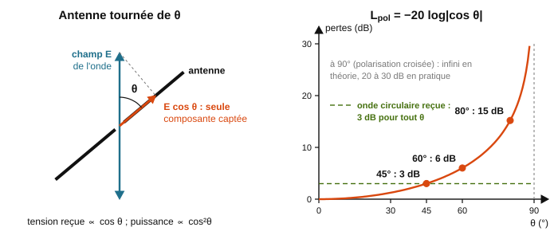

<em>Figure 84 : Antenne de réception tournée d'un angle θ : seule la composante E cos θ est captée ; pertes de polarisation en dB en fonction de θ.</em>

*Exemple résolu :* un point d'accès Wi-Fi émet en polarisation verticale. Un client dont l'antenne est verticale reçoit −60 dBm, et sa sensibilité pour le débit visé est de −75 dBm (marge de 15 dB).
- Antenne du client inclinée de 45° : L_pol = −20 log(cos 45°) = −20 log(0,707) ≈ 3,0 dB, le client reçoit −63 dBm.
- Antenne inclinée de 70° : L_pol = −20 log(cos 70°) = −20 log(0,342) ≈ 9,3 dB, le client reçoit −69,3 dBm : la marge tombe de 15 dB à 5,7 dB. Une simple antenne mal orientée consomme près des deux tiers de la marge.

> → **Sur le terrain :** à l'installation d'un pont radio ou d'une antenne de passerelle, on aligne les polarisations des deux extrémités (même orientation, vérifiée au niveau à bulle). Un écart de 10° ne coûte que 0,13 dB, mais une antenne posée à plat au lieu d'être verticale peut faire perdre 20 dB et couper la liaison.

#### Conséquences et applications de la polarisation

- **Orientation des antennes Wi-Fi.** Les antennes des points d'accès sont le plus souvent des dipôles verticaux (polarisation verticale). Un ordinateur portable ou un téléphone a des antennes intégrées d'orientation quelconque, qui change selon la façon dont on le tient. C'est pourquoi, sur une box ou un point d'accès à deux antennes orientables, on conseille d'en placer une verticale et l'autre horizontale (ou les deux à 45°) : quelle que soit l'orientation du client, au moins une antenne reçoit correctement. En intérieur, les réflexions multiples mélangent les polarisations, ce qui atténue le problème ; en extérieur et en vue directe, l'alignement compte beaucoup plus.
- **Double polarisation et MIMO.** Deux polarisations orthogonales (horizontale et verticale, ou +45° et −45°) se comportent comme deux canaux indépendants sur la **même fréquence**. Une antenne à double polarisation émet deux flux de données différents en même temps, et le récepteur les sépare grâce à l'isolation entre polarisations croisées (20 à 30 dB). Le débit double sans occuper de bande supplémentaire : c'est l'un des ressorts du MIMO 2×2 du Wi-Fi et des antennes « ±45° » des mâts 4G/5G.
- **Réutilisation des fréquences en faisceaux hertziens.** Un opérateur qui relie deux pylônes peut transmettre deux liaisons sur la même fréquence, l'une en polarisation horizontale (H), l'autre en polarisation verticale (V), un circuit compensant les fuites d'une polarisation dans l'autre : la capacité du faisceau double. Sur des liaisons voisines, on alterne les polarisations pour limiter les interférences.
- **Polarisation circulaire du GPS et des satellites.** Les satellites GPS et Galileo émettent en polarisation circulaire droite (RHCP), pour trois raisons :
  1. un récepteur embarqué (voiture, téléphone, drone) change sans cesse d'orientation, et une onde circulaire est reçue de la même façon quelle que soit l'orientation de l'antenne ;
  2. en traversant l'ionosphère, une onde rectiligne voit son plan de polarisation tourner de façon imprévisible (**rotation de Faraday**, due au champ magnétique terrestre) ; une onde circulaire n'y est pas sensible ;
  3. une réflexion sur le sol ou sur un immeuble inverse le sens de rotation (RHCP devient LHCP) : une antenne RHCP rejette en grande partie ces échos parasites (trajets multiples), qui dégradent la précision de la position.

  La petite antenne rectiligne d'un smartphone accepte, elle, de perdre 3 dB.
- **La réflexion modifie la polarisation.** Lors d'une réflexion sur une surface (eau, route mouillée, vitre, sol), la composante de $\vec{E}$ parallèle à la surface est mieux réfléchie que la composante située dans le plan d'incidence. Pour un angle d'incidence particulier, l'**incidence de Brewster** (tan θ_B = n₂/n₁, soit environ 53° pour l'eau et 56° pour le verre), cette seconde composante n'est plus du tout réfléchie : le reflet est polarisé rectilignement, parallèlement à la surface (horizontalement pour un sol ou un plan d'eau). Les **lunettes de soleil polarisantes**, dont l'axe est vertical, éliminent ces reflets grâce à la loi de Malus ; les photographes utilisent des filtres polarisants pour la même raison. En radio, les réflexions sur les murs et le sol modifient de même la polarisation : c'est une des raisons pour lesquelles l'isolation entre polarisations croisées reste limitée en pratique.
- **Écrans LCD.** Chaque pixel d'un écran à cristaux liquides est placé entre deux polariseurs croisés. Selon la tension appliquée, le cristal liquide fait tourner ou non de 90° la polarisation de la lumière, qui traverse alors le second polariseur ou est bloquée (loi de Malus). La lumière qui sort d'un écran LCD est donc polarisée : à travers des lunettes polarisantes, l'écran peut devenir noir quand on penche la tête de 90°.
- **Fibres à maintien de polarisation (ouverture).** Dans une fibre optique ordinaire (Chapitre 6), la polarisation de la lumière change de façon aléatoire au gré des courbures et des contraintes mécaniques. Certains composants (modulateurs, capteurs et gyroscopes à fibre) exigent une polarisation fixe : on utilise alors des **fibres à maintien de polarisation**, dont le cœur est encadré de barreaux de contrainte. À l'inverse, les liaisons optiques cohérentes à 100 Gbit/s et plus transmettent deux flux sur deux polarisations orthogonales (multiplexage de polarisation), exactement comme le MIMO en radio.

> → **Sur le terrain :** sur une box à deux antennes, placer une antenne verticale et l'autre horizontale (ou les deux à 45°) ; pour une antenne extérieure, respecter la polarisation de la fiche technique et celle de l'antenne d'en face ; pour le récepteur GPS qui horodate un serveur NTP ou une supervision, choisir une antenne RHCP placée en vue dégagée du ciel.

### 3.8 Antennes, réflexion et réfraction en espace libre

**Antennes, réflexion et réfraction**

- Une **antenne** convertit un signal électrique en onde rayonnée (émission) ou inversement (réception). Plus une antenne est adaptée à la fréquence utilisée, plus le rayonnement (ou la réception) est efficace.

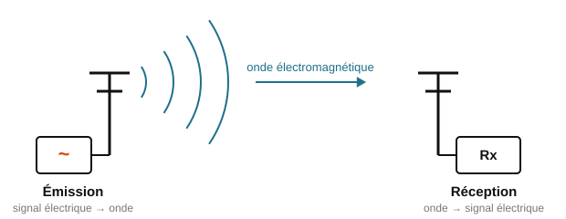

<em>Figure 37 : Principe d'une antenne émettrice/réceptrice.</em>

- Une onde qui rencontre un obstacle ou un changement de milieu peut être **réfléchie** (renvoyée) et/ou **réfractée** (déviée en changeant de milieu) : deux phénomènes qui expliquent par exemple les zones d'ombre Wi-Fi dans un bâtiment.

<em>Figure 38 : Réflexion et réfraction d'une onde sur un obstacle.</em>

> → **Application concrète :** **Le déploiement Wi-Fi d'un bâtiment ("site survey").** Avant d'installer des bornes, un technicien réseau réalise une étude de couverture : il mesure le niveau reçu pièce par pièce, repère les zones d'ombre créées par les murs porteurs (réflexion) et les cloisons (réfraction/atténuation), et choisit l'emplacement et le type d'antenne (omnidirectionnelle ou directive) en conséquence, exactement comme dans la partie 6 de l'annale 2026.

#### L'antenne quart d'onde : pourquoi la longueur d'une antenne dépend de λ

**La résonance d'un brin d'antenne**

- Une antenne filaire est un conducteur ouvert à son extrémité. L'onde de courant envoyée par l'émetteur parcourt le brin, se réfléchit au bout (extrémité ouverte : ρ = +1, voir §3.11) et revient. L'onde aller et l'onde retour se superposent et forment une **onde stationnaire** sur le brin, exactement comme sur une ligne non adaptée (§3.12) ou sur une corde de guitare.
- Au bout du brin, aucun courant ne peut sortir : le courant y est **nul** (nœud de courant) et la tension **maximale**. Un quart de longueur d'onde plus loin, on trouve un **ventre de courant** : le courant y est maximal et la tension minimale.
- L'antenne est **résonante** lorsque sa longueur place ce ventre de courant au point d'alimentation. L'émetteur « voit » alors une impédance purement résistive (la partie réactive s'annule, comme pour un circuit RLC à la résonance, §1.2) ; un fort courant circule dans le brin et l'antenne rayonne efficacement. Une antenne trop courte ou trop longue présente une impédance réactive : elle est désadaptée, et une grande partie de la puissance est renvoyée vers l'émetteur (TOS élevé, §3.12).
- Comme la corde de guitare qui ne vibre bien qu'aux fréquences fixées par sa longueur, une antenne ne rayonne bien qu'autour de la fréquence fixée par la longueur de son brin.

**Le dipôle demi-onde**

- L'antenne de référence est le **dipôle demi-onde** : deux brins de λ/4 alimentés en leur milieu, soit une longueur totale de λ/2. Le courant est maximal au centre (point d'alimentation) et nul aux deux extrémités (Figure 85).
- À la résonance, son impédance d'entrée est résistive et vaut environ **73 Ω**. Son gain est de 2,15 dBi (§3.9).

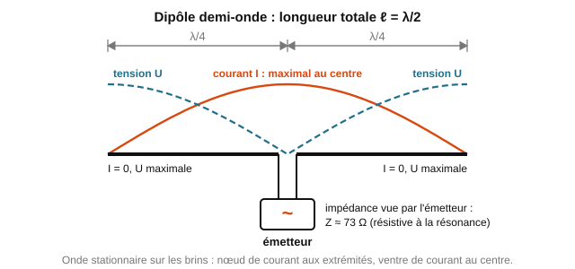

<em>Figure 85 : Dipôle demi-onde : le courant (maximal au centre) et la tension (maximale aux extrémités) forment une onde stationnaire sur les brins.</em>

**Le monopole quart d'onde et son plan de masse**

- On peut supprimer la moitié inférieure du dipôle et la remplacer par une surface métallique, le **plan de masse** : tôle, toit d'un véhicule, cuivre d'un circuit imprimé, ou trois ou quatre tiges appelées radians. Le plan de masse se comporte comme un **miroir** pour l'onde : les courants qu'il porte produisent, au-dessus du plan, le même champ qu'un brin « image » symétrique situé sous le plan. Monopole λ/4 + image = dipôle λ/2 : au-dessus du plan, on retrouve le rayonnement d'un dipôle avec une antenne deux fois plus courte (Figure 86).
- Le monopole n'alimente que la moitié de la structure équivalente : pour un même courant, la tension d'alimentation est divisée par deux, et son impédance d'entrée vaut la moitié de celle du dipôle, soit **≈ 36 Ω**.
- Le plan de masse doit s'étendre sur au moins λ/4 autour du pied de l'antenne ; un plan trop petit décale la résonance et dégrade le TOS.

Les longueurs résonantes théoriques à retenir sont donc :

$$\ell_{\text{dipôle}} = \dfrac{\lambda}{2} \qquad \ell_{\text{monopôle}} = \dfrac{\lambda}{4} = \dfrac{c_0}{4f} \tag{24e}$$

avec ℓ la longueur du brin (m), λ = c₀/f la longueur d'onde **dans l'air** (m), c₀ ≈ 3,0×10⁸ m/s et f la fréquence d'utilisation (Hz).

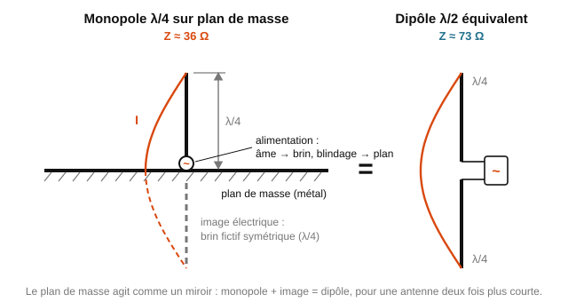

<em>Figure 86 : Monopole quart d'onde sur plan de masse et son image électrique : l'ensemble rayonne comme un dipôle demi-onde.</em>

**Impédance d'entrée et adaptation au câble 50 Ω**

- Les émetteurs et les câbles radio sont normalisés à 50 Ω (§3.10). Une antenne qui présente 50 Ω à sa fréquence de travail est dite **accordée** : elle ne renvoie presque rien vers l'émetteur (TOS proche de 1).
- Un dipôle (73 Ω) branché sur un câble 50 Ω donne ρ = (73 − 50)/(73 + 50) ≈ +0,19 et un TOS ≈ 1,46 ; un monopole (36 Ω) donne ρ ≈ −0,16 et un TOS ≈ 1,39 (méthode de calcul au §3.11 et au §3.12). Ces valeurs restent sous la limite usuelle de 1,5 : c'est pourquoi ces deux antennes simples sont si répandues. Les fabricants les ajustent ensuite vers 50 Ω, par exemple en inclinant les radians d'un monopole d'environ 45° vers le bas, ce qui remonte son impédance vers 50 Ω, ou en ajoutant un petit circuit d'adaptation.

**Longueur pratique : le raccourcissement**

- La longueur λ/4 est une valeur théorique, valable pour un fil infiniment fin. Un conducteur réel a un diamètre, et son extrémité se comporte comme une petite capacité qui « allonge » électriquement le brin (effet de bout). Pour résonner à la bonne fréquence, on coupe donc le brin environ 5 % plus court :

$$\ell_{\text{pratique}} \approx 0{,}95 \times \dfrac{\lambda}{4} \tag{24f}$$

- Le coefficient exact (de 0,93 à 0,98 environ) dépend du diamètre du conducteur : on l'ajuste à la mesure, en raccourcissant le brin jusqu'à obtenir le TOS minimal à la fréquence voulue. Une antenne gravée sur un circuit imprimé ou en céramique est encore plus courte, car l'onde y est ralentie par l'isolant, comme dans un câble (§3.11).
- Dans les exercices, sauf indication contraire, on calcule la longueur théorique λ/4.

| Usage | Fréquence | λ = c₀/f | Monopole λ/4 (théorique) | Longueur pratique ≈ 0,95 × λ/4 | Dipôle λ/2 |
|---|---|---|---|---|---|
| Radio FM (antenne fouet de voiture) | 100 MHz | 3,00 m | 75 cm | ≈ 71 cm | 1,50 m |
| Télécommande, capteur radio 433 MHz | 433 MHz | 69,3 cm | 17,3 cm | ≈ 16,5 cm | 34,6 cm |
| LoRa, Sigfox (Europe) | 868 MHz | 34,6 cm | 8,6 cm | ≈ 8,2 cm | 17,3 cm |
| Wi-Fi, Bluetooth | 2,4 GHz | 12,5 cm | 3,1 cm | ≈ 3,0 cm | 6,25 cm |

*Exemple résolu :* dimensionner l'antenne quart d'onde d'un module Wi-Fi à 2,4 GHz.

λ = c₀/f = 3,0×10⁸ / 2,4×10⁹ = 0,125 m = 12,5 cm (équation (22)) ; ℓ = λ/4 = 3,125 cm ≈ 3,1 cm (24e) ; en pratique ℓ ≈ 0,95 × 3,125 ≈ 2,97 cm, soit environ 3,0 cm (24f). L'antenne est montée sur un plan de masse d'au moins λ/4 ≈ 3 cm de rayon, et présente environ 36 Ω.

> → **Application concrète :** **Les antennes des objets connectés et des points d'accès.** Le fil d'environ 8 cm qui dépasse d'un module LoRa, l'antenne-tige d'un routeur Wi-Fi (un dipôle d'environ 6 cm sous son capuchon), la piste en zigzag gravée au bout d'un module ESP32 (un quart d'onde replié) : toutes ces antennes sont des λ/4 ou des λ/2, taillées pour leur bande. Conséquence : une antenne 868 MHz vissée sur un équipement 2,4 GHz, même si le connecteur SMA est identique, est complètement désadaptée : TOS élevé et portée effondrée.

> → **Sur le terrain :** avant de monter une antenne, vérifier que sa bande (marquée sur l'antenne ou sa fiche technique) correspond à celle de l'équipement, qu'elle dispose de son plan de masse, puis contrôler le TOS à l'analyseur d'antenne : le minimum du TOS doit tomber sur la fréquence de travail. S'il tombe plus bas en fréquence, le brin est trop long ; plus haut, il est trop court.

---

### 3.9 Liaison hertzienne

Une liaison hertzienne transmet de l'information à distance grâce à une onde radiofréquence. Pour une puissance d'émission P₀ (en W) et une distance d, l'intensité du champ électrique reçu vaut, en ordre de grandeur :

$$E = \dfrac{\alpha \sqrt{P_0}}{d} \tag{25}$$

(α étant une constante liée à l'antenne). Ce résultat qualitatif rejoint le bilan de liaison en dB/dBm déjà établi au Chapitre 1, §1.3 : plus la distance augmente, plus le niveau reçu diminue : d'où la nécessité de calculer précisément l'atténuation en espace libre (formule de Friis, voir exercices).

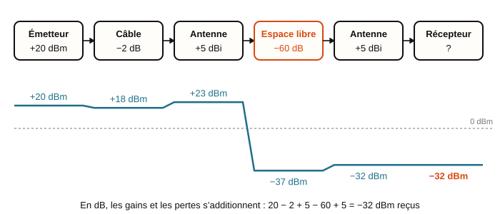

<em>Figure 39 : Bilan de liaison hertzienne.</em>

> → **Application concrète :** **La liaison radio entre deux bâtiments (pont Wi-Fi ou faisceau hertzien).** Pour relier deux sites distants de quelques kilomètres sans tirer de fibre, on installe un faisceau hertzien avec deux antennes directives en vis-à-vis. Le bilan de liaison (puissance émise, gains d'antennes, atténuation en espace libre selon la distance) détermine si la liaison sera fiable : c'est exactement le calcul de la partie 5 de l'annale 2025 sur les capteurs LoRa.

#### LoRa et LoRaWAN : un réseau radio longue portée pour l'IoT

**Le besoin : envoyer peu, loin, pendant des années**

Un compteur d'eau, un capteur de place de parking ou une sonde de température n'envoie que quelques octets, quelques fois par heure. En revanche, il doit le faire à plusieurs kilomètres, sans fil, et fonctionner 5 à 10 ans sur une simple pile. Ni le Wi-Fi ou le Bluetooth (portée de quelques dizaines de mètres), ni la 4G (consommation et abonnement) ne conviennent. On utilise alors un **LPWAN** (*Low Power Wide Area Network*, réseau étendu à basse consommation) : LoRaWAN, Sigfox, ou les versions bas débit de la 4G et de la 5G (NB-IoT, LTE-M).

**LoRa : la modulation radio**

- **LoRa** (*Long Range*) désigne la couche physique, c'est-à-dire la façon dont les bits sont transformés en onde radio. LoRa utilise un **étalement de spectre par « chirp »** (*Chirp Spread Spectrum*) : chaque symbole est un « chirp », un signal dont la fréquence balaie à vitesse constante toute la largeur du canal (en général B = 125 kHz), comme un sifflement qui monte. L'information est codée par la fréquence à laquelle le balayage commence (Figure 87).
- Le **facteur d'étalement** SF (*Spreading Factor*, de 7 à 12) fixe la durée d'un chirp : chaque symbole transporte SF bits et dure $T_s = 2^{SF}/B$. Augmenter SF de 1 double la durée du symbole : le débit est environ divisé par deux, mais le récepteur accumule deux fois plus d'énergie par symbole et gagne environ 2,5 dB de sensibilité.
- Le récepteur compare le signal reçu à un chirp de référence : cette opération concentre toute l'énergie du symbole et permet de décoder un signal **plus faible que le bruit** (jusqu'à 20 dB sous le niveau du bruit en SF12, voir le SNR au §2.2). C'est ce qui donne à LoRa son excellente **sensibilité** : de l'ordre de −120 à −137 dBm, contre environ −80 à −90 dBm pour le Wi-Fi.

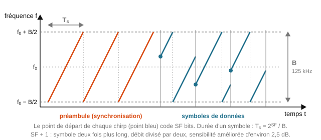

<em>Figure 87 : Modulation LoRa : chaque symbole est un balayage en fréquence (chirp) sur la largeur B du canal ; le point de départ du chirp porte l'information.</em>

| Facteur d'étalement SF | Durée d'un symbole (B = 125 kHz) | Débit utile | Sensibilité typique | Durée d'un message d'une trentaine d'octets |
|---|---|---|---|---|
| 7 | ≈ 1 ms | ≈ 5,5 kbit/s | ≈ −123 dBm | ≈ 70 ms |
| 9 | ≈ 4 ms | ≈ 1,8 kbit/s | ≈ −129 dBm | ≈ 250 ms |
| 12 | ≈ 33 ms | ≈ 0,3 kbit/s | ≈ −137 dBm | ≈ 1,8 s |

**Une bande libre, mais réglementée**

- En Europe, LoRa utilise la bande **ISM 868 MHz** (863 à 870 MHz). Elle est libre d'accès (pas de licence à payer) mais soumise à des règles strictes : puissance rayonnée limitée à 25 mW, soit **+14 dBm**, et **duty cycle** (taux d'occupation du canal) limité à **1 %** : un objet ne peut émettre que 1 % du temps, soit 36 s par heure.
- Conséquence : en SF12, un message dure près de 2 s, et un capteur ne peut donc envoyer qu'une vingtaine de messages par heure. LoRa est fait pour des mesures espacées, pas pour la voix ni la vidéo.
- Le choix de 868 MHz plutôt que 2,4 GHz n'est pas anodin : à gains d'antennes égaux, l'atténuation en espace libre est plus faible à basse fréquence (environ 9 dB de moins qu'à 2,4 GHz, puisque 20 log(2400/868) ≈ 8,8 dB), et l'onde traverse mieux les murs et la végétation (§3.6). Les antennes restent courtes : 8,6 cm pour un quart d'onde (§3.8).

**LoRaWAN : le protocole réseau**

- **LoRaWAN** est le protocole réseau construit au-dessus de la modulation LoRa (normalisé par la LoRa Alliance). Son architecture comporte quatre maillons (Figure 88) :
  1. les **objets** (*end devices*) : capteurs ou actionneurs sur pile, équipés d'un module LoRa et d'une petite antenne quart d'onde ;
  2. les **passerelles** (*gateways*) : récepteurs radio placés en point haut (toit, pylône, château d'eau), qui écoutent en permanence plusieurs canaux et tous les facteurs d'étalement à la fois. Une passerelle ne lit pas les données : elle les relaie telles quelles vers Internet (Ethernet, 4G, fibre). Un même message peut être reçu par plusieurs passerelles ;
  3. le **serveur réseau** (*network server*) : il élimine les doublons, vérifie l'authenticité des messages et choisit pour chaque objet le SF le plus rapide qui garde une marge suffisante (débit adaptatif, ou ADR) ;
  4. le **serveur applicatif** (*application server*) : il déchiffre les données et les met à disposition de l'application (tableau de bord, alertes, base de données).
- Les données sont chiffrées (AES-128) de l'objet jusqu'au serveur applicatif : une passerelle, même installée chez un tiers, ne peut pas les lire.
- Pour économiser sa pile, un objet de classe A (le cas le plus courant) dort presque tout le temps : il se réveille, émet son message, écoute brièvement une éventuelle réponse, puis se rendort.

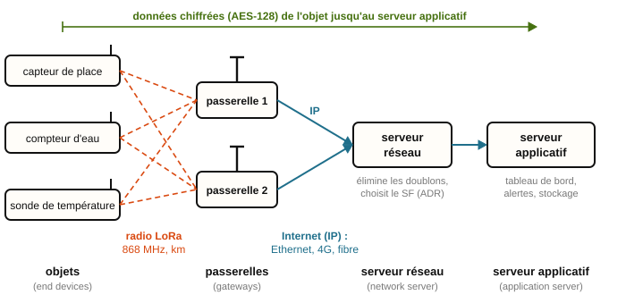

<em>Figure 88 : Architecture d'un réseau LoRaWAN : objets, passerelles, serveur réseau et serveur applicatif.</em>

**Portée, bilan de liaison et marge**

- Une passerelle couvre typiquement **2 à 5 km en ville** et **10 à 15 km en zone dégagée**. Comme la puissance d'émission est plafonnée par la réglementation, la portée dépend entièrement du **bilan de liaison** (§1.3, équation (10)), qui s'écrit pour une liaison radio :

$$P_{r(dBm)} = P_{e(dBm)} + G_e + G_r - L_{\text{câbles}} - A \tag{25a}$$

  avec P_e la puissance de l'émetteur (dBm), G_e et G_r les gains des antennes d'émission et de réception, L_câbles les pertes des câbles et connecteurs (dB) et A l'atténuation du trajet : espace libre, murs, végétation (dB). Le gain d'une antenne s'exprime en **dBi** : c'est sa capacité à concentrer la puissance dans une direction, comparée à une antenne **isotrope** idéale qui rayonnerait de la même façon dans toutes les directions (un dipôle λ/2 a un gain de 2,15 dBi). La puissance réellement rayonnée par l'émetteur, P_e + G_e − (pertes du câble d'émission), s'appelle la **PIRE** (puissance isotrope rayonnée équivalente).
- La **sensibilité** S du récepteur (en dBm) est la plus petite puissance reçue qui permet encore de décoder les données. La **marge** de la liaison est l'écart entre la puissance reçue et cette sensibilité :

$$M_{(dB)} = P_{r(dBm)} - S_{(dBm)} \tag{25b}$$

  La liaison fonctionne si M > 0 ; en pratique, on exige au moins 10 dB de marge pour absorber les imprévus (pluie, véhicule garé au-dessus du capteur, porte métallique, vieillissement, antenne mal orientée (§3.7)).
- Ordre de grandeur : avec P_e = +14 dBm, deux antennes de 2 dBi, 1 dB de câble et S = −137 dBm, la liaison LoRa supporte jusqu'à 14 + 2 + 2 − 1 + 137 = **154 dB** d'atténuation. Une liaison Wi-Fi (P_e = +20 dBm, S ≈ −82 dBm, mêmes antennes) n'en supporte qu'environ 105 dB. En espace libre, ces 50 dB d'écart correspondent à une distance multipliée par environ 300 : c'est le passage de la centaine de mètres à plusieurs kilomètres.

*Exemple résolu :* un capteur de place de parking émet à +14 dBm avec une antenne intégrée de 0 dBi. La passerelle, sur le toit, a une antenne de 5 dBi reliée par un câble qui perd 2 dB. L'atténuation du trajet (distance et bâtiments) est estimée à 135 dB.

P_r = 14 + 0 + 5 − 2 − 135 = **−118 dBm** (25a).

En SF7 (S = −123 dBm) : M = −118 − (−123) = 5 dB (25b) : la liaison passe, mais la marge est insuffisante (moins de 10 dB).

En SF12 (S = −137 dBm) : M = 19 dB : liaison fiable, au prix d'un débit environ 18 fois plus faible et d'un temps d'émission plus long, qui use la pile plus vite.

Le serveur réseau choisira un SF intermédiaire, par exemple SF9 (S ≈ −129 dBm, M = 11 dB).

**Comparaison avec les autres réseaux sans fil**

| Technologie | Bande de fréquence | Portée typique | Débit | Consommation |
|---|---|---|---|---|
| Bluetooth Low Energy | 2,4 GHz | 10 à 50 m | 1 à 2 Mbit/s | très faible (des mois à des années sur pile bouton) |
| Wi-Fi | 2,4 et 5 GHz | 30 à 100 m | 100 Mbit/s à plusieurs Gbit/s | élevée (secteur ou recharge fréquente) |
| 4G / 5G | 0,7 à 3,5 GHz | 1 à 10 km autour de l'antenne relais | 10 Mbit/s à plus de 1 Gbit/s | élevée, abonnement opérateur |
| LoRaWAN | 868 MHz (Europe) | 2 à 5 km en ville, 10 à 15 km en zone dégagée | 0,3 à 5,5 kbit/s | très faible (5 à 10 ans sur pile) |

À retenir : on échange du **débit** contre de la **portée** et de l'**autonomie**. LoRaWAN transporte quelques octets très loin avec très peu d'énergie ; le Wi-Fi transporte beaucoup de données près de la borne.

> → **Application concrète :** **Parking intelligent, télérelève et supervision d'une salle serveurs.** Des capteurs magnétiques noyés dans le sol d'un parking signalent si la place est libre (annale 2025, partie 5) ; les compteurs d'eau d'une ville transmettent leur index une fois par jour ; dans un datacenter, des sondes LoRaWAN de température et d'humidité, sans câble et sans pile à changer pendant des années, alertent dès qu'une baie chauffe.

> → **Sur le terrain :** pour déployer un réseau LoRaWAN, le technicien place la passerelle en point haut, avec une antenne verticale de quelques dBi et un câble court et à faibles pertes (§3.12) ; il calcule puis mesure la marge de chaque capteur (au moins 10 dB), en déplaçant la passerelle ou en ajoutant une seconde passerelle si un capteur est trop juste ; enfin, il protège les clés de chiffrement des objets, cible privilégiée des attaques.

### 3.10 Modélisation d'une ligne de transmission

- Une **ligne de transmission** est un ensemble de conducteurs utilisé pour transmettre un signal d'une source vers une charge (paires torsadées, câbles coaxiaux...). Dès que les dimensions de la ligne ne sont plus négligeables devant la longueur d'onde du signal transmis (hautes fréquences, longues distances), des phénomènes de propagation apparaissent qui ne peuvent plus être ignorés.
- Une ligne se modélise, par tronçon élémentaire, par quatre paramètres linéiques (résistance, inductance, capacité, conductance par unité de longueur). Aux fréquences habituelles, les effets résistifs sont souvent négligeables devant les effets capacitifs et inductifs : on parle alors de **ligne sans pertes**.

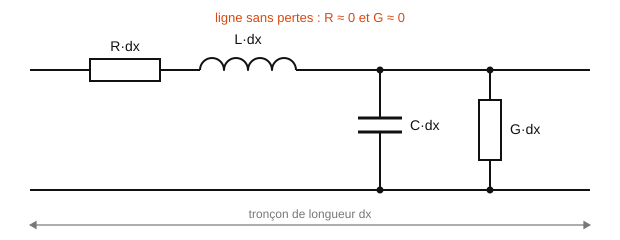

<em>Figure 40 : Modèle électrique d'un tronçon de ligne de transmission.</em>

- **Impédance caractéristique** d'une ligne sans pertes : $Z_C = \sqrt{\dfrac{L}{C}}$ (L et C étant les paramètres linéiques). Ces mêmes paramètres fixent la célérité des ondes dans la ligne : $c = \dfrac{1}{\sqrt{LC}} = k \cdot c_0$, où k est le coefficient de vélocité, caractéristique de la ligne (ex. câble coaxial : k ≈ 0,66, soit c ≈ 2,0×10⁸ m/s).

> → **Application concrète :** **Le câble Ethernet et le câble coaxial.** Un câble Ethernet (paires torsadées) a une impédance caractéristique de 100 Ω, un câble coaxial d'antenne TV 75 Ω, un câble coaxial de mesure ou de réseau radio 50 Ω. Ces valeurs ne sont pas arbitraires : ce sont les paramètres L et C linéiques du câble qui les fixent, et tous les équipements branchés doivent présenter la même impédance pour éviter les réflexions.

### 3.11 Propagation impulsionnelle et réflexions

- Le long d'une ligne de longueur l, un signal met un temps $\Delta t = \dfrac{l}{c}$ pour atteindre l'autre extrémité (retard de propagation).

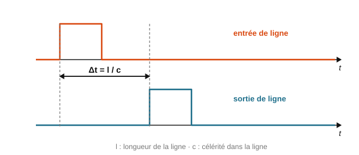

<em>Figure 42 : Oscillogramme d'un régime impulsionnel.</em>

- Si la ligne est fermée sur une résistance de charge **égale** à son impédance caractéristique (R_CH = Z_C), toute la puissance envoyée par le générateur est transmise à la charge : on dit que la **ligne est adaptée**, et une seule onde progressive circule (du générateur vers la charge).

<em>Figure 43 : Ligne adaptée vs ligne non adaptée.</em>

- Si la ligne n'est **pas adaptée** (R_CH ≠ Z_C), une partie de l'onde incidente est **réfléchie** vers la source. Le **coefficient de réflexion en tension** vaut :

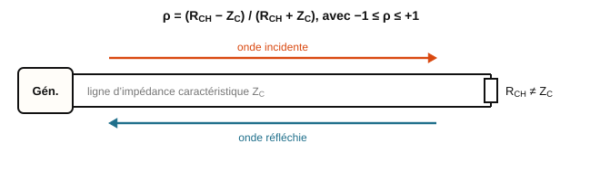

<em>Figure 41 : Onde incidente et onde réfléchie sur une ligne non adaptée.</em>

  $\rho = \dfrac{R_{CH} - Z_C}{R_{CH} + Z_C}$, avec −1 ≤ ρ ≤ +1

  - Ligne adaptée (R_CH = Z_C) : ρ = 0.
  - Ligne ouverte (R_CH → ∞) : ρ = +1.
  - Ligne en court-circuit (R_CH = 0) : ρ = −1.

> → **Application concrète :** **Le réflectomètre (TDR) et la localisation d'un défaut de câble.** Un testeur de câble réseau professionnel envoie une impulsion sur le câble et mesure le temps de retour de la réflexion : connaissant la célérité dans le câble, il indique à quelle distance se trouve une coupure, un court-circuit ou une mauvaise connexion, sans avoir à ouvrir les gaines. C'est exactement la démarche de la partie 4 de l'annale 2025 sur le bus RS485 : un technicien réseau utilise ce principe pour certifier un câblage.

#### Coefficient de vélocité, célérité et retard dans un câble

- Dans un câble, le signal est une onde électromagnétique guidée entre les conducteurs. Elle se propage dans l'isolant (le **diélectrique**) qui sépare l'âme du blindage, ce qui la ralentit : sa célérité v est toujours inférieure à c₀. On la caractérise par le **coefficient de vélocité** k (en anglais NVP, *Nominal Velocity of Propagation*, souvent donné en %), nombre sans unité compris entre 0 et 1 :

$$v = k \cdot c_0 \tag{25c}$$

  avec c₀ = 3,0×10⁸ m/s. C'est la célérité notée c au §3.10 ($c = 1/\sqrt{LC} = k \cdot c_0$) ; on la note ici v pour ne pas la confondre avec c₀. Le coefficient de vélocité dépend surtout de l'isolant : plus celui-ci contient d'air (isolant « mousse »), plus k se rapproche de 1.

| Câble | Isolant | Coefficient de vélocité k | Célérité v |
|---|---|---|---|
| Coaxial RG58, RG213 | polyéthylène plein | 0,66 | 2,0×10⁸ m/s |
| Coaxial TV (RG6), coaxial « faibles pertes » | polyéthylène mousse | 0,80 à 0,85 | 2,4 à 2,6×10⁸ m/s |
| Câble Ethernet Cat 5e, Cat 6 | polyéthylène, polyoléfine | 0,65 à 0,72 | 2,0 à 2,2×10⁸ m/s |
| Fibre optique (n ≈ 1,47) | verre de silice | ≈ 0,68 (k = 1/n) | ≈ 2,0×10⁸ m/s |
| Ligne bifilaire dans l'air | air | 0,95 à 1 | ≈ 3,0×10⁸ m/s |

- Le **retard** (temps de propagation) sur une longueur l s'en déduit :

$$t = \dfrac{l}{v} = \dfrac{l}{k \cdot c_0} \tag{25d}$$

  Ordre de grandeur à retenir : dans un câble de coefficient 0,66, le signal parcourt environ **20 cm par nanoseconde**, soit 5 ns par mètre (dans le vide : 30 cm par nanoseconde).
- Dans le câble, la longueur d'onde est raccourcie dans le même rapport : λ_câble = v/f = k × λ₀. C'est cette longueur d'onde qui fixe la distance entre deux maximums d'une onde stationnaire (λ/2, §3.12).

*Exemple résolu :* un lien Ethernet Cat 6 mesure l = 90 m, et son coefficient de vélocité vaut k = 0,69.

v = 0,69 × 3,0×10⁸ = 2,07×10⁸ m/s (25c) ; t = 90 / 2,07×10⁸ ≈ 4,35×10⁻⁷ s, soit **435 ns** (25d).

> → **Sur le terrain :** un testeur de câble ou un réflectomètre ne connaît pas le câble qu'on lui présente : avant toute mesure de longueur, le technicien règle le coefficient de vélocité (NVP) indiqué sur la fiche technique ou imprimé sur la gaine. Une erreur de 5 % sur k donne 5 % d'erreur sur toutes les distances affichées.

#### Le réflectomètre (TDR) : localiser un défaut par son écho

- Un **réflectomètre temporel** (TDR, *Time Domain Reflectometer*) injecte une impulsion très brève (quelques nanosecondes) à l'entrée du câble et enregistre la tension à cette même entrée au cours du temps. Toute **discontinuité d'impédance** (extrémité du câble, coupure, court-circuit, connecteur mal serti, câble écrasé, infiltration d'eau) renvoie une partie de l'impulsion vers l'appareil : c'est l'**écho**. La courbe obtenue s'appelle un **réflectogramme**.
- L'appareil mesure la durée Δt entre l'impulsion émise et l'écho. Pendant cette durée, le signal a parcouru **deux fois** la distance d du défaut (aller jusqu'au défaut, puis retour) : 2d = v × Δt, d'où :

$$d = \dfrac{v \cdot \Delta t}{2} \tag{25e}$$

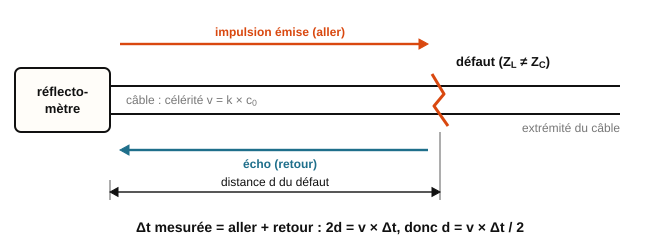

<em>Figure 89 : Principe du réflectomètre : l'écho a parcouru deux fois la distance du défaut.</em>

- L'écho revient affaibli par les pertes du câble, à l'aller et au retour : plus le défaut est loin, plus l'écho est petit.
- C'est exactement le principe du capteur à ultrasons (§3.1, d = c × t/2) et du radar, appliqué à une onde guidée dans un câble.

*Exemple résolu :* sur le lien Cat 6 précédent (v = 2,07×10⁸ m/s), un testeur reçoit un écho Δt = 320 ns après l'impulsion.

d = 2,07×10⁸ × 320×10⁻⁹ / 2 ≈ **33 m** (25e). Sans le facteur 2, on trouverait 66 m : c'est l'erreur classique.

> → **Sur le terrain :** face à une liaison coupée dans un faux plafond, le technicien mesure Δt au réflectomètre depuis la baie, calcule d avec le bon coefficient de vélocité, puis reporte cette distance sur le plan du cheminement des câbles : il sait où ouvrir, au lieu de tout démonter.

#### Lire un écho : signe et amplitude selon la charge

- Le **signe** et la **hauteur** de l'écho renseignent sur ce qui termine la ligne (charge, antenne ou défaut), caractérisé par son impédance Z_L. On généralise le coefficient de réflexion vu plus haut (R_CH devient Z_L) :

$$\rho = \dfrac{U_{\text{réfl}}}{U_{\text{inc}}} = \dfrac{Z_L - Z_C}{Z_L + Z_C} \tag{25f}$$

  où U_inc est l'amplitude de l'impulsion qui arrive sur la discontinuité et U_réfl celle de l'écho qui en repart. L'écho vaut donc ρ fois l'impulsion incidente : il a le **même signe** qu'elle si ρ > 0, le **signe opposé** si ρ < 0.
- **Sens physique.** Une onde qui se propage sur la ligne porte une tension et un courant dont le rapport vaut toujours Z_C. Au bout de la ligne, la charge impose sa propre loi, U = Z_L × I. Si Z_L = Z_C, l'onde incidente convient telle quelle : rien n'est renvoyé. Sinon, une onde réfléchie apparaît pour « corriger » la tension et le courant :
  - **circuit ouvert** : aucun courant ne peut sortir ; l'onde réfléchie annule le courant et double la tension au bout de la ligne : U_réfl = +U_inc, ρ = +1 ;
  - **court-circuit** : la tension au bout est forcément nulle ; l'onde réfléchie annule la tension : U_réfl = −U_inc, ρ = −1.

| Ce qui termine la ligne | Impédance | ρ | Écho observé au réflectomètre |
|---|---|---|---|
| Charge adaptée (bouchon de terminaison, équipement de même impédance) | Z_L = Z_C | 0 | aucun écho |
| Circuit ouvert (câble coupé, connecteur débranché) | Z_L → ∞ | +1 | écho de **même signe**, presque de même amplitude |
| Court-circuit (âme et blindage en contact) | Z_L = 0 | −1 | écho de **signe opposé**, presque de même amplitude |
| Impédance plus grande (charge de 100 Ω sur câble 50 Ω, contact oxydé) | Z_L > Z_C | entre 0 et +1 | petit écho de même signe |
| Impédance plus faible (câble écrasé, eau dans le câble, charge de 25 Ω) | Z_L < Z_C | entre −1 et 0 | petit écho de signe opposé |

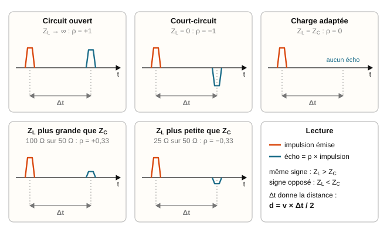

<em>Figure 90 : Réflectogrammes selon la charge : signe et amplitude de l'écho (un peu réduite par les pertes du câble).</em>

- **Méthode de lecture d'un réflectogramme :**
  1. repérer l'écho, mesurer Δt et calculer la distance avec (25e) ;
  2. lire le signe : même signe que l'impulsion, Z_L > Z_C (vers le circuit ouvert) ; signe opposé, Z_L < Z_C (vers le court-circuit) ;
  3. comparer les amplitudes : |ρ| ≈ U_réfl/U_inc. Un écho presque aussi grand que l'impulsion (|ρ| ≈ 1) signale un défaut franc (coupure ou court-circuit) ; un petit écho signale une simple désadaptation. À cause des pertes, l'écho d'un défaut franc éloigné est toujours un peu plus petit que l'impulsion : on conclut ρ ≈ +1 ou ρ ≈ −1.
- On peut même retrouver l'impédance du défaut en inversant (25f) : Z_L = Z_C × (1 + ρ)/(1 − ρ).

*Exemple résolu :* sur un câble 50 Ω, l'écho est de signe opposé à l'impulsion et son amplitude vaut le tiers de celle de l'impulsion : ρ = −1/3 ≈ −0,33.

Z_L = 50 × (1 − 1/3)/(1 + 1/3) = 50 × 0,5 = **25 Ω** : l'impédance a chuté localement (câble écrasé ou humide), sans court-circuit franc.

> → **Sur le terrain :** un écho de même signe et de pleine amplitude indique une coupure ou un connecteur débranché (on cherche un câble arraché) ; de signe opposé, un court-circuit (on cherche un câble écrasé ou un connecteur mal monté) ; un petit écho, une simple désadaptation (raccord d'une autre impédance, connecteur oxydé). Après réparation, on refait la mesure : l'écho du défaut doit avoir disparu ; seul peut subsister l'écho de l'extrémité du câble (aucun écho si elle est fermée sur une charge adaptée).

### 3.12 Taux d'ondes stationnaires (TOS) et atténuation linéique

- En régime sinusoïdal, une ligne non adaptée présente un régime d'**ondes stationnaires** : l'amplitude de la tension varie le long de la ligne entre une valeur maximale U_MAX et une valeur minimale U_MIN. On caractérise la qualité de la transmission par le **taux d'ondes stationnaires** :

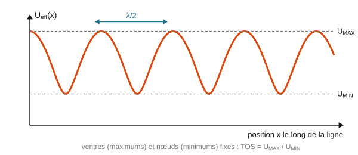

<em>Figure 44 : Onde stationnaire sur une ligne non adaptée.</em>

$$TOS = \dfrac{U_{MAX}}{U_{MIN}} = \dfrac{1 + |\rho|}{1 - |\rho|} \tag{26}$$

  Plus le TOS est proche de 1 (ligne bien adaptée), meilleure est la qualité de transmission. Un TOS élevé indique une désadaptation importante, avec risque d'endommager le générateur (puissance réfléchie).

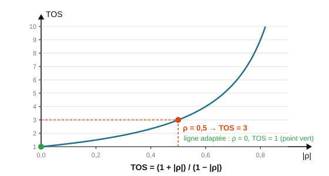

<em>Figure 45 : Abaque / courbe TOS en fonction de ρ.</em>

- En pratique, une ligne réelle introduit également des pertes : l'amplitude en sortie de ligne est plus faible qu'en entrée. On caractérise cette perte par l'**atténuation linéique** (en dB/m) :

$$A_l = \dfrac{20}{l} \times \log_{10}\!\left(\dfrac{U_{E,MAX}}{U_{S,MAX}}\right) \tag{27}$$

*Exemple résolu :* un câble coaxial 50 Ω est fermé sur une résistance de charge de 150 Ω.
ρ = (150−50)/(150+50) = 100/200 = 0,5. TOS = (1+0,5)/(1−0,5) = 1,5/0,5 = 3.
Ce TOS de 3 indique une désadaptation significative (une ligne bien adaptée viserait un TOS proche de 1).

> → **Application concrète :** **La certification d'un câblage réseau et le réglage d'une antenne.** Les testeurs de certification de câbles Ethernet mesurent notamment l'atténuation linéique de chaque liaison pour vérifier qu'elle respecte la norme (Cat 5e, 6, 6a). Côté radio, un installateur d'antenne mesure le TOS (ou ROS) pour vérifier l'adaptation entre l'émetteur et l'antenne : un TOS trop élevé signifie qu'une partie de la puissance est renvoyée vers l'émetteur, qui peut être endommagé.

#### D'où vient le TOS : ondes incidente, réfléchie et stationnaire

- En régime sinusoïdal, une ligne non adaptée transporte deux ondes en même temps : l'onde **incidente**, d'amplitude U_inc, qui va du générateur vers la charge, et l'onde **réfléchie**, d'amplitude |ρ| × U_inc, qui revient de la charge vers le générateur. En chaque point de la ligne, la tension observée est la somme des deux.
- Comme les deux ondes se déplacent en sens contraires, leur décalage change d'un point à l'autre de la ligne :
  - aux points où elles arrivent **en phase**, leurs amplitudes s'ajoutent : c'est un **ventre** de tension ;
  - aux points où elles arrivent **en opposition de phase**, elles se retranchent : c'est un **nœud** de tension.

$$U_{MAX} = U_{\text{inc}}\,(1 + |\rho|) \qquad U_{MIN} = U_{\text{inc}}\,(1 - |\rho|) \tag{27a}$$

- Ces ventres et ces nœuds restent **fixes** le long de la ligne : c'est une **onde stationnaire** (Figure 44). Deux ventres successifs sont séparés de λ/2, un ventre et le nœud voisin de λ/4, où λ = v/f est la longueur d'onde **dans le câble** (§3.11).
- En faisant le rapport des deux expressions (27a), on retrouve l'équation (26) : TOS = U_MAX/U_MIN = (1 + |ρ|)/(1 − |ρ|).
- Cas limites (Figure 91) :
  - ligne adaptée (ρ = 0) : U_MAX = U_MIN = U_inc ; l'amplitude est la même partout, l'onde est purement progressive : **TOS = 1** ;
  - circuit ouvert ou court-circuit (|ρ| = 1) : U_MIN = 0 ; la ligne présente de vrais nœuds, comme une corde de guitare : **TOS infini**.
- Inversement, on retrouve |ρ| à partir d'un TOS mesuré :

$$|\rho| = \dfrac{TOS - 1}{TOS + 1} \tag{27b}$$

- Vocabulaire : TOS (taux d'ondes stationnaires), ROS (rapport d'ondes stationnaires) et VSWR (*Voltage Standing Wave Ratio*) désignent la même grandeur, sans unité et toujours supérieure ou égale à 1 ; les fiches techniques l'écrivent souvent « 1,5:1 ». Attention : certains appareils anciens affichent un « TOS en % » qui correspond en réalité à |ρ| × 100. Dans ce cours, TOS = U_MAX/U_MIN.

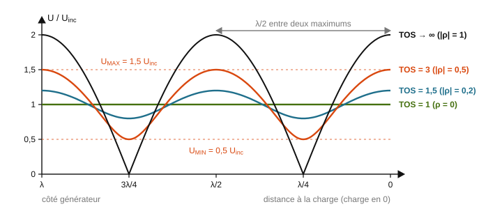

<em>Figure 91 : Amplitude de la tension le long d'une ligne pour plusieurs valeurs du TOS : plus |ρ| est grand, plus l'écart entre ventres et nœuds est marqué.</em>

*Exemple résolu :* une ligne 50 Ω est fermée sur 150 Ω (|ρ| = 0,5, exemple ci-dessus) ; l'onde incidente a une amplitude U_inc = 10 V.

U_MAX = 10 × (1 + 0,5) = 15 V et U_MIN = 10 × (1 − 0,5) = 5 V (27a), d'où TOS = 15/5 = 3 : on retrouve le résultat de l'équation (26). Une sonde déplacée le long du câble lirait donc entre 5 V et 15 V selon sa position : sur une ligne désadaptée, la tension dépend de l'endroit où l'on mesure.

> → **Sur le terrain :** un TOS-mètre (ou ROS-mètre) inséré entre l'émetteur et le câble d'antenne mesure séparément l'onde incidente et l'onde réfléchie, puis affiche le TOS. On le laisse en place pendant le réglage de l'antenne et on vise le TOS le plus proche possible de 1.

#### Interpréter un TOS : valeurs repères et puissance réfléchie

- Le coefficient ρ porte sur les tensions. La puissance étant proportionnelle au carré de la tension (§1.3), la fraction de la puissance incidente renvoyée vers le générateur vaut :

$$\dfrac{P_{\text{réfl}}}{P_{\text{inc}}} = |\rho|^2 \tag{27c}$$

  et, pour une ligne sans pertes, la fraction transmise à la charge vaut 1 − |ρ|².
- Les analyseurs d'antenne et les testeurs de câblage expriment souvent cette réflexion en dB, sous forme de **pertes de retour** (*return loss*, RL) : un nombre positif, d'autant plus grand que la réflexion est faible.

$$RL_{(dB)} = -10 \log_{10}\!\left(\dfrac{P_{\text{réfl}}}{P_{\text{inc}}}\right) = -20 \log_{10}|\rho| \tag{27d}$$

  Les analyseurs de réseau affichent souvent le paramètre S₁₁, qui vaut −RL. Le détail est donné dans les compléments BTS2 (fiche « Puissance réfléchie et pertes de retour »).

| TOS | \|ρ\| | Puissance réfléchie | Puissance transmise | RL | Interprétation |
|---|---|---|---|---|---|
| 1 | 0 | 0 % | 100 % | infinies | adaptation parfaite |
| 1,2 | 0,09 | 0,8 % | 99,2 % | 21 dB | très bonne adaptation |
| 1,5 | 0,20 | 4 % | 96 % | 14 dB | bonne adaptation : limite usuelle d'acceptation |
| 2 | 0,33 | 11 % | 89 % | 9,5 dB | désadaptation nette, à corriger |
| 3 | 0,50 | 25 % | 75 % | 6 dB | mauvaise adaptation |
| infini | 1 | 100 % | 0 % | 0 dB | circuit ouvert ou court-circuit : rien n'est transmis |

**Valeurs repères à retenir**

- **TOS = 1** : adaptation parfaite, aucune puissance réfléchie (cas idéal, jamais atteint exactement).
- **TOS < 1,5** : bonne adaptation, moins de 4 % de puissance réfléchie. C'est la valeur garantie par la plupart des fiches techniques d'antennes.
- **TOS entre 1,5 et 2** : adaptation encore acceptable, mais désadaptation modérée (4 à 11 % de puissance réfléchie) : on vérifie les connecteurs et les réglages. C'est typiquement ce que donne un mélange de matériels 50 Ω et 75 Ω (TOS = 1,5).
- **TOS > 2** : problème à corriger : antenne mal accordée ou prévue pour une autre bande, connecteur oxydé ou mal vissé, eau dans le câble, câble abîmé.

**Sens physique.** Même avec un TOS de 2, 89 % de la puissance arrive à la charge : la perte de puissance utile n'est que d'environ 0,5 dB (10 log(1/0,89)). Le vrai danger d'un TOS élevé est ailleurs :
- l'onde réfléchie revient dans l'étage de sortie de l'émetteur, qui chauffe et peut être détruit ; beaucoup d'émetteurs réduisent d'ailleurs automatiquement leur puissance au-delà d'un TOS de 2 à 3 ;
- sur un câble de données, les échos se superposent aux bits suivants et provoquent des erreurs de transmission.

*Exemple résolu :* une antenne présente un TOS de 1,8 à sa fréquence de travail ; l'émetteur fournit 10 W.

|ρ| = (1,8 − 1)/(1,8 + 1) = 0,8/2,8 ≈ 0,286 (27b) ; P_réfl/P_inc = 0,286² ≈ 0,082, soit 0,82 W renvoyés vers l'émetteur (27c) ; RL = −20 log(0,286) ≈ 10,9 dB (27d). Le TOS est entre 1,5 et 2 : la liaison fonctionne, mais l'antenne mérite d'être réglée.

> → **Sur le terrain :** à la réception d'une installation radio, on relève le TOS sur toute la bande utilisée et on le compare à la fiche technique de l'antenne (en général TOS ≤ 1,5) ; au-delà de 2, on ne met pas l'émetteur en service avant d'avoir trouvé la cause (connecteur, câble, antenne).

#### Atténuation linéique : mesurer, calculer, convertir

- Une ligne réelle dissipe une partie de l'énergie en chaleur (résistance des conducteurs, pertes dans l'isolant) : l'amplitude diminue avec la distance parcourue. Pour mesurer cette perte, on ferme le câble sur sa **charge adaptée** (sinon les ondes stationnaires fausseraient la mesure, puisque la tension dépendrait de l'endroit où l'on mesure) et on relève les amplitudes maximales U_E en entrée et U_S en sortie (les U_E,MAX et U_S,MAX de l'équation (27)).
- La démarche se fait en trois étapes :
  1. **atténuation totale du câble**, en dB, avec la tension d'entrée (la plus grande) au numérateur, pour obtenir un nombre **positif** ;
  2. **atténuation linéique** en dB/m : on divise par la longueur, A_l = A/l, ce qui redonne l'équation (27) ;
  3. **conversion en dB/100 m**, l'unité des fiches techniques : on multiplie par 100 (exemple : 0,05 dB/m = 5 dB/100 m).

$$A_{(dB)} = 20 \log_{10}\!\left(\dfrac{U_E}{U_S}\right) = 10 \log_{10}\!\left(\dfrac{P_E}{P_S}\right) \tag{27e}$$

- **Attention au signe.** Si l'on écrit 20 log(U_S/U_E), on obtient un nombre négatif : c'est un **gain** négatif (§1.3). Une atténuation s'énonce toujours positivement : « le câble atténue de 2 dB », ou « présente un gain de −2 dB », mais jamais « une atténuation de −2 dB ».
- **Utilisation inverse.** Connaissant l'atténuation linéique (fiche technique), on calcule la perte d'un tronçon de longueur l :

$$A_{(dB)} = A_l \times l \tag{27f}$$

  C'est le terme « câble » du bilan de liaison (§3.9). Exemple : 25 m de câble à 20 dB/100 m (soit 0,20 dB/m) perdent 0,20 × 25 = 5 dB, c'est-à-dire plus des deux tiers de la puissance.
- L'atténuation linéique **augmente avec la fréquence** : un câble RG58 perd environ 15 dB/100 m à 100 MHz, mais plus de 50 dB/100 m vers 900 MHz. C'est pourquoi les fiches techniques donnent A_l pour plusieurs fréquences, et pourquoi on relie une passerelle LoRa ou une antenne Wi-Fi extérieure à son émetteur par un câble court et « à faibles pertes ».

> → **Sur le terrain :** avant de tirer un câble d'antenne, on lit l'atténuation linéique sur la fiche technique **à la fréquence de travail**, on calcule la perte totale A = A_l × l et on l'intègre au bilan de liaison ; si elle mange trop de marge, on choisit un câble à plus faibles pertes ou on rapproche l'émetteur de l'antenne.

#### Exemple résolu complet : diagnostic du câble d'une antenne

*Énoncé.* Un câble coaxial 50 Ω à isolant mousse (k = 0,85), de longueur l = 30 m, relie une passerelle LoRa à son antenne quart d'onde installée sur le toit. La liaison ne fonctionne plus.

1. *Célérité et retard.* v = 0,85 × 3,0×10⁸ = 2,55×10⁸ m/s (25c) ; t = 30 / 2,55×10⁸ ≈ 1,18×10⁻⁷ s, soit environ **118 ns** (25d).
2. *Distance du défaut.* Le réflectomètre reçoit un écho Δt = 180 ns après l'impulsion : d = 2,55×10⁸ × 180×10⁻⁹ / 2 ≈ **23 m** (25e). Le défaut se trouve avant l'antenne : l'écho de l'extrémité, à 30 m, arriverait après 2 × 118 = 236 ns.
3. *Nature du défaut.* L'écho est de signe opposé à l'impulsion et presque de même amplitude : ρ ≈ −1, c'est un **court-circuit** (par exemple un collier de fixation trop serré qui a écrasé le câble jusqu'à mettre l'âme en contact avec le blindage). Un écho de même signe aurait indiqué un circuit ouvert (câble coupé).
4. *Adaptation de l'antenne.* Après réparation, le câble est refermé sur l'antenne quart d'onde, d'impédance Z_L ≈ 36 Ω (§3.8). ρ = (36 − 50)/(36 + 50) ≈ −0,163 (25f) ; TOS = (1 + 0,163)/(1 − 0,163) ≈ **1,39** (26) ; puissance réfléchie : 0,163² ≈ 2,7 % (27c). ρ est négatif (Z_L < Z_C), mais le TOS se calcule avec |ρ|. TOS < 1,5 : l'adaptation est correcte.
5. *Atténuation linéique.* On ferme le câble sur une charge de 50 Ω et on mesure U_E = 5,0 V et U_S = 3,4 V (amplitudes maximales). A = 20 log(5,0/3,4) ≈ 3,35 dB (27e) ; A_l = 3,35/30 ≈ **0,112 dB/m**, soit **11,2 dB/100 m** (27). Sens physique : 3,35 dB représentent une puissance divisée par $10^{0{,}335} \approx 2{,}2$ ; plus de la moitié de la puissance est perdue dans le câble.

*Conclusion.* Le défaut est un court-circuit à 23 m de la passerelle ; une fois réparé, l'antenne est correctement adaptée (TOS ≈ 1,4), mais les 30 m de câble coûtent 3,35 dB de marge.

> → **Application concrète :** **Testeur de câble, antenne Wi-Fi mal adaptée et certification.** Branché sur une prise murale, un testeur de câblage Ethernet affiche par exemple « paire 3-6 : ouvert à 37 m » : il a mesuré l'écho, lu son signe (même signe : coupure) et appliqué d = v × Δt / 2 avec le NVP du câble. Sur un point d'accès Wi-Fi extérieur dont la portée a chuté, l'analyseur d'antenne mesure un TOS de 2,5 à 2,45 GHz : un connecteur mal vissé ou une infiltration d'eau a désadapté l'antenne ; après remplacement, le TOS redescend sous 1,5. Enfin, pour certifier un lien Cat 6 ou Cat 6a, le testeur mesure pour chaque paire la longueur (par réflectométrie), l'atténuation et les pertes de retour, puis les compare aux limites de la norme avant de déclarer le lien conforme.

> → **Sur le terrain :** la démarche de diagnostic est toujours la même : (1) régler le coefficient de vélocité du câble ; (2) localiser le défaut au réflectomètre et identifier sa nature par le signe de l'écho ; (3) réparer, puis contrôler le TOS sur la charge réelle ; (4) mesurer l'atténuation et reporter la perte du câble dans le bilan de liaison, pour vérifier qu'il reste assez de marge.

### Erreurs fréquentes des étudiants

- Confondre fréquence et longueur d'onde : la fréquence est fixée par la source, la longueur d'onde et la célérité dépendent du milieu.
- Croire qu'une ligne "ouverte" (R_CH infinie) dissipe toute la puissance : au contraire, c'est le cas où **toute** la puissance est réfléchie (ρ = 1, aucune énergie n'est transmise à la charge).
- Oublier que l'adaptation d'impédance doit se faire des **deux côtés** de la ligne (génération ET charge) pour éviter des réflexions multiples.
- Confondre la polarisation (direction du champ $\vec{E}$) avec la direction de propagation : $\vec{E}$ est toujours perpendiculaire à la propagation.
- Appliquer cos θ à une puissance ou cos²θ à une tension : le champ et la tension reçus varient en cos θ, la puissance (et l'intensité lumineuse) en cos²θ. En dB, les deux écritures donnent la même perte : −20 log|cos θ| = −10 log(cos²θ).
- Croire qu'une antenne tournée de 45° ne reçoit plus que la moitié de la tension : c'est la **puissance** qui est divisée par 2 (−3 dB) ; la tension n'est multipliée que par 0,71.
- Croire qu'une onde circulaire n'est pas reçue par une antenne rectiligne : elle est reçue avec 3 dB de pertes, quelle que soit l'orientation de l'antenne.
- Calculer une antenne quart d'onde avec la longueur d'onde dans le câble : la longueur du brin se calcule avec λ dans l'air, λ = c₀/f ; le coefficient de vélocité ne concerne que le câble.
- Confondre LoRa (la modulation radio) et LoRaWAN (le protocole réseau qui relie objets, passerelles et serveurs) ; ou additionner des dBm entre eux dans un bilan de liaison : on ajoute des gains et on retranche des pertes en dB à **une seule** puissance en dBm.
- Oublier le facteur 2 au réflectomètre : l'écho a fait l'aller et le retour, d = v × Δt / 2.
- Utiliser ρ avec son signe dans le TOS : l'équation (26) utilise |ρ| ; un TOS est toujours supérieur ou égal à 1.
- Donner une atténuation négative : on place la tension d'entrée au numérateur, A = 20 log(U_E/U_S) > 0.

---

## Chapitre 4 : Systèmes bouclés et asservissement

### 4.1 Boucle ouverte, boucle fermée : vocabulaire et principes

**Boucle ouverte / boucle fermée**

- **Boucle ouverte :** la commande envoyée à l'actionneur ne dépend pas du résultat réellement obtenu en sortie. Simple à mettre en œuvre, mais sensible aux perturbations (aucune correction automatique).
- **Boucle fermée (système asservi) :** la sortie réelle est mesurée puis renvoyée en comparaison avec la consigne ; l'écart obtenu pilote une correction automatique.

**Schéma-bloc générique d'un système asservi**

Consigne → **comparateur** (calcule l'écart = consigne − mesure) → **correcteur** → **actionneur** → **système/procédé** → sortie, avec un **capteur** qui renvoie la mesure de la sortie vers le comparateur (boucle de retour).

<em>Figure 46 : Schéma-bloc générique d'un système asservi.</em>

**Vocabulaire clé**

| Terme | Rôle |
|---|---|
| Consigne | Valeur souhaitée pour la sortie |
| Mesure (ou retour) | Valeur réelle de la sortie, fournie par le capteur |
| Écart (ou erreur) | Écart = consigne − mesure ; pilote la correction |
| Correcteur | Calcule la commande à partir de l'écart |
| Actionneur | Agit physiquement sur le système (moteur, résistance chauffante...) |
| Perturbation | Cause extérieure non contrôlée qui modifie la sortie |

*Exemple résolu :* un radiateur électrique piloté par un thermostat. Consigne = 20°C, température mesurée = 18°C.
Écart = consigne − mesure = 20 − 18 = 2°C. Cet écart positif indique qu'il faut chauffer davantage ; le correcteur commande alors l'actionneur (résistance chauffante) en conséquence.

**Une nuance importante : boucle fermée ne veut pas dire "toujours meilleur"**

Une boucle fermée mal réglée (correction trop forte, trop lente...) peut osciller autour de la consigne au lieu de s'y stabiliser directement : c'est la notion de **stabilité**, qui sera approfondie plus tard dans l'année.

**Erreurs fréquentes des étudiants**

- Croire qu'un système en boucle fermée est automatiquement stable et précis : cela dépend aussi du réglage du correcteur.
- Confondre la consigne (ce qu'on veut) et la mesure (ce qu'on observe réellement).
- Oublier que la perturbation est une cause extérieure (une porte ouverte, par exemple), pas un élément du système lui-même.

L'intérêt d'un système bouclé est justement de pouvoir imposer, par le choix du correcteur, un comportement dynamique voulu (temps de réponse, dépassement) : ce qui n'est pas possible en boucle ouverte, où l'on subit le comportement naturel (souvent lent ou imprécis) du système.

> → **Application concrète :** **La régulation thermique d'un serveur.** Un serveur compare en permanence la température mesurée par ses sondes (mesure) à une température cible (consigne), et ajuste la vitesse de ses ventilateurs (actionneur) en fonction de l'écart : c'est un système en boucle fermée. Un ordinateur portable qui accélère ses ventilateurs sous charge, ou un datacenter qui régule sa climatisation, fonctionnent sur ce même principe.

---

### 4.2 Modélisation d'un système linéaire

- Un système physique (électrique, mécanique, thermique, hydraulique...) est dit **linéaire** lorsque sa grandeur de sortie s(t) est liée à sa grandeur d'entrée e(t) par une équation différentielle linéaire à coefficients constants.
- L'**ordre** du système est le degré de cette équation différentielle. En pratique, la plupart des systèmes physiques sont modélisables, en première approche, par une équation du premier ou du second ordre.

> → **Application concrète :** **La modélisation d'un ventilateur ou d'un disque dur.** Avant de programmer la régulation de vitesse d'un ventilateur, on modélise son comportement : un moteur avec son inertie et ses frottements obéit à une équation différentielle du premier ordre. Connaître cette équation permet au logiciel de commande de prévoir la réponse du moteur et de régler la correction sans essais-erreurs.

### 4.3 Les systèmes du premier ordre

Un système du premier ordre obéit à une équation du type :

$$\tau \dfrac{ds}{dt} + s = T_0 \cdot e \tag{28}$$

avec **τ** la constante de temps du système (en secondes) et **T₀** l'amplification statique.

On retrouve cette même forme d'équation dans des domaines très différents : ce qui permet de résoudre un problème mécanique ou thermique avec les mêmes outils qu'un problème électrique :

| Domaine | Équation | τ | T₀ |
|---|---|---|---|
| Électrique (circuit RC) | RC (duC/dt) + uC = uE | RC | 1 |
| Mécanique (moteur + charge, moment d'inertie J, frottement f) | (J/f)(dΩ/dt) + Ω = CM/f | J/f | 1/f |
| Thermique (résistance chauffante, capacité thermique C_TH, résistance thermique R_TH) | R_TH·C_TH (dθ/dt) + θ = R_TH·P | R_TH·C_TH | R_TH |

**Analogie thermique-électrique**

| Grandeur thermique | Grandeur électrique correspondante |
|---|---|
| Différence de température | Différence de potentiel (tension) |
| Puissance thermique | Intensité électrique |
| Résistance thermique | Résistance électrique |
| Capacité thermique | Capacité électrique |

Cette analogie permet d'associer à tout processus thermique un circuit électrique équivalent, et donc de réutiliser directement les méthodes de résolution déjà connues en électricité.

<em>Figure 52 : Analogie électrique/mécanique/thermique.</em>

*Exemple résolu :* un système thermique a une résistance thermique R_TH = 2,0 °C/W et une capacité thermique C_TH = 10 J/K. Sa constante de temps vaut τ = R_TH × C_TH = 20 s. Le régime permanent est atteint après Δt ≈ 3τ = 60 s.

> → **Application concrète :** **Le temps de chauffe d'un composant et la charge d'une batterie.** Un processeur qui monte en charge voit sa température évoluer selon une loi du premier ordre (constante de temps thermique liée à sa capacité et sa résistance thermiques) : c'est cette dynamique que le système de refroidissement doit anticiper. De même, la charge d'un condensateur de filtrage ou d'une petite batterie de sauvegarde suit une exponentielle de constante de temps τ = RC.

### 4.4 Les systèmes du second ordre

Un système du second ordre obéit à une équation du type :

$$\dfrac{1}{\omega_0^2} \dfrac{d^2 s}{dt^2} + \dfrac{2m}{\omega_0} \dfrac{ds}{dt} + s = T_0 \cdot e \tag{29}$$

avec :
- **T₀** : amplification statique,
- **m** : coefficient d'amortissement (sans unité),
- **ω₀** : pulsation propre du système, en rad/s.

Le comportement du système dépend directement de la valeur de m (voir §4.6).

> → **Application concrète :** **Le bras d'un disque dur et les têtes de lecture.** Le positionnement de la tête de lecture d'un disque dur mécanique est un système du second ordre : elle doit se déplacer très vite vers la bonne piste sans osciller autour (sinon la lecture échoue). Le compromis entre rapidité et absence d'oscillation (choix de l'amortissement m) est exactement le problème traité ici, et il conditionne les temps d'accès du disque.

### 4.5 De l'équation différentielle à la transmittance (fonction de transfert)

En notation complexe, la dérivation par rapport au temps correspond à une simple multiplication par jω (et une dérivée seconde à une multiplication par (jω)²). Cette propriété permet de passer directement de l'équation différentielle à la **transmittance isochrone** T(jω) = S/E du système, sans avoir à résoudre l'équation différentielle elle-même : c'est l'outil central pour étudier un système linéaire en régime sinusoïdal (développé en détail au Chapitre 5, §5.3).

> → **Application concrète :** **La simulation avant fabrication.** Les logiciels de simulation de circuits (LTspice, Falstad) et de systèmes automatisés calculent la transmittance d'un système pour prédire sa réponse en fréquence avant tout câblage réel. Un ingénieur qui conçoit un filtre pour une carte réseau ou un régulateur de tension d'alimentation valide ainsi son montage par le calcul avant de commander les composants.

### 4.6 Réponse temporelle : la réponse à un échelon

Un **échelon** e(t) = E·u(t) correspond au passage instantané d'une entrée nulle à une valeur constante E. La **réponse indicielle** d'un système est l'évolution de sa sortie s(t) suite à cet échelon : elle caractérise le comportement du système en régime transitoire.

**Système du premier ordre**

La réponse indicielle s'écrit :

$$s(t) = S_\infty + (S_0 - S_\infty) \, e^{-t/\tau} \tag{30}$$

<em>Figure 47 : Réponse à un échelon : système du premier ordre.</em>

- Elle ne présente **jamais de dépassement**.
- La tangente à l'origine coupe la droite s = S∞ à l'instant t = τ : c'est un moyen graphique simple de déterminer τ à partir d'une courbe expérimentale.
- Le **temps de réponse à 5 %** (durée pour que s(t) reste dans l'intervalle [0,95·S∞ ; 1,05·S∞]) vaut :

$$t_{R5\%} = 3\tau \tag{31}$$

**Système du second ordre**

Le comportement dépend du coefficient d'amortissement m :

| Cas | Comportement |
|---|---|
| m < 1 | Régime transitoire **pseudo-périodique** : la sortie dépasse S∞ puis oscille autour de cette valeur avec des amplitudes décroissantes. |
| m = 1 | Régime transitoire **critique** : la sortie atteint S∞ le plus rapidement possible, sans oscillation (cas limite, peu observable en pratique). |
| m > 1 | Régime transitoire **apériodique** : la sortie évolue lentement vers S∞, sans oscillation, avec une tangente à l'origine horizontale (contrairement au 1er ordre). |

<em>Figure 48 : Système du second ordre : les trois régimes.</em>

- Le temps de réponse à 5 % est **minimal pour m ≈ 0,7**, et vaut alors t_R5% ≈ 3/ω₀.

<em>Figure 50 : Abaque temps de réponse à 5 % / dépassement en fonction de m.</em>

- Si un dépassement existe (0 < m < 1), on définit le **dépassement relatif** :

$$D\% = \dfrac{S_{max} - S_\infty}{S_\infty} \times 100 \tag{32}$$

<em>Figure 49 : Dépassement et pseudo-période.</em>

- La **pseudo-période** (durée entre deux dépassements consécutifs) vaut :

$$T_P = \dfrac{2\pi}{\omega_0 \sqrt{1 - m^2}} \tag{33}$$

> → **Application concrète :** **Le réglage d'un correcteur de régulation (PID).** Les automates industriels, les drones et les imprimantes 3D utilisent des correcteurs PID dont le réglage vise précisément à obtenir une réponse à un échelon rapide, sans dépassement excessif : on cherche un amortissement proche de 0,7 pour un temps de réponse minimal. Les valeurs de dépassement et de temps de réponse à 5 % sont les critères que le technicien lit sur l'oscilloscope ou le logiciel de supervision pour valider son réglage.

### 4.7 Identifier la nature d'un système à partir de sa réponse à un échelon

Un échelon contient à la fois un **front** (variation rapide = hautes fréquences) et un **niveau constant** (régime établi = fréquence nulle). Observer si ces deux composantes sont transmises ou non en sortie permet d'identifier le type de système :

| | Passe-bas | Passe-haut | Passe-bande |
|---|---|---|---|
| Front (hautes fréquences) | Non transmis | Transmis | Non transmis |
| Niveau constant (fréquence nulle) | Transmis | Non transmis | Non transmis |

<em>Figure 51 : Identification du type de système via un échelon.</em>

> → **Application concrète :** **Le diagnostic rapide d'un montage ou d'une liaison.** Envoyer un échelon (ou un créneau) à l'entrée d'un système inconnu et observer sa sortie est la méthode la plus rapide pour l'identifier : un câble réseau qui arrondit les fronts se comporte comme un passe-bas, un couplage par condensateur qui supprime la composante continue comme un passe-haut. Un technicien utilise ce test pour vérifier qu'une liaison peut transmettre le débit voulu sans déformer les bits.

### Erreurs fréquentes des étudiants

- Croire que la tangente à l'origine d'une réponse indicielle du 1ᵉʳ ordre est horizontale : c'est au contraire une pente non nulle, propriété qui permet justement de reconnaître un système du 1ᵉʳ ordre.
- Confondre "temps de réponse minimal" et "pas de dépassement" : le temps de réponse à 5 % est minimal pour m ≈ 0,7, ce qui correspond justement à un léger dépassement, pas à son absence.
- Oublier que l'analogie électrique-mécanique-thermique ne change que le nom des grandeurs (τ, T₀) : les méthodes de résolution restent identiques.

---

## Chapitre 5 : Traitement du signal

### 5.1 Analyse temporelle des signaux

**Les quatre grandes familles de signaux**

| Type de signal | Caractéristique |
|---|---|
| Analogique | Continu en temps et en valeur : la grandeur peut prendre une infinité de valeurs, à tout instant. |
| Échantillonné | Discret en temps (valeurs connues seulement à intervalles réguliers Te), mais continu en valeur. |
| Quantifié | Continu en temps, mais discret en valeur (nombre fini de niveaux possibles). |
| Numérique | Discret en temps ET en valeur : échantillonné puis quantifié, généralement codé en binaire. |

<em>Figure 53 : Les quatre types de signaux.</em>

**Caractéristiques des signaux périodiques**

- **Fréquence :** f = 1/T (Hz), T étant la période.
- **Valeur moyenne** : ⟨u(t)⟩ = (1/T)∫u(t)dt sur une période. Pour un signal "simple", elle se ramène à un calcul d'aire : ⟨u(t)⟩ = Aire/Période. Elle se mesure au multimètre en position DC (souvent notée « = »).

<em>Figure 54 : Valeur moyenne comme aire sous la courbe.</em>

- Un signal périodique de valeur moyenne nulle est dit **alternatif**. Tout signal périodique se décompose en la somme de sa valeur moyenne et d'un signal alternatif : u(t) = ⟨u(t)⟩ + u_AC(t).
- **Valeur efficace :** U_eff = √⟨u²(t)⟩. Elle se mesure au multimètre en position AC ou RMS (*Root Mean Square*).

**Représentation d'un signal sinusoïdal**

$u(t) = A \sin(\omega t + \varphi)$, avec A l'amplitude, ω la pulsation (rad/s) et φ la phase à l'origine (rad).

**Puissance d'un signal**

- Puissance instantanée :

$$p(t) = u(t) \cdot i(t) \tag{34}$$

- Puissance active (ou moyenne) :

$$P = \langle p(t) \rangle \tag{35}$$

*Exemple résolu :* une perceuse fonctionnant sous 12 V (continu) absorbe un courant constant de 2,0 A. La puissance reçue vaut P = U×I = 12×2,0 = 24 W (et non 24 joules : le watt est une puissance, le joule une énergie).

> → **Application concrète :** **Le codage des données sur une liaison série ou réseau.** Un signal Ethernet, USB ou RS485 est un signal numérique dont les niveaux logiques 0 et 1 correspondent à des tensions précises ; la valeur moyenne d'un tel signal doit souvent être nulle (codage Manchester, 8b/10b) pour pouvoir traverser des transformateurs d'isolement. La valeur efficace, elle, conditionne la puissance dissipée et l'échauffement des composants d'une carte.

---

### 5.2 Analyse fréquentielle des signaux

**Théorème de Fourier**

Tout signal périodique de fréquence F peut se décomposer en la somme d'une infinité de sinusoïdes, appelées harmoniques, dont les fréquences sont des multiples entiers de F (dite fréquence fondamentale) :

$$u(t) = U_{moy} + A_1 \sin(\omega t + \varphi_1) + A_2 \sin(2\omega t + \varphi_2) + A_3 \sin(3\omega t + \varphi_3) + \dots \tag{36}$$

<em>Figure 55 : Décomposition de Fourier (fondamental + harmoniques).</em>

**Spectre d'un signal**

- Le **spectre d'amplitude** représente, pour chaque fréquence, l'amplitude de la composante correspondante.
- Pour un signal **périodique**, le spectre est un spectre de raies : une raie à 0 Hz (valeur moyenne), une raie au rang 1 (fondamental), des raies aux rangs 2, 3... (harmoniques). Une sinusoïde pure n'a qu'une seule raie.

<em>Figure 56 : Spectre de raies vs spectre continu.</em>

- Pour un signal **non périodique**, le spectre devient continu (spectre de bande) : il occupe une bande de fréquences plutôt que des raies isolées (ex. la voix humaine occupe grossièrement 50 Hz à 5 000 Hz).

**Valeur efficace à partir du spectre**

La puissance moyenne dissipée par un signal périodique est la somme des puissances dissipées par sa composante continue et par chacun de ses harmoniques :

$$U_{eff} = \sqrt{U_{moy}^2 + \dfrac{A_1^2}{2} + \dfrac{A_2^2}{2} + \dots + \dfrac{A_n^2}{2}} \tag{37}$$

**Taux de distorsion harmonique (THD)**

Il caractérise la pureté d'un signal périodique censé être sinusoïdal :

$D = \dfrac{\sqrt{A_2^2 + A_3^2 + \dots + A_n^2}}{A_1}$, souvent exprimé en pourcentage (D% = 100×D)

Un signal proche d'une sinusoïde pure a un THD inférieur à 1 %.

<em>Figure 57 : Taux de distorsion harmonique.</em>

*Exemple résolu :* un signal a pour fondamental A₁ = 5 V et pour seul harmonique notable A₂ = 0,2 V. THD = 0,2/5 = 0,04, soit 4 %.

> → **Application concrète :** **L'analyse de la qualité d'un signal réseau et la compression audio/vidéo.** Un analyseur de spectre permet de vérifier qu'un signal Wi-Fi ou une porteuse NFC (annale 2026) occupe bien la bande autorisée, sans harmoniques parasites qui perturberaient les canaux voisins. La compression MP3 ou AAC repose entièrement sur la décomposition fréquentielle d'un signal : on ne conserve que les composantes spectrales que l'oreille perçoit réellement.

---

### 5.3 Réponse fréquentielle : transmittance et diagramme de Bode

**Transmittance isochrone**

Le comportement fréquentiel d'un système linéaire, soumis à une entrée sinusoïdale e(t) et répondant par s(t), se caractérise par sa **transmittance** (ou fonction de transfert) :

$$\underline{T}(j\omega) = \dfrac{\underline{S}}{\underline{E}} \tag{38}$$

- Son module T = S/E (rapport des valeurs efficaces ou des amplitudes) donne le gain en dB :

$$G = 20 \times \log_{10}(T) \tag{39}$$

  - T = 1 ⇒ G = 0 dB (signal transmis à l'identique).
  - T > 1 ⇒ G > 0 dB (amplification).
  - T < 1 ⇒ G < 0 dB (atténuation).
- Son argument est le déphasage entre s(t) et e(t).
- Le tracé de G et du déphasage en fonction de la fréquence (échelle logarithmique) constitue le **diagramme de Bode** du système.

<em>Figure 58 : Diagramme de Bode complet (gain + phase).</em>

**Calcul pratique de la transmittance**

- Pour un quadripôle **passif**, on utilise le plus souvent la relation du diviseur de tension :

$$\underline{T} = \dfrac{\underline{U}_S}{\underline{U}_E} = \dfrac{\underline{Z}_2}{\underline{Z}_1 + \underline{Z}_2} \tag{40}$$

- Pour un quadripôle **actif** construit autour d'un AOP, on identifie la structure (inverseur, non-inverseur) et on applique directement sa relation caractéristique (voir §5.4).

**Bande passante à −3 dB**

Un système de gain maximal G_MAX transmet correctement les fréquences pour lesquelles G(f) ≥ G_MAX − 3 dB. L'intervalle de fréquences correspondant est la **bande passante à −3 dB**, ses bornes étant les **fréquences de coupure**.

**Systèmes du premier ordre**

| Type | Transmittance canonique |
|---|---|
| Passe-bas | $\underline{T} = \dfrac{T_0}{1 + j\frac{\omega}{\omega_0}}$, avec $\omega_0 = 1/\tau$ la pulsation de coupure à −3 dB |
| Passe-haut | $\underline{T} = T_0 \times \dfrac{j\frac{\omega}{\omega_0}}{1 + j\frac{\omega}{\omega_0}}$ |

<em>Figure 59 : Diagrammes de Bode des filtres du 1er ordre.</em>

**Systèmes du second ordre**

Transmittance canonique générale (dénominateur) : **1 + 2mj(ω/ω₀) + (jω/ω₀)²**

- **Passe-bas :** $\underline{T} = \dfrac{T_0}{1 + 2mj\frac{\omega}{\omega_0} + \left(j\frac{\omega}{\omega_0}\right)^2}$. Si m < 0,7, la courbe de gain présente un maximum (phénomène de **résonance**), d'autant plus marqué que m est faible : $G_{MAX} = 20 \log\!\left[\dfrac{1}{2m\sqrt{1-m^2}}\right]$, atteint pour $\omega_R = \omega_0\sqrt{1-2m^2}$.
- **Passe-haut :** :

$$\underline{T} = T_0 \times \dfrac{\left(j\frac{\omega}{\omega_0}\right)^2}{1 + 2mj\frac{\omega}{\omega_0} + \left(j\frac{\omega}{\omega_0}\right)^2} \tag{41}$$

- **Passe-bande :** $\underline{T} = T_0 \times \dfrac{2mj\frac{\omega}{\omega_0}}{1 + 2mj\frac{\omega}{\omega_0} + \left(j\frac{\omega}{\omega_0}\right)^2} = \dfrac{T_0}{1 + jQ\left(\frac{\omega}{\omega_0} - \frac{\omega_0}{\omega}\right)}$, avec le **facteur de qualité** $Q = \dfrac{1}{2m} = \dfrac{\omega_0}{\Delta\omega}$ (Δω : largeur de la bande passante).

<em>Figure 60 : Diagrammes de Bode du second ordre selon m.</em>

> → **Application concrète :** **La bande passante d'un câble et d'une carte son.** La catégorie d'un câble Ethernet (Cat 5e : 100 MHz, Cat 6 : 250 MHz, Cat 6a : 500 MHz) est justement sa bande passante à −3 dB : au-delà, le signal est trop atténué pour être exploité, ce qui limite le débit. De même, une carte son ou un convertisseur audio est spécifié par sa bande passante (typiquement 20 Hz à 20 kHz), directement lue sur son diagramme de Bode.

---

### 5.4 Amplification

**Trois définitions du gain**

| Grandeur | Définition | Gain en dB |
|---|---|---|
| Amplification en tension | A_V = s(t)/e(t) | G_V = 20×log\|A_V\| |
| Amplification en courant | A_i = i_s(t)/i_e(t) | G_i = 20×log\|A_i\| |
| Amplification en puissance | A_P = P_S/P_E | G_P = 20×log\|A_P\| |

Le **rendement** d'un amplificateur vaut η = P_S / (P_F + P_S), où P_F est la puissance perdue (dissipée) dans l'amplificateur lui-même.

**Modèle équivalent d'un amplificateur**

Un amplificateur se modélise par une résistance d'entrée R_e et une résistance de sortie R_s (modèle de Thévenin en sortie) :
- R_e doit être **la plus grande possible**, pour limiter la chute de tension en entrée lorsqu'un autre montage est placé en amont.
- R_s doit être **faible** devant la résistance de charge (ou égale à celle-ci pour un transfert de puissance maximal).

<em>Figure 64 : Modèle équivalent d'un amplificateur (Re, Rs).</em>

**Montage inverseur à AOP**

Pour un AOP en contre-réaction (résistances R₁ en entrée, R₂ en réaction), en régime linéaire on a v_d = 0 V, ce qui conduit à :

$$\underline{T}(j\omega) = \dfrac{\underline{S}}{\underline{E}} = -\dfrac{R_2}{R_1} \tag{42}$$

<em>Figure 63 : Montage inverseur à AOP.</em>

Le montage inverse le signal (signe −) et amplifie (ou atténue) selon le rapport R₂/R₁. Sa résistance d'entrée vaut simplement R_e = R₁.

**Amplificateur à transistor**

Contrairement à l'AOP (limité aux basses fréquences), un amplificateur à transistor permet de travailler à haute fréquence : on l'utilise dans les émetteurs/récepteurs radio et TV.

> → **Application concrète :** **Le conditionnement d'un capteur avant lecture par un microcontrôleur.** Un capteur (thermocouple, jauge de contrainte, microphone) délivre souvent quelques millivolts, insuffisants pour le CAN d'un microcontrôleur qui attend plusieurs volts : un amplificateur à AOP adapte le niveau. C'est exactement le rôle de l'amplificateur ×130 de la partie 4 de l'annale 2026, et de tout préamplificateur de carte d'acquisition ou d'interface audio.

---

### 5.5 Filtrage analogique

**Définition et rôle**

Un filtre est un quadripôle qui laisse passer certaines fréquences d'un signal et en atténue d'autres (et peut aussi déphaser le signal). On l'utilise pour éliminer du bruit ou sélectionner une bande de fréquences utile (télécommunications, traitement de signaux capteurs...).

**Les trois grandes familles**

| Filtre | Rôle | Exemple d'usage |
|---|---|---|
| Passe-bas | Laisse passer f ≤ f_c, élimine les hautes fréquences | Filtrage en sortie d'un CNA |
| Passe-haut | Laisse passer f ≥ f_c, élimine les basses fréquences | Suppression d'une composante continue parasite |
| Passe-bande | Laisse passer f_cb ≤ f ≤ f_ch | Sélection d'une station FM |

<em>Figure 65 : Gabarit d'un filtre (bande passante / bande coupée).</em>

**Filtres passifs et actifs**

- **Filtres passifs :** constitués uniquement de résistances, condensateurs, inductances. Avantage : utilisables à hautes fréquences, sans alimentation.
- **Filtres actifs :** ajoutent des composants actifs (AOP, transistors). Nécessitent une alimentation, mais permettent d'obtenir un gain et une structure plus flexible (ex. structures de **Sallen-Key** ou de **Rauch**, qui permettent d'obtenir un passe-bas, un passe-haut ou un passe-bande de second ordre en changeant simplement la nature de quelques composants).

<em>Figure 61 : Structure de Sallen-Key.</em>

**Synthèse de filtres d'ordre élevé**

Pour augmenter l'ordre d'un filtre (et donc la raideur de la coupure), on met en cascade plusieurs cellules du premier ou du second ordre. Deux réponses types sont couramment utilisées :

- **Butterworth :** la fréquence de coupure est prise à −3 dB du gain maximal ; réponse la plus "plate" possible dans la bande passante.
- **Chebyshev :** la coupure est prise à −1 dB (ou −0,1 dB) du maximum ; l'atténuation après la coupure est plus rapide, au prix d'une légère ondulation dans la bande passante.

<em>Figure 62 : Comparaison Butterworth vs Chebyshev.</em>

> → **Application concrète :** **Le filtre d'entrée d'une carte son et la séparation ADSL/téléphone.** Le filtre ADSL que l'on branche sur une prise téléphonique est un filtre passe-bas qui sépare la voix (basses fréquences) des données (hautes fréquences) circulant sur le même câble. Une carte son, un récepteur radio ou une interface capteur possèdent tous un filtre anti-bruit ou anti-repliement conçu selon les gabarits et les structures (Sallen-Key, Butterworth) présentés ici.

---

### 5.6 Numérisation des signaux analogiques et restitution

**La chaîne d'acquisition/restitution**

Un signal analogique x_a(t) est **échantillonné** (prélevé à intervalles réguliers T_e = 1/f_e) puis **bloqué**, avant d'être converti en une suite de nombres binaires par un **CAN** (convertisseur analogique-numérique). Après traitement numérique, un **CNA** (convertisseur numérique-analogique) restitue une tension analogique, lissée par un filtre passe-bas pour éliminer les "marches d'escalier".

<em>Figure 67 : Chaîne d'acquisition et de restitution complète.</em>

**Échantillonnage et condition de Shannon**

L'échantillonnage à la fréquence f_e provoque une périodisation du spectre du signal, avec des répliques autour des multiples de f_e. Pour éviter que ces répliques ne se chevauchent (**repliement de spectre**), il faut respecter la **condition de Shannon** :

$$f_e > 2 \times f_{max} \tag{43}$$

<em>Figure 68 : Repliement de spectre (aliasing).</em>

où f_max est la fréquence la plus élevée du spectre du signal analogique. On place en amont de l'échantillonneur un **filtre anti-repliement** (passe-bas, de fréquence de coupure < f_e/2) pour garantir cette condition.

<em>Figure 69 : Rôle du filtre anti-repliement.</em>

**Conversion analogique-numérique (CAN)**

Le CAN code chaque échantillon sur N bits, soit 2^N niveaux possibles. Le pas de quantification (ou **quantum**) vaut :

$$q = \dfrac{V_{réf}}{2^N - 1} \tag{44}$$

<em>Figure 70 : Caractéristique de transfert d'un CAN.</em>

L'erreur de quantification (bruit de quantification) est généralement de ±0,5q (quantification centrée) ou de 0 à q (quantification par défaut). Sa puissance moyenne (dans une résistance de 1 Ω) vaut q²/12 (quantification centrée) ou q²/3 (par défaut).

**SNR de quantification**

Pour un signal sinusoïdal codé sur N bits, le rapport signal sur bruit de quantification vaut :

$$SNR_{(dB)} = 1{,}8 + 6 \times N \tag{45}$$

Chaque bit supplémentaire améliore donc le SNR d'environ 6 dB : c'est un résultat à retenir, très utilisé pour dimensionner la résolution d'un CAN audio ou d'une chaîne d'acquisition.

*Exemple résolu :* un CAN audio 16 bits (format CD) a un SNR théorique de 1,8 + 6×16 = 97,8 dB, largement suffisant pour l'oreille humaine.

**Conversion numérique-analogique (CNA)**

Le CNA fait l'opération inverse : à chaque nombre binaire de N bits correspond un niveau de tension parmi 2^N, avec le même quantum q. Un **filtre de lissage** passe-bas (fréquence de coupure ≤ f_e/2) élimine les discontinuités de la tension de sortie pour restituer un signal analogique propre.

<em>Figure 71 : Signal échantillonné-bloqué et filtre de lissage.</em>

> → **Application concrète :** **Toute chaîne d'acquisition : carte son, capteur connecté, caméra IP.** Un microphone USB échantillonne le son à 44,1 kHz ou 48 kHz (Shannon impose plus de 2 × 20 kHz pour l'audio) et le quantifie sur 16 ou 24 bits (SNR de 98 ou 146 dB théoriques). Un capteur IoT sur LoRa ou un pèse-fût (annale 2026) numérise une grandeur physique avec un CAN dont la résolution en bits doit être choisie selon la précision voulue : le calcul du quantum et du SNR de quantification est au cœur du dimensionnement de tout objet connecté.

### Erreurs fréquentes des étudiants

- Confondre le rôle du filtre anti-repliement (avant échantillonnage) et celui du filtre de lissage (après conversion CNA) : ce sont deux filtres passe-bas, mais à deux endroits différents de la chaîne, avec deux objectifs différents.
- Oublier le facteur 6 dB/bit : une erreur classique consiste à croire que doubler le nombre de bits double le SNR, alors que c'est l'ajout d'un bit qui gagne 6 dB.
- Confondre bande passante d'un système (fréquences transmises) et bande passante d'une bande de bruit (Δf sur laquelle on intègre la densité spectrale) : ce sont deux notions liées mais distinctes.

---

## Chapitre 6 : Optique

### 6.1 Indice de réfraction et propagation de la lumière

- Dans un milieu transparent homogène d'indice de réfraction n, la lumière se propage en ligne droite à la vitesse $c = \dfrac{c_0}{n}$ (c₀ ≈ 3,0×10⁸ m/s dans le vide, où n = 1). Dans tout milieu transparent, n > 1 (ex. n ≈ 1,33 dans l'eau, soit c ≈ 2,25×10⁸ m/s).
- **Dispersion :** dans la plupart des milieux, l'indice n dépend de la longueur d'onde. Une lumière non monochromatique (« paquet d'ondes ») voit donc ses différentes composantes se propager à des vitesses légèrement différentes.

> → **Application concrète :** **La lecture d'un disque optique (CD, DVD, Blu-ray).** Le faisceau laser d'un lecteur traverse la couche transparente du disque, dont l'indice de réfraction est pris en compte pour focaliser précisément le faisceau sur la piste de données. Le passage du DVD au Blu-ray a d'ailleurs consisté à réduire la longueur d'onde du laser (du rouge au bleu) pour lire des détails plus fins, en jouant sur la relation entre longueur d'onde et milieu de propagation.

### 6.2 Réflexion, réfraction et réflexion totale

Lorsqu'un rayon lumineux passe d'un milieu 1 (indice n₁) à un milieu 2 (indice n₂), une partie de la lumière est réfléchie dans le milieu 1, l'autre réfractée dans le milieu 2.

**Loi de Snell-Descartes :** :

$$n_1 \sin(\theta_1) = n_2 \sin(\theta_2) \tag{46}$$

<em>Figure 72 : Réfraction à l'interface de deux milieux.</em>

- Les rayons incident, réfléchi et réfracté sont dans un même plan (plan d'incidence).
- **Réflexion totale :** si n₁ > n₂ et que l'angle d'incidence θ₁ dépasse un angle limite (tel que sin θ₁ > n₂/n₁), il n'y a plus de rayon réfracté : toute la lumière est réfléchie dans le milieu 1. C'est ce principe qui permet de guider la lumière dans une fibre optique.

<em>Figure 73 : Réflexion totale.</em>

> → **Application concrète :** **Les capteurs optiques à réflexion et le guidage de la lumière.** Un capteur de niveau de liquide sans contact exploite la réflexion totale : tant que l'extrémité d'un prisme est dans l'air, la lumière est totalement réfléchie vers le détecteur ; dès qu'elle touche le liquide (indice plus proche), la réflexion totale disparaît et le signal chute. C'est aussi ce principe qui rend possible le guidage de la lumière sur des kilomètres dans une fibre optique.

### 6.3 La fibre optique : structure et principe

- Une fibre optique est un cylindre en silice (ou en plastique) composé d'un **cœur** central et d'une **gaine** périphérique, utilisé pour guider la lumière d'un émetteur vers un récepteur.
- La lumière se propage dans le cœur à la vitesse c = c₀/n₁ (n₁ : indice du cœur), guidée par réflexion totale successive sur l'interface cœur/gaine (n₁ > n₂ nécessaire).

<em>Figure 74 : Structure d'une fibre optique (cœur/gaine).</em>

**Les trois grandes familles de fibres**

| Type | Principe |
|---|---|
| Multimode à saut d'indice | Indice du cœur n₁ constant, nettement supérieur à celui de la gaine n₂. Les rayons se propagent en ligne droite et subissent une réflexion totale sur la gaine. |
| Multimode à gradient d'indice | L'indice du cœur diminue progressivement du centre vers la gaine, ce qui courbe les rayons en continu. |
| Monomode | Diamètre de cœur extrêmement faible (< 10 µm) : un seul rayon possible, parallèle à l'axe. |

<em>Figure 75 : Les trois types de fibres.</em>

**Ouverture numérique**

$ON = \sin(\theta_0)$, où θ₀ est l'angle maximal d'incidence d'un rayon pour qu'il reste guidé dans la fibre.

<em>Figure 76 : Ouverture numérique.</em>

> → **Application concrète :** **Le câblage fibre d'un datacenter ou d'un réseau d'entreprise.** Les liaisons courtes à l'intérieur d'un datacenter (entre baies, entre switches) utilisent des fibres multimodes (OM3, OM4), moins chères et faciles à connecter ; les liaisons longues entre bâtiments ou entre villes utilisent des fibres monomodes (OS2). Le choix entre les deux, et la vérification du type de fibre avant de brancher un module SFP, est une décision quotidienne du technicien réseau.

#### Choisir une fibre : critères et conséquences

**Le tableau de choix**

| Critère | Multimode à saut d'indice | Multimode à gradient d'indice | Monomode |
|---|---|---|---|
| Diamètre cœur / gaine | 200/230 µm (silice) à 980/1 000 µm (plastique) | 50/125 µm (OM2 à OM5) ; 62,5/125 µm (OM1, ancien) | 9/125 µm (OS1, OS2) |
| Source associée | LED rouge (650 nm) ou LED 850 nm | VCSEL 850 nm (petit laser bon marché) ; LED pour les anciens OM1 et OM2 | laser 1 310 nm ou 1 550 nm |
| Atténuation typique | 5 à 10 dB/km (silice) ; 150 à 200 dB/km (plastique) | 2,5 à 3,5 dB/km à 850 nm | 0,3 à 0,4 dB/km à 1 310 nm ; 0,2 dB/km à 1 550 nm |
| Bande passante × distance | 10 à 50 MHz·km | 200 MHz·km (OM1) à 4 700 MHz·km (OM4, OM5) | pas de dispersion modale : seule la dispersion chromatique limite, très loin |
| Portée et débit typiques | moins de 100 m, quelques dizaines de Mbit/s (bus industriels, audio, automobile) | 10 Gbit/s : 300 m (OM3), 400 m (OM4) ; 100 Gbit/s : 70 m (OM3), 100 m (OM4) | 10 Gbit/s : 10 km (module LR), 40 km (ER) ; 100 Gbit/s et plus sur 10 à 80 km |
| Coût du câble | faible | moyen ; l'OM4 et l'OM5 coûtent plus cher que l'OS2 | le plus faible au mètre |
| Coût des émetteurs et récepteurs | très faible | faible (VCSEL, injection facile dans un cœur de 50 µm) | plus élevé : laser aligné au micromètre près ; module 1,5 à 5 fois plus cher qu'en multimode selon le débit |
| Raccordement, sensibilité à la poussière | très facile (coupe au cutter, connecteurs simples), peu sensible | facile ; un cœur de 50 µm tolère un léger défaut d'alignement | délicat : une poussière de quelques µm peut masquer le cœur de 9 µm ; inspection au microscope et nettoyage obligatoires ; soudure par fusion précise |
| Catégories normalisées | pas de catégorie « OM » | OM1, OM2, OM3, OM4, OM5 | OS1 (intérieur), OS2 (extérieur, faible atténuation) |
| Couleur usuelle de la gaine | noire ou variable | orange (OM1, OM2), turquoise (OM3, OM4), violet (OM4 en Europe), vert anis (OM5) | jaune |
| Couleur usuelle des connecteurs | variable | beige (OM1, OM2), turquoise (OM3, OM4), violet (OM4), vert anis (OM5) | bleu (poli droit, UPC) ; vert (poli en angle, APC) |

Ces couleurs sont des conventions, pas des garanties : on lit toujours le **marquage imprimé sur la gaine** (par exemple « OS2 9/125 G.652.D » ou « OM4 50/125 »).

**Pourquoi de telles différences : le lien avec la physique**

- **Un gros cœur accepte beaucoup de modes** : la dispersion modale (§6.4) étale les impulsions et limite le produit bande passante × distance. Le gradient d'indice compense en grande partie ce défaut (les rayons qui font le plus long chemin passent par des zones d'indice plus faible, où ils vont plus vite) : le produit BP × L est multiplié par cent environ. La fibre monomode, qui ne guide qu'un seul mode, supprime complètement la dispersion modale.
- **Un gros cœur est facile à « remplir » de lumière** : une LED ou un VCSEL bon marché suffit, l'alignement des connecteurs est tolérant et une poussière masque une petite partie du cœur. Injecter la lumière dans 9 µm exige un laser focalisé au micromètre près : l'optique coûte plus cher et la propreté devient critique.
- **La silice absorbe moins à 1 310 nm et à 1 550 nm** (fenêtres de transmission, §6.5) : les longues distances se font en monomode à ces longueurs d'onde. Le 850 nm, plus atténué, convient aux courtes distances, où ses sources bon marché font la différence.
- **Le coût total d'un lien = câble + pose + deux modules.** Dans un datacenter qui compte des milliers de liens courts, ce sont les modules qui pèsent : on choisit le multimode. Sur un lien long, c'est la portée qui décide : le monomode s'impose. Pour une nouvelle dorsale de campus, on pose souvent du monomode même sur des distances moyennes, car il supportera les débits futurs sans changer de câble (pérennité).

**La logique de décision du technicien**

Le choix suit toujours le même ordre :
1. **distance réelle du cheminement** (gaines, montées d'étage, réserves de câble ; pas la distance à vol d'oiseau) et **débit visé**, aujourd'hui et dans dix ans : le multimode atteint-il cette distance à ce débit ?
2. **existant** : quelle fibre est déjà posée (marquage sur la gaine), quels modules équipent les commutateurs ? On raccorde ce qui est compatible, avec le même type de module aux deux extrémités ;
3. **budget optique**, avec une marge d'au moins 3 dB (vieillissement, réparations futures, connecteurs encrassés) :

$$M = (P_{e,min} - S) - (\alpha \times L + n_c \times a_c + n_e \times a_e) \tag{46a}$$

  avec P_e,min la puissance minimale émise par le module (dBm), S la sensibilité du récepteur (dBm), α l'atténuation linéique de la fibre (dB/km, §6.4), L la longueur (km), n_c le nombre de connexions et a_c la perte par connexion (environ 0,3 à 0,75 dB), n_e le nombre d'épissures (soudures) et a_e la perte par épissure (environ 0,1 dB). La différence P_e,min − S est le **budget optique** du module ;

4. **coût** des modules multiplié par le nombre de liens ;
5. **environnement** : câble extérieur armé et étanche entre bâtiments, fibre insensible aux courbures (G.657) dans les logements et les goulottes serrées.

<em>Figure 92 : Choisir une fibre : la distance et le débit décident d'abord, puis les vérifications communes à tous les liens.</em>

| Situation | Distance, débit | Choix habituel | Pourquoi |
|---|---|---|---|
| Jarretière dans une baie (commutateur vers serveur) | 1 à 5 m, 10 à 25 Gbit/s | multimode OM4 et modules SR (ou câble cuivre direct DAC sous 5 m) | modules les moins chers ; la distance ne pose aucun problème |
| Liaison entre deux étages (rocade verticale) | 50 à 150 m, 10 Gbit/s | multimode OM4 (ou OM3) et modules SR 850 nm | dans la portée du 10GBASE-SR (300 à 400 m), avec des modules bon marché |
| Dorsale (backbone) de campus entre bâtiments | 2 km, 10 Gbit/s et plus | monomode OS2 en câble extérieur armé, modules LR 1 310 nm | le multimode est limité à quelques centaines de mètres à 10 Gbit/s ; le monomode accepte les débits futurs |
| Raccordement FTTH d'un abonné | jusqu'à 20 km du central optique | monomode G.657 (insensible aux courbures), connecteurs SC/APC verts | imposé par l'opérateur : longue distance, coupleurs passifs, réflexions à éviter |
| Lien entre deux datacenters | 10 à 80 km, 100 Gbit/s et plus | monomode OS2, lasers 1 550 nm, souvent multiplexage en longueur d'onde (WDM) | atténuation minimale à 1 550 nm (0,2 dB/km) ; plusieurs longueurs d'onde par fibre |

**Ce qui se passe si l'on se trompe**

- **Mélange multimode et monomode.** Une jarretière multimode (cœur de 50 µm) branchée sur une liaison monomode (cœur de 9 µm) envoie la lumière d'un grand cœur vers un petit : le rapport des surfaces, (50/9)² ≈ 31, correspond à environ 15 dB de pertes. La liaison tombe, ou devient instable. Dans l'autre sens, les pertes sont plus faibles mais la partie multimode réintroduit la dispersion modale. On ne mélange jamais : jaune avec jaune, turquoise avec turquoise.
- **Mauvais module SFP.** Un module SR (850 nm, multimode) et un module LR (1 310 nm, monomode) ne sont pas interchangeables, et les deux extrémités doivent porter le même type de module. Un mauvais choix peut sembler « fonctionner » sur quelques mètres au banc de test, puis provoquer des erreurs de transmission (trames corrompues) une fois en production. Certains commutateurs refusent en plus les modules d'autres marques.
- **Connecteur APC sur UPC.** Un connecteur APC (vert, face polie à 8° pour renvoyer les réflexions hors du cœur) branché sur un UPC (bleu, face droite) laisse une lame d'air et un défaut d'alignement : plusieurs dB de pertes, de fortes réflexions, et un risque de rayer les deux faces. Vert avec vert, bleu avec bleu.
- **Rayon de courbure trop faible.** Si la fibre est trop courbée, les rayons frappent la gaine sous un angle inférieur à l'angle limite de réflexion totale (§6.2) : la lumière s'échappe du cœur. Ces pertes par macrocourbure sont plus fortes à 1 550 nm qu'à 1 310 nm. Repères : environ 30 mm de rayon minimal pour une jarretière classique, 7,5 à 15 mm pour une fibre G.657, et 10 à 20 fois le diamètre pour un câble. Au réflectomètre optique (OTDR), une perte plus forte à 1 550 nm qu'à 1 310 nm signale une courbure ; un stylo laser rouge (localisateur visuel de défaut) la fait apparaître comme un point lumineux à travers la gaine.
- **Émission et réception inversées.** Sur un lien duplex, l'émetteur de chaque extrémité doit aboutir au récepteur de l'autre : si les deux fibres sont croisées du mauvais côté, le lien reste éteint alors que chaque fibre est intacte.
- **Connecteur sale.** Une seule poussière peut ajouter 1 dB ou plus, et rayer définitivement la face d'un connecteur au moment de l'embrochage : on **inspecte, on nettoie, puis on connecte**.
- **Sécurité.** On ne regarde jamais dans une fibre ou un connecteur : la lumière infrarouge d'un laser est invisible et peut brûler la rétine. On utilise un photomètre ou un microscope d'inspection équipé d'un filtre.

**Erreurs fréquentes sur le terrain**

- Choisir la fibre sur la seule distance ou le seul débit d'aujourd'hui : recâbler coûte bien plus cher que la fibre elle-même.
- Se fier à la couleur sans lire le marquage de la gaine.
- Oublier les connecteurs et les épissures dans le budget optique : sur un lien court, ils pèsent souvent plus que la fibre.
- Mesurer la distance sur un plan, à vol d'oiseau, au lieu de la longueur réelle du cheminement (prévoir 10 à 20 % de plus).
- Brancher un connecteur sans l'avoir inspecté ni nettoyé.

*Exemple résolu : vous devez choisir.* Il faut relier le local technique du bâtiment A à celui du bâtiment B à 10 Gbit/s. Longueur réelle du cheminement : 550 m. Le catalogue propose deux solutions (prix indicatifs) :
- solution 1 : câble OM4 et modules SFP+ 10GBASE-SR (850 nm), portée normalisée de 400 m sur OM4, environ 30 € le module ;
- solution 2 : câble OS2 et modules SFP+ 10GBASE-LR (1 310 nm), portée de 10 km, puissance émise minimale −8,2 dBm, sensibilité −14,4 dBm, environ 60 € le module.

La liaison comporte 2 connexions (un tiroir optique dans chaque bâtiment) à 0,5 dB et 2 épissures à 0,1 dB ; l'OS2 atténue 0,4 dB/km à 1 310 nm.

*Étape 1 : portée.* 550 m > 400 m : la solution 1 est exclue (dispersion modale, §6.4), même si elle est moins chère.

*Étape 2 : budget optique de la solution 2.* P_e,min − S = −8,2 − (−14,4) = 6,2 dB.

*Étape 3 : pertes.* Fibre : 0,4 × 0,55 = 0,22 dB ; connexions : 2 × 0,5 = 1,0 dB ; épissures : 2 × 0,1 = 0,2 dB ; total : 1,42 dB.

*Étape 4 : marge (46a).* M = 6,2 − 1,42 ≈ 4,8 dB, supérieure aux 3 dB exigés : la liaison est validée.

*Conclusion.* On choisit le monomode OS2 avec des modules LR. Le surcoût des modules (2 × 60 € au lieu de 2 × 30 €) est négligeable devant le coût du câble et de la pose, et la fibre OS2 acceptera plus tard un passage à 25 ou 100 Gbit/s sans recâblage. Après la pose, on vérifie au photomètre (ou à l'OTDR) que la perte mesurée est proche des 1,4 dB prévus.

> → **Sur le terrain :** avant de commander, le technicien mesure la longueur réelle du cheminement, lit le marquage de la fibre existante, choisit le même type de module aux deux extrémités et calcule le budget optique avec au moins 3 dB de marge ; à la mise en service, il inspecte et nettoie chaque connecteur avant de le brancher, respecte les rayons de courbure et contrôle la perte au photomètre.

### 6.4 Dispersion, bande passante et atténuation d'une fibre optique

**Dispersion modale**

Dans une fibre multimode, les différents rayons (modes) parcourent des distances différentes, donc arrivent avec des temps de propagation différents. On définit la **dispersion modale** :

$$\Delta t = t_{max} - t_{min} \tag{47}$$

<em>Figure 77 : Dispersion modale.</em>

Ce phénomène étale les impulsions transmises (comportement analogue à un filtre passe-bas en électronique). Il augmente avec la distance parcourue, et il est plus faible dans une fibre à gradient d'indice que dans une fibre à saut d'indice : ce qui explique pourquoi les fibres à gradient d'indice permettent des débits plus élevés sur de plus longues distances.

<em>Figure 78 : Étalement d'une impulsion le long d'une fibre.</em>

**Bande passante**

La bande passante d'une fibre est liée à sa dispersion modale : $BP = \dfrac{0{,}35}{\Delta t}$. Comme Δt augmente avec la longueur de la fibre, la bande passante est inversement proportionnelle à cette longueur : le produit **BP × L** (exprimé en MHz·km) est une caractéristique propre à chaque type de fibre, indépendante de la longueur utilisée : c'est cette valeur que l'on retrouve dans les fiches techniques des fibres commerciales.

**Atténuation linéique**

Une partie de la puissance lumineuse est absorbée par des impuretés du matériau. L'atténuation, proportionnelle à la longueur l de la fibre, s'exprime en dB/m (ou plus couramment en dB/km) :

$$A_0 = \dfrac{10}{l} \times \log_{10}\!\left(\dfrac{P_s}{P_e}\right) \tag{48}$$

*Exemple résolu :* une fibre présente une dispersion modale Δt = 20 ns/km. Sa bande passante vaut BP = 0,35/(20×10⁻⁹) ≈ 17,5 MHz par km, soit un produit BP×L ≈ 17,5 MHz·km : une valeur typique d'une fibre multimode à saut d'indice (à comparer aux 500-1000 MHz·km d'une fibre à gradient d'indice, bien meilleure).

> → **Application concrète :** **Le dimensionnement d'une liaison fibre (budget optique).** Avant de mettre en service une liaison fibre, on vérifie que le produit bande passante × longueur de la fibre choisie est compatible avec le débit visé sur la distance prévue, et que l'atténuation totale (fibre + connecteurs + épissures) reste inférieure au budget optique du module SFP. C'est exactement le raisonnement de la partie 2 de l'annale 2026 (choix de la liaison PGR-AP2) et un point clé de la certification d'un lien fibre au réflectomètre optique (OTDR).

---

### 6.5 Le spectre optique : infrarouge, visible, ultraviolet

**Rappel : où se situe le domaine optique dans le spectre électromagnétique**

Le domaine « optique » regroupe trois bandes voisines du spectre électromagnétique, entre les micro-ondes et les rayons X : l'infrarouge, le visible et l'ultraviolet. Comme pour toute onde électromagnétique, l'énergie transportée par un photon de cette bande vaut $E = h\nu = \dfrac{h c_0}{\lambda}$ (voir Chapitre 1, §1.5) : plus la longueur d'onde est courte, plus l'énergie par photon est grande.

| Domaine | Longueur d'onde approximative | Énergie de photon | Remarque |
|---|---|---|---|
| Infrarouge (IR) | 780 nm à 1 mm | Plus faible (≈ 1 eV et moins) | Souvent associé à la chaleur (rayonnement thermique) |
| Visible | 380 à 780 nm | ≈ 1,6 à 3,3 eV | Seule bande perceptible par l'œil humain |
| Ultraviolet (UV) | 10 à 380 nm | Plus élevée (jusqu'à plusieurs dizaines d'eV) | Suffisamment énergétique pour ioniser ou casser certaines liaisons chimiques |

<em>Figure 79 : Spectre optique détaillé (IR/visible/UV).</em>

**L'infrarouge (IR)**

- Le proche infrarouge (environ 780 nm à 2,5 µm) est très utilisé en électronique et en télécommunications : télécommandes IR, capteurs de proximité et de présence, et surtout les **fenêtres de transmission des fibres optiques**, centrées autour de 850 nm, 1310 nm et 1550 nm (voir Chapitre 6, §6.3-6.4) : ces longueurs d'onde sont choisies car elles correspondent à des minima locaux d'atténuation de la silice.
- L'infrarouge plus lointain est associé au rayonnement thermique : c'est la base de la **thermographie infrarouge** (caméras thermiques), utilisée en maintenance industrielle (détection de points chauds sur une installation électrique), en bâtiment (recherche de ponts thermiques) et en imagerie médicale.

**Le visible**

- C'est la seule bande directement perceptible par l'œil humain, entre le rouge (≈ 780 nm) et le violet (≈ 380 nm).
- Applications directes : éclairage, affichage (écrans, LED), codes-barres et QR codes (lus par un capteur optique dans le visible ou le proche IR), capteurs colorimétriques (analyse de la couleur d'un produit en contrôle qualité).

**L'ultraviolet (UV)**

- On distingue généralement UV-A (315-380 nm, le moins énergétique), UV-B (280-315 nm) et UV-C (100-280 nm, le plus énergétique et le plus dangereux pour les tissus vivants, mais aussi le plus efficace pour la désinfection).
- Applications : authentification de documents et billets de banque (marquages fluorescents invisibles en lumière visible, révélés sous UV) ; stérilisation UV-C (traitement de l'eau, désinfection de surfaces, sans utiliser de produit chimique) ; détection de fuites (traceurs fluorescents UV) ; photolithographie (fabrication des circuits intégrés, où l'UV grave des motifs microscopiques sur un wafer de silicium).

*Exemple résolu :* comparer l'énergie d'un photon UV-C à 254 nm (longueur d'onde germicide typique) à celle d'un photon infrarouge à 1550 nm (fibre optique).
E(254 nm) = hc₀/λ ≈ (6,63×10⁻³⁴ × 3,0×10⁸)/(254×10⁻⁹) ≈ 7,83×10⁻¹⁹ J ≈ 4,89 eV.
E(1550 nm) ≈ (6,63×10⁻³⁴ × 3,0×10⁸)/(1550×10⁻⁹) ≈ 1,28×10⁻¹⁹ J ≈ 0,80 eV.
Le photon UV-C est environ 6 fois plus énergétique que le photon infrarouge utilisé en fibre optique : ce qui explique pourquoi l'UV-C peut endommager l'ADN (d'où son usage germicide) alors que l'infrarouge des télécoms est totalement inoffensif.

<em>Figure 80 : Énergie de photon selon la longueur d'onde.</em>

**Notion de spectroscopie**

- La spectroscopie consiste à analyser la lumière absorbée, émise ou réfléchie par une substance pour l'identifier ou la caractériser, sans contact physique.
- **Spectroscopie d'absorption UV-Visible :** on mesure quelles longueurs d'onde sont absorbées par un échantillon (souvent liquide) pour doser une concentration chimique : technique courante en laboratoire d'analyse et en contrôle qualité agroalimentaire.

<em>Figure 81 : Principe de la spectroscopie d'absorption.</em>

- **Spectroscopie infrarouge :** chaque liaison chimique (C-H, O-H, C=O...) absorbe l'infrarouge à des longueurs d'onde caractéristiques ; on l'utilise pour identifier la composition d'un matériau (contrôle qualité industriel, analyse de polymères, sciences forensiques).

**Application sectorielle : un même principe, des usages très variés**

| Secteur | Technique | Exemple d'application |
|---|---|---|
| Télécoms/réseaux | Transmission guidée en IR | Fibre optique (850/1310/1550 nm) |
| Industrie | Thermographie IR | Maintenance prédictive, détection de points chauds |
| Santé | Imagerie IR, stérilisation UV-C | Thermographie médicale, désinfection de matériel |
| Sécurité/authentification | Fluorescence UV | Billets de banque, documents officiels |
| Électronique | Photolithographie UV | Fabrication des circuits intégrés |
| Agroalimentaire/chimie | Spectroscopie UV-Vis et IR | Dosage, contrôle qualité, identification de matériaux |

<em>Figure 82 : Tableau visuel des applications sectorielles.</em>

> → **Application concrète :** **Les capteurs infrarouges, la télédétection et la sécurité physique.** Une télécommande, un capteur de présence, une caméra thermique de surveillance d'un datacenter (détection d'un équipement en surchauffe) ou un capteur de qualité de l'air par spectroscopie infrarouge (détection de CO₂) exploitent tous une bande précise du spectre optique. En cybersécurité physique, la lampe UV qui authentifie un badge ou un document, et la caméra infrarouge qui voit dans le noir, relèvent du même chapitre.

### Erreurs fréquentes des étudiants

- Croire que la réflexion totale se produit dans n'importe quel sens : elle exige n₁ > n₂ ET un angle d'incidence suffisamment grand : dans le sens inverse (n₁ < n₂), elle est impossible quel que soit l'angle.
- Confondre atténuation (perte de puissance, en dB/km) et dispersion modale (étalement temporel, en ns/km) : ce sont deux limitations différentes, qui limitent respectivement la distance et le débit maximal d'une liaison optique.
- Oublier que le produit bande passante × longueur est une constante de la fibre : doubler la longueur d'une liaison divise sa bande passante par deux, pas par quatre.

---
- Croire que l'infrarouge et l'ultraviolet sont visibles avec un filtre adapté : ce sont des rayonnements **invisibles** à l'œil humain, quel que soit le filtre : seuls des capteurs spécifiques (photodiodes, capteurs CCD sensibles à ces longueurs d'onde) permettent de les détecter.
- Penser que "plus énergétique" veut dire "plus lumineux" : l'énergie par photon (liée à λ) et l'intensité (liée au nombre de photons, donc à la puissance) sont deux notions indépendantes.
- Confondre UV-A, UV-B et UV-C : ce sont trois sous-bandes bien distinctes, avec des usages et des dangers très différents (l'UV-C germicide n'a rien à voir avec l'UV-A responsable du bronzage).

---

## Chapitre 7 : Préparation à l'épreuve

*(À compléter au fil de l'année : méthodologie de résolution type épreuve U4 (Physique : 1h30/30 points), fiches de synthèse par thème, annales, révisions transversales.)*

---

## Bibliographie et ressources pour aller plus loin

Sélection d'ouvrages de référence, reconnus et largement utilisés dans l'enseignement technique et industriel francophone.

### Références techniques par thème

| Thème | Ouvrage | Auteur(s) | Éditeur |
|---|---|---|---|
| Mesures, capteurs, instrumentation | *Les capteurs en instrumentation industrielle* | Georges Asch et collaborateurs | Dunod |
| Électrotechnique / bases élec | *Électrotechnique* | Théodore Wildi | De Boeck |
| Électronique, semi-conducteurs | *Électronique : composants et systèmes d'application* | Robert Boylestad, Louis Nashelsky | Pearson / ERPI (traduction française) |
| Systèmes bouclés / asservissement | *Automatique : systèmes linéaires, non linéaires, à temps continu, à temps discret* | Yves Granjon | Dunod |
| Traitement du signal | *Traitement des signaux et acquisition de données* (collection Aide-mémoire) | Francis Cottet | Dunod |
| Mesures et incertitudes (référence officielle) | *Évaluation des données de mesure : Guide pour l'expression de l'incertitude de mesure* (GUM), JCGM 100:2008 | BIPM / JCGM | Téléchargement gratuit sur bipm.org |

### Pour la culture scientifique et donner du sens (à recommander aux étudiants curieux)

| Ouvrage | Auteur | Intérêt |
|---|---|---|
| *Le cours de physique de Feynman* | Richard Feynman | Un classique mondial, pédagogique et vivant, pour (re)donner du sens aux notions de base |
| *Le Goût du vrai* | Étienne Klein | Physicien et vulgarisateur français, sur l'esprit scientifique et la démarche expérimentale |
| Collection *Que sais-je ?* (ex. *L'électronique*, *Les ondes électromagnétiques*) | Divers auteurs | Format court et accessible pour des mises au point rapides sur un thème précis |

### Ressources numériques et normatives (gratuites)

- **BIPM/JCGM** : Guide pour l'expression de l'incertitude de mesure (GUM) et vocabulaire international de métrologie (VIM), téléchargeables gratuitement sur *bipm.org*.
- **Eduscol / sites académiques de sciences physiques** : ressources pédagogiques, banques d'exercices et documents d'accompagnement mutualisés entre professeurs de STS.

---

## Glossaire des formules

Toutes les formules numérotées du recueil, dans l'ordre d'apparition. Le numéro est cliquable et renvoie directement à la formule dans le texte. Le document Markdown n'ayant pas de pagination fixe, la référence indiquée est le chapitre et la section ; les numéros de page apparaîtront automatiquement lors d'une conversion en PDF.

| N° | Formule | Description | Section |
|---|---|---|---|
| [(1)](#eq-1) | $U = R \times I$ | Loi d'Ohm | 1.1 Bases de l'électricité |
| [(2)](#eq-2) | $U(R_2) = E \times \dfrac{R_2}{R_1 + R_2}$ | Diviseur de tension et diviseur de courant | 1.1 Bases de l'électricité |
| [(3)](#eq-3) | $f_0 = \dfrac{1}{2\pi\sqrt{LC}}$ | Résonance d'un dipôle RLC | 1.2 Circuits linéaires en régime sinusoïdal (systèmes linéaires) |
| [(4)](#eq-4) | $U_{eff} = \dfrac{U_{max}}{\sqrt{2}} \approx 0{,}707 \times U_{max}$ | Rappel : puissance en régime sinusoïdal | 1.3 Puissances, décibels, atténuation et gains |
| [(5)](#eq-5) | $P = \dfrac{U_{eff}^2}{R} = R \times I_{eff}^2 = U_{eff} \times I_{eff}$ | Rappel : puissance en régime sinusoïdal | 1.3 Puissances, décibels, atténuation et gains |
| [(6)](#eq-6) | $A_v = \dfrac{V_s}{V_e}$ | Gain et atténuation en linéaire | 1.3 Puissances, décibels, atténuation et gains |
| [(7)](#eq-7) | $A_{(dB)} = 10 \times \log_{10}\!\left(\dfrac{P_2}{P_1}\right)$ | Le décibel (dB) : pourquoi et comment | 1.3 Puissances, décibels, atténuation et gains |
| [(8)](#eq-8) | $G_{total(dB)} = G_{1(dB)} + G_{2(dB)} + \dots + G_{n(dB)}$ | Cascade de quadripôles (chaîne de transmission) | 1.3 Puissances, décibels, atténuation et gains |
| [(9)](#eq-9) | $P_{(dBm)} = 10 \times \log_{10}\!\left(\dfrac{P}{1\ \text{mW}}\right)$ | Le dBm : une unité absolue de puissance | 1.3 Puissances, décibels, atténuation et gains |
| [(10)](#eq-10) | $P_{s(dBm)} = P_{e(dBm)} + \sum \text{gains}_{(dB)} - \sum \text{pertes}_{(dB)}$ | Bilan de liaison (budget de liaison) | 1.3 Puissances, décibels, atténuation et gains |
| [(11)](#eq-11) | $P = \dfrac{U_{eff}^2}{Z}$ | D'autres échelles en dB, à connaître | 1.3 Puissances, décibels, atténuation et gains |
| [(12)](#eq-12) | $E = h\nu = \dfrac{h c_0}{\lambda}$ | 1.5 Bandes d'énergie et photons | 1.5 Bandes d'énergie et photons |
| [(13)](#eq-13) | $\nu = \dfrac{c_0}{\lambda} = \dfrac{\Delta E}{h}$ | 1.6 La diode électroluminescente (DEL/LED) | 1.6 La diode électroluminescente (DEL/LED) |
| [(14)](#eq-14) | $u_A = \dfrac{s}{\sqrt{n}}$ | Incertitude-type de type A (statistique) | 2.1 Notions fondamentales et incertitudes de mesure |
| [(15)](#eq-15) | $u = \sqrt{u_A^2 + u_B^2}$ | Composer deux incertitudes | 2.1 Notions fondamentales et incertitudes de mesure |
| [(16)](#eq-16) | $u(z) = \sqrt{u(x)^2 + u(y)^2}$ | Propagation des incertitudes sur une grandeur calculée | 2.1 Notions fondamentales et incertitudes de mesure |
| [(17)](#eq-17) | $\dfrac{u(z)}{z} = \sqrt{\left(\dfrac{u(x)}{x}\right)^2 + \left(\dfrac{u(y)}{y}\right)^2}$ | Propagation des incertitudes sur une grandeur calculée | 2.1 Notions fondamentales et incertitudes de mesure |
| [(18)](#eq-18) | $U_{mesurée} = (2{,}64 \pm 0{,}09)\ \text{V}$ | Écrire un résultat de mesure | 2.1 Notions fondamentales et incertitudes de mesure |
| [(19)](#eq-19) | $P_{(dBm)} = DSP + 10 \times \log_{10}(\Delta f)$ | Densité spectrale de puissance (DSP) | 2.2 Le bruit : une source d'incertitude sur tout signal mesuré |
| [(20)](#eq-20) | $SNR_{(dB)} = 10 \times \log_{10}\!\left(\dfrac{P_{signal}}{P_{bruit}}\right) = 20 \times \log_{10}\!\left(\dfrac{S}{B}\right)$ | Rapport signal sur bruit (SNR) | 2.2 Le bruit : une source d'incertitude sur tout signal mesuré |
| [(21)](#eq-21) | $y(x,t) = A \sin\!\left[\dfrac{2\pi}{T}\left(t - \dfrac{x}{c}\right)\right]$ | 3.2 Ondes progressives sinusoïdales | 3.2 Ondes progressives sinusoïdales |
| [(22)](#eq-22) | $\lambda = c \cdot T = \dfrac{c}{f}$ | 3.2 Ondes progressives sinusoïdales | 3.2 Ondes progressives sinusoïdales |
| [(23)](#eq-23) | $\Delta f = f_R - f_S = f_S \times \dfrac{v_S}{c - v_S}$ | 3.4 Ondes sonores et effet Doppler | 3.4 Ondes sonores et effet Doppler |
| [(24)](#eq-24) | $\dfrac{E}{B} = c$ | 3.5 Ondes électromagnétiques : propriétés | 3.5 Ondes électromagnétiques : propriétés |
| [(24a)](#eq-24a) | $\vec{E}(z,t) = E_x \cos(\omega t - kz)\,\vec{u}_x + E_y \cos(\omega t - kz + \varphi)\,\vec{u}_y$ | Mise en équation de la polarisation | 3.7 Polarisation d'une onde électromagnétique |
| [(24b)](#eq-24b) | $\theta = \arctan\!\left(\dfrac{E_y}{E_x}\right)$ | Angle d'une polarisation rectiligne | 3.7 Polarisation d'une onde électromagnétique |
| [(24c)](#eq-24c) | $I = I_0 \cos^2\theta$ | Loi de Malus | 3.7 Polarisation d'une onde électromagnétique |
| [(24d)](#eq-24d) | $L_{pol(dB)} = -20 \log_{10}\lvert\cos\theta\rvert = -10 \log_{10}(\cos^2\theta)$ | Pertes de désadaptation de polarisation | 3.7 Polarisation d'une onde électromagnétique |
| [(24e)](#eq-24e) | $\ell_{\text{dipôle}} = \dfrac{\lambda}{2} \qquad \ell_{\text{monopôle}} = \dfrac{\lambda}{4} = \dfrac{c_0}{4f}$ | Longueurs résonantes d'une antenne | 3.8 Antennes, réflexion et réfraction en espace libre |
| [(24f)](#eq-24f) | $\ell_{\text{pratique}} \approx 0{,}95 \times \dfrac{\lambda}{4}$ | Longueur pratique d'une antenne quart d'onde | 3.8 Antennes, réflexion et réfraction en espace libre |
| [(25)](#eq-25) | $E = \dfrac{\alpha \sqrt{P_0}}{d}$ | 3.9 Liaison hertzienne | 3.9 Liaison hertzienne |
| [(25a)](#eq-25a) | $P_{r(dBm)} = P_{e(dBm)} + G_e + G_r - L_{\text{câbles}} - A$ | Bilan d'une liaison radio | 3.9 Liaison hertzienne |
| [(25b)](#eq-25b) | $M_{(dB)} = P_{r(dBm)} - S_{(dBm)}$ | Marge d'une liaison | 3.9 Liaison hertzienne |
| [(25c)](#eq-25c) | $v = k \cdot c_0$ | Célérité dans un câble (coefficient de vélocité) | 3.11 Propagation impulsionnelle et réflexions |
| [(25d)](#eq-25d) | $t = \dfrac{l}{v} = \dfrac{l}{k \cdot c_0}$ | Retard de propagation dans un câble | 3.11 Propagation impulsionnelle et réflexions |
| [(25e)](#eq-25e) | $d = \dfrac{v \cdot \Delta t}{2}$ | Distance d'un défaut au réflectomètre | 3.11 Propagation impulsionnelle et réflexions |
| [(25f)](#eq-25f) | $\rho = \dfrac{U_{\text{réfl}}}{U_{\text{inc}}} = \dfrac{Z_L - Z_C}{Z_L + Z_C}$ | Coefficient de réflexion : lecture d'un écho | 3.11 Propagation impulsionnelle et réflexions |
| [(26)](#eq-26) | $TOS = \dfrac{U_{MAX}}{U_{MIN}} = \dfrac{1 + \vert \rho\vert }{1 - \vert \rho\vert }$ | 3.12 Taux d'ondes stationnaires (TOS) et atténuation linéique | 3.12 Taux d'ondes stationnaires (TOS) et atténuation linéique |
| [(27)](#eq-27) | $A_l = \dfrac{20}{l} \times \log_{10}\!\left(\dfrac{U_{E,MAX}}{U_{S,MAX}}\right)$ | 3.12 Taux d'ondes stationnaires (TOS) et atténuation linéique | 3.12 Taux d'ondes stationnaires (TOS) et atténuation linéique |
| [(27a)](#eq-27a) | $U_{MAX} = U_{\text{inc}}\,(1 + \vert\rho\vert) \qquad U_{MIN} = U_{\text{inc}}\,(1 - \vert\rho\vert)$ | Ventres et nœuds de l'onde stationnaire | 3.12 Taux d'ondes stationnaires (TOS) et atténuation linéique |
| [(27b)](#eq-27b) | $\vert\rho\vert = \dfrac{TOS - 1}{TOS + 1}$ | Coefficient de réflexion à partir du TOS | 3.12 Taux d'ondes stationnaires (TOS) et atténuation linéique |
| [(27c)](#eq-27c) | $\dfrac{P_{\text{réfl}}}{P_{\text{inc}}} = \vert\rho\vert^2$ | Puissance réfléchie | 3.12 Taux d'ondes stationnaires (TOS) et atténuation linéique |
| [(27d)](#eq-27d) | $RL_{(dB)} = -10 \log_{10}\!\left(\dfrac{P_{\text{réfl}}}{P_{\text{inc}}}\right) = -20 \log_{10}\vert\rho\vert$ | Pertes de retour | 3.12 Taux d'ondes stationnaires (TOS) et atténuation linéique |
| [(27e)](#eq-27e) | $A_{(dB)} = 20 \log_{10}\!\left(\dfrac{U_E}{U_S}\right) = 10 \log_{10}\!\left(\dfrac{P_E}{P_S}\right)$ | Atténuation totale d'un câble | 3.12 Taux d'ondes stationnaires (TOS) et atténuation linéique |
| [(27f)](#eq-27f) | $A_{(dB)} = A_l \times l$ | Perte d'un tronçon de câble | 3.12 Taux d'ondes stationnaires (TOS) et atténuation linéique |
| [(28)](#eq-28) | $\tau \dfrac{ds}{dt} + s = T_0 \cdot e$ | 4.3 Les systèmes du premier ordre | 4.3 Les systèmes du premier ordre |
| [(29)](#eq-29) | $\dfrac{1}{\omega_0^2} \dfrac{d^2 s}{dt^2} + \dfrac{2m}{\omega_0} \dfrac{ds}{dt} + s = T_0 \cdot e$ | 4.4 Les systèmes du second ordre | 4.4 Les systèmes du second ordre |
| [(30)](#eq-30) | $s(t) = S_\infty + (S_0 - S_\infty) \, e^{-t/\tau}$ | Système du premier ordre | 4.6 Réponse temporelle : la réponse à un échelon |
| [(31)](#eq-31) | $t_{R5\%} = 3\tau$ | Système du premier ordre | 4.6 Réponse temporelle : la réponse à un échelon |
| [(32)](#eq-32) | $D\% = \dfrac{S_{max} - S_\infty}{S_\infty} \times 100$ | Système du second ordre | 4.6 Réponse temporelle : la réponse à un échelon |
| [(33)](#eq-33) | $T_P = \dfrac{2\pi}{\omega_0 \sqrt{1 - m^2}}$ | Système du second ordre | 4.6 Réponse temporelle : la réponse à un échelon |
| [(34)](#eq-34) | $p(t) = u(t) \cdot i(t)$ | Puissance d'un signal | 5.1 Analyse temporelle des signaux |
| [(35)](#eq-35) | $P = \langle p(t) \rangle$ | Puissance d'un signal | 5.1 Analyse temporelle des signaux |
| [(36)](#eq-36) | $u(t) = U_{moy} + A_1 \sin(\omega t + \varphi_1) + A_2 \sin(2\omega t + \varphi_2) + A_3 \sin(3\omega t + \varphi_3) + \dots$ | Théorème de Fourier | 5.2 Analyse fréquentielle des signaux |
| [(37)](#eq-37) | $U_{eff} = \sqrt{U_{moy}^2 + \dfrac{A_1^2}{2} + \dfrac{A_2^2}{2} + \dots + \dfrac{A_n^2}{2}}$ | Valeur efficace à partir du spectre | 5.2 Analyse fréquentielle des signaux |
| [(38)](#eq-38) | $\underline{T}(j\omega) = \dfrac{\underline{S}}{\underline{E}}$ | Transmittance isochrone | 5.3 Réponse fréquentielle : transmittance et diagramme de Bode |
| [(39)](#eq-39) | $G = 20 \times \log_{10}(T)$ | Transmittance isochrone | 5.3 Réponse fréquentielle : transmittance et diagramme de Bode |
| [(40)](#eq-40) | $\underline{T} = \dfrac{\underline{U}_S}{\underline{U}_E} = \dfrac{\underline{Z}_2}{\underline{Z}_1 + \underline{Z}_2}$ | Calcul pratique de la transmittance | 5.3 Réponse fréquentielle : transmittance et diagramme de Bode |
| [(41)](#eq-41) | $\underline{T} = T_0 \times \dfrac{\left(j\frac{\omega}{\omega_0}\right)^2}{1 + 2mj\frac{\omega}{\omega_0} + \left(j\frac{\omega}{\omega_0}\right)^2}$ | Systèmes du second ordre | 5.3 Réponse fréquentielle : transmittance et diagramme de Bode |
| [(42)](#eq-42) | $\underline{T}(j\omega) = \dfrac{\underline{S}}{\underline{E}} = -\dfrac{R_2}{R_1}$ | Montage inverseur à AOP | 5.4 Amplification |
| [(43)](#eq-43) | $f_e > 2 \times f_{max}$ | Échantillonnage et condition de Shannon | 5.6 Numérisation des signaux analogiques et restitution |
| [(44)](#eq-44) | $q = \dfrac{V_{réf}}{2^N - 1}$ | Conversion analogique-numérique (CAN) | 5.6 Numérisation des signaux analogiques et restitution |
| [(45)](#eq-45) | $SNR_{(dB)} = 1{,}8 + 6 \times N$ | SNR de quantification | 5.6 Numérisation des signaux analogiques et restitution |
| [(46)](#eq-46) | $n_1 \sin(\theta_1) = n_2 \sin(\theta_2)$ | 6.2 Réflexion, réfraction et réflexion totale | 6.2 Réflexion, réfraction et réflexion totale |
| [(46a)](#eq-46a) | $M = (P_{e,min} - S) - (\alpha \times L + n_c \times a_c + n_e \times a_e)$ | Marge d'une liaison optique (budget optique) | 6.3 La fibre optique : structure et principe |
| [(47)](#eq-47) | $\Delta t = t_{max} - t_{min}$ | Dispersion modale | 6.4 Dispersion, bande passante et atténuation d'une fibre optique |
| [(48)](#eq-48) | $A_0 = \dfrac{10}{l} \times \log_{10}\!\left(\dfrac{P_s}{P_e}\right)$ | Atténuation linéique | 6.4 Dispersion, bande passante et atténuation d'une fibre optique |

---

## Glossaire du vocabulaire technique

Définitions courtes des termes techniques utilisés dans ce recueil, par ordre alphabétique. Le chapitre indiqué entre parenthèses renvoie à l'endroit où la notion est développée.

**Admittance** : inverse de l'impédance, $\underline{Y} = 1/\underline{Z}$, en siemens (S). Pratique pour les associations en parallèle. (Ch. 1)

**Amortissement (coefficient d')** : nombre sans dimension noté m, qui caractérise la façon dont un système du second ordre revient à l'équilibre : oscillations (m < 1), retour lent sans oscillation (m > 1). (Ch. 4)

**Amplificateur opérationnel (AOP)** : composant actif à gain très élevé, utilisé en contre-réaction pour réaliser amplification, filtrage ou comparaison. (Ch. 5)

**Amplitude** : valeur maximale d'un signal sinusoïdal par rapport à sa valeur moyenne. (Ch. 5)

**Anti-repliement (filtre)** : filtre passe-bas placé avant l'échantillonneur pour garantir que le signal ne contient pas de fréquence supérieure à f_e/2. (Ch. 5)

**Antenne** : dispositif convertissant un signal électrique en onde électromagnétique rayonnée (émission), ou l'inverse (réception). (Ch. 3)

**Atténuation** : diminution de la puissance ou de l'amplitude d'un signal, exprimée en dB (rapport) ou en dB/m (atténuation linéique). (Ch. 1, 3, 6)

**Bande passante** : intervalle de fréquences qu'un système transmet correctement, généralement défini à −3 dB par rapport au gain maximal. (Ch. 5)

**Bande de conduction / bande de valence** : bandes d'énergie d'un semi-conducteur ; les électrons de la bande de conduction sont libres, ceux de la bande de valence sont liés. (Ch. 1)

**Bode (diagramme de)** : représentation du gain (en dB) et du déphasage d'un système en fonction de la fréquence, en échelle logarithmique. (Ch. 5)

**Bruit** : fluctuation aléatoire qui se superpose à un signal utile ; caractérisé par sa valeur efficace et sa densité spectrale de puissance. (Ch. 2)

**CAN / CNA** : convertisseur analogique-numérique / numérique-analogique ; réalise le passage entre une tension et un nombre binaire, et inversement. (Ch. 5)

**Capteur** : élément qui convertit une grandeur physique (température, lumière, force...) en signal électrique exploitable. (Ch. 4, 5)

**CCD (Charge-Coupled Device)** : capteur d'image constitué d'une matrice de photodiodes dont les charges sont transférées ligne par ligne vers un convertisseur. (Ch. 1)

**Célérité** : vitesse de propagation d'une onde dans un milieu donné (son : ≈ 340 m/s dans l'air ; lumière : ≈ 3×10⁸ m/s dans le vide). (Ch. 3)

**Coefficient de réflexion (ρ)** : rapport entre l'onde réfléchie et l'onde incidente à l'extrémité d'une ligne, compris entre −1 et +1 ; nul si la ligne est adaptée. (Ch. 3)

**Coefficient de vélocité (k, NVP)** : rapport v/c₀ entre la célérité d'un signal dans un câble et celle de la lumière dans le vide (0,66 pour un coaxial à isolant plein) ; à régler sur tout réflectomètre. (Ch. 3)

**Consigne** : valeur souhaitée pour la sortie d'un système asservi. (Ch. 4)

**Constante de temps (τ)** : durée caractéristique d'un système du premier ordre ; le régime permanent est atteint à 5 % près après 3τ. (Ch. 4)

**Correcteur** : élément d'un système asservi qui calcule la commande à partir de l'écart consigne − mesure. (Ch. 4)

**Décibel (dB)** : unité logarithmique exprimant un rapport de puissances (10 log) ou de tensions (20 log). Le dBm est une puissance absolue référencée à 1 mW. (Ch. 1)

**Densité spectrale de puissance (DSP)** : répartition de la puissance d'un signal (souvent d'un bruit) en fonction de la fréquence, en dBm/Hz. (Ch. 2)

**Dépassement** : écart maximal, en pourcentage, entre la sortie d'un système du second ordre et sa valeur finale lors d'un régime transitoire oscillant. (Ch. 4)

**Déphasage** : décalage temporel entre deux signaux de même fréquence, exprimé en degrés ou en radians. (Ch. 3)

**Diode** : composant à jonction PN ne laissant passer le courant que dans un sens, au-delà d'une tension de seuil (≈ 0,6-0,7 V pour le silicium). (Ch. 1)

**Diode laser** : diode à cavité résonnante produisant une lumière monochromatique et puissante par émission stimulée. (Ch. 1)

**Dipôle demi-onde** : antenne de référence formée de deux brins de λ/4 alimentés au centre (longueur totale λ/2), d'impédance ≈ 73 Ω et de gain 2,15 dBi. (Ch. 3)

**Dispersion** : dépendance de la célérité d'une onde vis-à-vis de sa fréquence dans un milieu. Dans une fibre, la dispersion modale étale les impulsions. (Ch. 3, 6)

**Doppler (effet)** : décalage de la fréquence perçue lorsque la source ou le récepteur d'une onde est en mouvement. (Ch. 3)

**Échantillonnage** : prélèvement des valeurs d'un signal à intervalles réguliers T_e = 1/f_e. (Ch. 5)

**Échelon** : signal passant instantanément d'une valeur nulle à une valeur constante ; sert de test standard pour caractériser un système. (Ch. 4)

**Écart (ou erreur)** : différence consigne − mesure dans un système asservi. (Ch. 4)

**Émission stimulée** : mécanisme par lequel un photon incident provoque l'émission d'un second photon identique par un atome excité ; principe du laser. (Ch. 1)

**Erreur aléatoire / erreur systématique** : fluctuation imprévisible d'une mesure à l'autre / biais reproductible dû à l'appareil ou à la méthode. (Ch. 2)

**Fidélité** : capacité d'un instrument à donner des valeurs proches les unes des autres lors de mesures répétées. (Ch. 2)

**Fibre optique** : guide de lumière constitué d'un cœur et d'une gaine d'indices différents, utilisé pour les transmissions à haut débit. (Ch. 6)

**Filtre** : quadripôle qui laisse passer certaines fréquences et en atténue d'autres (passe-bas, passe-haut, passe-bande). (Ch. 5)

**Fréquence de coupure** : fréquence à laquelle le gain d'un système chute de 3 dB par rapport à son maximum. (Ch. 5)

**Fréquence de résonance** : fréquence à laquelle un dipôle RLC devient purement résistif, $f_0 = 1/(2\pi\sqrt{LC})$. (Ch. 1)

**Front d'onde** : surface regroupant tous les points atteints par une onde au même instant (plan ou sphérique). (Ch. 3)

**Gain** : rapport entre la sortie et l'entrée d'un système (en tension, courant ou puissance), souvent exprimé en dB. (Ch. 1, 5)

**Gap (bande interdite)** : écart d'énergie entre la bande de valence et la bande de conduction d'un semi-conducteur ; fixe la couleur émise par une LED. (Ch. 1)

**Harmonique** : composante sinusoïdale d'un signal périodique dont la fréquence est un multiple entier du fondamental. (Ch. 5)

**Impédance (Z)** : généralisation de la résistance en régime sinusoïdal, nombre complexe tenant compte de l'amplitude et du déphasage, en ohms. (Ch. 1)

**Impédance caractéristique (Z_C)** : impédance propre d'une ligne de transmission, fixée par ses paramètres L et C linéiques (50 Ω, 75 Ω, 100 Ω selon les câbles). (Ch. 3)

**Incertitude-type** : estimation du doute sur une mesure ; de type A (statistique, sur une série de mesures) ou de type B (notice constructeur, résolution). (Ch. 2)

**Incertitude élargie (U)** : incertitude-type multipliée par un facteur k (k = 2 pour ≈ 95 % de confiance). (Ch. 2)

**Indice de réfraction (n)** : rapport entre la célérité de la lumière dans le vide et dans un milieu, n = c₀/c. (Ch. 6)

**Jonction PN** : contact entre un semi-conducteur dopé P et un dopé N ; base de la diode, de la LED et de la photodiode. (Ch. 1)

**Justesse** : capacité d'un instrument à donner en moyenne une valeur proche de la valeur vraie. (Ch. 2)

**LED (DEL)** : diode électroluminescente, émettant de la lumière par recombinaison électron-trou lorsqu'elle est polarisée en direct. (Ch. 1)

**Ligne de transmission** : ensemble de conducteurs transportant un signal (câble coaxial, paire torsadée) dont les effets de propagation ne sont plus négligeables. (Ch. 3)

**Longueur d'onde (λ)** : distance parcourue par une onde pendant une période, λ = c/f. (Ch. 3)

**LoRa / LoRaWAN** : LoRa est une modulation radio à étalement de spectre (chirp) très sensible et à faible débit ; LoRaWAN est le protocole réseau qui relie objets, passerelles et serveurs. (Ch. 3)

**LPWAN** : réseau étendu à basse consommation (LoRaWAN, Sigfox, NB-IoT), conçu pour des objets sur pile qui envoient peu de données à plusieurs kilomètres. (Ch. 3)

**Malus (loi de)** : l'intensité transmise par un polariseur vaut I = I₀ cos²θ ; de même, une antenne tournée de θ par rapport à la polarisation de l'onde ne reçoit que cos²θ de la puissance. (Ch. 3)

**Marge (d'une liaison)** : écart en dB entre la puissance reçue et la sensibilité du récepteur, M = P_r − S ; on vise au moins 10 dB en radio, 3 dB en optique. (Ch. 3, 6)

**Mesurande** : grandeur physique que l'on cherche à mesurer. (Ch. 2)

**Monopole quart d'onde** : brin de longueur λ/4 monté sur un plan de masse qui joue le rôle de miroir ; il rayonne comme un dipôle λ/2 et présente ≈ 36 Ω. (Ch. 3)

**Onde électromagnétique** : propagation couplée d'un champ électrique et d'un champ magnétique, sans support matériel. (Ch. 3)

**Onde mécanique** : perturbation se propageant dans un milieu matériel (transversale ou longitudinale). (Ch. 3)

**Ouverture numérique (ON)** : sinus de l'angle maximal d'entrée d'un rayon pour qu'il soit guidé dans une fibre optique. (Ch. 6)

**Passerelle (gateway)** : récepteur radio LoRaWAN placé en point haut, qui relaie vers Internet les messages des objets situés à plusieurs kilomètres, sans les déchiffrer. (Ch. 3)

**Photodiode** : diode convertissant la lumière reçue en courant électrique (mode photoconducteur ou photovoltaïque). (Ch. 1)

**Photon** : "grain" de lumière transportant une énergie E = hν. (Ch. 1)

**Plan de masse** : surface métallique au pied d'une antenne monopole ; elle crée l'image électrique du brin et doit s'étendre sur au moins λ/4. (Ch. 3)

**Polarisation** : orientation du champ électrique d'une onde électromagnétique (linéaire, elliptique, circulaire). (Ch. 3)

**Pulsation (ω)** : vitesse angulaire d'un signal sinusoïdal, ω = 2πf, en rad/s. (Ch. 1, 5)

**Quantum (q)** : plus petite variation de tension représentable par un CAN, q = V_réf/(2^N − 1). (Ch. 5)

**Réflectomètre (TDR)** : appareil qui envoie une impulsion dans un câble et mesure le retard Δt et le signe de l'écho, pour localiser un défaut (d = v·Δt/2) et en déduire sa nature. (Ch. 3)

**Réflexion totale** : phénomène où toute la lumière est réfléchie à l'interface de deux milieux, lorsque n₁ > n₂ et que l'angle d'incidence dépasse l'angle limite. (Ch. 6)

**Régime transitoire / permanent** : phase d'évolution d'un système après une perturbation / état stable atteint ensuite. (Ch. 4)

**Repliement de spectre (aliasing)** : chevauchement des répliques spectrales lorsque la condition de Shannon n'est pas respectée. (Ch. 5)

**Résolution** : plus petite variation détectable par un instrument (analogique) ou représentable par un convertisseur (numérique, en bits). (Ch. 2, 5)

**Sensibilité (d'un récepteur)** : plus petite puissance reçue, en dBm, qui permet encore de décoder les données (≈ −82 dBm en Wi-Fi, jusqu'à −137 dBm en LoRa). (Ch. 3)

**Shannon (condition de)** : la fréquence d'échantillonnage doit être supérieure au double de la fréquence maximale du signal. (Ch. 5)

**Snell-Descartes (loi de)** : relation entre les angles d'incidence et de réfraction à l'interface de deux milieux, n₁ sin θ₁ = n₂ sin θ₂. (Ch. 6)

**SNR (rapport signal sur bruit)** : rapport, en dB, entre la puissance du signal utile et celle du bruit. (Ch. 2)

**Spectre** : représentation d'un signal en fonction de la fréquence (spectre de raies pour un signal périodique, continu sinon). (Ch. 5)

**Surtension** : à la résonance d'un dipôle RLC, la tension aux bornes de L ou C peut valoir Q fois la tension d'alimentation. (Ch. 1)

**Taux de distorsion harmonique (THD)** : rapport entre l'amplitude des harmoniques et celle du fondamental, mesurant la pureté d'une sinusoïde. (Ch. 5)

**Taux d'ondes stationnaires (TOS)** : rapport U_MAX/U_MIN le long d'une ligne non adaptée ; vaut 1 pour une ligne parfaitement adaptée. (Ch. 3)

**Temps de réponse à 5 %** : durée pour que la sortie d'un système reste dans une bande de ±5 % autour de sa valeur finale. (Ch. 4)

**Transmittance (fonction de transfert)** : rapport complexe sortie/entrée d'un système linéaire en régime sinusoïdal, $\underline{T}(j\omega) = \underline{S}/\underline{E}$. (Ch. 4, 5)

**Valeur efficace (RMS)** : valeur d'un signal continu qui produirait la même puissance dans une résistance ; pour une sinusoïde, U_max/√2. (Ch. 1, 5)

**Valeur moyenne** : moyenne d'un signal sur une période, mesurée au multimètre en position DC. (Ch. 5)