# BTS CIEL : Physique
## Recueil de TD (exercices et annales)

## Table des matières

- [BTS CIEL : Physique](#bts-ciel--physique)
  - [Recueil de TD (exercices et annales)](#recueil-de-td-exercices-et-annales)
  - [Table des matières](#table-des-matières)
  - [Mode d'emploi du recueil](#mode-demploi-du-recueil)
  - [0. Aide-mémoire : unités et équivalences](#0-aide-mémoire--unités-et-équivalences)
    - [Préfixes multiplicateurs (à connaître par cœur)](#préfixes-multiplicateurs-à-connaître-par-cœur-bts1-bts2)
    - [Grandeurs, symboles et unités SI utilisées dans ce dossier](#grandeurs-symboles-et-unités-si-utilisées-dans-ce-dossier-bts1-bts2)
    - [Conversions rapides fréquemment nécessaires](#conversions-rapides-fréquemment-nécessaires-bts1-bts2)
  - [Chapitre 1 : Électricité et optoélectronique](#chapitre-1--électricité-et-optoélectronique)
    - [Série §1.1 : Bases de l'électricité](#série-11--bases-de-lélectricité-bts1-bts2)
    - [Série §1.2 : Circuits linéaires en régime sinusoïdal](#série-12--circuits-linéaires-en-régime-sinusoïdal-bts2)
    - [Série §1.3 : Puissances, décibels, atténuation et gains](#série-13--puissances-décibels-atténuation-et-gains-bts1-bts2)
    - [Série §1.4 : Semi-conducteurs : la jonction PN et la diode](#série-14--semi-conducteurs--la-jonction-pn-et-la-diode-bts1-bts2)
    - [Série §1.5 : Bandes d'énergie et photons](#série-15--bandes-dénergie-et-photons-bts1-bts2)
    - [Série §1.6 : La diode électroluminescente (DEL/LED)](#série-16--la-diode-électroluminescente-delled-bts1-bts2)
    - [Série §1.7 : La diode laser](#série-17--la-diode-laser-bts2)
    - [Série §1.8 : La photodiode](#série-18--la-photodiode-bts1-bts2)
    - [Série §1.9 : Le capteur CCD (Charge-Coupled Device)](#série-19--le-capteur-ccd-charge-coupled-device-bts2)
    - [Série de synthèse : exercices type BTS](#série-de-synthèse--exercices-type-bts-bts1-bts2)
    - [Défi du chapitre](#défi-du-chapitre-bts2)
    - [Corrigés du chapitre 1](#corrigés-du-chapitre-1-bts1-bts2)
  - [Chapitre 2 : Mesures et incertitudes](#chapitre-2--mesures-et-incertitudes)
    - [Série §2.1 : Notions fondamentales et incertitudes de mesure](#série-21--notions-fondamentales-et-incertitudes-de-mesure-bts1-bts2)
    - [Série §2.2 : Le bruit : une source d'incertitude sur tout signal mesuré](#série-22--le-bruit--une-source-dincertitude-sur-tout-signal-mesuré-bts2)
    - [Série de synthèse : exercices type BTS](#série-de-synthèse--exercices-type-bts-bts1-bts2-1)
    - [Défi du chapitre](#défi-du-chapitre-bts2-1)
    - [Corrigés du chapitre 2](#corrigés-du-chapitre-2-bts1-bts2)
  - [Chapitre 3 : Ondes et propagation](#chapitre-3--ondes-et-propagation)
    - [Série §3.1 : Ondes mécaniques progressives](#série-31--ondes-mécaniques-progressives-bts1-bts2)
    - [Série §3.2 : Ondes progressives sinusoïdales](#série-32--ondes-progressives-sinusoïdales-bts1-bts2)
    - [Série §3.3 : Lecture d'une onde à l'oscilloscope et déphasage](#série-33--lecture-dune-onde-à-loscilloscope-et-déphasage-bts1-bts2)
    - [Série §3.4 : Ondes sonores et effet Doppler](#série-34--ondes-sonores-et-effet-doppler-bts1-bts2)
    - [Série §3.5 : Ondes électromagnétiques : propriétés](#série-35--ondes-électromagnétiques--propriétés-bts1-bts2)
    - [Série §3.6 : Classification du spectre électromagnétique](#série-36--classification-du-spectre-électromagnétique-bts1-bts2)
    - [Série §3.7 : Polarisation d'une onde électromagnétique](#série-37--polarisation-dune-onde-électromagnétique-bts2)
    - [Série §3.8 : Antennes, réflexion et réfraction en espace libre](#série-38--antennes-réflexion-et-réfraction-en-espace-libre-bts1-bts2)
    - [Série §3.9 : Liaison hertzienne](#série-39--liaison-hertzienne-bts1-bts2)
    - [Série §3.10 : Modélisation d'une ligne de transmission](#série-310--modélisation-dune-ligne-de-transmission-bts1-bts2)
    - [Série §3.11 : Propagation impulsionnelle et réflexions](#série-311--propagation-impulsionnelle-et-réflexions-bts2)
    - [Série §3.12 : Taux d'ondes stationnaires (TOS) et atténuation linéique](#série-312--taux-dondes-stationnaires-tos-et-atténuation-linéique-bts2)
    - [Série de synthèse : exercices type BTS](#série-de-synthèse--exercices-type-bts-bts2)
    - [Défi du chapitre](#défi-du-chapitre-bts2-2)
    - [Corrigés du chapitre 3](#corrigés-du-chapitre-3-bts1-bts2)
  - [Chapitre 4 : Systèmes bouclés et asservissement](#chapitre-4--systèmes-bouclés-et-asservissement)
    - [Série §4.1 : Boucle ouverte, boucle fermée : vocabulaire et principes](#série-41--boucle-ouverte-boucle-fermée--vocabulaire-et-principes-bts1-bts2)
    - [Série §4.2 : Modélisation d'un système linéaire](#série-42--modélisation-dun-système-linéaire-bts2)
    - [Série §4.3 : Les systèmes du premier ordre](#série-43--les-systèmes-du-premier-ordre-bts2)
    - [Série §4.4 : Les systèmes du second ordre](#série-44--les-systèmes-du-second-ordre-bts2)
    - [Série §4.5 : De l'équation différentielle à la transmittance (fonction de transfert)](#série-45--de-léquation-différentielle-à-la-transmittance-fonction-de-transfert-bts2)
    - [Série §4.6 : Réponse temporelle : la réponse à un échelon](#série-46--réponse-temporelle--la-réponse-à-un-échelon-bts2)
    - [Série §4.7 : Identifier la nature d'un système à partir de sa réponse à un échelon](#série-47--identifier-la-nature-dun-système-à-partir-de-sa-réponse-à-un-échelon-bts2)
    - [Série de synthèse : exercices type BTS](#série-de-synthèse--exercices-type-bts-bts2-1)
    - [Défi du chapitre](#défi-du-chapitre-bts2-3)
    - [Corrigés du chapitre 4](#corrigés-du-chapitre-4-bts1-bts2)
  - [Chapitre 5 : Traitement du signal](#chapitre-5--traitement-du-signal)
    - [Série §5.1 : Analyse temporelle des signaux](#série-51--analyse-temporelle-des-signaux-bts1-bts2)
    - [Série §5.2 : Analyse fréquentielle des signaux](#série-52--analyse-fréquentielle-des-signaux-bts1-bts2)
    - [Série §5.3 : Réponse fréquentielle : transmittance et diagramme de Bode](#série-53--réponse-fréquentielle--transmittance-et-diagramme-de-bode-bts2)
    - [Série §5.4 : Amplification](#série-54--amplification-bts1-bts2)
    - [Série §5.5 : Filtrage analogique](#série-55--filtrage-analogique-bts1-bts2)
    - [Série §5.6 : Numérisation des signaux analogiques et restitution](#série-56--numérisation-des-signaux-analogiques-et-restitution-bts1-bts2)
    - [Série de synthèse : exercices type BTS](#série-de-synthèse--exercices-type-bts-bts1-bts2-2)
    - [Défi du chapitre](#défi-du-chapitre-bts2-4)
    - [Corrigés du chapitre 5](#corrigés-du-chapitre-5-bts1-bts2)
  - [Chapitre 6 : Optique](#chapitre-6--optique)
    - [Série §6.1 : Indice de réfraction et propagation de la lumière](#série-61--indice-de-réfraction-et-propagation-de-la-lumière-bts1-bts2)
    - [Série §6.2 : Réflexion, réfraction et réflexion totale](#série-62--réflexion-réfraction-et-réflexion-totale-bts1-bts2)
    - [Série §6.3 : La fibre optique : structure et principe](#série-63--la-fibre-optique--structure-et-principe-bts1-bts2)
    - [Série §6.4 : Dispersion, bande passante et atténuation d'une fibre optique](#série-64--dispersion-bande-passante-et-atténuation-dune-fibre-optique-bts2)
    - [Série §6.5 : Le spectre optique : infrarouge, visible, ultraviolet](#série-65--le-spectre-optique--infrarouge-visible-ultraviolet-bts1-bts2)
    - [Série de synthèse : exercices type BTS](#série-de-synthèse--exercices-type-bts-bts2-2)
    - [Défi du chapitre](#défi-du-chapitre-bts2-5)
    - [Corrigés du chapitre 6](#corrigés-du-chapitre-6-bts1-bts2)
  - [Chapitre 7 : Préparation à l'épreuve](#chapitre-7--préparation-à-lépreuve)
    - [7.1 Exercice type BTS : contrôle d'une liaison de mesure](#71-exercice-type-bts--contrôle-dune-liaison-de-mesure-bts1-bts2)
    - [7.2 Annales officielles](#72-annales-officielles-bts2)
    - [Annale : Session 2026 (sujet blanc), domaine de la physique (1h30, 4 parties indépendantes)](#annale--session-2026-sujet-blanc-domaine-de-la-physique-1h30-4-parties-indépendantes-bts2)
      - [Partie 3 : Validation du choix du débitmètre](#partie-3--validation-du-choix-du-débitmètre)
      - [Partie 4 : Détection des fûts de boisson vides](#partie-4--détection-des-fûts-de-boisson-vides)
      - [Partie 5 : Caractérisation du protocole de communication NFC](#partie-5--caractérisation-du-protocole-de-communication-nfc)
      - [Partie 6 : Choix des antennes](#partie-6--choix-des-antennes)
    - [Annale : Session 2025 (officielle), domaine de la physique (1h30, 3 parties indépendantes)](#annale--session-2025-officielle-domaine-de-la-physique-1h30-3-parties-indépendantes-bts2)
      - [Partie 3 : Dimensionnement du détecteur de véhicule](#partie-3--dimensionnement-du-détecteur-de-véhicule)
      - [Partie 4 : Dépannage de la liaison RS485](#partie-4--dépannage-de-la-liaison-rs485)
      - [Partie 5 : Amélioration du système de localisation des places vides grâce aux capteurs LoRa](#partie-5--amélioration-du-système-de-localisation-des-places-vides-grâce-aux-capteurs-lora)
    - [Corrigés du chapitre 7](#corrigés-du-chapitre-7-bts1-bts2)

---

## Mode d'emploi du recueil

Les exercices suivent le plan du recueil de cours. Dans chaque chapitre, ils sont regroupés en séries :

- une **série par sous-partie du cours** (série §1.1, série §1.2...), dans l'ordre du cours ; à l'intérieur d'une série, les exercices sont classés par difficulté croissante (★ puis ★★, et ★★★ pour un sujet de type BTS centré sur cette sous-partie) ;
- une **série de synthèse**, qui rassemble des exercices de type BTS (★★★) faisant appel à plusieurs notions du chapitre ;
- le **défi du chapitre** (★★★★), pour aller plus loin.

Une section « Corrigés du chapitre » termine chaque chapitre ; les corrigés y suivent l'ordre des exercices.

**Numérotation des exercices**

Dans chaque chapitre, les exercices sont numérotés dans leur ordre d'apparition (exercice 1.1, 1.2, 1.3...). Cette numérotation diffère de celle des versions précédentes du recueil : une table de correspondance entre anciens et nouveaux numéros est disponible auprès de l'enseignant.

**Niveau de difficulté**

| Repère | Type d'exercice | Quand le faire |
|---|---|---|
| ★ | Application directe d'une formule ou d'une définition du cours | Juste après le cours, en séance |
| ★★ | Méthode en plusieurs étapes, raisonnement à construire | En fin de séance ou en travail personnel |
| ★★★ | Exercice « type BTS » : mise en situation professionnelle, document technique, plusieurs questions | En entraînement à l'épreuve |
| ★★★★ | Défi : niveau post-BTS / école d'ingénieurs (modélisation, hypothèses à poser, démonstration ou optimisation, avec des coups de pouce) | En approfondissement, pour aller plus loin ou préparer une poursuite d'études |

**Niveau d'étude**

Chaque titre de section porte un badge : `BTS1` `BTS2` (traité dès la première année et réinvesti en deuxième année) ou `BTS2` seul (traité en deuxième année uniquement). Dans une série badgée `BTS1` `BTS2`, un exercice marqué `BTS2` relève de la deuxième année.

**Méthode attendue dans toutes les réponses :** formule littérale, application numérique avec les unités SI, résultat avec son unité et un nombre de chiffres significatifs cohérent avec les données (en général 2 ou 3).

---

## 0. Aide-mémoire : unités et équivalences

À garder sous les yeux pendant les exercices : beaucoup d'erreurs de calcul viennent d'une conversion d'unité oubliée (mA ↔ A, kΩ ↔ Ω, ms ↔ s…).

### Préfixes multiplicateurs (à connaître par cœur) `BTS1` `BTS2`

| Préfixe | Symbole | Facteur | Exemple d'usage |
|---|---|---|---|
| giga | G | ×10⁹ | GHz (fréquence radio) |
| méga | M | ×10⁶ | MΩ, MHz |
| kilo | k | ×10³ | kΩ, kHz |
| (aucun) | (unité seule) | ×10⁰ | V, A, Ω, s, Hz |
| déci | d | ×10⁻¹ | dB (échelle log, à part) |
| centi | c | ×10⁻² | cm |
| milli | m | ×10⁻³ | mV, mA, ms |
| micro | µ | ×10⁻⁶ | µV, µA, µF |
| nano | n | ×10⁻⁹ | ns, nF |
| pico | p | ×10⁻¹² | pF |

### Grandeurs, symboles et unités SI utilisées dans ce dossier `BTS1` `BTS2`

| Grandeur | Symbole | Unité SI | Symbole unité | Équivalences usuelles |
|---|---|---|---|---|
| Tension électrique | U, V | volt | V | 1 kV = 10³ V ; 1 mV = 10⁻³ V |
| Intensité du courant | I | ampère | A | 1 mA = 10⁻³ A ; 1 µA = 10⁻⁶ A |
| Résistance électrique | R | ohm | Ω | 1 kΩ = 10³ Ω ; 1 MΩ = 10⁶ Ω |
| Puissance | P | watt | W | 1 mW = 10⁻³ W ; 1 kW = 10³ W |
| Énergie | E, W | joule | J | 1 kWh = 3,6.10⁶ J ; 1 eV = 1,6.10⁻¹⁹ J |
| Temps, période | t, T | seconde | s | 1 ms = 10⁻³ s ; 1 µs = 10⁻⁶ s ; 1 ns = 10⁻⁹ s |
| Fréquence | f | hertz | Hz | 1 kHz = 10³ Hz ; 1 MHz = 10⁶ Hz ; 1 GHz = 10⁹ Hz |
| Longueur, longueur d'onde | l, λ | mètre | m | 1 cm = 10⁻² m ; 1 mm = 10⁻³ m ; 1 nm = 10⁻⁹ m |
| Vitesse, célérité | v, c | mètre par seconde | m/s | 1 km/h ≈ 0,278 m/s |
| Capacité électrique | C | farad | F | 1 µF = 10⁻⁶ F ; 1 nF = 10⁻⁹ F ; 1 pF = 10⁻¹² F |
| Inductance | L | henry | H | 1 mH = 10⁻³ H ; 1 µH = 10⁻⁶ H |
| Charge électrique | Q | coulomb | C | 1 mC = 10⁻³ C |
| Angle, déphasage | φ, θ | radian | rad | 2π rad = 360° ; 1 rad ≈ 57,3° |
| Température | θ, T | degré Celsius / kelvin | °C / K | T(K) = θ(°C) + 273,15 |
| Rapport de puissance (atténuation, gain) | A, G | décibel (sans dimension) | dB | A(dB) = 10·log₁₀(P_s/P_e) |
| Puissance absolue en décibels | P | décibel-milliwatt | dBm | 0 dBm = 1 mW ; −30 dBm = 1 µW |

### Conversions rapides fréquemment nécessaires `BTS1` `BTS2`

| Conversion | Méthode | Exemple |
|---|---|---|
| mA → A | ÷ 1000 | 25 mA = 0,025 A |
| kΩ → Ω | × 1000 | 4,7 kΩ = 4700 Ω |
| ms → s | ÷ 1000 | 0,5 ms = 0,0005 s |
| kHz → Hz | × 1000 | 100 kHz = 100 000 Hz |
| nF → F | ÷ 10⁹ | 100 nF = 100.10⁻⁹ F |
| Fréquence ↔ période | f = 1/T ; T = 1/f | 1 kHz ↔ 1 ms |
| Puissance ↔ dB | A(dB) = 10·log₁₀(P₂/P₁) | ratio 2 ↔ ≈ 3 dB ; ratio 10 ↔ 10 dB |
| mW ↔ dBm | P(dBm) = 10·log₁₀(P/1 mW) ; P = 10^(P(dBm)/10) mW | 20 mW ↔ 13 dBm |

---

&nbsp;

## Chapitre 1 : Électricité et optoélectronique

*Les exercices sont regroupés en séries qui suivent les sous-parties du cours (1.1 à 1.9) ; chaque série comporte au moins un exercice ★ et un exercice ★★, classés par difficulté croissante. La série de synthèse rassemble les sujets de type BTS (★★★) qui mobilisent plusieurs sous-parties : alimentation PoE d'une caméra IP (exercice 1.28), barrière infrarouge de détection de passage (exercice 1.29) et diagnostic d'un module SFP (exercice 1.30). Le défi du chapitre (exercice 1.31, ★★★★) le termine.*

### Série §1.1 : Bases de l'électricité `BTS1` `BTS2`

**Exercice 1.1 ★ : Pont diviseur de tension**

*Compétence visée : appliquer la relation du pont diviseur, la loi d'Ohm et le calcul de puissance.*

Un pont diviseur de tension est réalisé avec $R_1 = 2{,}2$ kΩ (en haut) et $R_2 = 1$ kΩ (en bas), alimenté sous $E = 12$ V.

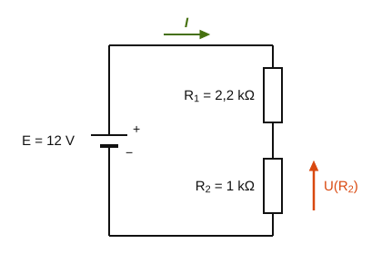

<em>Figure TD 6 : Pont diviseur de tension de l'exercice 1.1.</em>

1) Calculer la tension aux bornes de $R_2$.
2) Calculer le courant circulant dans le pont.
3) Calculer la puissance totale dissipée.

**Exercice 1.2 ★★ : Diviseur de tension en charge**

*Compétence visée : associer des résistances en parallèle et analyser l'effet de charge d'un appareil de mesure.*

Un pont diviseur $R_1 = 4{,}7$ kΩ / $R_2 = 2{,}2$ kΩ est alimenté sous $E = 10$ V. On y branche un appareil de mesure (charge) modélisé par une résistance $R_{ch} = 2{,}2$ kΩ en parallèle sur $R_2$.

<em>Figure TD 1 : Pont diviseur de tension en charge.</em>

1) Calculer la tension aux bornes de $R_2$ **à vide** (sans charge).
2) Calculer la nouvelle résistance équivalente ($R_2 \, /\!/ \, R_{ch}$) puis la tension aux bornes de $R_2$ **en charge**.
3) Comparer les deux résultats et expliquer, en une phrase, pourquoi un appareil de mesure doit avoir une résistance d'entrée la plus grande possible.

**Exercice 1.3 ★★ : Alimenter une carte ESP32 : régulateur linéaire ou convertisseur à découpage ?**

*Compétence visée : appliquer la loi des mailles, calculer des puissances et un rendement pour choisir une alimentation (sous-partie 1.1).*

Une carte ESP32 fonctionne sous 3,3 V. Elle consomme en moyenne 80 mA lorsqu'elle est connectée au Wi-Fi, et jusqu'à 350 mA pendant les pointes d'émission. Sur la carte de développement, les 3,3 V sont obtenus à partir des 5,0 V du port USB par un régulateur linéaire (LDO) : ce composant, placé en série entre l'alimentation et l'ESP32, se comporte comme une résistance variable qui « absorbe » la différence de tension. On néglige le courant consommé par le régulateur lui-même : le courant qui entre dans le régulateur est égal au courant qui alimente l'ESP32.

1) Calculer la puissance consommée par l'ESP32 à 80 mA, puis à 350 mA.
2) Écrire la loi des mailles et en déduire la tension aux bornes du régulateur. Calculer la puissance qu'il dissipe dans les deux situations. Montrer que son rendement vaut $\eta = \dfrac{3{,}3}{5{,}0}$, quel que soit le courant.
3) La carte est installée dans un coffret et alimentée par un bloc 12 V, toujours à travers le même régulateur linéaire. Celui-ci peut dissiper au plus 1,0 W sans surchauffer. Calculer la puissance dissipée lors d'une pointe à 350 mA et le rendement. Conclure.
4) On remplace le régulateur linéaire par un convertisseur à découpage 12 V → 3,3 V de rendement 90 %. Lors d'une pointe à 350 mA, calculer la puissance absorbée sur le 12 V, le courant fourni par le bloc et les pertes du convertisseur.
5) Calculer l'énergie consommée par l'ESP32 en une journée à 80 mA, en Wh puis en J.

### Série §1.2 : Circuits linéaires en régime sinusoïdal `BTS2`

**Exercice 1.4 ★ : Résonance d'un dipôle RLC série**

*Compétence visée : calculer la fréquence de résonance, le facteur de qualité et la surtension d'un RLC série.*

Un dipôle RLC série est constitué de $R = 15$ Ω, $L = 2{,}2$ mH et $C = 47$ nF. Il est alimenté par un générateur sinusoïdal de valeur efficace $U = 2{,}0$ V.

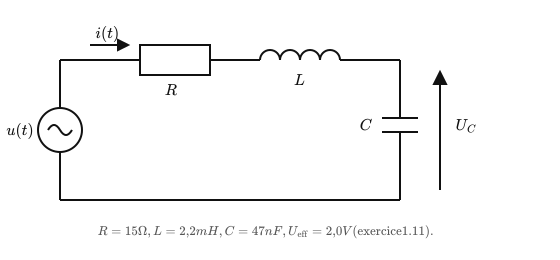

<em>Figure TD 2 : Dipôle RLC série alimenté en tension sinusoïdale.</em>

1) Calculer la fréquence de résonance $f_0$.
2) Calculer le facteur de qualité $Q$ et la bande passante à −3 dB $\Delta f$.
3) À la résonance, quelle est l'intensité efficace dans le circuit ? Quelle est la tension efficace aux bornes du condensateur ? Commenter.
4) Le dipôle est-il capacitif ou inductif à 5 kHz ? À 50 kHz ? Justifier sans calcul.

**Exercice 1.5 ★★ : Circuit d'accord d'un lecteur NFC**

*Compétence visée : dimensionner un circuit résonnant et relier facteur de qualité, bande passante et débit.*

L'antenne d'un lecteur NFC est une boucle d'inductance $L = 1{,}5$ µH et de résistance série $R = 1{,}2$ Ω. On lui associe un condensateur $C$ pour former un circuit résonnant à $f_0 = 13{,}56$ MHz.

1) Calculer la valeur de $C$ nécessaire.
2) Calculer le facteur de qualité $Q$ et la bande passante $\Delta f$ du circuit.
3) La modulation NFC occupe environ ±424 kHz autour de la porteuse. Le circuit tel quel laisse-t-il passer cette modulation ? Conclure.
4) Pour laisser passer toute la modulation, la bande passante doit atteindre au moins 848 kHz. Calculer le facteur de qualité maximal admissible. On retient $Q = 15$ : calculer la nouvelle bande passante et la résistance série totale à obtenir. Quelle résistance faut-il ajouter ?
5) Expliquer en une phrase le compromis entre sélectivité (rejet du bruit) et bande passante (débit de données).

**Exercice 1.6 ★★ : Gâche électrique d'un contrôle d'accès**

*Compétence visée : calculer impédance, courant, déphasage et puissance d'un dipôle RL en régime sinusoïdal, puis comparer avec le régime continu (sous-partie 1.2).*

La porte d'une salle serveurs est verrouillée par une gâche électrique, commandée par la centrale du contrôle d'accès (lecteur de badges). La bobine de la gâche est modélisée par une résistance $R = 6{,}0\ \Omega$ en série avec une inductance $L = 40\ \text{mH}$. Elle est alimentée sous une tension sinusoïdale de valeur efficace $U = 12\ \text{V}$ et de fréquence 50 Hz.

1) Calculer la réactance $L\omega$, puis le module de l'impédance $Z = \sqrt{R^2 + (L\omega)^2}$.
2) Calculer l'intensité efficace $I$ et le déphasage $\varphi = \arctan\!\left(\dfrac{L\omega}{R}\right)$ entre la tension et le courant. Le courant est-il en avance ou en retard sur la tension ?
3) Calculer les tensions efficaces $U_R$ et $U_L$. Leur somme vaut-elle 12 V ? Expliquer.
4) Calculer la puissance active consommée par la gâche, $P = R I^2$ (seule la résistance dissipe de l'énergie).
5) Lors d'un remplacement, un technicien branche cette gâche sur une alimentation 12 V **continue**. Calculer le courant et la puissance dissipée. Comparer à la question 4 et conclure.
6) Pour utiliser malgré tout cette gâche sur le 12 V continu avec le même courant qu'en alternatif, on ajoute une résistance en série. Calculer sa valeur et la puissance qu'elle dissipe. Cette solution est-elle satisfaisante ?

### Série §1.3 : Puissances, décibels, atténuation et gains `BTS1` `BTS2`

**Exercice 1.7 ★ : Conversion simple**

*Compétence visée : calculer un gain en puissance en décibels.*

Un amplificateur reçoit $P_e = 4$ mW en entrée et délivre $P_s = 200$ mW en sortie.

1) Calculer le gain en dB.
2) Ce gain vous semble-t-il réaliste pour un amplificateur audio courant ?

**Exercice 1.8 ★ : Formule inverse (tension)**

*Compétence visée : repasser d'un gain en dB à un rapport de tensions.*

Un quadripôle présente une atténuation de −12 dB en tension. La tension d'entrée est $U_1 = 2{,}0$ V.

1) Calculer le rapport $U_2/U_1$ correspondant à −12 dB.
2) En déduire $U_2$.

**Exercice 1.9 ★ : Chaîne en cascade**

*Compétence visée : additionner des gains en dB dans une chaîne de quadripôles.*

Une chaîne de transmission comprend : un préamplificateur (+8 dB), un câble (−5 dB), un amplificateur de puissance (+25 dB), un connecteur (−0,5 dB).

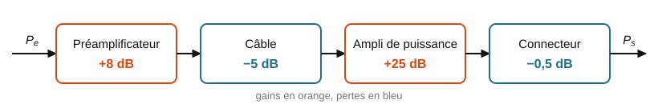

<em>Figure TD 7 : Chaîne de transmission en cascade : gains et pertes en dB.</em>

1) Calculer le gain total de la chaîne en dB.
2) Convertir ce gain total en facteur linéaire (rapport de puissance).

**Exercice 1.10 ★ : Bilan de liaison Wi-Fi**

*Compétence visée : faire un bilan de liaison en dBm et convertir des dBm en watts.*

Une borne Wi-Fi émet à $P_e = +18$ dBm. Le signal traverse un câble (−1,5 dB), une antenne d'émission de gain +6 dB, un trajet en espace libre qui atténue de 70 dB, puis une antenne de réception de gain +3 dB.

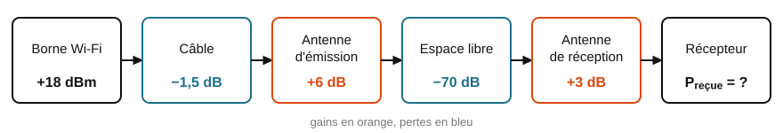

<em>Figure TD 8 : Bilan de liaison Wi-Fi, de la borne au récepteur.</em>

1) Calculer la puissance reçue en dBm.
2) Convertir cette puissance en mW puis en W.

**Exercice 1.11 ★★ : Atténuation en décibels sur une liaison**

*Compétence visée : calculer une atténuation linéique et en déduire une longueur maximale de câble.*

Un signal de puissance $P_e = 2{,}0$ mW est injecté dans un câble ; en sortie, on mesure $P_s = 0{,}5$ mW.

1) Calculer l'atténuation en dB : $A_{(dB)} = 10 \times \log_{10}\!\left(\dfrac{P_e}{P_s}\right)$.
2) Si le câble atténue de façon linéaire (en dB par mètre) et mesure 25 m, calculer l'atténuation linéique en dB/m.
3) Quelle longueur maximale de câble peut-on utiliser si l'atténuation totale ne doit pas dépasser 10 dB ?

**Exercice 1.12 ★★ : Portée maximale d'une liaison**

*Compétence visée : raisonner sur un budget de liaison et sur l'évolution de l'atténuation avec la distance.*

Une liaison radio dispose d'un budget de liaison de 100 dB (différence entre puissance émise et sensibilité minimale du récepteur). L'atténuation en espace libre augmente d'environ 6 dB à chaque doublement de distance (approximation usuelle en propagation libre).

1) Si le budget est déjà consommé à 70 dB pour une distance de 100 m, combien reste-t-il de marge en dB ?
2) En doublant la distance à chaque fois (200 m, 400 m, 800 m...), combien de doublements supplémentaires la marge restante permet-elle avant d'atteindre la limite du budget ?
3) En déduire une estimation grossière de la portée maximale de cette liaison.

**Exercice 1.13 ★★ : Équivalence linéaire/dB**

*Compétence visée : passer d'un gain linéaire à un gain en dB et inversement pour comparer deux systèmes.*

Un système A présente un gain de 40 dB. Un système B présente un gain linéaire de 8000.

1) Convertir le gain du système A en gain linéaire.
2) Convertir le gain du système B en dB.
3) Lequel des deux systèmes amplifie le plus ?

### Série §1.4 : Semi-conducteurs : la jonction PN et la diode `BTS1` `BTS2`

**Exercice 1.14 ★ : Caractéristique d'une diode**

*Compétence visée : exploiter des relevés de la caractéristique I(V) d'une diode.*

Sur une diode silicium on relève : $V = 0{,}5$ V → $I \approx 0$ mA ; $V = 0{,}65$ V → $I \approx 2$ mA ; $V = 0{,}7$ V → $I \approx 8$ mA.

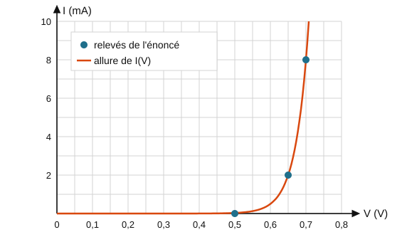

<em>Figure TD 9 : Relevés de l'exercice 1.14 placés sur la caractéristique I(V) de la diode.</em>

1) Que dire de la tension de seuil ?
2) Pourquoi le courant croît-il aussi vite entre 0,65 V et 0,7 V ?

**Exercice 1.15 ★★ : Résistance de protection et redressement**

*Compétence visée : dimensionner la résistance de protection d'une diode avec le modèle à seuil et analyser un redressement.*

Une diode silicium (modèle « diode idéale + seuil », $V_{seuil} = 0{,}7$ V) est montée en série avec une résistance $R$ sous une alimentation continue $E = 9$ V. On souhaite un courant $I = 15$ mA.

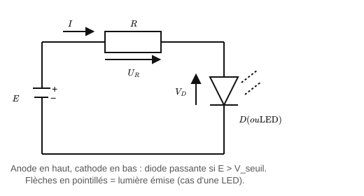

<em>Figure TD 3 : Diode (ou LED) avec résistance de protection en série.</em>

1) Calculer la valeur théorique de $R$, puis choisir la valeur normalisée la plus proche dans la série E12 (…, 470, 560, 680, …). Recalculer le courant réel.
2) Calculer la puissance dissipée dans $R$. Une résistance « 1/4 W » convient-elle ?
3) Calculer la puissance dissipée dans la diode.
4) La diode est montée à l'envers par erreur. Donner $I$, $U_R$ et la tension aux bornes de la diode.
5) On remplace l'alimentation continue par un signal sinusoïdal d'amplitude 12 V. Tracer l'allure de la tension aux bornes de $R$ sur une période et donner sa valeur maximale. Comment s'appelle cette fonction ?

**Exercice 1.16 ★★ : Commande d'un relais par un GPIO et diode de roue libre**

*Compétence visée : utiliser le modèle de la diode à seuil pour dimensionner une commande et justifier le rôle des diodes de protection (sous-partie 1.4).*

Un ESP32 commande, par sa broche GPIO (3,3 V), un relais qui coupe l'alimentation d'un équipement réseau à redémarrer à distance. Le GPIO ne pouvant pas fournir le courant de la bobine, il commande un transistor NPN à travers une résistance $R_B = 2{,}7\ \text{k}\Omega$. Une diode de roue libre $D_{RL}$ est placée en parallèle sur la bobine (figure TD 40).

*Données :* bobine du relais : 12 V, résistance 400 Ω, inductance 0,20 H ; jonction base-émetteur du transistor : comme une diode, tension de seuil 0,7 V ; transistor saturé : tension collecteur-émetteur négligeable ; tension collecteur-émetteur maximale supportée : 40 V ; diodes silicium : seuil 0,7 V.

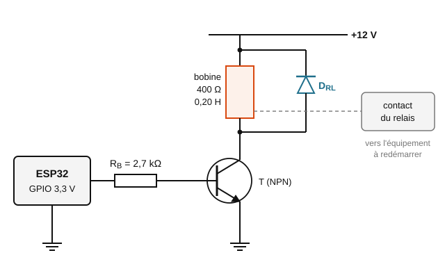

<em>Figure TD 40 : Commande du relais par un GPIO, transistor NPN et diode de roue libre.</em>

1) Le GPIO est à 3,3 V. Calculer le courant de base. Est-il compatible avec un GPIO de l'ESP32, qui peut fournir au plus 40 mA ?
2) Le transistor est saturé : calculer le courant dans la bobine et la puissance qu'elle consomme.
3) On enlève la diode $D_{RL}$. Au blocage du transistor, le courant de la bobine s'annule en 1 µs environ. La tension aux bornes d'une bobine vaut $u = L \dfrac{\Delta i}{\Delta t}$. Calculer cette tension et en déduire le risque pour le transistor.
4) La diode est remise en place. Expliquer son rôle au blocage du transistor, puis calculer la tension supportée par le transistor. Calculer l'énergie stockée dans la bobine, $W = \dfrac{1}{2} L I^2$, que la diode permet de dissiper sans danger.
5) Un technicien soude la diode à l'envers. Que se passe-t-il dès que le transistor conduit ?
6) La carte complète consomme 0,50 A sous 12 V. Pour la protéger contre une inversion des fils d'alimentation, on place une diode en série sur l'arrivée du + 12 V. Calculer la puissance dissipée et la tension disponible pour la carte avec une diode silicium (0,7 V), puis avec une diode Schottky (0,35 V). Que se passe-t-il si les fils sont inversés ?

### Série §1.5 : Bandes d'énergie et photons `BTS1` `BTS2`

*Données pour les exercices 1.17 à 1.26 et 1.28 : $h = 6{,}63 \times 10^{-34}$ J·s ; $c_0 = 3{,}0 \times 10^8$ m/s ; $1$ eV $= 1{,}6 \times 10^{-19}$ J ; $e = 1{,}6 \times 10^{-19}$ C.*

**Exercice 1.17 ★ : Les trois longueurs d'onde des liaisons fibre**

*Compétence visée : calculer la fréquence et l'énergie d'un photon, comparer à un gap.*

Les modules SFP émettent à 850 nm (liaisons courtes), 1310 nm et 1550 nm (liaisons longues).

1) Calculer la fréquence $\nu$ de chacun de ces rayonnements.
2) Calculer l'énergie d'un photon pour chacune, en joule puis en électronvolt.
3) Le silicium a un gap $\Delta E \approx 1{,}1$ eV. Lesquels de ces photons une photodiode en silicium peut-elle détecter ? Justifier.
4) Le gap de l'InGaAs vaut environ 0,75 eV. Que peut-on en conclure sur le matériau des récepteurs des liaisons longues ?

**Exercice 1.18 ★★ : Longueur d'onde de coupure et courant photonique**

*Compétence visée : relier puissance optique, nombre de photons et courant électrique.*

1) Calculer la longueur d'onde maximale $\lambda_{max}$ qu'un photon peut avoir pour faire franchir le gap du silicium ($\Delta E = 1{,}1$ eV). Dans quel domaine du spectre se situe-t-elle ?
2) Un récepteur reçoit une puissance optique de −20 dBm à 1310 nm. Convertir cette puissance en watt.
3) En utilisant l'énergie du photon à 1310 nm (exercice 1.17), calculer le nombre de photons reçus par seconde.
4) Si chaque photon absorbé libère un électron (rendement quantique de 100 %), calculer le courant électrique correspondant. Commenter l'ordre de grandeur.

### Série §1.6 : La diode électroluminescente (DEL/LED) `BTS1` `BTS2`

**Exercice 1.19 ★ : Couleur et gap, résistance de protection d'une LED**

*Compétence visée : relier couleur et gap, dimensionner la résistance de protection d'une LED.*

Les LED de face avant d'un switch réseau sont rouge ($\lambda = 650$ nm), verte ($\lambda = 525$ nm) et bleue ($\lambda = 470$ nm).

1) Calculer le gap $\Delta E$ (en eV) du matériau de chaque LED.
2) Classer les trois matériaux par gap croissant. Que remarque-t-on ?
3) La LED verte a une tension directe $V_F = 2{,}2$ V et doit être parcourue par $I = 10$ mA sous une alimentation de 5 V (montage de la figure TD 3). Calculer la résistance de protection, choisir la valeur E12 immédiatement supérieure et recalculer le courant.
4) Pourquoi ne peut-on pas obtenir une LED bleue en plaçant un filtre bleu devant une LED rouge ?

**Exercice 1.20 ★★ : LED infrarouge d'un module SFP et budget optique**

*Compétence visée : calculer une longueur d'onde à partir d'un gap et établir un bilan de puissance optique.*

Un module SFP « courte distance » utilise une LED en arséniure de gallium (GaAs, gap $\Delta E = 1{,}42$ eV).

1) Calculer la longueur d'onde émise et la comparer aux 850 nm annoncés.
2) Une LED émet en réalité sur une largeur spectrale d'environ 40 nm autour de sa longueur d'onde centrale, alors qu'une diode laser émet sur moins de 1 nm. Expliquer, à l'aide du mécanisme d'émission (spontanée ou stimulée), l'origine de cette différence.
3) La LED injecte une puissance optique de 1 mW dans une fibre. Exprimer cette puissance en dBm.
4) La liaison comporte 300 m de fibre (atténuation 3,5 dB/km à 850 nm) et deux connecteurs de 0,5 dB chacun. Calculer la puissance reçue en dBm.
5) La photodiode du récepteur a une sensibilité de −17 dBm. Calculer la marge de la liaison. Quelle longueur de fibre maximale cette LED autoriserait-elle avec ces deux connecteurs ?

### Série §1.7 : La diode laser `BTS2`

**Exercice 1.21 ★ : Cavité résonnante d'une diode laser**

*Compétence visée : relier longueur de cavité, longueur d'onde et modes d'une diode laser.*

Une diode laser à 1550 nm possède une cavité de longueur $L_{cav} = 300$ µm dans un semi-conducteur d'indice de réfraction $n = 3{,}5$. Dans le matériau, la longueur d'onde vaut $\lambda = \lambda_0 / n$.

1) Calculer la longueur d'onde $\lambda$ dans le matériau.
2) La cavité impose $L_{cav} = k \times \lambda / 2$ avec $k$ entier. Calculer $k$.
3) Deux modes voisins ($k$ et $k+1$) sont séparés de $\Delta\lambda = \dfrac{\lambda_0^2}{2 n L_{cav}}$. Calculer $\Delta\lambda$.
4) La diode laser délivre +3 dBm. Convertir en mW.

**Exercice 1.22 ★★ : LED ou laser pour une liaison de 20 km ?**

*Compétence visée : comparer deux émetteurs selon le bilan de puissance et la dispersion chromatique.*

On compare deux émetteurs à 1550 nm pour une liaison fibre de 20 km : une LED (puissance −3 dBm, largeur spectrale 50 nm) et une diode laser (puissance +3 dBm, largeur spectrale 0,1 nm). La fibre atténue de 0,2 dB/km et présente une dispersion chromatique $D = 17$ ps/(nm·km) : une impulsion s'étale de $\Delta t = D \times \Delta\lambda \times L$. Le récepteur a une sensibilité de −20 dBm.

<em>Figure TD 4 : Chaîne de transmission optique émetteur / fibre / photodiode.</em>

1) Calculer l'atténuation totale de la fibre puis la puissance reçue avec chaque émetteur. Le bilan de puissance est-il satisfait dans les deux cas ?
2) Calculer l'étalement $\Delta t$ d'une impulsion pour chaque émetteur.
3) À 1 Gbit/s, un bit dure 1 ns ; à 10 Gbit/s, 100 ps. Pour rester lisible, l'étalement doit rester nettement inférieur à la durée d'un bit. Quel(s) débit(s) chaque émetteur permet-il ?
4) Conclure : pourquoi les liaisons longue distance utilisent-elles une diode laser, alors même que le bilan de puissance de la LED était correct ?

### Série §1.8 : La photodiode `BTS1` `BTS2`

**Exercice 1.23 ★ : Photodiode en mode photoconducteur**

*Compétence visée : exploiter la sensibilité d'une photodiode polarisée en inverse.*

Une photodiode silicium de sensibilité $S = 0{,}5$ A/W (courant inverse par watt de flux reçu) est polarisée en inverse par une alimentation de 5 V à travers une résistance $R = 10$ kΩ. On mesure la tension $U_R$ aux bornes de $R$.

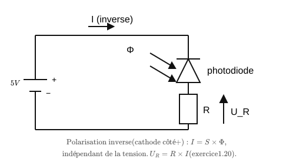

<em>Figure TD 5 : Photodiode polarisée en inverse avec résistance de mesure.</em>

1) Le flux reçu vaut 20 µW. Calculer le courant inverse $I$ puis $U_R$.
2) Même question pour un flux de 100 µW.
3) Que peut-on dire de la relation entre $U_R$ et le flux lumineux ? Quel est l'intérêt de ce montage ?
4) Au-delà de quel flux le montage sature-t-il (la tension $U_R$ ne pouvant dépasser 5 V) ?

**Exercice 1.24 ★★ : Récepteur d'une liaison fibre**

*Compétence visée : dimensionner un récepteur optique et interpréter le courant d'obscurité.*

Le récepteur d'une liaison à 1310 nm utilise une photodiode InGaAs de sensibilité $S = 0{,}9$ A/W suivie d'un amplificateur transimpédance qui convertit le courant en tension : $U = R_f \times I$ avec $R_f = 10$ kΩ.

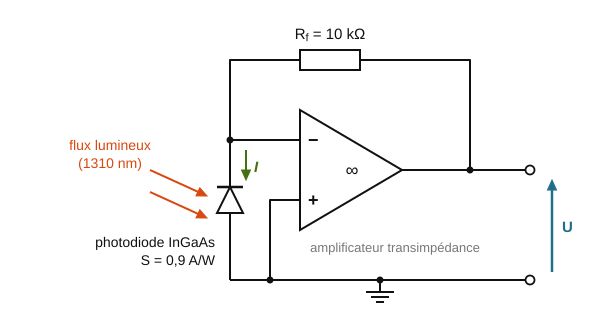

<em>Figure TD 11 : Photodiode suivie d'un amplificateur transimpédance.</em>

1) La puissance reçue vaut −20 dBm. Calculer le courant de la photodiode puis la tension $U$.
2) Même question pour une puissance reçue de −30 dBm.
3) Dans l'obscurité, la photodiode débite un courant résiduel de 5 nA (courant d'obscurité). À quelle puissance optique, en W puis en dBm, ce courant correspond-il ?
4) Expliquer pourquoi le courant d'obscurité limite la sensibilité du récepteur.
5) La même photodiode, non polarisée, est éclairée par le soleil. Dans quel mode fonctionne-t-elle et à quoi peut-elle alors servir ?

### Série §1.9 : Le capteur CCD (Charge-Coupled Device) `BTS2`

**Exercice 1.25 ★ : Flux de données d'une caméra IP**

*Compétence visée : relier la structure d'un capteur d'image au débit de données à transmettre.*

Une caméra IP utilise un capteur de 1920 × 1080 pixels. Chaque pixel est converti par un CAN sur 12 bits.

1) Calculer le nombre de pixels du capteur.
2) Calculer la quantité de données d'une image brute, en bits puis en octets.
3) À 25 images par seconde, calculer le débit brut en Mbit/s. Que faut-il en conclure pour la transmission sur le réseau ?
4) Les charges sont transférées vers le CAN au rythme d'un pixel par coup d'horloge, à 100 MHz. Calculer le temps de lecture d'une image complète et la cadence maximale d'images par seconde.

**Exercice 1.26 ★★ : Saturation d'un pixel**

*Compétence visée : relier énergie lumineuse reçue, nombre de photons et charge stockée dans un pixel.*

Un pixel de capteur CCD peut stocker au maximum 20 000 électrons (capacité du puits). Il reçoit une lumière verte ($\lambda = 550$ nm) d'une puissance de 2 pW pendant un temps d'exposition de 10 ms. Le rendement quantique du capteur vaut 40 % (un photon sur 2,5 crée un électron).

1) Calculer l'énergie d'un photon à 550 nm.
2) Calculer l'énergie lumineuse reçue par le pixel pendant l'exposition, puis le nombre de photons reçus.
3) Calculer le nombre d'électrons créés. Le pixel est-il saturé ?
4) Calculer le temps d'exposition maximal pour éviter la saturation.
5) Le CAN convertit la charge sur 12 bits. À combien d'électrons correspond un niveau de quantification ?

**Exercice 1.27 ★★ : Caméra de vidéoprotection de nuit : taille des pixels et bruit**

*Compétence visée : relier nombre de photons, charges stockées et bruit dans un pixel pour comparer deux capteurs d'image (sous-partie 1.9).*

Pour surveiller un parking la nuit, on hésite entre deux caméras dont les capteurs ont la même surface, 7,68 mm × 4,32 mm :

| Capteur | Côté d'un pixel | Capacité du puits | Bruit de lecture |
|---|---|---|---|
| A (« 4K ») | 2,0 µm | 6 000 électrons | 5 électrons efficaces |
| B (« Full HD ») | 4,0 µm | 25 000 électrons | 5 électrons efficaces |

La nuit, chaque µm² du capteur reçoit en moyenne 25 photons par image (temps de pose de 40 ms). Le rendement quantique vaut 60 % pour les deux capteurs. On admet que le nombre $N$ d'électrons créés dans un pixel fluctue d'une image à l'autre : c'est le **bruit de photons**, de valeur efficace $\sqrt{N}$ (en électrons). Le rapport signal sur bruit d'un pixel vaut $SNR = \dfrac{N}{\text{bruit}}$ (rapport d'amplitudes, à convertir avec $20\log_{10}$).

1) Calculer le nombre de pixels de chaque capteur (en colonnes × lignes, puis en mégapixels).
2) Calculer, pour chaque capteur, le nombre de photons reçus par pixel et par image, puis le nombre d'électrons $N$.
3) En ne tenant compte que du bruit de photons, calculer le SNR de chaque capteur, puis le convertir en dB.
4) Le bruit de lecture s'ajoute au bruit de photons ; les deux bruits sont indépendants, ils se composent comme des incertitudes : $\text{bruit} = \sqrt{N + 5^2}$. Recalculer les SNR en dB.
5) La dynamique d'un capteur compare le plus grand signal mesurable au bruit de lecture : $DR = 20\log_{10}\!\left(\dfrac{N_{max}}{5}\right)$. La calculer pour chaque capteur.
6) Le capteur A peut regrouper ses pixels par blocs de 2 × 2 (*binning*) : les électrons des 4 pixels sont additionnés, mais les 4 bruits de lecture aussi (en quadratique). Calculer le SNR obtenu, en dB. Conclure sur le choix de la caméra pour le parking.

### Série de synthèse : exercices type BTS `BTS1` `BTS2`

**Exercice 1.28 ★★★ : Alimentation PoE d'une caméra IP (type BTS)**

*Compétence visée : mobiliser lois de l'électricité, décibels et optoélectronique pour valider une installation réelle.*

*Contexte :* une entreprise installe des caméras IP de vidéosurveillance sur son parking. Chaque caméra est reliée à un switch PoE (Power over Ethernet, norme IEEE 802.3af) par un câble Cat 5e qui transporte à la fois les données et l'alimentation. Le technicien doit valider l'installation de la caméra la plus éloignée, à 80 m du switch.

*Document technique :*

| Élément | Caractéristique | Valeur |
|---|---|---|
| Switch PoE (8 ports) | Tension délivrée par port | 48,0 V |
| | Puissance maximale par port | 15,4 W |
| | Budget PoE total du switch | 120 W |
| Câble Cat 5e | Résistance de la boucle d'alimentation (aller + retour) | 0,125 Ω par mètre de câble |
| | Atténuation du signal Ethernet à 100 MHz | 22 dB/100 m |
| Caméra IP | Courant consommé (vision nocturne active) | 0,30 A |
| | Tension minimale de fonctionnement | 37 V |
| | Amplitude minimale du signal Ethernet reçu | 0,20 V |
| | Projecteur infrarouge de vision nocturne | LED à 850 nm |
| | Voyant d'état | LED verte, $V_F = 2{,}0$ V, $I = 5$ mA, pilotée par une sortie 3,3 V |

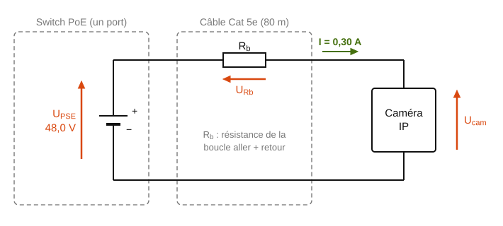

<em>Figure TD 10 : Modèle électrique de l'alimentation PoE : port du switch, câble et caméra en série.</em>

**Partie A : alimentation de la caméra**

1) Calculer la résistance $R_b$ de la boucle d'alimentation pour 80 m de câble.
2) Le câble et la caméra sont en série. Écrire la loi des mailles et calculer la tension $U_{cam}$ aux bornes de la caméra. Est-elle suffisante ?
3) Calculer la puissance fournie par le port du switch, la puissance perdue dans le câble et la puissance reçue par la caméra. En déduire le rendement de la liaison.
4) Le switch alimente 8 caméras identiques. Le budget PoE est-il respecté si l'on compte la puissance réellement consommée ? Et si le switch réserve 15,4 W par port ? Conclure.
5) Calculer la longueur de câble maximale pour laquelle la caméra reste alimentée correctement. Pourquoi ce n'est pas cette valeur qui limite la longueur du câble en pratique (la norme Ethernet impose 100 m) ?

**Partie B : signal de données**

6) Calculer l'atténuation du signal Ethernet sur les 80 m de câble.
7) Le signal est émis avec une amplitude de 2,0 V. Calculer l'amplitude reçue et la marge en dB par rapport à l'amplitude minimale.

**Partie C : optoélectronique**

8) Calculer l'énergie d'un photon émis par le projecteur infrarouge, en J et en eV. Ce rayonnement est-il visible ? Le capteur d'image en silicium de la caméra ($\Delta E = 1{,}1$ eV) peut-il le détecter ?
9) Calculer la résistance de protection du voyant d'état, choisir la valeur E12 immédiatement supérieure (…, 220, 270, 330, …) et recalculer le courant.

**Exercice 1.29 ★★★ : Barrière infrarouge de détection de passage (type BTS)**

*Compétence visée : mobiliser loi d'Ohm, décibels, LED et photodiode pour valider et fiabiliser un capteur (sous-parties 1.1, 1.3, 1.6 et 1.8).*

*Contexte :* à l'entrée du couloir d'une salle serveurs, une barrière infrarouge compte les passages et signale tout passage en dehors des horaires d'ouverture. L'émetteur et le récepteur se font face, de part et d'autre du couloir, à 4,0 m l'un de l'autre. Le technicien doit dimensionner l'émetteur, vérifier la réception et analyser un dysfonctionnement signalé par temps ensoleillé.

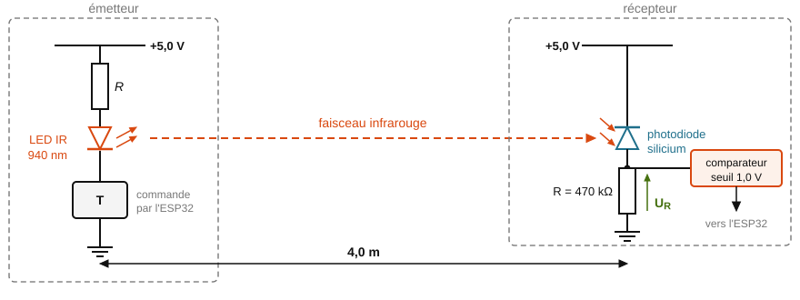

<em>Figure TD 41 : Barrière infrarouge : émetteur, faisceau de 4,0 m et récepteur.</em>

*Document technique :*

| Élément | Caractéristique | Valeur |
|---|---|---|
| LED infrarouge | Longueur d'onde | 940 nm |
| | Tension directe $V_F$ ; courant nominal | 1,2 V ; 50 mA |
| | Rendement de conversion (puissance optique / puissance électrique) | 15 % |
| Alimentation de l'émetteur | Tension ; transistor saturé (tension négligeable) | 5,0 V |
| Trajet optique (lentilles comprises) | Fraction de la puissance émise captée par la photodiode | −20 dB à 1,0 m, puis 6 dB de moins à chaque doublement de distance |
| Photodiode silicium | Sensibilité à 940 nm | $S = 0{,}60\ \text{A/W}$ |
| Résistance de mesure | Montage photoconducteur sous 5,0 V | $R = 470\ \text{k}\Omega$ |
| Comparateur relié à l'ESP32 | « Faisceau présent » si | $U_R \geq 1{,}0\ \text{V}$ |

*Données : $h = 6{,}63 \times 10^{-34}$ J·s ; $c_0 = 3{,}0 \times 10^8$ m/s ; $1$ eV $= 1{,}6 \times 10^{-19}$ J.*

**Partie A : émetteur**

1) Calculer la résistance de protection de la LED pour un courant de 50 mA, puis choisir la valeur la plus proche dans la série E12 (…, 56, 68, 82, 100, …). Recalculer le courant. Une résistance 1/4 W convient-elle ?
2) Calculer la puissance électrique reçue par la LED, puis la puissance optique émise, en mW puis en dBm.
3) Calculer l'énergie d'un photon émis, en eV. La comparer à la tension directe de la LED et commenter.

**Partie B : réception**

4) Calculer l'affaiblissement du trajet optique à 4,0 m, puis la puissance reçue par la photodiode, en dBm puis en µW.
5) Une photodiode en silicium ($\Delta E = 1{,}1$ eV) peut-elle détecter ce rayonnement ? Calculer le courant de la photodiode puis la tension $U_R$. Le faisceau est-il détecté ?
6) Calculer la puissance optique minimale qui donne encore $U_R = 1{,}0$ V, en µW puis en dBm. En déduire la marge de la barrière à 4,0 m et la distance maximale entre émetteur et récepteur. Commenter.

**Partie C : dysfonctionnement par temps ensoleillé**

7) Le soleil, à travers une fenêtre, éclaire la photodiode et crée un courant parasite permanent. Calculer $U_R$ lorsqu'une personne coupe le faisceau, pour un courant parasite de 1,5 µA, puis de 2,5 µA. Le passage est-il détecté dans chaque cas ?
8) Proposer deux solutions pour rendre la barrière insensible à la lumière du jour.

**Exercice 1.30 ★★★ : Diagnostic d'un module SFP à partir de ses mesures internes (type BTS)** `BTS2`

*Compétence visée : exploiter les mesures de diagnostic d'un module optique pour localiser l'origine d'une panne (sous-parties 1.3, 1.5, 1.7 et 1.8).*

*Contexte :* un lien fibre à 10 Gbit/s de 12 km relie le cœur de réseau d'une entreprise à un site distant. Les compteurs d'erreurs du port augmentent. Le module SFP+ (10GBASE-LR, 1310 nm) dispose d'une fonction de diagnostic (DDM, *Digital Diagnostic Monitoring*) : le technicien relève ses mesures internes depuis l'interface d'administration du switch.

*Document 1 : mesures DDM du module local.*

| Paramètre | Valeur mesurée | Seuil d'alarme bas | Seuil d'alarme haut |
|---|---|---|---|
| Température du module | 41,2 °C | −5,0 °C | 75,0 °C |
| Tension d'alimentation | 3,28 V | 3,00 V | 3,60 V |
| Courant de polarisation du laser | 38,5 mA | 10,0 mA | 85,0 mA |
| Puissance optique émise | −1,2 dBm | −8,2 dBm | +0,5 dBm |
| Puissance optique reçue | −16,1 dBm | −14,4 dBm | +0,5 dBm |

*Document 2 : caractéristiques du module.* Laser : courant de seuil $I_s = 8{,}0$ mA ; au-delà, la puissance émise vaut $P = \eta\,(I - I_s)$ avec $\eta = 0{,}025$ mW/mA pour un module neuf. Photodiode InGaAs : sensibilité $S = 0{,}85$ A/W. Sensibilité du récepteur : −14,4 dBm.

*Document 3 : liaison.* 12 km de fibre monomode (0,35 dB/km à 1310 nm), 2 connecteurs (0,5 dB chacun), 4 épissures (0,1 dB chacune). Le module distant émet −1,0 dBm (valeur lue sur l'équipement distant). Le cahier des charges impose une marge d'au moins 3 dB au-dessus de la sensibilité.

*Données : $h = 6{,}63 \times 10^{-34}$ J·s ; $c_0 = 3{,}0 \times 10^8$ m/s ; $1$ eV $= 1{,}6 \times 10^{-19}$ J ; $e = 1{,}6 \times 10^{-19}$ C.*

**Partie A : le laser du module local**

1) Convertir la puissance émise en mW.
2) Calculer la puissance prévue par le modèle du document 2 pour le courant de polarisation relevé. Les mesures DDM sont-elles cohérentes ?
3) Trois ans plus tard, le module doit être polarisé à 52 mA pour émettre la même puissance (le circuit du module régule la puissance émise). Calculer la nouvelle valeur de $\eta$. Interpréter. Quelle alarme finira par se déclencher si cette évolution continue ?

**Partie B : la réception**

4) Calculer l'énergie d'un photon à 1310 nm, en eV. Pourquoi la photodiode est-elle en InGaAs et non en silicium ($\Delta E = 1{,}1$ eV) ?
5) Convertir la puissance reçue en µW. Calculer le nombre de photons reçus par seconde et le courant de la photodiode.
6) Calculer les pertes prévues de la liaison et la puissance qui devrait être reçue. Comparer à la mesure. Quels paramètres DDM sont anormaux ? Formuler un diagnostic.
7) Après nettoyage des connecteurs, la puissance reçue remonte à −7,0 dBm. Calculer la marge au-dessus de la sensibilité. Le cahier des charges est-il respecté ? Reste-t-il une perte anormale ?

### Défi du chapitre `BTS2`

**Exercice 1.31 ★★★★ : Jusqu'où peut-on alimenter un équipement en PoE ? (défi)**

*Compétence visée : modéliser une charge à puissance constante, établir et discuter une équation du second degré, relier transfert maximal de puissance et rendement (sous-partie 1.1).*

Un switch PoE+ délivre $U_0 = 50{,}0$ V sur chaque port. Le câble a une résistance de boucle $R_b = 0{,}125\ \Omega$ par mètre de câble. L'équipement alimenté est un point d'accès Wi-Fi qui contient un convertisseur à découpage : il absorbe une puissance **constante** $P = 25{,}5$ W, quelle que soit la tension $U$ à ses bornes, tant que $U \geq 37$ V (en dessous, il s'arrête).

1) Montrer que le courant $I$ vérifie l'équation $R_b I^2 - U_0 I + P = 0$.
*Coup de pouce : écrire la loi des mailles, puis remplacer $U$ par $P/I$.*
2) Montrer que cette équation n'a de solution que si $P \leq \dfrac{U_0^2}{4R_b}$. Que représente physiquement cette valeur ? Montrer qu'à cette limite, $U = U_0/2$ et que la résistance apparente de l'équipement, $U/I$, est égale à $R_b$.
*Coup de pouce : un trinôme $aI^2 + bI + c$ n'a de racine réelle que si son discriminant est positif ou nul.*
3) Pour un câble de 100 m, calculer $R_b$, la puissance maximale transmissible, puis les deux solutions $I_1 < I_2$ et la tension $U$ correspondant à chacune. Quel est le point de fonctionnement réel ? Justifier.
4) Montrer que le rendement de la liaison s'écrit $\eta = \dfrac{U}{U_0}$. Le calculer au point de fonctionnement, puis à la limite de la question 2. Pourquoi ne fonctionne-t-on jamais près de la puissance maximale transmissible ?
5) Calculer la longueur de câble maximale pour laquelle l'équipement reçoit encore au moins 37 V. La comparer à la longueur pour laquelle la puissance maximale transmissible tombe à 25,5 W. Quelle condition limite la longueur ?
6) La norme PoE++ fait passer le courant par les 4 paires du câble : la résistance de boucle est divisée par 2. Pour 100 m de câble, recalculer le courant, les pertes et le rendement. Un datacenter alimente 400 points d'accès de ce type : calculer la puissance économisée et l'énergie économisée en un an.

### Corrigés du chapitre 1 `BTS1` `BTS2`

**Exercice 1.1.** Pont diviseur : $U(R_2) = E \times \dfrac{R_2}{R_1 + R_2} = 12 \times \dfrac{1000}{2200 + 1000} = 3{,}75$ V. Les deux résistances sont en série : $I = \dfrac{E}{R_1 + R_2} = \dfrac{12}{3200} = 3{,}75$ mA. $P = E \times I = 12 \times 3{,}75 \times 10^{-3} = 45$ mW.

**Exercice 1.2.**
1) $U(R_2)_{\text{vide}} = 10 \times \dfrac{2200}{4700 + 2200} = 3{,}19$ V.
2) $R_2 \, /\!/ \, R_{ch} = \dfrac{2200 \times 2200}{2200 + 2200} = 1100$ Ω. $U(R_2)_{\text{charge}} = 10 \times \dfrac{1100}{4700 + 1100} = 1{,}90$ V.
3) L'écart est important (3,19 V → 1,90 V) : brancher un appareil de mesure modifie le circuit qu'il mesure (« effet de charge »). Un voltmètre idéal doit avoir une résistance d'entrée très grande devant celle du circuit pour ne pas le perturber.

**Exercice 1.3.**
*Méthode :* le régulateur et l'ESP32 sont en série, donc traversés par le même courant ; chaque puissance se calcule par $P = U \times I$, et le rendement est le rapport puissance utile / puissance absorbée.
1) $P = 3{,}3 \times 0{,}080 \approx 0{,}26\ \text{W}$ ; en pointe, $P = 3{,}3 \times 0{,}350 \approx 1{,}16\ \text{W}$.
2) Loi des mailles : $5{,}0 = U_{LDO} + 3{,}3$, donc $U_{LDO} = 1{,}7\ \text{V}$. $P_{LDO} = 1{,}7 \times 0{,}080 \approx 0{,}14\ \text{W}$ et $1{,}7 \times 0{,}350 \approx 0{,}60\ \text{W}$. $\eta = \dfrac{3{,}3 \times I}{5{,}0 \times I} = \dfrac{3{,}3}{5{,}0} = 0{,}66$, soit 66 % : le courant se simplifie, le rendement ne dépend que des tensions.
3) $U_{LDO} = 12 - 3{,}3 = 8{,}7\ \text{V}$ ; $P_{LDO} = 8{,}7 \times 0{,}350 \approx 3{,}0\ \text{W} > 1{,}0\ \text{W}$ : le régulateur surchauffe (mise en sécurité thermique ou destruction). $\eta = \dfrac{3{,}3}{12} \approx 0{,}28$ : près des trois quarts de l'énergie sont transformés en chaleur. Un régulateur linéaire ne convient que si l'écart entre tension d'entrée et tension de sortie est faible.
4) $P_{abs} = \dfrac{P_u}{\eta} = \dfrac{1{,}155}{0{,}90} \approx 1{,}28\ \text{W}$ ; $I = \dfrac{1{,}28}{12} \approx 0{,}11\ \text{A}$ ; pertes : $1{,}28 - 1{,}16 \approx 0{,}13\ \text{W}$. Le bloc fournit 0,11 A alors que l'ESP32 consomme 0,35 A : un convertisseur à découpage conserve (presque) la puissance, pas le courant.
5) $E = P \times t = 0{,}264 \times 24 \approx 6{,}3\ \text{Wh}$, soit $0{,}264 \times 86\,400 \approx 2{,}3 \times 10^4\ \text{J}$.

*Erreurs fréquentes :* croire qu'un régulateur linéaire « transforme » la tension sans pertes ; appliquer au convertisseur à découpage l'égalité des courants d'entrée et de sortie ; confondre W (puissance) et Wh (énergie).

**Exercice 1.4.**
1) $f_0 = \dfrac{1}{2\pi\sqrt{LC}} = \dfrac{1}{2\pi\sqrt{2{,}2 \times 10^{-3} \times 47 \times 10^{-9}}} \approx 15{,}7$ kHz.
2) $Q = \dfrac{1}{R}\sqrt{\dfrac{L}{C}} = \dfrac{1}{15}\sqrt{\dfrac{2{,}2 \times 10^{-3}}{47 \times 10^{-9}}} \approx 14{,}4$ ; $\Delta f = f_0/Q \approx 1{,}09$ kHz.
3) À la résonance $\underline{Z} = R$ : $I_{eff} = U/R = 2{,}0/15 \approx 133$ mA. $U_C = Q \times U = 14{,}4 \times 2{,}0 \approx 28{,}8$ V : la tension aux bornes du condensateur est près de 15 fois la tension d'alimentation (surtension) ; le condensateur doit tenir au moins cette tension.
4) À 5 kHz ($f < f_0$), le terme $1/(C\omega)$ domine : comportement capacitif. À 50 kHz ($f > f_0$), $L\omega$ domine : comportement inductif.

**Exercice 1.5.**
1) $LC\omega_0^2 = 1 \Rightarrow C = \dfrac{1}{L(2\pi f_0)^2} = \dfrac{1}{1{,}5 \times 10^{-6} \times (2\pi \times 13{,}56 \times 10^6)^2} \approx 91{,}8$ pF.
2) $Q = \dfrac{L\omega_0}{R} = \dfrac{1{,}5 \times 10^{-6} \times 8{,}52 \times 10^7}{1{,}2} \approx 106$ ; $\Delta f = f_0/Q \approx 128$ kHz.
3) La modulation occupe environ 850 kHz (±424 kHz) : la bande passante de 128 kHz est très insuffisante, le circuit couperait les bandes latérales et les données ne passeraient pas.
4) $\Delta f = f_0/Q \geq 848$ kHz $\Rightarrow Q \leq \dfrac{13{,}56 \times 10^6}{848 \times 10^3} \approx 16$. Avec $Q = 15$ : $\Delta f = \dfrac{13{,}56 \times 10^6}{15} \approx 904$ kHz, qui couvre bien les ±424 kHz de la modulation. $R_{tot} = \dfrac{L\omega_0}{Q} = \dfrac{127{,}8}{15} \approx 8{,}5$ Ω : il faut ajouter environ $8{,}52 - 1{,}2 \approx 7{,}3$ Ω en série (résistance d'amortissement).
5) Un Q élevé rejette mieux le bruit hors bande mais étrangle la bande passante, donc le débit : l'antenne est accordée pour un compromis entre sélectivité et débit de données.

**Exercice 1.6.**
*Méthode :* en sinusoïdal, la bobine oppose la réactance $L\omega$, qui se compose avec $R$ comme les côtés d'un triangle rectangle ; en continu ($\omega = 0$), seule $R$ limite le courant.
1) $L\omega = 0{,}040 \times 2\pi \times 50 \approx 12{,}6\ \Omega$ ; $Z = \sqrt{6{,}0^2 + 12{,}57^2} = \sqrt{193{,}9} \approx 13{,}9\ \Omega$.
2) $I = \dfrac{U}{Z} = \dfrac{12}{13{,}9} \approx 0{,}86\ \text{A}$ ; $\varphi = \arctan\!\left(\dfrac{12{,}57}{6{,}0}\right) \approx 64°$ : dipôle inductif, le courant est en retard sur la tension.
3) $U_R = R I = 6{,}0 \times 0{,}862 \approx 5{,}2\ \text{V}$ ; $U_L = L\omega I = 12{,}57 \times 0{,}862 \approx 10{,}8\ \text{V}$. Leur somme (16 V) n'est pas égale à 12 V : les deux tensions sont déphasées de 90°, elles s'ajoutent comme des vecteurs perpendiculaires : $\sqrt{5{,}17^2 + 10{,}83^2} = 12\ \text{V}$.
4) $P = R I^2 = 6{,}0 \times 0{,}862^2 \approx 4{,}5\ \text{W}$.
5) En continu, $L\omega = 0$ : $I = \dfrac{12}{6{,}0} = 2{,}0\ \text{A}$ et $P = 6{,}0 \times 2{,}0^2 = 24\ \text{W}$, soit plus de 5 fois la puissance prévue : la bobine chauffe anormalement, son isolant peut fondre. Une gâche « 12 V AC » n'est pas une gâche « 12 V DC ».
6) $R_s = \dfrac{12}{0{,}862} - 6{,}0 \approx 7{,}9\ \Omega$ (8,2 Ω en série E12). Puissance dans $R_s$ : $7{,}93 \times 0{,}862^2 \approx 5{,}9\ \text{W}$, plus que la gâche elle-même : il faut une résistance de puissance qui chauffe, et l'énergie est gaspillée. La bonne solution est une gâche prévue pour le continu.

*Erreurs fréquentes :* oublier $\omega = 2\pi f$ et utiliser $L$ à la place de $L\omega$ ; additionner directement des tensions efficaces déphasées ; calculer la puissance par $U \times I$ (qui donne ici 10,3 VA, une puissance apparente, et non la puissance active).

**Exercice 1.7.** $A = 10 \times \log_{10}\!\left(\dfrac{200}{4}\right) = 10 \times \log_{10}(50) \approx 17{,}0$ dB. C'est un ordre de grandeur tout à fait réaliste pour un étage amplificateur.

**Exercice 1.8.** $-12 = 20 \log_{10}(U_2/U_1) \Rightarrow \log_{10}(U_2/U_1) = -0{,}6 \Rightarrow U_2/U_1 = 10^{-0{,}6} \approx 0{,}251$. $U_2 = 0{,}251 \times 2{,}0 \approx 0{,}50$ V.

**Exercice 1.9.** $G_{total} = 8 - 5 + 25 - 0{,}5 = 27{,}5$ dB. Facteur linéaire : $G = 10^{27{,}5/10} \approx 562$.

**Exercice 1.10.** $P_{reçue} = 18 - 1{,}5 + 6 - 70 + 3 = -44{,}5$ dBm. En mW : $P = 10^{-44{,}5/10} \approx 3{,}55 \times 10^{-5}$ mW $\approx 3{,}55 \times 10^{-8}$ W.

**Exercice 1.11.**
1) $A = 10 \times \log_{10}\!\left(\dfrac{2{,}0}{0{,}5}\right) = 10 \times \log_{10}(4) \approx 6{,}02$ dB.
2) $\dfrac{6{,}02}{25} \approx 0{,}241$ dB/m.
3) $L_{max} = \dfrac{10}{0{,}241} \approx 41{,}5$ m.

**Exercice 1.12.** 1) Marge restante = 100 − 70 = 30 dB. 2) Avec 6 dB par doublement, 30/6 = 5 doublements supplémentaires possibles. 3) Portée ≈ $100 \times 2^5 = 3200$ m (estimation grossière, propagation idéalisée en espace libre).

**Exercice 1.13.** 1) $G_A = 10^{40/10} = 10^4 = 10\,000$. 2) $G_{B(dB)} = 10 \log_{10}(8000) \approx 39{,}0$ dB. 3) Le système A (gain 10 000, soit 40 dB) amplifie légèrement plus que le système B (gain 8000, soit 39 dB).

**Exercice 1.14.** Seuil ≈ 0,6 à 0,65 V, cohérent avec le silicium. Au-delà du seuil, la caractéristique $I(V)$ est fortement non linéaire (croissance quasi exponentielle), typique d'une jonction PN passante.

**Exercice 1.15.**
1) $R = \dfrac{E - V_{seuil}}{I} = \dfrac{9 - 0{,}7}{0{,}015} \approx 553$ Ω → valeur E12 : 560 Ω. $I_{réel} = 8{,}3/560 \approx 14{,}8$ mA.
2) $P_R = U_R \times I = 8{,}3 \times 0{,}0148 \approx 0{,}123$ W : une résistance 1/4 W (0,25 W) convient, avec une marge d'environ 2.
3) $P_{diode} = V_{seuil} \times I = 0{,}7 \times 0{,}0148 \approx 10{,}4$ mW.
4) Diode bloquée : $I = 0$, $U_R = 0$, la diode supporte toute la tension : $U_{diode} = -9$ V (en inverse).
5) Pendant l'alternance positive (au-delà de 0,7 V), la diode conduit et $U_R = u(t) - 0{,}7$ ; pendant l'alternance négative, $U_R = 0$. Valeur maximale : $12 - 0{,}7 = 11{,}3$ V. C'est un redressement simple alternance.

**Exercice 1.16.**
*Méthode :* modèle de la diode à seuil pour la jonction base-émetteur et pour les diodes ; loi d'Ohm pour la bobine.
1) $I_B = \dfrac{3{,}3 - 0{,}7}{2700} \approx 0{,}96\ \text{mA}$, très inférieur aux 40 mA admissibles : le GPIO n'est pas surchargé.
2) $I = \dfrac{12}{400} = 30\ \text{mA}$ ; $P = 12 \times 0{,}030 = 0{,}36\ \text{W}$.
3) $u = 0{,}20 \times \dfrac{0{,}030}{1 \times 10^{-6}} = 6\,000\ \text{V}$ (en théorie) : cette surtension apparaît entre collecteur et émetteur, très au-delà des 40 V admissibles : le transistor claque dès la première coupure.
4) Au blocage, le courant de la bobine ne peut pas s'annuler brutalement : il continue de circuler dans la boucle bobine + diode, qui devient passante. La tension aux bornes de la bobine est limitée au seuil de la diode, et le transistor supporte $V_{CE} = 12 + 0{,}7 = 12{,}7\ \text{V} < 40\ \text{V}$. Énergie dissipée dans la diode et la résistance de la bobine : $W = \dfrac{1}{2} \times 0{,}20 \times 0{,}030^2 = 9{,}0 \times 10^{-5}\ \text{J} = 90\ \mu\text{J}$. Le relais retombe un peu plus lentement, car le courant décroît progressivement.
5) Montée à l'envers, la diode est polarisée en direct par le 12 V dès que le transistor conduit : elle court-circuite la bobine et le courant n'est limité par rien. La diode ou le transistor est détruit.
6) Diode silicium : $P = 0{,}7 \times 0{,}50 = 0{,}35\ \text{W}$, la carte reçoit $12 - 0{,}7 = 11{,}3\ \text{V}$. Diode Schottky : $P = 0{,}35 \times 0{,}50 \approx 0{,}18\ \text{W}$, la carte reçoit 11,65 V. Si les fils sont inversés, la diode est bloquée : $I = 0$, la carte n'est pas alimentée mais elle est protégée.

*Erreurs fréquentes :* appliquer la loi d'Ohm à la jonction base-émetteur sans retirer les 0,7 V ; croire que la diode de roue libre conduit pendant le fonctionnement normal (elle est alors bloquée) ; oublier que la surtension de coupure peut aussi perturber l'ESP32 par la masse.

**Exercice 1.17.**
1) $\nu = c_0/\lambda$ : 850 nm → $3{,}53 \times 10^{14}$ Hz ; 1310 nm → $2{,}29 \times 10^{14}$ Hz ; 1550 nm → $1{,}94 \times 10^{14}$ Hz.
2) $E = hc_0/\lambda$ : 850 nm → $2{,}34 \times 10^{-19}$ J ≈ 1,46 eV ; 1310 nm → $1{,}52 \times 10^{-19}$ J ≈ 0,95 eV ; 1550 nm → $1{,}28 \times 10^{-19}$ J ≈ 0,80 eV.
3) Seul le photon à 850 nm (1,46 eV > 1,1 eV) peut faire franchir le gap du silicium ; à 1310 et 1550 nm, l'énergie du photon est inférieure au gap : le silicium est transparent, la photodiode ne détecte rien.
4) Les récepteurs des liaisons longues doivent utiliser un matériau à gap plus petit que 0,80 eV : l'InGaAs (0,75 eV) convient pour 1310 et 1550 nm.

**Exercice 1.18.**
1) $\lambda_{max} = \dfrac{hc_0}{\Delta E} = \dfrac{6{,}63 \times 10^{-34} \times 3{,}0 \times 10^8}{1{,}1 \times 1{,}6 \times 10^{-19}} \approx 1{,}13$ µm = 1130 nm : proche infrarouge.
2) $-20$ dBm $= 10^{-20/10}$ mW $= 0{,}01$ mW $= 1{,}0 \times 10^{-5}$ W.
3) $N = \dfrac{P}{E_{photon}} = \dfrac{1{,}0 \times 10^{-5}}{1{,}52 \times 10^{-19}} \approx 6{,}6 \times 10^{13}$ photons par seconde.
4) $I = N \times e = 6{,}6 \times 10^{13} \times 1{,}6 \times 10^{-19} \approx 1{,}05 \times 10^{-5}$ A ≈ 10,5 µA. Un courant de l'ordre de la dizaine de microampères : il faut l'amplifier avant tout traitement (voir exercice 1.24).

**Exercice 1.19.**
1) $\Delta E = hc_0/\lambda$ : rouge 650 nm → 1,91 eV ; verte 525 nm → 2,37 eV ; bleue 470 nm → 2,64 eV.
2) Rouge < verte < bleue : plus le gap est grand, plus la longueur d'onde est courte (photon plus énergétique).
3) $R = \dfrac{5 - 2{,}2}{0{,}010} = 280$ Ω → E12 immédiatement supérieure : 330 Ω. $I = 2{,}8/330 \approx 8{,}5$ mA.
4) Un filtre ne peut que retirer de la lumière : les photons rouges (1,91 eV) ne peuvent pas devenir bleus (2,64 eV). La couleur est fixée par le gap du matériau, pas par un filtre.

**Exercice 1.20.**
1) $\lambda = \dfrac{hc_0}{\Delta E} = \dfrac{6{,}63 \times 10^{-34} \times 3{,}0 \times 10^8}{1{,}42 \times 1{,}6 \times 10^{-19}} \approx 875$ nm, proche des 850 nm annoncés (l'écart vient des valeurs approchées et du dopage du matériau réel).
2) Dans une LED, l'émission est spontanée : chaque recombinaison produit un photon d'énergie légèrement différente (agitation thermique, largeur des bandes), d'où un spectre large. Dans un laser, l'émission stimulée produit des photons identiques et la cavité ne sélectionne qu'une longueur d'onde : spectre très étroit.
3) $P = 10 \log_{10}(1\ \text{mW}/1\ \text{mW}) = 0$ dBm.
4) Pertes : $3{,}5 \times 0{,}3 = 1{,}05$ dB (fibre) $+ 2 \times 0{,}5 = 1$ dB (connecteurs) = 2,05 dB. $P_{reçue} = 0 - 2{,}05 = -2{,}05$ dBm.
5) Marge $= -2{,}05 - (-17) \approx 15$ dB. Longueur maximale : $(17 - 1)/3{,}5 \approx 4{,}6$ km en pur bilan de puissance (en pratique, la dispersion limite bien avant, voir exercice 1.22).

**Exercice 1.21.**
1) $\lambda = 1550/3{,}5 \approx 443$ nm.
2) $k = \dfrac{2 L_{cav}}{\lambda} = \dfrac{2 \times 300 \times 10^{-6}}{443 \times 10^{-9}} \approx 1355$.
3) $\Delta\lambda = \dfrac{(1550 \times 10^{-9})^2}{2 \times 3{,}5 \times 300 \times 10^{-6}} \approx 1{,}14$ nm.
4) $P = 10^{3/10} \approx 2{,}0$ mW.

**Exercice 1.22.**
1) Atténuation $= 0{,}2 \times 20 = 4$ dB. LED : $-3 - 4 = -7$ dBm ; laser : $+3 - 4 = -1$ dBm. Les deux sont au-dessus de −20 dBm : le bilan de puissance est satisfait dans les deux cas.
2) LED : $\Delta t = 17 \times 50 \times 20 = 17\,000$ ps = 17 ns. Laser : $\Delta t = 17 \times 0{,}1 \times 20 = 34$ ps.
3) LED : 17 ns ≫ 1 ns, aucun des deux débits n'est possible. Laser : 34 ps ≪ 1 ns et reste inférieur à 100 ps : 1 Gbit/s et 10 Gbit/s sont possibles.
4) La limite n'est pas la puissance mais la dispersion chromatique : le spectre large de la LED étale les impulsions jusqu'à les rendre illisibles. La diode laser, quasi monochromatique, est indispensable pour les liaisons longues à haut débit.

**Exercice 1.23.**
1) $I = S \times \Phi = 0{,}5 \times 20 \times 10^{-6} = 10$ µA ; $U_R = R \times I = 10^4 \times 10^{-5} = 0{,}10$ V.
2) $I = 50$ µA ; $U_R = 0{,}50$ V.
3) $U_R$ est proportionnelle au flux : le montage convertit linéairement un flux lumineux en tension mesurable (capteur de lumière, récepteur optique).
4) $U_R = 5$ V $\Rightarrow I = 0{,}5$ mA $\Rightarrow \Phi = I/S = 1$ mW. Au-delà, la photodiode n'est plus polarisée en inverse et la tension ne suit plus le flux.

**Exercice 1.24.**
1) $-20$ dBm $= 10$ µW ; $I = 0{,}9 \times 10 \times 10^{-6} = 9$ µA ; $U = 10^4 \times 9 \times 10^{-6} = 90$ mV.
2) $-30$ dBm $= 1$ µW ; $I = 0{,}9$ µA ; $U = 9$ mV.
3) $\Phi = I/S = 5 \times 10^{-9}/0{,}9 \approx 5{,}6$ nW $= 5{,}6 \times 10^{-9}$ W, soit $10\log_{10}(5{,}6 \times 10^{-6}) \approx -52{,}5$ dBm.
4) Un signal optique dont le courant est comparable au courant d'obscurité ne peut plus en être distingué : le courant d'obscurité fixe un plancher de bruit, donc la puissance minimale détectable.
5) Non polarisée et éclairée, elle fonctionne en mode photovoltaïque : elle se comporte en générateur, comme une cellule solaire.

**Exercice 1.25.**
1) $1920 \times 1080 = 2\,073\,600$ pixels.
2) $2\,073\,600 \times 12 = 24\,883\,200$ bits ≈ 24,9 Mbit ≈ 3,1 Mo.
3) $24{,}9 \times 25 \approx 622$ Mbit/s brut : un flux impossible à transmettre tel quel sur un lien Fast Ethernet et lourd même en Gigabit, d'où la nécessité d'une compression vidéo (H.264, H.265) avant l'envoi sur le réseau.
4) $t = 2\,073\,600 / 10^8 \approx 20{,}7$ ms ; cadence maximale $\approx 1/0{,}0207 \approx 48$ images par seconde.

**Exercice 1.26.**
1) $E = hc_0/\lambda = 3{,}62 \times 10^{-19}$ J (≈ 2,26 eV).
2) $E_{reçue} = 2 \times 10^{-12} \times 0{,}010 = 2 \times 10^{-14}$ J ; $N = 2 \times 10^{-14} / 3{,}62 \times 10^{-19} \approx 55\,300$ photons.
3) $N_e = 0{,}40 \times 55\,300 \approx 22\,100$ électrons > 20 000 : le pixel est saturé (blanc).
4) $t_{max} = 10 \text{ ms} \times 20\,000/22\,100 \approx 9{,}0$ ms.
5) $2^{12} = 4096$ niveaux ; $20\,000/4096 \approx 4{,}9$ électrons par niveau.

**Exercice 1.27.**
*Méthode :* surface du pixel → photons → électrons (rendement quantique) → bruit ; les bruits indépendants se composent quadratiquement, comme les incertitudes.
1) A : $\dfrac{7{,}68\ \text{mm}}{2{,}0\ \mu\text{m}} = 3840$ colonnes et $\dfrac{4{,}32\ \text{mm}}{2{,}0\ \mu\text{m}} = 2160$ lignes, soit environ 8,3 Mpixels. B : $1920 \times 1080$, soit environ 2,1 Mpixels.
2) A : surface $4{,}0\ \mu\text{m}^2$, $25 \times 4{,}0 = 100$ photons, $N = 0{,}60 \times 100 = 60$ électrons. B : $16\ \mu\text{m}^2$, 400 photons, $N = 240$ électrons.
3) A : $SNR = \dfrac{60}{\sqrt{60}} = \sqrt{60} \approx 7{,}7$, soit $20\log_{10}(7{,}75) \approx 17{,}8\ \text{dB}$. B : $\sqrt{240} \approx 15{,}5$, soit $\approx 23{,}8\ \text{dB}$. Un pixel 4 fois plus grand reçoit 4 fois plus de photons et gagne un facteur 2 sur le SNR (+6 dB).
4) A : bruit $\sqrt{60 + 25} \approx 9{,}2$ ; $SNR \approx 6{,}5$, soit $\approx 16{,}3\ \text{dB}$. B : bruit $\sqrt{240 + 25} \approx 16{,}3$ ; $SNR \approx 14{,}7$, soit $\approx 23{,}4\ \text{dB}$. Le bruit de lecture pénalise surtout le petit pixel, qui reçoit peu de lumière.
5) A : $20\log_{10}\!\left(\dfrac{6000}{5}\right) \approx 61{,}6\ \text{dB}$ ; B : $20\log_{10}(5000) \approx 74{,}0\ \text{dB}$. Le capteur B supporte mieux un phare de voiture dans une scène sombre.
6) $N = 4 \times 60 = 240$ électrons ; bruit $\sqrt{240 + 4 \times 25} = \sqrt{340} \approx 18{,}4$ ; $SNR \approx 13{,}0$, soit $\approx 22{,}3\ \text{dB}$, un peu moins bien que B (le bruit de lecture est compté 4 fois). Pour un parking de nuit, la caméra B est préférable ; la caméra A, plus détaillée, est intéressante de jour (lecture de plaques), quitte à passer en *binning* la nuit.

*Erreurs fréquentes :* additionner les bruits au lieu de les composer quadratiquement ; utiliser $10\log_{10}$ pour un rapport d'amplitudes ; oublier le rendement quantique.

**Exercice 1.28.**

*Partie A.*
1) $R_b = 0{,}125 \times 80 = 10$ Ω.
2) Loi des mailles : $U_{PSE} = R_b \times I + U_{cam}$, donc $U_{cam} = 48{,}0 - 10 \times 0{,}30 = 45$ V. C'est supérieur aux 37 V minimum : la caméra est correctement alimentée.
3) Puissance fournie par le port : $P_{PSE} = U_{PSE} \times I = 48{,}0 \times 0{,}30 = 14{,}4$ W (inférieure aux 15,4 W autorisés). Pertes dans le câble : $P_J = R_b I^2 = 10 \times 0{,}30^2 = 0{,}90$ W. Puissance reçue : $P_{cam} = U_{cam} \times I = 45 \times 0{,}30 = 13{,}5$ W (on vérifie $14{,}4 - 0{,}90 = 13{,}5$ W). Rendement : $\eta = \dfrac{13{,}5}{14{,}4} \approx 0{,}94$, soit 94 %.
4) Consommation réelle : $8 \times 14{,}4 = 115{,}2$ W ≤ 120 W : le budget est respecté. Avec une réservation de 15,4 W par port : $8 \times 15{,}4 = 123{,}2$ W > 120 W : le switch risque de refuser d'alimenter la huitième caméra. Il faut configurer l'allocation selon la consommation réelle ou choisir un switch au budget PoE plus élevé.
5) Condition : $48{,}0 - 0{,}125 \times L \times 0{,}30 \geq 37$, soit $L \leq \dfrac{11}{0{,}0375} \approx 290$ m. L'alimentation ne serait limitante qu'au-delà de 290 m : c'est l'atténuation du signal de données qui impose les 100 m de la norme Ethernet.

*Partie B.*
6) $A = 22 \times \dfrac{80}{100} = 17{,}6$ dB.
7) Atténuation en tension : $U_r = U_e \times 10^{-A/20} = 2{,}0 \times 10^{-17{,}6/20} \approx 0{,}26$ V ≥ 0,20 V. Marge : $20 \log_{10}\!\left(\dfrac{0{,}264}{0{,}20}\right) \approx 2{,}4$ dB : la liaison fonctionne, mais avec peu de marge.

*Partie C.*
8) $E = \dfrac{hc_0}{\lambda} = \dfrac{6{,}63 \times 10^{-34} \times 3{,}0 \times 10^8}{850 \times 10^{-9}} \approx 2{,}34 \times 10^{-19}$ J ≈ 1,46 eV. 850 nm > 780 nm : rayonnement infrarouge, invisible à l'œil. Comme 1,46 eV > 1,1 eV, les photons peuvent faire franchir le gap du silicium : le capteur de la caméra « voit » la scène éclairée par le projecteur.
9) $R = \dfrac{3{,}3 - 2{,}0}{5 \times 10^{-3}} = 260$ Ω → valeur E12 immédiatement supérieure : 270 Ω. $I = \dfrac{1{,}3}{270} \approx 4{,}8$ mA.

**Exercice 1.29.**

*Partie A.*
1) $R = \dfrac{5{,}0 - 1{,}2}{0{,}050} = 76\ \Omega$ ; la valeur E12 la plus proche est 82 Ω (68 Ω est plus éloignée). $I = \dfrac{3{,}8}{82} \approx 46{,}3\ \text{mA}$. $P_R = 82 \times 0{,}0463^2 \approx 0{,}18\ \text{W} < 0{,}25\ \text{W}$ : une résistance 1/4 W convient.
2) $P_{él} = V_F \times I = 1{,}2 \times 0{,}0463 \approx 55{,}6\ \text{mW}$ ; $P_{opt} = 0{,}15 \times 55{,}6 \approx 8{,}3\ \text{mW}$, soit $10\log_{10}(8{,}34) \approx 9{,}2\ \text{dBm}$.
3) $E = \dfrac{hc_0}{\lambda} = \dfrac{6{,}63 \times 10^{-34} \times 3{,}0 \times 10^8}{940 \times 10^{-9}} \approx 2{,}12 \times 10^{-19}\ \text{J} \approx 1{,}32\ \text{eV}$. C'est du même ordre que $e \times V_F$ (1,2 eV) : chaque électron qui traverse la jonction apporte environ l'énergie d'un photon, ce qui relie la tension directe d'une LED à son gap.

*Partie B.*
4) De 1,0 m à 4,0 m, la distance double deux fois : affaiblissement $-20 - 2 \times 6 = -32\ \text{dB}$. $P_r = 9{,}2 - 32 \approx -22{,}8\ \text{dBm}$, soit $10^{-2{,}28}\ \text{mW} \approx 5{,}3\ \mu\text{W}$.
5) $1{,}32\ \text{eV} > 1{,}1\ \text{eV}$ : le silicium détecte ce rayonnement. $I = S \times P_r = 0{,}60 \times 5{,}26 \times 10^{-6} \approx 3{,}2\ \mu\text{A}$ ; $U_R = 470 \times 10^3 \times 3{,}16 \times 10^{-6} \approx 1{,}5\ \text{V} \geq 1{,}0\ \text{V}$ : faisceau détecté.
6) $I_{min} = \dfrac{1{,}0}{470 \times 10^3} \approx 2{,}13\ \mu\text{A}$ ; $P_{min} = \dfrac{I_{min}}{S} \approx 3{,}5\ \mu\text{W}$, soit $\approx -24{,}5\ \text{dBm}$. Marge : $-22{,}8 - (-24{,}5) \approx 1{,}7\ \text{dB}$. Avec 6 dB par doublement : $d_{max} = 4{,}0 \times 2^{1{,}7/6} \approx 4{,}9\ \text{m}$. La marge est faible : un léger désalignement ou de la poussière sur les lentilles suffit à faire croire à une coupure permanente.

*Partie C.*
7) Faisceau coupé, seul le courant parasite circule : 1,5 µA donne $U_R = 470 \times 10^3 \times 1{,}5 \times 10^{-6} \approx 0{,}71\ \text{V} < 1{,}0\ \text{V}$ : la coupure est détectée. 2,5 µA donne $U_R \approx 1{,}18\ \text{V} \geq 1{,}0\ \text{V}$ : le système croit le faisceau présent, le passage n'est pas détecté (barrière « aveuglée »).
8) Placer devant la photodiode un filtre qui bloque le visible et laisse passer l'infrarouge ; moduler la LED (impulsions à quelques dizaines de kHz) et ne garder, par un filtre passe-bande, que la composante à cette fréquence (le soleil donne un courant continu, éliminé) ; ajouter une visière, ou orienter le récepteur dos à la fenêtre.

*Erreurs fréquentes :* compter 6 dB par mètre au lieu de 6 dB par doublement ; oublier de convertir les dBm en watts avant d'utiliser la sensibilité ; confondre la résistance de protection de la LED et la résistance de mesure de la photodiode.

**Exercice 1.30.**

*Partie A.*
1) $P = 10^{-1{,}2/10}\ \text{mW} \approx 0{,}76\ \text{mW}$.
2) $P = 0{,}025 \times (38{,}5 - 8{,}0) \approx 0{,}76\ \text{mW}$, soit $10\log_{10}(0{,}7625) \approx -1{,}2\ \text{dBm}$ : courant de polarisation et puissance émise sont cohérents, le laser local fonctionne normalement.
3) $\eta = \dfrac{0{,}7625}{52 - 8{,}0} \approx 0{,}017\ \text{mW/mA}$, soit environ 30 % de moins : le laser vieillit, il faut plus de courant pour la même puissance. Le courant de polarisation finira par dépasser 85 mA : l'alarme haute « courant de polarisation » annoncera la fin de vie du module, avant même que la puissance émise ne chute. Surveiller cette valeur permet une maintenance préventive.

*Partie B.*
4) $E = \dfrac{hc_0}{\lambda} \approx 1{,}52 \times 10^{-19}\ \text{J} \approx 0{,}95\ \text{eV} < 1{,}1\ \text{eV}$ : le silicium est transparent à 1310 nm ; l'InGaAs, de gap plus faible (environ 0,75 eV), absorbe ces photons.
5) $P_r = 10^{-1{,}61}\ \text{mW} \approx 24{,}5\ \mu\text{W}$. $N = \dfrac{P_r}{E} = \dfrac{24{,}5 \times 10^{-6}}{1{,}52 \times 10^{-19}} \approx 1{,}6 \times 10^{14}$ photons par seconde. $I = S \times P_r = 0{,}85 \times 24{,}5 \times 10^{-6} \approx 21\ \mu\text{A}$.
6) Pertes : $12 \times 0{,}35 + 2 \times 0{,}5 + 4 \times 0{,}1 = 4{,}2 + 1{,}0 + 0{,}4 = 5{,}6\ \text{dB}$. Puissance attendue : $-1{,}0 - 5{,}6 = -6{,}6\ \text{dBm}$. Mesurée : −16,1 dBm, soit 9,5 dB de pertes en trop, et sous la sensibilité (−14,4 dBm) : d'où les erreurs. Température, tension, courant laser et puissance émise sont normaux : le module local et le module distant ne sont pas en cause, c'est la liaison qui perd de la lumière (connecteur sale ou endommagé, courbure excessive, épissure défectueuse).
7) Marge : $-7{,}0 - (-14{,}4) = 7{,}4\ \text{dB} \geq 3\ \text{dB}$ : cahier des charges respecté. Écart résiduel avec la prévision : $-6{,}6 - (-7{,}0) = 0{,}4\ \text{dB}$, dans la dispersion normale des composants : la panne venait bien des connecteurs encrassés.

*Erreurs fréquentes :* soustraire des dBm et des mW ; conclure trop vite que le module est en panne alors que les paramètres internes sont normaux ; oublier que le module distant, et non le local, fixe la puissance reçue localement.

**Exercice 1.31.**
1) Loi des mailles : $U_0 = R_b I + U$. Avec $U = \dfrac{P}{I}$ : $U_0 = R_b I + \dfrac{P}{I}$, et en multipliant par $I$ : $R_b I^2 - U_0 I + P = 0$.
2) Le discriminant $\Delta = U_0^2 - 4R_b P$ doit être positif ou nul : $P \leq \dfrac{U_0^2}{4R_b}$. C'est la puissance maximale que le câble peut transmettre. À cette limite, la racine double vaut $I = \dfrac{U_0}{2R_b}$, d'où $U = U_0 - R_b I = \dfrac{U_0}{2}$ et $\dfrac{U}{I} = R_b$ : la charge « vue » par le câble a la même résistance que lui. C'est la condition de transfert maximal de puissance (adaptation).
3) $R_b = 0{,}125 \times 100 = 12{,}5\ \Omega$ ; $P_{max} = \dfrac{50{,}0^2}{4 \times 12{,}5} = 50\ \text{W}$. $\Delta = 2500 - 4 \times 12{,}5 \times 25{,}5 = 1225$, $\sqrt{\Delta} = 35$. $I_1 = \dfrac{50 - 35}{25} = 0{,}60\ \text{A}$ et $I_2 = \dfrac{50 + 35}{25} = 3{,}4\ \text{A}$. $U_1 = 50 - 12{,}5 \times 0{,}60 = 42{,}5\ \text{V}$ ; $U_2 = 50 - 12{,}5 \times 3{,}4 = 7{,}5\ \text{V}$. La solution $I_2$ donne une tension bien inférieure à 37 V, où l'équipement est à l'arrêt : le point de fonctionnement est $I = 0{,}60$ A sous 42,5 V. (L'équipement démarre d'ailleurs à faible courant et s'arrête sur la première solution rencontrée.)
4) Le même courant traverse le câble et l'équipement : $\eta = \dfrac{P}{U_0 I} = \dfrac{U I}{U_0 I} = \dfrac{U}{U_0}$. Au point de fonctionnement : $\eta = \dfrac{42{,}5}{50{,}0} = 0{,}85$, soit 85 % (pertes $R_b I^2 = 4{,}5$ W). À la puissance maximale : $\eta = 0{,}50$ : la moitié de la puissance chauffe le câble, et la tension (25 V) est trop basse pour l'équipement. Le transfert maximal de puissance s'accompagne toujours d'un rendement de 50 %, inacceptable pour une alimentation.
5) $U = 37\ \text{V}$ impose $I = \dfrac{25{,}5}{37} \approx 0{,}689\ \text{A}$ et $R_b = \dfrac{50 - 37}{0{,}689} \approx 18{,}9\ \Omega$, soit $L \approx 151\ \text{m}$. La puissance maximale transmissible tombe à 25,5 W pour $R_b = \dfrac{2500}{4 \times 25{,}5} \approx 24{,}5\ \Omega$, soit $L \approx 196\ \text{m}$. C'est le seuil de 37 V qui limite en premier ; en pratique, la norme Ethernet limite de toute façon le câble à 100 m (atténuation du signal, exercice 1.28).
6) $R_b = 6{,}25\ \Omega$ : $\Delta = 2500 - 637{,}5 = 1862{,}5$, $\sqrt{\Delta} \approx 43{,}2$ ; $I = \dfrac{50 - 43{,}16}{12{,}5} \approx 0{,}55\ \text{A}$ ; pertes $6{,}25 \times 0{,}547^2 \approx 1{,}9\ \text{W}$ ; $\eta = \dfrac{25{,}5}{50 \times 0{,}547} \approx 93\ \%$. Économie : $(4{,}5 - 1{,}87) \times 400 \approx 1{,}05\ \text{kW}$ en permanence, soit $1{,}05 \times 8760 \approx 9{,}2\ \text{MWh}$ par an, sans compter la climatisation nécessaire pour évacuer cette chaleur.

*Erreurs fréquentes :* modéliser l'équipement par une résistance fixe (il consomme une puissance constante, son courant augmente quand la tension baisse) ; garder les deux solutions sans discuter leur sens physique ; confondre « puissance maximale transmissible » et « fonctionnement optimal ».

---

&nbsp;

## Chapitre 2 : Mesures et incertitudes

*Les exercices sont regroupés en deux séries qui suivent les sous-parties du cours : incertitudes de mesure (2.1) et bruit (2.2). Dans chaque série, ils sont classés par difficulté croissante ; la série §2.1 se termine par un sujet de type BTS sur l'efficacité énergétique d'un datacenter (exercice 2.8, ★★★). La série de synthèse rassemble deux sujets de type BTS : la validation des sondes de température d'une salle serveurs (exercice 2.13) et la recette de la couverture Wi-Fi d'un poste de travail (exercice 2.14), qui associe incertitudes et bruit. Le défi du chapitre (exercice 2.15, ★★★★) le termine. Certains exercices `BTS2` s'appuient sur les fiches 2.C, 2.D et 2.E des compléments BTS2.*

### Série §2.1 : Notions fondamentales et incertitudes de mesure `BTS1` `BTS2`

**Exercice 2.1 ★ : Incertitudes de type A et B**

*Compétence visée : calculer une incertitude de type A, la composer avec une incertitude de type B et écrire le résultat.*

Une série de 8 mesures d'une tension donne $\bar{x} = 5{,}08$ V et $s = 0{,}06$ V. Le multimètre a une incertitude constructeur de type B estimée à $u_B = 0{,}02$ V.

1) Calculer $u_A$.
2) En déduire l'incertitude composée $u = \sqrt{u_A^2 + u_B^2}$.
3) Donner le résultat avec l'incertitude élargie $U$ ($k = 2$), correctement écrit.

**Exercice 2.2 ★ : Résolution, arrondi et compatibilité**

*Compétence visée : évaluer une incertitude de type B liée à la résolution, arrondir un résultat et tester la compatibilité avec une valeur de référence.*

1) Le régulateur 3,3 V d'une carte ESP32 est contrôlé avec un voltmètre numérique de résolution $\delta = 0{,}01\ \text{V}$, qui affiche 3,29 V. En ne tenant compte que de la résolution, calculer $u_B = \dfrac{\delta}{\sqrt{12}}$, puis l'incertitude élargie $U$ ($k = 2$). Écrire le résultat.
2) Le résultat est-il compatible avec la valeur nominale 3,30 V ? Que peut-on reprocher à cette évaluation de l'incertitude ?
3) Écrire correctement les résultats suivants (incertitude à 1 chiffre significatif, valeur alignée sur la même décimale) :
   - a) $U = 12{,}3456\ \text{V}$ avec $U(U) = 0{,}0832\ \text{V}$ ;
   - b) $I = 0{,}004567\ \text{A}$ avec $U(I) = 0{,}000231\ \text{A}$ (à exprimer en mA) ;
   - c) $R = 1523{,}8\ \Omega$ avec $U(R) = 47\ \Omega$ (à exprimer en kΩ).
4) Quatre sondes de température placées dans une même baie, à 24,0 °C, donnent chacune 10 mesures. Associer chaque description à « juste et fidèle », « juste mais peu fidèle », « fidèle mais peu juste » ou « ni juste ni fidèle » :
   - sonde A : valeurs entre 24,9 et 25,1 °C ;
   - sonde B : valeurs entre 23,0 et 25,0 °C, moyenne 24,0 °C ;
   - sonde C : valeurs entre 23,9 et 24,1 °C ;
   - sonde D : valeurs entre 25,0 et 27,0 °C.

**Exercice 2.3 ★★ : Incertitude sur une grandeur avec exposant**

*Compétence visée : propager des incertitudes relatives sur un produit, un quotient et une puissance.*

On veut déterminer la puissance dissipée $P = U^2/R$ à partir de $U = (6{,}00 \pm 0{,}05)$ V et $R = (100 \pm 2)$ Ω.

1) Rappeler la règle de propagation pour $z = x^n$ : $\dfrac{u(z)}{z} = n \times \dfrac{u(x)}{x}$. Justifier qualitativement pourquoi l'exposant « amplifie » l'incertitude relative.
2) Calculer l'incertitude relative sur $U^2$, puis sur $R$.
3) En déduire l'incertitude relative sur $P$, puis $P$ avec son incertitude élargie ($k = 2$), correctement écrite.

**Exercice 2.4 ★★ : Tolérance, incertitude et compatibilité**

*Compétence visée : exploiter une notice d'appareil, distinguer incertitude de mesure et tolérance d'un composant.*

Une résistance marquée 4,7 kΩ (tolérance ±5 %) est mesurée à l'ohmmètre numérique : l'affichage indique 4,62 kΩ. La notice donne une précision de ±(0,8 % de la lecture + 2 digits), le digit valant 0,01 kΩ sur ce calibre.

1) Calculer la demi-étendue $a$ de l'intervalle donné par le constructeur.
2) En déduire l'incertitude-type de type B ($u_B = a/\sqrt{3}$), puis écrire le résultat avec l'incertitude élargie ($k = 2$).
3) Le résultat est-il compatible avec la valeur nominale 4,7 kΩ ?
4) Le composant est-il pour autant hors tolérance ? Conclure.

**Exercice 2.5 ★★ : Incertitude d'une mesure de distance par ultrasons**

*Compétence visée : évaluer des incertitudes de type A et B, les composer et les propager sur un produit (sous-partie 2.1).*

Un module à ultrasons relié à une carte Arduino mesure la distance d'un obstacle à partir de la durée aller-retour $t$ de l'écho : $d = \dfrac{c \times t}{2}$. La carte mesure $t$ avec une résolution de 4 µs. Huit mesures successives donnent (en µs) : 2915 ; 2921 ; 2908 ; 2919 ; 2912 ; 2924 ; 2910 ; 2917.

Le programme calcule la célérité du son par $c = 331{,}4 + 0{,}6\,\theta$ ($c$ en m/s, $\theta$ en °C). La température de la salle est estimée à $\theta = 22\ °\text{C}$, à ±2 °C près : on admet une loi uniforme, soit $u(\theta) = \dfrac{2}{\sqrt{3}}\ °\text{C}$, et $u(c) = 0{,}6 \times u(\theta)$.

1) Calculer la moyenne $\bar{t}$, l'écart-type $s$ et l'incertitude-type de type A sur $t$.
2) Calculer l'incertitude-type de type B due à la résolution, puis l'incertitude-type composée $u(t)$.
3) Calculer $c$ et $u(c)$.
4) Calculer $d$, puis son incertitude-type relative en composant celles de $c$ et de $t$. Écrire le résultat en cm avec son incertitude élargie ($k = 2$).
5) Un mètre ruban indique 50,1 cm (valeur prise comme référence). Le résultat est-il compatible ?
6) Quelle source d'incertitude domine ? Proposer une amélioration du montage.

**Exercice 2.6 ★★ : Le débit garanti par l'opérateur est-il respecté ?**

*Compétence visée : exploiter une série de mesures répétées pour prendre une décision contractuelle (sous-partie 2.1).*

Une entreprise a souscrit un accès fibre à 1 Gbit/s dont le contrat garantit un débit utile d'au moins 940 Mbit/s. Le technicien lance dix tests de débit (logiciel iperf3) vers le serveur de test de l'opérateur, depuis un poste relié en câble au routeur : 934 ; 939 ; 926 ; 937 ; 942 ; 929 ; 935 ; 940 ; 923 ; 931 (en Mbit/s).

1) Calculer la moyenne, l'écart-type et l'incertitude-type de type A.
2) On néglige les incertitudes de type B (le logiciel compte des octets sur une durée connue avec précision). Calculer l'incertitude élargie ($k = 2$) et écrire le résultat.
3) Le résultat est-il compatible avec 940 Mbit/s ? Le technicien peut-il affirmer que la garantie n'est pas respectée ?
4) L'opérateur répond : « vos mesures sont trop dispersées pour conclure ». Que lui répondre ? Combien de mesures faudrait-il pour diviser l'incertitude de type A par 2 ?
5) Pourquoi faut-il préciser dans le rapport l'heure des tests, le type de raccordement du poste (câble ou Wi-Fi) et le serveur utilisé ? De quel type d'erreur s'agit-il ?

**Exercice 2.7 ★★ : Étalonner un capteur de courant à effet Hall** `BTS2`

*Compétence visée : exploiter une régression linéaire et l'écart normalisé pour étalonner un capteur (sous-partie 2.1, fiches 2.C et 2.D des compléments).*

Un capteur de courant à effet Hall (de type ACS712) mesure le courant consommé par un équipement. Sa notice annonce $U = 2{,}500\ \text{V} + 0{,}185\ \text{V/A} \times I$ (sensibilité typique 185 mV/A, tolérance ±1,5 %). Sur un banc, on impose des courants connus avec une précision bien meilleure que celle du capteur, et on relève sa tension de sortie :

| $I$ (A) | 0 | 1,000 | 2,000 | 3,000 | 4,000 | 5,000 |
|---|---|---|---|---|---|---|
| $U$ (V) | 2,502 | 2,687 | 2,874 | 3,058 | 3,246 | 3,430 |

Le tableur (fonction DROITEREG) donne : $a = 0{,}18574\ \text{V/A}$ ; $b = 2{,}5018\ \text{V}$ ; $u(a) = 0{,}00023\ \text{V/A}$ ; $u(b) = 0{,}00069\ \text{V}$. Les résidus valent (en mV) : +0,19 ; −0,55 ; +0,70 ; −1,04 ; +1,22 ; −0,52.

1) Le modèle linéaire convient-il ? Justifier à l'aide des résidus.
2) Comparer la sensibilité $a$ à la valeur typique de la notice à l'aide de l'écart normalisé $z = \dfrac{|a - 0{,}185|}{u(a)}$. Conclure. Le capteur est-il pour autant hors tolérance ?
3) Le capteur présente-t-il un décalage (offset) par rapport à 2,500 V ?
4) Le capteur indique $U = 2{,}950\ \text{V}$. Calculer le courant avec la droite d'étalonnage, puis avec les valeurs de la notice. Quel écart obtient-on ?
5) Le capteur est lu par le CAN 10 bits d'une carte Arduino (0 à 5 V). Calculer le quantum, puis la résolution en courant. La correction apportée par l'étalonnage est-elle significative avec ce CAN ? Quand le devient-elle ?

**Exercice 2.8 ★★★ : Efficacité énergétique (PUE) d'un datacenter (type BTS)**

*Compétence visée : propager des incertitudes sur un quotient et une différence, et critiquer l'usage d'un écart-type (sous-partie 2.1).*

*Contexte :* l'efficacité énergétique d'un datacenter est mesurée par le PUE (*Power Usage Effectiveness*) : $PUE = \dfrac{E_{totale}}{E_{informatique}}$, rapport entre l'énergie consommée par tout le site et celle consommée par les seuls équipements informatiques. Un PUE de 1 serait idéal (aucune énergie pour la climatisation, l'éclairage, les pertes des onduleurs). Le contrat signé avec un client impose un PUE mensuel inférieur ou égal à 1,40.

*Document 1 : compteurs sur un mois de 30 jours.* Compteur général : $E_{totale} = 296{,}4\ \text{MWh}$, précision ±0,5 % de la lecture. Compteur informatique (sortie des onduleurs) : $E_{informatique} = 218{,}7\ \text{MWh}$, précision ±1,0 % de la lecture. Pour chaque précision $a$, on prend $u = a/\sqrt{3}$.

*Document 2 : PUE mensuels de l'année écoulée, de janvier à décembre.* 1,31 ; 1,30 ; 1,32 ; 1,35 ; 1,37 ; 1,41 ; 1,42 ; 1,39 ; 1,38 ; 1,35 ; 1,33 ; 1,30.

*Document 3 : prix de l'électricité.* 0,15 € par kWh.

**Partie A : PUE du mois**

1) Calculer le PUE du mois.
2) Calculer l'incertitude-type relative de chaque compteur, puis l'incertitude-type relative du PUE. Écrire le résultat avec son incertitude élargie ($k = 2$).
3) L'engagement contractuel est-il respecté ?

**Partie B : énergie non informatique**

4) Calculer l'énergie consommée par la climatisation, l'éclairage et les pertes ($E_{totale} - E_{informatique}$), son incertitude élargie et son incertitude relative. Comparer à l'incertitude relative du PUE et expliquer la différence.
5) Calculer le coût mensuel de cette énergie, avec son incertitude.
6) Le responsable veut remplacer un des deux compteurs par un modèle précis à ±0,2 %. Lequel choisir ? Calculer la nouvelle incertitude élargie du PUE.

**Partie C : une erreur de méthode**

7) Calculer la moyenne et l'écart-type des douze PUE mensuels. Un collègue propose d'écrire « PUE annuel $= 1{,}35 \pm 2 \times \dfrac{s}{\sqrt{12}}$ ». Critiquer cette proposition : l'écart-type traduit-il ici une incertitude de mesure ? Comment faut-il calculer le PUE annuel ?

### Série §2.2 : Le bruit : une source d'incertitude sur tout signal mesuré `BTS2`

**Exercice 2.9 ★ : Rapport signal sur bruit d'un canal Wi-Fi**

*Compétence visée : calculer un SNR en dB et une puissance de bruit à partir d'une densité spectrale.*

1) Un capteur délivre un signal de valeur efficace $S = 50\ \text{mV}$, affecté d'un bruit de valeur efficace $B = 0{,}5\ \text{mV}$. Calculer le SNR en dB.
2) Le bruit thermique ambiant a une densité spectrale de puissance de $-174\ \text{dBm/Hz}$. Calculer la puissance de bruit dans un canal Wi-Fi de 20 MHz.
3) Un ordinateur reçoit le signal du point d'accès à $-65\ \text{dBm}$. Calculer le SNR.
4) Le point d'accès passe en canal de 80 MHz. Calculer la nouvelle puissance de bruit et le nouveau SNR.

**Exercice 2.10 ★★ : Bruit thermique et rapport signal sur bruit**

*Compétence visée : calculer un bruit thermique, une puissance de bruit dans une bande et l'effet d'un filtrage sur le SNR.*

1) Calculer la valeur efficace du bruit thermique d'une résistance $R = 50$ kΩ à $T = 300$ K, mesurée sur la bande audio $\Delta f = 20$ kHz ($k_B = 1{,}38 \times 10^{-23}$ J/K).
2) Le signal utile aux bornes de cette résistance a une valeur efficace $S = 10$ mV. Calculer le SNR en dB.
3) À la sortie d'un récepteur, un analyseur de spectre mesure une densité spectrale de bruit de $-150$ dBm/Hz. Calculer la puissance de bruit dans une bande de 20 kHz, puis le SNR si le signal reçu vaut $-80$ dBm.
4) On divise la largeur de bande par 4 grâce à un filtre. De combien le SNR s'améliore-t-il ? Pourquoi ne peut-on pas réduire la bande indéfiniment ?

**Exercice 2.11 ★★ : Débit maximal d'une liaison Wi-Fi selon la distance**

*Compétence visée : relier SNR et débit maximal d'un canal (relation de Shannon-Hartley).*

Un point d'accès Wi-Fi utilise un canal de largeur $B = 20\ \text{MHz}$. La puissance de bruit totale du récepteur dans ce canal vaut $-95\ \text{dBm}$. Le débit maximal théorique du canal est donné par la relation de Shannon-Hartley : $C = B \times \log_2(1 + SNR)$, où le SNR est exprimé en rapport de puissances (pas en dB). On rappelle $\log_2(x) = \dfrac{\log_{10}(x)}{\log_{10}(2)}$.

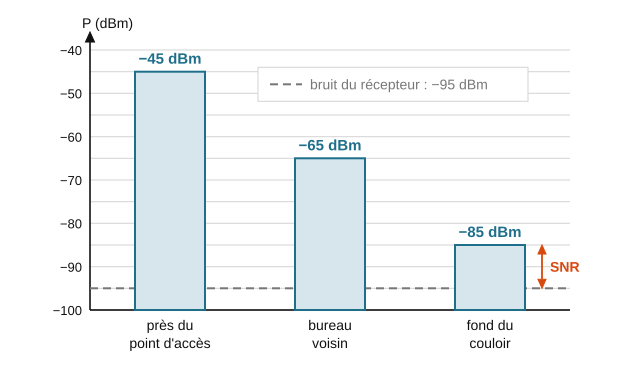

<em>Figure TD 13 : Puissances reçues aux trois emplacements de la question 1, comparées au bruit du récepteur.</em>

1) Un poste reçoit $-45\ \text{dBm}$ près du point d'accès, $-65\ \text{dBm}$ dans le bureau voisin et $-85\ \text{dBm}$ au fond du couloir. Calculer le SNR (en dB puis en rapport linéaire) dans les trois cas.
2) Calculer le débit maximal théorique $C$ dans les trois cas. Commenter.
3) Au fond du couloir, un four à micro-ondes augmente le niveau de bruit de 10 dB. Que devient le débit maximal ?
4) Sans le four, on réduit la largeur de canal à 5 MHz : le bruit baisse de $10\log_{10}(4) \approx 6\ \text{dB}$. Calculer le nouveau SNR et le nouveau débit au fond du couloir. Réduire la bande est-il intéressant pour le débit ?

**Exercice 2.12 ★★ : Sensibilité d'un récepteur LoRa**

*Compétence visée : calculer une puissance de bruit à partir de la densité spectrale et en déduire la sensibilité d'un récepteur (sous-partie 2.2).*

Le bruit thermique a une densité spectrale de puissance de −174 dBm/Hz. Le récepteur ajoute son propre bruit : on en tient compte par son **facteur de bruit** $NF$ (en dB), qui s'ajoute à la puissance de bruit : $P_{bruit} = -174 + 10\log_{10}(B) + NF$ (en dBm, $B$ en Hz). La **sensibilité** est la puissance minimale permettant de décoder le signal : $S = P_{bruit} + SNR_{min}$. Grâce à l'étalement de spectre, la modulation LoRa sait décoder des signaux plus faibles que le bruit ($SNR_{min}$ négatif).

Récepteur LoRa : $B = 125\ \text{kHz}$ ; $NF = 6\ \text{dB}$.

| Facteur d'étalement | SF7 | SF9 | SF12 |
|---|---|---|---|
| $SNR_{min}$ | −7,5 dB | −12,5 dB | −20 dB |
| Débit utile | 5,47 kbit/s | 1,76 kbit/s | 0,293 kbit/s |

1) Calculer la puissance de bruit du récepteur.
2) Calculer la sensibilité pour chaque facteur d'étalement. Comparer la valeur obtenue en SF12 à celle de la passerelle de l'exercice 3.34.
3) Que signifie concrètement $SNR_{min} = -20\ \text{dB}$ ? Comment le récepteur peut-il retrouver un signal plus faible que le bruit ?
4) Avec une largeur de bande de 500 kHz, que devient la sensibilité en SF12 ? Quel est l'intérêt d'une bande plus large ?
5) Un capteur est reçu à −125 dBm. Avec quels facteurs d'étalement peut-il communiquer ? Et si l'on exige une marge de 10 dB ? Calculer la durée d'émission de 20 octets en SF7, SF9 et SF12 (sans tenir compte des en-têtes). Pourquoi le réseau choisit-il le facteur d'étalement le plus faible possible ?

### Série de synthèse : exercices type BTS `BTS1` `BTS2`

**Exercice 2.13 ★★★ : Validation des sondes de température d'une salle serveurs (type BTS)**

*Compétence visée : conduire une analyse complète d'incertitude (types A et B, composition, propagation, compatibilité) pour prendre une décision technique.*

*Contexte :* dans un datacenter, la supervision déclenche une alerte de surchauffe lorsque la température d'entrée d'air d'une baie atteint 27 °C. Le technicien doit valider deux nouvelles sondes avant de les mettre en service, puis estimer la puissance consommée par la baie.

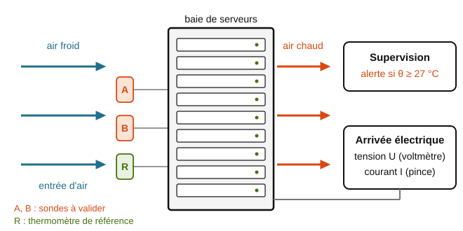

<em>Figure TD 12 : Contrôle des sondes de température dans l'entrée d'air de la baie.</em>

*Document 1 : caractéristiques de la sonde A (constructeur).* Sonde numérique, résolution 0,1 °C, précision ±0,5 °C sur la plage 0 à 50 °C.

*Document 2 : mesures de contrôle.* Les sondes sont placées à côté d'un thermomètre de référence étalonné qui indique $\theta_{réf} = (24{,}00 \pm 0{,}10)\ °\text{C}$. Dix relevés de la sonde A :

| n° | 1 | 2 | 3 | 4 | 5 | 6 | 7 | 8 | 9 | 10 |
|---|---|---|---|---|---|---|---|---|---|---|
| θ (°C) | 24,3 | 24,4 | 24,2 | 24,3 | 24,5 | 24,3 | 24,4 | 24,2 | 24,3 | 24,4 |

La sonde B, de même modèle, donne dans les mêmes conditions $\bar{\theta}_B = 25{,}1\ °\text{C}$ avec une incertitude élargie de 0,6 °C.

*Document 3 : mesures électriques sur l'arrivée de la baie (incertitudes élargies).* $U = (230 \pm 3)$ V ; $I = (12{,}0 \pm 0{,}2)$ A. On admet $P = U \times I$.

**Partie A : sonde A**

1) Calculer la moyenne $\bar{\theta}_A$ et l'écart-type $s$ de la série (3 chiffres significatifs pour $s$).
2) Calculer l'incertitude-type de type A.
3) Calculer l'incertitude-type de type B due à la précision constructeur ($u_B = a/\sqrt{3}$). Montrer que celle due à la résolution est négligeable devant elle.
4) Calculer l'incertitude composée $u$, puis l'incertitude élargie $U$ ($k = 2$). Écrire le résultat.
5) La sonde A est-elle compatible avec la référence ?

**Partie B : sonde B**

6) La sonde B est-elle compatible avec la référence ? De quel type d'erreur s'agit-il : aléatoire ou systématique ? Proposer une correction.

**Partie C : exploitation**

7) Pendant un pic de charge, la sonde A affiche 26,6 °C avec $U = 0{,}6\ °\text{C}$. Peut-on affirmer que la température est inférieure au seuil d'alerte ? Quelle décision prudente prendre ?
8) Calculer la puissance $P$ consommée par la baie et son incertitude élargie (document 3). Écrire le résultat en kW.

**Exercice 2.14 ★★★ : Recette de la couverture Wi-Fi d'un poste de travail (type BTS)** `BTS2`

*Compétence visée : associer incertitude de mesure et bruit pour valider un débit au regard d'un cahier des charges (sous-parties 2.1 et 2.2).*

*Contexte :* un entrepôt logistique s'équipe en Wi-Fi 6. Le cahier des charges impose, au poste de préparation de commandes le plus éloigné du point d'accès, un débit physique d'au moins 130 Mbit/s, **garanti avec un niveau de confiance d'environ 95 %**. Le technicien relève dix fois la puissance reçue (RSSI) affichée par la carte Wi-Fi du poste.

*Document 1 : relevés du RSSI (résolution 1 dB).* −67 ; −71 ; −69 ; −66 ; −70 ; −72 ; −68 ; −69 ; −70 ; −68 (en dBm).

*Document 2 : bruit du récepteur.* Densité spectrale du bruit thermique : −174 dBm/Hz ; facteur de bruit de la carte : $NF = 7\ \text{dB}$ ; $P_{bruit} = -174 + 10\log_{10}(B) + NF$. Le point d'accès utilise un canal de 40 MHz (ou de 20 MHz).

*Document 3 : schémas de modulation (1 flux spatial, valeurs indicatives).*

| MCS | Modulation | SNR minimal | Débit en 20 MHz | Débit en 40 MHz |
|---|---|---|---|---|
| 3 | 16-QAM 1/2 | 13 dB | 34,4 Mbit/s | 68,8 Mbit/s |
| 5 | 64-QAM 2/3 | 20 dB | 68,8 Mbit/s | 137,6 Mbit/s |
| 7 | 64-QAM 5/6 | 25 dB | 86,0 Mbit/s | 172,1 Mbit/s |
| 9 | 256-QAM 5/6 | 30 dB | 114,7 Mbit/s | 229,4 Mbit/s |
| 11 | 1024-QAM 5/6 | 35 dB | 143,4 Mbit/s | 286,8 Mbit/s |

**Partie A : puissance reçue**

1) Calculer la moyenne, l'écart-type et l'incertitude-type de type A du RSSI.
2) Calculer l'incertitude-type de type B due à la résolution, l'incertitude composée, puis l'incertitude élargie ($k = 2$). Écrire le résultat.
3) Citer deux causes physiques des fluctuations du RSSI dans un entrepôt.

**Partie B : rapport signal sur bruit et débit**

4) Calculer la puissance de bruit pour un canal de 40 MHz, puis le SNR moyen. En considérant la puissance de bruit comme exacte, donner l'intervalle du SNR au niveau de confiance de 95 %.
5) Quel MCS est garanti dans tout cet intervalle ? Le cahier des charges est-il respecté ?

**Partie C : améliorations envisagées**

6) Le technicien envisage de réduire le canal à 20 MHz. Recalculer la puissance de bruit et l'intervalle du SNR, puis le MCS garanti et le débit. Est-ce une bonne idée ?
7) On ajoute un second point d'accès, deux fois plus proche du poste : l'atténuation en espace libre diminue de $20\log_{10}(2)$. Calculer le nouvel intervalle du SNR en 40 MHz, le MCS garanti et le débit.

### Défi du chapitre `BTS2`

**Exercice 2.15 ★★★★ : Montage amont ou montage aval ? Minimiser une erreur systématique (défi)**

*Compétence visée : modéliser l'erreur systématique due aux appareils de mesure, la minimiser puis la corriger (sous-partie 2.1).*

Un banc de test mesure la résistance d'une thermistance CTN, qui varie de 100 Ω à 300 kΩ selon la température, par la méthode voltampèremétrique : on calcule $R_{mes} = \dfrac{U}{I}$ à partir des indications d'un voltmètre et d'un ampèremètre. L'ampèremètre a une résistance interne $R_A = 1{,}0\ \Omega$ ; le voltmètre a une résistance interne $R_V = 10\ \text{M}\Omega$. Deux montages sont possibles :
- **montage amont** : le voltmètre mesure la tension aux bornes de l'ensemble « ampèremètre + thermistance » ;
- **montage aval** : le voltmètre est branché directement aux bornes de la thermistance ; l'ampèremètre, placé avant, mesure le courant total qui alimente la thermistance et le voltmètre.

1) Montage amont : montrer que $R_{mes} = R + R_A$ et que l'erreur relative vaut $\varepsilon_{amont} = \dfrac{R_A}{R}$.
2) Montage aval : montrer que $R_{mes} = \dfrac{R\,R_V}{R + R_V}$ et que l'erreur relative vaut $\varepsilon_{aval} = -\dfrac{R}{R + R_V} \approx -\dfrac{R}{R_V}$ lorsque $R \ll R_V$.
*Coup de pouce : dans le montage aval, la thermistance et le voltmètre sont en parallèle.*
3) Montrer que les deux erreurs ont la même valeur absolue pour $R_c = \sqrt{R_A R_V}$. Calculer $R_c$. Quel montage choisir en dessous de $R_c$ ? Au-dessus ?
4) Calculer les erreurs relatives des deux montages pour $R = 100\ \Omega$ et pour $R = 300\ \text{k}\Omega$. Ces erreurs diminuent-elles si l'on répète les mesures ? Pourquoi ?
5) Le programme du banc commute automatiquement de montage à $R_c$. Montrer que l'erreur relative ne dépasse alors jamais $\sqrt{\dfrac{R_A}{R_V}}$ sur toute la plage, et calculer cette valeur.
*Coup de pouce : étudier comment chaque erreur varie avec $R$ de part et d'autre de $R_c$.*
6) Avec un voltmètre bas de gamme ($R_V = 1{,}0\ \text{M}\Omega$), que deviennent $R_c$ et l'erreur maximale ? Proposer enfin une correction par calcul qui supprime l'erreur systématique du montage amont, et préciser ce qui limite alors la justesse.

### Corrigés du chapitre 2 `BTS1` `BTS2`

**Exercice 2.1.** $u_A = \dfrac{s}{\sqrt{n}} = \dfrac{0{,}06}{\sqrt{8}} \approx 0{,}021$ V. $u = \sqrt{0{,}021^2 + 0{,}02^2} \approx 0{,}029$ V. $U = 2u \approx 0{,}058$ V $\approx 0{,}06$ V. Résultat : $U_{mesurée} = (5{,}08 \pm 0{,}06)$ V.

**Exercice 2.2.**
1) $u_B = \dfrac{0{,}01}{\sqrt{12}} \approx 0{,}0029\ \text{V}$ ; $U = 2u_B \approx 0{,}0058\ \text{V} \approx 0{,}006\ \text{V}$. Résultat : $U = (3{,}290 \pm 0{,}006)\ \text{V}$.
2) $|3{,}290 - 3{,}300| = 0{,}010\ \text{V} > 0{,}006\ \text{V}$ : le résultat n'est pas compatible avec 3,30 V. Mais l'incertitude est sous-évaluée : la précision du voltmètre (donnée par sa notice, du type ±(0,5 % + 2 digits)) n'a pas été prise en compte, seule la résolution l'a été. Avec la précision constructeur, l'intervalle serait plus large et la conclusion pourrait changer.
3) a) $U(U) = 0{,}08\ \text{V}$ → $U = (12{,}35 \pm 0{,}08)\ \text{V}$. b) $I = 4{,}567\ \text{mA}$, $U(I) = 0{,}231\ \text{mA} \approx 0{,}2\ \text{mA}$ → $I = (4{,}6 \pm 0{,}2)\ \text{mA}$. c) $U(R) = 47\ \Omega \approx 0{,}05\ \text{k}\Omega$ → $R = (1{,}52 \pm 0{,}05)\ \text{k}\Omega$.
4) Sonde A : valeurs groupées mais décalées de +1 °C : fidèle mais peu juste. Sonde B : moyenne correcte mais dispersion forte : juste mais peu fidèle. Sonde C : groupées autour de 24,0 °C : juste et fidèle. Sonde D : décalée et dispersée : ni juste ni fidèle.

**Exercice 2.3.**
1) Une petite variation relative sur $x$ se répercute $n$ fois sur $x^n$ (dérivée logarithmique : $d(\ln z) = n\, d(\ln x)$) : plus l'exposant est élevé, plus l'incertitude relative se dégrade.
2) $\dfrac{u(U^2)}{U^2} = 2 \times \dfrac{0{,}05}{6{,}00} = 1{,}67\ \%$. $\dfrac{u(R)}{R} = \dfrac{2}{100} = 2{,}00\ \%$.
3) $\dfrac{u(P)}{P} = \sqrt{1{,}67^2 + 2{,}00^2}\ \% \approx 2{,}60\ \%$. $P = \dfrac{6{,}00^2}{100} = 0{,}360$ W. $u(P) \approx 0{,}0094$ W. $U(P) = 2 \times 0{,}0094 \approx 0{,}019$ W $\approx 0{,}02$ W. Résultat : $P = (0{,}36 \pm 0{,}02)$ W.

**Exercice 2.4.**
1) $a = 0{,}008 \times 4{,}62 + 2 \times 0{,}01 = 0{,}037 + 0{,}020 \approx 0{,}057$ kΩ.
2) $u_B = \dfrac{0{,}057}{\sqrt{3}} \approx 0{,}033$ kΩ ; $U = 2u_B \approx 0{,}066$ kΩ $\approx 0{,}07$ kΩ. Résultat : $R = (4{,}62 \pm 0{,}07)$ kΩ.
3) $|4{,}62 - 4{,}70| = 0{,}08$ kΩ $> 0{,}07$ kΩ : le résultat n'est **pas compatible** avec la valeur nominale, à ce niveau de confiance.
4) La tolérance ±5 % autorise $[4{,}465 ; 4{,}935]$ kΩ : la mesure est dans cet intervalle, le composant est **conforme**. Sa valeur réelle n'est simplement pas 4,7 kΩ : c'est exactement ce qu'autorise une tolérance de 5 %.

**Exercice 2.5.**
*Méthode :* composer d'abord les incertitudes sur chaque grandeur mesurée ($t$ et $c$), puis propager sur le produit $d = c\,t/2$ par les incertitudes relatives (le facteur 1/2, exact, n'apporte aucune incertitude).
1) $\bar{t} = \dfrac{23\,326}{8} \approx 2915{,}8\ \mu\text{s}$ ; somme des carrés des écarts : $215{,}5\ \mu\text{s}^2$, d'où $s = \sqrt{\dfrac{215{,}5}{7}} \approx 5{,}55\ \mu\text{s}$ ; $u_A = \dfrac{5{,}55}{\sqrt{8}} \approx 1{,}96\ \mu\text{s}$.
2) $u_B = \dfrac{4}{\sqrt{12}} \approx 1{,}15\ \mu\text{s}$ ; $u(t) = \sqrt{1{,}96^2 + 1{,}15^2} \approx 2{,}3\ \mu\text{s}$.
3) $c = 331{,}4 + 0{,}6 \times 22 = 344{,}6\ \text{m/s}$ ; $u(\theta) = \dfrac{2}{\sqrt{3}} \approx 1{,}15\ °\text{C}$ ; $u(c) = 0{,}6 \times 1{,}15 \approx 0{,}69\ \text{m/s}$.
4) $d = \dfrac{344{,}6 \times 2915{,}8 \times 10^{-6}}{2} \approx 0{,}5024\ \text{m}$. $\dfrac{u(c)}{c} = \dfrac{0{,}69}{344{,}6} \approx 0{,}20\ \%$ ; $\dfrac{u(t)}{t} = \dfrac{2{,}28}{2915{,}8} \approx 0{,}078\ \%$ ; $\dfrac{u(d)}{d} = \sqrt{0{,}20^2 + 0{,}078^2} \approx 0{,}22\ \%$. $u(d) \approx 0{,}0011\ \text{m}$, $U(d) \approx 0{,}0022\ \text{m} \approx 0{,}2\ \text{cm}$. Résultat : $d = (50{,}2 \pm 0{,}2)\ \text{cm}$.
5) $|50{,}24 - 50{,}1| = 0{,}14\ \text{cm} \leq 0{,}22\ \text{cm}$ : compatible.
6) La température domine (0,20 % contre 0,08 % pour la durée). Il faut mesurer la température de l'air avec un capteur (par exemple à ±0,5 °C) et l'intégrer au calcul de $c$ : $u(c)/c$ serait divisé par 4.

*Erreurs fréquentes :* oublier la division par 2 de l'aller-retour ; composer une incertitude absolue en µs avec une incertitude en m/s (il faut passer par les incertitudes relatives) ; garder 4 chiffres significatifs sur l'incertitude.

**Exercice 2.6.**
1) $\bar{D} = \dfrac{9336}{10} = 933{,}6\ \text{Mbit/s}$ ; somme des carrés des écarts : $352{,}4$, d'où $s = \sqrt{\dfrac{352{,}4}{9}} \approx 6{,}3\ \text{Mbit/s}$ ; $u_A = \dfrac{6{,}26}{\sqrt{10}} \approx 2{,}0\ \text{Mbit/s}$.
2) $U = 2 \times 1{,}98 \approx 4\ \text{Mbit/s}$. Résultat : $D = (934 \pm 4)\ \text{Mbit/s}$.
3) $|933{,}6 - 940| = 6{,}4\ \text{Mbit/s} > 4\ \text{Mbit/s}$ : pas compatible. L'intervalle $[929{,}6\ ;\ 937{,}6]$ Mbit/s est entièrement sous 940 Mbit/s : au niveau de confiance de 95 %, le débit garanti n'est pas atteint.
4) La dispersion des mesures est justement prise en compte dans $U$ : même en l'intégrant, 940 Mbit/s reste hors de l'intervalle. Comme $u_A = s/\sqrt{n}$, diviser $u_A$ par 2 demande 4 fois plus de mesures, soit 40.
5) Ces conditions peuvent introduire une **erreur systématique** : réseau chargé aux heures de pointe, Wi-Fi plus lent que le câble, serveur de test éloigné ou saturé. Répéter les mesures dans les mêmes conditions ne la fait pas disparaître ; il faut des conditions conformes à celles prévues au contrat.

*Erreurs fréquentes :* conclure sur une seule mesure ; diviser par $n$ au lieu de $n - 1$ dans l'écart-type ; croire qu'une incertitude plus grande « arrange » le client (elle rend au contraire la conclusion impossible).

**Exercice 2.7.**
1) Les résidus restent inférieurs à 1,3 mV et changent de signe sans forme organisée ($+, -, +, -, +, -$) : le modèle linéaire convient.
2) $z = \dfrac{|0{,}18574 - 0{,}185|}{0{,}00023} \approx 3{,}2 > 2$ : la sensibilité réelle (185,7 mV/A) est significativement différente de la valeur typique. Mais la tolérance ±1,5 % autorise $[0{,}1822\ ;\ 0{,}1878]\ \text{V/A}$ : le capteur est conforme. Comme à l'exercice 2.4, « non compatible avec la valeur typique » ne veut pas dire « hors tolérance ».
3) $z = \dfrac{|2{,}5018 - 2{,}500|}{0{,}00069} \approx 2{,}6 > 2$ : un décalage de 1,8 mV est mis en évidence.
4) Avec l'étalonnage : $I = \dfrac{2{,}950 - 2{,}5018}{0{,}18574} \approx 2{,}413\ \text{A}$. Avec la notice : $I = \dfrac{2{,}950 - 2{,}500}{0{,}185} \approx 2{,}432\ \text{A}$. Écart : environ 19 mA (0,8 %).
5) $q = \dfrac{5}{1023} \approx 4{,}9\ \text{mV}$, soit $\dfrac{4{,}89}{185{,}7} \approx 26\ \text{mA}$ par niveau : la correction (19 mA) est inférieure à un quantum, elle n'apporte presque rien avec ce CAN. Elle devient utile avec un CAN plus résolu (16 bits) ou en moyennant de nombreuses conversions.

*Erreurs fréquentes :* utiliser les incertitudes élargies dans l'écart normalisé (il faut les incertitudes-types) ; confondre compatibilité avec la valeur typique et conformité à la tolérance ; inverser $a$ et $b$ dans le calcul de $I$.

**Exercice 2.8.**

*Partie A.*
1) $PUE = \dfrac{296{,}4}{218{,}7} \approx 1{,}355$.
2) Compteur général : $\dfrac{0{,}5}{\sqrt{3}} \approx 0{,}29\ \%$ ; compteur informatique : $\dfrac{1{,}0}{\sqrt{3}} \approx 0{,}58\ \%$. Quotient : $\dfrac{u(PUE)}{PUE} = \sqrt{0{,}29^2 + 0{,}58^2} \approx 0{,}65\ \%$, d'où $u \approx 0{,}0087$ et $U \approx 0{,}017 \approx 0{,}02$. Résultat : $PUE = 1{,}36 \pm 0{,}02$.
3) Borne haute : $1{,}355 + 0{,}017 \approx 1{,}37 < 1{,}40$ : l'engagement est respecté, même en tenant compte de l'incertitude.

*Partie B.*
4) $E = 296{,}4 - 218{,}7 = 77{,}7\ \text{MWh}$. Différence : on compose les incertitudes **absolues** : $u(E_{totale}) = 296{,}4 \times 0{,}0029 \approx 0{,}86\ \text{MWh}$ ; $u(E_{informatique}) = 218{,}7 \times 0{,}0058 \approx 1{,}26\ \text{MWh}$ ; $u(E) = \sqrt{0{,}86^2 + 1{,}26^2} \approx 1{,}5\ \text{MWh}$ ; $U \approx 3{,}1\ \text{MWh}$. Résultat : $E = (77{,}7 \pm 3{,}1)\ \text{MWh}$, soit 3,9 % d'incertitude relative contre 1,3 % pour le PUE : la différence de deux grandeurs voisines amplifie l'incertitude relative (comme pour le son dans l'acier, exercice 3.2).
5) $77\,700 \times 0{,}15 \approx 11\,700\ \text{€}$ ; $U = 3050 \times 0{,}15 \approx 460\ \text{€}$. Résultat : $(11{,}7 \pm 0{,}5)\ \text{k€}$.
6) Le compteur informatique, qui domine l'incertitude. Avec ±0,2 % : $\sqrt{0{,}29^2 + 0{,}12^2} \approx 0{,}31\ \%$, d'où $U(PUE) \approx 2 \times 0{,}0031 \times 1{,}355 \approx 0{,}008$ ; c'est alors le compteur général qui domine.

*Partie C.*
7) Moyenne : 1,3525 ; $s \approx 0{,}042$. L'écart-type ne traduit pas ici une incertitude de mesure : les PUE varient de façon **systématique** avec les saisons (plus de climatisation en été). Ce ne sont pas des mesures répétées d'une même grandeur, la formule $s/\sqrt{n}$ n'a pas de sens. Le PUE annuel se calcule à partir des énergies annuelles : $\dfrac{\sum E_{totale}}{\sum E_{informatique}}$ (les mois n'ont pas tous la même consommation, la moyenne des rapports n'est pas le rapport des sommes).

*Erreurs fréquentes :* composer des incertitudes relatives pour une différence ; appliquer mécaniquement la formule de type A à des valeurs qui évoluent pour une raison physique ; arrondir le PUE avant de calculer son incertitude.

**Exercice 2.9.**
1) $SNR = 20 \log_{10}\!\left(\dfrac{S}{B}\right) = 20 \log_{10}\!\left(\dfrac{50}{0{,}5}\right) = 20 \log_{10}(100) = 40\ \text{dB}$.
2) $P_{bruit} = DSP + 10\log_{10}(\Delta f) = -174 + 10\log_{10}(20 \times 10^{6}) = -174 + 73{,}0 = -101\ \text{dBm}$.
3) $SNR = P_{signal} - P_{bruit} = -65 - (-101) = 36\ \text{dB}$ (en dBm, une différence donne directement des dB).
4) $P_{bruit} = -174 + 10\log_{10}(80 \times 10^{6}) \approx -95{,}0\ \text{dBm}$ (bande ×4, donc bruit +6 dB). $SNR = -65 - (-95) = 30\ \text{dB}$ : un canal plus large capte plus de bruit.

**Exercice 2.10.**
1) $B_{eff} = \sqrt{4 k_B T R \Delta f} = \sqrt{4 \times 1{,}38 \times 10^{-23} \times 300 \times 5 \times 10^{4} \times 2 \times 10^{4}} \approx 4{,}1\ \mu$V.
2) $SNR = 20 \log_{10}\!\left(\dfrac{10 \times 10^{-3}}{4{,}07 \times 10^{-6}}\right) \approx 67{,}8$ dB.
3) $P_{bruit} = -150 + 10 \log_{10}(2 \times 10^{4}) \approx -150 + 43{,}0 = -107{,}0$ dBm. $SNR = -80 - (-107{,}0) \approx 27$ dB.
4) La puissance de bruit est proportionnelle à $\Delta f$ : diviser la bande par 4 retire $10 \log_{10}(4) \approx 6$ dB de bruit, donc le SNR gagne environ 6 dB. On ne peut pas descendre sous la bande occupée par le signal utile lui-même : on filtrerait alors une partie de l'information (et le débit possible diminue avec la bande).

**Exercice 2.11.**
1) $SNR_{(dB)} = P_{signal} - P_{bruit}$ : près du point d'accès $-45 + 95 = 50\ \text{dB}$, soit $10^{5}$ ; bureau voisin $30\ \text{dB}$, soit $1000$ ; fond du couloir $10\ \text{dB}$, soit $10$.
2) $C = 20 \times 10^{6} \times \log_2(1 + 10^{5}) \approx 20 \times 10^6 \times 16{,}6 \approx 332\ \text{Mbit/s}$ ; $C = 20 \times 10^6 \times \log_2(1001) \approx 199\ \text{Mbit/s}$ ; $C = 20 \times 10^6 \times \log_2(11) \approx 69\ \text{Mbit/s}$. Le débit possible chute quand on s'éloigne : c'est le SNR qui limite, à bande égale.
3) Le bruit passe à $-85\ \text{dBm}$ : $SNR = 0\ \text{dB}$, soit 1, et $C = 20 \times 10^6 \times \log_2(2) = 20\ \text{Mbit/s}$.
4) Bruit : $-95 - 6 = -101\ \text{dBm}$ ; $SNR = -85 + 101 = 16\ \text{dB}$, soit $10^{1{,}6} \approx 39{,}8$. $C = 5 \times 10^6 \times \log_2(40{,}8) \approx 26{,}7\ \text{Mbit/s}$, contre 69 Mbit/s en 20 MHz. Le SNR s'améliore, mais la perte de bande l'emporte : réduire la bande n'est intéressant que pour fiabiliser une liaison très bruitée, pas pour gagner en débit.

**Exercice 2.12.**
*Méthode :* tout se fait en dB et dBm, par additions : $10\log_{10}(B)$ convertit la largeur de bande en dB.
1) $P_{bruit} = -174 + 10\log_{10}(125 \times 10^3) + 6 = -174 + 51{,}0 + 6 \approx -117{,}0\ \text{dBm}$.
2) SF7 : $-117{,}0 - 7{,}5 = -124{,}5\ \text{dBm}$ ; SF9 : $-129{,}5\ \text{dBm}$ ; SF12 : $-137{,}0\ \text{dBm}$, exactement la sensibilité de la passerelle de l'exercice 3.34.
3) $-20\ \text{dB}$ correspond à un rapport de puissances de $10^{-2}$ : le signal est 100 fois plus faible que le bruit. L'émetteur étale chaque symbole sur une longue durée selon un motif connu du récepteur ; celui-ci accumule le signal le long de ce motif, alors que le bruit, aléatoire, se compense en partie (même principe que le moyennage, fiche 2.E, ou que le GPS).
4) $P_{bruit} = -174 + 10\log_{10}(500 \times 10^3) + 6 \approx -111{,}0\ \text{dBm}$, d'où $S = -131{,}0\ \text{dBm}$ : la sensibilité perd 6 dB, mais le débit est multiplié par 4 (bande 4 fois plus large).
5) −125 dBm est sous la sensibilité de SF7 (−124,5 dBm) : SF7 impossible ; SF9 (marge 4,5 dB) et SF12 (marge 12 dB) conviennent. Avec 10 dB de marge, seul SF12 convient. Durées : SF7 $\dfrac{160}{5470} \approx 29\ \text{ms}$ ; SF9 $\approx 91\ \text{ms}$ ; SF12 $\approx 0{,}55\ \text{s}$. Le plus petit facteur d'étalement possible réduit la durée d'émission, donc l'énergie consommée par le capteur sur pile et l'occupation du canal partagé.

*Erreurs fréquentes :* oublier le facteur de bruit ; prendre $\log_{10}(125)$ avec $B$ en kHz au lieu de Hz ; croire qu'un SNR négatif est impossible.

**Exercice 2.13.**

*Partie A.*
1) $\bar{\theta}_A = \dfrac{\sum \theta_i}{10} = \dfrac{243{,}3}{10} = 24{,}33\ °\text{C}$. Écarts à la moyenne : la somme de leurs carrés vaut $0{,}081\ °\text{C}^2$, d'où $s = \sqrt{\dfrac{0{,}081}{9}} \approx 0{,}0949\ °\text{C}$.
2) $u_A = \dfrac{s}{\sqrt{10}} = \dfrac{0{,}0949}{3{,}162} \approx 0{,}030\ °\text{C}$.
3) Précision constructeur $a = 0{,}5\ °\text{C}$ : $u_B = \dfrac{0{,}5}{\sqrt{3}} \approx 0{,}29\ °\text{C}$. Résolution : $\dfrac{0{,}1}{\sqrt{12}} \approx 0{,}029\ °\text{C}$, dix fois plus petite : elle ne modifie $u$ que dans le troisième chiffre ($0{,}290$ → $0{,}292$), on la néglige.
4) $u = \sqrt{0{,}030^2 + 0{,}289^2} \approx 0{,}29\ °\text{C}$ ; $U = 2u \approx 0{,}58\ °\text{C} \approx 0{,}6\ °\text{C}$. Résultat : $\theta_A = (24{,}3 \pm 0{,}6)\ °\text{C}$. L'incertitude est dominée par la précision constructeur (type B) : répéter les mesures ne l'améliore pas.
5) $|24{,}33 - 24{,}00| = 0{,}33\ °\text{C} \leq 0{,}6\ °\text{C}$ : la sonde A est compatible avec la référence.

*Partie B.*
6) $|25{,}1 - 24{,}0| = 1{,}1\ °\text{C} > 0{,}6\ °\text{C}$ : la sonde B n'est pas compatible. Ses mesures sont reproductibles (même incertitude que A) mais décalées : c'est une erreur systématique (défaut d'étalonnage, offset). Correction : appliquer un offset de $-1{,}1\ °\text{C}$ dans la configuration de la sonde, puis la recontrôler, ou la renvoyer en étalonnage.

*Partie C.*
7) L'intervalle est $[26{,}0 ; 27{,}2]\ °\text{C}$ : il contient 27 °C. On ne peut pas affirmer que la température est sous le seuil. Décision prudente : déclencher une pré-alerte (ou abaisser le seuil logiciel à $27 - 0{,}6 = 26{,}4\ °\text{C}$) pour ne jamais manquer une surchauffe réelle.
8) $P = 230 \times 12{,}0 = 2760\ \text{W}$. Produit : on compose les incertitudes relatives : $\dfrac{U(P)}{P} = \sqrt{\left(\dfrac{3}{230}\right)^2 + \left(\dfrac{0{,}2}{12{,}0}\right)^2} \approx 2{,}1\ \%$, d'où $U(P) \approx 0{,}021 \times 2760 \approx 58\ \text{W} \approx 0{,}06\ \text{kW}$. Résultat : $P = (2{,}76 \pm 0{,}06)\ \text{kW}$.

**Exercice 2.14.**

*Partie A.*
1) $\overline{RSSI} = -69{,}0\ \text{dBm}$ ; somme des carrés des écarts : 30, $s = \sqrt{30/9} \approx 1{,}83\ \text{dB}$ ; $u_A = \dfrac{1{,}83}{\sqrt{10}} \approx 0{,}58\ \text{dB}$.
2) $u_B = \dfrac{1}{\sqrt{12}} \approx 0{,}29\ \text{dB}$ ; $u = \sqrt{0{,}58^2 + 0{,}29^2} \approx 0{,}65\ \text{dB}$ ; $U = 2u \approx 1{,}3\ \text{dB}$. Résultat : $RSSI = (-69{,}0 \pm 1{,}3)\ \text{dBm}$.
3) Trajets multiples (réflexions sur les racks métalliques, qui s'ajoutent ou s'opposent), passages de personnes et de chariots, variations de charge du point d'accès.

*Partie B.*
4) $P_{bruit} = -174 + 10\log_{10}(40 \times 10^6) + 7 \approx -91{,}0\ \text{dBm}$ ; $SNR = -69{,}0 - (-91{,}0) = 22{,}0\ \text{dB}$. Le bruit étant pris exact, l'incertitude sur le SNR est celle du RSSI : $SNR \in [20{,}7\ ;\ 23{,}3]\ \text{dB}$.
5) Le MCS 5 (20 dB) est garanti dans tout l'intervalle, pas le MCS 7 (25 dB). Débit garanti : 137,6 Mbit/s ≥ 130 Mbit/s : cahier des charges respecté, de justesse.

*Partie C.*
6) $P_{bruit} = -174 + 73{,}0 + 7 \approx -94{,}0\ \text{dBm}$ : le SNR gagne 3 dB, $[23{,}7\ ;\ 26{,}3]\ \text{dB}$. Le MCS 7 n'est toujours pas garanti (25 dB > 23,7 dB) : on reste en MCS 5, mais à 68,8 Mbit/s en 20 MHz. Mauvaise idée : on gagne en SNR moins que ce que l'on perd en largeur de canal.
7) Gain : $20\log_{10}(2) \approx 6\ \text{dB}$, d'où $SNR \in [26{,}7\ ;\ 29{,}3]\ \text{dB}$ : MCS 7 garanti, soit 172,1 Mbit/s.

*Erreurs fréquentes :* choisir le MCS d'après le SNR moyen au lieu de la borne basse de l'intervalle ; soustraire des dBm sans changer d'unité (une différence de dBm est en dB) ; oublier le facteur de bruit.

**Exercice 2.15.**
1) Montage amont : le voltmètre mesure $U = (R + R_A)\,I$ et l'ampèremètre mesure exactement le courant $I$ de la thermistance. $R_{mes} = R + R_A$, d'où $\varepsilon_{amont} = \dfrac{R_{mes} - R}{R} = \dfrac{R_A}{R}$.
2) Montage aval : le voltmètre mesure exactement la tension $U$ de la thermistance, mais l'ampèremètre mesure $I = \dfrac{U}{R} + \dfrac{U}{R_V}$ (loi des nœuds). $R_{mes} = \dfrac{U}{I} = \dfrac{R\,R_V}{R + R_V}$, la résistance équivalente de $R$ et $R_V$ en parallèle. $\varepsilon_{aval} = \dfrac{R_{mes} - R}{R} = \dfrac{R_V}{R + R_V} - 1 = -\dfrac{R}{R + R_V} \approx -\dfrac{R}{R_V}$.
3) $\dfrac{R_A}{R} = \dfrac{R}{R_V} \Leftrightarrow R^2 = R_A R_V$, d'où $R_c = \sqrt{R_A R_V} = \sqrt{1{,}0 \times 10^7} \approx 3{,}2\ \text{k}\Omega$. En dessous de $R_c$, l'erreur aval est la plus petite : montage aval (petites résistances). Au-dessus, montage amont (grandes résistances).
4) $R = 100\ \Omega$ : $\varepsilon_{amont} = 1{,}0\ \%$ ; $\varepsilon_{aval} \approx -0{,}001\ \%$. $R = 300\ \text{k}\Omega$ : $\varepsilon_{amont} \approx 0{,}0003\ \%$ ; $\varepsilon_{aval} \approx -2{,}9\ \%$. Ce sont des erreurs **systématiques** : elles se reproduisent à l'identique à chaque mesure, la répétition ne les réduit pas.
5) En dessous de $R_c$ (montage aval), $|\varepsilon| \approx R/R_V$ croît avec $R$ ; au-dessus (montage amont), $\varepsilon = R_A/R$ décroît avec $R$. L'erreur est donc maximale à la commutation, où elle vaut $\dfrac{R_A}{R_c} = \dfrac{R_A}{\sqrt{R_A R_V}} = \sqrt{\dfrac{R_A}{R_V}} \approx 3{,}2 \times 10^{-4}$, soit environ 0,03 % sur toute la plage.
6) $R_c = \sqrt{1{,}0 \times 10^6} = 1{,}0\ \text{k}\Omega$ et l'erreur maximale passe à $\sqrt{10^{-6}} = 0{,}1\ \%$. Correction du montage amont : $R = R_{mes} - R_A$ ; l'erreur systématique disparaît, et la justesse n'est plus limitée que par la connaissance de $R_A$ (son incertitude) et par la précision des deux appareils.

*Erreurs fréquentes :* inverser les deux montages (retenir : en montage amont, le voltmètre est branché en amont de l'ampèremètre, il mesure donc aussi la chute de tension dans l'ampèremètre) ; croire que répéter les mesures corrige une erreur systématique ; négliger $R_V$ face à des résistances de plusieurs centaines de kΩ.

---

&nbsp;

## Chapitre 3 : Ondes et propagation

*Les exercices sont regroupés en séries qui suivent les douze sous-parties du cours ; dans chaque série, ils sont classés par difficulté croissante. La série §3.7 (polarisation) va de l'application directe au sujet de type BTS sur un faisceau hertzien à double polarisation (exercice 3.21, ★★★). La série de synthèse rassemble les sujets de type BTS qui mobilisent plusieurs sous-parties : installation d'une passerelle LoRaWAN (exercice 3.34), déploiement de capteurs LoRaWAN dans une commune (exercice 3.35) et maintenance d'un point d'accès Wi-Fi extérieur (exercice 3.36). Le défi du chapitre (exercice 3.37, ★★★★) le termine. Certains exercices `BTS2` s'appuient sur les fiches 3.B, 3.C, 3.D et 3.F des compléments BTS2.*

*Données pour tout le chapitre : $c_0 = 3{,}0 \times 10^8$ m/s (célérité de la lumière dans le vide, et dans l'air pour les ondes radio) ; célérité du son dans l'air à 20 °C : 340 m/s (sauf indication contraire).*

### Série §3.1 : Ondes mécaniques progressives `BTS1` `BTS2`

**Exercice 3.1 ★ : Nature d'une onde et capteur de niveau à ultrasons**

*Compétence visée : distinguer onde transversale et longitudinale, utiliser la relation $c = d/t$ pour une mesure par écho.*

1) Classer chacune des ondes suivantes en onde transversale ou longitudinale : a) le son émis par le haut-parleur d'une alarme incendie ; b) l'onde qui parcourt une corde de guitare pincée ; c) une compression qui se propage le long d'un ressort ; d) la « ola » dans un stade.
2) Une onde mécanique transporte-t-elle de la matière ? Justifier avec l'exemple de la ola.
3) Le circuit de refroidissement liquide d'un datacenter comporte une cuve tampon. Un capteur à ultrasons fixé 1,20 m au-dessus du fond de la cuve mesure la durée aller-retour de l'écho sur la surface du liquide : $t = 4{,}0\ \text{ms}$. La célérité du son dans l'air de la cuve vaut $343\ \text{m/s}$. Calculer la distance entre le capteur et la surface, puis la hauteur de liquide dans la cuve.

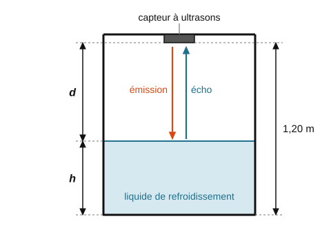

<em>Figure TD 14 : Mesure du niveau de liquide dans la cuve tampon par écho ultrasonore (question 3).</em>

**Exercice 3.2 ★★ : Le son dans l'acier et dans l'air**

*Compétence visée : exploiter un retard entre deux ondes pour déterminer une célérité et critiquer la précision de la méthode.*

Dans un local technique, un technicien frappe l'extrémité d'une canalisation métallique rectiligne de longueur $L = 102\ \text{m}$. Un collègue, à l'autre extrémité, entend deux sons : le premier transmis par le métal, le second par l'air, avec un écart $\Delta t = 0{,}280\ \text{s}$.

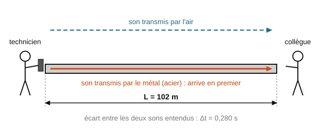

<em>Figure TD 15 : Propagation du son dans la canalisation et dans l'air.</em>

1) Calculer la durée de propagation du son dans l'air sur 102 m.
2) En déduire la durée de propagation dans l'acier.
3) Calculer la célérité du son dans l'acier.
4) L'écart $\Delta t$ est mesuré à $\pm 0{,}005\ \text{s}$ près. Calculer les valeurs extrêmes possibles de la célérité. La méthode est-elle précise ? Pourquoi ?
5) La célérité dépend-elle de la source (le marteau) ou du milieu ? Que se passerait-il avec une canalisation en PVC ?

### Série §3.2 : Ondes progressives sinusoïdales `BTS1` `BTS2`

**Exercice 3.3 ★ : Longueurs d'onde usuelles**

*Compétence visée : utiliser $\lambda = c/f$ et distinguer ce qui dépend de la source et ce qui dépend du milieu.*

1) Calculer la longueur d'onde des ondes suivantes : a) Wi-Fi à 2,4 GHz ; b) Wi-Fi à 5,0 GHz ; c) son de 1,0 kHz dans l'air ; d) ultrasons de 40 kHz dans l'air.
2) Calculer la fréquence d'un rayonnement infrarouge de longueur d'onde 1310 nm dans le vide.
3) Le son de 1,0 kHz passe de l'air dans l'eau, où sa célérité vaut 1480 m/s. Sa fréquence change-t-elle ? Calculer sa longueur d'onde dans l'eau.

**Exercice 3.4 ★ : Battement de deux signaux**

*Compétence visée : calculer une fréquence de battement et en mesurer les conséquences sur un canal radio.*

Deux émetteurs radio proches émettent respectivement à $f_1 = 100{,}000$ kHz et $f_2 = 100{,}003$ kHz. Superposés, ils produisent un phénomène de battement.

1) Rappeler (ou admettre) que la fréquence de battement perçue vaut $f_{bat} = |f_1 - f_2|$. Calculer $f_{bat}$.
2) En déduire la période du battement.
3) Pourquoi ce phénomène est-il un problème pratique en télécommunications (deux canaux trop proches en fréquence) ? Donner une conséquence concrète.

**Exercice 3.5 ★★ : Retard de propagation et synchronisation d'horloges**

*Compétence visée : calculer un retard de propagation et le convertir en déphasage.*

Les protocoles de synchronisation d'horloge (NTP, PTP) estiment le temps de propagation d'une trame en supposant que l'aller et le retour ont la même durée.

1) Calculer la célérité de la lumière dans une fibre d'indice $n = 1{,}47$ ($c = c_0/n$).
2) Calculer le retard de propagation sur une liaison fibre de 25,0 km.
3) Sur une liaison réelle, la fibre aller mesure 25,0 km et la fibre retour 25,2 km. Le protocole estime le retard aller comme la moitié de l'aller-retour. Calculer l'erreur commise sur l'heure (moitié de la différence entre retour et aller).
4) Une horloge de référence sinusoïdale à 10 MHz est distribuée par câble coaxial (coefficient de vélocité $k = 0{,}66$). Calculer sa longueur d'onde dans le câble.
5) Deux équipements reçoivent cette horloge par deux câbles dont les longueurs diffèrent de 5,0 m. Calculer le décalage temporel entre les deux signaux, puis le déphasage en degrés. Les deux horloges sont-elles en phase ?

**Exercice 3.6 ★★ : Mesurer la longueur d'onde et la célérité des ultrasons**

*Compétence visée : mesurer une longueur d'onde par décalage de deux récepteurs, relier retard et déphasage, choisir une méthode de mesure (sous-parties 3.2 et 3.3).*

Un émetteur à ultrasons est alimenté par un générateur sinusoïdal à $f = 40{,}0\ \text{kHz}$. Deux récepteurs $R_1$ et $R_2$ sont placés face à l'émetteur, le long d'une règle graduée ; leurs signaux sont observés sur les voies 1 et 2 d'un oscilloscope. $R_1$ reste fixe ; au départ, $R_2$ est à côté de $R_1$ et les deux signaux sont en phase.

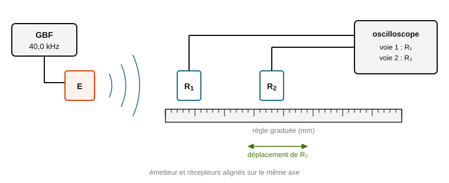

<em>Figure TD 42 : Mesure de la longueur d'onde des ultrasons avec deux récepteurs.</em>

1) Calculer la période des ultrasons. Combien de divisions occupe-t-elle avec une base de temps de 10 µs/div ?
2) On éloigne lentement $R_2$ de l'émetteur : les deux signaux se retrouvent en phase pour la dixième fois après un déplacement de 86 mm, lu à ±1 mm près. Justifier que ce déplacement vaut $10\lambda$. Calculer $\lambda$ et la célérité $c$. Pourquoi mesurer dix longueurs d'onde plutôt qu'une seule ?
3) On place $R_2$ à 2,15 mm derrière une position où les deux signaux étaient en phase. Calculer le retard du signal de $R_2$ sur celui de $R_1$, puis le déphasage en degrés. Décrire l'aspect des deux courbes à l'écran.
4) On veut mesurer directement $c$ par un temps de vol, avec $R_2$ placé 30,0 cm derrière $R_1$. Combien de périodes contient le retard ? Pourquoi est-il impossible de le mesurer avec un signal sinusoïdal permanent ? En mode « salves », le début de la salve reçue par $R_2$ apparaît 8,7 divisions après celui de $R_1$, avec une base de temps de 0,1 ms/div. Calculer $c$.
5) On admet $c = 331{,}5 + 0{,}6\,\theta$ ($\theta$ en °C). Estimer la température de l'air de la salle à partir de $c = 344\ \text{m/s}$.

### Série §3.3 : Lecture d'une onde à l'oscilloscope et déphasage `BTS1` `BTS2`

**Exercice 3.7 ★ : Lecture d'une onde à l'oscilloscope**

*Compétence visée : lire une période à l'oscilloscope et en déduire fréquence et longueur d'onde.*

Base de temps 0,2 ms/div, une période occupe 3,5 divisions.

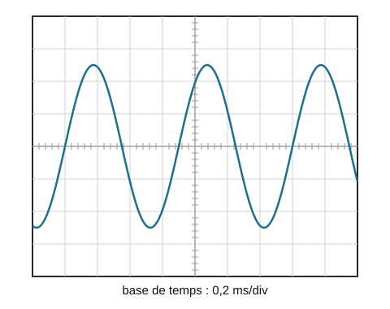

<em>Figure TD 16 : Oscillogramme de l'exercice 3.7.</em>

1) Calculer $T$.
2) En déduire $f$.
3) Ce signal est une onde sonore ($v = 340$ m/s) : calculer $\lambda$.

**Exercice 3.8 ★★ : Déphasage entrée/sortie d'un filtre et lecture d'une liaison série**

*Compétence visée : mesurer amplitudes, période et déphasage sur un oscillogramme, choisir un calibre adapté.*

On visualise sur un oscilloscope l'entrée (voie 1) et la sortie (voie 2) du filtre d'entrée d'une carte d'acquisition. Réglages : 1 V/div sur les deux voies, base de temps 50 µs/div. Relevés : une période occupe 4,0 div ; l'amplitude crête vaut 3,2 div sur la voie 1 et 2,2 div sur la voie 2 ; le signal de sortie atteint son maximum 0,5 div après le signal d'entrée.

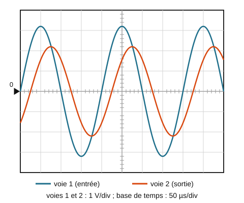

<em>Figure TD 17 : Oscillogramme de l'entrée (voie 1) et de la sortie (voie 2) du filtre.</em>

1) Calculer la période et la fréquence du signal.
2) Calculer les amplitudes, puis les valeurs efficaces, des deux signaux (signaux sinusoïdaux).
3) Calculer le décalage temporel et le déphasage en degrés. La sortie est-elle en avance ou en retard ?
4) Calculer le gain du filtre en dB à cette fréquence : $G = 20\log_{10}\!\left(\dfrac{U_{s}}{U_{e}}\right)$.
5) On observe maintenant la ligne TX d'une liaison série UART à 115 200 bauds. Calculer la durée d'un bit et celle d'un octet transmis avec un bit de start et un bit de stop. Sur combien de divisions s'étale un bit avec une base de temps de 20 µs/div ? De 5 µs/div ? Quel calibre choisir pour lire les bits ?

### Série §3.4 : Ondes sonores et effet Doppler `BTS1` `BTS2`

**Exercice 3.9 ★ : Alarme sonore et drone d'inspection**

*Compétence visée : calculer une longueur d'onde sonore, une puissance acoustique surfacique et un décalage Doppler.*

1) La sirène d'alarme incendie d'un datacenter émet un son de 2,0 kHz. Calculer sa longueur d'onde dans l'air.
2) À quelques mètres de la sirène, la surpression acoustique a une amplitude $A = 2{,}0\ \text{Pa}$. L'impédance acoustique de l'air vaut $Z = 415\ \text{Pa·s/m}$. Calculer la puissance surfacique $P = \dfrac{A^2}{2Z}$.
3) Un drone d'inspection, dont les hélices produisent un son de 2,0 kHz, s'approche à 15 m/s d'un technicien immobile. Calculer le décalage Doppler $\Delta f = f_S \times \dfrac{v_S}{c - v_S}$ et la fréquence perçue.
4) Même question lorsque le drone s'éloigne à la même vitesse ($v_S = -15$ m/s).

**Exercice 3.10 ★★ : Capteur à ultrasons et effet Doppler**

*Compétence visée : exploiter une mesure par écho, évaluer l'effet de la température et appliquer la relation de Doppler.*

Un capteur d'aide au stationnement émet des ultrasons à 40 kHz ; on prend $c = 340$ m/s dans l'air à 15 °C.

1) Calculer la longueur d'onde des ultrasons émis.
2) L'écho revient 5,0 ms après l'émission. À quelle distance se trouve l'obstacle ?
3) Par une journée à 30 °C, la célérité vaut 349 m/s, mais le calculateur utilise toujours 340 m/s. Quelle est la distance réelle pour le même écho de 5,0 ms ? Quelle erreur commet le capteur ?
4) Une sirène de fréquence $f_S = 440$ Hz s'approche d'un piéton immobile à 90 km/h. Calculer le décalage Doppler et la fréquence perçue. Que perçoit le piéton une fois le véhicule passé (même vitesse, source qui s'éloigne) ?

**Exercice 3.11 ★★ : Détecteur de présence radar à effet Doppler** `BTS2`

*Compétence visée : appliquer la relation du radar Doppler et en déduire des contraintes d'installation et d'échantillonnage (sous-partie 3.4, fiche 3.B des compléments).*

Les portes automatiques et l'éclairage d'un couloir de datacenter sont commandés par un détecteur radar qui émet à $f_0 = 24{,}125\ \text{GHz}$. Une cible qui se déplace à la vitesse $v$, en faisant un angle $\theta$ avec la direction du radar, renvoie une onde décalée de $\Delta f \approx \dfrac{2\,v\cos\theta\,f_0}{c}$ ; le détecteur extrait directement ce décalage.

1) Calculer la longueur d'onde émise.
2) Une personne marche droit vers le détecteur à 1,2 m/s. Calculer le décalage Doppler.
3) Même question si elle marche en faisant un angle de 60° avec la direction du radar, puis de 90°. Quelle conséquence pour l'installation du détecteur ?
4) Le signal Doppler est numérisé par un ESP32. On veut détecter des vitesses jusqu'à 5,0 m/s (personne qui court droit vers le détecteur). Calculer le décalage maximal et la fréquence d'échantillonnage minimale.
5) Un ventilateur voisin a des pales dont l'extrémité se déplace à 15 m/s. Calculer le décalage Doppler maximal qu'il peut produire. Comment éviter qu'il déclenche le détecteur ?
6) Un détecteur à ultrasons à 40 kHz ($c = 340\ \text{m/s}$) observe la même personne qu'à la question 2. Calculer le décalage Doppler et commenter.

### Série §3.5 : Ondes électromagnétiques : propriétés `BTS1` `BTS2`

**Exercice 3.12 ★ : Champs d'un point d'accès Wi-Fi**

*Compétence visée : relier les champs E et B, calculer une densité surfacique de puissance et une célérité dans un milieu.*

À 1 m d'un point d'accès Wi-Fi, on mesure un champ électrique efficace $E = 2{,}0\ \text{V/m}$. On donne $Z_0 = 377\ \Omega$.

1) Calculer le champ magnétique efficace $B$.
2) Calculer la densité surfacique de puissance $p = \dfrac{E^2}{Z_0}$, en W/m² puis en mW/m².
3) Dans un câble coaxial, l'onde se propage dans un isolant en polyéthylène d'indice $n = 1{,}52$. Calculer sa célérité et le coefficient de vélocité $k = c/c_0$.
4) Une onde électromagnétique a-t-elle besoin d'un milieu matériel pour se propager ? Citer un exemple qui le prouve.

**Exercice 3.13 ★★ : Onde électromagnétique d'une passerelle LoRa**

*Compétence visée : calculer les grandeurs caractéristiques d'une onde radio et établir un bilan de liaison.*

Une passerelle LoRa émet à 868 MHz.

1) Calculer la longueur d'onde dans le vide, puis la longueur d'une antenne quart d'onde.
2) À quelques mètres de l'antenne, on mesure un champ électrique efficace $E = 0{,}50$ V/m. Calculer le champ magnétique $B$ et la densité surfacique de puissance $p$ ($Z_0 \approx 377$ Ω).
3) L'onde traverse un isolant d'indice $n = 1{,}5$. Calculer sa célérité et sa longueur d'onde dans ce matériau. Sa fréquence change-t-elle ?
4) Bilan de liaison : émetteur +14 dBm, câble −1 dB, deux antennes de +2 dBi, atténuation en espace libre de 120 dB. Calculer la puissance reçue. La sensibilité du récepteur est de −120 dBm : la liaison fonctionne-t-elle, et avec quelle marge ?

### Série §3.6 : Classification du spectre électromagnétique `BTS1` `BTS2`

*Limites usuelles des domaines (dans le vide) : ondes radio $\lambda > 1$ m ; micro-ondes de 1 mm à 1 m ; infrarouge de 780 nm à 1 mm ; visible de 380 à 780 nm ; ultraviolet de 10 à 380 nm ; rayons X en dessous de 10 nm.*

**Exercice 3.14 ★ : Classer les technologies sur le spectre**

*Compétence visée : convertir fréquence et longueur d'onde et situer une technologie dans le spectre électromagnétique.*

1) Calculer la longueur d'onde dans le vide et donner le domaine de : a) la radio FM à 100 MHz ; b) LoRa à 868 MHz ; c) le Wi-Fi à 5,5 GHz.
2) Calculer la fréquence et donner le domaine de : d) une télécommande infrarouge à 940 nm ; e) la fibre optique à 1550 nm ; f) une lampe germicide UV-C à 254 nm ; g) un rayonnement de radiographie à 0,050 nm.
3) Classer les sept rayonnements par fréquence croissante.

**Exercice 3.15 ★★ : 2,4 GHz ou 5 GHz ?**

*Compétence visée : comparer deux bandes de fréquence par un calcul d'atténuation et par l'énergie des photons.*

Un point d'accès bibande rayonne une PIRE de 20 dBm dans les deux bandes. Un ordinateur (antenne 0 dBi) est situé à 20 m, derrière un mur en béton. L'atténuation en espace libre vaut $FSL = 32{,}45 + 20\log_{10}(f) + 20\log_{10}(d)$ avec $f$ en MHz et $d$ en km. Le mur atténue de 10 dB à 2,4 GHz et de 18 dB à 5,5 GHz.

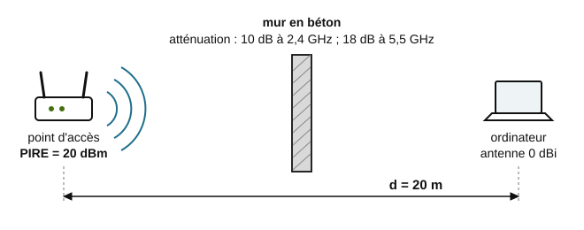

<em>Figure TD 18 : Point d'accès bibande et ordinateur situé à 20 m, derrière un mur en béton.</em>

1) Calculer la longueur d'onde dans les deux bandes (2,4 GHz et 5,5 GHz).
2) Calculer la FSL à 20 m dans les deux bandes et leur différence.
3) Calculer la puissance reçue par l'ordinateur dans les deux bandes. Pour le débit maximal, la carte Wi-Fi exige au moins −65 dBm : quelle bande choisir derrière ce mur ?
4) Pourquoi utilise-t-on malgré tout le 5 GHz dans les salles de réunion et les open spaces ?
5) Calculer l'énergie d'un photon à 5,5 GHz en J puis en eV, et la comparer à l'énergie d'ionisation d'un atome (environ 10 eV). Le Wi-Fi est-il un rayonnement ionisant ?

### Série §3.7 : Polarisation d'une onde électromagnétique `BTS2`

**Exercice 3.16 ★ : Orientation des antennes**

*Compétence visée : définir la polarisation et évaluer la perte due à un désalignement de polarisation.*

1) Définir la polarisation d'une onde électromagnétique. Quelle est la différence entre polarisation linéaire et polarisation circulaire ?
2) Une antenne de réception à polarisation linéaire est tournée d'un angle $\theta$ par rapport à la polarisation de l'onde reçue. On admet que la puissance reçue vaut $P = P_{max} \times \cos^2\theta$. Calculer la perte en dB pour $\theta = 30°$, $45°$ et $60°$. Que se passe-t-il en théorie pour $\theta = 90°$ ?

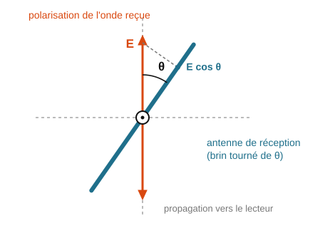

<em>Figure TD 19 : Antenne de réception tournée d'un angle θ par rapport à la polarisation de l'onde reçue (question 2).</em>

3) Pourquoi les satellites GPS émettent-ils en polarisation circulaire, alors qu'un smartphone peut être tenu dans n'importe quelle orientation ?

**Exercice 3.17 ★ : Reconnaître l'état de polarisation d'une onde**

*Compétence visée : identifier une polarisation rectiligne, circulaire ou elliptique à partir de l'expression du champ électrique (sous-partie 3.7).*

Une onde électromagnétique se propage selon l'axe $z$ ; $\vec{u}_x$ est horizontal et $\vec{u}_y$ vertical. Son champ électrique s'écrit :

$$\vec{E} = E_x \cos(\omega t - kz)\,\vec{u}_x + E_y \cos(\omega t - kz + \varphi)\,\vec{u}_y$$

*Rappel : si $\varphi = 0$ ou $\varphi = \pi$, la polarisation est rectiligne ; si $\varphi = \pm\pi/2$ et $E_x = E_y$, elle est circulaire ; dans les autres cas (avec $E_x$ et $E_y$ non nuls), elle est elliptique.*

| Onde | $E_x$ (V/m) | $E_y$ (V/m) | $\varphi$ |
|---|---|---|---|
| a | 2,0 | 2,0 | 0 |
| b | 3,0 | 1,0 | $\pi$ |
| c | 1,5 | 1,5 | $\pi/2$ |
| d | 2,0 | 1,0 | $\pi/2$ |
| e | 0 | 0,8 | quelconque |

1) Donner l'état de polarisation de chaque onde.
2) Pour les ondes à polarisation rectiligne, calculer l'angle $\theta$ entre la direction du champ et l'axe horizontal, ainsi que l'amplitude du champ $\sqrt{E_x^2 + E_y^2}$. *Pour l'onde b, remarquer que $\cos(\alpha + \pi) = -\cos\alpha$.*
3) Pour les ondes a et c, décrire la courbe parcourue par l'extrémité du vecteur $\vec{E}$, dans le plan $z = 0$, au cours d'une période.

**Exercice 3.18 ★ : Loi de Malus et perte de polarisation**

*Compétence visée : appliquer la loi de Malus et calculer une perte de polarisation en dB (sous-partie 3.7).*

1) La lumière d'un écran LCD sort polarisée rectilignement, à 45° de la verticale. Un technicien porte des lunettes de soleil polarisantes, qui ne laissent passer que la lumière polarisée verticalement. D'après la loi de Malus, $I = I_0\cos^2\theta$, quelle fraction de la lumière de l'écran voit-il ? L'écran est tourné en mode portrait (la polarisation tourne de 90°) : que voit-il alors ? Que verrait-il, dans les deux orientations, avec un écran polarisé horizontalement ?
2) Une antenne de réception à polarisation rectiligne est tournée d'un angle $\theta$ par rapport à la polarisation de l'onde reçue. La tension reçue est proportionnelle à $\cos\theta$, la puissance à $\cos^2\theta$, et la perte de polarisation vaut $L = -20\log_{10}|\cos\theta|$. Recopier et compléter le tableau.

| $\theta$ | 0° | 20° | 45° | 70° | 85° |
|---|---|---|---|---|---|
| Tension reçue / tension maximale | | | | | |
| Puissance reçue / puissance maximale | | | | | |
| Perte de polarisation (dB) | | | | | |

3) Montrer que $L(45°) \approx 3$ dB sans calculatrice.
4) Les satellites GPS émettent en polarisation circulaire, et l'antenne d'un smartphone est rectiligne. Expliquer pourquoi la perte de polarisation vaut 3 dB quelle que soit l'orientation du téléphone. Pourquoi est-ce préférable à une émission en polarisation rectiligne ?

**Exercice 3.19 ★★ : Double polarisation d'un pont radio MIMO**

*Compétence visée : exploiter deux polarisations orthogonales pour augmenter le débit et évaluer l'effet d'un couplage parasite.*

Un pont radio à 5 GHz relie deux bâtiments. Chaque antenne émet deux flux de données indépendants, l'un en polarisation horizontale, l'autre en polarisation verticale. Largeur du canal $B = 40\ \text{MHz}$ ; SNR de chaque flux : 25 dB. Débit maximal d'un flux : $C = B \times \log_2(1 + SNR)$, SNR en rapport linéaire.

1) Calculer le débit maximal d'un flux, puis le débit total avec les deux polarisations.
2) En réalité, chaque flux reçoit aussi une fraction de l'autre polarisation, 20 dB en dessous du signal utile (découplage de polarisation de 20 dB). Ce parasite s'ajoute au bruit. Montrer que le rapport signal sur (bruit + parasite) vaut environ 76, soit 18,8 dB.
3) En déduire le débit total réel. Quel pourcentage du débit idéal perd-on ?
4) Pourquoi l'alignement mécanique des deux antennes (rotation autour de l'axe de visée) doit-il être soigné ?

**Exercice 3.20 ★★ : Bilan de liaison Wi-Fi avec perte de polarisation**

*Compétence visée : intégrer une perte de polarisation dans un bilan de liaison et justifier l'orientation des antennes d'un point d'accès (sous-parties 3.7 et 3.9).*

Une box Wi-Fi émet sur le canal 6 (2437 MHz) avec une PIRE de 20 dBm ; ses deux antennes sont verticales. Un ordinateur portable se trouve à 30 m, derrière deux cloisons qui atténuent chacune de 5 dB ; son antenne a un gain de 2 dBi. L'application utilisée exige une puissance reçue d'au moins −65 dBm. L'antenne de l'ordinateur, logée dans le bord de l'écran, fait un angle de 70° avec la verticale. On donne $FSL = 32{,}45 + 20\log_{10}(f_{\text{MHz}}) + 20\log_{10}(d_{\text{km}})$ et $L = -20\log_{10}|\cos\theta|$.

1) Calculer l'atténuation en espace libre, puis la puissance reçue si les polarisations étaient alignées.
2) Calculer la perte de polarisation et la puissance réellement reçue. L'exigence est-elle satisfaite ?
3) La notice de la box conseille d'incliner l'une des deux antennes à 45° (dans le plan vertical qui contient l'antenne de l'ordinateur). Calculer l'angle entre l'antenne de l'ordinateur et l'antenne inclinée, la perte de polarisation et la puissance reçue. Même calcul pour un smartphone tenu verticalement, avec chacune des deux antennes. Expliquer l'intérêt d'avoir une antenne verticale et une antenne inclinée.
4) Un objet connecté d'orientation quelconque (dans le plan perpendiculaire à la propagation) reçoit en moyenne la fraction $\overline{\cos^2\theta}$ de la puissance maximale. Montrer que cette moyenne vaut 1/2. Quelle perte moyenne en dB en déduit-on ? *Coup de pouce : $\cos^2\theta = \dfrac{1 + \cos 2\theta}{2}$, et la moyenne de $\cos 2\theta$ sur un tour est nulle.*

**Exercice 3.21 ★★★ : Faisceau hertzien à double polarisation (type BTS)**

*Compétence visée : évaluer l'isolation entre deux polarisations croisées et en déduire une tolérance d'alignement (sous-partie 3.7).*

*Contexte :* un opérateur relie deux sites par un faisceau hertzien à 18 GHz. Pour doubler la capacité sans utiliser de nouvelle fréquence, le même canal transporte deux flux : l'un en polarisation horizontale (H), l'autre en polarisation verticale (V). Chaque flux est perturbé par la petite partie de l'autre flux qui « fuit » dans sa polarisation : c'est l'interférence de polarisation croisée.

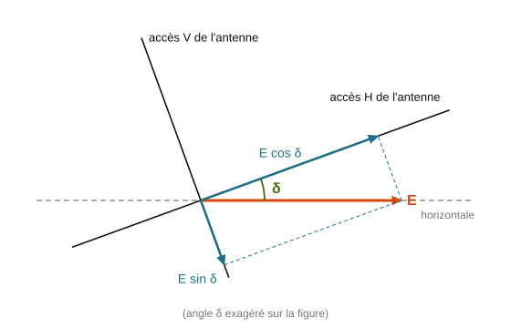

<em>Figure TD 45 : Antenne de réception tournée d'un angle δ : une partie du flux H est reçue sur l'accès V.</em>

*Document technique :*

| Élément | Caractéristique | Valeur |
|---|---|---|
| Antennes paraboliques | Isolation de polarisation croisée propre (XPD) : la puissance qui fuit dans l'autre polarisation est inférieure de… | 30 dB |
| Modem | Débit par polarisation (modulation 256-QAM) | 1,0 Gbit/s |
| | Rapport signal sur interférence minimal $C/I$ | 25 dB |
| Pluie intense | XPD des antennes dégradée à | 22 dB |
| Annuleur numérique XPIC | Amélioration du rapport $C/I$ | 15 dB |

*Modèle :* si l'antenne de réception est tournée d'un angle $\delta$ autour de son axe, le champ du flux H se décompose en $E\cos\delta$ sur l'accès H et $E\sin\delta$ sur l'accès V (figure TD 45) : la puissance qui fuit, rapportée à la puissance utile, vaut $\tan^2\delta$. Les puissances parasites (fuite propre de l'antenne et fuite due à la rotation) s'additionnent : $\dfrac{I}{C} = 10^{-XPD/10} + \tan^2\delta$.

1) Calculer la longueur d'onde et le débit total de la liaison.
2) Pour $\delta = 3°$, calculer la perte de polarisation subie par le flux utile, $L = -20\log_{10}(\cos\delta)$. Est-ce elle qui pose problème ?
3) Calculer, pour $\delta = 1°$, 3° et 5°, la fuite due à la rotation en dB ($10\log_{10}(\tan^2\delta)$), puis le rapport $C/I$ total en dB. Dans quels cas le modem fonctionne-t-il ?
4) Calculer l'angle de rotation maximal admissible par temps sec.
5) Par forte pluie, la XPD tombe à 22 dB. Calculer $C/I$ pour $\delta = 1°$. Le modem fonctionne-t-il ? Et avec l'annuleur XPIC ?
6) Pourquoi le technicien doit-il régler et bloquer très soigneusement l'orientation des antennes autour de leur axe, et pas seulement leur pointage ?

### Série §3.8 : Antennes, réflexion et réfraction en espace libre `BTS1` `BTS2`

**Exercice 3.22 ★ : Devoir maison : électromagnétisme**

*Compétence visée : calculer une longueur d'onde et décrire les phénomènes à l'interface entre deux milieux.*

1) Une antenne émet à 433 MHz (liaisons courte-portée). Calculer sa longueur d'onde dans le vide ($c \approx 3 \times 10^8$ m/s).
2) Expliquer, en quelques lignes, pourquoi $\vec{E}$ et $\vec{B}$ sont perpendiculaires entre eux et à la direction de propagation.
3) Une onde radio passe de l'air à un matériau plus dense : citer deux phénomènes possibles à l'interface et une situation professionnelle CIEL où cela compte (pose d'antenne, câblage, blindage…).

**Exercice 3.23 ★★ : PIRE réglementaire et choix d'antenne**

*Compétence visée : calculer une PIRE, vérifier la conformité réglementaire et tenir compte des obstacles.*

Un point d'accès 2,4 GHz délivre $P = 17\ \text{dBm}$ à son connecteur. Il est relié par un câble et deux connecteurs (pertes totales 1,5 dB) à une antenne omnidirectionnelle de gain 5 dBi. En France, la PIRE est limitée à 20 dBm (100 mW) dans la bande 2,4 GHz. On rappelle : $PIRE = P - \text{pertes} + G_{antenne}$.

1) Calculer la PIRE. L'installation est-elle conforme ? Convertir la PIRE en mW.
2) Quelle puissance d'émission maximale faut-il configurer pour être conforme ?
3) Dans une allée d'entrepôt, on remplace l'antenne par une antenne directive de 12 dBi. Calculer la puissance d'émission maximale autorisée. Quel est l'intérêt d'une antenne directive ici ?
4) Les étagères métalliques créent des zones sans réseau derrière elles. Quel phénomène est en cause ? Une cloison en plâtre atténue de 3 dB et un mur en béton de 12 dB : un ordinateur qui recevrait $-50\ \text{dBm}$ devant le mur en béton reçoit combien derrière ?

**Exercice 3.24 ★★ : Antenne quart d'onde d'un nœud LoRa** `BTS2`

*Compétence visée : dimensionner une antenne quart d'onde et chiffrer l'effet d'une désadaptation sur la puissance rayonnée et la portée (sous-parties 3.8 et 3.12, fiche 3.F des compléments).*

Un nœud LoRa (ESP32 et module radio à 868 MHz, puissance d'émission 14 dBm) utilise une antenne fouet quart d'onde.

1) Calculer la longueur d'onde dans l'air et la longueur théorique d'une antenne quart d'onde. En pratique, on la raccourcit d'environ 5 % : quelle longueur couper ?
2) Un technicien a monté par erreur une antenne quart d'onde prévue pour 433 MHz. Quelle est sa longueur ? À 868 MHz, l'analyseur d'antenne mesure un TOS de 4,0. Calculer $|\rho|$, la fraction de puissance réfléchie, les pertes de retour $RL = -20\log_{10}|\rho|$ et la perte de désadaptation $L = -10\log_{10}(1 - \rho^2)$.
3) Mêmes calculs avec la bonne antenne, dont le TOS vaut 1,3.
4) En espace libre, la portée est divisée par 2 chaque fois que le bilan perd 6 dB. De quel facteur la portée de la liaison montante (nœud vers passerelle) est-elle multipliée avec la mauvaise antenne ? Pourquoi la liaison descendante est-elle également dégradée ?
5) Calculer la puissance réfléchie vers le module radio avec la mauvaise antenne, en mW. Est-elle dangereuse pour le module ? Que se passerait-il avec le même TOS sur un émetteur de 10 W ?

### Série §3.9 : Liaison hertzienne `BTS1` `BTS2`

**Exercice 3.25 ★ : Champ reçu et atténuation en espace libre**

*Compétence visée : exploiter la loi $E = \alpha\sqrt{P_0}/d$ et la formule de l'atténuation en espace libre.*

1) À 10 m d'une borne, le champ électrique vaut 1,2 V/m. En utilisant $E = \dfrac{\alpha\sqrt{P_0}}{d}$, calculer le champ à 20 m puis à 40 m. De combien de dB le niveau reçu baisse-t-il à chaque doublement de distance ($20\log_{10}$ du rapport des champs) ?
2) Par quel facteur faut-il multiplier la puissance émise pour doubler le champ reçu à distance fixe ?
3) Calculer l'atténuation en espace libre $FSL = 32{,}45 + 20\log_{10}(f_{\text{MHz}}) + 20\log_{10}(d_{\text{km}})$ à 2,4 GHz pour $d = 100$ m, puis pour $d = 200$ m. Retrouve-t-on le résultat de la question 1 ?

**Exercice 3.26 ★★ : Pont Wi-Fi entre deux bâtiments**

*Compétence visée : établir un bilan de liaison hertzienne complet et en déduire une portée maximale.*

Deux bâtiments distants de 2,0 km sont reliés par un pont Wi-Fi à 5,8 GHz. Chaque extrémité comporte : un émetteur-récepteur (puissance d'émission 20 dBm, sensibilité −80 dBm au débit voulu), un câble de 1 dB de pertes et une antenne parabolique de 23 dBi. On exige une marge de 15 dB.

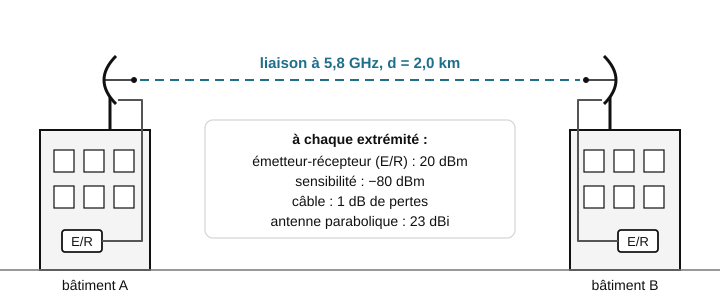

<em>Figure TD 20 : Pont Wi-Fi à 5,8 GHz entre les deux bâtiments.</em>

1) Calculer l'atténuation en espace libre (formule de l'exercice 3.25).
2) Calculer la puissance reçue.
3) Calculer la marge de la liaison. La liaison est-elle validée ?
4) Calculer la distance maximale pour laquelle la marge de 15 dB serait encore respectée.
5) Pourquoi utilise-t-on des antennes très directives pour ce type de liaison ? Quelle contrainte d'installation en découle ?

### Série §3.10 : Modélisation d'une ligne de transmission `BTS1` `BTS2`

**Exercice 3.27 ★ : Paramètres d'un câble coaxial**

*Compétence visée : calculer impédance caractéristique, célérité et retard d'une ligne à partir de ses paramètres linéiques.*

Un câble coaxial RG58 a une inductance linéique $L = 250\ \text{nH/m}$ et une capacité linéique $C = 100\ \text{pF/m}$.

1) Calculer son impédance caractéristique $Z_C = \sqrt{L/C}$.
2) Calculer la célérité des signaux $c = \dfrac{1}{\sqrt{LC}}$ et le coefficient de vélocité $k$.
3) Calculer le retard de propagation sur 15 m de ce câble.

**Exercice 3.28 ★★ : Ligne longue ou ligne courte ?**

*Compétence visée : décider si les effets de propagation doivent être pris en compte en comparant la longueur d'une liaison à la longueur d'onde.*

On admet qu'une liaison doit être traitée comme une ligne de transmission (adaptation d'impédance nécessaire) dès que sa longueur dépasse $\lambda/10$.

1) Une paire torsadée de câble Cat 6 a pour paramètres linéiques $L = 525\ \text{nH/m}$ et $C = 52\ \text{pF/m}$. Calculer $Z_C$, la célérité et le coefficient de vélocité.
2) En Gigabit Ethernet, les symboles sont transmis à 125 MHz. Calculer la longueur d'onde dans la paire torsadée. Une liaison de 90 m est-elle une ligne longue ? Combien de longueurs d'onde contient-elle ?
3) Un bus I²C à 100 kHz relie un ESP32 à un capteur par une piste de 0,5 m sur un circuit imprimé (célérité $1{,}5 \times 10^8\ \text{m/s}$). Calculer $\lambda$ et le rapport $l/\lambda$. Faut-il adapter la ligne ?
4) Du seul point de vue de la propagation, jusqu'à quelle longueur un bus I²C à 400 kHz peut-il être traité comme une ligne courte ?

**Exercice 3.29 ★★ : Bus RS485 : faut-il des résistances de terminaison ?** `BTS2`

*Compétence visée : comparer le temps de propagation à la durée d'un bit et calculer les coefficients de réflexion d'un bus de terrain (sous-parties 3.10 et 3.11).*

Un bus RS485 relie un automate à des compteurs d'énergie répartis dans un bâtiment, par 600 m de paire torsadée d'impédance caractéristique $Z_C = 120\ \Omega$ et de coefficient de vélocité $k = 0{,}66$. On admet que les réflexions perturbent la lecture des bits lorsque la durée de l'aller-retour d'un signal sur toute la longueur du câble dépasse le dixième de la durée d'un bit.

1) Calculer la célérité des signaux, le retard sur les 600 m, puis la durée d'un aller-retour.
2) Calculer la durée d'un bit à 9600 bit/s puis à 115,2 kbit/s. Dans chaque cas, des résistances de terminaison sont-elles indispensables ? Quelle longueur maximale de bus pourrait-on utiliser sans terminaison à 115,2 kbit/s ?
3) Calculer le coefficient de réflexion en bout de bus : sans terminaison, avec une terminaison de 120 Ω, puis avec une terminaison de 100 Ω (mauvaise référence). Décrire l'écho dans chaque cas.
4) Au repos, l'émetteur différentiel voit les deux terminaisons en parallèle. Calculer la résistance équivalente, le courant pour une tension différentielle de 2,5 V et la puissance dissipée.
5) Un technicien ajoute une troisième résistance de 120 Ω au milieu du bus. Calculer la nouvelle charge et le courant. Un signal qui arrive au milieu du bus « voit » la suite de la ligne (120 Ω) en parallèle avec cette résistance : calculer le coefficient de réflexion à cet endroit. Conclure.

### Série §3.11 : Propagation impulsionnelle et réflexions `BTS2`

**Exercice 3.30 ★ : Coefficient de réflexion et forme de l'écho**

*Compétence visée : calculer un coefficient de réflexion et prévoir le signe et l'amplitude de l'écho.*

Une impulsion d'amplitude 2,0 V est envoyée sur une ligne d'impédance caractéristique $Z_C = 50\ \Omega$. Pour chacune des charges suivantes, calculer $\rho = \dfrac{R_{CH} - Z_C}{R_{CH} + Z_C}$, l'amplitude de l'impulsion réfléchie et décrire l'écho observé : a) 50 Ω ; b) ligne ouverte ; c) court-circuit ; d) 75 Ω ; e) 25 Ω ; f) 150 Ω.

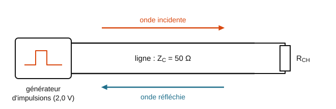

<em>Figure TD 21 : Ligne d'impédance caractéristique 50 Ω fermée sur la charge RCH.</em>

**Exercice 3.31 ★★ : Diagnostic d'un câble coaxial au réflectomètre**

*Compétence visée : localiser et identifier un défaut de câble par réflectométrie, calculer TOS et atténuation linéique.*

Un câble coaxial d'impédance caractéristique $Z_C = 50$ Ω, de longueur $l = 40$ m, a un coefficient de vélocité $k = 0{,}66$.

1) Calculer la célérité des signaux dans le câble, puis le retard de propagation d'une impulsion sur toute sa longueur.
2) Sur un autre tronçon du même câble, un réflectomètre reçoit un écho 300 ns après l'impulsion. À quelle distance se trouve le défaut ?
3) L'écho a le même signe que l'impulsion et presque la même amplitude. Quelle est la nature du défaut ? Qu'aurait indiqué un écho de signe opposé ?

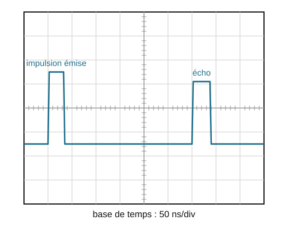

<em>Figure TD 22 : Réflectogramme du tronçon étudié aux questions 2 et 3.</em>

4) Le câble de 40 m est finalement fermé sur une charge de 75 Ω. Calculer le coefficient de réflexion et le TOS. Commenter.
5) On mesure 2,0 V en entrée et 1,6 V en sortie de ligne (amplitudes maximales). Calculer l'atténuation linéique en dB/m, puis en dB/100 m.

### Série §3.12 : Taux d'ondes stationnaires (TOS) et atténuation linéique `BTS2`

**Exercice 3.32 ★ : TOS et puissance réfléchie**

*Compétence visée : passer du coefficient de réflexion au TOS et inversement, calculer la puissance réfléchie.*

1) Calculer le TOS pour $|\rho| = 0{,}1$ ; $1/3$ ; $0{,}5$. Quelle fraction de la puissance incidente ($\rho^2$) est réfléchie dans chaque cas ?
2) Sur une ligne non adaptée, on relève $U_{MAX} = 1{,}8\ \text{V}$ et $U_{MIN} = 1{,}2\ \text{V}$. Calculer le TOS puis $|\rho| = \dfrac{TOS - 1}{TOS + 1}$.

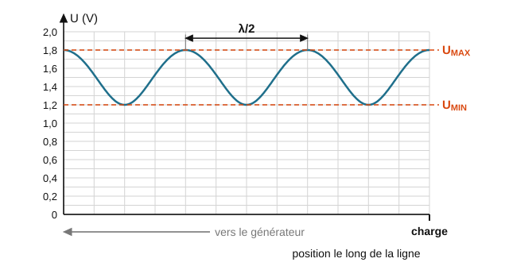

<em>Figure TD 23 : Amplitude de la tension le long de la ligne non adaptée (question 2).</em>

3) L'émetteur envoie 20 W vers cette charge. Quelle puissance est réfléchie ?

**Exercice 3.33 ★★ : Câble d'antenne d'un relais radio**

*Compétence visée : combiner atténuation linéique et désadaptation pour calculer la puissance réellement transmise à une antenne.*

Un émetteur de 10 W alimente une antenne par 30 m de câble coaxial 50 Ω d'atténuation linéique 6,0 dB/100 m. Au pied de l'antenne, on relève $U_{MAX} = 2{,}6\ \text{V}$ et $U_{MIN} = 1{,}4\ \text{V}$.

1) Calculer l'atténuation du câble et la puissance qui arrive au pied de l'antenne.
2) Calculer le TOS et le coefficient de réflexion $|\rho|$.
3) Calculer la puissance réfléchie par l'antenne et la puissance qu'elle accepte (et rayonne). Quelle puissance réfléchie revient jusqu'à l'émetteur après le trajet retour dans le câble ?
4) En supposant l'impédance de l'antenne réelle, quelles sont ses deux valeurs possibles ? Comment lever le doute ?

### Série de synthèse : exercices type BTS `BTS2`

**Exercice 3.34 ★★★ : Installation d'une passerelle LoRaWAN (type BTS)**

*Compétence visée : choisir un câble, vérifier la conformité réglementaire, établir un bilan de liaison et diagnostiquer un câble par réflectométrie.*

*Contexte :* une collectivité déploie des capteurs connectés LoRaWAN (comptage d'eau, qualité de l'air) dans un quartier. La passerelle est installée dans le local technique d'un bâtiment ; son antenne est fixée sur un mât en toiture, à 20 m de câble de la passerelle. Le technicien doit choisir le câble, vérifier la liaison avec le capteur le plus éloigné, puis contrôler l'installation.

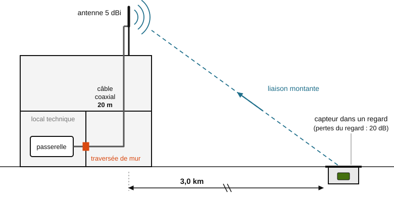

<em>Figure TD 24 : Installation de la passerelle LoRaWAN et du capteur le plus éloigné (échelle non respectée).</em>

*Document 1 : câbles coaxiaux 50 Ω disponibles.*

| Câble | Atténuation à 868 MHz | Coefficient de vélocité $k$ | Prix indicatif |
|---|---|---|---|
| RG58 | 50 dB/100 m | 0,66 | 1 €/m |
| RG213 | 25 dB/100 m | 0,66 | 3 €/m |
| LMR400 | 13 dB/100 m | 0,85 | 4 €/m |

*Document 2 : caractéristiques des équipements.*

| Équipement | Caractéristique | Valeur |
|---|---|---|
| Passerelle | Puissance d'émission maximale | 14 dBm |
| | Sensibilité (facteur d'étalement SF12) | −137 dBm |
| Antenne de la passerelle | Gain | 5 dBi |
| Capteur | Puissance d'émission | 14 dBm |
| | Gain d'antenne | 2 dBi |
| Réglementation 868 MHz | PIRE maximale | 16 dBm |
| Cahier des charges | Pertes maximales dans le câble | 3 dB |
| | Marge minimale de la liaison | 20 dB |
| | TOS maximal au pied de l'antenne | 1,5 |

Atténuation en espace libre : $FSL = 32{,}45 + 20\log_{10}(f_{\text{MHz}}) + 20\log_{10}(d_{\text{km}})$.

**Partie A : choix du câble et conformité**

1) Calculer les pertes de chacun des trois câbles pour 20 m. Lequel respecte le cahier des charges ?
2) Calculer la PIRE de la passerelle avec ce câble, à puissance d'émission maximale. Est-elle conforme ? Sinon, quelle puissance d'émission (nombre entier de dBm) faut-il configurer ?

**Partie B : liaison montante (capteur vers passerelle)**

3) Le capteur le plus éloigné est à 3,0 km, à l'intérieur d'un regard qui ajoute 20 dB de pertes. Calculer la FSL.
4) Calculer la puissance reçue par la passerelle (après l'antenne et le câble), puis la marge. La liaison est-elle validée ?

**Partie C : contrôle de l'installation**

5) Avant le serrage final, un réflectomètre branché côté passerelle reçoit un écho 120 ns après l'impulsion, de signe opposé et d'amplitude égale à 30 % de l'impulsion incidente. Calculer la distance du défaut. Calculer $\rho$, puis l'impédance locale du câble au niveau du défaut. Proposer une cause (le câble passe par une traversée de mur à cet endroit).
6) Après réparation, on mesure au pied de l'antenne $U_{MAX} = 1{,}10\ \text{V}$ et $U_{MIN} = 0{,}90\ \text{V}$. Calculer le TOS et la fraction de puissance réfléchie. L'installation est-elle validée ?

**Exercice 3.35 ★★★ : Déployer des capteurs LoRaWAN dans une commune (type BTS)**

*Compétence visée : vérifier le dégagement d'un trajet radio, établir un bilan de liaison avec perte de polarisation et respecter la réglementation du temps d'émission (sous-parties 3.5, 3.7, 3.8 et 3.9, fiches 3.C et 3.D des compléments).*

*Contexte :* une commune équipe ses conteneurs à verre de capteurs de remplissage LoRaWAN. La passerelle est installée en haut du château d'eau. Le capteur le plus éloigné est à 4,0 km ; un gymnase se trouve sur le trajet. Le technicien doit vérifier la liaison et le paramétrage des capteurs.

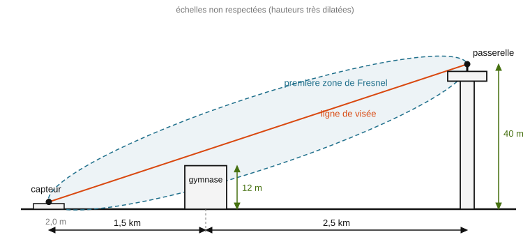

<em>Figure TD 43 : Profil de la liaison entre le capteur et la passerelle (échelles non respectées).</em>

*Document 1 : géométrie.* Antenne de la passerelle à 40 m de hauteur ; antenne du capteur à 2,0 m (sur le conteneur) ; gymnase de 12 m de haut, à 1,5 km du capteur et 2,5 km de la passerelle ; sol plat.

*Document 2 : équipements.*

| Équipement | Caractéristique | Valeur |
|---|---|---|
| Capteur | Puissance d'émission ; gain d'antenne | 14 dBm ; 2 dBi |
| | Antenne prévue en polarisation verticale | fixée sur le couvercle, inclinée de 30° par rapport à la verticale |
| Passerelle | Gain d'antenne (polarisation verticale) ; pertes du câble | 6 dBi ; 1,5 dB |
| | Sensibilité en SF7 ; SF10 ; SF12 | −124,5 dBm ; −132 dBm ; −137 dBm |
| Durée d'émission d'un message | SF7 ; SF10 ; SF12 | 56,6 ms ; 371 ms ; 1155 ms |
| Réglementation 868 MHz | Rapport cyclique maximal de chaque émetteur | 1 % (36 s d'émission par heure) |

*Document 3 : formules.* Rayon de la première zone de Fresnel à $d_1$ d'une extrémité et $d_2$ de l'autre : $r_1 = \sqrt{\dfrac{\lambda\, d_1 d_2}{d_1 + d_2}}$. Le trajet est considéré comme dégagé si au moins 60 % de $r_1$ est libre de tout obstacle ; sinon, on compte 6 dB de pertes supplémentaires. Atténuation en espace libre : $FSL = 32{,}45 + 20\log_{10}(f_{\text{MHz}}) + 20\log_{10}(d_{\text{km}})$. Perte de polarisation pour un angle $\theta$ entre les antennes : $L = -20\log_{10}|\cos\theta|$.

**Partie A : dégagement du trajet**

1) Calculer la longueur d'onde, puis le rayon $r_1$ de la zone de Fresnel au niveau du gymnase, et 60 % de ce rayon.
2) Calculer la hauteur de la ligne de visée au-dessus du gymnase, puis le dégagement. Le trajet est-il dégagé ?
3) À quelle hauteur faudrait-il placer l'antenne du capteur pour dégager le trajet ? Est-ce réaliste ? Quelle décision prendre ?

**Partie B : bilan de liaison montante**

4) Calculer l'atténuation en espace libre à 4,0 km.
5) Calculer la perte de polarisation due à l'inclinaison de l'antenne du capteur.
6) Calculer la puissance reçue par la passerelle (après son câble), puis la marge en SF7 et en SF12. Quel facteur d'étalement le serveur de réseau choisira-t-il ?

**Partie C : temps d'émission**

7) Calculer le nombre maximal de messages par heure autorisé par le rapport cyclique, en SF7 et en SF12. Les capteurs doivent émettre un message toutes les 15 min : est-ce possible dans les deux cas ?
8) Pourquoi le serveur de réseau a-t-il intérêt à imposer le facteur d'étalement le plus faible possible (deux raisons) ?

**Exercice 3.36 ★★★ : Maintenance d'un point d'accès Wi-Fi extérieur (type BTS)**

*Compétence visée : localiser et caractériser un défaut par réflectométrie, puis recalculer la PIRE et proposer une amélioration (sous-parties 3.9 à 3.12, fiche 3.F des compléments).*

*Contexte :* sur un parking d'entreprise, un point d'accès Wi-Fi à 5,5 GHz est installé au pied d'un mât. Il est relié à une antenne sectorielle placée en haut du mât par 18 m de câble coaxial, au milieu duquel est inséré un parafoudre coaxial. Les utilisateurs signalent une couverture dégradée. Le technicien réalise une réflectométrie du câble, depuis le point d'accès.

*Document 1 : installation.* Câble : $Z_C = 50\ \Omega$, $k = 0{,}85$, atténuation 37 dB/100 m à 5,5 GHz. Puissance du point d'accès : 20 dBm. Gain de l'antenne : 12 dBi. Réglementation de 5,470 à 5,725 GHz : PIRE au plus égale à 30 dBm (1 W).

*Document 2 : réflectogramme (figure TD 44).* Calibre vertical 0,2 V/div, base de temps 20 ns/div. L'impulsion émise, d'amplitude 1,0 V, part de l'origine des temps. On néglige l'atténuation de l'impulsion dans le câble et les réflexions multiples.

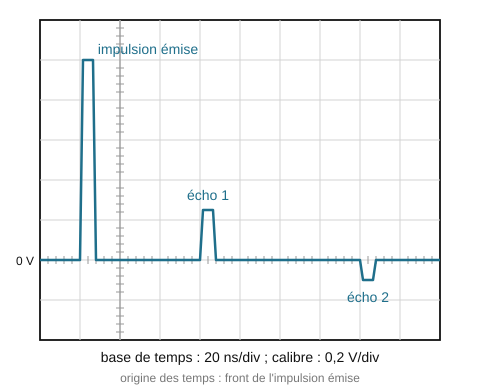

<em>Figure TD 44 : Réflectogramme du câble d'antenne relevé depuis le point d'accès.</em>

**Partie A : diagnostic**

1) Calculer la célérité des signaux dans le câble, puis la position des deux échos. Identifier l'élément responsable de chacun.
2) Calculer le coefficient de réflexion du premier écho, puis l'impédance locale du câble à cet endroit. Proposer une cause.
3) Calculer les pertes de retour au niveau de ce défaut, la fraction de puissance réfléchie et la perte (en dB) subie par l'onde qui le traverse.

**Partie B : conformité**

4) Calculer l'atténuation du câble, puis la PIRE de l'installation avec le défaut. Est-elle conforme ?
5) Après remplacement du parafoudre, on relève au pied de l'antenne $U_{MAX} = 1{,}30\ \text{V}$ et $U_{MIN} = 1{,}00\ \text{V}$. Calculer le TOS, $|\rho|$ et la fraction de puissance réfléchie. L'installation est-elle validée (TOS au plus égal à 1,5) ? Recalculer la PIRE.

**Partie C : amélioration**

6) On propose de monter le point d'accès en haut du mât, alimenté et relié au réseau par un câble Ethernet PoE, avec une jarretière coaxiale de 0,5 dB jusqu'à l'antenne. Calculer la PIRE si le point d'accès reste réglé à 20 dBm. Quel réglage faut-il adopter ? Calculer le gain obtenu sur la liaison descendante (point d'accès vers clients) et le facteur multiplicatif sur la portée. Pourquoi le gain sur la liaison montante (clients vers point d'accès) est-il encore plus intéressant ?

### Défi du chapitre `BTS2`

**Exercice 3.37 ★★★★ : Hauteur d'antenne et réflexion sur le sol : le modèle à deux rayons (défi)**

*Compétence visée : modéliser l'interférence entre un trajet direct et un trajet réfléchi, établir une loi de propagation et en tirer une règle d'installation (sous-parties 3.8 et 3.9).*

Un point d'accès Wi-Fi à 2,4 GHz ($\lambda = 12{,}5$ cm) est fixé à $h_1 = 10$ m de hauteur sur un mât. Un terminal (capteur ou tablette) est placé à la hauteur $h_2$, à la distance horizontale $d$. Le terminal reçoit l'onde directe et l'onde réfléchie par le sol, supposé plat ; pour une incidence rasante, on admet que la réflexion se fait avec $\rho = -1$ (inversion de l'onde) et que les deux ondes ont pratiquement la même amplitude $E_0$.

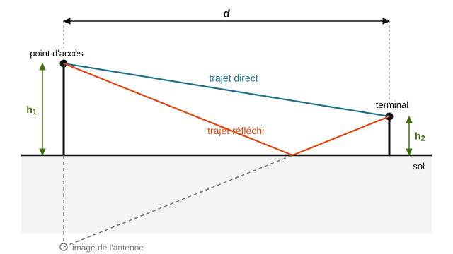

<em>Figure TD 46 : Trajet direct et trajet réfléchi sur le sol.</em>

1) À l'aide de la figure (le trajet réfléchi a la même longueur que le trajet issu de l'image de l'antenne, symétrique par rapport au sol), montrer que la différence de marche vaut $\Delta = \sqrt{d^2 + (h_1 + h_2)^2} - \sqrt{d^2 + (h_1 - h_2)^2}$, puis que $\Delta \approx \dfrac{2h_1 h_2}{d}$ lorsque $h_1, h_2 \ll d$. Calculer $\Delta$ pour $h_2 = 1{,}5$ m et $d = 200$ m.
*Coup de pouce : pour $a \ll d$, $\sqrt{d^2 + a^2} \approx d + \dfrac{a^2}{2d}$.*
2) Le déphasage entre les deux ondes vaut $\pi + \dfrac{2\pi\Delta}{\lambda}$ (inversion à la réflexion et retard de marche). Montrer que l'amplitude reçue vaut $2E_0\left|\sin\!\left(\dfrac{\pi\Delta}{\lambda}\right)\right|$, et donc que la puissance reçue, rapportée à celle de l'onde directe seule, vaut $G = 4\sin^2\!\left(\dfrac{\pi\Delta}{\lambda}\right)$. Calculer $G$ en dB pour $h_2 = 1{,}5$ m et $d = 200$ m.
*Coup de pouce : $\cos a + \cos b = 2\cos\!\left(\dfrac{a + b}{2}\right)\cos\!\left(\dfrac{a - b}{2}\right)$.*
3) À $d = 200$ m, à quelles hauteurs $h_2$ obtient-on le premier maximum (+6 dB) et le premier zéro ? Quelle conséquence pratique pour un capteur fixé à 1,25 m du sol ?
4) Loin du mât ($\pi\Delta/\lambda \ll 1$), montrer que $G \approx \left(\dfrac{4\pi h_1 h_2}{\lambda d}\right)^2$. En déduire qu'avec des antennes isotropes, $\dfrac{P_r}{P_e} = \left(\dfrac{\lambda}{4\pi d}\right)^2 G \approx \left(\dfrac{h_1 h_2}{d^2}\right)^2$ : de combien de dB la puissance reçue diminue-t-elle quand la distance est multipliée par 10 ? Dépend-elle de la fréquence ? Calculer la distance $d_c = \dfrac{4\pi h_1 h_2}{\lambda}$ à partir de laquelle cette loi s'applique ($h_2 = 1{,}5$ m).
5) À $d = 4{,}0$ km, calculer l'atténuation en espace libre, puis l'atténuation réelle en tenant compte du sol. Pour gagner 6 dB à cette distance, vaut-il mieux doubler la puissance d'émission ou la hauteur du mât ? Justifier.

### Corrigés du chapitre 3 `BTS1` `BTS2`

**Exercice 3.1.**
1) a) Son : longitudinale (compressions et dilatations de l'air dans la direction de propagation). b) Corde : transversale. c) Ressort comprimé : longitudinale. d) Ola : transversale (les spectateurs se lèvent verticalement, l'onde avance horizontalement).
2) Non : chaque spectateur se lève puis se rassoit à sa place, seule la perturbation (et l'énergie) se déplace le long du stade.
3) Aller-retour : $d = \dfrac{c \times t}{2} = \dfrac{343 \times 4{,}0 \times 10^{-3}}{2} \approx 0{,}686\ \text{m}$. Hauteur de liquide : $h = 1{,}20 - 0{,}686 \approx 0{,}51\ \text{m}$.

**Exercice 3.2.**
1) $t_{air} = \dfrac{L}{c_{air}} = \dfrac{102}{340} = 0{,}300\ \text{s}$.
2) Le son du métal arrive en premier : $t_{acier} = t_{air} - \Delta t = 0{,}300 - 0{,}280 = 0{,}020\ \text{s}$.
3) $c_{acier} = \dfrac{L}{t_{acier}} = \dfrac{102}{0{,}020} = 5{,}1 \times 10^{3}\ \text{m/s}$.
4) $t_{acier}$ varie de $0{,}015$ à $0{,}025\ \text{s}$, donc $c_{acier}$ varie de $\dfrac{102}{0{,}025} \approx 4{,}1 \times 10^3$ à $\dfrac{102}{0{,}015} \approx 6{,}8 \times 10^3\ \text{m/s}$. La méthode est très imprécise : $t_{acier}$ est obtenu par différence de deux grandeurs voisines, et une petite erreur sur $\Delta t$ (±0,005 s) représente 25 % de $t_{acier}$.
5) La célérité ne dépend que du milieu. Dans le PVC, moins rigide que l'acier, le son irait moins vite : les deux sons arriveraient avec un écart plus faible.

**Exercice 3.3.**
1) a) $\lambda = \dfrac{3{,}0 \times 10^8}{2{,}4 \times 10^9} = 0{,}125\ \text{m} = 12{,}5\ \text{cm}$. b) $\lambda = \dfrac{3{,}0 \times 10^8}{5{,}0 \times 10^9} = 6{,}0\ \text{cm}$. c) $\lambda = \dfrac{340}{1000} = 0{,}34\ \text{m}$. d) $\lambda = \dfrac{340}{40 \times 10^3} = 8{,}5\ \text{mm}$.
2) $f = \dfrac{c_0}{\lambda} = \dfrac{3{,}0 \times 10^8}{1310 \times 10^{-9}} \approx 2{,}29 \times 10^{14}\ \text{Hz}$.
3) La fréquence est imposée par la source : elle reste 1,0 kHz. $\lambda_{eau} = \dfrac{1480}{1000} = 1{,}48\ \text{m}$ : c'est la longueur d'onde (et la célérité) qui changent avec le milieu.

**Exercice 3.4.**
1) $f_{bat} = |100{,}003 - 100{,}000|$ kHz $= 0{,}003$ kHz $= 3$ Hz.
2) $T_{bat} = \dfrac{1}{f_{bat}} \approx 0{,}33$ s.
3) Deux porteuses trop proches créent une interférence audible/mesurable (battement, brouillage) : c'est pourquoi les canaux radio sont espacés d'un écart minimal normalisé (canalisation) pour éviter le recouvrement spectral.

**Exercice 3.5.**
1) $c = \dfrac{3{,}0 \times 10^8}{1{,}47} \approx 2{,}04 \times 10^8\ \text{m/s}$.
2) $\Delta t = \dfrac{d}{c} = \dfrac{25{,}0 \times 10^3}{2{,}04 \times 10^8} \approx 1{,}23 \times 10^{-4}\ \text{s} = 123\ \mu\text{s}$.
3) Différence aller/retour : $\dfrac{200}{2{,}04 \times 10^8} \approx 0{,}98\ \mu\text{s}$. Erreur sur l'heure : la moitié, soit $\approx 0{,}49\ \mu\text{s}$. Pour une synchronisation PTP visant moins de 1 µs, cette asymétrie n'est pas négligeable : il faut la mesurer et la compenser.
4) $c = k \times c_0 = 0{,}66 \times 3{,}0 \times 10^8 = 1{,}98 \times 10^8\ \text{m/s}$ ; $\lambda = \dfrac{c}{f} = \dfrac{1{,}98 \times 10^8}{10 \times 10^6} \approx 19{,}8\ \text{m}$.
5) $\Delta t = \dfrac{5{,}0}{1{,}98 \times 10^8} \approx 25\ \text{ns}$ ; $T = 100\ \text{ns}$, donc $\varphi = 360 \times \dfrac{\Delta t}{T} \approx 91°$ : les deux horloges sont pratiquement en quadrature, pas du tout en phase. On distribue donc les horloges par des câbles de même longueur.

**Exercice 3.6.**
1) $T = \dfrac{1}{40{,}0 \times 10^3} = 25\ \mu\text{s}$, soit $\dfrac{25}{10} = 2{,}5$ divisions.
2) Deux points de la même onde vibrent en phase lorsqu'ils sont séparés d'un nombre entier de longueurs d'onde : chaque nouvelle coïncidence correspond à un déplacement supplémentaire de $\lambda$, donc la dixième à $10\lambda$. $\lambda = \dfrac{86}{10} = 8{,}6\ \text{mm}$ ; $c = \lambda f = 8{,}6 \times 10^{-3} \times 40{,}0 \times 10^3 \approx 344\ \text{m/s}$. L'erreur de lecture (±1 mm) porte sur la longueur totale : divisée par 10, elle ne vaut plus que ±0,1 mm sur $\lambda$.
3) $\Delta t = \dfrac{2{,}15 \times 10^{-3}}{344} \approx 6{,}25\ \mu\text{s}$ ; $\varphi = 360° \times \dfrac{6{,}25}{25} = 90°$ (ou $360° \times \dfrac{2{,}15}{8{,}6}$) : les signaux sont en quadrature, l'un passe par zéro quand l'autre est à son maximum.
4) $\Delta t = \dfrac{0{,}300}{344} \approx 0{,}87\ \text{ms}$, soit $\dfrac{0{,}87\ \text{ms}}{25\ \mu\text{s}} \approx 35$ périodes. Avec une sinusoïde permanente, toutes les périodes se ressemblent : on ne voit que le décalage « modulo une période », pas le retard réel. Une salve marque un début reconnaissable. $\Delta t = 8{,}7 \times 0{,}1 = 0{,}87\ \text{ms}$ et $c = \dfrac{0{,}300}{0{,}87 \times 10^{-3}} \approx 345\ \text{m/s}$, cohérent avec la question 2.
5) $\theta = \dfrac{344 - 331{,}5}{0{,}6} \approx 21\ °\text{C}$.

*Erreurs fréquentes :* compter 9 longueurs d'onde au lieu de 10 (la position de départ n'est pas une coïncidence « obtenue ») ; confondre retard (en s) et déphasage (en degrés) ; oublier de convertir les mm en m.

**Exercice 3.7.** $T = 3{,}5 \times 0{,}2 \times 10^{-3} = 0{,}7$ ms. $f = \dfrac{1}{T} \approx 1429$ Hz $\approx 1{,}4$ kHz. $\lambda = \dfrac{v}{f} = v \times T = 340 \times 0{,}7 \times 10^{-3} \approx 0{,}238$ m $\approx 24$ cm.

**Exercice 3.8.**
1) $T = 4{,}0 \times 50\ \mu\text{s} = 200\ \mu\text{s}$ ; $f = \dfrac{1}{T} = 5{,}00\ \text{kHz}$.
2) $U_{e,max} = 3{,}2 \times 1 = 3{,}2\ \text{V}$ et $U_{s,max} = 2{,}2\ \text{V}$. Valeurs efficaces : $\dfrac{3{,}2}{\sqrt{2}} \approx 2{,}26\ \text{V}$ et $\dfrac{2{,}2}{\sqrt{2}} \approx 1{,}56\ \text{V}$.
3) $\Delta t = 0{,}5 \times 50 = 25\ \mu\text{s}$ ; $\varphi = 360 \times \dfrac{25}{200} = 45°$. La sortie atteint son maximum après l'entrée : elle est en retard de 45°.
4) $G = 20\log_{10}\!\left(\dfrac{2{,}2}{3{,}2}\right) \approx -3{,}3\ \text{dB}$ : on est proche de la fréquence de coupure du filtre.
5) $T_{bit} = \dfrac{1}{115\,200} \approx 8{,}68\ \mu\text{s}$ ; octet de 10 bits : $\approx 86{,}8\ \mu\text{s}$. À 20 µs/div, un bit occupe $8{,}68/20 \approx 0{,}43$ div : illisible. À 5 µs/div, $8{,}68/5 \approx 1{,}7$ div : lisible. On choisit 5 µs/div (ou 10 µs/div pour voir un octet entier sur l'écran).

**Exercice 3.9.**
1) $\lambda = \dfrac{c}{f} = \dfrac{340}{2{,}0 \times 10^3} = 0{,}17\ \text{m}$.
2) $P = \dfrac{A^2}{2Z} = \dfrac{2{,}0^2}{2 \times 415} \approx 4{,}8 \times 10^{-3}\ \text{W/m}^2$.
3) $\Delta f = 2000 \times \dfrac{15}{340 - 15} \approx +92\ \text{Hz}$ ; $f_R \approx 2{,}09\ \text{kHz}$ (son plus aigu).
4) $\Delta f = 2000 \times \dfrac{-15}{340 + 15} \approx -85\ \text{Hz}$ ; $f_R \approx 1{,}92\ \text{kHz}$ (son plus grave).

**Exercice 3.10.**
1) $\lambda = \dfrac{c}{f} = \dfrac{340}{40 \times 10^{3}} = 8{,}5$ mm.
2) L'onde fait l'aller-retour : $d = \dfrac{c \times t}{2} = \dfrac{340 \times 5{,}0 \times 10^{-3}}{2} = 0{,}85$ m.
3) $d_{réelle} = \dfrac{349 \times 5{,}0 \times 10^{-3}}{2} \approx 0{,}87$ m : le capteur annonce 0,85 m, soit une erreur d'environ 2 cm (≈ 2,6 %). D'où la compensation en température des capteurs précis.
4) $v_S = 90$ km/h $= 25$ m/s. $\Delta f = 440 \times \dfrac{25}{340 - 25} \approx +34{,}9$ Hz, soit $f_R \approx 475$ Hz (plus aigu). Source qui s'éloigne ($v_S = -25$ m/s) : $\Delta f = 440 \times \dfrac{-25}{340 + 25} \approx -30{,}1$ Hz, soit $f_R \approx 410$ Hz (plus grave).

**Exercice 3.11.**
*Méthode :* formule du radar (aller-retour, facteur 2) ; seule la composante de la vitesse dirigée vers le radar compte.
1) $\lambda = \dfrac{3{,}0 \times 10^8}{24{,}125 \times 10^9} \approx 12{,}4\ \text{mm}$.
2) $\Delta f = \dfrac{2 \times 1{,}2 \times 24{,}125 \times 10^9}{3{,}0 \times 10^8} \approx 193\ \text{Hz}$.
3) À 60° : $193 \times \cos 60° \approx 96\ \text{Hz}$ ; à 90° : 0 Hz. Une personne qui passe perpendiculairement au faisceau n'est pas détectée : le détecteur doit viser dans l'axe du couloir, face aux personnes qui arrivent.
4) $\Delta f_{max} = \dfrac{2 \times 5{,}0 \times 24{,}125 \times 10^9}{3{,}0 \times 10^8} \approx 804\ \text{Hz}$ ; condition de Shannon : $f_e > 2 \times 804 \approx 1{,}6\ \text{kHz}$.
5) $\Delta f = \dfrac{2 \times 15 \times 24{,}125 \times 10^9}{3{,}0 \times 10^8} \approx 2{,}4\ \text{kHz}$, nettement au-dessus des fréquences produites par des personnes : un filtre passe-bas d'environ 1 kHz (qui sert aussi d'anti-repliement) l'élimine.
6) $\Delta f = \dfrac{2 \times 1{,}2 \times 40 \times 10^3}{340} \approx 282\ \text{Hz}$ : du même ordre que le radar, alors que la fréquence émise est environ 600 000 fois plus faible, car la célérité du son est environ 900 000 fois plus faible que celle de la lumière. Seul compte le rapport $v/c$.

*Erreurs fréquentes :* oublier le facteur 2 du radar ; utiliser l'angle avec la perpendiculaire au lieu de l'angle avec la direction du radar ; appliquer Shannon à la fréquence émise (24 GHz) au lieu du décalage Doppler.

**Exercice 3.12.**
1) $B = \dfrac{E}{c_0} = \dfrac{2{,}0}{3{,}0 \times 10^8} \approx 6{,}7 \times 10^{-9}\ \text{T}$.
2) $p = \dfrac{E^2}{Z_0} = \dfrac{2{,}0^2}{377} \approx 1{,}1 \times 10^{-2}\ \text{W/m}^2 = 11\ \text{mW/m}^2$.
3) $c = \dfrac{c_0}{n} = \dfrac{3{,}0 \times 10^8}{1{,}52} \approx 1{,}97 \times 10^8\ \text{m/s}$ ; $k = \dfrac{1}{n} \approx 0{,}66$ : on retrouve le coefficient de vélocité usuel des câbles coaxiaux.
4) Non : elle se propage aussi dans le vide. Exemple : la lumière du Soleil et les signaux des satellites GPS traversent le vide spatial.

**Exercice 3.13.**
1) $\lambda = \dfrac{3 \times 10^{8}}{868 \times 10^{6}} \approx 0{,}346$ m ≈ 35 cm ; antenne quart d'onde : $\lambda/4 \approx 8{,}6$ cm.
2) $B = \dfrac{E}{c} = \dfrac{0{,}50}{3 \times 10^{8}} \approx 1{,}7 \times 10^{-9}$ T. $p = \dfrac{E^2}{Z_0} = \dfrac{0{,}25}{377} \approx 6{,}6 \times 10^{-4}$ W/m² (0,66 mW/m²).
3) $c = \dfrac{c_0}{n} = 2{,}0 \times 10^{8}$ m/s ; $\lambda = \dfrac{c}{f} \approx 0{,}23$ m. La fréquence ne change pas : elle est fixée par la source.
4) $P_r = 14 - 1 + 2 - 120 + 2 = -103$ dBm. $-103$ dBm $> -120$ dBm : la liaison fonctionne avec une marge de 17 dB.

**Exercice 3.14.**
1) a) $\lambda = \dfrac{3{,}0 \times 10^8}{100 \times 10^6} = 3{,}0\ \text{m}$ : ondes radio. b) $\lambda \approx 0{,}35\ \text{m}$ : micro-ondes. c) $\lambda \approx 5{,}5\ \text{cm}$ : micro-ondes.
2) d) $f = \dfrac{3{,}0 \times 10^8}{940 \times 10^{-9}} \approx 3{,}2 \times 10^{14}\ \text{Hz}$ : infrarouge. e) $f \approx 1{,}9 \times 10^{14}\ \text{Hz}$ : infrarouge. f) $f \approx 1{,}2 \times 10^{15}\ \text{Hz}$ : ultraviolet. g) $f = \dfrac{3{,}0 \times 10^8}{0{,}050 \times 10^{-9}} = 6{,}0 \times 10^{18}\ \text{Hz}$ : rayons X.
3) FM (100 MHz) < LoRa (868 MHz) < Wi-Fi (5,5 GHz) < fibre 1550 nm < télécommande 940 nm < UV-C < rayons X.

**Exercice 3.15.**
1) $\lambda_{2,4} = \dfrac{3{,}0 \times 10^8}{2{,}4 \times 10^9} = 12{,}5\ \text{cm}$ ; $\lambda_{5,5} \approx 5{,}5\ \text{cm}$.
2) $FSL_{2,4} = 32{,}45 + 20\log_{10}(2400) + 20\log_{10}(0{,}020) \approx 66{,}1\ \text{dB}$ ; $FSL_{5,5} = 32{,}45 + 20\log_{10}(5500) + 20\log_{10}(0{,}020) \approx 73{,}3\ \text{dB}$. Différence : $20\log_{10}(5500/2400) \approx 7{,}2\ \text{dB}$ en défaveur du 5 GHz.
3) $P_{2,4} = 20 - 66{,}1 - 10 \approx -56\ \text{dBm}$ ; $P_{5,5} = 20 - 73{,}3 - 18 \approx -71\ \text{dBm}$. Seul le 2,4 GHz dépasse −65 dBm derrière ce mur : on choisit le 2,4 GHz pour ce poste.
4) Le 5 GHz offre beaucoup plus de canaux larges (40, 80, 160 MHz), donc plus de débit et moins d'interférences entre points d'accès voisins ; sa portée réduite est même un avantage pour cloisonner les cellules dans un espace dense.
5) $E = h f = 6{,}63 \times 10^{-34} \times 5{,}5 \times 10^9 \approx 3{,}6 \times 10^{-24}\ \text{J}$, soit $\dfrac{3{,}6 \times 10^{-24}}{1{,}6 \times 10^{-19}} \approx 2{,}3 \times 10^{-5}\ \text{eV}$ : environ 400 000 fois moins que 10 eV. Le Wi-Fi est un rayonnement non ionisant.

**Exercice 3.16.**
1) La polarisation est l'orientation du champ électrique $\vec{E}$ dans le plan perpendiculaire à la propagation. Polarisation linéaire : $\vec{E}$ garde une direction fixe ; circulaire : la direction de $\vec{E}$ tourne au cours de la propagation.
2) Perte $= 10\log_{10}(\cos^2\theta)$ : 30° → −1,2 dB ; 45° → −3,0 dB ; 60° → −6,0 dB. À 90°, $\cos^2\theta = 0$ : en théorie l'antenne ne reçoit plus rien (en pratique, réflexions et imperfections laissent passer un peu de signal).
3) Avec une polarisation circulaire, le champ tourne : une antenne de réception orientée n'importe comment reçoit toujours une partie du signal, sans perte totale. C'est indispensable pour un récepteur dont l'orientation est inconnue (smartphone, véhicule).

**Exercice 3.17.**
1) a : $\varphi = 0$, rectiligne. b : $\varphi = \pi$, rectiligne. c : $\varphi = \pi/2$ et $E_x = E_y$, circulaire. d : $\varphi = \pi/2$ mais $E_x \neq E_y$, elliptique. e : une seule composante, rectiligne (verticale).
2) a : $\theta = \arctan\!\left(\dfrac{2{,}0}{2{,}0}\right) = 45°$ ; amplitude $\sqrt{2{,}0^2 + 2{,}0^2} \approx 2{,}8\ \text{V/m}$. b : $E_y\cos(\omega t - kz + \pi) = -1{,}0\cos(\omega t - kz)$ : les deux composantes oscillent en opposition, $\theta = \arctan\!\left(\dfrac{-1{,}0}{3{,}0}\right) \approx -18{,}4°$ (direction inclinée vers le bas) ; amplitude $\sqrt{10} \approx 3{,}2\ \text{V/m}$. e : $\theta = 90°$, amplitude 0,8 V/m.
3) a : l'extrémité de $\vec{E}$ parcourt un segment incliné à 45°, de longueur $2 \times 2{,}8 = 5{,}6\ \text{V/m}$, en allant et venant. c : quand $E_x$ est maximal, $E_y$ est nul et inversement ; l'extrémité de $\vec{E}$ parcourt un cercle de rayon 1,5 V/m, à vitesse constante, une fois par période.

*Erreurs fréquentes :* conclure « circulaire » dès que $\varphi = \pi/2$, sans vérifier l'égalité des amplitudes ; oublier le signe introduit par $\varphi = \pi$.

**Exercice 3.18.**
1) $\cos^2 45° = 0{,}50$ : il voit la moitié de la lumière. En mode portrait, la polarisation est à 135° de la verticale : $\cos^2 135° = 0{,}50$, l'écran reste visible. Avec un écran polarisé horizontalement : $\cos^2 90° = 0$ en paysage (écran noir) et $\cos^2 0° = 1$ en portrait. C'est pour cette raison que de nombreux écrans sont polarisés à 45°.
2)

| $\theta$ | 0° | 20° | 45° | 70° | 85° |
|---|---|---|---|---|---|
| Tension reçue / tension maximale | 1 | 0,94 | 0,71 | 0,34 | 0,087 |
| Puissance reçue / puissance maximale | 1 | 0,88 | 0,50 | 0,12 | 0,0076 |
| Perte de polarisation (dB) | 0 | 0,5 | 3,0 | 9,3 | 21 |

3) $\cos 45° = \dfrac{1}{\sqrt{2}}$, donc $L = -20\log_{10}\!\left(2^{-1/2}\right) = 10\log_{10}(2) \approx 3\ \text{dB}$.
4) Une onde circulaire est la somme de deux ondes rectilignes perpendiculaires, de même amplitude, qui transportent chacune la moitié de la puissance. Une antenne rectiligne, quelle que soit son orientation, ne capte que la composante parallèle à elle-même : elle reçoit toujours la moitié de la puissance, soit −3 dB. Avec une émission rectiligne, un téléphone mal orienté pourrait perdre 20 dB ou plus (85°) : la polarisation circulaire garantit une perte faible et constante.

*Erreurs fréquentes :* utiliser $10\log_{10}(\cos\theta)$ au lieu de $20\log_{10}(\cos\theta)$ ; confondre le rapport des tensions ($\cos\theta$) et celui des puissances ($\cos^2\theta$).

**Exercice 3.19.**
1) $SNR = 10^{25/10} \approx 316$. $C = 40 \times 10^6 \times \log_2(1 + 316) \approx 40 \times 10^6 \times 8{,}31 \approx 332\ \text{Mbit/s}$ par flux ; avec deux polarisations : $\approx 665\ \text{Mbit/s}$.
2) Bruit : $N = S/316$ ; parasite : $I = S/100$ (20 dB en dessous). $\dfrac{S}{N + I} = \dfrac{1}{1/316 + 1/100} = \dfrac{1}{0{,}00316 + 0{,}0100} \approx 76$, soit $10\log_{10}(76) \approx 18{,}8\ \text{dB}$.
3) $C = 40 \times 10^6 \times \log_2(77) \approx 251\ \text{Mbit/s}$ par flux, soit $\approx 501\ \text{Mbit/s}$ au total. Perte : $1 - 501/665 \approx 25\ \%$.
4) Une rotation de l'antenne fait « fuir » une partie de chaque polarisation dans l'autre : le découplage diminue, le parasite augmente et le débit chute. Le pointage doit donc régler à la fois la direction et l'orientation des antennes.

**Exercice 3.20.**
1) $FSL = 32{,}45 + 20\log_{10}(2437) + 20\log_{10}(0{,}030) \approx 69{,}7\ \text{dB}$ ; $P_r = 20 - 69{,}7 - 2 \times 5 + 2 \approx -57{,}7\ \text{dBm}$.
2) $L = -20\log_{10}(\cos 70°) \approx 9{,}3\ \text{dB}$ ; $P_r \approx -67{,}0\ \text{dBm} < -65\ \text{dBm}$ : exigence non satisfaite, à cause de la seule polarisation.
3) Angle avec l'antenne inclinée : $70° - 45° = 25°$ ; $L \approx 0{,}85\ \text{dB}$ ; $P_r \approx -58{,}6\ \text{dBm}$ : satisfaisant. Smartphone vertical : avec l'antenne verticale, $L = 0$ et $P_r \approx -57{,}7\ \text{dBm}$ ; avec l'antenne inclinée, $L = 3{,}0\ \text{dB}$ et $P_r \approx -60{,}7\ \text{dBm}$. La box utilise ses deux antennes (diversité, MIMO) : chaque client est bien servi par au moins l'une d'elles, quelle que soit son orientation.
4) $\overline{\cos^2\theta} = \dfrac{1}{2} + \dfrac{\overline{\cos 2\theta}}{2} = \dfrac{1}{2}$, soit une perte moyenne de $10\log_{10}(2) \approx 3\ \text{dB}$ : autant qu'une onde circulaire reçue par une antenne rectiligne, mais avec des pertes très variables d'un appareil à l'autre.

*Erreurs fréquentes :* oublier les deux cloisons ; ajouter la perte de polarisation au lieu de la retrancher ; prendre l'angle avec la verticale au lieu de l'angle entre les deux antennes.

**Exercice 3.21.**
1) $\lambda = \dfrac{3{,}0 \times 10^8}{18 \times 10^9} \approx 1{,}7\ \text{cm}$ ; débit total : $2 \times 1{,}0 = 2{,}0\ \text{Gbit/s}$ sur un seul canal.
2) $L = -20\log_{10}(\cos 3°) \approx 0{,}01\ \text{dB}$ : la perte du signal utile est négligeable. Le problème est la fuite du signal vers l'autre polarisation, qui devient une interférence pour l'autre flux.
3) $10^{-30/10} = 1{,}0 \times 10^{-3}$.
   - $\delta = 1°$ : $\tan^2\delta \approx 3{,}0 \times 10^{-4}$ (−35,2 dB) ; $\dfrac{I}{C} \approx 1{,}3 \times 10^{-3}$ ; $C/I \approx 28{,}8\ \text{dB} \geq 25\ \text{dB}$ : fonctionne.
   - $\delta = 3°$ : $\tan^2\delta \approx 2{,}7 \times 10^{-3}$ (−25,6 dB) ; $C/I \approx 24{,}3\ \text{dB}$ : ne fonctionne pas.
   - $\delta = 5°$ : $\tan^2\delta \approx 7{,}7 \times 10^{-3}$ (−21,2 dB) ; $C/I \approx 20{,}6\ \text{dB}$ : ne fonctionne pas.
4) Il faut $10^{-3} + \tan^2\delta \leq 10^{-2{,}5} \approx 3{,}16 \times 10^{-3}$, soit $\tan^2\delta \leq 2{,}16 \times 10^{-3}$, $\tan\delta \leq 0{,}0465$ et $\delta \leq 2{,}7°$.
5) $10^{-2{,}2} + 3{,}0 \times 10^{-4} \approx 6{,}6 \times 10^{-3}$, soit $C/I \approx 21{,}8\ \text{dB} < 25\ \text{dB}$ : la liaison décroche. Avec l'annuleur : $21{,}8 + 15 \approx 36{,}8\ \text{dB}$ : la liaison fonctionne.
6) Quelques degrés de rotation suffisent à faire chuter $C/I$ sous le seuil, alors qu'ils ne changent presque rien à la puissance reçue (le niveau semble bon, mais le débit s'effondre). Le vent et la torsion du mât peuvent faire tourner l'antenne : elle doit être réglée au degré près et solidement bloquée.

*Erreurs fréquentes :* additionner des dB au lieu d'additionner les puissances parasites en valeur linéaire ; confondre perte de polarisation (sur le signal utile) et fuite (vers l'autre flux) ; régler le pointage sans contrôler la rotation.

**Exercice 3.22.**
1) $\lambda = \dfrac{c}{f} = \dfrac{3 \times 10^8}{433 \times 10^6} \approx 0{,}693$ m $\approx 69$ cm.
2) Une onde électromagnétique est transversale : les champs $\vec{E}$ et $\vec{B}$ oscillent dans un plan perpendiculaire à la direction de propagation, et sont eux-mêmes perpendiculaires entre eux (leur rapport est constant, $E/B = c$). C'est une conséquence directe des équations de Maxwell dans le vide : la variation d'un champ engendre l'autre, à angle droit, ce qui fait avancer l'onde.
3) À l'interface, l'onde peut être **réfléchie** (renvoyée vers le premier milieu) et/ou **réfractée** (transmise en changeant de direction, et atténuée). Situations professionnelles : zones d'ombre Wi-Fi derrière un mur porteur (réflexion), choix de l'emplacement d'une antenne, efficacité d'un blindage de câble ou de boîtier (l'onde est réfléchie par le métal).

**Exercice 3.23.**
1) $PIRE = 17 - 1{,}5 + 5 = 20{,}5\ \text{dBm} > 20\ \text{dBm}$ : non conforme. $P = 10^{20{,}5/10} \approx 112\ \text{mW}$.
2) $P_{max} = 20 + 1{,}5 - 5 = 16{,}5\ \text{dBm}$ : on configure 16 dBm (ou 16,5 dBm si le réglage le permet).
3) $P_{max} = 20 + 1{,}5 - 12 = 9{,}5\ \text{dBm}$. L'antenne directive concentre la puissance dans l'axe de l'allée : à PIRE égale, la couverture est meilleure dans l'allée et les interférences avec les zones voisines sont réduites.
4) Le métal réfléchit les ondes : réflexion, qui crée une zone d'ombre derrière l'obstacle. Derrière le mur en béton : $-50 - 12 = -62\ \text{dBm}$.

**Exercice 3.24.**
1) $\lambda = \dfrac{3{,}0 \times 10^8}{868 \times 10^6} \approx 34{,}6\ \text{cm}$ ; $\lambda/4 \approx 8{,}6\ \text{cm}$ ; avec 5 % de raccourcissement : $0{,}95 \times 8{,}64 \approx 8{,}2\ \text{cm}$.
2) Antenne 433 MHz : $\dfrac{3{,}0 \times 10^8}{4 \times 433 \times 10^6} \approx 17{,}3\ \text{cm}$. $|\rho| = \dfrac{4{,}0 - 1}{4{,}0 + 1} = 0{,}60$ ; $\rho^2 = 0{,}36$ : 36 % de la puissance est réfléchie. $RL = -20\log_{10}(0{,}60) \approx 4{,}4\ \text{dB}$ ; $L = -10\log_{10}(1 - 0{,}36) \approx 1{,}9\ \text{dB}$.
3) $|\rho| = \dfrac{0{,}3}{2{,}3} \approx 0{,}13$ ; $\rho^2 \approx 1{,}7\ \%$ ; $RL \approx 17{,}7\ \text{dB}$ ; $L \approx 0{,}07\ \text{dB}$, négligeable.
4) Facteur sur la portée : $2^{-1{,}94/6} = 10^{-1{,}94/20} \approx 0{,}80$ : la portée diminue d'environ 20 %. L'antenne fonctionne de la même façon en émission et en réception (réciprocité) : les messages descendants (accusés de réception, commandes) subissent la même perte.
5) $P = 10^{14/10} \approx 25\ \text{mW}$ ; puissance réfléchie : $0{,}36 \times 25 \approx 9\ \text{mW}$, sans danger pour le module mais gaspillée. Avec un émetteur de 10 W, 3,6 W reviendraient vers l'étage de sortie, qui pourrait être détruit (exercice 3.33).

*Erreurs fréquentes :* confondre pertes de retour (grandes quand tout va bien) et perte de désadaptation (petite quand tout va bien) ; diviser par 4 la longueur d'onde à 433 MHz au lieu de 868 MHz ; oublier que la portée varie en $10^{-L/20}$ et non en $10^{-L/10}$.

**Exercice 3.25.**
1) $E \propto 1/d$ : à 20 m, $E = 0{,}60\ \text{V/m}$ ; à 40 m, $E = 0{,}30\ \text{V/m}$. À chaque doublement : $20\log_{10}(1/2) \approx -6{,}0\ \text{dB}$.
2) $E \propto \sqrt{P_0}$ : pour doubler $E$, il faut multiplier $P_0$ par 4 (soit +6 dB).
3) $FSL(100\ \text{m}) = 32{,}45 + 20\log_{10}(2400) + 20\log_{10}(0{,}1) \approx 80{,}1\ \text{dB}$ ; $FSL(200\ \text{m}) \approx 86{,}1\ \text{dB}$. On retrouve bien +6 dB par doublement de distance.

**Exercice 3.26.**
1) $FSL = 32{,}45 + 20\log_{10}(5800) + 20\log_{10}(2{,}0) \approx 32{,}45 + 75{,}27 + 6{,}02 \approx 113{,}7\ \text{dB}$.
2) $P_r = 20 - 1 + 23 - 113{,}7 + 23 - 1 \approx -49{,}7\ \text{dBm}$.
3) Marge $= -49{,}7 - (-80) \approx 30\ \text{dB} \geq 15\ \text{dB}$ : liaison validée.
4) FSL maximale admissible : $20 - 1 + 23 + 23 - 1 + 80 - 15 = 129\ \text{dB}$. $20\log_{10}(d) = 129 - 32{,}45 - 75{,}27 \approx 21{,}3$, d'où $d = 10^{21{,}3/20} \approx 11{,}6\ \text{km}$.
5) Le gain élevé (23 dBi) compense une grande partie de la FSL et réduit les interférences avec les autres réseaux. En contrepartie, le faisceau est très étroit : les antennes doivent être alignées précisément, fixées sur des supports rigides (vent) et en visibilité directe.

**Exercice 3.27.**
1) $Z_C = \sqrt{\dfrac{250 \times 10^{-9}}{100 \times 10^{-12}}} = \sqrt{2500} = 50\ \Omega$.
2) $c = \dfrac{1}{\sqrt{250 \times 10^{-9} \times 100 \times 10^{-12}}} = 2{,}0 \times 10^8\ \text{m/s}$ ; $k = \dfrac{2{,}0 \times 10^8}{3{,}0 \times 10^8} \approx 0{,}67$.
3) $\Delta t = \dfrac{15}{2{,}0 \times 10^8} = 75\ \text{ns}$.

**Exercice 3.28.**
1) $Z_C = \sqrt{\dfrac{525 \times 10^{-9}}{52 \times 10^{-12}}} \approx 100\ \Omega$ ; $c = \dfrac{1}{\sqrt{525 \times 10^{-9} \times 52 \times 10^{-12}}} \approx 1{,}91 \times 10^8\ \text{m/s}$ ; $k \approx 0{,}64$.
2) $\lambda = \dfrac{1{,}91 \times 10^8}{125 \times 10^6} \approx 1{,}53\ \text{m}$. $90\ \text{m} \gg \lambda/10 = 0{,}15\ \text{m}$ : ligne longue, qui contient environ $90/1{,}53 \approx 59$ longueurs d'onde. Les cartes réseau sont donc adaptées à 100 Ω.
3) $\lambda = \dfrac{1{,}5 \times 10^8}{100 \times 10^3} = 1500\ \text{m}$ ; $l/\lambda = \dfrac{0{,}5}{1500} \approx 3 \times 10^{-4}$ : ligne courte, aucune adaptation nécessaire.
4) $\lambda = \dfrac{1{,}5 \times 10^8}{400 \times 10^3} = 375\ \text{m}$ ; $\lambda/10 = 37{,}5\ \text{m}$. En pratique, la capacité du bus limite l'I²C à quelques mètres, bien avant les effets de propagation.

**Exercice 3.29.**
1) $c = 0{,}66 \times 3{,}0 \times 10^8 = 1{,}98 \times 10^8\ \text{m/s}$ ; retard : $\dfrac{600}{1{,}98 \times 10^8} \approx 3{,}0\ \mu\text{s}$ ; aller-retour : $\approx 6{,}1\ \mu\text{s}$.
2) À 9600 bit/s : $T_{bit} = \dfrac{1}{9600} \approx 104\ \mu\text{s}$ ; $6{,}1\ \mu\text{s} < 10{,}4\ \mu\text{s}$ : réflexions sans conséquence, la terminaison n'est pas indispensable (elle reste recommandée). À 115,2 kbit/s : $T_{bit} \approx 8{,}7\ \mu\text{s}$ ; l'aller-retour en représente 70 % : terminaisons indispensables. Longueur maximale sans terminaison : aller-retour $\leq 0{,}87\ \mu\text{s}$, soit $L \leq \dfrac{1{,}98 \times 10^8 \times 0{,}87 \times 10^{-6}}{2} \approx 86\ \text{m}$.
3) Sans terminaison : $\rho = +1$, écho de même signe et de même amplitude. 120 Ω : $\rho = 0$, aucun écho. 100 Ω : $\rho = \dfrac{100 - 120}{100 + 120} \approx -0{,}09$, petit écho inversé (9 % de l'amplitude), généralement acceptable.
4) $R_{éq} = \dfrac{120}{2} = 60\ \Omega$ ; $I = \dfrac{2{,}5}{60} \approx 42\ \text{mA}$ ; $P = \dfrac{2{,}5^2}{60} \approx 0{,}10\ \text{W}$.
5) Trois résistances de 120 Ω en parallèle : 40 Ω, $I = \dfrac{2{,}5}{40} \approx 63\ \text{mA}$ : l'émetteur est surchargé et la tension différentielle risque de passer sous le seuil des récepteurs. Au milieu, l'onde voit $120\ /\!/\ 120 = 60\ \Omega$ : $\rho = \dfrac{60 - 120}{60 + 120} \approx -0{,}33$, un écho important. Les terminaisons se placent uniquement aux deux extrémités du bus.

*Erreurs fréquentes :* oublier l'aller-retour ; croire qu'une terminaison doit être placée à chaque équipement ; utiliser $c_0$ au lieu de $k\,c_0$.

**Exercice 3.30.**

| Charge | $\rho$ | Amplitude réfléchie | Écho observé |
|---|---|---|---|
| a) 50 Ω | 0 | 0 V | Aucun écho : ligne adaptée |
| b) ouverte | +1 | +2,0 V | Écho de même signe, même amplitude |
| c) court-circuit | −1 | −2,0 V | Écho inversé, même amplitude |
| d) 75 Ω | +0,20 | +0,40 V | Petit écho de même signe |
| e) 25 Ω | −0,33 | −0,67 V | Écho inversé, un tiers de l'amplitude |
| f) 150 Ω | +0,50 | +1,0 V | Écho de même signe, moitié de l'amplitude |

Méthode : $\rho = \dfrac{R_{CH} - 50}{R_{CH} + 50}$ ; amplitude réfléchie $= \rho \times 2{,}0\ \text{V}$. Un écho de même signe indique $R_{CH} > Z_C$, un écho inversé $R_{CH} < Z_C$.

**Exercice 3.31.**
1) $c = k \times c_0 = 0{,}66 \times 3 \times 10^{8} = 1{,}98 \times 10^{8}$ m/s ; $\Delta t = \dfrac{l}{c} = \dfrac{40}{1{,}98 \times 10^{8}} \approx 202$ ns.
2) L'écho fait l'aller-retour : $d = \dfrac{c \times t}{2} = \dfrac{1{,}98 \times 10^{8} \times 300 \times 10^{-9}}{2} \approx 29{,}7$ m.
3) Écho de même signe et d'amplitude presque égale : $\rho \approx +1$, la ligne est **ouverte** (câble coupé). Un écho de signe opposé ($\rho \approx -1$) aurait indiqué un **court-circuit**.
4) $\rho = \dfrac{75 - 50}{75 + 50} = 0{,}2$ ; $TOS = \dfrac{1 + 0{,}2}{1 - 0{,}2} = 1{,}5$. Désadaptation modérée : 4 % de la puissance ($\rho^2$) est réfléchie. On évite de mélanger câbles 50 Ω et équipements 75 Ω.
5) $A_l = \dfrac{20}{40} \times \log_{10}\!\left(\dfrac{2{,}0}{1{,}6}\right) \approx 0{,}048$ dB/m, soit environ 4,8 dB/100 m.

**Exercice 3.32.**
1) $TOS = \dfrac{1 + |\rho|}{1 - |\rho|}$ : 0,1 → 1,22 (1 % réfléchi) ; 1/3 → 2,0 (11 % réfléchi) ; 0,5 → 3,0 (25 % réfléchi).
2) $TOS = \dfrac{1{,}8}{1{,}2} = 1{,}5$ ; $|\rho| = \dfrac{1{,}5 - 1}{1{,}5 + 1} = 0{,}20$.
3) $P_r = \rho^2 \times P = 0{,}04 \times 20 = 0{,}8\ \text{W}$.

**Exercice 3.33.**
1) $A = 6{,}0 \times \dfrac{30}{100} = 1{,}8\ \text{dB}$ ; $P_{antenne} = 10 \times 10^{-1{,}8/10} \approx 6{,}6\ \text{W}$ (le câble consomme un tiers de la puissance).
2) $TOS = \dfrac{2{,}6}{1{,}4} \approx 1{,}86$ ; $|\rho| = \dfrac{1{,}86 - 1}{1{,}86 + 1} \approx 0{,}30$.
3) Puissance réfléchie : $\rho^2 \times 6{,}6 \approx 0{,}09 \times 6{,}6 \approx 0{,}59\ \text{W}$ ; puissance acceptée : $6{,}6 - 0{,}59 \approx 6{,}0\ \text{W}$. Après 1,8 dB de pertes au retour : $0{,}59 \times 10^{-0{,}18} \approx 0{,}39\ \text{W}$ reviennent à l'émetteur.
4) $R > Z_C$ : $R = Z_C \dfrac{1 + |\rho|}{1 - |\rho|} = 50 \times \dfrac{1{,}3}{0{,}7} \approx 93\ \Omega$ ; $R < Z_C$ : $R = 50 \times \dfrac{0{,}7}{1{,}3} \approx 27\ \Omega$. Le TOS ne donne que $|\rho|$ : le signe de l'écho au réflectomètre (même signe ou inversé) permet de trancher.

**Exercice 3.34.**

*Partie A.*
1) Pertes pour 20 m : RG58 $50 \times 0{,}2 = 10\ \text{dB}$ ; RG213 $5{,}0\ \text{dB}$ ; LMR400 $2{,}6\ \text{dB}$. Seul le LMR400 respecte la limite de 3 dB.
2) $PIRE = 14 - 2{,}6 + 5 = 16{,}4\ \text{dBm} > 16\ \text{dBm}$ : non conforme. Il faut $P \leq 16 + 2{,}6 - 5 = 13{,}6\ \text{dBm}$ : on configure 13 dBm (PIRE de 15,4 dBm).

*Partie B.*
3) $FSL = 32{,}45 + 20\log_{10}(868) + 20\log_{10}(3{,}0) \approx 32{,}45 + 58{,}77 + 9{,}54 \approx 100{,}8\ \text{dB}$.
4) $P_r = 14 + 2 - 20 - 100{,}8 + 5 - 2{,}6 \approx -102{,}4\ \text{dBm}$. Marge $= -102{,}4 - (-137) \approx 34{,}6\ \text{dB} \geq 20\ \text{dB}$ : liaison validée.

*Partie C.*
5) Dans le LMR400 : $c = 0{,}85 \times 3{,}0 \times 10^8 = 2{,}55 \times 10^8\ \text{m/s}$. Aller-retour : $d = \dfrac{c \times t}{2} = \dfrac{2{,}55 \times 10^8 \times 120 \times 10^{-9}}{2} \approx 15{,}3\ \text{m}$. Écho inversé de 30 % : $\rho = -0{,}30$. $Z = Z_C \dfrac{1 + \rho}{1 - \rho} = 50 \times \dfrac{0{,}70}{1{,}30} \approx 27\ \Omega$ : impédance plus faible que 50 Ω, typique d'un câble écrasé (conducteurs rapprochés) par un serre-câble trop serré dans la traversée de mur.
6) $TOS = \dfrac{1{,}10}{0{,}90} \approx 1{,}22 \leq 1{,}5$ ; $|\rho| = \dfrac{0{,}22}{2{,}22} \approx 0{,}10$, soit $\rho^2 = 1\ \%$ de puissance réfléchie : installation validée.

**Exercice 3.35.**

*Partie A.*
1) $\lambda = \dfrac{3{,}0 \times 10^8}{868 \times 10^6} \approx 0{,}346\ \text{m}$ ; $r_1 = \sqrt{\dfrac{0{,}346 \times 1500 \times 2500}{4000}} \approx 18{,}0\ \text{m}$ ; 60 % : $\approx 10{,}8\ \text{m}$.
2) La ligne de visée monte de 2,0 m à 40 m sur 4,0 km. Au niveau du gymnase (1,5 km du capteur) : $h = 2{,}0 + (40 - 2{,}0) \times \dfrac{1{,}5}{4{,}0} = 16{,}25\ \text{m}$. Dégagement : $16{,}25 - 12 \approx 4{,}3\ \text{m} < 10{,}8\ \text{m}$ : la zone de Fresnel est obstruée, on compte 6 dB de pertes supplémentaires.
3) Il faut $h_s + (40 - h_s) \times 0{,}375 \geq 12 + 10{,}8$, soit $0{,}625\,h_s \geq 7{,}8$ et $h_s \geq 12{,}5\ \text{m}$ : impossible sur un conteneur à verre. On accepte les 6 dB de pertes si la marge le permet (partie B).

*Partie B.*
4) $FSL = 32{,}45 + 20\log_{10}(868) + 20\log_{10}(4{,}0) \approx 32{,}45 + 58{,}77 + 12{,}04 \approx 103{,}3\ \text{dB}$.
5) $L = -20\log_{10}(\cos 30°) \approx 1{,}2\ \text{dB}$.
6) $P_r = 14 + 2 - 103{,}3 - 6 - 1{,}2 + 6 - 1{,}5 \approx -90{,}0\ \text{dBm}$. Marges : SF7 $-90{,}0 + 124{,}5 \approx 34{,}5\ \text{dB}$ ; SF12 $\approx 47\ \text{dB}$. Le serveur choisit SF7, qui suffit largement (adaptation automatique du débit).

*Partie C.*
7) SF7 : $\dfrac{36}{0{,}0566} \approx 636$ messages par heure ; SF12 : $\dfrac{36}{1{,}155} \approx 31$ messages par heure. Un message toutes les 15 min, soit 4 par heure : possible dans les deux cas.
8) Avec un facteur d'étalement plus faible, chaque message dure moins longtemps : le capteur consomme moins d'énergie (pile qui dure plus longtemps, exercice 5.3) et occupe moins le canal partagé par tous les capteurs (moins de collisions).

*Erreurs fréquentes :* calculer $r_1$ avec des distances en km et $\lambda$ en m ; oublier la perte de polarisation ou les pertes du câble de la passerelle ; confondre 1 % du temps et 1 % de la puissance.

**Exercice 3.36.**

*Partie A.*
1) $c = 0{,}85 \times 3{,}0 \times 10^8 = 2{,}55 \times 10^8\ \text{m/s}$. Écho 1 : $t = 3 \times 20 = 60\ \text{ns}$, $d = \dfrac{c\,t}{2} = \dfrac{2{,}55 \times 10^8 \times 60 \times 10^{-9}}{2} \approx 7{,}7\ \text{m}$ : le parafoudre, à mi-hauteur. Écho 2 : $t = 140\ \text{ns}$, $d \approx 17{,}9\ \text{m}$ : l'extrémité du câble de 18 m, c'est-à-dire l'antenne.
2) $\rho_1 = \dfrac{0{,}25}{1{,}0} = +0{,}25$ ; $Z = Z_C\,\dfrac{1 + \rho}{1 - \rho} = 50 \times \dfrac{1{,}25}{0{,}75} \approx 83\ \Omega$. Impédance trop élevée : résistance de contact ajoutée en série, typique d'un connecteur desserré ou oxydé (humidité) ou d'un parafoudre endommagé par une surtension.
3) $RL = -20\log_{10}(0{,}25) \approx 12\ \text{dB}$ ; fraction réfléchie : $\rho^2 = 6{,}25\ \%$ ; perte : $-10\log_{10}(1 - 0{,}0625) \approx 0{,}28\ \text{dB}$.

*Partie B.*
4) Câble : $37 \times \dfrac{18}{100} \approx 6{,}7\ \text{dB}$. $PIRE = 20 - 6{,}66 - 0{,}28 + 12 \approx 25{,}1\ \text{dBm}$ (environ 320 mW) $\leq 30\ \text{dBm}$ : conforme. Le défaut ne coûte que 0,3 dB sur la PIRE, mais un contact oxydé s'aggrave avec le temps et renvoie de la puissance vers l'émetteur : on le remplace. La couverture limitée vient surtout des 6,7 dB perdus dans le câble (partie C).
5) $TOS = \dfrac{1{,}30}{1{,}00} = 1{,}3 \leq 1{,}5$ ; $|\rho| = \dfrac{0{,}3}{2{,}3} \approx 0{,}13$ ; $\rho^2 \approx 1{,}7\ \%$ : validé. $PIRE = 20 - 6{,}66 - 0{,}07 + 12 \approx 25{,}3\ \text{dBm}$.

*Partie C.*
6) $PIRE = 20 - 0{,}5 + 12 = 31{,}5\ \text{dBm} > 30\ \text{dBm}$ : non conforme. Il faut $P \leq 30 + 0{,}5 - 12 = 18{,}5\ \text{dBm}$ : on règle 18 dBm, d'où $PIRE = 29{,}5\ \text{dBm}$. Gain sur la liaison descendante : $29{,}5 - 25{,}3 \approx 4{,}2\ \text{dB}$, soit une portée multipliée par $10^{4{,}2/20} \approx 1{,}6$. En liaison montante, aucune limite réglementaire ne vient réduire le gain : le signal des clients (smartphones peu puissants) ne traverse plus les 6,7 dB du câble mais seulement 0,5 dB, soit environ 6,2 dB de gain et une portée multipliée par 2,0. C'est souvent la liaison montante qui limite une installation Wi-Fi.

*Erreurs fréquentes :* oublier de diviser par 2 le temps de l'écho ; confondre les divisions et les nanosecondes ; additionner des dBm entre eux ; oublier que la PIRE réglementaire limite l'émission mais pas la réception.

**Exercice 3.37.**
1) L'image de l'antenne est à $h_1$ sous le sol : le trajet réfléchi a pour longueur $\sqrt{d^2 + (h_1 + h_2)^2}$, le trajet direct $\sqrt{d^2 + (h_1 - h_2)^2}$, d'où l'expression de $\Delta$. Avec le coup de pouce : $\Delta \approx \dfrac{(h_1 + h_2)^2 - (h_1 - h_2)^2}{2d} = \dfrac{4h_1 h_2}{2d} = \dfrac{2h_1 h_2}{d}$. Application : $\Delta = \dfrac{2 \times 10 \times 1{,}5}{200} = 0{,}15\ \text{m}$ (1,2 longueur d'onde).
2) $E_0\cos(\omega t) + E_0\cos(\omega t - \psi)$ avec $\psi = \pi + \dfrac{2\pi\Delta}{\lambda}$ : d'après le coup de pouce, la somme vaut $2E_0\cos\!\left(\dfrac{\psi}{2}\right)\cos\!\left(\omega t - \dfrac{\psi}{2}\right)$, d'amplitude $2E_0\left|\cos\!\left(\dfrac{\pi}{2} + \dfrac{\pi\Delta}{\lambda}\right)\right| = 2E_0\left|\sin\!\left(\dfrac{\pi\Delta}{\lambda}\right)\right|$. La puissance étant proportionnelle au carré de l'amplitude : $G = 4\sin^2\!\left(\dfrac{\pi\Delta}{\lambda}\right)$. Application : $\dfrac{\pi\Delta}{\lambda} = 1{,}2\pi$, $\sin^2(1{,}2\pi) \approx 0{,}345$, $G \approx 1{,}38$, soit $+1{,}4\ \text{dB}$.
3) Premier maximum ($G = 4$, soit +6 dB) pour $\Delta = \lambda/2$ : $h_2 = \dfrac{\lambda d}{4h_1} = \dfrac{0{,}125 \times 200}{40} \approx 0{,}63\ \text{m}$. Premier zéro pour $\Delta = \lambda$ : $h_2 = \dfrac{\lambda d}{2h_1} = 1{,}25\ \text{m}$. Un capteur fixé à 1,25 m serait dans un « trou » de réception : quelques dizaines de centimètres de hauteur font passer de +6 dB à une extinction presque totale. On teste plusieurs hauteurs (ou on utilise deux antennes) lors de l'installation.
4) Pour $x \ll 1$, $\sin x \approx x$ : $G \approx 4\left(\dfrac{\pi\Delta}{\lambda}\right)^2 = \left(\dfrac{2\pi \times 2h_1 h_2}{\lambda d}\right)^2 = \left(\dfrac{4\pi h_1 h_2}{\lambda d}\right)^2$. Alors $\dfrac{P_r}{P_e} = \left(\dfrac{\lambda}{4\pi d}\right)^2 \left(\dfrac{4\pi h_1 h_2}{\lambda d}\right)^2 = \left(\dfrac{h_1 h_2}{d^2}\right)^2$ : la puissance reçue varie en $1/d^4$, elle perd 40 dB quand la distance est multipliée par 10 (contre 20 dB en espace libre), et elle ne dépend plus de la fréquence. $d_c = \dfrac{4\pi \times 10 \times 1{,}5}{0{,}125} \approx 1{,}5\ \text{km}$.
5) $FSL = 32{,}45 + 20\log_{10}(2400) + 20\log_{10}(4{,}0) \approx 112{,}1\ \text{dB}$. $G \approx \left(\dfrac{d_c}{d}\right)^2 = \left(\dfrac{1508}{4000}\right)^2$, soit $\approx -8{,}5\ \text{dB}$ : atténuation réelle $\approx 112{,}1 + 8{,}5 \approx 120{,}6\ \text{dB}$. Doubler la puissance d'émission ne fait gagner que 3 dB ; doubler $h_1$ multiplie $P_r$ par 4, soit +6 dB. Dans cette zone, rehausser l'antenne est la solution la plus efficace.

*Erreurs fréquentes :* oublier l'inversion à la réflexion (on trouverait un maximum au lieu d'un zéro) ; appliquer l'approximation de la question 4 près du mât, où elle est fausse ; confondre gain en amplitude ($2E_0$, +6 dB en puissance) et gain en puissance.

---

&nbsp;

## Chapitre 4 : Systèmes bouclés et asservissement

*Les exercices sont regroupés en séries qui suivent les sept sous-parties du cours ; dans chaque série, ils sont classés par difficulté croissante. La sous-partie 4.1 est commune aux deux années ; les sous-parties 4.2 à 4.7 sont traitées en deuxième année. La série de synthèse rassemble les sujets de type BTS : régulation thermique d'une baie de serveurs (exercice 4.19), régulation de vitesse d'un ventilateur par un ESP32 (exercice 4.20) et stabilisation thermique d'un laser DWDM (exercice 4.21). Le défi du chapitre (exercice 4.22, ★★★★) le termine.*

### Série §4.1 : Boucle ouverte, boucle fermée : vocabulaire et principes `BTS1` `BTS2`

**Exercice 4.1 ★ : Régulation d'un radiateur**

*Compétence visée : reconnaître une boucle fermée et en identifier les éléments.*

Un radiateur électrique est piloté par un thermostat qui compare la température mesurée à une consigne, et coupe/remet le chauffage selon l'écart.

1) Boucle ouverte ou fermée ? Justifier.
2) Identifier consigne, grandeur mesurée, écart, actionneur.

**Exercice 4.2 ★★ : Climatisation d'une salle serveurs à hystérésis**

*Compétence visée : construire le schéma-bloc d'une régulation, calculer l'écart et prévoir l'action d'un correcteur tout-ou-rien.*

La climatisation d'une salle serveurs maintient la température autour d'une consigne de 22,0 °C. Le correcteur est de type tout-ou-rien avec hystérésis : le compresseur démarre lorsque la température mesurée dépasse 23,0 °C et s'arrête lorsqu'elle descend sous 21,0 °C ; entre ces deux seuils, il garde son état précédent. À $t = 0$, le compresseur est arrêté.

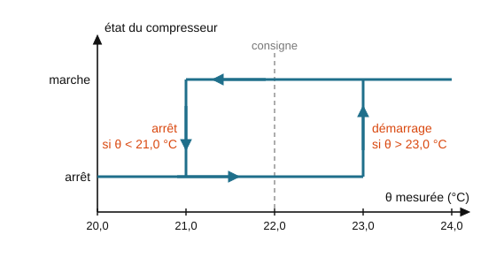

<em>Figure TD 25 : Fonctionnement du correcteur tout-ou-rien à hystérésis.</em>

| $t$ (min) | 0 | 5 | 10 | 15 | 20 | 25 | 30 | 35 |
|---|---|---|---|---|---|---|---|---|
| $\theta$ mesurée (°C) | 22,4 | 22,9 | 23,2 | 22,6 | 21,8 | 20,9 | 21,5 | 22,3 |

1) Construire le schéma-bloc de la régulation (consigne, comparateur, correcteur, actionneur, salle, capteur) en nommant chaque élément concret.
2) Citer deux perturbations possibles.
3) Calculer l'écart (consigne − mesure) à chaque instant du tableau.
4) Indiquer l'état du compresseur (marche ou arrêt) à chaque instant. Justifier les changements d'état.
5) Pourquoi utilise-t-on deux seuils au lieu d'un seul seuil à 22,0 °C ?

**Exercice 4.3 ★★ : Régulation de l'éclairement d'un bureau**

*Compétence visée : comparer boucle ouverte et boucle fermée face à une perturbation, et chiffrer l'erreur statique d'une correction proportionnelle (sous-partie 4.1).*

Dans un bureau, un ESP32 pilote un luminaire à LED par un signal PWM de rapport cyclique $\alpha$ (en %, de 0 à 100 %). Un capteur de luminosité mesure l'éclairement $E$ (en lux) sur le plan de travail. On admet le modèle $E = E_{ext} + 8{,}0 \times \alpha$, où $E_{ext}$ est l'éclairement apporté par la lumière du jour. La consigne est $E_c = 500$ lux.

1) Identifier, dans cette installation : la consigne, la grandeur réglée, le capteur, le comparateur et le correcteur, l'actionneur, la perturbation.
2) *Boucle ouverte.* Une horloge impose $\alpha = 50\ \%$ toute la journée. Calculer l'éclairement le soir ($E_{ext} = 0$), le matin ($E_{ext} = 100$ lux) et l'après-midi ($E_{ext} = 350$ lux). Conclure.
3) *Boucle fermée.* L'ESP32 calcule l'écart $\varepsilon = E_c - E$ et applique $\alpha = K \times \varepsilon$ ($K$ en %/lux). Montrer qu'en régime établi, $E = \dfrac{E_{ext} + 8{,}0 \times K \times E_c}{1 + 8{,}0 \times K}$.
4) Avec $K = 0{,}50$ %/lux, calculer $E$, $\varepsilon$ et $\alpha$ pour $E_{ext} = 0$, 100 et 350 lux.
5) Mêmes calculs avec $K = 2{,}0$ %/lux. Comparer, pour les deux réglages et pour la boucle ouverte, la variation de l'éclairement entre le soir et l'après-midi. Quel est l'effet de $K$ sur l'erreur statique et sur la sensibilité aux perturbations ?
6) En plein soleil, $E_{ext} = 600$ lux. Que donne la formule de la question 3 avec $K = 2{,}0$ %/lux ? Que vaut réellement $\alpha$, et quel est l'éclairement ? Que faudrait-il ajouter à l'installation pour respecter la consigne ?
7) Pourquoi ne choisit-on pas un gain $K$ très grand pour annuler l'erreur statique ?

### Série §4.2 : Modélisation d'un système linéaire `BTS2`

**Exercice 4.4 ★ : Ordre et linéarité d'un modèle**

*Compétence visée : reconnaître un modèle linéaire et donner son ordre.*

Pour chaque équation reliant une sortie $s(t)$ (ou $u$, $\Omega$) à une entrée $e(t)$, indiquer si le modèle est linéaire et, si oui, son ordre.

a) $u = R \times i$ (résistance) ;
b) $RC \dfrac{du}{dt} + u = e$ (circuit RC) ;
c) $LC \dfrac{d^2u}{dt^2} + RC \dfrac{du}{dt} + u = e$ (circuit RLC) ;
d) $J \dfrac{d\Omega}{dt} + f \Omega = C_M$ (moteur de ventilateur) ;
e) $s = k \times e^2$ (capteur quadratique) ;
f) $\tau \dfrac{ds}{dt} + s^2 = e$.

**Exercice 4.5 ★★ : Supercondensateur de sauvegarde d'une horloge temps réel**

*Compétence visée : établir l'équation différentielle d'un circuit électrique et l'identifier à la forme canonique du premier ordre.*

Sur une carte de supervision, l'horloge temps réel (RTC) est sauvegardée par un supercondensateur $C = 0{,}47\ \text{F}$, chargé sous $E = 5{,}0\ \text{V}$ à travers une résistance $R = 100\ \Omega$.

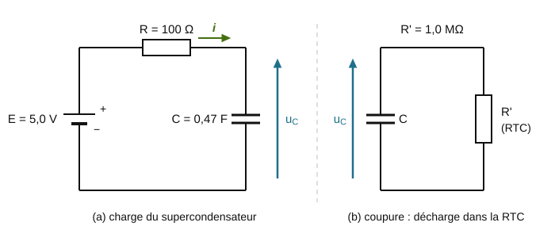

<em>Figure TD 26 : Charge du supercondensateur (a) et décharge dans la RTC lors d'une coupure (b).</em>

1) Écrire la loi des mailles du circuit de charge et la relation $i = C \dfrac{du_C}{dt}$. En déduire l'équation différentielle vérifiée par $u_C$.
2) L'identifier à la forme $\tau \dfrac{ds}{dt} + s = T_0 \cdot e$ : donner $\tau$ et $T_0$, puis la valeur finale de $u_C$.
3) Lors d'une coupure d'alimentation, le supercondensateur se décharge dans la RTC, modélisée par une résistance $R' = 1{,}0\ \text{M}\Omega$ : $u_C(t) = 5{,}0 \times e^{-t/\tau'}$ avec $\tau' = R'C$. Calculer $\tau'$.
4) La RTC s'arrête sous 2,0 V. Calculer l'autonomie de sauvegarde, en secondes puis en jours.

### Série §4.3 : Les systèmes du premier ordre `BTS2`

**Exercice 4.6 ★ : Constante de temps d'un dissipateur de processeur**

*Compétence visée : calculer une constante de temps et un régime permanent à l'aide de l'analogie thermique-électrique.*

1) Un circuit RC a pour composants $R = 10\ \text{k}\Omega$ et $C = 100\ \text{nF}$. Calculer sa constante de temps et son temps de réponse à 5 %.
2) Le processeur d'un serveur et son dissipateur forment un système thermique de résistance thermique $R_{TH} = 0{,}50\ °\text{C/W}$ et de capacité thermique $C_{TH} = 120\ \text{J/K}$. Calculer $\tau = R_{TH} C_{TH}$ et le temps de réponse à 5 %.
3) L'amplification statique vaut $T_0 = R_{TH}$. Le processeur passe brusquement de 0 à 80 W. Calculer l'élévation de température finale, puis la température finale si l'air ambiant est à 25 °C.
4) Quel est l'équivalent électrique de la puissance thermique ? De la température ?

**Exercice 4.7 ★★ : Démarrage du ventilateur d'un serveur**

*Compétence visée : exploiter le modèle mécanique du premier ordre d'un moteur pour prévoir sa réponse.*

Le moteur d'un ventilateur de serveur et son hélice ont un moment d'inertie $J = 2{,}0 \times 10^{-5}\ \text{kg·m}^2$ et un coefficient de frottement $f = 1{,}0 \times 10^{-5}\ \text{N·m·s/rad}$. Au démarrage, le moteur fournit un couple constant $C_M = 3{,}0 \times 10^{-3}\ \text{N·m}$. Le modèle est $\dfrac{J}{f} \dfrac{d\Omega}{dt} + \Omega = \dfrac{C_M}{f}$.

1) Identifier la constante de temps $\tau$ et la vitesse finale $\Omega_\infty$ (en rad/s puis en tr/min).
2) Écrire l'expression de $\Omega(t)$ en partant de l'arrêt et calculer la vitesse atteinte à $t = \tau$.
3) Calculer le temps de réponse à 5 %.
4) On monte une hélice deux fois plus lourde (inertie doublée). Que deviennent $\tau$ et $\Omega_\infty$ ?

**Exercice 4.8 ★★ : Panne de climatisation : combien de temps avant l'arrêt des serveurs ?**

*Compétence visée : exploiter la réponse d'un premier ordre à partir d'une condition initiale non nulle et prévoir des instants de franchissement de seuil (sous-parties 4.3 et 4.6).*

La climatisation d'une salle serveurs tombe en panne à $t = 0$, alors que la salle est à $\theta_0 = 22\ °\text{C}$. Les serveurs continuent de dissiper $P = 40\ \text{kW}$. On modélise la salle par un premier ordre de résistance thermique $R_{TH} = 0{,}75\ °\text{C/kW}$ (échanges avec l'extérieur du bâtiment, à 22 °C) et de constante de temps $\tau = 25\ \text{min}$. La supervision déclenche une alarme à 27 °C ; les serveurs s'arrêtent automatiquement à 35 °C.

1) Calculer la température finale $\theta_\infty = \theta_0 + R_{TH} \times P$ qu'atteindrait la salle sans intervention.
2) Écrire l'expression de $\theta(t)$ à l'aide de la relation $s(t) = S_\infty + (S_0 - S_\infty)\,e^{-t/\tau}$.
3) Calculer l'instant de l'alarme.
4) Calculer l'instant de l'arrêt automatique, puis le temps dont dispose le technicien entre l'alarme et l'arrêt.
5) Calculer la pente de la courbe à l'origine, $\dfrac{\theta_\infty - \theta_0}{\tau}$, en °C/min. Estimer l'instant d'arrêt en supposant que la température monte à cette vitesse constante. Cette estimation est-elle prudente ?
6) Calculer la capacité thermique $C_{TH} = \dfrac{\tau}{R_{TH}}$ de la salle (en J/K). On installe une réserve d'eau glacée qui double la capacité thermique : recalculer le temps avant l'arrêt automatique.

### Série §4.4 : Les systèmes du second ordre `BTS2`

**Exercice 4.9 ★ : Identifier les paramètres d'un second ordre**

*Compétence visée : identifier $T_0$, $m$ et $\omega_0$ par comparaison à la forme canonique, et prévoir le régime.*

1) Un système obéit à $1{,}0 \times 10^{-6}\, \dfrac{d^2 s}{dt^2} + 1{,}2 \times 10^{-3}\, \dfrac{ds}{dt} + s = 5\, e$. Par identification avec $\dfrac{1}{\omega_0^2} \dfrac{d^2 s}{dt^2} + \dfrac{2m}{\omega_0} \dfrac{ds}{dt} + s = T_0 \cdot e$, déterminer $\omega_0$, $f_0$, $m$ et $T_0$. Quel régime transitoire attend-on ?
2) Même question pour $4{,}0 \times 10^{-4}\, \dfrac{d^2 s}{dt^2} + 0{,}10\, \dfrac{ds}{dt} + s = e$.

**Exercice 4.10 ★★ : Réglage de l'amortissement d'un filtre RLC**

*Compétence visée : relier les composants d'un circuit RLC aux paramètres $\omega_0$ et $m$ et choisir une résistance d'amortissement.*

Le filtre d'alimentation d'une carte électronique est un circuit RLC série ($L = 10\ \text{mH}$, $C = 1{,}0\ \mu\text{F}$) ; la tension de sortie, prise aux bornes du condensateur, vérifie $LC \dfrac{d^2 s}{dt^2} + RC \dfrac{ds}{dt} + s = e$.

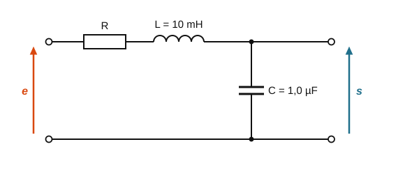

<em>Figure TD 27 : Filtre RLC série, sortie prise aux bornes du condensateur.</em>

1) Par identification avec la forme canonique, exprimer $\omega_0$ et $m$ en fonction de $R$, $L$ et $C$. Montrer que $m = \dfrac{R}{2}\sqrt{\dfrac{C}{L}}$.
2) Calculer $\omega_0$ et $f_0$.
3) Avec $R = 20\ \Omega$, calculer $m$. Quel régime observe-t-on ? Calculer la pseudo-période $T_P = \dfrac{2\pi}{\omega_0\sqrt{1 - m^2}}$.
4) Quelle résistance faut-il pour obtenir $m = 0{,}7$ ? Et pour le régime critique ?

### Série §4.5 : De l'équation différentielle à la transmittance (fonction de transfert) `BTS2`

**Exercice 4.11 ★ : Transmittance d'un circuit RC**

*Compétence visée : passer d'une équation différentielle à la transmittance en remplaçant la dérivation par $j\omega$.*

Un circuit RC ($R = 1{,}0\ \text{k}\Omega$, $C = 1{,}0\ \mu\text{F}$) vérifie $RC \dfrac{ds}{dt} + s = e$.

1) En remplaçant $\dfrac{d}{dt}$ par $j\omega$, établir $\underline{T}(j\omega) = \dfrac{\underline{S}}{\underline{E}} = \dfrac{1}{1 + jRC\omega}$.
2) Calculer la pulsation $\omega_0 = \dfrac{1}{RC}$.
3) Calculer le module de $\underline{T}$ et le gain en dB pour $\omega = \omega_0$ et pour $\omega = 10\,\omega_0$. Donner l'argument de $\underline{T}$ pour $\omega = \omega_0$.
4) De quel type de filtre s'agit-il ?

**Exercice 4.12 ★★ : Transmittance d'un second ordre**

*Compétence visée : établir la transmittance d'un second ordre et calculer son gain à plusieurs pulsations.*

Un système vérifie $2{,}5 \times 10^{-7}\, \dfrac{d^2 s}{dt^2} + 6{,}0 \times 10^{-4}\, \dfrac{ds}{dt} + s = 2\, e$.

1) Établir sa transmittance et l'écrire sous la forme $\underline{T} = \dfrac{T_0}{1 + 2mj\dfrac{\omega}{\omega_0} + \left(j\dfrac{\omega}{\omega_0}\right)^2}$. Donner $T_0$, $\omega_0$ et $m$.
2) Calculer le module de $\underline{T}$ et le gain en dB pour $\omega \to 0$, pour $\omega = \omega_0$ et pour $\omega = 10\,\omega_0$.
3) Le système présente-t-il une résonance ? Si oui, calculer la pulsation de résonance $\omega_R = \omega_0\sqrt{1 - 2m^2}$ et la surélévation $20\log_{10}\!\left[\dfrac{1}{2m\sqrt{1 - m^2}}\right]$ par rapport au gain statique.

**Exercice 4.13 ★★ : Sonde de température suivie d'un filtre : deux premiers ordres en cascade**

*Compétence visée : établir la transmittance de deux systèmes en cascade et l'identifier à un second ordre (sous-partie 4.5).*

Une sonde de température se comporte comme un premier ordre de constante de temps $\tau_1 = 20\ \text{s}$ et d'amplification statique $T_{01} = 10\ \text{mV/°C}$. Pour éliminer le bruit, sa tension traverse un filtre RC de constante de temps $\tau_2 = 5{,}0\ \text{s}$ et d'amplification statique 1, sans qu'il charge la sonde.

1) Écrire la transmittance de chaque élément, puis la transmittance totale $\underline{T} = \underline{T}_1 \times \underline{T}_2$.
2) Développer le dénominateur et l'identifier à $1 + 2mj\dfrac{\omega}{\omega_0} + \left(j\dfrac{\omega}{\omega_0}\right)^2$. Exprimer puis calculer $\omega_0$, $m$ et $T_0$.
3) Montrer que $m = \dfrac{\tau_1 + \tau_2}{2\sqrt{\tau_1 \tau_2}}$ est toujours supérieur ou égal à 1. Quelle conséquence sur la réponse à un échelon ?
*Coup de pouce : développer $\left(\sqrt{\tau_1} - \sqrt{\tau_2}\right)^2 \geq 0$.*
4) Calculer le module de $\underline{T}$ à la pulsation $\omega_0$, rapporté à $T_0$, en valeur linéaire puis en dB.
5) Écrire l'équation différentielle reliant la tension de sortie $s$ (en V) à la température $\theta$ (en °C).
6) Une simulation donne un temps de réponse à 5 % de 66 s pour l'ensemble, contre 60 s pour la sonde seule. Avec un filtre de constante de temps 0,5 s, on obtiendrait 60,4 s. Calculer $m$ dans ce dernier cas et conclure sur le choix de $\tau_2$.

### Série §4.6 : Réponse temporelle : la réponse à un échelon `BTS2`

**Exercice 4.14 ★ : Circuit de remise à zéro d'un ESP32**

*Compétence visée : exploiter la réponse indicielle d'un premier ordre.*

La broche EN (activation) d'un ESP32 est reliée à un circuit RC ($R = 10\ \text{k}\Omega$, $C = 1{,}0\ \mu\text{F}$) alimenté par un échelon de 3,3 V à la mise sous tension. La tension de la broche vérifie $u(t) = 3{,}3\,(1 - e^{-t/\tau})$.

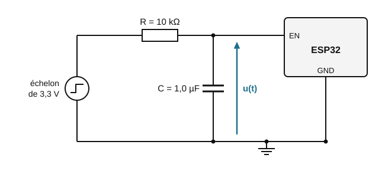

<em>Figure TD 28 : Circuit RC de la broche EN de l'ESP32.</em>

1) Calculer $\tau$.
2) Calculer $u(\tau)$ et $u(3\tau)$. Quel pourcentage de la valeur finale atteint-on dans chaque cas ?
3) Le microcontrôleur démarre quand $u$ dépasse 2,5 V. Calculer l'instant de démarrage.
4) Pourquoi ce retard au démarrage est-il utile ?

**Exercice 4.15 ★★ : Bras robotisé d'une bibliothèque de bandes**

*Compétence visée : calculer dépassement, pseudo-période et temps de réponse d'un second ordre et choisir l'amortissement.*

Dans une bibliothèque de sauvegarde sur bandes magnétiques d'un datacenter, un bras robotisé se positionne devant une cartouche. Son asservissement de position se comporte comme un second ordre de pulsation propre $\omega_0 = 2000\ \text{rad/s}$ et de gain statique 1. On admet que le dépassement relatif vaut $D\% = 100 \times \exp\!\left(\dfrac{-\pi m}{\sqrt{1 - m^2}}\right)$.

1) Avec $m = 0{,}4$, calculer le dépassement relatif et la pseudo-période $T_P$.
2) Le bras doit se déplacer de 10,0 mm. Quelle position maximale atteint-il ?
3) Avec $m = 0{,}7$, calculer le nouveau dépassement et le temps de réponse à 5 % ($t_{R5\%} \approx 3/\omega_0$).
4) Quel réglage choisir pour un positionnement rapide sans risque de heurter la cartouche voisine ?

**Exercice 4.16 ★★ : Identifier le second ordre d'une caméra motorisée**

*Compétence visée : identifier un second ordre à partir d'un relevé (dépassement, pseudo-période, temps de réponse) et vérifier un cahier des charges (sous-parties 4.6 et 4.7).*

Une caméra de vidéoprotection motorisée (caméra dôme orientable) reçoit à $t = 0$ une consigne de rotation de 0 à 90°. Le relevé de son orientation est donné sur la figure TD 47. Le cahier des charges impose un dépassement relatif au plus égal à 5 % (pour que l'image ne « rebondisse » pas) et un temps de réponse à 5 % au plus égal à 0,50 s.

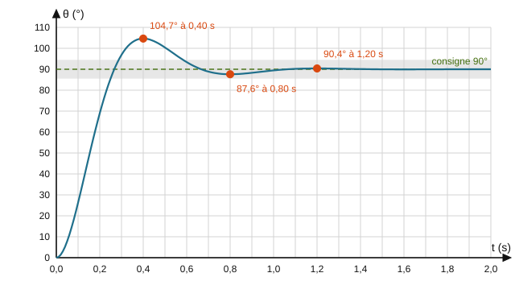

<em>Figure TD 47 : Orientation de la caméra après une consigne de 0 à 90° (la bande grisée correspond à ±5 % de la valeur finale).</em>

1) Justifier qu'un modèle du second ordre avec $m < 1$ convient. Donner la valeur finale et l'amplification statique $T_0$.
2) Calculer le dépassement relatif.
3) En déduire le coefficient d'amortissement $m$.
*On pourra poser $x = \dfrac{\pi m}{\sqrt{1 - m^2}} = -\ln(D)$, avec $D$ en valeur décimale.*
4) Lire la pseudo-période, puis calculer $\omega_0$.
5) Lire le temps de réponse à 5 %. Le cahier des charges est-il respecté ?
6) Le correcteur est réglé pour obtenir $m = 0{,}7$, sans changer $\omega_0$. Calculer le dépassement et le temps de réponse à 5 % ($t_{R5\%} \approx 3/\omega_0$). Conclure.
7) Écrire l'équation différentielle du système réglé à $m = 0{,}50$ (question 3).

### Série §4.7 : Identifier la nature d'un système à partir de sa réponse à un échelon `BTS2`

**Exercice 4.17 ★ : Reconnaître une réponse indicielle**

*Compétence visée : identifier le type et l'ordre d'un système à partir de l'allure de sa réponse à un échelon.*

On applique un échelon à l'entrée de cinq systèmes. Pour chacun, dire s'il s'agit d'un passe-bas, d'un passe-haut ou d'un passe-bande, et préciser l'ordre (1 ou 2) quand c'est possible.

- A : la sortie part avec une pente non nulle et monte jusqu'à une valeur constante, sans dépassement.
- B : la sortie part avec une tangente horizontale, dépasse sa valeur finale puis oscille autour.
- C : la sortie reproduit le front de l'échelon, puis redescend vers zéro.
- D : la sortie est nulle juste après le front et nulle en régime établi ; elle présente une « bosse » entre les deux.
- E : la sortie part avec une tangente horizontale et monte lentement jusqu'à sa valeur finale, sans dépassement.

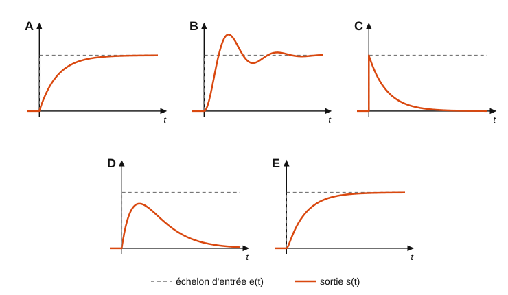

<em>Figure TD 29 : Allure des réponses à un échelon des systèmes A à E.</em>

**Exercice 4.18 ★★ : Identification d'un ventilateur piloté en tension**

*Compétence visée : identifier un premier ordre (amplification statique, constante de temps, temps de réponse) à partir d'un relevé.*

La commande d'un ventilateur passe brusquement de 0 à 10 V. On relève la vitesse de rotation :

| $t$ (s) | 0 | 1 | 2 | 3 | 4 | 6 | 8 | 10 | 15 |
|---|---|---|---|---|---|---|---|---|---|
| $\Omega$ (tr/min) | 0 | 1180 | 1896 | 2331 | 2594 | 2851 | 2945 | 2980 | 2998 |

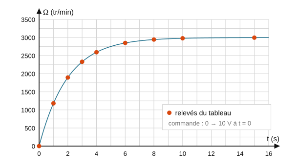

<em>Figure TD 30 : Relevé de la vitesse de rotation du ventilateur (points du tableau).</em>

1) Justifier que le système peut être modélisé par un premier ordre.
2) Déterminer la vitesse finale et l'amplification statique $T_0$ (en tr/min par volt).
3) Déterminer la constante de temps par la méthode des 63 %.
4) Déterminer le temps de réponse à 5 % sur le tableau et le comparer à $3\tau$.
5) Écrire l'équation différentielle du modèle.

### Série de synthèse : exercices type BTS `BTS2`

**Exercice 4.19 ★★★ : Régulation thermique d'une baie de serveurs (type BTS)**

*Compétence visée : identifier un système thermique du premier ordre, puis analyser les performances d'une régulation du second ordre au regard d'un cahier des charges.*

*Contexte :* dans une salle informatique, une baie de serveurs est refroidie par un ventilateur à vitesse réglable. Le technicien caractérise d'abord la baie en boucle ouverte, puis vérifie le réglage de la régulation.

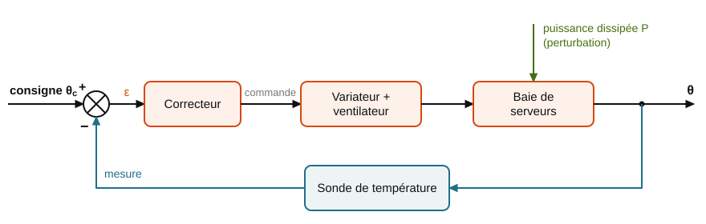

<em>Figure TD 31 : Schéma-bloc de la régulation thermique de la baie.</em>

*Document 1 : essai en boucle ouverte.* La ventilation est fixée à vitesse constante. À $t = 0$, la puissance dissipée par les serveurs passe brusquement de 2,0 kW à 4,0 kW. Température de l'air en sortie de baie :

| $t$ (min) | 0 | 2 | 4 | 6 | 8 | 12 | 16 | 20 |
|---|---|---|---|---|---|---|---|---|
| $\theta$ (°C) | 30,0 | 33,2 | 35,1 | 36,2 | 36,9 | 37,6 | 37,9 | 38,0 |

*Document 2 : essai en boucle fermée.* La régulation pilote la vitesse du ventilateur. La consigne passe de 32,0 °C à 28,0 °C. La température descend, atteint un minimum de 27,5 °C, remonte légèrement puis se stabilise à 28,0 °C. Deux minimums successifs sont séparés de 6,0 min.

*Document 3 : cahier des charges de la régulation.* Erreur statique nulle ; dépassement relatif (rapporté à la variation de consigne) inférieur à 10 % ; temps de réponse à 5 % inférieur à 8 min.

*Formulaire :* dépassement relatif d'un second ordre $D\% = 100 \times \exp\!\left(\dfrac{-\pi m}{\sqrt{1 - m^2}}\right)$ ; pseudo-période $T_P = \dfrac{2\pi}{\omega_0\sqrt{1 - m^2}}$ ; pour $m = 0{,}7$, $t_{R5\%} \approx 3/\omega_0$.

**Partie A : identification de la baie (boucle ouverte)**

1) L'essai du document 1 est-il réalisé en boucle ouverte ou en boucle fermée ? Justifier.
2) Justifier qu'un modèle du premier ordre convient.
3) Calculer l'amplification statique $T_0 = \dfrac{\Delta\theta}{\Delta P}$ en °C/W. À quelle grandeur thermique correspond-elle ?
4) Déterminer la constante de temps $\tau$ par la méthode des 63 %.
5) En déduire la capacité thermique $C_{TH}$ de la baie.
6) Calculer le temps de réponse à 5 % (5 % de la variation totale).

**Partie B : vérification de la régulation (boucle fermée)**

7) Calculer le dépassement relatif observé. Le cahier des charges est-il respecté ?
8) Calculer la valeur de $m$ correspondant au dépassement observé (on pourra poser $x = \dfrac{\pi m}{\sqrt{1 - m^2}} = -\ln(D)$ avec $D$ en valeur décimale). Quelle valeur minimale de $m$ respecterait le critère de dépassement ?
9) À partir de la pseudo-période, calculer $\omega_0$ (en rad/min).
10) On règle le correcteur pour obtenir $m = 0{,}7$, en supposant $\omega_0$ inchangée. Calculer le dépassement et le temps de réponse à 5 %. Le cahier des charges est-il respecté ?

**Exercice 4.20 ★★★ : Régulation de vitesse d'un ventilateur par un ESP32 (type BTS)**

*Compétence visée : identifier un premier ordre, prévoir les performances d'une boucle à correction proportionnelle et en montrer les limites (saturation, erreur statique) (sous-parties 4.1, 4.3 et 4.6).*

*Contexte :* dans une baie, un ESP32 régule la vitesse d'un ventilateur 12 V à 4 fils : il le commande par un signal PWM à 25 kHz (rapport cyclique $\alpha$ de 0 à 100 %) et mesure sa vitesse grâce au signal tachymétrique (2 impulsions par tour).

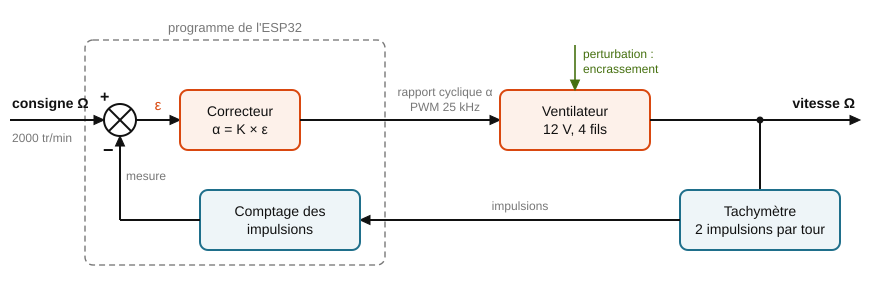

<em>Figure TD 48 : Schéma-bloc de la régulation de vitesse du ventilateur.</em>

*Document 1 : essai en boucle ouverte.* À $t = 0$, le rapport cyclique passe de 0 à 60 %.

| $t$ (s) | 0 | 0,5 | 1,0 | 1,5 | 2,0 | 3,0 | 4,5 | 6,0 | 8,0 | 12 |
|---|---|---|---|---|---|---|---|---|---|---|
| $\Omega$ (tr/min) | 0 | 680 | 1168 | 1517 | 1767 | 2075 | 2281 | 2356 | 2388 | 2400 |

*Document 2 : formulaire de la boucle fermée.* Pour un système du premier ordre ($T_0$, $\tau$) commandé par un correcteur proportionnel $\alpha = K \times \varepsilon$, avec $\varepsilon = \Omega_c - \Omega$, la boucle fermée est un premier ordre d'amplification statique $T_0' = \dfrac{K T_0}{1 + K T_0}$ et de constante de temps $\tau' = \dfrac{\tau}{1 + K T_0}$. L'erreur statique vaut $\varepsilon_\infty = \dfrac{\Omega_c}{1 + K T_0}$. Ces relations ne sont valables que si $\alpha$ reste entre 0 et 100 %.

*Document 3 : cahier des charges.* Consigne $\Omega_c = 2000$ tr/min ; erreur statique au plus égale à 2 % de la consigne ; temps de réponse à 5 % au plus égal à 0,5 s ; commande jamais saturée.

**Partie A : mesure et commande**

1) Calculer la période du signal PWM. Pourquoi choisir 25 kHz plutôt que quelques centaines de hertz ?
2) Calculer la fréquence du signal tachymétrique à 2400 tr/min. L'ESP32 compte les impulsions pendant 0,50 s : combien en compte-t-il ? Quelle est la résolution de la mesure de vitesse (écart de vitesse correspondant à une impulsion) ?

**Partie B : identification**

3) Justifier qu'un modèle du premier ordre convient. Déterminer $T_0$ (en (tr/min)/%) et la constante de temps $\tau$.

**Partie C : correction proportionnelle**

4) Avec $K = 0{,}020$ %/(tr/min), calculer $K T_0$, l'erreur statique, la vitesse atteinte, $\tau'$, le temps de réponse à 5 % et la commande à $t = 0$. Quelles exigences sont respectées ?
5) Quel gain $K$ faudrait-il pour respecter l'exigence d'erreur statique ? Que vaudrait alors la commande au démarrage ? Conclure.
6) Avec $K = 0{,}20$ %/(tr/min), calculer les performances prévues par le document 2. Vérifier la commande au démarrage. En réalité, tant que $\alpha$ est saturé à 100 %, le ventilateur accélère comme en boucle ouverte vers 4000 tr/min, avec la constante de temps $\tau$. Calculer l'instant où la vitesse atteint 1500 tr/min (fin de la saturation). Le temps de réponse prévu est-il réaliste ?
7) Les filtres s'encrassent : l'amplification statique tombe à 36 (tr/min)/%. Calculer la vitesse obtenue en boucle ouverte avec $\alpha = 50\ \%$, puis en boucle fermée avec $K = 0{,}20$. Quel avantage de la boucle fermée cette question illustre-t-elle ?
8) Proposer une modification du programme de l'ESP32 qui permette de respecter tout le cahier des charges.

**Exercice 4.21 ★★★ : Stabilisation thermique d'un laser DWDM (type BTS)**

*Compétence visée : relier une contrainte de longueur d'onde à une tolérance de température, puis identifier et valider une régulation du second ordre (sous-parties 4.4 et 4.6, avec réinvestissement des chapitres 1 et 6).*

*Contexte :* deux datacenters sont reliés par une fibre qui transporte plusieurs dizaines de canaux de longueurs d'onde différentes (multiplexage DWDM). Chaque canal est émis par une diode laser dont la longueur d'onde dépend de la température. Le module de chaque laser contient une régulation de température par module Peltier (qui peut chauffer ou refroidir) et thermistance.

*Document 1 : laser.* Fréquence d'émission à 25,0 °C : 193,4 THz. Dérive : +0,10 nm/°C. Les canaux sont espacés de 100 GHz, soit environ 0,80 nm ; la longueur d'onde doit rester à ±0,10 nm de sa valeur nominale.

*Document 2 : mise en route.* Laser éteint, le module est à 35,0 °C ; à $t = 0$, la régulation démarre avec la consigne 25,0 °C. La température descend, atteint un minimum de 24,4 °C, remonte légèrement, puis se stabilise à 25,0 °C. Deux minimums successifs sont séparés de 4,0 s.

*Document 3 : sans régulation.* Le laser suivrait la température du boîtier, qui varie de 15 °C à 45 °C dans le local technique.

*Formulaire : $D\% = 100 \times \exp\!\left(\dfrac{-\pi m}{\sqrt{1 - m^2}}\right)$ ; $T_P = \dfrac{2\pi}{\omega_0\sqrt{1 - m^2}}$ ; pour $m \approx 0{,}7$, $t_{R5\%} \approx 3/\omega_0$ ; $h = 6{,}63 \times 10^{-34}$ J·s ; $c_0 = 3{,}0 \times 10^8$ m/s ; $1$ eV $= 1{,}6 \times 10^{-19}$ J.*

**Partie A : pourquoi réguler ?**

1) Calculer la longueur d'onde du laser et l'énergie d'un photon (en eV). Quel matériau de photodiode faut-il au récepteur ?
2) Calculer l'écart de température toléré.
3) Sans régulation, calculer l'écart de longueur d'onde extrême par rapport à la valeur nominale. Le comparer à l'espacement des canaux. Conséquence ?

**Partie B : performances de la régulation**

4) Calculer le dépassement relatif lors de la mise en route.
5) En déduire le coefficient d'amortissement $m$.
6) Calculer $\omega_0$.
7) Estimer le temps de réponse à 5 %.
8) Calculer l'écart de longueur d'onde au minimum de température, puis à $t = 0$. Pourquoi le module n'allume-t-il son laser qu'une fois la température stabilisée ?

**Partie C : capacité de la liaison**

9) La bande C s'étend de 1530 à 1562 nm. Combien de canaux espacés de 0,80 nm peut-elle contenir ? Calculer la capacité totale de la fibre avec 100 Gbit/s par canal.

### Défi du chapitre `BTS2`

**Exercice 4.22 ★★★★ : Asservissement de position : la rapidité a un prix (défi)**

*Compétence visée : établir l'équation d'un système bouclé, l'identifier à un second ordre et montrer qu'un correcteur proportionnel impose un compromis indépassable (sous-parties 4.4 et 4.5, avec 4.1).*

La caméra motorisée de l'exercice 4.16 est entraînée par un moteur à courant continu. La vitesse de rotation $\Omega$ (en rad/s) obéit au premier ordre $\tau \dfrac{d\Omega}{dt} + \Omega = T_m\,u$, avec $\tau = 50\ \text{ms}$ et $T_m = 2{,}0\ \text{(rad/s)/V}$, où $u$ est la tension de commande. L'orientation $\theta$ (en rad) vérifie $\Omega = \dfrac{d\theta}{dt}$. Un codeur mesure $\theta$ et le correcteur proportionnel applique $u = K\,(\theta_c - \theta)$, avec $K$ en V/rad.

1) Montrer que l'orientation vérifie $\dfrac{\tau}{K T_m}\dfrac{d^2\theta}{dt^2} + \dfrac{1}{K T_m}\dfrac{d\theta}{dt} + \theta = \theta_c$.
*Coup de pouce : remplacer $\Omega$ par $\dfrac{d\theta}{dt}$ et $u$ par son expression, puis diviser par $K T_m$.*
2) Identifier l'amplification statique $T_0$, la pulsation propre $\omega_0$ et le coefficient d'amortissement $m$ en fonction de $K$, $T_m$ et $\tau$. Que vaut l'erreur statique ? Quel élément de la boucle en est responsable ?
3) Montrer que $\omega_0 = \dfrac{1}{2m\tau}$, quel que soit $K$. En déduire que, pour $m = 0{,}7$, le temps de réponse à 5 % vaut $t_{R5\%} \approx 6m\tau$. Calculer le gain $K$ nécessaire, $\omega_0$ et $t_{R5\%}$.
4) Un nouveau cahier des charges exige $t_{R5\%} \leq 0{,}1\ \text{s}$ avec un dépassement d'au plus 5 %. Est-ce possible en modifiant seulement $K$ ? Sur quoi faudrait-il agir ?
5) Un technicien règle $K = 10$ V/rad « pour aller plus vite ». Calculer $\omega_0$, $m$ et le dépassement relatif. A-t-il gagné en rapidité ? Commenter.

### Corrigés du chapitre 4 `BTS1` `BTS2`

**Exercice 4.1.** Boucle fermée : la sortie (température) est mesurée, renvoyée et comparée à la consigne. Consigne = température souhaitée ; mesure = température ambiante (capteur du thermostat) ; écart = consigne − mesure ; actionneur = résistance chauffante (commandée par le relais du thermostat).

**Exercice 4.2.**
1) Consigne (22,0 °C, réglée sur le contrôleur) → comparateur (calcule l'écart) → correcteur tout-ou-rien à hystérésis → actionneur (compresseur du climatiseur) → système (air de la salle) → sortie : température ; capteur (sonde de température) qui renvoie la mesure vers le comparateur.
2) Variation de la charge des serveurs (puissance dissipée), ouverture de la porte, température extérieure, panne d'un ventilateur.
3) Écarts : $-0{,}4$ ; $-0{,}9$ ; $-1{,}2$ ; $-0{,}6$ ; $+0{,}2$ ; $+1{,}1$ ; $+0{,}5$ ; $-0{,}3$ °C. Un écart négatif signifie que la salle est plus chaude que la consigne.
4) $t = 0$ et 5 min : arrêt (sous 23,0 °C, état initial conservé). $t = 10$ min : 23,2 °C > 23,0 °C → **marche**. $t = 15$ et 20 min : marche (la température n'est pas encore descendue sous 21,0 °C). $t = 25$ min : 20,9 °C < 21,0 °C → **arrêt**. $t = 30$ et 35 min : arrêt (sous 23,0 °C).
5) Avec un seul seuil, le moindre bruit de mesure autour de 22,0 °C ferait démarrer et arrêter le compresseur en permanence, ce qui l'userait très vite. L'hystérésis espace les commutations, au prix d'une oscillation de ±1 °C autour de la consigne.

**Exercice 4.3.**
1) Consigne : 500 lux ; grandeur réglée : l'éclairement du plan de travail ; capteur : le capteur de luminosité ; comparateur et correcteur : le programme de l'ESP32 ; actionneur : le driver et le luminaire à LED ; perturbation : la lumière du jour.
2) $E = E_{ext} + 400$ : 400 lux le soir (insuffisant), 500 lux le matin, 750 lux l'après-midi (gaspillage). La boucle ouverte ne corrige pas la perturbation.
3) En régime établi, $\alpha = K(E_c - E)$, donc $E = E_{ext} + 8{,}0\,K\,(E_c - E)$, soit $E\,(1 + 8{,}0\,K) = E_{ext} + 8{,}0\,K\,E_c$, d'où la formule.
4) $K = 0{,}50$ : $E = \dfrac{E_{ext} + 2000}{5}$. Soir : 400 lux, $\varepsilon = 100$ lux, $\alpha = 50\ \%$ ; matin : 420 lux, $\varepsilon = 80$ lux, $\alpha = 40\ \%$ ; après-midi : 470 lux, $\varepsilon = 30$ lux, $\alpha = 15\ \%$.
5) $K = 2{,}0$ : $E = \dfrac{E_{ext} + 8000}{17}$. Soir : 471 lux, $\varepsilon \approx 29$ lux, $\alpha \approx 59\ \%$ ; matin : 476 lux, $\varepsilon \approx 24$ lux, $\alpha \approx 47\ \%$ ; après-midi : 491 lux, $\varepsilon \approx 9$ lux, $\alpha \approx 18\ \%$. Variation entre le soir et l'après-midi : 350 lux en boucle ouverte, 70 lux avec $K = 0{,}50$, 21 lux avec $K = 2{,}0$. Plus $K$ est grand, plus l'erreur statique est faible et mieux la perturbation est compensée, mais l'erreur ne s'annule jamais avec un correcteur proportionnel (il faut un écart pour qu'il y ait une commande).
6) La formule donne $E \approx 506$ lux, donc $\alpha = 2{,}0 \times (500 - 506) < 0$ : impossible, la commande sature à $\alpha = 0$. L'éclairement vaut alors $E = E_{ext} = 600$ lux : le luminaire est éteint et ne peut pas « retirer » de la lumière. Il faudrait un second actionneur, par exemple des stores motorisés.
7) Un gain trop élevé rend la boucle instable : la moindre variation de mesure (bruit du capteur, retard de traitement) provoque de fortes variations de commande, et l'éclairement oscille (clignotement) au lieu de se stabiliser.

*Erreurs fréquentes :* oublier que la commande est limitée entre 0 et 100 % ; confondre erreur statique et perturbation ; croire qu'une boucle fermée proportionnelle atteint exactement la consigne.

**Exercice 4.4.** a) Linéaire, ordre 0 (pas de dérivée). b) Linéaire, ordre 1. c) Linéaire, ordre 2. d) Linéaire, ordre 1. e) Non linéaire (terme $e^2$). f) Non linéaire (terme $s^2$).

**Exercice 4.5.**
1) Loi des mailles : $E = R i + u_C$. Avec $i = C \dfrac{du_C}{dt}$ : $RC \dfrac{du_C}{dt} + u_C = E$.
2) $\tau = RC = 100 \times 0{,}47 = 47\ \text{s}$ ; $T_0 = 1$. Valeur finale : $u_C = T_0 \times E = 5{,}0\ \text{V}$.
3) $\tau' = R'C = 1{,}0 \times 10^6 \times 0{,}47 = 4{,}7 \times 10^5\ \text{s}$.
4) $5{,}0\, e^{-t/\tau'} = 2{,}0 \Rightarrow t = \tau' \ln\!\left(\dfrac{5{,}0}{2{,}0}\right) = 4{,}7 \times 10^5 \times 0{,}916 \approx 4{,}3 \times 10^5\ \text{s}$, soit $\dfrac{4{,}3 \times 10^5}{86\,400} \approx 5{,}0$ jours.

**Exercice 4.6.**
1) $\tau = RC = 10 \times 10^3 \times 100 \times 10^{-9} = 1{,}0\ \text{ms}$ ; $t_{R5\%} = 3\tau = 3{,}0\ \text{ms}$.
2) $\tau = 0{,}50 \times 120 = 60\ \text{s}$ ; $t_{R5\%} = 3\tau = 180\ \text{s} = 3{,}0\ \text{min}$.
3) $\Delta\theta_\infty = T_0 \times P = 0{,}50 \times 80 = 40\ °\text{C}$ ; $\theta_\infty = 25 + 40 = 65\ °\text{C}$.
4) La puissance thermique correspond à l'intensité électrique ; la température (ou différence de température) correspond à la tension.

**Exercice 4.7.**
1) $\tau = \dfrac{J}{f} = \dfrac{2{,}0 \times 10^{-5}}{1{,}0 \times 10^{-5}} = 2{,}0\ \text{s}$ ; $\Omega_\infty = \dfrac{C_M}{f} = \dfrac{3{,}0 \times 10^{-3}}{1{,}0 \times 10^{-5}} = 300\ \text{rad/s}$, soit $300 \times \dfrac{60}{2\pi} \approx 2{,}9 \times 10^3\ \text{tr/min}$.
2) $\Omega(t) = 300\,(1 - e^{-t/2{,}0})$ (en rad/s, $t$ en s). $\Omega(\tau) = 300 \times (1 - e^{-1}) \approx 190\ \text{rad/s}$ (63 % de la valeur finale).
3) $t_{R5\%} = 3\tau = 6{,}0\ \text{s}$.
4) $\tau$ double (4,0 s) : le ventilateur met deux fois plus de temps à atteindre sa vitesse. $\Omega_\infty$ ne dépend pas de $J$ : elle reste 300 rad/s.

**Exercice 4.8.**
1) $\theta_\infty = 22 + 0{,}75 \times 40 = 52\ °\text{C}$.
2) $\theta(t) = 52 + (22 - 52)\,e^{-t/25} = 52 - 30\,e^{-t/25}$ ($t$ en min, $\theta$ en °C).
3) $52 - 30\,e^{-t/25} = 27 \Rightarrow e^{-t/25} = \dfrac{25}{30} \Rightarrow t = -25\ln\!\left(\dfrac{25}{30}\right) \approx 4{,}6\ \text{min}$.
4) $e^{-t/25} = \dfrac{17}{30} \Rightarrow t = -25\ln\!\left(\dfrac{17}{30}\right) \approx 14{,}2\ \text{min}$. Temps disponible : $14{,}2 - 4{,}6 \approx 9{,}6\ \text{min}$.
5) Pente : $\dfrac{30}{25} = 1{,}2\ °\text{C/min}$ ; à vitesse constante, 35 °C serait atteint après $\dfrac{35 - 22}{1{,}2} \approx 10{,}8\ \text{min}$. La tangente est au-dessus de la courbe réelle : cette estimation surévalue la vitesse d'échauffement et donne un temps plus court que la réalité. Elle est donc prudente pour un plan d'intervention.
6) $C_{TH} = \dfrac{25 \times 60}{0{,}75 \times 10^{-3}} = 2{,}0 \times 10^6\ \text{J/K}$ (attention : $R_{TH}$ en °C/W). En doublant $C_{TH}$, $\tau = 50$ min et $t = -50\ln\!\left(\dfrac{17}{30}\right) \approx 28\ \text{min}$ : l'inertie thermique double le temps d'intervention.

*Erreurs fréquentes :* utiliser $s(t) = S_\infty(1 - e^{-t/\tau})$ en oubliant la valeur initiale ; laisser $R_{TH}$ en °C/kW dans le calcul de $C_{TH}$ ; inverser le rapport dans le logarithme.

**Exercice 4.9.**
1) $\dfrac{1}{\omega_0^2} = 1{,}0 \times 10^{-6} \Rightarrow \omega_0 = 1{,}0 \times 10^3\ \text{rad/s}$ ; $f_0 = \dfrac{\omega_0}{2\pi} \approx 159\ \text{Hz}$. $\dfrac{2m}{\omega_0} = 1{,}2 \times 10^{-3} \Rightarrow m = \dfrac{1{,}2 \times 10^{-3} \times 1000}{2} = 0{,}60$. $T_0 = 5$. Comme $m < 1$ : régime pseudo-périodique (léger dépassement).
2) $\omega_0 = \dfrac{1}{\sqrt{4{,}0 \times 10^{-4}}} = 50\ \text{rad/s}$ ; $m = \dfrac{0{,}10 \times 50}{2} = 2{,}5$ ; $T_0 = 1$. Comme $m > 1$ : régime apériodique, sans dépassement.

**Exercice 4.10.**
1) Identification : $\dfrac{1}{\omega_0^2} = LC$, donc $\omega_0 = \dfrac{1}{\sqrt{LC}}$ ; $\dfrac{2m}{\omega_0} = RC$, donc $m = \dfrac{RC\omega_0}{2} = \dfrac{RC}{2\sqrt{LC}} = \dfrac{R}{2}\sqrt{\dfrac{C}{L}}$.
2) $\omega_0 = \dfrac{1}{\sqrt{10 \times 10^{-3} \times 1{,}0 \times 10^{-6}}} = 1{,}0 \times 10^4\ \text{rad/s}$ ; $f_0 \approx 1{,}59\ \text{kHz}$.
3) $m = \dfrac{20}{2}\sqrt{\dfrac{10^{-6}}{10^{-2}}} = 10 \times 0{,}01 = 0{,}10$ : régime pseudo-périodique très peu amorti. $T_P = \dfrac{2\pi}{10^4 \times \sqrt{1 - 0{,}01}} \approx 0{,}63\ \text{ms}$.
4) $m = 0{,}005 \times R$ : $m = 0{,}7 \Rightarrow R = 140\ \Omega$ ; régime critique ($m = 1$) : $R = 200\ \Omega$.

**Exercice 4.11.**
1) $RC\, j\omega \underline{S} + \underline{S} = \underline{E} \Rightarrow \underline{S}(1 + jRC\omega) = \underline{E} \Rightarrow \underline{T} = \dfrac{1}{1 + jRC\omega}$.
2) $\omega_0 = \dfrac{1}{1{,}0 \times 10^3 \times 1{,}0 \times 10^{-6}} = 1{,}0 \times 10^3\ \text{rad/s}$.
3) $|\underline{T}| = \dfrac{1}{\sqrt{1 + (\omega/\omega_0)^2}}$. Pour $\omega = \omega_0$ : $\dfrac{1}{\sqrt{2}} \approx 0{,}707$, soit $G \approx -3{,}0\ \text{dB}$ ; argument $-\arctan(1) = -45°$. Pour $\omega = 10\,\omega_0$ : $\dfrac{1}{\sqrt{101}} \approx 0{,}0995$, soit $G \approx -20\ \text{dB}$.
4) Gain maximal aux basses fréquences, qui diminue aux hautes fréquences : filtre passe-bas du premier ordre.

**Exercice 4.12.**
1) $2{,}5 \times 10^{-7} (j\omega)^2 \underline{S} + 6{,}0 \times 10^{-4} j\omega \underline{S} + \underline{S} = 2\underline{E}$, d'où $\underline{T} = \dfrac{2}{1 + 6{,}0 \times 10^{-4} j\omega + 2{,}5 \times 10^{-7}(j\omega)^2}$. Identification : $T_0 = 2$ ; $\omega_0 = \dfrac{1}{\sqrt{2{,}5 \times 10^{-7}}} = 2{,}0 \times 10^3\ \text{rad/s}$ ; $m = \dfrac{6{,}0 \times 10^{-4} \times 2000}{2} = 0{,}60$.
2) $\omega \to 0$ : $|\underline{T}| = 2$, $G = 20\log_{10}(2) \approx 6{,}0\ \text{dB}$. $\omega = \omega_0$ : $\underline{T} = \dfrac{2}{2mj}$, $|\underline{T}| = \dfrac{2}{1{,}2} \approx 1{,}67$, $G \approx 4{,}4\ \text{dB}$. $\omega = 10\,\omega_0$ : dénominateur $1 - 100 + j \times 1{,}2 \times 10 = -99 + 12j$, de module $\approx 99{,}7$ ; $|\underline{T}| \approx 0{,}020$, $G \approx -34\ \text{dB}$.
3) $m = 0{,}60 < 0{,}7$ : légère résonance. $\omega_R = 2000\sqrt{1 - 2 \times 0{,}36} \approx 1{,}06 \times 10^3\ \text{rad/s}$ ; surélévation $20\log_{10}\!\left[\dfrac{1}{2 \times 0{,}6 \times 0{,}8}\right] \approx 0{,}35\ \text{dB}$ au-dessus du gain statique : résonance à peine visible.

**Exercice 4.13.**
1) $\underline{T}_1 = \dfrac{T_{01}}{1 + j\omega\tau_1}$ ; $\underline{T}_2 = \dfrac{1}{1 + j\omega\tau_2}$ ; $\underline{T} = \dfrac{T_{01}}{(1 + j\omega\tau_1)(1 + j\omega\tau_2)}$.
2) Dénominateur : $1 + j\omega(\tau_1 + \tau_2) + (j\omega)^2\tau_1\tau_2$. Identification : $\dfrac{1}{\omega_0^2} = \tau_1\tau_2$, donc $\omega_0 = \dfrac{1}{\sqrt{\tau_1\tau_2}} = \dfrac{1}{\sqrt{100}} = 0{,}10\ \text{rad/s}$ ; $\dfrac{2m}{\omega_0} = \tau_1 + \tau_2$, donc $m = \dfrac{\tau_1 + \tau_2}{2\sqrt{\tau_1\tau_2}} = \dfrac{25}{20} = 1{,}25$ ; $T_0 = T_{01} = 10\ \text{mV/°C}$.
3) $\left(\sqrt{\tau_1} - \sqrt{\tau_2}\right)^2 = \tau_1 + \tau_2 - 2\sqrt{\tau_1\tau_2} \geq 0$, donc $\tau_1 + \tau_2 \geq 2\sqrt{\tau_1\tau_2}$ et $m \geq 1$ (égalité si $\tau_1 = \tau_2$). Deux premiers ordres en cascade donnent toujours un régime apériodique : jamais de dépassement, tangente horizontale à l'origine.
4) À $\omega_0$ : $\dfrac{|\underline{T}|}{T_0} = \dfrac{1}{|2mj|} = \dfrac{1}{2m} = 0{,}40$, soit $20\log_{10}(0{,}40) \approx -8{,}0\ \text{dB}$. Vérification : $\dfrac{1}{\sqrt{1 + 2^2}\sqrt{1 + 0{,}5^2}} = 0{,}40$.
5) $\tau_1\tau_2\dfrac{d^2 s}{dt^2} + (\tau_1 + \tau_2)\dfrac{ds}{dt} + s = T_0\,\theta$, soit $100\,\dfrac{d^2 s}{dt^2} + 25\,\dfrac{ds}{dt} + s = 0{,}010\,\theta$.
6) $m = \dfrac{20{,}5}{2\sqrt{10}} \approx 3{,}2$ : un amortissement très fort, le système se comporte presque comme la sonde seule. Un filtre dont la constante de temps est petite devant celle de la sonde réduit le bruit sans presque ralentir la mesure ; avec $\tau_2 = 5$ s, la mesure perd 6 s, ce qui peut retarder une alarme.

*Erreurs fréquentes :* additionner les transmittances au lieu de les multiplier ; oublier le facteur 2 dans l'identification de $m$ ; croire que la cascade peut osciller.

**Exercice 4.14.**
1) $\tau = RC = 10 \times 10^3 \times 1{,}0 \times 10^{-6} = 10\ \text{ms}$.
2) $u(\tau) = 3{,}3 \times (1 - e^{-1}) \approx 2{,}1\ \text{V}$ (63 %) ; $u(3\tau) = 3{,}3 \times (1 - e^{-3}) \approx 3{,}1\ \text{V}$ (95 %).
3) $3{,}3\,(1 - e^{-t/\tau}) = 2{,}5 \Rightarrow e^{-t/\tau} = 1 - \dfrac{2{,}5}{3{,}3} \approx 0{,}242 \Rightarrow t = -\tau \ln(0{,}242) \approx 14\ \text{ms}$.
4) Le retard laisse le temps à l'alimentation 3,3 V de se stabiliser avant que le microcontrôleur ne démarre : on évite un démarrage sous tension insuffisante (plantage, corruption de la mémoire flash).

**Exercice 4.15.**
1) $D\% = 100 \times \exp\!\left(\dfrac{-\pi \times 0{,}4}{\sqrt{1 - 0{,}16}}\right) \approx 25\ \%$. $T_P = \dfrac{2\pi}{2000 \times \sqrt{0{,}84}} \approx 3{,}4\ \text{ms}$.
2) $x_{max} = 10{,}0 \times (1 + 0{,}254) \approx 12{,}5\ \text{mm}$ : le bras dépasse de 2,5 mm.
3) $D\% = 100 \times \exp\!\left(\dfrac{-\pi \times 0{,}7}{\sqrt{1 - 0{,}49}}\right) \approx 4{,}6\ \%$ ; $t_{R5\%} \approx \dfrac{3}{2000} = 1{,}5\ \text{ms}$.
4) $m = 0{,}7$ : temps de réponse minimal et dépassement faible (0,46 mm). Si même ce dépassement est inacceptable, on prend $m \geq 1$, au prix d'un positionnement plus lent.

**Exercice 4.16.**
1) La réponse part avec une tangente horizontale et dépasse sa valeur finale avant d'osciller : second ordre avec $m < 1$. Valeur finale : 90° pour une consigne de 90°, donc $T_0 = 1$.
2) $D\% = \dfrac{104{,}7 - 90}{90} \times 100 \approx 16{,}3\ \%$.
3) $x = -\ln(0{,}163) \approx 1{,}81$ ; $\dfrac{m}{\sqrt{1 - m^2}} = \dfrac{x}{\pi} \approx 0{,}577$, d'où $m^2 = \dfrac{0{,}577^2}{1 + 0{,}577^2} \approx 0{,}25$ et $m \approx 0{,}50$.
4) Deux maximums successifs, à 0,40 s et 1,20 s : $T_P = 0{,}80\ \text{s}$. $\omega_0 = \dfrac{2\pi}{T_P\sqrt{1 - m^2}} = \dfrac{2\pi}{0{,}80 \times \sqrt{0{,}75}} \approx 9{,}1\ \text{rad/s}$.
5) La courbe entre définitivement dans la bande de 85,5° à 94,5° vers $t \approx 0{,}58\ \text{s}$. Ni le dépassement (16 % > 5 %) ni le temps de réponse (0,58 s > 0,50 s) ne respectent le cahier des charges.
6) $D\% = 100 \times \exp\!\left(\dfrac{-0{,}7\pi}{\sqrt{0{,}51}}\right) \approx 4{,}6\ \%$ ; $t_{R5\%} \approx \dfrac{3}{9{,}07} \approx 0{,}33\ \text{s}$. Les deux exigences sont respectées : moins d'oscillations, et donc une stabilisation plus rapide.
7) $\dfrac{1}{\omega_0^2} = \dfrac{1}{9{,}07^2} \approx 0{,}012\ \text{s}^2$ et $\dfrac{2m}{\omega_0} = \dfrac{1}{9{,}07} \approx 0{,}11\ \text{s}$ : $0{,}012\,\dfrac{d^2\theta}{dt^2} + 0{,}11\,\dfrac{d\theta}{dt} + \theta = \theta_c$.

*Erreurs fréquentes :* calculer le dépassement par rapport au maximum au lieu de la valeur finale ; prendre pour pseudo-période l'écart entre un maximum et le minimum suivant (c'est une demi-période) ; lire le temps de réponse au premier passage dans la bande.

**Exercice 4.17.** A : passe-bas du premier ordre (pente non nulle à l'origine, pas de dépassement). B : passe-bas du second ordre avec $m < 1$. C : passe-haut (le front passe, le niveau continu est bloqué). D : passe-bande (ni le front ni le continu ne passent). E : passe-bas du second ordre avec $m > 1$ (tangente horizontale, pas de dépassement).

**Exercice 4.18.**
1) La vitesse croît dès $t = 0$ avec une pente non nulle (1180 tr/min dès la première seconde) et tend vers sa valeur finale sans dépassement : allure d'un premier ordre.
2) $\Omega_\infty \approx 3000\ \text{tr/min}$ ; $T_0 = \dfrac{3000}{10} = 300\ \text{(tr/min)/V}$.
3) $0{,}63 \times 3000 \approx 1896\ \text{tr/min}$, atteint à $t = 2\ \text{s}$ : $\tau = 2{,}0\ \text{s}$.
4) $0{,}95 \times 3000 = 2850\ \text{tr/min}$, atteint à $t \approx 6\ \text{s}$ : on retrouve bien $3\tau = 6{,}0\ \text{s}$.
5) $2{,}0\, \dfrac{d\Omega}{dt} + \Omega = 300 \times e$ ($\Omega$ en tr/min, $e$ en V, $t$ en s).

**Exercice 4.19.**

*Partie A.*
1) Boucle ouverte : la vitesse du ventilateur est fixe et ne dépend pas de la température mesurée.
2) La température évolue dès $t = 0$ avec une pente non nulle et tend vers 38,0 °C sans dépassement : allure d'un premier ordre.
3) $T_0 = \dfrac{38{,}0 - 30{,}0}{4000 - 2000} = \dfrac{8{,}0}{2000} = 4{,}0 \times 10^{-3}\ °\text{C/W}$. C'est la résistance thermique $R_{TH}$ de la baie (avec sa ventilation).
4) 63 % de la variation : $30{,}0 + 0{,}63 \times 8{,}0 \approx 35{,}1\ °\text{C}$, atteint à $t = 4\ \text{min}$ : $\tau = 4{,}0\ \text{min} = 240\ \text{s}$.
5) $C_{TH} = \dfrac{\tau}{R_{TH}} = \dfrac{240}{4{,}0 \times 10^{-3}} = 6{,}0 \times 10^{4}\ \text{J/K}$.
6) $t_{R5\%} = 3\tau = 12\ \text{min}$ (on vérifie : 95 % de la variation donne 37,6 °C, atteint à 12 min).

*Partie B.*
7) Variation de consigne : 4,0 °C ; dépassement : $28{,}0 - 27{,}5 = 0{,}5\ °\text{C}$. $D\% = \dfrac{0{,}5}{4{,}0} \times 100 = 12{,}5\ \%$ > 10 % : cahier des charges non respecté.
8) $x = -\ln(0{,}125) \approx 2{,}08$. $\dfrac{m}{\sqrt{1 - m^2}} = \dfrac{x}{\pi} \approx 0{,}662 \Rightarrow m^2 = \dfrac{0{,}662^2}{1 + 0{,}662^2} \approx 0{,}305 \Rightarrow m \approx 0{,}55$. Pour $D = 10\ \%$ : $x = -\ln(0{,}10) \approx 2{,}30$, d'où $m \approx 0{,}59$ : il faut $m \geq 0{,}59$.
9) $\omega_0 = \dfrac{2\pi}{T_P\sqrt{1 - m^2}} = \dfrac{2\pi}{6{,}0 \times \sqrt{1 - 0{,}305}} \approx 1{,}26\ \text{rad/min}$.
10) $m = 0{,}7$ : $D\% \approx 4{,}6\ \%$ < 10 % ; $t_{R5\%} \approx \dfrac{3}{1{,}26} \approx 2{,}4\ \text{min}$ < 8 min. L'erreur statique est nulle (la température se stabilise à la consigne). Le cahier des charges est respecté.

**Exercice 4.20.**

*Partie A.*
1) $T = \dfrac{1}{25 \times 10^3} = 40\ \mu\text{s}$. À quelques centaines de hertz, les bobinages du moteur vibreraient à une fréquence audible (sifflement) ; 25 kHz est au-delà de la limite de l'oreille (20 kHz).
2) $2400\ \text{tr/min} = 40\ \text{tr/s}$, soit $f = 80\ \text{Hz}$. En 0,50 s : 40 impulsions. Une impulsion de plus ou de moins correspond à $\dfrac{1}{2 \times 0{,}50}\ \text{tr/s} = 1\ \text{tr/s} = 60\ \text{tr/min}$ : c'est la résolution de la mesure (3 % de la consigne). Pour mieux faire, on mesure la période entre deux impulsions.

*Partie B.*
3) Pente non nulle à l'origine, pas de dépassement : premier ordre. $T_0 = \dfrac{2400}{60} = 40\ \text{(tr/min)/\%}$. 63 % de 2400 : 1512 tr/min, atteint à $t \approx 1{,}5\ \text{s}$ : $\tau = 1{,}5\ \text{s}$ (on vérifie : à $3\tau = 4{,}5$ s, 2281 tr/min, soit 95 %).

*Partie C.*
4) $K T_0 = 0{,}020 \times 40 = 0{,}80$ ; $\varepsilon_\infty = \dfrac{2000}{1{,}80} \approx 1111\ \text{tr/min}$ ; vitesse atteinte : $\approx 889\ \text{tr/min}$ ; $\tau' = \dfrac{1{,}5}{1{,}80} \approx 0{,}83\ \text{s}$, $t_{R5\%} \approx 2{,}5\ \text{s}$ ; commande initiale $\alpha = 0{,}020 \times 2000 = 40\ \%$. Seule l'exigence de non-saturation est respectée.
5) $\dfrac{1}{1 + K T_0} \leq 0{,}02 \Rightarrow K T_0 \geq 49 \Rightarrow K \geq 1{,}2\ \%/(\text{tr/min})$. Au démarrage : $\alpha = 1{,}225 \times 2000 \approx 2450\ \%$, très au-delà de 100 % : impossible sans saturer fortement.
6) $K T_0 = 8$ : $\varepsilon_\infty = \dfrac{2000}{9} \approx 222\ \text{tr/min}$ (11 %), vitesse 1778 tr/min ; $\tau' = \dfrac{1{,}5}{9} \approx 0{,}17\ \text{s}$, $t_{R5\%} = 0{,}50\ \text{s}$. Mais au démarrage $\alpha = 0{,}20 \times 2000 = 400\ \%$ : saturation à 100 %. Tant que $\alpha = 100\ \%$, $\Omega = 4000\,(1 - e^{-t/1{,}5})$ ; la saturation cesse quand $K\varepsilon = 100$, soit $\varepsilon = 500$ et $\Omega = 1500$ tr/min : $t = -1{,}5\ln\!\left(1 - \dfrac{1500}{4000}\right) \approx 0{,}71\ \text{s}$. La réponse réelle est plus lente que prévu : le formulaire n'est pas valable pendant la saturation.
7) Boucle ouverte : $36 \times 50 = 1800\ \text{tr/min}$ au lieu de 2000 (−10 %). Boucle fermée : $2000 \times \dfrac{7{,}2}{8{,}2} \approx 1756\ \text{tr/min}$ au lieu de 1778 (−1,2 %). La boucle fermée rend la vitesse beaucoup moins sensible aux variations du système.
8) Ajouter une action intégrale (correcteur PI) qui annule l'erreur statique sans gain proportionnel excessif, et/ou une précommande $\alpha_0 = \dfrac{\Omega_c}{T_0} = 50\ \%$ à laquelle on ajoute la correction $K\varepsilon$ ; limiter la vitesse de variation de la consigne pour éviter la saturation.

*Erreurs fréquentes :* oublier que la commande est bornée ; lire $\tau$ à 95 % au lieu de 63 % ; exprimer $K$ sans unité et se tromper d'un facteur 100 entre % et valeur décimale.

**Exercice 4.21.**

*Partie A.*
1) $\lambda = \dfrac{3{,}0 \times 10^8}{193{,}4 \times 10^{12}} \approx 1551\ \text{nm}$ ; $E = h\nu = 6{,}63 \times 10^{-34} \times 193{,}4 \times 10^{12} \approx 1{,}28 \times 10^{-19}\ \text{J} \approx 0{,}80\ \text{eV}$ : inférieure au gap du silicium, il faut une photodiode InGaAs.
2) $\Delta\theta = \dfrac{0{,}10}{0{,}10} = 1{,}0\ °\text{C}$ : la température doit rester entre 24,0 et 26,0 °C.
3) De 15 °C à 45 °C : $\Delta\lambda$ varie de $-10 \times 0{,}10 = -1{,}0\ \text{nm}$ à $+20 \times 0{,}10 = +2{,}0\ \text{nm}$, plus que l'espacement entre canaux (0,80 nm) : le laser empiéterait sur les canaux voisins (diaphonie, erreurs sur plusieurs liaisons). La régulation est indispensable.

*Partie B.*
4) Variation de consigne : 10,0 °C ; dépassement : 0,6 °C ; $D\% = \dfrac{0{,}6}{10{,}0} \times 100 = 6{,}0\ \%$.
5) $x = -\ln(0{,}060) \approx 2{,}81$ ; $\dfrac{m}{\sqrt{1 - m^2}} = \dfrac{2{,}81}{\pi} \approx 0{,}896$ ; $m^2 = \dfrac{0{,}802}{1{,}802} \approx 0{,}445$ ; $m \approx 0{,}67$.
6) $\omega_0 = \dfrac{2\pi}{4{,}0 \times \sqrt{1 - 0{,}445}} \approx 2{,}1\ \text{rad/s}$.
7) $m$ est proche de 0,7 : $t_{R5\%} \approx \dfrac{3}{2{,}11} \approx 1{,}4\ \text{s}$.
8) Au minimum : $\Delta\theta = -0{,}6\ °\text{C}$, $\Delta\lambda = -0{,}06\ \text{nm}$, dans la tolérance. À $t = 0$ : $+10\ °\text{C}$, soit $+1{,}0\ \text{nm}$, hors tolérance et même dans le canal voisin. Le laser reste éteint tant que la température n'est pas stabilisée, pour ne pas perturber les autres canaux de la fibre.

*Partie C.*
9) $\dfrac{1562 - 1530}{0{,}80} = 40$ canaux, soit $40 \times 100 = 4\,000\ \text{Gbit/s} = 4\ \text{Tbit/s}$ sur une seule fibre.

*Erreurs fréquentes :* calculer le dépassement relatif par rapport à 25 °C au lieu de la variation de consigne (10 °C) ; confondre écart de température et écart de longueur d'onde ; utiliser $\lambda = c/\nu$ avec $\nu$ en GHz.

**Exercice 4.22.**
1) $\tau\dfrac{d^2\theta}{dt^2} + \dfrac{d\theta}{dt} = T_m K(\theta_c - \theta)$, donc $\tau\dfrac{d^2\theta}{dt^2} + \dfrac{d\theta}{dt} + K T_m\,\theta = K T_m\,\theta_c$ ; en divisant par $K T_m$, on obtient l'équation demandée.
2) Identification avec la forme canonique : $T_0 = 1$ ; $\dfrac{1}{\omega_0^2} = \dfrac{\tau}{K T_m}$, donc $\omega_0 = \sqrt{\dfrac{K T_m}{\tau}}$ ; $\dfrac{2m}{\omega_0} = \dfrac{1}{K T_m}$, donc $m = \dfrac{\omega_0}{2K T_m} = \dfrac{1}{2\sqrt{K T_m \tau}}$. $T_0 = 1$ : l'erreur statique est nulle, même avec un simple correcteur proportionnel. C'est l'intégration ($\theta$ est l'intégrale de $\Omega$) présente dans la boucle qui l'assure : tant que $\theta \neq \theta_c$, le moteur tourne.
3) $2m\tau\,\omega_0 = \dfrac{\tau}{\sqrt{K T_m \tau}}\sqrt{\dfrac{K T_m}{\tau}} = 1$, donc $\omega_0 = \dfrac{1}{2m\tau}$ et $t_{R5\%} \approx \dfrac{3}{\omega_0} = 6m\tau$. Pour $m = 0{,}7$ : $K T_m = \dfrac{1}{4m^2\tau} = \dfrac{1}{4 \times 0{,}49 \times 0{,}050} \approx 10{,}2\ \text{s}^{-1}$, donc $K \approx 5{,}1\ \text{V/rad}$ ; $\omega_0 = \dfrac{1}{2 \times 0{,}7 \times 0{,}050} \approx 14{,}3\ \text{rad/s}$ ; $t_{R5\%} \approx 6 \times 0{,}7 \times 0{,}050 = 0{,}21\ \text{s}$.
4) Avec un dépassement d'au plus 5 %, il faut $m \geq 0{,}69$ environ, et le temps de réponse reste voisin de $6m\tau \approx 0{,}2\ \text{s}$, quel que soit $K$ : impossible d'atteindre 0,1 s. Il faut réduire $\tau$ (moteur plus rapide, mécanique plus légère) ou changer de type de correcteur (action dérivée ou « avance de phase », qui augmente l'amortissement).
5) $K T_m = 20$ : $\omega_0 = \sqrt{\dfrac{20}{0{,}050}} = 20\ \text{rad/s}$ ; $m = \dfrac{1}{2\sqrt{20 \times 0{,}050}} = 0{,}50$ ; $D\% \approx 16\ \%$. La réponse démarre plus vite, mais elle oscille : elle met environ 0,26 s à rester dans la bande de ±5 %, plus qu'avec $K = 5{,}1$. Augmenter le gain d'un correcteur proportionnel déstabilise la boucle sans la rendre plus rapide au sens du temps de réponse.

*Erreurs fréquentes :* oublier que $\theta$ est l'intégrale de $\Omega$ (on obtiendrait un premier ordre) ; croire qu'un gain plus grand donne toujours une réponse plus rapide ; confondre temps de montée et temps de réponse à 5 %.

---

&nbsp;

## Chapitre 5 : Traitement du signal

*Les exercices sont regroupés en séries qui suivent les six sous-parties du cours ; dans chaque série, ils sont classés par difficulté croissante. La sous-partie 5.3 (transmittance et diagramme de Bode) est traitée en deuxième année. La série de synthèse rassemble les sujets de type BTS : chaîne d'acquisition pour la maintenance prédictive (exercice 5.17), chaîne audio d'un interphone IP (exercice 5.18) et mesure du courant d'une baie par une PDU intelligente (exercice 5.19). Le défi du chapitre (exercice 5.20, ★★★★) le termine.*

### Série §5.1 : Analyse temporelle des signaux `BTS1` `BTS2`

**Exercice 5.1 ★ : Signal PWM de commande d'un ventilateur**

*Compétence visée : calculer période, valeur moyenne et valeur efficace d'un signal rectangulaire, et classer les types de signaux.*

Un ventilateur de PC à 4 fils est commandé par un signal PWM (modulation de largeur d'impulsion) de fréquence 25 kHz, qui vaut 5,0 V pendant une fraction $\alpha$ de la période (rapport cyclique) et 0 V le reste du temps. On règle $\alpha = 30\ \%$.

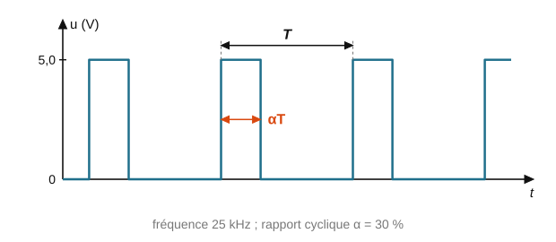

<em>Figure TD 32 : Signal PWM de commande du ventilateur.</em>

1) Calculer la période $T$ et la durée de l'état haut.
2) Calculer la valeur moyenne $U_{moy} = \alpha \times U$ (méthode des aires).
3) Calculer la valeur efficace $U_{eff} = U\sqrt{\alpha}$.
4) Qu'affiche un multimètre en position DC ? En position AC (TRMS, composante alternative seule : $\sqrt{U_{eff}^2 - U_{moy}^2}$) ?
5) Classer chacun des signaux suivants (analogique, échantillonné, quantifié, numérique) : a) la tension de sortie d'une sonde de température analogique ; b) la suite des valeurs lues toutes les secondes par le CAN d'un ESP32 ; c) le signal PWM ci-dessus.

**Exercice 5.2 ★★ : Signal d'un capteur avec composante continue**

*Compétence visée : décomposer un signal en valeur moyenne et composante alternative, calculer valeur efficace et puissance.*

Un capteur délivre $u(t) = 2{,}0 + 3{,}0\sin(2\pi \times 1000\, t)$ (en V).

1) Donner la valeur moyenne, l'amplitude et la fréquence de la composante alternative.
2) Calculer la valeur efficace de $u(t)$ : $U_{eff} = \sqrt{U_{moy}^2 + \dfrac{A^2}{2}}$.
3) Qu'affiche un multimètre en position DC ? En position AC (composante alternative seule) ?
4) Le signal est appliqué à une résistance de 50 Ω. Calculer la puissance moyenne dissipée.
5) Comparer avec une horloge carrée 0/3,3 V de rapport cyclique 50 % : calculer sa valeur moyenne et sa valeur efficace.

**Exercice 5.3 ★★ : Autonomie d'un capteur LoRa sur pile**

*Compétence visée : calculer la valeur moyenne d'un courant impulsionnel par la méthode des aires et en déduire une autonomie (sous-partie 5.1).*

Un capteur connecté LoRa, alimenté par une pile lithium de 3,6 V et de capacité 2600 mAh, répète un cycle de 10 min (600 s) : mesure pendant 2,0 s (15 mA), émission radio pendant 1,2 s (45 mA), puis veille (8 µA) jusqu'à la fin du cycle (figure TD 49). On considère que 80 % de la capacité de la pile est réellement utilisable.

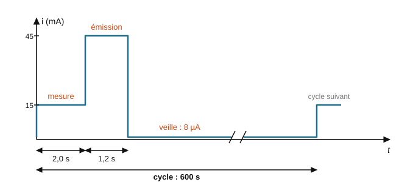

<em>Figure TD 49 : Courant consommé par le capteur au cours d'un cycle (échelles non respectées).</em>

1) Calculer la durée de la veille sur un cycle.
2) Calculer la charge consommée (en mA·s) pendant chacune des trois phases, puis sur un cycle complet. En déduire la valeur moyenne du courant.
3) Quelle part de la consommation revient à chaque phase ? Laquelle faut-il optimiser en priorité ?
4) Calculer l'autonomie du capteur, en heures puis en années.
5) Calculer l'énergie consommée sur un cycle, en joules.
6) Le client souhaite une mesure toutes les 2 min (cycle de 120 s, mêmes durées de mesure et d'émission). Calculer la nouvelle autonomie.
7) En revenant au cycle de 10 min, le réseau fait passer le capteur en facteur d'étalement SF7 : l'émission ne dure plus que 0,06 s. Calculer le nouveau courant moyen et l'autonomie.

### Série §5.2 : Analyse fréquentielle des signaux `BTS1` `BTS2`

**Exercice 5.4 ★ : Spectre de raies et distorsion**

*Compétence visée : tracer un spectre de raies, calculer une valeur efficace à partir du spectre et un taux de distorsion harmonique.*

L'analyse d'un signal de fréquence fondamentale 1,0 kHz, en sortie d'un amplificateur audio de salle de visioconférence, donne : $u(t) = 1{,}5 + 4{,}0\sin(\omega t) + 0{,}8\sin(3\omega t) + 0{,}3\sin(5\omega t)$ (en V).

1) Donner la fréquence et l'amplitude de chaque raie du spectre, puis représenter le spectre d'amplitude.
2) Calculer la valeur efficace du signal.
3) Calculer le taux de distorsion harmonique THD. L'amplificateur est-il de bonne qualité ?

**Exercice 5.5 ★★ : Spectre d'une horloge numérique**

*Compétence visée : exploiter la décomposition en série de Fourier d'un signal carré pour évaluer bande passante et pureté.*

Une horloge carrée de 1,0 MHz, de rapport cyclique 50 %, oscille entre 0 et 3,3 V. On admet que sa partie alternative (un carré de ±1,65 V) ne contient que des harmoniques de rang impair, d'amplitude $A_n = \dfrac{4 \times 1{,}65}{n\pi}$.

1) Donner la valeur moyenne et calculer l'amplitude des raies de rang 1, 3, 5 et 7.
2) Calculer la valeur efficace à partir de ces quatre raies et de la valeur moyenne. Comparer à la valeur exacte $3{,}3/\sqrt{2}$.
3) Calculer le THD obtenu en ne gardant que les rangs 3, 5 et 7.
4) Quelle bande passante doit avoir une liaison pour transmettre l'horloge jusqu'à l'harmonique 5 ? Que devient le signal à travers une liaison dont la bande passante n'est que de 1,5 MHz ?
5) Pourquoi les harmoniques des horloges sont-elles une source de perturbations électromagnétiques pour les équipements radio voisins ?

**Exercice 5.6 ★★ : Courant absorbé par l'alimentation d'un serveur**

*Compétence visée : exploiter le spectre d'un courant non sinusoïdal pour calculer sa valeur efficace, son taux de distorsion et son facteur de puissance (sous-partie 5.2).*

Une ancienne alimentation de serveur, sans correction du facteur de puissance, est branchée sur le réseau 230 V, 50 Hz (tension sinusoïdale). Son courant a pour décomposition : $i(t) = 2{,}4\sin(\omega t) + 1{,}9\sin(3\omega t) + 1{,}3\sin(5\omega t) + 0{,}7\sin(7\omega t)$ (en A).

On admet que, la tension étant sinusoïdale, seul le fondamental du courant transporte de la puissance active : $P = U_{eff} \times I_{1,eff} \times \cos\varphi_1$, avec ici $\varphi_1 = 0$. La puissance apparente vaut $S = U_{eff} \times I_{eff}$ et le facteur de puissance $FP = P/S$.

1) Donner la fréquence et l'amplitude de chaque raie du spectre du courant.
2) Calculer la valeur efficace du courant, puis celle de son fondamental.
3) Calculer le taux de distorsion harmonique du courant. Commenter.
4) Calculer la puissance active, la puissance apparente et le facteur de puissance.
5) Une alimentation moderne, équipée d'une correction du facteur de puissance (PFC), absorbe un courant sinusoïdal pour la même puissance. Calculer sa valeur efficace. De quel pourcentage le courant efficace diminue-t-il ? Quel intérêt pour le câblage et les onduleurs d'un datacenter ?
6) Dans une installation triphasée, les harmoniques de rang 3 des trois phases sont en phase et s'additionnent dans le conducteur de neutre. Pour trois alimentations identiques réparties sur les trois phases, calculer l'amplitude puis la valeur efficace du courant à 150 Hz dans le neutre. Pourquoi est-ce dangereux si le neutre a été dimensionné en supposant qu'il ne transporte presque aucun courant ?

### Série §5.3 : Réponse fréquentielle : transmittance et diagramme de Bode `BTS2`

**Exercice 5.7 ★ : Gain en dB et passe-bas du premier ordre**

*Compétence visée : convertir un module de transmittance en gain et lire les valeurs remarquables d'un premier ordre.*

1) Calculer le gain $G = 20\log_{10}(T)$ pour $T = 0{,}5$ ; $10$ ; $0{,}1$.
2) Calculer $T$ pour $G = -3\ \text{dB}$ et pour $G = 26\ \text{dB}$.
3) Un filtre passe-bas du premier ordre a pour transmittance $\underline{T} = \dfrac{1}{1 + j\dfrac{f}{f_c}}$ avec $f_c = 1{,}0\ \text{kHz}$. Calculer le gain et le déphasage pour $f = 1{,}0\ \text{kHz}$, $10\ \text{kHz}$ et $100\ \text{kHz}$. Quelle est la pente de l'asymptote haute fréquence ?

**Exercice 5.8 ★★ : Diagramme de Bode d'un filtre RC**

*Compétence visée : établir la transmittance d'un quadripôle passif par le diviseur de tension et tracer son diagramme de Bode.*

Un filtre est formé d'une résistance $R = 3{,}3\ \text{k}\Omega$ et d'un condensateur $C = 10\ \text{nF}$. La sortie est prise aux bornes du condensateur.

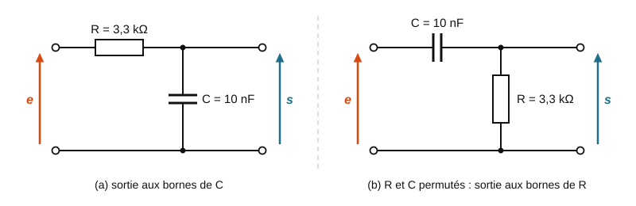

<em>Figure TD 33 : Filtre RC : montage étudié (a) et montage obtenu en permutant R et C (b).</em>

1) En utilisant le diviseur de tension avec $\underline{Z}_R = R$ et $\underline{Z}_C = \dfrac{1}{jC\omega}$, établir $\underline{T} = \dfrac{1}{1 + jRC\omega}$. Calculer la fréquence de coupure $f_c = \dfrac{1}{2\pi RC}$.
2) Calculer le gain et le déphasage pour $f = 500\ \text{Hz}$, $f = f_c$ et $f = 10 f_c$. Tracer l'allure du diagramme de Bode (gain et phase) avec ses asymptotes.
3) On permute $R$ et $C$ (sortie aux bornes de $R$). Établir la nouvelle transmittance. De quel filtre s'agit-il ? Calculer son gain à 500 Hz.
4) Un filtre passe-bas du second ordre a un coefficient d'amortissement $m = 0{,}3$ et une fréquence propre $f_0 = 10\ \text{kHz}$. Calculer la surélévation maximale du gain $G_{MAX} = 20\log_{10}\!\left[\dfrac{1}{2m\sqrt{1 - m^2}}\right]$ et la fréquence de résonance $f_R = f_0\sqrt{1 - 2m^2}$. Est-ce gênant pour un filtre anti-bruit ?

**Exercice 5.9 ★★ : Filtre passe-bande d'un interphone**

*Compétence visée : associer un passe-haut et un passe-bas pour réaliser un passe-bande, tracer son diagramme de Bode asymptotique et calculer son gain (sous-partie 5.3).*

La voix est transmise entre 300 Hz et 3400 Hz. Dans un interphone, le signal du microphone traverse un filtre passe-haut ($R_1 = 10\ \text{k}\Omega$, $C_1 = 47\ \text{nF}$, sortie aux bornes de $R_1$), un montage suiveur, puis un filtre passe-bas ($R_2 = 4{,}7\ \text{k}\Omega$, $C_2 = 10\ \text{nF}$, sortie aux bornes de $C_2$).

1) Calculer les fréquences de coupure $f_{c1}$ du passe-haut et $f_{c2}$ du passe-bas.
2) Écrire les transmittances $\underline{T}_1 = \dfrac{j\,f/f_{c1}}{1 + j\,f/f_{c1}}$ et $\underline{T}_2 = \dfrac{1}{1 + j\,f/f_{c2}}$. Pourquoi la transmittance de l'ensemble vaut-elle $\underline{T}_1 \times \underline{T}_2$ grâce au suiveur ?
3) Tracer le diagramme de Bode asymptotique du gain de l'ensemble (pentes et fréquences de cassure).
4) Calculer le gain réel à 50 Hz, 300 Hz, 1 kHz, 3,4 kHz et 10 kHz. Pourquoi le gain à 1 kHz n'est-il pas exactement 0 dB ?
5) Calculer le déphasage introduit à 1 kHz.
6) Un ronflement à 50 Hz, d'amplitude 200 mV, se superpose au signal du microphone. Calculer son amplitude en sortie du filtre. Comment l'atténuer davantage ?

### Série §5.4 : Amplification `BTS1` `BTS2`

**Exercice 5.10 ★ : Montage inverseur**

*Compétence visée : calculer l'amplification, le gain et la résistance d'entrée d'un montage inverseur à AOP.*

Un montage inverseur à AOP utilise $R_1 = 10\ \text{k}\Omega$ et $R_2 = 47\ \text{k}\Omega$. Il est alimenté en ±5 V et sature à ±4,5 V.

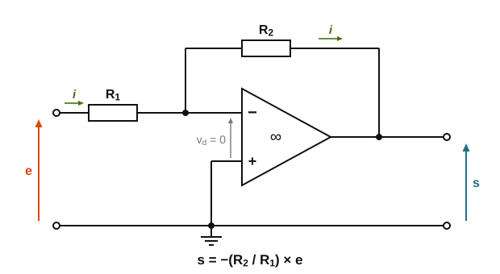

<em>Figure 63 (recueil de cours) : Montage inverseur à AOP.</em>

1) Calculer l'amplification $A_V = -\dfrac{R_2}{R_1}$ et le gain en dB.
2) L'entrée est une sinusoïde d'amplitude 0,20 V. Donner l'amplitude et la phase de la sortie.
3) Donner la résistance d'entrée du montage.
4) Quelle est l'amplitude d'entrée maximale avant saturation ?

**Exercice 5.11 ★★ : Préamplificateur de microphone pour un ESP32**

*Compétence visée : dimensionner un amplificateur en tenant compte de la résistance d'entrée et de la résistance de la source.*

Un microphone délivre un signal d'amplitude 20 mV ; il se comporte comme un générateur de tension en série avec une résistance $R_g = 2{,}2\ \text{k}\Omega$. Pour exploiter au mieux le CAN de l'ESP32, on veut une amplitude de 1,0 V en sortie d'un montage inverseur.

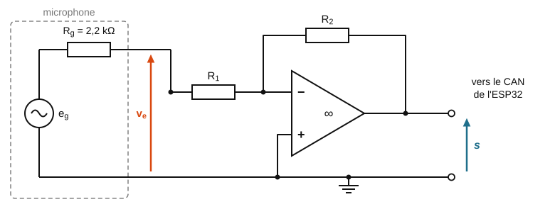

<em>Figure TD 34 : Microphone (générateur eg et résistance Rg) relié au préamplificateur inverseur.</em>

1) Calculer l'amplification (en valeur absolue) nécessaire et le gain en dB.
2) Un premier montage utilise $R_1 = 2{,}2\ \text{k}\Omega$ et $R_2 = 110\ \text{k}\Omega$. En tenant compte du diviseur de tension formé par $R_g$ et la résistance d'entrée $R_e = R_1$, calculer l'amplitude réellement présente à l'entrée de l'AOP, puis l'amplitude de sortie. Conclure.
3) Expliquer pourquoi la résistance d'entrée d'un amplificateur doit être grande devant la résistance de la source.
4) On choisit $R_1 = 22\ \text{k}\Omega$ et $R_2 = 1{,}2\ \text{M}\Omega$ (valeurs E12). Calculer l'amplification globale (source comprise) et l'amplitude de sortie. Le cahier des charges est-il respecté ?
5) L'amplificateur de puissance du haut-parleur d'alarme associé délivre 2,0 W et dissipe 3,0 W sous forme de chaleur. Calculer son rendement.

**Exercice 5.12 ★★ : Boucle de courant 4-20 mA d'un capteur de pression**

*Compétence visée : convertir un courant en tension pour un CAN, calculer une résolution et justifier l'usage d'une boucle de courant (sous-parties 5.4 et 5.6, avec réinvestissement de la sous-partie 1.1).*

Le circuit d'eau glacée d'un datacenter est surveillé par un capteur de pression industriel 0-10 bar, à sortie 4-20 mA : il fait circuler 4 mA à 0 bar et 20 mA à 10 bar, proportionnellement. Le capteur est relié par 300 m de câble (2 conducteurs) à une résistance de mesure $R = 150\ \Omega$ dont la tension est numérisée par le CAN 12 bits d'un ESP32 (0 à 3,3 V). La boucle est alimentée en 24 V (figure TD 50).

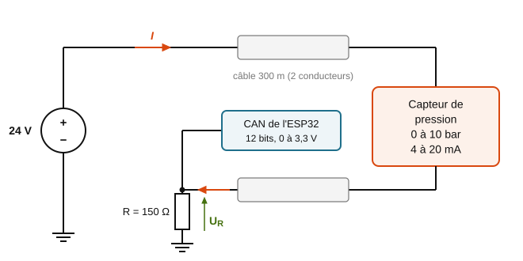

<em>Figure TD 50 : Boucle de courant 4-20 mA du capteur de pression.</em>

1) Calculer la tension aux bornes de $R$ pour 4 mA et pour 20 mA. Est-elle compatible avec le CAN ?
2) Calculer la sensibilité de la chaîne en mA/bar, puis en V/bar. Quelle pression correspond à une tension mesurée de 1,56 V ?
3) Calculer le quantum du CAN et la résolution en pression (en mbar). Combien de valeurs numériques différentes sont réellement utilisées ?
4) Le câble a une résistance de 0,04 Ω par mètre de conducteur. Calculer la résistance de la boucle de câble, puis la tension disponible aux bornes du capteur à 20 mA. Le capteur a besoin d'au moins 10 V pour fonctionner : calculer la résistance totale maximale admissible en série dans la boucle.
5) Expliquer pourquoi la mesure ne dépend pas de la résistance du câble (contrairement à une sortie en tension). Pourquoi le zéro est-il codé par 4 mA et non par 0 mA ? Le programme déclare le capteur en défaut au-dessous de 3,6 mA : à quelle valeur numérique du CAN cela correspond-il ?

### Série §5.5 : Filtrage analogique `BTS1` `BTS2`

**Exercice 5.13 ★ : Filtre RC passe-bas et fréquence de coupure**

*Compétence visée : calculer une fréquence de coupure et prévoir l'effet d'un filtre passe-bas sur un signal utile et un parasite.*

Un filtre RC passe-bas est réalisé avec $R = 1{,}0$ kΩ et $C = 100$ nF (même structure que le montage (a) de la figure TD 33).

1) Donner (ou admettre) la formule de la fréquence de coupure : $f_c = \dfrac{1}{2\pi RC}$. Calculer $f_c$.
2) Un signal utile à 200 Hz et un bruit parasite à 50 kHz traversent ce filtre. Lequel est fortement atténué ? Justifier sans calcul détaillé, juste par comparaison à $f_c$.
3) On veut abaisser $f_c$ d'un facteur 10 sans changer $R$ : quelle nouvelle valeur de $C$ faut-il choisir ?

**Exercice 5.14 ★★ : Choisir l'ordre d'un filtre anti-parasite**

*Compétence visée : choisir le type et l'ordre d'un filtre à partir d'un gabarit.*

Un capteur de vibrations délivre un signal utile entre 0 et 500 Hz. Une alimentation à découpage voisine superpose un parasite à 20 kHz d'amplitude 0,50 V. On veut réduire ce parasite sous 5 mV sans atténuer le signal utile de plus de 1 dB. On utilise un filtre de Butterworth d'ordre $n$ et de fréquence de coupure $f_c = 1{,}0\ \text{kHz}$, dont le module vaut $T = \dfrac{1}{\sqrt{1 + (f/f_c)^{2n}}}$.

1) Quel type de filtre faut-il (passe-bas, passe-haut, passe-bande) ? Quelle atténuation minimale (en dB) faut-il à 20 kHz ?
2) Pour $n = 1$, calculer le gain à 20 kHz et l'amplitude résiduelle du parasite, puis le gain à 500 Hz. Le gabarit est-il respecté ?
3) Même question pour $n = 2$.
4) Proposer une structure de filtre actif permettant de réaliser l'ordre 2. Qu'apporterait un filtre de Chebyshev ?

### Série §5.6 : Numérisation des signaux analogiques et restitution `BTS1` `BTS2`

**Exercice 5.15 ★ : Le CAN d'un ESP32**

*Compétence visée : calculer le quantum et le SNR de quantification d'un CAN, appliquer la condition de Shannon.*

Le CAN d'un ESP32 code sur $N = 12$ bits une tension comprise entre 0 et $V_{réf} = 3{,}3\ \text{V}$.

1) Calculer le nombre de niveaux et le quantum $q = \dfrac{V_{réf}}{2^N - 1}$.
2) Quel nombre (en décimal) le CAN renvoie-t-il pour une tension de 1,50 V ?
3) Calculer le SNR de quantification théorique.
4) On veut enregistrer de la voix jusqu'à 4 kHz, puis de la musique jusqu'à 20 kHz. Donner la fréquence d'échantillonnage minimale dans chaque cas. Les fréquences de 8 kHz et 44,1 kHz conviennent-elles ?

**Exercice 5.16 ★★ : Numériser une sonde de température LM35**

*Compétence visée : choisir la résolution et la tension de référence d'un CAN, et identifier un repliement de spectre.*

Une sonde LM35 délivre 10 mV/°C. On mesure des températures de 0 à 100 °C.

1) Quelle est la plage de tension à numériser ?
2) Avec un CAN 10 bits et $V_{réf} = 3{,}3\ \text{V}$, calculer le quantum et la résolution en °C.
3) Même question avec $V_{réf} = 1{,}1\ \text{V}$. Pourquoi est-ce mieux ? Quelle est la température maximale mesurable ?
4) Avec $V_{réf} = 3{,}3\ \text{V}$, combien de bits faut-il au minimum pour une résolution de 0,1 °C ?
5) Sur une autre voie, un capteur de vibrations contient une composante à 7 kHz ; on l'échantillonne à 10 kHz sans filtre anti-repliement. À quelle fréquence apparaît cette composante dans le signal numérisé ? Quelle condition faudrait-il respecter et quel filtre placer ?

### Série de synthèse : exercices type BTS `BTS1` `BTS2`

**Exercice 5.17 ★★★ : Chaîne d'acquisition pour la maintenance prédictive (type BTS)**

*Compétence visée : analyser une chaîne complète (spectre, amplification, filtrage, numérisation, transmission) et valider chaque bloc.*

*Contexte :* un datacenter surveille l'usure des ventilateurs de ses unités de climatisation. Un accéléromètre est fixé sur chaque ventilateur ; son signal est amplifié, filtré, numérisé par un ESP32, puis analysé localement. Seul le résultat de l'analyse est transmis par LoRaWAN.

*Document 1 : chaîne d'acquisition.* Accéléromètre (signal alternatif centré sur 0 V) → amplificateur inverseur ($R_1 = 10\ \text{k}\Omega$, $R_2 = 150\ \text{k}\Omega$) → circuit de décalage (+1,65 V, gain 1) → filtre anti-repliement passe-bas de Butterworth d'ordre 2, $f_c = 2{,}0\ \text{kHz}$ ($T = \dfrac{1}{\sqrt{1 + (f/f_c)^4}}$) → CAN de l'ESP32 (12 bits, 0 à 3,3 V, $f_e = 8{,}0\ \text{kHz}$).

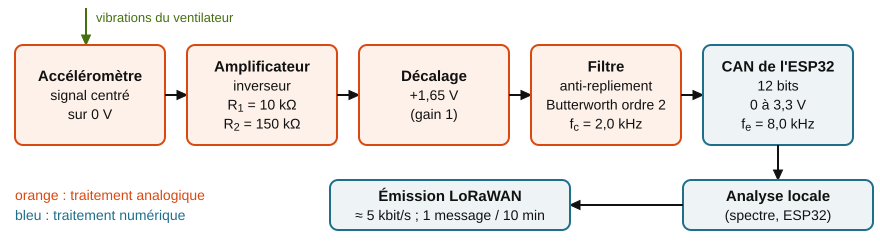

<em>Figure TD 35 : Chaîne d'acquisition et de transmission du document 1.</em>

*Document 2 : spectre mesuré en sortie de l'accéléromètre (ventilateur à 3600 tr/min).*

| Fréquence | 60 Hz | 120 Hz | 180 Hz | 1,2 kHz | 50 kHz |
|---|---|---|---|---|---|
| Amplitude | 30 mV | 12 mV | 6 mV | 8 mV | 20 mV |
| Origine | rotation | harmonique 2 | harmonique 3 | défaut de roulement | alimentation à découpage |

*Document 3 : liaison LoRaWAN.* Débit utile maximal : environ 5 kbit/s ; un message toutes les 10 minutes.

**Partie A : analyse du signal**

1) Montrer que la raie à 60 Hz correspond à la fréquence de rotation du ventilateur.
2) Calculer la valeur efficace du signal vibratoire (raies de 60 Hz à 1,2 kHz, sans le parasite).
3) Calculer le taux de distorsion de la vibration de rotation (harmoniques 2 et 3 rapportés au fondamental).

**Partie B : amplification**

4) Calculer l'amplification et le gain en dB de l'amplificateur, ainsi que sa résistance d'entrée.
5) Dans le pire cas, toutes les raies utiles s'additionnent en phase. Calculer l'amplitude maximale après amplification, puis la plage de tension après décalage. Est-elle compatible avec la plage du CAN ?

**Partie C : filtrage et échantillonnage**

6) Quelle est la fréquence maximale que l'on peut numériser sans repliement à $f_e = 8{,}0\ \text{kHz}$ ? Le défaut de roulement est-il observable ?
7) Sans filtre, le parasite à 50 kHz se replierait. À quelle fréquence apparaîtrait-il ? Pourquoi serait-ce grave pour le diagnostic ?
8) Calculer l'atténuation du filtre à 50 kHz, puis l'amplitude du parasite à l'entrée du CAN. Comparer au quantum. Vérifier que le filtre n'atténue presque pas la raie à 1,2 kHz.

**Partie D : numérisation et transmission**

9) Calculer le quantum du CAN et la plus petite amplitude de vibration détectable en sortie de l'accéléromètre.
10) Calculer le débit brut produit par le CAN. Peut-on transmettre le signal brut par LoRaWAN ? Proposer une solution.

**Exercice 5.18 ★★★ : Chaîne audio d'un interphone IP (type BTS)**

*Compétence visée : dimensionner une chaîne complète d'acquisition et de transmission de la voix (amplification, anti-repliement, quantification, débit réseau) (sous-parties 5.1, 5.4, 5.5 et 5.6).*

*Contexte :* un interphone IP, à l'entrée d'un datacenter, numérise la voix du visiteur et la transmet en VoIP au poste de sécurité. Le technicien vérifie chaque bloc de la chaîne.

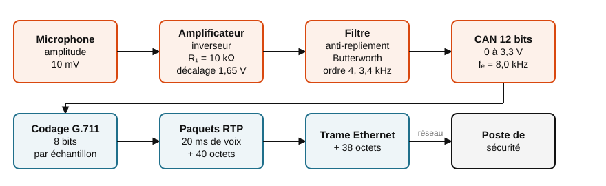

<em>Figure TD 51 : Chaîne d'acquisition et de transmission de l'interphone IP.</em>

*Document 1 : chaîne d'acquisition.* Microphone : amplitude maximale 10 mV. Amplificateur inverseur ($R_1 = 10\ \text{k}\Omega$) suivi d'un décalage de +1,65 V. Filtre anti-repliement de Butterworth d'ordre 4, $f_c = 3{,}4\ \text{kHz}$, de module $T = \dfrac{1}{\sqrt{1 + (f/f_c)^{8}}}$. CAN 12 bits (0 à 3,3 V), $f_e = 8{,}0\ \text{kHz}$.

*Document 2 : transmission.* Codage G.711 : chaque échantillon est ramené à 8 bits. Les échantillons sont groupés en paquets de 20 ms ; chaque paquet reçoit 40 octets d'en-têtes (IP, UDP, RTP), puis 38 octets supplémentaires pour la trame Ethernet (en-tête, contrôle, préambule et intervalle entre trames).

**Partie A : amplification**

1) On veut une amplitude de 1,5 V en sortie de l'amplificateur. Calculer l'amplification nécessaire (en valeur absolue), le gain en dB et la valeur de $R_2$. Est-ce une valeur normalisée de la série E12 ?
2) Après décalage, entre quelles tensions varie le signal ? Est-il compatible avec le CAN ?

**Partie B : échantillonnage et filtrage**

3) La condition de Shannon est-elle respectée pour la voix ? Une composante parasite à 5,0 kHz, non filtrée, apparaîtrait à quelle fréquence après échantillonnage ? Pourquoi est-ce gênant ?
4) Calculer le gain du filtre à 300 Hz, à 3,4 kHz et à 4,6 kHz. Les composantes au-delà de $f_e - f_{max} = 4{,}6\ \text{kHz}$ se replient dans la bande de la voix : le filtre les atténue-t-il suffisamment ?
5) On échantillonne à 32 kHz, puis on filtre numériquement avant de revenir à 8 kHz. Calculer la nouvelle fréquence $f_e - f_{max}$ et le gain du même filtre analogique à cette fréquence. Conclure.

**Partie C : quantification et réseau**

6) Calculer le SNR de quantification du CAN 12 bits, puis celui d'un codage sur 8 bits. Le codage G.711 dégrade-t-il fortement la qualité ?
7) Calculer le débit de la voix codée en G.711, puis la taille d'un paquet (voix et en-têtes) et le débit réellement occupé sur le réseau Ethernet, pour un sens de communication.
8) Le poste de sécurité gère 10 appels simultanés : quel débit total, dans chaque sens ? Avec un codec G.729 (8 kbit/s, soit 20 octets de voix par paquet de 20 ms), calculer le débit sur le réseau et le rapport entre ce débit et le débit de la voix. Commenter.

**Exercice 5.19 ★★★ : Mesure du courant d'une baie par une PDU intelligente (type BTS)** `BTS2`

*Compétence visée : dimensionner le conditionnement d'un capteur, choisir fréquence d'échantillonnage et filtre anti-repliement, puis exploiter des échantillons (sous-parties 5.1, 5.2, 5.5 et 5.6).*

*Contexte :* une PDU (bandeau de prises intelligent) mesure le courant de chaque baie pour suivre sa consommation et détecter les surcharges. Le technicien vérifie la conception de la chaîne de mesure.

*Document 1 : chaîne de mesure.* Transformateur de courant de rapport 1000:1 (courant au secondaire $i_s = i/1000$) ; résistance de charge $R_b$ qui convertit $i_s$ en tension ; décalage de +1,65 V ; filtre anti-repliement RC ; CAN 12 bits (0 à 3,3 V), $f_e = 3{,}2\ \text{kHz}$. L'ESP32 calcule la valeur efficace $I_{eff} = \sqrt{\langle i^2 \rangle}$ sur les échantillons d'une période de 20 ms.

*Document 2 : cahier des charges.* Courant efficace maximal de la ligne : 32 A. Les alimentations sans PFC donnent des courants de facteur de crête $\dfrac{I_{crête}}{I_{eff}}$ allant jusqu'à 2,5. Les harmoniques doivent être mesurés jusqu'au rang 15.

**Partie A : conditionnement**

1) Pour un courant sinusoïdal de 32 A efficaces, calculer le courant crête au primaire, au secondaire, puis la tension crête aux bornes de $R_b = 100\ \Omega$. Ce choix convient-il, sachant que la tension ne doit pas s'écarter de plus de 1,65 V du décalage ?
2) Tenir compte du facteur de crête de 2,5 : calculer la valeur maximale de $R_b$, puis choisir la valeur E12 immédiatement inférieure (…, 15, 18, 22, …). Calculer la résolution de la mesure en courant au primaire (courant correspondant à un quantum).

**Partie B : échantillonnage et filtrage**

3) Combien d'échantillons l'ESP32 prend-il par période du réseau ? La condition de Shannon est-elle respectée pour l'harmonique de rang 15 ?
4) Une alimentation à découpage produit une composante parasite à 3150 Hz. À quelle fréquence apparaît-elle après échantillonnage ? Pourquoi est-ce particulièrement gênant ici ?
5) Le filtre RC a une fréquence de coupure de 1,0 kHz. Calculer son gain à 750 Hz (rang 15) et à 3150 Hz. Conclure. On propose $f_e = 12{,}8\ \text{kHz}$ et un filtre RC à 3,0 kHz : calculer le gain à 750 Hz et à la fréquence $f_e - 50\ \text{Hz}$. Est-ce mieux ? Suffisant ?

**Partie C : exploitation**

6) Sur une période, la somme des carrés des 64 échantillons (convertis en ampères) vaut 37 990 A². Calculer le courant efficace. Avec un facteur de puissance de 0,95 sous 230 V, calculer la puissance active de la baie, l'énergie consommée en 30 jours et son coût à 0,15 €/kWh.
7) Calculer la puissance dissipée dans la résistance $R_b$ choisie, pour 32 A efficaces. Commenter.

### Défi du chapitre `BTS2`

**Exercice 5.20 ★★★★ : D'où vient « 6 dB par bit » ? Démonstration et suréchantillonnage (défi)**

*Compétence visée : démontrer la formule du SNR de quantification, définir un nombre de bits effectif et optimiser une acquisition par suréchantillonnage (sous-partie 5.6, avec réinvestissement du chapitre 2).*

Un CAN de $N$ bits et de quantum $q$ arrondit chaque tension au niveau le plus proche : l'erreur de quantification $\epsilon$ est comprise entre $-q/2$ et $+q/2$, et toutes les valeurs de cet intervalle sont également probables.

1) Montrer que la valeur efficace de l'erreur de quantification vaut $\dfrac{q}{\sqrt{12}}$.
*Coup de pouce : la puissance du bruit est la moyenne de $\epsilon^2$ sur l'intervalle, $\dfrac{1}{q}\displaystyle\int_{-q/2}^{q/2} \epsilon^2\,d\epsilon$. On peut aussi relier ce résultat à l'incertitude-type de résolution $\delta/\sqrt{12}$ du chapitre 2.*
2) Un signal sinusoïdal utilise toute la plage du CAN : son amplitude crête à crête vaut $2^N q$. Exprimer sa puissance (valeur efficace au carré).
3) Montrer que $SNR_{(dB)} = 10\log_{10}\!\left(1{,}5 \times 2^{2N}\right) \approx 1{,}76 + 6{,}02\,N$. Comparer à la formule du cours et calculer le SNR d'un CAN 12 bits.
*Coup de pouce : $\log_{10}(2^{2N}) = 2N\log_{10}(2)$.*
4) Le CAN de l'ESP32 est annoncé sur 12 bits, mais on mesure un SNR de 62 dB (bruit électronique et non-linéarités compris). Calculer son nombre de bits effectif $ENOB = \dfrac{SNR - 1{,}76}{6{,}02}$.
5) Suréchantillonnage : on échantillonne à $f_e = OSR \times 2B$ (OSR : facteur de suréchantillonnage, $B$ : bande utile), le bruit de quantification se répartit uniformément entre 0 et $f_e/2$, puis un filtre numérique ne garde que la bande $[0\ ;\ B]$. Montrer que le SNR gagne $10\log_{10}(OSR)$ dB. Combien de bits effectifs gagne-t-on pour $OSR = 4$ ? Pour $OSR = 16$ ?
6) Un capteur de température lent est lu par cet ESP32, dont l'ENOB est en réalité de 9,5 bits. Quel facteur de suréchantillonnage faut-il pour obtenir 12 bits effectifs ? Faire le lien avec le moyennage de $N$ mesures (le bruit est divisé par $\sqrt{N}$). Pourquoi cette méthode échoue-t-elle si la tension d'entrée est parfaitement stable et non bruitée ?

### Corrigés du chapitre 5 `BTS1` `BTS2`

**Exercice 5.1.**
1) $T = \dfrac{1}{25 \times 10^3} = 40\ \mu\text{s}$ ; état haut : $\alpha T = 0{,}30 \times 40 = 12\ \mu\text{s}$.
2) $U_{moy} = \dfrac{5{,}0 \times 12}{40} = 0{,}30 \times 5{,}0 = 1{,}5\ \text{V}$.
3) $U_{eff} = 5{,}0 \times \sqrt{0{,}30} \approx 2{,}7\ \text{V}$.
4) DC : 1,5 V. AC : $\sqrt{2{,}74^2 - 1{,}5^2} \approx 2{,}3\ \text{V}$.
5) a) Analogique (continu en temps et en valeur). b) Numérique (prélevé à intervalles réguliers et codé sur un nombre fini de niveaux). c) Quantifié : continu en temps mais limité à deux niveaux (0 et 5 V).

**Exercice 5.2.**
1) $U_{moy} = 2{,}0\ \text{V}$ ; amplitude $A = 3{,}0\ \text{V}$ ; $f = 1000\ \text{Hz}$.
2) $U_{eff} = \sqrt{2{,}0^2 + \dfrac{3{,}0^2}{2}} = \sqrt{4{,}0 + 4{,}5} \approx 2{,}9\ \text{V}$.
3) DC : 2,0 V. AC : $\dfrac{3{,}0}{\sqrt{2}} \approx 2{,}1\ \text{V}$.
4) $P = \dfrac{U_{eff}^2}{R} = \dfrac{8{,}5}{50} = 0{,}17\ \text{W}$.
5) Horloge : $U_{moy} = 0{,}5 \times 3{,}3 = 1{,}65\ \text{V}$ ; $U_{eff} = 3{,}3 \times \sqrt{0{,}5} = \dfrac{3{,}3}{\sqrt{2}} \approx 2{,}3\ \text{V}$.

**Exercice 5.3.**
*Méthode :* la valeur moyenne d'un courant est l'aire sous la courbe (une charge, en mA·s) divisée par la période ; l'autonomie est la capacité utilisable divisée par le courant moyen.
1) $600 - 2{,}0 - 1{,}2 = 596{,}8\ \text{s}$.
2) Mesure : $15 \times 2{,}0 = 30\ \text{mA·s}$ ; émission : $45 \times 1{,}2 = 54\ \text{mA·s}$ ; veille : $0{,}008 \times 596{,}8 \approx 4{,}8\ \text{mA·s}$. Total : $\approx 88{,}8\ \text{mA·s}$. $I_{moy} = \dfrac{88{,}8}{600} \approx 0{,}148\ \text{mA} = 148\ \mu\text{A}$.
3) Émission : 61 % ; mesure : 34 % ; veille : 5 %. L'émission radio est le premier poste : c'est sa durée (facteur d'étalement, taille des messages) qu'il faut réduire en priorité.
4) $\dfrac{0{,}80 \times 2600}{0{,}148} \approx 14\,100\ \text{h}$, soit environ 1,6 an.
5) $E = U \times Q = 3{,}6 \times 88{,}8 \times 10^{-3} \approx 0{,}32\ \text{J}$.
6) Veille : $116{,}8\ \text{s}$, soit $0{,}93\ \text{mA·s}$ ; total $\approx 84{,}9\ \text{mA·s}$ ; $I_{moy} = \dfrac{84{,}9}{120} \approx 0{,}71\ \text{mA}$ ; autonomie $\dfrac{2080}{0{,}708} \approx 2900\ \text{h}$, environ 4 mois : cinq fois plus de mesures divisent presque par cinq l'autonomie.
7) Émission : $45 \times 0{,}06 = 2{,}7\ \text{mA·s}$ ; veille : $0{,}008 \times 597{,}94 \approx 4{,}8\ \text{mA·s}$ ; total $\approx 37{,}5\ \text{mA·s}$ ; $I_{moy} \approx 62{,}5\ \mu\text{A}$ ; autonomie $\dfrac{2080}{0{,}0625} \approx 33\,300\ \text{h}$, environ 3,8 ans.

*Erreurs fréquentes :* faire la moyenne des trois courants sans tenir compte des durées ; oublier de convertir les µA en mA ; confondre capacité (mAh) et énergie (Wh).

**Exercice 5.4.**
1) Raies : 0 Hz (1,5 V), 1 kHz (4,0 V), 3 kHz (0,8 V), 5 kHz (0,3 V). Le spectre comporte quatre bâtons verticaux de hauteur égale à ces amplitudes.
2) $U_{eff} = \sqrt{1{,}5^2 + \dfrac{4{,}0^2 + 0{,}8^2 + 0{,}3^2}{2}} = \sqrt{2{,}25 + 8{,}365} \approx 3{,}3\ \text{V}$.
3) $THD = \dfrac{\sqrt{0{,}8^2 + 0{,}3^2}}{4{,}0} = \dfrac{0{,}854}{4{,}0} \approx 0{,}21$, soit 21 % : très au-dessus de 1 %, l'amplificateur distord fortement (saturation probable).

**Exercice 5.5.**
1) $U_{moy} = 1{,}65\ \text{V}$. $A_1 = \dfrac{4 \times 1{,}65}{\pi} \approx 2{,}10\ \text{V}$ ; $A_3 \approx 0{,}70\ \text{V}$ ; $A_5 \approx 0{,}42\ \text{V}$ ; $A_7 \approx 0{,}30\ \text{V}$.
2) $U_{eff} \approx \sqrt{1{,}65^2 + \dfrac{2{,}10^2 + 0{,}70^2 + 0{,}42^2 + 0{,}30^2}{2}} \approx 2{,}30\ \text{V}$, contre $\dfrac{3{,}3}{\sqrt{2}} \approx 2{,}33\ \text{V}$ : les quatre premières raies portent déjà près de 99 % de la valeur efficace.
3) $THD = \dfrac{\sqrt{0{,}70^2 + 0{,}42^2 + 0{,}30^2}}{2{,}10} \approx 0{,}41$, soit 41 % : un carré est très loin d'une sinusoïde.
4) Jusqu'à l'harmonique 5 : 5,0 MHz de bande passante. Avec 1,5 MHz, seul le fondamental passe : le signal reçu ressemble à une sinusoïde de 1 MHz (fronts très arrondis) autour de 1,65 V.
5) Les harmoniques d'une horloge s'étendent loin en fréquence avec une amplitude non négligeable ; elles sont rayonnées par les pistes et les câbles et peuvent tomber dans une bande radio utilisée (Wi-Fi, GPS, LoRa). D'où les règles de CEM : pistes courtes, plans de masse, blindages, ferrites.

**Exercice 5.6.**
1) 50 Hz (2,4 A), 150 Hz (1,9 A), 250 Hz (1,3 A), 350 Hz (0,7 A) : uniquement des harmoniques impairs.
2) $I_{eff} = \sqrt{\dfrac{2{,}4^2 + 1{,}9^2 + 1{,}3^2 + 0{,}7^2}{2}} = \sqrt{\dfrac{11{,}55}{2}} \approx 2{,}40\ \text{A}$ ; $I_{1,eff} = \dfrac{2{,}4}{\sqrt{2}} \approx 1{,}70\ \text{A}$.
3) $THD = \dfrac{\sqrt{1{,}9^2 + 1{,}3^2 + 0{,}7^2}}{2{,}4} = \dfrac{2{,}41}{2{,}4} \approx 1{,}0$, soit 100 % : les harmoniques ont autant de « poids » que le fondamental. Le courant est formé de pointes, absorbées seulement au sommet de la tension par le condensateur de filtrage.
4) $P = 230 \times 1{,}70 \approx 390\ \text{W}$ ; $S = 230 \times 2{,}40 \approx 553\ \text{VA}$ ; $FP = \dfrac{390}{553} \approx 0{,}71$.
5) $I_{eff} = 1{,}70\ \text{A}$, soit $1 - \dfrac{1{,}70}{2{,}40} \approx 29\ \%$ de moins pour la même puissance utile : câbles, disjoncteurs et onduleurs peuvent être moins surdimensionnés, et les pertes par effet Joule (en $R I^2$) baissent d'environ 50 %.
6) Amplitude : $3 \times 1{,}9 = 5{,}7\ \text{A}$ ; valeur efficace : $\dfrac{5{,}7}{\sqrt{2}} \approx 4{,}0\ \text{A}$, plus que le courant efficace de chaque phase (2,4 A). Un neutre dimensionné « léger » et non protégé par un disjoncteur peut surchauffer.

*Erreurs fréquentes :* additionner les amplitudes pour obtenir la valeur efficace ; calculer la puissance active avec le courant efficace total ; oublier que les harmoniques ne transportent pas de puissance active ici mais chauffent quand même les câbles.

**Exercice 5.7.**
1) $T = 0{,}5$ : $G \approx -6{,}0\ \text{dB}$ ; $T = 10$ : $G = 20\ \text{dB}$ ; $T = 0{,}1$ : $G = -20\ \text{dB}$.
2) $T = 10^{G/20}$ : $10^{-3/20} \approx 0{,}71$ ; $10^{26/20} \approx 20$.
3) $G = -10\log_{10}\!\left(1 + (f/f_c)^2\right)$ et $\varphi = -\arctan(f/f_c)$ : 1,0 kHz → −3,0 dB, −45° ; 10 kHz → −20 dB, −84° ; 100 kHz → −40 dB, −89°. Asymptote haute fréquence : −20 dB par décade.

**Exercice 5.8.**
1) $\underline{T} = \dfrac{\underline{Z}_C}{\underline{Z}_R + \underline{Z}_C} = \dfrac{1/(jC\omega)}{R + 1/(jC\omega)} = \dfrac{1}{1 + jRC\omega}$. $f_c = \dfrac{1}{2\pi \times 3{,}3 \times 10^3 \times 10 \times 10^{-9}} \approx 4{,}8\ \text{kHz}$.
2) 500 Hz : $G \approx -0{,}05\ \text{dB}$, $\varphi \approx -6°$ ; $f_c$ : $G \approx -3{,}0\ \text{dB}$, $\varphi = -45°$ ; $10 f_c$ : $G \approx -20\ \text{dB}$, $\varphi \approx -84°$. Diagramme : asymptote horizontale à 0 dB jusqu'à $f_c$, puis droite de pente −20 dB/décade ; la phase passe de 0° à −90°, avec −45° à $f_c$.
3) $\underline{T} = \dfrac{R}{R + 1/(jC\omega)} = \dfrac{jRC\omega}{1 + jRC\omega}$ : filtre passe-haut de même $f_c$. À 500 Hz : $x = f/f_c \approx 0{,}104$, $T = \dfrac{x}{\sqrt{1 + x^2}} \approx 0{,}103$, $G \approx -20\ \text{dB}$.
4) $G_{MAX} = 20\log_{10}\!\left[\dfrac{1}{2 \times 0{,}3 \times \sqrt{0{,}91}}\right] \approx 4{,}8\ \text{dB}$ ; $f_R = 10 \times \sqrt{1 - 0{,}18} \approx 9{,}1\ \text{kHz}$. Oui : un bruit proche de 9 kHz serait amplifié d'environ 1,7 fois au lieu d'être atténué. On choisit plutôt $m \approx 0{,}7$ (pas de résonance).

**Exercice 5.9.**
1) $f_{c1} = \dfrac{1}{2\pi \times 10 \times 10^3 \times 47 \times 10^{-9}} \approx 339\ \text{Hz}$ ; $f_{c2} = \dfrac{1}{2\pi \times 4{,}7 \times 10^3 \times 10 \times 10^{-9}} \approx 3{,}39\ \text{kHz}$.
2) Le suiveur a une résistance d'entrée très grande et une résistance de sortie très faible : le second filtre ne « charge » pas le premier, et chaque filtre garde sa propre transmittance. Les transmittances en cascade se multiplient (et les gains en dB s'additionnent).
3) Asymptotes : pente +20 dB/décade jusqu'à 339 Hz ; 0 dB entre 339 Hz et 3,39 kHz ; pente −20 dB/décade au-delà.
4) $|\underline{T}| = \dfrac{f/f_{c1}}{\sqrt{1 + (f/f_{c1})^2}} \times \dfrac{1}{\sqrt{1 + (f/f_{c2})^2}}$ :

| $f$ | 50 Hz | 300 Hz | 1 kHz | 3,4 kHz | 10 kHz |
|---|---|---|---|---|---|
| $\lvert\underline{T}\rvert$ | 0,146 | 0,661 | 0,908 | 0,702 | 0,321 |
| $G$ (dB) | −16,7 | −3,6 | −0,8 | −3,1 | −9,9 |

À 1 kHz, on n'est qu'à une demi-décade de chaque coupure : les deux filtres atténuent déjà un peu. Les asymptotes ne sont qu'une approximation.
5) $\varphi = \arctan\!\left(\dfrac{f_{c1}}{f}\right) - \arctan\!\left(\dfrac{f}{f_{c2}}\right) = 18{,}7° - 16{,}4° \approx +2°$ : déphasage presque nul au centre de la bande.
6) $200 \times 0{,}146 \approx 29\ \text{mV}$. Pour mieux l'éliminer : passe-haut d'ordre 2 (pente de 40 dB/décade), ou filtre réjecteur centré sur 50 Hz.

*Erreurs fréquentes :* additionner les transmittances ; oublier le suiveur et calculer les deux filtres comme s'ils étaient indépendants ; lire le gain réel sur les asymptotes.

**Exercice 5.10.**
1) $A_V = -\dfrac{47}{10} = -4{,}7$ ; $G = 20\log_{10}(4{,}7) \approx 13{,}4\ \text{dB}$.
2) Amplitude $4{,}7 \times 0{,}20 = 0{,}94\ \text{V}$, en opposition de phase avec l'entrée (signe −).
3) $R_e = R_1 = 10\ \text{k}\Omega$.
4) $\dfrac{4{,}5}{4{,}7} \approx 0{,}96\ \text{V}$.

**Exercice 5.11.**
1) $|A| = \dfrac{1{,}0}{0{,}020} = 50$ ; $G = 20\log_{10}(50) \approx 34\ \text{dB}$.
2) Diviseur de tension : $v_e = 20 \times \dfrac{2{,}2}{2{,}2 + 2{,}2} = 10\ \text{mV}$. Sortie : $\dfrac{110}{2{,}2} \times 10\ \text{mV} = 50 \times 10\ \text{mV} = 0{,}50\ \text{V}$ : seulement la moitié de l'amplitude voulue.
3) La source et l'entrée de l'amplificateur forment un diviseur de tension : si $R_e$ n'est pas grande devant $R_g$, une partie du signal est perdue dans $R_g$ avant même d'être amplifiée.
4) $\dfrac{v_e}{e_g} = \dfrac{22}{22 + 2{,}2} \approx 0{,}909$ ; $\dfrac{R_2}{R_1} = \dfrac{1200}{22} \approx 54{,}5$ ; amplification globale $\approx 0{,}909 \times 54{,}5 \approx 49{,}6$. Amplitude de sortie : $49{,}6 \times 0{,}020 \approx 0{,}99\ \text{V}$ : cahier des charges respecté.
5) $\eta = \dfrac{P_S}{P_F + P_S} = \dfrac{2{,}0}{3{,}0 + 2{,}0} = 0{,}40$, soit 40 %.

**Exercice 5.12.**
1) $U = R\,I$ : $150 \times 4 \times 10^{-3} = 0{,}60\ \text{V}$ et $150 \times 20 \times 10^{-3} = 3{,}00\ \text{V}$, compris entre 0 et 3,3 V : compatible.
2) $\dfrac{20 - 4}{10} = 1{,}6\ \text{mA/bar}$, soit $150 \times 1{,}6 \times 10^{-3} = 0{,}24\ \text{V/bar}$. Pour 1,56 V : $I = \dfrac{1{,}56}{150} = 10{,}4\ \text{mA}$ et $p = \dfrac{10{,}4 - 4}{1{,}6} = 4{,}0\ \text{bar}$.
3) $q = \dfrac{3{,}3}{4095} \approx 0{,}81\ \text{mV}$ ; résolution : $\dfrac{0{,}806\ \text{mV}}{240\ \text{mV/bar}} \approx 3{,}4\ \text{mbar}$. Valeurs utilisées : $\dfrac{3{,}00 - 0{,}60}{0{,}000806} \approx 2980$ sur 4096.
4) $2 \times 300 \times 0{,}04 = 24\ \Omega$. À 20 mA : $24 - 24 \times 0{,}020 - 3{,}0 = 24 - 0{,}48 - 3{,}0 \approx 20{,}5\ \text{V}$ aux bornes du capteur, supérieur à 10 V. Résistance totale maximale : $\dfrac{24 - 10}{0{,}020} = 700\ \Omega$.
5) Dans une boucle en série, le courant est le même partout (loi des nœuds) : c'est le capteur qui l'impose, et la résistance du câble ne change que la tension disponible, pas le courant mesuré. Avec une sortie en tension, la chute de tension dans le câble fausserait la mesure. Le zéro à 4 mA permet d'alimenter le capteur par la boucle et de distinguer « 0 bar » (4 mA) d'un fil coupé (0 mA). Seuil de défaut : $150 \times 3{,}6 \times 10^{-3} = 0{,}54\ \text{V}$, soit $\dfrac{0{,}54}{0{,}000806} \approx 670$.

*Erreurs fréquentes :* compter 300 m de conducteur au lieu de 600 m ; oublier que 0 bar correspond à 4 mA et non à 0 mA ; diviser par $2^N$ au lieu de $2^N - 1$ (écart négligeable ici, mais à justifier).

**Exercice 5.13.**
1) $f_c = \dfrac{1}{2\pi \times 1000 \times 100 \times 10^{-9}} \approx 1592$ Hz $\approx 1{,}6$ kHz.
2) Le signal à 200 Hz est bien en dessous de $f_c$ : il passe presque sans atténuation. Le parasite à 50 kHz est très au-dessus de $f_c$ : il est fortement atténué par le filtre passe-bas.
3) $f_c \propto 1/C$, donc pour diviser $f_c$ par 10 il faut multiplier $C$ par 10 : $C = 1$ µF.

**Exercice 5.14.**
1) Il faut garder les basses fréquences et éliminer 20 kHz : filtre passe-bas. Atténuation : $20\log_{10}\!\left(\dfrac{5 \times 10^{-3}}{0{,}50}\right) = -40\ \text{dB}$ au moins.
2) $n = 1$ : à 20 kHz, $T = \dfrac{1}{\sqrt{1 + 20^2}} \approx 0{,}050$, $G \approx -26\ \text{dB}$ ; parasite résiduel $0{,}50 \times 0{,}050 \approx 25\ \text{mV}$ > 5 mV. À 500 Hz : $T = \dfrac{1}{\sqrt{1 + 0{,}25}} \approx 0{,}894$, $G \approx -0{,}97\ \text{dB}$ (limite). Gabarit non respecté.
3) $n = 2$ : à 20 kHz, $T = \dfrac{1}{\sqrt{1 + 20^4}} \approx 2{,}5 \times 10^{-3}$, $G \approx -52\ \text{dB}$ ; parasite résiduel $\approx 1{,}3\ \text{mV}$ < 5 mV. À 500 Hz : $T = \dfrac{1}{\sqrt{1 + 0{,}5^4}} \approx 0{,}970$, $G \approx -0{,}26\ \text{dB}$. Gabarit respecté.
4) Une cellule de Sallen-Key (AOP + deux résistances + deux condensateurs) réalise un passe-bas d'ordre 2. Un filtre de Chebyshev de même ordre couperait plus raidement après $f_c$, au prix d'une légère ondulation dans la bande passante.

**Exercice 5.15.**
1) $2^{12} = 4096$ niveaux ; $q = \dfrac{3{,}3}{4095} \approx 0{,}81\ \text{mV}$.
2) $N = \dfrac{1{,}50}{0{,}000806} \approx 1861$.
3) $SNR = 1{,}8 + 6 \times 12 = 73{,}8\ \text{dB}$.
4) Voix : $f_e > 8\ \text{kHz}$ ; musique : $f_e > 40\ \text{kHz}$. 8 kHz est tout juste à la limite pour la voix (on l'utilise en téléphonie, avec un filtre anti-repliement qui coupe vers 3,4 kHz) ; 44,1 kHz convient pour la musique.

**Exercice 5.16.**
1) 0 à 1,00 V.
2) $q = \dfrac{3{,}3}{1023} \approx 3{,}2\ \text{mV}$, soit $\dfrac{3{,}2}{10} \approx 0{,}32\ °\text{C}$.
3) $q = \dfrac{1{,}1}{1023} \approx 1{,}1\ \text{mV}$, soit $\approx 0{,}11\ °\text{C}$ : la plage du CAN est mieux adaptée à celle du signal (on utilise presque tous les niveaux). Température maximale : $\dfrac{1{,}1\ \text{V}}{10\ \text{mV/°C}} = 110\ °\text{C}$, suffisant.
4) $q \leq 1\ \text{mV} \Rightarrow 2^N - 1 \geq 3300 \Rightarrow N = 12$ ($2^{12} - 1 = 4095$ ; avec 11 bits, $2047 < 3300$).
5) La condition de Shannon ($f_e > 14\ \text{kHz}$) n'est pas respectée : la composante se replie à $10 - 7 = 3\ \text{kHz}$, une fréquence fantôme. Il faut $f_e > 2 f_{max}$ et un filtre anti-repliement passe-bas de fréquence de coupure inférieure à $f_e/2$ placé avant le CAN.

**Exercice 5.17.**

*Partie A.*
1) $3600\ \text{tr/min} = \dfrac{3600}{60} = 60\ \text{tr/s}$ : la fréquence de rotation est 60 Hz, c'est le fondamental de la vibration.
2) $U_{eff} = \sqrt{\dfrac{30^2 + 12^2 + 6^2 + 8^2}{2}} = \sqrt{572} \approx 24\ \text{mV}$ (pas de composante continue).
3) $THD = \dfrac{\sqrt{12^2 + 6^2}}{30} \approx 0{,}45$, soit 45 % : la vibration est loin d'être sinusoïdale (balourd, jeu mécanique).

*Partie B.*
4) $A_V = -\dfrac{150}{10} = -15$ ; $G = 20\log_{10}(15) \approx 23{,}5\ \text{dB}$ ; $R_e = R_1 = 10\ \text{k}\Omega$.
5) $(30 + 12 + 6 + 8) \times 15 = 56 \times 15 = 840\ \text{mV}$. Après décalage : de $1{,}65 - 0{,}84 = 0{,}81\ \text{V}$ à $1{,}65 + 0{,}84 = 2{,}49\ \text{V}$, compris dans 0 à 3,3 V : compatible, sans écrêtage.

*Partie C.*
6) $f_{max} < \dfrac{f_e}{2} = 4{,}0\ \text{kHz}$ : la raie à 1,2 kHz est observable.
7) $50 = 6 \times 8 + 2$ : le parasite apparaîtrait à 2,0 kHz, dans la bande analysée. Il serait confondu avec une vibration réelle et pourrait déclencher une fausse alerte de défaut.
8) À 50 kHz : $T = \dfrac{1}{\sqrt{1 + 25^4}} \approx 1{,}6 \times 10^{-3}$, soit $\approx -56\ \text{dB}$. Amplitude à l'entrée du CAN : $20 \times 15 \times 1{,}6 \times 10^{-3} \approx 0{,}48\ \text{mV}$, inférieure au quantum (0,81 mV) : le parasite est invisible. À 1,2 kHz : $T = \dfrac{1}{\sqrt{1 + 0{,}6^4}} \approx 0{,}94$ ($\approx -0{,}5\ \text{dB}$) : la raie de défaut est presque intacte.

*Partie D.*
9) $q = \dfrac{3{,}3}{4095} \approx 0{,}81\ \text{mV}$ en entrée du CAN, soit $\dfrac{0{,}81}{15} \approx 54\ \mu\text{V}$ en sortie de l'accéléromètre.
10) $D = 8000 \times 12 = 96\ \text{kbit/s}$, environ 20 fois plus que les 5 kbit/s de LoRaWAN (et LoRaWAN n'autorise qu'un message toutes les 10 minutes) : impossible. L'ESP32 calcule localement le spectre et n'envoie que les amplitudes des raies surveillées (quelques octets par message), ou seulement une alerte en cas de dépassement de seuil.

**Exercice 5.18.**

*Partie A.*
1) $|A| = \dfrac{1{,}5}{0{,}010} = 150$ ; $G = 20\log_{10}(150) \approx 43{,}5\ \text{dB}$ ; $R_2 = 150 \times 10\ \text{k}\Omega = 1{,}5\ \text{M}\Omega$, valeur de la série E12.
2) De $1{,}65 - 1{,}5 = 0{,}15\ \text{V}$ à $1{,}65 + 1{,}5 = 3{,}15\ \text{V}$ : dans la plage 0 à 3,3 V, sans écrêtage.

*Partie B.*
3) $f_e = 8{,}0\ \text{kHz} > 2 \times 3{,}4\ \text{kHz}$ : oui. La composante à 5,0 kHz apparaîtrait à $8{,}0 - 5{,}0 = 3{,}0\ \text{kHz}$, en pleine bande vocale : un sifflement que l'on ne pourrait plus retirer après échantillonnage.
4) 300 Hz : $\approx 0\ \text{dB}$ ; 3,4 kHz : $-3{,}0\ \text{dB}$ ; 4,6 kHz : $T = \dfrac{1}{\sqrt{1 + (4{,}6/3{,}4)^8}} \approx 0{,}29$, soit $\approx -10{,}9\ \text{dB}$. Une composante repliée ne serait atténuée que d'environ 11 dB, très loin des 74 dB du SNR du CAN : le filtre ne suffit pas, la bande de transition (de 3,4 à 4,6 kHz) est trop étroite.
5) $f_e - f_{max} = 32 - 3{,}4 = 28{,}6\ \text{kHz}$ ; $T \approx \dfrac{1}{(28{,}6/3{,}4)^4}$, soit $\approx -74\ \text{dB}$ : les composantes repliées passent sous le bruit de quantification. Le suréchantillonnage permet de garder un filtre analogique simple ; le filtrage raide est fait en numérique.

*Partie C.*
6) 12 bits : $1{,}8 + 6 \times 12 = 73{,}8\ \text{dB}$ ; 8 bits : $1{,}8 + 6 \times 8 = 49{,}8\ \text{dB}$, environ 50 dB : largement suffisant pour une voix téléphonique (le codage G.711 est de plus logarithmique : il garde une qualité constante pour les sons faibles).
7) $8000 \times 8 = 64\ \text{kbit/s}$. Paquet de 20 ms : $64\,000 \times 0{,}020 / 8 = 160$ octets de voix, $+ 40 + 38 = 238$ octets sur Ethernet ; 50 paquets par seconde : $238 \times 8 \times 50 \approx 95{,}2\ \text{kbit/s}$ par sens.
8) $10 \times 95{,}2 \approx 952\ \text{kbit/s}$ par sens, soit environ 1 Mbit/s. G.729 : $20 + 40 + 38 = 98$ octets, soit $98 \times 8 \times 50 = 39{,}2\ \text{kbit/s}$, environ 4,9 fois le débit de la voix (8 kbit/s) : avec un codec très compressé, les en-têtes deviennent l'essentiel du trafic. On pourrait regrouper 40 ms de voix par paquet, au prix d'un retard plus grand.

*Erreurs fréquentes :* oublier les en-têtes dans le débit réseau ; confondre bits et octets ; appliquer la condition de Shannon à $f_c$ au lieu de la fréquence maximale du signal à numériser.

**Exercice 5.19.**

*Partie A.*
1) $I_{crête} = 32 \times \sqrt{2} \approx 45{,}3\ \text{A}$ ; au secondaire : $45{,}3\ \text{mA}$ ; $U = 100 \times 0{,}0453 \approx 4{,}5\ \text{V} > 1{,}65\ \text{V}$ : le signal serait écrêté, $R_b = 100\ \Omega$ est trop grande.
2) $I_{crête} = 2{,}5 \times 32 = 80\ \text{A}$, soit 80 mA au secondaire : $R_b \leq \dfrac{1{,}65}{0{,}080} \approx 20{,}6\ \Omega$, d'où $R_b = 18\ \Omega$. Résolution : $\dfrac{q}{R_b} = \dfrac{0{,}806 \times 10^{-3}}{18} \approx 45\ \mu\text{A}$ au secondaire, soit environ 45 mA au primaire.

*Partie B.*
3) $\dfrac{3200}{50} = 64$ échantillons par période. Rang 15 : 750 Hz $< \dfrac{3200}{2} = 1600\ \text{Hz}$ : condition respectée.
4) $3200 - 3150 = 50\ \text{Hz}$ : la composante parasite tombe exactement sur le fondamental, qu'elle fausse sans que rien ne le signale à l'écran.
5) $T(750) = \dfrac{1}{\sqrt{1 + 0{,}75^2}} = 0{,}80$ ($-1{,}9$ dB) et $T(3150) = \dfrac{1}{\sqrt{1 + 3{,}15^2}} \approx 0{,}30$ ($-10{,}4$ dB) : le filtre fausse de 20 % l'harmonique 15 tout en laissant passer 30 % du parasite. Avec $f_e = 12{,}8\ \text{kHz}$ et $f_c = 3{,}0\ \text{kHz}$ : $T(750) \approx 0{,}97$ ($-0{,}26$ dB) et $T(12\,750) \approx 0{,}23$ ($-12{,}8$ dB). Les harmoniques sont mieux mesurés et les parasites gênants sont repoussés vers 12,8 kHz, mais un premier ordre atténue encore peu : on choisit un filtre d'ordre 2 et on complète par un filtrage numérique.

*Partie C.*
6) $I_{eff} = \sqrt{\dfrac{37\,990}{64}} \approx 24{,}4\ \text{A}$ ; $P = 230 \times 24{,}4 \times 0{,}95 \approx 5{,}3\ \text{kW}$ ; $E = 5{,}32 \times 720 \approx 3{,}8 \times 10^3\ \text{kWh}$ ; coût $\approx 575\ \text{€}$.
7) $I_{s,eff} = 32\ \text{mA}$ ; $P = 18 \times 0{,}032^2 \approx 18\ \text{mW}$ : négligeable, une résistance 1/4 W convient.

*Erreurs fréquentes :* dimensionner $R_b$ avec la valeur efficace au lieu de la valeur crête ; oublier le rapport 1000 du transformateur ; croire qu'un filtre anti-repliement placé à $f_e/2$ suffit sans regarder son atténuation réelle.

**Exercice 5.20.**
1) $\langle \epsilon^2 \rangle = \dfrac{1}{q}\left[\dfrac{\epsilon^3}{3}\right]_{-q/2}^{q/2} = \dfrac{1}{q} \times \dfrac{2}{3} \times \dfrac{q^3}{8} = \dfrac{q^2}{12}$, d'où une valeur efficace $\dfrac{q}{\sqrt{12}}$. C'est la même expression que l'incertitude-type de résolution d'un appareil numérique : dans les deux cas, l'erreur est uniformément répartie sur un pas.
2) Amplitude : $A = \dfrac{2^N q}{2}$ ; puissance : $\dfrac{A^2}{2} = \dfrac{2^{2N} q^2}{8}$.
3) $SNR = \dfrac{2^{2N} q^2/8}{q^2/12} = 1{,}5 \times 2^{2N}$ ; $10\log_{10}(1{,}5) \approx 1{,}76$ et $10\log_{10}(2^{2N}) = 20N\log_{10}(2) \approx 6{,}02\,N$. Le cours arrondit en $1{,}8 + 6N$. Pour 12 bits : $1{,}76 + 6{,}02 \times 12 \approx 74{,}0\ \text{dB}$.
4) $ENOB = \dfrac{62 - 1{,}76}{6{,}02} \approx 10{,}0$ bits : les 2 derniers bits sont « noyés » dans le bruit.
5) Dans la bande $[0\ ;\ B]$, il ne reste que la fraction $\dfrac{B}{f_e/2} = \dfrac{1}{OSR}$ de la puissance du bruit, alors que le signal est intact : le SNR est multiplié par $OSR$, soit $+10\log_{10}(OSR)$ dB. $OSR = 4$ : +6,0 dB, soit 1 bit ; $OSR = 16$ : +12,0 dB, soit 2 bits. Chaque bit supplémentaire coûte un facteur 4 sur la fréquence d'échantillonnage.
6) Il faut gagner 2,5 bits : $OSR = 4^{2{,}5} = 32$. C'est le moyennage de la fiche 2.E : moyenner 32 mesures divise le bruit par $\sqrt{32} \approx 5{,}7$, soit $+15$ dB. Si la tension d'entrée est parfaitement stable et sans bruit, le CAN renvoie toujours le même code : la moyenne de valeurs identiques n'apporte aucune information supplémentaire. Le gain suppose un peu de bruit (au moins de l'ordre du quantum), éventuellement ajouté volontairement.

*Erreurs fréquentes :* utiliser l'amplitude au lieu de la valeur efficace pour la puissance du signal ; croire que doubler le nombre de bits double le SNR ; oublier que le suréchantillonnage n'améliore rien sans filtrage numérique ou moyennage.

---

&nbsp;

## Chapitre 6 : Optique

*Les exercices sont regroupés en séries qui suivent les cinq sous-parties du cours ; dans chaque série, ils sont classés par difficulté croissante. La sous-partie 6.4 (dispersion, bande passante et atténuation) est traitée en deuxième année ; sa série se termine par deux sujets de type BTS : raccordement FTTH d'un abonné en GPON (exercice 6.11) et câblage de liens à 100 Gbit/s entre baies d'un datacenter (exercice 6.12). La série de synthèse propose un sujet de type BTS sur la mise en service d'une liaison fibre entre deux bâtiments (exercice 6.16). Le défi du chapitre (exercice 6.17, ★★★★) le termine.*

*Données pour tout le chapitre : $c_0 = 3{,}0 \times 10^8$ m/s ; $h = 6{,}63 \times 10^{-34}$ J·s ; $1$ eV $= 1{,}6 \times 10^{-19}$ J.*

### Série §6.1 : Indice de réfraction et propagation de la lumière `BTS1` `BTS2`

**Exercice 6.1 ★ : Vitesse de la lumière dans une fibre**

*Compétence visée : calculer une vitesse de propagation à partir de l'indice et en déduire un temps de propagation.*

1) Calculer la vitesse de la lumière dans l'eau ($n = 1{,}33$), dans un verre ($n = 1{,}50$) et dans le cœur d'une fibre en silice ($n = 1{,}468$).
2) Calculer la durée de propagation de la lumière dans 10 km de fibre. Comparer à la durée de propagation d'une onde radio dans l'air sur la même distance.
3) Un serveur parisien interroge un serveur situé à 800 km (longueur réelle du trajet en fibre). Calculer la durée minimale d'un aller-retour (« ping ») due à la seule propagation.

**Exercice 6.2 ★★ : Dispersion de la silice et liaisons à très faible latence**

*Compétence visée : exploiter la variation de l'indice avec la longueur d'onde et comparer des temps de propagation.*

L'indice de la silice dépend de la longueur d'onde : $n = 1{,}4525$ à 850 nm ; $n = 1{,}4469$ à 1310 nm ; $n = 1{,}4440$ à 1550 nm.

1) Calculer la vitesse de la lumière dans la silice pour ces trois longueurs d'onde. Laquelle va le plus vite ?
2) Calculer la durée de propagation sur 10 km pour chacune.
3) Deux impulsions, l'une à 850 nm et l'autre à 1550 nm, partent ensemble. Calculer leur écart d'arrivée après 10 km. Comment s'appelle ce phénomène ?
4) Des sociétés de courtage relient Londres et Francfort (640 km) par des faisceaux hertziens plutôt que par fibre. On prend $n = 1{,}468$ pour la fibre et $n = 1{,}00$ pour l'air. Calculer le gain de temps obtenu sur un aller simple.

### Série §6.2 : Réflexion, réfraction et réflexion totale `BTS1` `BTS2`

**Exercice 6.3 ★ : Loi de Snell-Descartes et angle limite**

*Compétence visée : appliquer la loi de Snell-Descartes et calculer un angle limite de réflexion totale.*

1) Un rayon passe de l'air ($n = 1{,}00$) dans un verre ($n = 1{,}50$) avec un angle d'incidence de 30°. Calculer l'angle de réfraction. Le rayon se rapproche-t-il ou s'éloigne-t-il de la normale ?

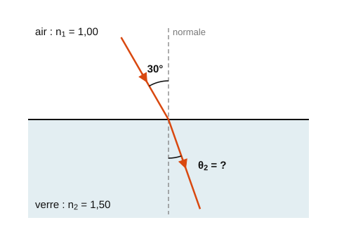

<em>Figure TD 36 : Rayon passant de l'air dans le verre (question 1).</em>

2) Un rayon passe du verre dans l'air avec un angle d'incidence de 30°. Calculer l'angle de réfraction.
3) Calculer l'angle limite de réflexion totale pour le passage verre → air.
4) Que se passe-t-il pour un rayon qui arrive du verre sur l'air avec un angle d'incidence de 50° ? Et pour un rayon qui va de l'air vers le verre avec 50° ?

**Exercice 6.4 ★★ : Détecteur de fuite sous un plancher technique**

*Compétence visée : utiliser la réflexion totale pour concevoir un capteur et en vérifier le fonctionnement selon le milieu extérieur.*

Sous le plancher technique d'une salle serveurs, des détecteurs de fuite optiques surveillent les canalisations d'eau glacée. Une LED envoie un faisceau dans un prisme en verre ($n = 1{,}50$) qui arrive sur la face en contact avec l'extérieur sous un angle d'incidence de 45° ; une photodiode reçoit le faisceau s'il est totalement réfléchi.

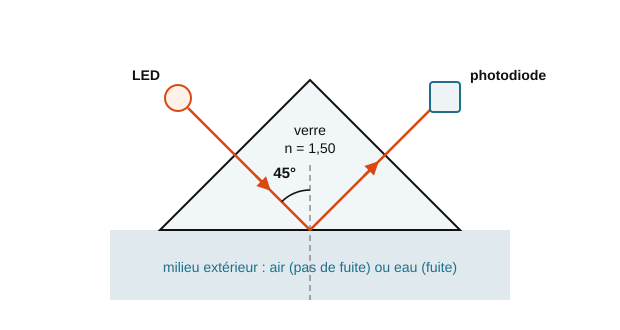

<em>Figure TD 37 : Principe du détecteur de fuite optique à prisme.</em>

1) Le prisme est dans l'air. Calculer l'angle limite et montrer qu'il y a réflexion totale. Que reçoit la photodiode ?
2) Une fuite noie le prisme dans l'eau ($n = 1{,}33$). Calculer le nouvel angle limite. Y a-t-il encore réflexion totale ? Calculer l'angle du rayon réfracté dans l'eau. Que reçoit la photodiode ?
3) Le fluide caloporteur est en réalité de l'eau glycolée ($n = 1{,}43$). Le détecteur fonctionne-t-il ?
4) Entre quelles valeurs doit être choisi l'angle d'incidence pour que le capteur distingue l'air de l'eau ?

**Exercice 6.5 ★★ : Pourquoi les connecteurs APC sont-ils polis en biais ?**

*Compétence visée : calculer une réflexion à l'interface entre deux milieux et utiliser la condition de guidage d'une fibre pour justifier une technologie de connecteur (sous-parties 6.1, 6.2 et 6.3).*

Lorsqu'un rayon arrive perpendiculairement sur l'interface entre deux milieux d'indices $n_1$ et $n_2$, la fraction de puissance réfléchie vaut $R = \left(\dfrac{n_1 - n_2}{n_1 + n_2}\right)^2$. On caractérise un connecteur optique par ses pertes de retour $RL = -10\log_{10}(R)$, en dB (plus elles sont grandes, moins le connecteur renvoie de lumière vers l'émetteur).

1) Calculer la fraction réfléchie à l'interface entre le cœur d'une fibre ($n = 1{,}468$) et l'air, puis les pertes de retour correspondantes.
2) Deux connecteurs mal enfoncés laissent une fine lame d'air entre les deux fibres : la lumière traverse deux interfaces silice/air. Calculer la fraction de puissance transmise et la perte d'insertion en dB.
3) Un connecteur UPC (fibres en contact, face bombée) garantit $RL \geq 50\ \text{dB}$. Quelle fraction de la puissance est alors réfléchie au plus ?
4) Dans un connecteur APC (vert), la face de la fibre est polie avec un angle de 8° par rapport à la perpendiculaire à l'axe. Montrer que la lumière réfléchie par cette face repart en faisant un angle de 16° avec l'axe de la fibre. Pour une fibre monomode OS2 ($n_1 = 1{,}4504$, $n_2 = 1{,}4447$), un rayon reste guidé si son angle $\theta_r$ avec l'axe vérifie $\cos\theta_r \geq \dfrac{n_2}{n_1}$. Calculer l'angle maximal de guidage et conclure.
5) Les réseaux FTTH et les transmissions vidéo utilisent des connecteurs APC. Pourquoi ne faut-il jamais raccorder un connecteur APC à un connecteur UPC (bleu) ?

### Série §6.3 : La fibre optique : structure et principe `BTS1` `BTS2`

**Exercice 6.6 ★ : Ouverture numérique d'une fibre multimode**

*Compétence visée : calculer l'ouverture numérique et l'angle d'acceptance d'une fibre, reconnaître un type de fibre.*

Une fibre multimode à saut d'indice a un cœur d'indice $n_1 = 1{,}48$ et une gaine d'indice $n_2 = 1{,}46$. On admet que son ouverture numérique vaut $ON = \sqrt{n_1^2 - n_2^2}$.

1) Calculer l'ouverture numérique et l'angle d'acceptance maximal $\theta_0$ ($ON = \sin\theta_0$). Quel est l'angle total du cône d'acceptance ?
2) Calculer l'angle limite de réflexion totale à l'interface cœur/gaine.
3) Les fibres d'un datacenter sont repérées par leurs diamètres de cœur et de gaine : 9/125 µm, 50/125 µm, 62,5/125 µm. Lesquelles sont multimodes ? Laquelle est monomode ?

**Exercice 6.7 ★★ : Démontrer l'expression de l'ouverture numérique**

*Compétence visée : enchaîner deux applications de la loi de Snell-Descartes pour établir une relation.*

Un rayon entre dans la fibre depuis l'air avec l'angle d'incidence $\theta_0$ ; il est réfracté dans le cœur avec l'angle $\theta_r$ par rapport à l'axe, puis arrive sur l'interface cœur/gaine avec l'angle d'incidence $i = 90° - \theta_r$.

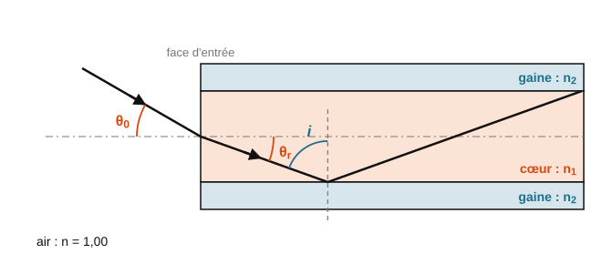

<em>Figure TD 38 : Angle d'entrée θ0, angle de réfraction θr et angle d'incidence i sur la gaine.</em>

1) Écrire la loi de Snell-Descartes à l'entrée de la fibre.
2) Écrire la condition de réflexion totale sur l'interface cœur/gaine. Montrer qu'elle s'écrit $\cos\theta_r \geq \dfrac{n_2}{n_1}$.
3) En utilisant $\sin^2\theta_r + \cos^2\theta_r = 1$, montrer que l'angle d'entrée maximal vérifie $\sin\theta_0 = \sqrt{n_1^2 - n_2^2}$.
4) Une fibre optique plastique (POF), utilisée pour les liaisons domotiques et automobiles, a $n_1 = 1{,}49$ et $n_2 = 1{,}41$. Calculer son ouverture numérique et son angle d'acceptance. Comparer à la fibre de l'exercice 6.6 : laquelle est la plus facile à coupler avec une LED ?

**Exercice 6.8 ★★ : Monomode à 1310 nm, mais pas à 850 nm**

*Compétence visée : utiliser la fréquence normalisée d'une fibre pour prévoir son caractère monomode ou multimode selon la longueur d'onde (sous-partie 6.3).*

Une fibre à saut d'indice de rayon de cœur $a$ et d'ouverture numérique $ON$ est caractérisée, à la longueur d'onde $\lambda$, par sa **fréquence normalisée** $V = \dfrac{2\pi a}{\lambda} \times ON$. Elle est monomode si $V < 2{,}405$ ; sinon, elle guide environ $\dfrac{V^2}{2}$ modes.

Fibre monomode G.652 (OS2) : diamètre de cœur 8,0 µm, $ON = 0{,}12$.

1) Calculer $V$ à 1310 nm, 1550 nm et 850 nm. Conclure pour chaque longueur d'onde.
2) Calculer la longueur d'onde de coupure $\lambda_c$, au-delà de laquelle la fibre est monomode.
3) Un technicien raccorde par erreur deux switches équipés de modules 10GBASE-SR (850 nm, prévus pour de la fibre multimode 50 µm) sur une liaison en OS2. Expliquer pourquoi la liaison risque de ne pas fonctionner (deux raisons).
4) Pour une ouverture numérique de 0,12, quel diamètre de cœur maximal permet un fonctionnement monomode à 1310 nm ?
5) Fibre multimode OM3 : diamètre de cœur 50 µm, $ON = 0{,}20$. Calculer $V$ à 850 nm et le nombre approximatif de modes guidés. Quel phénomène, étudié en 6.4, limite alors la bande passante ?

### Série §6.4 : Dispersion, bande passante et atténuation d'une fibre optique `BTS2`

**Exercice 6.9 ★ : Atténuation et bande passante**

*Compétence visée : calculer une atténuation linéique, une puissance reçue en dBm et une bande passante.*

1) Un laser injecte 1,0 mW dans 40 km de fibre monomode atténuant de 0,35 dB/km. Calculer l'atténuation totale, la puissance reçue en dBm puis en µW.
2) Sur une fibre multimode de 2,5 km, on mesure $P_e = 2{,}0\ \text{mW}$ en entrée et $P_s = 0{,}80\ \text{mW}$ en sortie. Calculer l'atténuation totale et l'atténuation linéique en dB/km.
3) Une impulsion s'étale de $\Delta t = 25\ \text{ns}$ sur une liaison. Calculer la bande passante $BP = \dfrac{0{,}35}{\Delta t}$.

**Exercice 6.10 ★★ : Dispersion modale et longueur maximale d'une fibre**

*Compétence visée : calculer une dispersion modale, une bande passante et utiliser le produit BP × L.*

Dans une fibre multimode à saut d'indice de longueur $L$, le rayon axial met $t_{min} = \dfrac{L n_1}{c_0}$ et le rayon le plus incliné met $t_{max} = t_{min} \times \dfrac{n_1}{n_2}$.

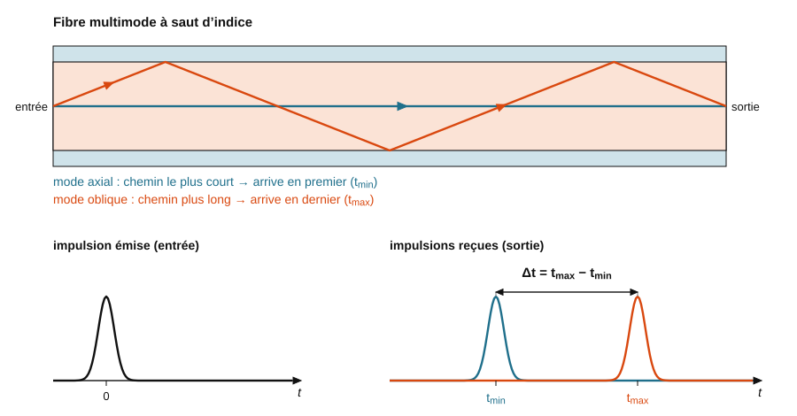

<em>Figure 77 (recueil de cours) : Dispersion modale dans une fibre à saut d'indice.</em>

1) Pour $L = 1{,}0\ \text{km}$, $n_1 = 1{,}48$ et $n_2 = 1{,}46$, calculer $t_{min}$, $t_{max}$ et la dispersion modale $\Delta t$.
2) En déduire la bande passante et le produit $BP \times L$.
3) Quelle est la bande passante d'une liaison de 200 m avec cette fibre ?
4) Une fibre à gradient d'indice OM3 a un produit $BP \times L = 2000\ \text{MHz·km}$ à 850 nm. On admet qu'une liaison à 10 Gbit/s exige une bande passante d'au moins 6,7 GHz. Calculer la longueur maximale d'une liaison 10 Gbit/s sur OM3. Comparer à la fibre à saut d'indice.

**Exercice 6.11 ★★★ : Raccordement FTTH d'un abonné en GPON (type BTS)**

*Compétence visée : établir le budget optique d'un réseau passif à coupleurs, en déduire une portée, et exploiter des mesures de temps de propagation (sous-partie 6.4, avec réinvestissement des chapitres 1 et 3).*

*Contexte :* un opérateur raccorde une entreprise à la fibre (FTTH) par un réseau optique passif GPON : une seule fibre, partant du central (NRO), est partagée entre 32 abonnés grâce à deux coupleurs optiques qui divisent la lumière. Le technicien vérifie le budget optique de l'abonné le plus éloigné, puis localise une panne.

<em>Figure TD 52 : Architecture du réseau GPON jusqu'à l'abonné le plus éloigné (échelle non respectée).</em>

*Document 1 : architecture.* NRO (équipement OLT) → 6,5 km → point de mutualisation (coupleur 1:8) → 1,2 km → point de branchement (coupleur 1:4) → 0,3 km → prise terminale optique → box de l'abonné (ONT). La liaison comporte 6 connecteurs (0,3 dB chacun) et 8 épissures (0,1 dB chacune).

*Document 2 : GPON classe B+.* Affaiblissement admissible entre l'OLT et l'ONT : de 13 à 28 dB. Sens descendant à 1490 nm, l'OLT émet au minimum +1,5 dBm ; sens montant à 1310 nm. Sensibilité de l'ONT : −27 dBm. Débit descendant : 2,488 Gbit/s, partagé entre les abonnés. Marge d'exploitation à conserver : 3 dB. Indice de groupe de la fibre : 1,468.

*Document 3 : composants.* Fibre G.652 : 0,35 dB/km à 1310 nm ; 0,25 dB/km à 1490 nm. Pertes maximales des coupleurs : 1:4 : 7,3 dB ; 1:8 : 10,5 dB.

*Données : $h = 6{,}63 \times 10^{-34}$ J·s ; $c_0 = 3{,}0 \times 10^8$ m/s ; $1$ eV $= 1{,}6 \times 10^{-19}$ J.*

**Partie A : budget optique**

1) Un coupleur idéal 1:N partage la puissance en N parts égales. Calculer sa perte en dB pour N = 8 et N = 4, et la comparer aux valeurs du document 3. Calculer la perte idéale d'un partage total 1:32.
2) Calculer l'affaiblissement total de la liaison à 1310 nm, puis à 1490 nm. Est-il dans la plage de la classe B+ ? Quelle marge reste-t-il par rapport à 28 dB à 1310 nm ?
3) Calculer la puissance reçue par l'ONT dans le sens descendant. La sensibilité est-elle respectée, avec la marge d'exploitation ?
4) En conservant la marge de 3 dB, jusqu'à quelle longueur totale de fibre pourrait-on raccorder un abonné à 1310 nm, avec les mêmes coupleurs, connecteurs et épissures ?

**Partie B : partage et synchronisation**

5) Calculer le débit descendant minimal garanti à chaque abonné si les 32 abonnés téléchargent en même temps. Même calcul pour la technologie XGS-PON (9,953 Gbit/s).
6) Dans le sens montant, les ONT émettent chacune à leur tour sur la même fibre. L'OLT mesure le temps d'aller-retour vers chaque ONT pour éviter les collisions (*ranging*). Calculer ce temps pour l'abonné le plus éloigné (8,0 km), puis pour un abonné à 2,0 km, et leur différence. Pourquoi faut-il en tenir compte ?
7) Calculer l'énergie d'un photon à 1490 nm. La photodiode de l'ONT peut-elle être en silicium ?

**Partie C : dépannage**

8) L'abonné n'a plus de signal. Le technicien branche un réflectomètre optique sur la prise terminale, côté réseau : un événement réfléchissant (fibre coupée) apparaît 9,8 µs après l'impulsion. À quelle distance se trouve la coupure ? Dans quel tronçon du réseau ?

**Exercice 6.12 ★★★ : Câbler des liens à 100 Gbit/s entre baies d'un datacenter (type BTS)**

*Compétence visée : choisir une fibre multimode et une connectique à partir de la bande passante et d'un budget optique très serré (sous-parties 6.3 et 6.4, avec réinvestissement du chapitre 1).*

*Contexte :* dans une salle informatique, des switches sont reliés par des liens à 100 Gbit/s utilisant des modules optiques 100GBASE-SR4 : chaque lien utilise 4 fibres en émission et 4 fibres en réception, regroupées dans un connecteur multifibre MPO. Le technicien doit choisir la fibre et la connectique.

*Document 1 : module 100GBASE-SR4.* 4 voies à 25,78 Gbit/s chacune, longueur d'onde 850 nm (laser VCSEL). Puissance émise minimale par voie : −8,4 dBm. Pertes maximales admissibles entre les deux modules (fibre et connecteurs) : 1,9 dB. Une voie à 25,78 Gbit/s exige une bande passante d'au moins 0,67 GHz par Gbit/s, soit environ 17,3 GHz.

*Document 2 : fibres multimodes à 850 nm.* OM3 : $BP \times L = 2000$ MHz·km ; OM4 : $BP \times L = 4700$ MHz·km ; atténuation : 3,0 dB/km pour les deux.

*Document 3 : connectique.* Connexion MPO standard : 0,75 dB ; connexion MPO « faibles pertes » : 0,35 dB.

*Données : $h = 6{,}63 \times 10^{-34}$ J·s ; $c_0 = 3{,}0 \times 10^8$ m/s ; $1$ eV $= 1{,}6 \times 10^{-19}$ J ; indice de groupe de la fibre : 1,48.*

**Partie A : débit et bande passante**

1) Calculer le débit total transporté par un lien.
2) Calculer la longueur maximale autorisée par la bande passante, pour l'OM3 puis pour l'OM4.

**Partie B : budget optique**

3) Deux baies voisines sont reliées par une jarretière MPO de 60 m (2 connexions standard). Calculer les pertes. Le lien est-il valide ? Quelle marge reste-t-il ?
4) Pour relier deux salles, le lien fait 90 m et passe par deux panneaux de brassage : 4 connexions MPO. Calculer les pertes avec des connexions standard, puis avec des connexions faibles pertes. Conclure.
5) Avec 4 connexions faibles pertes, calculer la longueur maximale autorisée par le budget optique. En combinant avec la question 2, quelle est la longueur maximale du lien en OM3 ? En OM4 ? Quel phénomène limite dans chaque cas ?

**Partie C : exploitation**

6) Une poussière sur une face de connecteur ajoute 0,5 dB de pertes sur le lien de la question 4 (version faibles pertes). Que se passe-t-il ? Quelle opération doit précéder systématiquement chaque branchement ?
7) Calculer l'énergie d'un photon à 850 nm, puis le nombre de photons émis par seconde par une voie à −8,4 dBm. Calculer le temps de propagation sur 100 m de fibre.
8) La salle compte 48 liens de ce type. Combien de fibres sont réellement utilisées ? Combien de fibres faut-il prévoir si chaque lien utilise un connecteur MPO à 12 fibres ? Commenter.

### Série §6.5 : Le spectre optique : infrarouge, visible, ultraviolet `BTS1` `BTS2`

**Exercice 6.13 ★ : Domaines du spectre optique**

*Compétence visée : situer une longueur d'onde dans le spectre optique et calculer l'énergie d'un photon.*

Pour chacun des rayonnements suivants, indiquer le domaine (UV, visible, IR) et calculer l'énergie d'un photon en eV : a) lampe germicide UV-C, 254 nm ; b) lampe de contrôle des billets, 365 nm ; c) LED bleue, 470 nm ; d) LED rouge, 650 nm ; e) module SFP, 850 nm ; f) télécommande, 940 nm ; g) fibre longue distance, 1550 nm ; h) rayonnement thermique d'un objet à température ambiante, 10 µm.

**Exercice 6.14 ★★ : Thermographie, capteur de CO₂ et désinfection UV**

*Compétence visée : relier longueur d'onde, énergie des photons et choix d'un capteur ou d'une source.*

On donne la loi de Wien : un corps à la température $T$ (en kelvin) rayonne au maximum à la longueur d'onde $\lambda_{max} = \dfrac{2898}{T}$ ($\lambda_{max}$ en µm).

1) Calculer $\lambda_{max}$ pour un technicien (37 °C), pour un composant en surchauffe dans une baie (80 °C) et pour le filament d'une ampoule (2800 K). Une caméra thermique sensible entre 8 et 14 µm convient-elle pour détecter un point chaud dans une baie ?
2) Calculer l'énergie d'un photon à 9 µm. Pourquoi une caméra thermique ne peut-elle pas utiliser un capteur en silicium ($\Delta E = 1{,}1$ eV) ?
3) Les capteurs de qualité de l'air des salles de réunion mesurent le CO₂ par absorption infrarouge à 4,26 µm. Calculer l'énergie de ces photons.
4) Une LED UV-C à 265 nm sert à désinfecter les claviers partagés. Calculer l'énergie d'un photon et la comparer à l'énergie d'une liaison carbone-carbone (environ 3,6 eV). Un photon de 1550 nm peut-il produire le même effet ?
5) Calculer le nombre de photons émis par seconde par une source de 1,0 mW à 265 nm, puis à 1550 nm. « Plus énergétique » signifie-t-il « plus de photons » ?

**Exercice 6.15 ★★ : Li-Fi : transmettre des données par la lumière**

*Compétence visée : relier énergie des photons, sensibilité d'une photodiode et choix des longueurs d'onde d'une liaison optique sans fil (sous-partie 6.5, avec réinvestissement des sous-parties 1.5 et 1.8).*

Dans une salle de réunion, le Li-Fi transmet les données par la lumière : la liaison descendante utilise l'éclairage à LED blanches (LED bleue à 450 nm associée à un luminophore qui réémet autour de 550 nm), modulé à plusieurs MHz, invisible pour l'œil ; la liaison montante, de l'ordinateur vers le plafonnier, utilise une LED infrarouge à 940 nm. Les récepteurs sont des photodiodes en silicium de rendement quantique $\eta = 0{,}80$ (80 % des photons absorbés créent un électron).

*Données : $h = 6{,}63 \times 10^{-34}$ J·s ; $c_0 = 3{,}0 \times 10^8$ m/s ; $e = 1{,}6 \times 10^{-19}$ C ; gap du silicium : 1,1 eV.*

1) Calculer l'énergie des photons à 450 nm, 550 nm et 940 nm, en eV. Préciser le domaine de chaque rayonnement.
2) Montrer que la sensibilité d'une photodiode (courant produit par watt reçu) vaut $S = \dfrac{\eta\,e\,\lambda}{h\,c_0}$. Calculer $S$ à 450 nm et à 940 nm. Pourquoi $S$ augmente-t-elle avec $\lambda$ ? Que vaut-elle à 1550 nm pour une photodiode en silicium ?
*Coup de pouce : exprimer le nombre de photons reçus par seconde, puis le nombre d'électrons créés par seconde.*
3) Un ordinateur reçoit 2,0 µW de lumière bleue modulée. Calculer le courant produit. La lumière du jour ajoute un courant continu de 25 µA, bien plus grand : comment séparer le signal utile ?
4) Pourquoi la liaison montante utilise-t-elle l'infrarouge plutôt que la lumière visible ? Pourquoi n'utilise-t-on jamais l'ultraviolet C ?
5) La lumière ne traverse pas les murs opaques. Citer deux avantages qui en découlent par rapport au Wi-Fi.

### Série de synthèse : exercices type BTS `BTS2`

**Exercice 6.16 ★★★ : Liaison fibre entre deux bâtiments d'un campus (type BTS)**

*Compétence visée : choisir fibre et modules optiques, établir un budget optique et exploiter une mesure au réflectomètre.*

*Contexte :* un campus veut relier le cœur de réseau du bâtiment A au switch de distribution du bâtiment B à 10 Gbit/s. Le tracé en fourreau mesure 1,8 km. La liaison comporte 4 connecteurs (deux tiroirs optiques et deux jarretières) et 2 épissures.

<em>Figure TD 39 : Liaison fibre entre les bâtiments A et B : connecteurs et épissures.</em>

*Document 1 : modules optiques 10 Gbit/s.*

| Module | Longueur d'onde | Fibre | Puissance émise minimale | Sensibilité | Portée annoncée |
|---|---|---|---|---|---|
| 10GBASE-SR | 850 nm | multimode OM3 | −7,3 dBm | −9,9 dBm | 300 m |
| 10GBASE-LR | 1310 nm | monomode OS2 | −8,2 dBm | −14,4 dBm | 10 km |
| 10GBASE-ER | 1550 nm | monomode OS2 | −4,7 dBm | −15,8 dBm | 40 km |

*Document 2 : fibres disponibles.*

| Fibre | Atténuation | Bande passante | Indices cœur / gaine |
|---|---|---|---|
| OM3 (50/125 µm) | 3,0 dB/km à 850 nm | $BP \times L = 2000$ MHz·km à 850 nm | (non utiles ici) |
| OS2 (9/125 µm) | 0,35 dB/km à 1310 nm ; 0,22 dB/km à 1550 nm | pas de dispersion modale | 1,4504 / 1,4447 |

*Document 3 : règles d'ingénierie.* Perte par connecteur : 0,5 dB ; perte par épissure : 0,1 dB ; marge de vieillissement à conserver : 3,0 dB ; une liaison à 10 Gbit/s exige une bande passante d'au moins 6,7 GHz ; indice de groupe de l'OS2 à 1310 nm : 1,468.

**Partie A : choix de la fibre et des modules**

1) Calculer la bande passante de 1,8 km de fibre OM3. Peut-on utiliser l'OM3 ?
2) Justifier le choix de la fibre OS2. Quel module choisir entre LR et ER ? Pourquoi ne pas prendre systématiquement le module le plus puissant ?

**Partie B : budget optique**

3) Calculer les pertes totales de la liaison avec le module LR.
4) Calculer la puissance reçue en dBm et en µW. Vérifier que la liaison respecte la sensibilité en conservant la marge de vieillissement. Quelle marge reste-t-il ?
5) Calculer l'énergie d'un photon à 1310 nm. La photodiode du récepteur peut-elle être en silicium ($\Delta E = 1{,}1$ eV) ?
6) Calculer l'ouverture numérique et l'angle d'acceptance de l'OS2 ($ON = \sqrt{n_1^2 - n_2^2}$). Pourquoi l'alignement des connecteurs monomodes doit-il être si précis ?

**Partie C : recette au réflectomètre optique**

7) Le réflectomètre optique (OTDR), branché côté bâtiment A, montre un événement anormal dont l'écho revient 12,2 µs après l'impulsion. Calculer sa distance (indice de groupe 1,468).
8) Cet événement, une épissure mal réalisée, présente une perte de 1,5 dB au lieu de 0,1 dB. Refaire le budget optique. La liaison est-elle encore validée ? Que faut-il faire ?

### Défi du chapitre `BTS2`

**Exercice 6.17 ★★★★ : Dispersion modale : démontrer, puis optimiser le profil d'indice (défi)**

*Compétence visée : établir l'expression de la dispersion modale, en tirer des lois d'échelle et optimiser le profil d'indice d'une fibre (sous-partie 6.4, avec 6.2 et 6.3).*

On considère une fibre à saut d'indice de longueur $L$, de cœur d'indice $n_1$ et de gaine d'indice $n_2$. On note $\Delta = \dfrac{n_1 - n_2}{n_1}$ (écart relatif d'indice, petit devant 1).

1) Le rayon axial parcourt la longueur $L$ à la vitesse $c_0/n_1$. Le rayon guidé le plus incliné arrive sur la gaine avec l'angle limite $i_\ell$ ($\sin i_\ell = n_2/n_1$). Montrer qu'il parcourt une longueur totale $\dfrac{L}{\sin i_\ell}$, puis que $t_{max} = t_{min} \times \dfrac{n_1}{n_2}$ (formule admise dans l'exercice 6.10).
*Coup de pouce : entre deux réflexions, le rayon parcourt une longueur $\ell$ et avance de $\ell\sin i_\ell$ le long de l'axe.*
2) En déduire $\Delta t = \dfrac{L\,n_1}{c_0} \times \dfrac{n_1 - n_2}{n_2}$, puis montrer que $\Delta t \approx \dfrac{L\,n_1\,\Delta}{c_0}$ et que $\Delta t \approx \dfrac{L \times ON^2}{2\,n_2\,c_0}$.
*Coup de pouce : $n_1^2 - n_2^2 = (n_1 - n_2)(n_1 + n_2)$ et $n_1 + n_2 \approx 2n_2$.*
Calculer $\Delta t$ pour 1,0 km de fibre ($n_1 = 1{,}48$, $n_2 = 1{,}46$) avec la formule exacte et avec les deux approximations.
3) Une fibre optique plastique (POF, $n_1 = 1{,}49$, $n_2 = 1{,}41$) relie deux équipements domotiques sur 100 m. Calculer son ouverture numérique, sa dispersion modale et sa bande passante ($BP = 0{,}35/\Delta t$), puis son produit $BP \times L$. Quel est le prix à payer pour sa grande ouverture numérique ?
4) Dans une fibre à gradient d'indice optimisé, on admet que la dispersion modale devient $\Delta t_{GI} \approx \dfrac{L\,n_1\,\Delta^2}{8\,c_0}$. Montrer que le gradient d'indice divise la dispersion par environ $\dfrac{8}{\Delta}$. Calculer $\Delta t_{GI}$ pour 1,0 km ($n_1 = 1{,}48$, $n_2 = 1{,}46$) et le produit $BP \times L$ correspondant. Comparer aux fibres OM3 et OM4 (exercice 6.12).
5) On veut une liaison à 10 Gbit/s (bande passante d'au moins 6,7 GHz) sur 300 m avec une fibre à gradient d'indice ($n_1 = 1{,}48$). Calculer la valeur maximale de $\Delta$, puis l'ouverture numérique correspondante, $ON \approx n_1\sqrt{2\Delta}$. Pourquoi ne choisit-on pas un $\Delta$ beaucoup plus petit encore ? Formuler le compromis.

### Corrigés du chapitre 6 `BTS1` `BTS2`

**Exercice 6.1.**
1) $c = \dfrac{c_0}{n}$ : eau $\dfrac{3{,}0 \times 10^8}{1{,}33} \approx 2{,}26 \times 10^8\ \text{m/s}$ ; verre $2{,}00 \times 10^8\ \text{m/s}$ ; silice $2{,}04 \times 10^8\ \text{m/s}$.
2) Fibre : $t = \dfrac{10 \times 10^3}{2{,}04 \times 10^8} \approx 49\ \mu\text{s}$ ; air : $t = \dfrac{10 \times 10^3}{3{,}0 \times 10^8} \approx 33\ \mu\text{s}$. La fibre est environ 1,5 fois plus lente que la radio.
3) $t = \dfrac{2 \times 800 \times 10^3}{2{,}04 \times 10^8} \approx 7{,}8\ \text{ms}$ : aucun ping vers ce serveur ne pourra descendre sous 7,8 ms, quel que soit le débit de la liaison.

**Exercice 6.2.**
1) $c = \dfrac{c_0}{n}$ : 850 nm → $2{,}065 \times 10^8\ \text{m/s}$ ; 1310 nm → $2{,}073 \times 10^8\ \text{m/s}$ ; 1550 nm → $2{,}078 \times 10^8\ \text{m/s}$. Le 1550 nm (indice le plus faible) va le plus vite.
2) $t = \dfrac{L n}{c_0}$ : 850 nm → $48{,}42\ \mu\text{s}$ ; 1310 nm → $48{,}23\ \mu\text{s}$ ; 1550 nm → $48{,}13\ \mu\text{s}$.
3) $\Delta t = \dfrac{L\,(n_{850} - n_{1550})}{c_0} = \dfrac{10 \times 10^3 \times 0{,}0085}{3{,}0 \times 10^8} \approx 2{,}8 \times 10^{-7}\ \text{s} = 0{,}28\ \mu\text{s}$. C'est la dispersion (chromatique) : chaque longueur d'onde se propage à sa propre vitesse.
4) Fibre : $\dfrac{640 \times 10^3 \times 1{,}468}{3{,}0 \times 10^8} \approx 3{,}13\ \text{ms}$ ; air : $\dfrac{640 \times 10^3}{3{,}0 \times 10^8} \approx 2{,}13\ \text{ms}$. Gain : environ 1,0 ms, décisif pour des ordres de bourse passés automatiquement.

**Exercice 6.3.**
1) $1{,}00 \times \sin 30° = 1{,}50 \times \sin\theta_2 \Rightarrow \sin\theta_2 = 0{,}333 \Rightarrow \theta_2 \approx 19{,}5°$ : le rayon se rapproche de la normale (il entre dans un milieu plus réfringent).
2) $1{,}50 \times \sin 30° = 1{,}00 \times \sin\theta_2 \Rightarrow \sin\theta_2 = 0{,}75 \Rightarrow \theta_2 \approx 48{,}6°$ : il s'éloigne de la normale.
3) $\sin\theta_{lim} = \dfrac{n_2}{n_1} = \dfrac{1{,}00}{1{,}50} \Rightarrow \theta_{lim} \approx 41{,}8°$.
4) Verre → air à 50° > 41,8° : réflexion totale, pas de rayon réfracté. Air → verre : la réflexion totale est impossible ($n_1 < n_2$) ; le rayon est réfracté avec $\sin\theta_2 = \dfrac{\sin 50°}{1{,}50} \approx 0{,}51$, soit $\theta_2 \approx 31°$.

**Exercice 6.4.**
1) $\sin\theta_{lim} = \dfrac{1{,}00}{1{,}50} \Rightarrow \theta_{lim} \approx 41{,}8°$. Comme $45° > 41{,}8°$ : réflexion totale, la photodiode reçoit tout le faisceau (signal maximal : « pas de fuite »).
2) $\sin\theta_{lim} = \dfrac{1{,}33}{1{,}50} \approx 0{,}887 \Rightarrow \theta_{lim} \approx 62{,}5°$. Comme $45° < 62{,}5°$ : plus de réflexion totale. $1{,}50 \times \sin 45° = 1{,}33 \times \sin\theta_2 \Rightarrow \sin\theta_2 \approx 0{,}798 \Rightarrow \theta_2 \approx 52{,}9°$. L'essentiel de la lumière sort dans l'eau : le signal de la photodiode chute, l'alarme est déclenchée.
3) $\sin\theta_{lim} = \dfrac{1{,}43}{1{,}50} \approx 0{,}953 \Rightarrow \theta_{lim} \approx 72{,}4° > 45°$ : pas de réflexion totale, le détecteur fonctionne aussi.
4) Il faut la réflexion totale dans l'air ($\theta > 41{,}8°$) mais pas dans l'eau ($\theta < 62{,}5°$) : l'angle d'incidence doit être compris entre 41,8° et 62,5° ; 45° convient.

**Exercice 6.5.**
1) $R = \left(\dfrac{1{,}468 - 1}{1{,}468 + 1}\right)^2 = \left(\dfrac{0{,}468}{2{,}468}\right)^2 \approx 0{,}036$, soit 3,6 % ; $RL = -10\log_{10}(0{,}036) \approx 14{,}4\ \text{dB}$.
2) Transmission à chaque interface : $1 - R$ ; pour deux interfaces : $(1 - 0{,}036)^2 \approx 0{,}929$, soit une perte de $-10\log_{10}(0{,}929) \approx 0{,}32\ \text{dB}$, auxquels s'ajoutent deux réflexions de 3,6 % renvoyées vers l'émetteur.
3) $R \leq 10^{-50/10} = 10^{-5}$, soit au plus 0,001 % de la puissance.
4) La face polie fait un angle de 8° avec la perpendiculaire à l'axe : un rayon qui se propage le long de l'axe arrive sur elle avec une incidence de 8° par rapport à sa normale. Il repart symétriquement, à 8° de l'autre côté de la normale, donc à $2 \times 8° = 16°$ de l'axe. Angle maximal de guidage : $\theta_r = \arccos\!\left(\dfrac{1{,}4447}{1{,}4504}\right) \approx 5{,}1°$. Comme $16° > 5{,}1°$, la lumière réfléchie n'est pas guidée : elle s'échappe dans la gaine et ne remonte pas jusqu'au laser (pertes de retour supérieures à 60 dB).
5) Les deux faces ne sont pas parallèles (8° contre 0°) : elles ne se touchent que sur un bord, une lame d'air se forme, la perte d'insertion augmente fortement (plusieurs dB) et la lumière réfléchie n'est plus éliminée. On vérifie toujours la couleur des connecteurs : vert pour APC, bleu pour UPC.

*Erreurs fréquentes :* oublier le carré dans $R$ ; croire que l'angle de réflexion vaut 8° par rapport à l'axe ; confondre perte d'insertion (lumière perdue vers l'avant) et pertes de retour (lumière renvoyée).

**Exercice 6.6.**
1) $ON = \sqrt{1{,}48^2 - 1{,}46^2} = \sqrt{2{,}1904 - 2{,}1316} \approx 0{,}243$ ; $\theta_0 = \arcsin(0{,}243) \approx 14{,}0°$ ; cône d'acceptance total : environ 28°.
2) $\sin\theta_{lim} = \dfrac{1{,}46}{1{,}48} \Rightarrow \theta_{lim} \approx 80{,}6°$ : seuls les rayons presque parallèles à l'axe (incidence supérieure à 80,6° sur la gaine) restent guidés.
3) 50/125 et 62,5/125 µm : multimodes (cœur large) ; 9/125 µm : monomode (cœur inférieur à 10 µm).

**Exercice 6.7.**
1) $1{,}00 \times \sin\theta_0 = n_1 \sin\theta_r$.
2) Réflexion totale si $\sin i \geq \dfrac{n_2}{n_1}$. Or $\sin i = \sin(90° - \theta_r) = \cos\theta_r$, d'où $\cos\theta_r \geq \dfrac{n_2}{n_1}$.
3) L'angle $\theta_r$ maximal correspond à $\cos\theta_r = \dfrac{n_2}{n_1}$, donc $\sin\theta_r = \sqrt{1 - \dfrac{n_2^2}{n_1^2}}$. Alors $\sin\theta_0 = n_1 \sin\theta_r = n_1\sqrt{1 - \dfrac{n_2^2}{n_1^2}} = \sqrt{n_1^2 - n_2^2}$.
4) $ON = \sqrt{1{,}49^2 - 1{,}41^2} = \sqrt{0{,}232} \approx 0{,}48$ ; $\theta_0 \approx 28{,}8°$ (cône total d'environ 58°). Le cône d'acceptance de la POF est deux fois plus ouvert que celui de la fibre en silice : elle capte bien mieux la lumière très divergente d'une LED, d'où son usage avec des émetteurs bon marché.

**Exercice 6.8.**
1) $a = 4{,}0\ \mu\text{m}$. 1310 nm : $V = \dfrac{2\pi \times 4{,}0}{1{,}31} \times 0{,}12 \approx 2{,}30 < 2{,}405$ : monomode. 1550 nm : $V \approx 1{,}95$ : monomode. 850 nm : $V \approx 3{,}55 > 2{,}405$ : la fibre guide quelques modes, elle n'est plus monomode.
2) $\lambda_c = \dfrac{2\pi a \times ON}{2{,}405} = \dfrac{2\pi \times 4{,}0 \times 0{,}12}{2{,}405} \approx 1{,}25\ \mu\text{m}$, soit environ 1250 nm : la fibre est monomode aux longueurs d'onde télécom (1310 et 1550 nm), pas à 850 nm.
3) Les modules SR émettent un faisceau large, prévu pour un cœur de 50 µm : très peu de lumière entre dans un cœur de 8 µm (forte perte de couplage). De plus, à 850 nm, la fibre guide plusieurs modes qui interfèrent entre eux (bruit modal, dispersion) : la liaison est instable ou ne monte pas.
4) $a_{max} = \dfrac{2{,}405 \times \lambda}{2\pi \times ON} = \dfrac{2{,}405 \times 1{,}31}{2\pi \times 0{,}12} \approx 4{,}2\ \mu\text{m}$, soit un diamètre de cœur d'au plus 8,4 µm.
5) $V = \dfrac{2\pi \times 25}{0{,}85} \times 0{,}20 \approx 37$ ; nombre de modes $\approx \dfrac{37^2}{2} \approx 680$. Ces modes ne parcourent pas tous le même chemin : la dispersion modale étale les impulsions et limite la bande passante (sous-partie 6.4).

*Erreurs fréquentes :* utiliser le diamètre au lieu du rayon ; garder $\lambda$ en nm et $a$ en µm sans conversion ; croire qu'une fibre est monomode « par nature », indépendamment de la longueur d'onde.

**Exercice 6.9.**
1) $A = 0{,}35 \times 40 = 14\ \text{dB}$. $P_e = 1{,}0\ \text{mW} = 0\ \text{dBm}$, donc $P_r = -14\ \text{dBm}$, soit $10^{-1{,}4}\ \text{mW} \approx 40\ \mu\text{W}$.
2) $A = 10\log_{10}\!\left(\dfrac{2{,}0}{0{,}80}\right) \approx 4{,}0\ \text{dB}$ ; $\dfrac{4{,}0}{2{,}5} \approx 1{,}6\ \text{dB/km}$.
3) $BP = \dfrac{0{,}35}{25 \times 10^{-9}} = 1{,}4 \times 10^7\ \text{Hz} = 14\ \text{MHz}$.

**Exercice 6.10.**
1) $t_{min} = \dfrac{1{,}0 \times 10^3 \times 1{,}48}{3{,}0 \times 10^8} \approx 4{,}933\ \mu\text{s}$ ; $t_{max} = 4{,}933 \times \dfrac{1{,}48}{1{,}46} \approx 5{,}001\ \mu\text{s}$ ; $\Delta t \approx 68\ \text{ns}$.
2) $BP = \dfrac{0{,}35}{67{,}6 \times 10^{-9}} \approx 5{,}2\ \text{MHz}$ ; $BP \times L \approx 5{,}2\ \text{MHz·km}$.
3) $BP = \dfrac{5{,}2\ \text{MHz·km}}{0{,}20\ \text{km}} \approx 26\ \text{MHz}$.
4) $L_{max} = \dfrac{2000\ \text{MHz·km}}{6700\ \text{MHz}} \approx 0{,}30\ \text{km} = 300\ \text{m}$ (c'est la portée annoncée des modules 10GBASE-SR sur OM3). Avec la fibre à saut d'indice, on n'atteindrait même pas 1 m : seules les fibres à gradient d'indice et monomodes conviennent aux hauts débits.

**Exercice 6.11.**

*Partie A.*
1) 1:8 : $10\log_{10}(8) \approx 9{,}0\ \text{dB}$ (10,5 dB en réalité, soit 1,5 dB de pertes en excès) ; 1:4 : $\approx 6{,}0\ \text{dB}$ (7,3 dB, soit 1,3 dB en excès) ; 1:32 : $10\log_{10}(32) \approx 15{,}1\ \text{dB}$.
2) Longueur de fibre : $6{,}5 + 1{,}2 + 0{,}3 = 8{,}0\ \text{km}$. À 1310 nm : $8{,}0 \times 0{,}35 + 10{,}5 + 7{,}3 + 6 \times 0{,}3 + 8 \times 0{,}1 = 2{,}8 + 17{,}8 + 1{,}8 + 0{,}8 = 23{,}2\ \text{dB}$. À 1490 nm : $2{,}0 + 17{,}8 + 1{,}8 + 0{,}8 = 22{,}4\ \text{dB}$. Les deux sont entre 13 et 28 dB ; marge à 1310 nm : $28 - 23{,}2 = 4{,}8\ \text{dB}$. Les coupleurs représentent plus des trois quarts des pertes.
3) $P_r = 1{,}5 - 22{,}4 = -20{,}9\ \text{dBm}$ ; marge : $-20{,}9 - (-27) = 6{,}1\ \text{dB} \geq 3\ \text{dB}$ : validé.
4) Pertes hors fibre : $23{,}2 - 2{,}8 = 20{,}4\ \text{dB}$ ; reste pour la fibre : $28 - 3 - 20{,}4 = 4{,}6\ \text{dB}$, soit $\dfrac{4{,}6}{0{,}35} \approx 13\ \text{km}$.

*Partie B.*
5) $\dfrac{2488}{32} \approx 78\ \text{Mbit/s}$ ; XGS-PON : $\dfrac{9953}{32} \approx 311\ \text{Mbit/s}$. En pratique, les abonnés ne téléchargent pas tous en même temps : chacun dispose souvent de bien plus.
6) $c = \dfrac{3{,}0 \times 10^8}{1{,}468} \approx 2{,}04 \times 10^8\ \text{m/s}$. Aller-retour : $\dfrac{2 \times 8000}{2{,}04 \times 10^8} \approx 78\ \mu\text{s}$ pour 8,0 km et $\approx 20\ \mu\text{s}$ pour 2,0 km ; différence $\approx 59\ \mu\text{s}$. Si chaque ONT émettait dès son tour, les paquets des abonnés éloignés arriveraient en retard et chevaucheraient ceux des abonnés proches : l'OLT impose à chaque ONT un retard de compensation pour que tous les paquets arrivent dans leur créneau.
7) $E = \dfrac{6{,}63 \times 10^{-34} \times 3{,}0 \times 10^8}{1490 \times 10^{-9}} \approx 1{,}33 \times 10^{-19}\ \text{J} \approx 0{,}83\ \text{eV} < 1{,}1\ \text{eV}$ : le silicium ne détecte pas ce rayonnement ; la photodiode est en InGaAs.

*Partie C.*
8) $d = \dfrac{c\,t}{2} = \dfrac{2{,}04 \times 10^8 \times 9{,}8 \times 10^{-6}}{2} \approx 1{,}0\ \text{km}$. Depuis la prise terminale : 0,3 km jusqu'au point de branchement, puis 0,7 km de plus : la coupure est dans le tronçon de 1,2 km entre le point de branchement et le point de mutualisation (les autres abonnés du même coupleur 1:4 sont probablement aussi en panne).

*Erreurs fréquentes :* compter les pertes d'un coupleur 1:N comme N dB ; oublier la marge d'exploitation ; utiliser $c_0$ au lieu de $c_0/n$ pour le réflectomètre, ou oublier l'aller-retour.

**Exercice 6.12.**

*Partie A.*
1) $4 \times 25{,}78 \approx 103\ \text{Gbit/s}$ (dont 100 Gbit/s de données, le reste servant au codage).
2) OM3 : $L_{max} = \dfrac{2000\ \text{MHz·km}}{17\,300\ \text{MHz}} \approx 0{,}116\ \text{km} \approx 116\ \text{m}$ ; OM4 : $\dfrac{4700}{17\,300} \approx 0{,}27\ \text{km} \approx 272\ \text{m}$.

*Partie B.*
3) $0{,}060 \times 3{,}0 + 2 \times 0{,}75 = 0{,}18 + 1{,}50 = 1{,}68\ \text{dB} \leq 1{,}9\ \text{dB}$ : valide, avec seulement 0,22 dB de marge.
4) Standard : $0{,}27 + 4 \times 0{,}75 = 3{,}27\ \text{dB} > 1{,}9\ \text{dB}$ : impossible. Faibles pertes : $0{,}27 + 4 \times 0{,}35 = 1{,}67\ \text{dB}$ : valide. À ces débits, ce sont les connexions qui consomment le budget, pas la fibre.
5) $\dfrac{1{,}9 - 1{,}4}{3{,}0} \approx 0{,}17\ \text{km} = 167\ \text{m}$. En OM3, la bande passante limite à 116 m (dispersion modale) ; en OM4, c'est le budget optique qui limite à 167 m.

*Partie C.*
6) $1{,}67 + 0{,}5 = 2{,}17\ \text{dB} > 1{,}9\ \text{dB}$ : le lien produit des erreurs ou ne s'établit pas. Chaque connecteur doit être inspecté (microscope) et nettoyé avant tout branchement.
7) $E = \dfrac{hc_0}{\lambda} \approx 2{,}34 \times 10^{-19}\ \text{J} \approx 1{,}46\ \text{eV}$ ; $P = 10^{-0{,}84}\ \text{mW} \approx 0{,}145\ \text{mW}$ ; $N = \dfrac{1{,}45 \times 10^{-4}}{2{,}34 \times 10^{-19}} \approx 6{,}2 \times 10^{14}$ photons par seconde. Temps de propagation : $\dfrac{100 \times 1{,}48}{3{,}0 \times 10^8} \approx 0{,}49\ \mu\text{s}$.
8) $48 \times 8 = 384$ fibres utilisées ; avec des MPO à 12 fibres : $48 \times 12 = 576$ fibres, dont 192 inutilisées (un tiers). On utilise des câbles et connecteurs MPO à 8 fibres, ou des boîtiers de conversion qui répartissent 3 liens sur 2 connecteurs de 12 fibres.

*Erreurs fréquentes :* oublier les connexions des panneaux de brassage ; vérifier seulement la bande passante ou seulement le budget ; compter 4 fibres par lien au lieu de 8.

**Exercice 6.13.** $E = \dfrac{hc_0}{\lambda}$ (en J), divisée par $1{,}6 \times 10^{-19}$ pour l'avoir en eV.

| Rayonnement | λ | Domaine | Énergie du photon |
|---|---|---|---|
| a) UV-C germicide | 254 nm | UV (UV-C) | 4,9 eV |
| b) Contrôle des billets | 365 nm | UV (UV-A) | 3,4 eV |
| c) LED bleue | 470 nm | visible | 2,6 eV |
| d) LED rouge | 650 nm | visible | 1,9 eV |
| e) Module SFP | 850 nm | IR proche | 1,5 eV |
| f) Télécommande | 940 nm | IR proche | 1,3 eV |
| g) Fibre longue distance | 1550 nm | IR proche | 0,80 eV |
| h) Rayonnement thermique | 10 µm | IR lointain | 0,12 eV |

**Exercice 6.14.**
1) Technicien : $T = 310\ \text{K}$, $\lambda_{max} = \dfrac{2898}{310} \approx 9{,}3\ \mu\text{m}$ ; composant : $T = 353\ \text{K}$, $\lambda_{max} \approx 8{,}2\ \mu\text{m}$ ; filament : $\lambda_{max} \approx 1{,}0\ \mu\text{m}$. Les objets entre la température ambiante et une centaine de degrés rayonnent surtout entre 8 et 10 µm : la caméra 8 à 14 µm convient.
2) $E = \dfrac{6{,}63 \times 10^{-34} \times 3{,}0 \times 10^8}{9 \times 10^{-6}} \approx 2{,}2 \times 10^{-20}\ \text{J} \approx 0{,}14\ \text{eV}$, bien inférieur au gap du silicium : ces photons ne peuvent pas créer de paires électron-trou. Les caméras thermiques utilisent des microbolomètres, qui mesurent l'échauffement produit par le rayonnement.
3) $E = \dfrac{6{,}63 \times 10^{-34} \times 3{,}0 \times 10^8}{4{,}26 \times 10^{-6}} \approx 4{,}7 \times 10^{-20}\ \text{J} \approx 0{,}29\ \text{eV}$.
4) $E = \dfrac{6{,}63 \times 10^{-34} \times 3{,}0 \times 10^8}{265 \times 10^{-9}} \approx 7{,}5 \times 10^{-19}\ \text{J} \approx 4{,}7\ \text{eV} > 3{,}6\ \text{eV}$ : un photon UV-C peut casser une liaison C-C (ADN des micro-organismes). À 1550 nm, $E \approx 0{,}80\ \text{eV}$ : impossible, quelle que soit la puissance.
5) $N = \dfrac{P}{E}$ : à 265 nm, $\dfrac{1{,}0 \times 10^{-3}}{7{,}5 \times 10^{-19}} \approx 1{,}3 \times 10^{15}$ photons/s ; à 1550 nm, $\dfrac{1{,}0 \times 10^{-3}}{1{,}28 \times 10^{-19}} \approx 7{,}8 \times 10^{15}$ photons/s. À puissance égale, la source infrarouge émet environ 6 fois plus de photons, chacun moins énergétique : énergie par photon et nombre de photons sont deux notions indépendantes.

**Exercice 6.15.**
1) $E = \dfrac{hc_0}{\lambda}$ : 450 nm : 2,76 eV (visible, bleu) ; 550 nm : 2,26 eV (visible, vert-jaune) ; 940 nm : 1,32 eV (infrarouge proche).
2) Pour une puissance $P$, le nombre de photons par seconde vaut $\dfrac{P}{hc_0/\lambda}$ ; chacun crée un électron avec la probabilité $\eta$ : $I = \eta \times \dfrac{P\lambda}{hc_0} \times e$, d'où $S = \dfrac{I}{P} = \dfrac{\eta\,e\,\lambda}{hc_0}$. À 450 nm : $S = \dfrac{0{,}80 \times 1{,}6 \times 10^{-19} \times 450 \times 10^{-9}}{6{,}63 \times 10^{-34} \times 3{,}0 \times 10^8} \approx 0{,}29\ \text{A/W}$ ; à 940 nm : $\approx 0{,}60\ \text{A/W}$. À puissance égale, les photons infrarouges, moins énergétiques, sont plus nombreux : ils créent plus d'électrons. À 1550 nm, le photon (0,80 eV) est moins énergétique que le gap du silicium (1,1 eV) : il n'est pas absorbé, $S = 0$ (la formule ne s'applique que si le photon est absorbé).
3) $I = 0{,}29 \times 2{,}0 \times 10^{-6} \approx 0{,}58\ \mu\text{A}$. Le courant dû au jour est continu (ou lentement variable), le signal utile est modulé à plusieurs MHz : un filtre passe-haut (condensateur de liaison) bloque la composante continue et ne garde que le signal.
4) Une lumière visible émise par l'ordinateur éblouirait les utilisateurs ; l'infrarouge est invisible et les photodiodes silicium y sont très sensibles. L'UV-C est dangereux pour les yeux et la peau (photons de près de 5 eV, capables de casser des liaisons chimiques).
5) Confidentialité : le signal ne sort pas de la pièce (impossible de le capter depuis le couloir ou le parking). Pas d'interférences entre salles voisines : chaque pièce peut réutiliser les mêmes canaux, et le Li-Fi ne perturbe pas les équipements radio sensibles.

*Erreurs fréquentes :* croire qu'une photodiode est plus sensible aux photons les plus énergétiques ; oublier le rendement quantique ; appliquer la formule de $S$ au-delà de la longueur d'onde de coupure.

**Exercice 6.16.**

*Partie A.*
1) $BP = \dfrac{2000}{1{,}8} \approx 1{,}1 \times 10^3\ \text{MHz} = 1{,}1\ \text{GHz} < 6{,}7\ \text{GHz}$ : la dispersion modale interdit l'OM3 (le module SR est d'ailleurs limité à 300 m).
2) L'OS2, monomode, n'a pas de dispersion modale : sa bande passante n'est pas limitante sur 1,8 km. Le module LR (portée 10 km) suffit. Un module ER, prévu pour 40 km, émet plus fort : sur une liaison courte, il risquerait de saturer le récepteur (il faudrait ajouter un atténuateur) et il coûte plus cher.

*Partie B.*
3) Fibre : $0{,}35 \times 1{,}8 = 0{,}63\ \text{dB}$ ; connecteurs : $4 \times 0{,}5 = 2{,}0\ \text{dB}$ ; épissures : $2 \times 0{,}1 = 0{,}2\ \text{dB}$. Total : $2{,}83\ \text{dB}$.
4) $P_r = -8{,}2 - 2{,}83 \approx -11{,}0\ \text{dBm}$, soit $10^{-1{,}10}\ \text{mW} \approx 79\ \mu\text{W}$. Avec la marge de vieillissement : $-11{,}0 - 3{,}0 = -14{,}0\ \text{dBm} \geq -14{,}4\ \text{dBm}$ : liaison validée, avec seulement 0,4 dB de marge supplémentaire.
5) $E = \dfrac{hc_0}{\lambda} = \dfrac{6{,}63 \times 10^{-34} \times 3{,}0 \times 10^8}{1310 \times 10^{-9}} \approx 1{,}52 \times 10^{-19}\ \text{J} \approx 0{,}95\ \text{eV} < 1{,}1\ \text{eV}$ : le silicium est transparent à 1310 nm ; le récepteur utilise une photodiode InGaAs.
6) $ON = \sqrt{1{,}4504^2 - 1{,}4447^2} \approx 0{,}13$ ; $\theta_0 \approx 7{,}4°$. Le cœur ne mesure que 9 µm et le cône d'acceptance est étroit : un décalage de quelques micromètres ou un léger défaut d'angle entre deux fibres fait perdre une grande partie de la lumière.

*Partie C.*
7) $c = \dfrac{3{,}0 \times 10^8}{1{,}468} \approx 2{,}04 \times 10^8\ \text{m/s}$ ; aller-retour : $d = \dfrac{c \times t}{2} = \dfrac{2{,}04 \times 10^8 \times 12{,}2 \times 10^{-6}}{2} \approx 1{,}25 \times 10^3\ \text{m}$, soit à 1,25 km du bâtiment A.
8) Pertes : $2{,}83 - 0{,}1 + 1{,}5 = 4{,}23\ \text{dB}$ ; $P_r = -8{,}2 - 4{,}23 \approx -12{,}4\ \text{dBm}$ ; avec la marge : $-15{,}4\ \text{dBm} < -14{,}4\ \text{dBm}$. La liaison n'est plus validée : il faut refaire l'épissure à 1,25 km, puis renouveler la mesure.

**Exercice 6.17.**
1) Entre deux réflexions, le rayon parcourt $\ell$ et avance de $\ell\sin i_\ell$ le long de l'axe : pour avancer de $L$, il parcourt $\dfrac{L}{\sin i_\ell} = \dfrac{L\,n_1}{n_2}$. Tous les rayons vont à la vitesse $c_0/n_1$ : $t_{max} = \dfrac{L\,n_1}{n_2} \times \dfrac{n_1}{c_0} = t_{min} \times \dfrac{n_1}{n_2}$, avec $t_{min} = \dfrac{L\,n_1}{c_0}$.
2) $\Delta t = t_{min}\left(\dfrac{n_1}{n_2} - 1\right) = \dfrac{L\,n_1}{c_0} \times \dfrac{n_1 - n_2}{n_2}$. Comme $n_2 \approx n_1$ : $\Delta t \approx \dfrac{L\,(n_1 - n_2)}{c_0} = \dfrac{L\,n_1\,\Delta}{c_0}$. Et $n_1 - n_2 = \dfrac{ON^2}{n_1 + n_2} \approx \dfrac{ON^2}{2n_2}$, d'où $\Delta t \approx \dfrac{L\,n_1\,ON^2}{2\,n_2^2\,c_0} \approx \dfrac{L \times ON^2}{2\,n_2\,c_0}$. Pour 1,0 km : formule exacte $\approx 67{,}6\ \text{ns}$ ; $\dfrac{L\,n_1\,\Delta}{c_0} \approx 66{,}7\ \text{ns}$ ; $\dfrac{L \times ON^2}{2n_2 c_0} \approx 67{,}1\ \text{ns}$ : les approximations sont excellentes.
3) $ON = \sqrt{1{,}49^2 - 1{,}41^2} \approx 0{,}48$ ; $\Delta t = \dfrac{100 \times 1{,}49}{3{,}0 \times 10^8} \times \dfrac{0{,}08}{1{,}41} \approx 28\ \text{ns}$ ; $BP = \dfrac{0{,}35}{28 \times 10^{-9}} \approx 12\ \text{MHz}$ ; $BP \times L \approx 1{,}2\ \text{MHz·km}$. Une grande ouverture numérique facilite le couplage (LED bon marché, connecteurs simples) mais augmente la dispersion comme $ON^2$ : la POF est réservée aux liaisons courtes et lentes.
4) $\dfrac{\Delta t}{\Delta t_{GI}} = \dfrac{L\,n_1\,\Delta/c_0}{L\,n_1\,\Delta^2/(8c_0)} = \dfrac{8}{\Delta}$. Ici $\Delta = \dfrac{0{,}02}{1{,}48} \approx 0{,}0135$, d'où un facteur $\approx 590$. $\Delta t_{GI} = \dfrac{1000 \times 1{,}48 \times 0{,}0135^2}{8 \times 3{,}0 \times 10^8} \approx 0{,}11\ \text{ns}$ ; $BP = \dfrac{0{,}35}{0{,}113 \times 10^{-9}} \approx 3{,}1\ \text{GHz}$, soit $BP \times L \approx 3100\ \text{MHz·km}$, entre l'OM3 (2000) et l'OM4 (4700) : c'est bien ainsi que sont conçues ces fibres.
5) $\Delta t_{max} = \dfrac{0{,}35}{6{,}7 \times 10^9} \approx 52\ \text{ps}$ ; $\Delta \leq \sqrt{\dfrac{8\,c_0\,\Delta t_{max}}{L\,n_1}} = \sqrt{\dfrac{8 \times 3{,}0 \times 10^8 \times 52{,}2 \times 10^{-12}}{300 \times 1{,}48}} \approx 0{,}017$ ; $ON \approx 1{,}48\sqrt{2 \times 0{,}0168} \approx 0{,}27$. Un $\Delta$ plus petit réduirait encore la dispersion, mais l'ouverture numérique diminuerait : la lumière du laser serait plus difficile à injecter et moins bien confinée (pertes aux courbures). Le compromis consiste à prendre le plus grand $\Delta$ compatible avec la bande passante visée, et à soigner la réalisation du profil d'indice (ses imperfections limitent en pratique).

*Erreurs fréquentes :* confondre angle limite (sur la gaine) et angle d'acceptance (à l'entrée) ; oublier que tous les rayons ont la même vitesse et que seul le chemin diffère ; appliquer à une fibre à gradient d'indice la formule du saut d'indice.

---

&nbsp;

## Chapitre 7 : Préparation à l'épreuve

*Ce chapitre rassemble un exercice transversal de type BTS et les annales officielles du domaine de la physique de l'épreuve E4. Les exercices ★★★ des chapitres 1 à 6 (séries de synthèse, et fin des séries §2.1, §3.7 et §6.4 : 1.28 à 1.30, 2.8, 2.13, 2.14, 3.21, 3.34 à 3.36, 4.19 à 4.21, 5.17 à 5.19, 6.11, 6.12 et 6.16) constituent un entraînement complémentaire, chapitre par chapitre.*

### 7.1 Exercice type BTS : contrôle d'une liaison de mesure `BTS1` `BTS2`

**Exercice 7.1 ★★★ : Contrôle d'une liaison de mesure**

*Compétence visée : mobiliser incertitudes, ondes et électricité dans une même situation de maintenance.*

L'exercice ci-dessous est construit dans l'esprit d'un sujet d'examen BTS (mise en situation professionnelle, plusieurs parties indépendantes, données réalistes). Il peut être démarré en classe et terminé en autonomie.

*Contexte : dans le cadre de la maintenance d'une installation, un technicien doit caractériser un signal transmis sur une liaison filaire avant de le raccorder à une carte d'acquisition.*

**Partie A : Mesures et incertitudes (8 points)**

Le technicien relève 10 fois l'amplitude crête d'un signal avec un oscilloscope de résolution 0,02 V : 2,14 ; 2,16 ; 2,12 ; 2,15 ; 2,18 ; 2,13 ; 2,17 ; 2,14 ; 2,16 ; 2,15 (en V).

1) Calculer $\bar{x}$ et $s$ (formules attendues, résultat à 3 chiffres significatifs).
2) Calculer $u_A$.
3) Calculer $u_B = \text{résolution}/\sqrt{12}$.
4) Calculer $u$ composée puis $U$ ($k = 2$). Écrire le résultat final.

**Partie B : Ondes (7 points)**

Le signal a une fréquence de 1,2 kHz et se propage sur le câble à $2 \times 10^8$ m/s.

1) Calculer $T$. 2) Calculer $\lambda$. 3) Le câble mesure 15 m. Exprimer sa longueur en fraction de $\lambda$ et commenter l'intérêt pour une liaison de mesure.

**Partie C : Électricité (5 points)**

En sortie de câble, le signal attaque une résistance d'adaptation $R = 50$ Ω, tension efficace mesurée 1,5 V.

1) Calculer le courant efficace. 2) Calculer la puissance moyenne dissipée.

### 7.2 Annales officielles `BTS2`

Deux annales officielles du domaine de la physique de l'épreuve E4 (BTS CIEL Option A : Informatique et Réseaux), à traiter en conditions d'épreuve (1h30) ou à découper par partie selon l'avancement du programme. Les figures reproduites ci-dessous sont des pages scannées des sujets originaux. Des éléments de corrigé sont donnés en fin de chapitre : les valeurs lues sur les figures le sont à la précision de la lecture graphique, et ces éléments ne remplacent pas le corrigé officiel.

### Annale : Session 2026 (sujet blanc), domaine de la physique (1h30, 4 parties indépendantes) `BTS2`

**Difficulté : ★★★ (sujet d'examen).** *Compétences visées : exploiter un oscillogramme et un spectre, une chaîne de mesure avec CAN, un bilan de liaison Wi-Fi et une documentation d'antennes.*

**Contexte :** la société CISS propose un système de paiement sans contact (bracelets NFC) pour des festivals : *CISS Cashless Online*. Un stand de service autonome de distribution de boissons est ajouté au système ; il comporte un débitmètre à impulsions, un capteur de force (pont de Wheatstone) pour détecter les fûts vides, une communication NFC entre lecteur et bracelet, et des antennes Wi-Fi 5 GHz pour la supervision réseau.

#### Partie 3 : Validation du choix du débitmètre

Le débitmètre à impulsions OF-10 ZZT doit être capable de mesurer un débit maximum proche de 300 L/h (300 000 cm³/h), et remplir un verre de 0,25 L (250 cm³) en moins de 11 s.

| Type | OF-05 ZAT-AO | OF-05 ZZT-AO | OF-10 ZAT-AO | OF-10 ZZT-AO |
|---|---|---|---|---|
| Fluide | Kérosène, Huile, Gasoil | Eau, Acides faibles, Bases, solvants | Kérosène, Huile, Gasoil | Eau, Acides faibles, Bases, solvants |
| Plages | 0,3 à 200 cPo selon plage | 0,5 à 50 L/h selon plage | 0,3 à 200 cPo selon plage | 10 à 300 L/h selon plage |
| Volume | 0,46 cm³/impulsion | 0,46 cm³/impulsion | 2,5 cm³/impulsion | 2,5 cm³/impulsion |
| Tension | Alimentation 3...12 V DC | | | |
| Sortie | Impulsions carrées / sortie tension | | | |

Q44. Déterminer la durée entre deux impulsions, notée ΔT_min, à la sortie du débitmètre (figure 19).
Q45. Calculer le nombre d'impulsions en une heure, noté N_I1, dans le cas où le temps entre deux impulsions correspond à ΔT_min.
Q46. Calculer, en utilisant le résultat de Q45, le débit maximum que peut mesurer le débitmètre OF-10 ZZT, noté D_max, exprimé en cm³ par heure.
Q47. Calculer le nombre d'impulsions, noté N_I2, nécessaires en sortie du débitmètre OF-10 ZZT afin de remplir un verre de 0,25 L (250 cm³).

Q48. Calculer le temps maximal, noté T_MAX, nécessaire pour remplir un verre de 0,25 L si le temps entre deux impulsions correspond à ΔT_MAX.
Q49. Commenter la validité du débitmètre OF-10 ZZT d'après les deux critères à vérifier.

#### Partie 4 : Détection des fûts de boisson vides

Le capteur de force (4 jauges de contraintes en pont de Wheatstone) mesure la masse du fût. Une alerte doit se déclencher pour une masse de 6,8 kg (2 L restants), soit ΔU_alerte = 6,8 mV. Le montage : E = 5,0 V ; R₁ = R₃ = R₀ − ΔR ; R₂ = R₄ = R₀ + ΔR. La chaîne de mesure est : pont de Wheatstone → amplificateur ×130 → CAN (résolution 24 bits, U_PE = 5,00 V). La relation $\Delta U = 10^{-3} \times \Delta m$ relie la variation de tension (V) à la variation de masse (kg).

Q50. Exprimer la tension U₁ en fonction de R₁, R₂ et E.
Q51. Exprimer ΔU, grâce à la loi des mailles, en fonction de U₁ et U₄.
Q52. Calculer le quantum q du convertisseur analogique-numérique.
Q53. Calculer la tension U_a,alerte correspondant à ΔU_alerte.
Q54. En déduire la valeur numérique décimale N_alerte en sortie du CAN correspondant à cette alerte.
Q55. Calculer la résolution analogique de la chaîne de mesure (sachant qu'elle doit être de 2 kg), et conclure si la résolution de 24 bits est suffisante et judicieuse.

#### Partie 5 : Caractérisation du protocole de communication NFC

La communication NFC (standard ISO/IEC 14443 type A) se fait à f_p = 13,56 MHz, modulation d'amplitude, débit théorique 106 kbits/s, codage de Miller modifié.

Q56. Déterminer, à l'aide de l'oscillogramme, la durée d'un bit T_B.
Q57. Calculer le débit de cette transmission binaire D, exprimé en kbits/s.
Q58. Écrire, après décodage (Miller modifié), l'octet transmis sous la forme {b₇,b₆,b₅,b₄,b₃,b₂,b₁,b₀} (b₀ = bit de poids faible, premier bit lu = '0').

Q59. En déduire le nom de la commande transmise au tag.

Q60. Mesurer la fréquence de la porteuse f_porteuse à l'aide du spectre.
Q61. Conclure sur la validité des caractéristiques de fréquence et de débit binaire de la communication NFC.

#### Partie 6 : Choix des antennes

Étude de la transmission Wi-Fi 5 GHz en espace libre entre les terminaux et deux points d'accès (AP1, AP2, Cisco Aironet 3702e), distance maximale mesurée : 65,0 m. Fréquences : f_Wi-Fi1 = 5,50 GHz (AP1), f_Wi-Fi2 = 5,54 GHz (AP2).

Bilan de liaison : $P_r = P_e + G_e + G_r - FSL$, avec FSL (formule de Friis) : $FSL = -147{,}5 + 20\log(f) + 20\log(d)$ (f en Hz, d en m).

Q62. Montrer que les pertes en espace libre FSL, pour d = 65 m et f_Wi-Fi2 = 5,54 GHz, valent environ 84 dB.

Données terminal → AP : P_TER = 13 dBm ; G_TER = 0 dBi ; FSL = 84 dB ; G_APMIN2 = 6,0 dBi ; P_APMIN = −65 dBm.
Données AP → terminal : P_AP = 23 dBm ; FSL = 84 dB ; G_TER = 0 dBi ; sensibilité terminal S_TER = −67 dBm ; marge souhaitée 10 dB.

Q63. Calculer la puissance minimale P_TERmin que peut recevoir le terminal pour que la communication soit établie.
Q64. Calculer le gain minimum de l'antenne de l'AP, noté G_APMIN1, pour la transmission AP → terminal.

À 5,54 GHz, la réglementation française limite la PIRE à 30 dBm ; la puissance d'émission vers l'antenne de l'AP est de 23 dBm.

Q65. Calculer le gain maximum de l'antenne de l'AP, noté G_APMAX, pour respecter la réglementation.

| Antenne | Gain (dBi) | Angle d'ouverture à −3 dB | Bande passante (MHz) | Impédance (Ω) |
|---|---|---|---|---|
| AIR-ANT 2547-VN | 7 | 360° | 5150-5875 | 50 |
| AIR-ANT 2466-PR | 6 | 75° | 2400-2484 | 50 |
| AIR-ANT 2568-VG | 8 | 360° | 5150-5925 | 50 |
| AIR-ANT 2588-P3M | 8 | 120° | 5150-5900 | 50 |
| AIR-ANT 5170-PR | 7 | 70° | 5150-5850 | 50 |
| AIR-ANT 5114-P2M | 14 | 30° | 5150-5900 | 50 |

Q66. Déterminer, en le(s) justifiant, le(s) choix d'antenne(s) pour AP1 puis pour AP2, respectant les critères de gain, de fréquence et d'angle d'ouverture.

---

### Annale : Session 2025 (officielle), domaine de la physique (1h30, 3 parties indépendantes) `BTS2`

**Difficulté : ★★★ (sujet d'examen).** *Compétences visées : circuit LC et lecture de chronogramme, liaison différentielle RS485 et réflectométrie, bilan de liaison LoRaWAN.*

**Contexte :** un système de gestion de parking utilise une boucle magnétique pour détecter les véhicules à l'entrée, un bus RS485 pour piloter des panneaux d'affichage de places, et des capteurs LoRaWAN pour localiser les places vides.

#### Partie 3 : Dimensionnement du détecteur de véhicule

Une boucle magnétique (bobine d'inductance L, N spires) détecte le passage d'un véhicule par variation de fréquence du signal généré (f₀ à vide, f₁ au passage d'un véhicule). Dimensions de la boucle : rectangle 4,3 m × 1,5 m.

Q46. Calculer le périmètre U de la boucle.

Q47. Déterminer le nombre de spires N de la boucle d'après le tableau ci-dessus.

Formule d'estimation de l'inductance : $L\,(\mu\text{H}) \approx U \times (N^2 + N)$, avec U le périmètre en m. Longueur du câble d'alimentation négligée. Plage optimale d'inductance : 80 à 300 µH.

Q48. Calculer la valeur L₀ de l'inductance à vide.

Q49. Indiquer, en justifiant, si la tension u(t) est périodique.
Q50. Déterminer la période T₀ de u(t) en la faisant apparaître sur le document réponse.
Q51. En déduire la fréquence f₀ de u(t).

Fréquence de la sinusoïde : $f = \dfrac{1}{2\pi\sqrt{LC}}$, avec C = 70 µF (capacité interne du capteur). Un véhicule se présente : la fréquence générée vaut alors 1,2 kHz.

Q52. Calculer la valeur L₁ de l'inductance de la boucle au passage du véhicule.
Q53. Vérifier si L₀ et L₁ sont dans la plage optimale (80-300 µH).

#### Partie 4 : Dépannage de la liaison RS485

Un défaut d'affichage est observé sur les panneaux reliés par bus RS485 (9600 bauds ± 5 %) à une SEVEN BOX. Deux hypothèses : (1) erreur de configuration du débit binaire, (2) défaut sur la ligne de transmission. Vitesse des ondes dans la ligne : 2,0×10⁸ m/s.

Q54. Indiquer, en justifiant, si la ligne RS485 est différentielle.
Q55. Justifier qu'une seule voie de l'oscilloscope ne suffit pas pour visualiser le signal U_RS485.
Q56. Donner l'opération mathématique réalisée par l'oscilloscope pour obtenir le signal « M ».
Q57. Déterminer le nombre de bits total de la trame, noté N_t (avec bit de start et bit de stop par octet).
Q58. Mesurer le débit binaire de cette trame, noté D.
Q59. Conclure sur la validité de l'hypothèse n°1 (erreur de débit).

Q60. Déterminer, en justifiant, si le défaut est un « circuit ouvert » ou un « court-circuit ».
Q61. Indiquer si ce défaut peut expliquer le problème d'affichage.
Q62. Mesurer la durée Δt associée au retard de l'onde réfléchie par rapport à l'onde incidente.
Q63. Calculer la distance d entre l'entrée de la ligne et le défaut.

Q64. Conclure sur la qualité de la réparation.

#### Partie 5 : Amélioration du système de localisation des places vides grâce aux capteurs LoRa

Un capteur de présence LW009-SM (LoRaWAN) est étudié pour équiper des places de parking sur deux niveaux (−1 et −2), la passerelle étant au niveau −1. Distance maximale capteur-passerelle : 100 m.

| Paramètre | Valeur |
|---|---|
| Protocole LoRa | LoRaWAN V1.0.3 Class A |
| Fréquence LoRa | EU868/AS923 |
| Spreading Factor | 125 kHz à 500 kHz |
| Tx Power | Max 17 dBm |
| Sensibilité capteur | −135 dBm (SF12, 125 kHz) |

| Passerelle IXM-LPWA-800-16-K9 | Valeur |
|---|---|
| Bande de fréquence | 863-870 MHz |
| Sensibilité de réception | jusqu'à −139,5 dBm |

| Antenne de la passerelle ANT-LPWA-DB-O-N-5 | Valeur |
|---|---|
| Type | Omnidirectionnelle |
| Bande de fréquence | 863-928 MHz |
| Gain | 5 dBi |
| Impédance | 50 Ω |

Q65. Compléter le tableau (fréquence d'émission en Europe, sensibilité de réception de la passerelle, puissance maximale d'émission du capteur = PIRE, gain de l'antenne de réception).

Bilan de liaison en espace libre : $P_r = PIRE - FSL + G_r$, avec $FSL = 32{,}45 + 20\log(f) + 20\log(d)$ (f en MHz, d en km).

Q66. Montrer que les pertes en espace libre FSL, pour les places les plus éloignées du niveau −1 (d = 100 m), valent environ 71 dB.
Q67. Calculer le niveau de puissance reçue par la passerelle, noté Pr, exprimé en dBm.

Marge nécessaire pour un bon fonctionnement : 10 dB par rapport à la sensibilité de la passerelle.

Q68. En déduire si la communication du capteur LW009 vers la passerelle est réalisable à ce niveau.

Le niveau −2 est séparé de la passerelle par une dalle de béton armé, atténuant de 40 dB.

Q69. Valider, en justifiant, si toutes les places du parking peuvent être équipées de ce capteur.

### Corrigés du chapitre 7 `BTS1` `BTS2`

**Exercice 7.1 : Partie A.** $\bar{x} = \dfrac{21{,}50}{10} = 2{,}150$ V. $s = \sqrt{\dfrac{\sum(x_i - \bar{x})^2}{n - 1}} = \sqrt{\dfrac{0{,}0030}{9}} \approx 0{,}0183$ V. $u_A = \dfrac{s}{\sqrt{10}} \approx 0{,}0058$ V. $u_B = \dfrac{0{,}02}{\sqrt{12}} \approx 0{,}0058$ V. $u = \sqrt{u_A^2 + u_B^2} \approx 0{,}0082$ V. $U = 2u \approx 0{,}016$ V $\approx 0{,}02$ V. Résultat : $U_{signal} = (2{,}15 \pm 0{,}02)$ V.

**Exercice 7.1 : Partie B.** $T = \dfrac{1}{1200} \approx 0{,}833$ ms. $\lambda = \dfrac{v}{f} = \dfrac{2 \times 10^8}{1200} \approx 1{,}67 \times 10^5$ m. $\dfrac{L}{\lambda} = \dfrac{15}{1{,}67 \times 10^5} \approx 9 \times 10^{-5}$ : le câble est très court devant $\lambda$, les effets de propagation (retard, réflexions) sont négligeables ici : la liaison n'a pas besoin d'être traitée comme une ligne de transmission.

**Exercice 7.1 : Partie C.** $I = \dfrac{U}{R} = \dfrac{1{,}5}{50} = 30$ mA. $P = U \times I = 1{,}5 \times 0{,}030 = 45$ mW (ou $P = \dfrac{U^2}{R} = \dfrac{1{,}5^2}{50} = 45$ mW).

**Annale 2026 : Partie 3 (débitmètre).**
- Q44 : les impulsions se succèdent à 20 ms, 50 ms et 80 ms environ : $\Delta T_{min} \approx 30$ ms.
- Q45 : $N_{I1} = \dfrac{3600}{30 \times 10^{-3}} = 1{,}2 \times 10^5$ impulsions par heure.
- Q46 : $D_{max} = 1{,}2 \times 10^5 \times 2{,}5 = 3{,}0 \times 10^5$ cm³/h, soit 300 L/h.
- Q47 : $N_{I2} = \dfrac{250}{2{,}5} = 100$ impulsions.
- Q48 : sur la figure 21, $\Delta T_{MAX} \approx 97 - 10 \approx 87$ ms ; $T_{MAX} = 100 \times 87 \times 10^{-3} \approx 8{,}7$ s.
- Q49 : le débitmètre mesure bien jusqu'à 300 L/h et remplit un verre en moins de 11 s même au débit minimal : il est validé sur les deux critères.

**Annale 2026 : Partie 4 (pont de Wheatstone).**
- Q50 : diviseur de tension : $U_1 = E \times \dfrac{R_1}{R_1 + R_2}$.
- Q51 : loi des mailles : $U_1 + \Delta U - U_4 = 0$, soit $\Delta U = U_4 - U_1$ (avec $U_4 = E \dfrac{R_4}{R_3 + R_4}$, on obtient $\Delta U = E \dfrac{\Delta R}{R_0}$).
- Q52 : $q = \dfrac{U_{PE}}{2^{24} - 1} = \dfrac{5{,}00}{16\,777\,215} \approx 2{,}98 \times 10^{-7}$ V ≈ 0,30 µV.
- Q53 : $U_{a,alerte} = 130 \times 6{,}8 \times 10^{-3} \approx 0{,}884$ V.
- Q54 : $N_{alerte} = \dfrac{0{,}884}{2{,}98 \times 10^{-7}} \approx 2{,}97 \times 10^6$ (environ 2 966 000).
- Q55 : une résolution de 2 kg correspond à $\Delta U = 2 \times 10^{-3}$ V, soit $U_a = 130 \times 2 \times 10^{-3} = 0{,}26$ V en entrée du CAN. Un quantum (0,30 µV) correspond à $\dfrac{2{,}98 \times 10^{-7}}{130 \times 10^{-3}} \approx 2{,}3 \times 10^{-6}$ kg, soit 2,3 mg. La résolution de 24 bits est largement suffisante, mais surdimensionnée : il suffirait de $2^N \geq \dfrac{5{,}00}{0{,}26} \approx 19$, soit $N = 5$ bits ; le choix n'est pas judicieux du seul point de vue du besoin.

**Annale 2026 : Partie 5 (NFC).**
- Q56 : un bit occupe un peu moins d'une division à 10 µs/div : $T_B \approx 9{,}4$ µs.
- Q57 : $D = \dfrac{1}{T_B} \approx \dfrac{1}{9{,}4 \times 10^{-6}} \approx 106$ kbit/s.
- Q58 : en Miller modifié, une pause au milieu du bit code un « 1 », une pause au début du bit code un « 0 » qui suit un « 0 », et l'absence de pause code un « 0 » qui suit un « 1 ». On lit : $b_0 = 0$ (pause au début), $b_1 = 0$ (pause au début), $b_2 = 1$ (pause au milieu), $b_3 = 0$ (pas de pause), $b_4 = 0$ (pause au début), $b_5 = 1$, $b_6 = 0$, $b_7 = 1$. Octet : $\{1, 0, 1, 0, 0, 1, 0, 0\}$.
- Q59 : $b_7 \dots b_1 = 1010010$, soit '52' : commande WUPA (réveil d'un tag).
- Q60 : le pic du spectre se situe vers 13,56 MHz (entre 13,5 et 13,6 MHz).
- Q61 : porteuse à 13,56 MHz et débit de 106 kbit/s : la communication est conforme à la norme ISO/IEC 14443 type A.

**Annale 2026 : Partie 6 (antennes).**
- Q62 : $FSL = -147{,}5 + 20\log(5{,}54 \times 10^9) + 20\log(65) \approx -147{,}5 + 194{,}9 + 36{,}3 \approx 83{,}6$ dB ≈ 84 dB.
- Q63 : $P_{TERmin} = S_{TER} + \text{marge} = -67 + 10 = -57$ dBm.
- Q64 : $P_{AP} + G_{AP} - FSL + G_{TER} \geq P_{TERmin}$, d'où $G_{APMIN1} = -57 - 23 + 84 - 0 = 4$ dBi. Le sens terminal → AP impose déjà 6,0 dBi : il faut donc au moins 6 dBi.
- Q65 : $PIRE = 23 + G_{AP} \leq 30$ dBm, d'où $G_{APMAX} = 7$ dBi.
- Q66 : il faut $6 \leq G \leq 7$ dBi et une bande passante contenant 5,50 et 5,54 GHz : restent les AIR-ANT 2547-VN (7 dBi, 360°) et 5170-PR (7 dBi, 70°). AP1 doit couvrir 235° : seule l'antenne omnidirectionnelle 2547-VN convient. AP2 doit couvrir 20° : les deux conviennent, on préfère la directive 5170-PR, qui concentre l'énergie vers les stands et limite les interférences.

**Annale 2025 : Partie 3 (boucle de détection).**
- Q46 : $U = 2 \times (4{,}3 + 1{,}5) = 11{,}6$ m.
- Q47 : périmètre entre 10 et 20 m : $N = 3$ spires.
- Q48 : $L_0 = 11{,}6 \times (3^2 + 3) \approx 139$ µH.
- Q49 : oui, le motif sinusoïdal se répète identique à lui-même à intervalles réguliers.
- Q50 : deux passages par zéro en descendant sont séparés d'environ 6,2 divisions à 100 µs/div : $T_0 \approx 620$ µs.
- Q51 : $f_0 = \dfrac{1}{T_0} \approx 1{,}6$ kHz (cohérent avec $\dfrac{1}{2\pi\sqrt{139 \times 10^{-6} \times 70 \times 10^{-6}}} \approx 1{,}61$ kHz).
- Q52 : $L_1 = \dfrac{1}{(2\pi f)^2 C} = \dfrac{1}{(2\pi \times 1200)^2 \times 70 \times 10^{-6}} \approx 2{,}5 \times 10^{-4}$ H ≈ 251 µH.
- Q53 : 139 µH et 251 µH sont compris entre 80 et 300 µH : la boucle est correctement dimensionnée.

**Annale 2025 : Partie 4 (RS485).**
- Q54 : oui : l'information est portée par deux fils Data+ et Data− de signaux complémentaires ; c'est leur différence qui code les bits (meilleure immunité au bruit).
- Q55 : chaque voie mesure une tension par rapport à la masse (GND) ; $u_{RS485}$ est la tension entre Data+ et Data−, aucune des deux n'étant reliée à la masse : il faut deux voies.
- Q56 : $M = CH1 - CH2$.
- Q57 : 6 octets (0x31, 0x2F, 0x32, 0x33, 0x2F, 0x38), chacun avec 1 bit de start, 8 bits de données et 1 bit de stop : $N_t = 6 \times 10 = 60$ bits.
- Q58 : la trame dure environ 12,5 divisions à 500 µs/div, soit 6,2 à 6,3 ms : $D = \dfrac{60}{6{,}25 \times 10^{-3}} \approx 9{,}6$ kbit/s.
- Q59 : le débit mesuré est compris entre 9120 et 10 080 bit/s (9600 ± 5 %) : l'hypothèse n°1 est écartée.
- Q60 : l'onde réfléchie a le même signe que l'onde incidente : $\rho > 0$, le défaut est un circuit ouvert (câble coupé).
- Q61 : oui : au-delà de la coupure, les panneaux ne reçoivent plus les trames, et les réflexions perturbent les autres.
- Q62 : les fronts des deux impulsions sont séparés d'environ 6 divisions à 50 ns/div : $\Delta t \approx 300$ ns.
- Q63 : aller-retour : $d = \dfrac{v \times \Delta t}{2} = \dfrac{2{,}0 \times 10^8 \times 300 \times 10^{-9}}{2} = 30$ m.
- Q64 : après réparation, il n'y a plus d'onde réfléchie : la ligne est continue et adaptée, la réparation est bonne.

**Annale 2025 : Partie 5 (LoRaWAN).**
- Q65 : fréquence en Europe : 868 MHz ; sensibilité de la passerelle : −139,5 dBm ; PIRE du capteur : 17 dBm ; gain de l'antenne de réception : 5 dBi.
- Q66 : $FSL = 32{,}45 + 20\log(868) + 20\log(0{,}1) \approx 32{,}45 + 58{,}77 - 20 \approx 71{,}2$ dB ≈ 71 dB.
- Q67 : $P_r = 17 - 71{,}2 + 5 \approx -49{,}2$ dBm.
- Q68 : il faut $P_r \geq -139{,}5 + 10 = -129{,}5$ dBm : $-49{,}2$ dBm convient largement (environ 80 dB au-delà du minimum exigé).
- Q69 : au niveau −2 : $P_r \approx -49{,}2 - 40 = -89{,}2$ dBm ≥ −129,5 dBm : la liaison fonctionne encore ; toutes les places peuvent être équipées.
