# BTS CIEL : Physique
## Recueil de TP

## Table des matières

- [0. Aide-mémoire : unités et équivalences](#sec-0-aide-memoire-unites-et-equivalences)
- [Index des TP](#sec-index-des-tp)
- [Fiche outil : prise en main de Falstad](#sec-fiche-outil-prise-en-main-de-falstad)
- [Séance de rentrée : organisation du TP tournant](#sec-seance-de-rentree-organisation-du-tp-tournant)
- [Chapitre 1 : Électricité et optoélectronique](#sec-chapitre-1-electricite-et-optoelectronique)
    - [TP 1.1 : Bases de l'électricité](#sec-tp-1-1-bases-de-l-electricite)
        - [Version simulée du TP 1.1 (Falstad ou Tinkercad Circuits)](#sec-version-simulee-du-tp-1-1-falstad-ou-tinkercad-circuits)
    - [TP 1.2 : Caractéristique d'une diode](#sec-tp-1-2-caracteristique-d-une-diode)
        - [Version Falstad du TP 1.2 (version de référence) : tracer la caractéristique d'une diode](#sec-version-falstad-du-tp-1-2-version-de-reference-tracer-la-caracteristiq)
    - [TP 1.3 : Condensateur et bobine en régime sinusoïdal : impédance et déphasage](#sec-tp-1-3-condensateur-et-bobine-en-regime-sinusoidal-impedance-et-dephas)
    - [TP 1.4 : Résonance d'un dipôle RLC série](#sec-tp-1-4-resonance-d-un-dipole-rlc-serie)
    - [TP 1.5 : Théorème de superposition et modèle de Thévenin](#sec-tp-1-5-theoreme-de-superposition-et-modele-de-thevenin)
    - [TP 1.6 : Décibels et chaîne d'atténuateurs](#sec-tp-1-6-decibels-et-chaine-d-attenuateurs)
    - [TP 1.7 : LED : tension de seuil, couleur et longueur d'onde](#sec-tp-1-7-led-tension-de-seuil-couleur-et-longueur-d-onde)
    - [TP 1.8 (pour aller plus loin) : Photodiode : deux modes de fonctionnement](#sec-tp-1-8-pour-aller-plus-loin-photodiode-deux-modes-de-fonctionnement)
    - [TP 1.9 : Diviseur de tension à vide et en charge](#sec-tp-1-9-diviseur-de-tension-a-vide-et-en-charge)
- [Chapitre 2 : Mesures et incertitudes](#sec-chapitre-2-mesures-et-incertitudes)
    - [TP 2.1 : Mesures et incertitudes](#sec-tp-2-1-mesures-et-incertitudes)
        - [Version simulée du TP 2.1 (tableur)](#sec-version-simulee-du-tp-2-1-tableur)
    - [TP 2.2 : Incertitude de type A sur 100 mesures automatiques (Arduino et Python)](#sec-tp-2-2-incertitude-de-type-a-sur-100-mesures-automatiques)
        - [Version simulée du TP 2.2 (Python)](#sec-version-simulee-du-tp-2-2-python)
    - [TP 2.3 : Recette d'un lot de cartes Arduino Uno](#sec-tp-2-3-recette-d-un-lot-de-cartes-arduino-uno)
        - [Version de repli du TP 2.3 (relevés fournis)](#sec-version-de-repli-du-tp-2-3-releves-fournis)
- [Chapitre 3 : Ondes et propagation](#sec-chapitre-3-ondes-et-propagation)
    - [TP 3.0 : Prise en main du GBF et de l'oscilloscope](#sec-tp-3-0-prise-en-main-du-gbf-et-de-l-oscilloscope)
        - [Version simulée du TP 3.0 (Falstad)](#sec-version-simulee-du-tp-3-0-falstad)
    - [TP 3.1 : Ondes : GBF et oscilloscope](#sec-tp-3-1-ondes-gbf-et-oscilloscope)
        - [Version simulée du TP 3.1 (Falstad, GBF et oscilloscope intégrés)](#sec-version-simulee-du-tp-3-1-falstad-gbf-et-oscilloscope-integres)
    - [TP 3.2 : Célérité des ultrasons](#sec-tp-3-2-celerite-des-ultrasons)
        - [Version simulée du TP 3.2 (exploitation de relevés, tableur ou Python)](#sec-version-simulee-du-tp-3-2-exploitation-de-releves)
    - [TP 3.3 : Réflexions sur une ligne coaxiale](#sec-tp-3-3-reflexions-sur-une-ligne-coaxiale)
        - [Version simulée du TP 3.3 (Falstad)](#sec-version-simulee-du-tp-3-3-falstad)
    - [TP 3.4 : Mesurer la célérité du son avec un Arduino](#sec-tp-3-4-mesurer-la-celerite-du-son-avec-un-arduino)
        - [Version simulée du TP 3.4 (Wokwi et relevés fournis)](#sec-version-simulee-du-tp-3-4-wokwi-et-releves-fournis)
- [Chapitre 4 : Systèmes bouclés et asservissement](#sec-chapitre-4-systemes-boucles-et-asservissement)
    - [TP 4.1 : Boucle ouverte / boucle fermée](#sec-tp-4-1-boucle-ouverte-boucle-fermee)
        - [Version Falstad du TP 4.1 (version de référence) : boucle ouverte contre boucle fermée](#sec-version-falstad-du-tp-4-1-version-de-reference-boucle-ouverte-contre-b)
    - [TP 4.2 : Réponse indicielle d'un circuit RC](#sec-tp-4-2-reponse-indicielle-d-un-circuit-rc)
        - [Version simulée du TP 4.2 (Falstad)](#sec-version-simulee-du-tp-4-2-falstad)
    - [TP 4.3 : Régulation de luminosité avec Arduino](#sec-tp-4-3-regulation-de-luminosite-avec-arduino)
        - [Version simulée du TP 4.3 (Python)](#sec-version-simulee-du-tp-4-3-python)
- [Chapitre 5 : Traitement du signal](#sec-chapitre-5-traitement-du-signal)
    - [TP 5.1 : Mesure de gain et d'atténuation d'un quadripôle](#sec-tp-5-1-mesure-de-gain-et-d-attenuation-d-un-quadripole)
    - [TP 5.2 : Filtre RC et diagramme de Bode](#sec-tp-5-2-filtre-rc-et-diagramme-de-bode)
        - [Version simulée du TP 5.2 (Falstad)](#sec-version-simulee-du-tp-5-2-falstad)
    - [TP 5.3 : Échantillonnage, repliement de spectre et filtre numérique](#sec-tp-5-3-echantillonnage-repliement-de-spectre-et-filtre-numerique)
        - [Démonstration au banc du TP 5.3 (oscilloscope Rigol, poste tournant)](#sec-demonstration-au-banc-du-tp-5-3-oscilloscope-rigol)
    - [TP 5.4 : Spectre d'un signal à la FFT de l'oscilloscope](#sec-tp-5-4-spectre-d-un-signal-a-la-fft-de-l-oscilloscope)
        - [Version simulée du TP 5.4 (Python)](#sec-version-simulee-du-tp-5-4-python)
- [Chapitre 6 : Optique](#sec-chapitre-6-optique)
    - [TP 6.1 : Réfraction et réflexion totale](#sec-tp-6-1-refraction-et-reflexion-totale)
        - [Version simulée du TP 6.1 (PhET « Courber la lumière »)](#sec-version-simulee-du-tp-6-1-phet-courber-la-lumiere)
    - [TP 6.2 : Liaison par fibre optique](#sec-tp-6-2-liaison-par-fibre-optique)
        - [Version simulée du TP 6.2 (Python)](#sec-version-simulee-du-tp-6-2-python)
- [Chapitre 7 : Préparation à l'épreuve](#sec-chapitre-7-preparation-a-l-epreuve)
- [Projet : Mémoire de 64 bits](#sec-projet-memoire-64-bits)
    - [Projet de TP : Construire une mémoire de 64 bits](#sec-mem-projet-de-tp-construire-une-memoire-de-64-bits)
    - [Sommaire](#sec-mem-sommaire)
    - [1. Présentation du projet](#sec-mem-1-presentation-du-projet)
    - [2. Matériel général](#sec-mem-2-materiel-general)
    - [3. TP 1 : Un bit physique](#sec-mem-3-tp-1-un-bit-physique)
    - [4. TP 2 : Un octet électronique](#sec-mem-4-tp-2-un-octet-electronique)
    - [5. TP 3 : Une mémoire collective de 64 bits](#sec-mem-5-tp-3-une-memoire-collective-de-64-bits)
    - [6. Évaluation](#sec-mem-6-evaluation)
    - [7. Annexes techniques](#sec-mem-7-annexes-techniques)
    - [Conclusion du projet](#sec-mem-conclusion-du-projet)
---

<a id="sec-0-aide-memoire-unites-et-equivalences"></a>

## 0. Aide-mémoire : unités et équivalences

À distribuer ou projeter en permanence pendant la séance : beaucoup d'erreurs de calcul viennent d'une conversion d'unité oubliée (mA ↔ A, kΩ ↔ Ω, ms ↔ s…).

### Préfixes multiplicateurs (à connaître par cœur)

| Préfixe | Symbole | Facteur | Exemple d'usage |
|---|---|---|---|
| giga | G | ×10⁹ | GHz (fréquence radio) |
| méga | M | ×10⁶ | MΩ, MHz |
| kilo | k | ×10³ | kΩ, kHz |
| : | (unité) | ×10⁰ | V, A, Ω, s, Hz |
| déci | d | ×10⁻¹ | dB (échelle log, à part) |
| centi | c | ×10⁻² | cm |
| milli | m | ×10⁻³ | mV, mA, ms |
| micro | µ | ×10⁻⁶ | µV, µA, µF |
| nano | n | ×10⁻⁹ | ns, nF |
| pico | p | ×10⁻¹² | pF |

### Grandeurs, symboles et unités SI utilisées dans ce dossier

| Grandeur | Symbole | Unité SI | Symbole unité | Équivalences usuelles |
|---|---|---|---|---|
| Tension électrique | U, V | volt | V | 1 kV = 10³ V ; 1 mV = 10⁻³ V |
| Intensité du courant | I | ampère | A | 1 mA = 10⁻³ A ; 1 µA = 10⁻⁶ A |
| Résistance électrique | R | ohm | Ω | 1 kΩ = 10³ Ω ; 1 MΩ = 10⁶ Ω |
| Puissance | P | watt | W | 1 mW = 10⁻³ W ; 1 kW = 10³ W |
| Énergie | E, W | joule | J | 1 kWh = 3,6.10⁶ J |
| Temps, période | t, T | seconde | s | 1 ms = 10⁻³ s ; 1 µs = 10⁻⁶ s ; 1 ns = 10⁻⁹ s |
| Fréquence | f | hertz | Hz | 1 kHz = 10³ Hz ; 1 MHz = 10⁶ Hz ; 1 GHz = 10⁹ Hz |
| Longueur, longueur d'onde | l, λ | mètre | m | 1 cm = 10⁻² m ; 1 mm = 10⁻³ m |
| Vitesse, célérité | v, c | mètre par seconde | m/s | 1 km/h ≈ 0,278 m/s |
| Capacité électrique | C | farad | F | 1 µF = 10⁻⁶ F ; 1 nF = 10⁻⁹ F ; 1 pF = 10⁻¹² F |
| Charge électrique | Q | coulomb | C | : |
| Angle, déphasage | φ, θ | radian | rad | 2π rad = 360° ; 1 rad ≈ 57,3° |
| Température | θ, T | degré Celsius / kelvin | °C / K | T(K) = θ(°C) + 273,15 |
| Rapport de puissance (atténuation, gain) | A, G | décibel (sans dimension) | dB | A(dB) = 10·log₁₀(P_s/P_e) |

### Conversions rapides fréquemment nécessaires

| Conversion | Méthode | Exemple |
|---|---|---|
| mA → A | ÷ 1000 | 25 mA = 0,025 A |
| kΩ → Ω | × 1000 | 4,7 kΩ = 4700 Ω |
| ms → s | ÷ 1000 | 0,5 ms = 0,0005 s |
| kHz → Hz | × 1000 | 100 kHz = 100 000 Hz |
| nF → F | ÷ 10⁹ | 100 nF = 100.10⁻⁹ F |
| Fréquence ↔ période | $f = 1/T$ ; $T = 1/f$ | 1 kHz ↔ 1 ms |
| Puissance ↔ dB | A(dB) = 10·log₁₀(P₂/P₁) | ratio 2 ↔ ≈ 3 dB ; ratio 10 ↔ 10 dB |

---

<a id="sec-index-des-tp"></a>

## Index des TP

Chaque TP porte un numéro **chapitre.rang** (TP 1.3 = troisième TP du chapitre 1), le même que dans le recueil de cours. Chaque fiche commence par un encadré indiquant la durée, le mode (matériel réel ou simulateur Falstad), la section du cours à relire et le livrable attendu. Lorsqu'un TP existe en version matériel **et** en version simulée, la version simulée suit immédiatement la version matériel.

| N° | Titre | Chapitre | Durée | Mode | Séance |
|---|---|---|---|---|---|
| TP 1.1 | Bases de l'électricité (série, parallèle, lois de Kirchhoff) | 1 | 55 min | Matériel, ou Falstad/Tinkercad | Rentrée (rotation) |
| TP 1.2 | Caractéristique d'une diode | 1 | 55 min | **Falstad** (matériel indisponible) | Rentrée (bonus) |
| TP 1.3 | Condensateur et bobine en régime sinusoïdal : impédance et déphasage | 1 | 55 min | Falstad | Chapitre 1 |
| TP 1.4 | Résonance d'un dipôle RLC série | 1 | 55 min | Falstad | Chapitre 1 |
| TP 1.5 | Théorème de superposition et modèle de Thévenin | 1 | 55 min | Falstad | Chapitre 1 |
| TP 1.6 | Décibels et chaîne d'atténuateurs | 1 | 55 min | Falstad | Chapitre 1 |
| TP 1.7 | LED : tension de seuil, couleur et longueur d'onde | 1 | 45 min | Falstad | Chapitre 1 |
| TP 1.8 | Photodiode : deux modes de fonctionnement (pour aller plus loin) | 1 | 45 min | Falstad | Chapitre 1 |
| TP 1.9 | Diviseur de tension à vide et en charge | 1 | 1 h 30 | Matériel, ou Falstad | Chapitre 1 |
| TP 2.1 | Mesures et incertitudes | 2 | 55 min | Matériel, ou tableur | Rentrée (rotation) |
| TP 2.2 | Incertitude de type A sur 100 mesures automatiques (Arduino et Python) | 2 | 2 h | TP informatisé (Arduino + Python), ou Python seul | Chapitre 2 |
| TP 2.3 | Recette d'un lot de cartes Arduino Uno (autotest, incertitudes, procès-verbal de recette) | 2 | 2 h | TP informatisé (cartes Arduino seules, sans câblage), ou relevés fournis | Chapitre 2 |
| TP 3.0 | Prise en main du GBF et de l'oscilloscope | 3 | 2 h | Matériel (poste tournant), ou Falstad + relevés fournis | Chapitre 3 |
| TP 3.1 | Ondes : GBF et oscilloscope | 3 | 55 min | Matériel, ou Falstad | Rentrée (rotation) |
| TP 3.2 | Célérité des ultrasons | 3 | 1 h 30 | Matériel (poste tournant), ou relevés + tableur | Chapitre 3 |
| TP 3.3 | Réflexions sur une ligne coaxiale (BTS2) | 3 | 1 h 30 | Matériel (poste tournant), ou Falstad | Chapitre 3 |
| TP 3.4 | Mesurer la célérité du son avec un Arduino | 3 | 2 h | TP informatisé (Arduino + HC-SR04), ou Wokwi + relevés fournis | Chapitre 3 |
| TP 4.1 | Boucle ouverte / boucle fermée | 4 | 55 min | **Falstad** (matériel indisponible) | Rentrée (bonus) |
| TP 4.2 | Réponse indicielle d'un circuit RC | 4 | 1 h 30 | Matériel (poste tournant), ou Falstad | Chapitre 4 |
| TP 4.3 | Régulation de luminosité avec Arduino (BTS2) | 4 | 2 h | Matériel (Arduino), ou Python | Chapitre 4 |
| TP 5.1 | Mesure de gain et d'atténuation d'un quadripôle | 5 | 2 h | Matériel, ou Falstad | Chapitre 5 |
| TP 5.2 | Filtre RC et diagramme de Bode | 5 | 2 h | Matériel (poste tournant), ou Falstad | Chapitre 5 |
| TP 5.3 | Échantillonnage, repliement de spectre et filtre numérique (BTS2) | 5 | 2 h | TP informatisé (Python) + démonstration au banc | Chapitre 5 |
| TP 5.4 | Spectre d'un signal à la FFT de l'oscilloscope | 5 | 1 h 30 | Matériel (poste tournant), ou Python | Chapitre 5 |
| TP 6.1 | Réfraction et réflexion totale | 6 | 1 h 30 | Matériel (4 postes optiques), ou simulateur PhET | Chapitre 6 |
| TP 6.2 | Liaison par fibre optique | 6 | 2 h | Matériel (poste tournant), ou Python | Chapitre 6 |
| Projet | Mémoire de 64 bits (3 séances) | Transversal | ≈ 10 h | Matériel (+ Logisim/Falstad) | Fin de document |

---

<a id="sec-fiche-outil-prise-en-main-de-falstad"></a>

## Fiche outil : prise en main de Falstad

Cette fiche est commune à tous les TP réalisés sur le simulateur (TP 1.2 à 1.8, TP 4.1, et les versions simulées des autres). À faire lire une fois, puis à garder sous la main.

**Avant de commencer (pour tout le sous-groupe, 5 min)**

1. Ouvrir un navigateur et aller sur **falstad.com/circuit**.
2. Le simulateur ouvre toujours un circuit d'exemple : le vider entièrement par le menu **Fichier → Nouveau circuit vide**, ou sélectionner tout et supprimer. L'écran doit être vide.
3. Repérer les trois zones : la **zone de dessin** (grande grille), le **panneau de droite** (bouton Run/Stop, curseur de vitesse de simulation), et le **menu du haut** (Fichier, Édition, Dessiner, Oscilloscopes, Options).
4. Deux gestes à connaître :
   - **Placer un composant** : menu **Dessiner** (*Draw*), choisir le composant, puis **cliquer-glisser** sur la grille pour le tracer (la longueur du glissement donne la taille du composant).
   - **Modifier une valeur** : **clic droit** sur le composant → **Éditer…**, saisir la valeur, valider.
   - **Effacer** : clic droit sur le composant → **Supprimer** (*Delete*).
5. **Vocabulaire :** certains noms employés dans l'énoncé désignent un **rôle**, pas un composant du menu. Une « résistance de protection », une « résistance de charge » ou une « résistance de rappel » sont toutes de simples **résistances** (*Ajouter une résistance*) : seules leur valeur et leur place dans le circuit changent. De même, la « consigne » de le TP 4.1 est une simple **source de tension continue**.
6. Astuce de lecture : une fois la simulation lancée, Falstad affiche des **points mobiles** sur les fils (le courant) et un **code couleur** de tension (vert = potentiel positif, rouge = négatif, gris = 0 V). Survoler un composant affiche sa tension et son courant dans le bandeau inférieur.

> ⚠ Le simulateur est utilisé **en français** (le choix de la langue se fait dans le menu **Options**).

---

### Matériel global à préparer (pour 4 postes en parallèle)

| Matériel | Quantité | Utilisé pour |
|---|---|---|
| Alimentation stabilisée 0-15 V | 4 | TP 1, 2, 4 |
| Multimètre numérique (voltmètre/ampèremètre/ohmmètre) | 8 (2 par poste) | TP 1, 2, 4 |
| Générateur basses fréquences (GBF) | 4 | TP 3.1 |
| Oscilloscope 2 voies | 4 | TP 3.1, 4 |
| Plaque d'essai (breadboard) | 8 | TP 2, 3, 4 |
| Jeu de fils de raccordement / cordons banane-banane et BNC | 4 lots | Tous |
| Résistances 100 Ω, 220 Ω, 470 Ω, 1 kΩ, 2,2 kΩ, 10 kΩ (5 %) | 4 lots de 6 valeurs, x3 exemplaires chacune | TP 1, 2 |
| Condensateur 100 nF ou 1 µF | 4 | TP 3.1 (circuit RC) |
| Diode silicium (type 1N4148 ou 1N4001) | 4 | TP 1.2 |
| Résistance de protection série pour diode (~1 kΩ) | 4 | TP 1.2 |
| Potentiomètre 1-10 kΩ | 4 | TP 4.1 |
| Calculatrice scientifique | 1 par étudiant | Tous |
| Feuilles de compte-rendu / tableaux de mesures pré-imprimés | 1 par étudiant | Tous |

---

<div style="page-break-after: always;"></div>

&nbsp;

<div style="page-break-after: always;"></div>

<a id="sec-chapitre-1-electricite-et-optoelectronique"></a>

## Chapitre 1 : Électricité et optoélectronique

<a id="sec-tp-1-1-bases-de-l-electricite"></a>

### TP 1.1 : Bases de l'électricité

> **Durée :** 55 min · **Mode :** matériel (version simulée ci-dessous) · **Cours :** Chapitre 1, §1.1 · **Prérequis :** aucun
> **Objectif :** vérifier expérimentalement la loi d'Ohm, les lois de Kirchhoff et les associations série/parallèle.

- **Objectifs :** vérifier expérimentalement la loi d'Ohm et les lois de Kirchhoff, mesurer une puissance.
- **Matériel par poste :** 1 plaque d'essai, 3-4 résistances (montage série puis parallèle), 2 multimètres, 1 alimentation stabilisée, cordons.
- **Sécurité :** toujours couper (ou mettre à zéro) l'alimentation avant de modifier le montage ; vérifier la polarité avant la mise sous tension.

**Déroulé détaillé**

1. **(5 min) Consignes et prévision théorique.** Avant tout branchement, avec E = 9 V, R1 = 220 Ω, R2 = 470 Ω donnés en série :
   - ❓ *Q1. Calculez la valeur théorique de $R_{éq}$, du courant I attendu, et des tensions U(R1) et U(R2) attendues.*
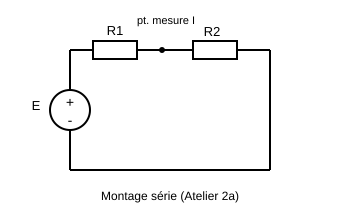

2. **(20 min) Montage série.** Réaliser le montage ci-dessus (le reproduire sur le compte-rendu avant de monter). Mesurer :
   - le courant I à trois endroits différents du circuit série (avant R1, entre R1 et R2, après R2) ;
   - la tension aux bornes de R1, puis de R2 ;
   - la tension aux bornes de l'alimentation.

     | Grandeur | I avant R1 | I entre R1-R2 | I après R2 | U(R1) | U(R2) | U(alim) |
     |---|---|---|---|---|---|---|
     | Valeur mesurée | | | | | | |

   - ❓ *Q2. Le courant est-il identique aux trois points de mesure ? Cela confirme-t-il votre cours sur le montage série ?*
   - ❓ *Q3. Calculez U(R1) + U(R2) et comparez à U(alim) mesurée. Calculez l'écart relatif. La loi des mailles est-elle vérifiée aux incertitudes de mesure près ?*
   - ❓ *Q4. Comparez le courant mesuré à la valeur théorique de la Q1 : calculez l'écart relatif.*


3. **(20 min) Montage parallèle.** Remonter R1 et R2 en parallèle sous la même alimentation E, comme ci-dessus. Mesurer :
   - le courant dans R1, le courant dans R2, le courant total débité par l'alimentation ;
   - la tension commune aux bornes de R1 et R2.

     | Grandeur | I(R1) | I(R2) | I(total) | U commune |
     |---|---|---|---|---|
     | Valeur mesurée | | | | |

   - ❓ *Q5. Calculez I(R1) + I(R2) et comparez à I(total) mesuré. La loi des nœuds est-elle vérifiée ?*
   - ❓ *Q6. La tension est-elle bien identique aux bornes de R1 et de R2 ? Est-ce cohérent avec le montage parallèle ?*
4. **(10 min) Puissance et bilan.**
   - ❓ *Q7. Calculez la puissance dissipée dans chaque résistance ($P = U \times I$ mesurés) puis la puissance totale débitée par l'alimentation ($P = U_{alim} \times I_{total}$). Comparez les deux.*
   - ❓ *Q8. Entre le montage série et le montage parallèle (mêmes R1, R2, même E), lequel consomme le plus de puissance totale ? Expliquez pourquoi en une phrase à partir de $R_{éq}$.*
- **Livrable :** schémas des deux montages, tableaux de mesures remplis, réponses Q1 à Q8.
- **⚙ Si matériel insuffisant :** basculer sur la version informatique de cet TP (version simulée du TP 1.1).

<a id="sec-version-simulee-du-tp-1-1-falstad-ou-tinkercad-circuits"></a>

#### Version simulée du TP 1.1 (Falstad ou Tinkercad Circuits)

- **Principe :** construire soi-même les mêmes montages série et parallèle dans Falstad, avec des voltmètres et ampèremètres virtuels. Les questions Q1 à Q8 et les tableaux sont les mêmes que pour la version matériel.
- **Avantage :** Falstad affiche en temps réel le courant (points mobiles sur les fils) et la tension (couleur des fils) : la loi des nœuds et la loi des mailles deviennent visibles.

**Étape 0 (10 min) : prise en main.** Ouvrir **falstad.com/circuit**, passer en français (**Options → Langue**), puis **Fichier → Nouveau circuit vide**. Relire la fiche outil en début de recueil. Astuce : la touche **/** (ou **Editer → Trouver un composant…**) permet de chercher un composant par son nom.

**Étape 1 (5 min) : préparation.** Répondre à la Q1 avant de construire quoi que ce soit.

**Étape 2 (20 min) : montage série.**

1. Placer le générateur : **Dessiner → Entrées et Générateurs → Ajouter Générateur de Tension (2 terminaux)**, puis cliquer-glisser verticalement sur la grille. Double-clic dessus et régler la tension à **9 V**.
2. Placer R₁ : **Dessiner → Ajouter Résistance** (raccourci **r**), cliquer-glisser horizontalement en partant de la borne + du générateur. Double-clic et régler **220 Ω**.
3. Placer R₂ de la même façon, à la suite de R₁, et la régler à **470 Ω**.
4. Fermer la boucle avec des fils : **Dessiner → Ajouter Fils** (raccourci **w**), de la fin de R₂ jusqu'à la borne − du générateur. Les points mobiles doivent apparaître : le courant circule.
5. Mesurer le courant : supprimer un morceau de fil (clic droit → **Supprimer**) et le remplacer par **Dessiner → Sorties et Etiquettes → Ajouter Ampèremètre**. Recommencer à deux autres endroits de la boucle (avant R₁, entre R₁ et R₂, après R₂).
6. Mesurer les tensions : **Dessiner → Sorties et Etiquettes → Ajouter Voltmètre/Sonde Oscilloscope**, et relier ses deux bornes de part et d'autre de R₁, puis de R₂, puis du générateur.
7. Remplir le tableau du montage série et répondre aux questions Q2 à Q4.

**Étape 3 (20 min) : montage parallèle.**

1. **Fichier → Nouveau circuit vide**, puis replacer le générateur réglé à 9 V.
2. Placer R₁ (220 Ω) et R₂ (470 Ω) **verticalement, côte à côte**, et relier leurs extrémités hautes ensemble à la borne +, et leurs extrémités basses ensemble à la borne −.
3. Insérer un ampèremètre dans la branche de R₁, un dans la branche de R₂, et un sur le fil qui part du générateur avant la séparation (le courant total).
4. Placer un voltmètre aux bornes de R₁, puis aux bornes de R₂.
5. Remplir le tableau du montage parallèle et répondre aux questions Q5 et Q6. Observer les points mobiles au nœud : le courant se partage.

**Étape 4 (10 min) : puissance et bilan.** Répondre à Q7 et Q8 à partir des valeurs relevées. Pour vérifier, Falstad affiche aussi la puissance d'un composant quand on le survole (bandeau du bas).

- **Livrable :** captures d'écran des deux montages, annotées (noms des composants, sens du courant), les deux tableaux remplis, réponses Q1 à Q8.

---

<a id="sec-tp-1-2-caracteristique-d-une-diode"></a>

### TP 1.2 : Caractéristique d'une diode

> **Durée :** 55 min · **Mode :** **Falstad** (le matériel n'étant pas disponible, la version simulée ci-dessous est la version de référence) · **Cours :** Chapitre 1, §1.4 · **Prérequis :** TP 1.1, fiche outil Falstad
> **Objectif :** relever point par point la caractéristique $I(V)$ d'une diode et en déduire sa tension de seuil.

> Le déroulé ci-dessous décrit la version sur **matériel réel**, conservée pour référence. La version **Falstad, à suivre en séance**, est détaillée juste après.

- **Matériel :** 1 alimentation, 1 diode silicium, 1 résistance de protection (~1 kΩ), 2 multimètres, plaque d'essai.
- **Sécurité :** ne jamais dépasser le courant maximal de la diode (limité naturellement par la résistance de protection) ; ne pas alimenter directement la diode sans résistance en série.

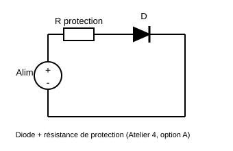

**Déroulé détaillé**

1. **(5 min) Montage et consignes.** Monter la diode en série avec la résistance de protection sous l'alimentation réglable.
   - ❓ *Q1. Pourquoi place-t-on une résistance de protection en série avec la diode ? Que risquerait-il de se passer sans elle ?*
2. **(10 min) Sens bloqué.** Inverser la diode (sens bloqué), faire varier la tension d'alimentation de 0 à sa valeur maximale par paliers, mesurer le courant à chaque palier.
   - ❓ *Q2. Le courant mesuré en sens bloqué est-il rigoureusement nul ? Donnez son ordre de grandeur et comparez-le au courant observé en sens passant (étape suivante).*
3. **(25 min) Sens passant : relevé point par point.** Remettre la diode dans le bon sens. Faire varier la tension d'alimentation par petits paliers, en resserrant les points autour du seuil attendu (0,5 V ; 0,55 V ; 0,6 V ; 0,63 V ; 0,65 V ; 0,68 V ; 0,7 V ; 0,72 V ; 0,75 V), et mesurer à chaque palier la tension $V_{diode}$ et le courant I.

     | $V_{diode}$ (V) | 0,5 | 0,55 | 0,6 | 0,63 | 0,65 | 0,68 | 0,7 | 0,72 | 0,75 |
     |---|---|---|---|---|---|---|---|---|---|
     | I (mA) | | | | | | | | | |

   - Tracer le graphe $I = f(V_{diode})$ sur papier millimétré ou tableur.
   - ❓ *Q3. À partir de quelle tension le courant commence-t-il à croître significativement (au-delà du bruit de mesure) ? Cette valeur est-elle cohérente avec les 0,6-0,7 V annoncés en cours pour le silicium ?*
   - ❓ *Q4. La progression du courant est-elle linéaire, ou de plus en plus rapide ? Que cela indique-t-il sur la nature de la caractéristique $I(V)$ d'une diode ?*
4. **(10 min) Bilan.**
   - ❓ *Q5. Citer une application où la diode est utilisée dans une carte électronique CIEL (redressement, protection, indicateur...).*

---

<a id="sec-version-falstad-du-tp-1-2-version-de-reference-tracer-la-caracteristiq"></a>

#### Version Falstad du TP 1.2 (version de référence) : tracer la caractéristique d'une diode

**Objectif :** construire un circuit diode + résistance de protection, relever point par point le couple $(V_{diode},\, I)$, tracer $I = f(V_{diode})$ et en déduire la tension de seuil.

Vous aurez besoin des racourcie clavier : https://defkey.com/fr/falstad-circuit-simulator-raccourcis-clavier. Si il n'y a pas de raccourcie cherchez dans le menu dessiner en hau à gauche.

**Étape 1 (10 min) : construire le circuit**

Le circuit à reproduire est celui du TP 1.2 (version matériel ci-dessus) : une source de tension continue, une résistance de protection de 1 kΩ et une diode en série, le tout refermé sur la masse.

1. **Placer la source** : menu **Ajouter une source de tension (2 bornes)** (*Draw → Inputs and Sources → Add Voltage Source (2-terminal)*). Tracer un segment **vertical** à gauche de l'écran (glisser du bas vers le haut).
2. **Régler la source** : clic droit dessus → **Éditer…**. Choisir une source **continue (DC)** et mettre la tension à **0,5 V** pour commencer.
3. **Placer la résistance** : **Ajouter une résistance** (*Draw → Passive Components → Add Resistor*). La tracer **horizontalement**, à partir de la borne du haut de la source.
4. **Régler la résistance** : clic droit → **Éditer…** → **1000 Ω** (1 kΩ).
5. **Placer la diode** : **Ajouter une diode**. La tracer horizontalement, dans le prolongement de la résistance. Vérifier le sens : la barre du symbole (la cathode) doit être **à droite**, côté masse. Si le sens est inversé, clic droit → **Inverser les bornes** , ou refaire le tracé dans l'autre sens.

   **Choisir le modèle de la diode** : clic droit sur la diode → **Éditer…** → dans la liste **Modèle** (*Model*), choisir **1N4148**, puis valider. Ne modifier aucun autre paramètre.

   > **Pourquoi ce réglage ?** Le modèle proposé par défaut (*default*) est une diode générique, beaucoup moins raide qu'une vraie diode au silicium : il donne environ 0,45 V à 1 mA et fait apparaître un « seuil » vers 0,4 V. Le modèle **1N4148** reprend les paramètres de la diode réelle du TP matériel : environ 0,6 V à 1 mA, comme annoncé en cours.
6. **Placer la masse** : **Ajouter une masse** . La placer sous la borne du bas de la source, et la relier.
7. **Fermer le circuit** : **Ajouter un fil**w pour relier la sortie de la diode jusqu'à la masse.
8. **Vérifier avant de lancer** : le circuit doit former une boucle fermée unique : source → résistance → diode → masse → source. Aucun fil ne doit rester en l'air.

- ❓ *Q1. Reproduisez sur votre compte-rendu le schéma que vous avez construit, avec les valeurs. Pourquoi place-t-on une résistance de protection en série avec la diode ? Que se passerait-il, dans le simulateur comme en réel, si on la supprimait ?*

**Étape 2 (10 min) : observer le sens bloqué**

9. Inverser la diode (clic droit → **Inverser les bornes**) : elle est maintenant montée **en sens bloqué**.
10. Lancer la simulation (bouton **Marche / Run** dans le panneau de droite s'il est sur Arrêt).
11. Faire varier la tension de la source de 0 V à 5 V (clic droit → **Éditer…**, ou ajouter un curseur : clic droit → **Curseurs…** (*Sliders…*) pour régler la tension en continu).
12. Survoler la diode pour lire le courant qui la traverse, à chaque valeur de tension.

- ❓ *Q2. Le courant en sens bloqué est-il rigoureusement nul ? Notez son ordre de grandeur (attention aux unités : le simulateur affiche souvent des nanoampères ou des picoampères). Comparez-le au courant que vous mesurerez en sens passant à l'étape suivante.*

**Étape 3 (25 min) : relevé point par point en sens passant**

13. Remettre la diode dans le **bon sens** (clic droit → **Inverser les bornes**).
14. Pour chaque valeur de tension de source indiquée dans le tableau, éditer la source, laisser la simulation se stabiliser une seconde, puis **survoler la diode** pour lire $V_{diode}$ et $I$.
15. Compléter le tableau ci-dessous (les valeurs de source sont resserrées autour du seuil attendu) :

| Tension de la source (V) | 0,50 | 0,60 | 0,70 | 0,80 | 1,00 | 1,50 | 2,00 | 3,00 | 5,00 |
|---|---|---|---|---|---|---|---|---|---|
| $V_{diode}$ mesurée (V) | | | | | | | | | |
| $I$ mesuré (mA) | | | | | | | | | |

16. **Tracer la caractéristique** $I = f(V_{diode})$ : sur papier millimétré, ou dans un tableur en reportant les deux lignes du tableau.

- ❓ *Q3. À partir de quelle tension $V_{diode}$ le courant commence-t-il à croître significativement ? Cette valeur est-elle cohérente avec les 0,6 à 0,7 V annoncés en cours pour le silicium ?*
- ❓ *Q4. Quand la tension de la source passe de 2 V à 5 V, de combien varie $V_{diode}$ ? Et le courant $I$ ? Qu'en concluez-vous sur le modèle simplifié « la diode passante impose environ 0,7 V à ses bornes » ?*
- ❓ *Q5. La progression du courant est-elle linéaire, ou de plus en plus rapide ? Que cela indique-t-il sur la nature de la caractéristique $I(V)$ d'une diode ? Une diode obéit-elle à la loi d'Ohm ?*

**Étape 4 (10 min) : vérification par le calcul et bilan**

17. Reprendre trois points du tableau (par exemple sources à 1 V, 2 V et 5 V) et vérifier la cohérence par la loi des mailles : la tension aux bornes de la résistance vaut $U_R = E - V_{diode}$, et le courant doit valoir $I = U_R / R$.

- ❓ *Q6. Pour chacun des trois points, comparez le courant calculé $I = (E - V_{diode})/R$ au courant lu dans le simulateur. Les deux concordent-ils ?*
- ❓ *Q7. Citez une application où la diode est utilisée dans une carte électronique*

**Livrable :** schéma du circuit construit, tableau de mesures complet, graphe $I = f(V_{diode})$ tracé et annoté (seuil repéré), réponses Q1 à Q7, capture d'écran du circuit sous Falstad.

---

---

<a id="sec-tp-1-3-condensateur-et-bobine-en-regime-sinusoidal-impedance-et-dephas"></a>

### TP 1.3 : Condensateur et bobine en régime sinusoïdal : impédance et déphasage

> **Durée :** 55 min · **Mode :** Falstad (les étudiants construisent le circuit) · **Cours :** Chapitre 1, §1.2 · **Prérequis :** fiche outil Falstad, TP 1.1
> **Objectif :** constater qu'un condensateur et une bobine ne se comportent pas comme une résistance : leur « résistance apparente » (impédance) dépend de la fréquence, et ils déphasent le courant par rapport à la tension.

**Ce qu'il faut savoir avant de commencer**

En régime continu, un condensateur est un circuit ouvert (aucun courant) et une bobine est un fil (aucune tension). En régime sinusoïdal, tout change : le courant qui les traverse existe, mais il est **limité** par une grandeur qui joue le rôle d'une résistance, l'**impédance** $Z$ (en ohms), et il est **décalé dans le temps** par rapport à la tension : c'est le **déphasage** $\varphi$.

| Dipôle | Impédance | Dépend de $f$ ? | Le courant est… |
|---|---|---|---|
| Résistance $R$ | $Z_R = R$ | non | en phase avec la tension |
| Condensateur $C$ | $Z_C = \dfrac{1}{C\omega}$ | oui, **diminue** quand $f$ augmente | **en avance** sur la tension |
| Bobine $L$ | $Z_L = L\omega$ | oui, **augmente** quand $f$ augmente | **en retard** sur la tension |

avec $\omega = 2\pi f$ la **pulsation** (en rad/s). Ne pas oublier le $2\pi$ : c'est l'erreur la plus fréquente.

Quand R et C (ou R et L) sont en série, les impédances **ne s'additionnent pas** comme des résistances, parce que les tensions ne sont pas en phase. Le module de l'impédance totale se calcule « comme une hypoténuse » :

$$\lvert Z \rvert = \sqrt{R^2 + Z_C^2} \qquad \text{puis} \qquad I_{max} = \frac{U_{max}}{\lvert Z \rvert}$$

**Exemple guidé (à refaire avec vos valeurs) :** pour $R = 2\ \text{k}\Omega$, $C = 50$ nF et $f = 1$ kHz :
$\omega = 2\pi \times 1000 = 6283$ rad/s ; $Z_C = 1/(50 \times 10^{-9} \times 6283) = 3183\ \Omega$ ; $\lvert Z \rvert = \sqrt{2000^2 + 3183^2} = 3759\ \Omega$ ; avec $U_{max} = 5$ V, $I_{max} = 5/3759 = 1{,}33$ mA. Ces valeurs ne sont **pas** celles du TP : elles servent seulement de modèle de calcul.

**Comment on « voit » le courant sur Falstad :** l'oscilloscope n'affiche que des tensions. On observe donc la tension aux bornes de la résistance $u_R(t)$, qui est proportionnelle au courant ($u_R = R \, i$) : même forme, même déphasage, et $I_{max} = U_{R,max}/R$.

**Étape 1 (10 min) : construire le circuit RC**

1. Placer une **source de tension sinusoïdale** : **Dessiner → Entrées et sources → Ajouter une source de tension (2 bornes)**, puis clic droit → **Éditer…** : forme d'onde **sinusoïdale**, tension max **5 V**, fréquence **1 kHz**. Relier sa borne basse à une masse.
2. Placer en série, depuis la borne haute de la source : une **résistance** R = **1 kΩ**, puis un **condensateur** (**Dessiner → Composants passifs → Ajouter un condensateur**) C = **100 nF**, dont la seconde borne revient à la masse. Ordre important pour la suite : la résistance doit être **du côté de la source**, le condensateur du côté de la masse.
3. Afficher les signaux : clic droit sur la **source** → **Voir dans un nouvel oscilloscope** (tension d'entrée $u(t)$), puis clic droit sur la **résistance** → **Voir dans un nouvel oscilloscope** (tension $u_R(t)$, image du courant). Attention à bien cliquer sur la résistance et non sur le condensateur.
4. Pour comparer les deux courbes sur le même graphe : clic droit sur l'un des oscilloscopes → **Combiner** (*Combine*) avec l'autre, ou les laisser empilés l'un au-dessus de l'autre.
5. Vérification avant de continuer : les deux courbes doivent être des sinusoïdes de même période (1 ms), celle de $u_R$ plus petite que celle de la source et décalée vers la gauche. Si $u_R$ apparaît « à l'envers » (inversée), clic droit sur la résistance → **Inverser les bornes**.

**Étape 2 (15 min) : mesurer amplitude et déphasage à 1 kHz**

6. **Amplitude.** Survoler l'oscilloscope de la résistance : Falstad affiche la valeur maximale de $u_R$ (« max »). Reporter $U_{R,max}$ puis calculer $I_{max} = U_{R,max}/R$ (en mA si $U_R$ en V et R en kΩ).
7. **Déphasage.** Repérer sur l'oscilloscope combiné deux passages par zéro **en montée**, l'un pour $u(t)$, l'autre pour $u_R(t)$, les plus proches l'un de l'autre. L'écart horizontal entre eux est $\Delta t$ ; la distance entre deux passages par zéro en montée d'une même courbe est la période $T$. Convertir ce décalage en degrés :

$$\varphi = 360 \times \frac{\Delta t}{T}$$

   Exemple : si $\Delta t$ vaut un dixième de période, $\varphi = 36°$. Si $u_R$ passe par zéro **avant** $u$, le courant est **en avance**.

8. **Avant de mesurer**, calculer $Z_C$, $\lvert Z \rvert$ et $I_{max}$ attendus à 1 kHz (suivre l'exemple guidé) : la mesure doit ensuite confirmer le calcul à quelques pourcents près. Compléter la première ligne du tableau.

| f | $\omega = 2\pi f$ (rad/s) | $Z_C = 1/(C\omega)$ calculé (Ω) | $\lvert Z \rvert = \sqrt{R^2 + Z_C^2}$ calculé (Ω) | $I_{max}$ calculé (mA) | $U_{R,max}$ lu (V) | $I_{max}$ mesuré (mA) | $\Delta t$ lu | $\varphi$ mesuré (°) | Le courant est… |
|---|---|---|---|---|---|---|---|---|---|
| 1 kHz | | | | | | | | | en avance / en retard |
| 100 Hz | | | | | | | | | en avance / en retard |
| 10 kHz | | | | | | | | | en avance / en retard |

- ❓ *Q1. À 1 kHz :*
  *a) Comparez $I_{max}$ mesuré et $I_{max}$ calculé. Sont-ils cohérents ?*
  *b) Calculez le courant que l'on obtiendrait si le condensateur était remplacé par une vraie résistance de 1592 Ω en série avec R (les résistances s'additionnent alors simplement). Comparez à la valeur mesurée.*
  *c) Citez deux différences entre le condensateur et cette résistance de 1592 Ω : l'une visible sur l'oscilloscope (pensez au décalage des courbes), l'autre qui apparaîtra à l'étape 3.*
- ❓ *Q2. Le courant est-il en avance ou en retard sur la tension (c'est-à-dire : $u_R$ passe-t-elle par zéro avant ou après $u$) ? Est-ce cohérent avec le tableau du début du TP ? Expliquez en une phrase pourquoi le courant doit précéder la tension dans un condensateur (indice : que faut-il pour que la tension aux bornes du condensateur monte ?).*

**Étape 3 (15 min) : faire varier la fréquence**

9. Éditer la source : fréquence **100 Hz**. Refaire les calculs puis les mesures (la période vaut maintenant 10 ms, ajuster la base de temps de l'oscilloscope si les courbes sont trop serrées ou trop larges).
10. Passer à **10 kHz** : la période n'est plus que 0,1 ms et le décalage $\Delta t$ devient très petit ; il faut réduire la base de temps pour le voir. S'il n'est pas mesurable, noter « déphasage quasi nul ».

- ❓ *Q3. À partir des trois lignes du tableau :*
  *a) Quand la fréquence est multipliée par 10, par combien $Z_C$ est-il divisé ?*
  *b) Comment évolue le déphasage $\varphi$ quand $f$ augmente ? Vers quelle valeur tend-il ?*
  *c) À 10 kHz, comparez $Z_C$ à $R$. Lequel des deux limite le courant ? En déduire si le circuit se comporte plutôt comme une résistance seule (comportement résistif) ou comme un condensateur (comportement capacitif).*
- ❓ *Q4. On dit qu'un condensateur « laisse passer les hautes fréquences et bloque les basses fréquences ». Reformulez cette phrase à partir de vos mesures, en comparant les courants obtenus à 100 Hz et à 10 kHz pour la même tension d'entrée de 5 V. Que se passerait-il en continu ($f = 0$) ?*

**Étape 4 (10 min) : remplacer le condensateur par une bobine**

11. Supprimer le condensateur et placer une **bobine** (**Dessiner → Composants passifs → Ajouter une inductance**) L = **100 mH** au même endroit. Remettre la source à **1 kHz**. Refaire les mesures d'amplitude et de déphasage, avec la même méthode (passages par zéro en montée).

- ❓ *Q5. Bobine à 1 kHz :*
  *a) Calculez $Z_L = L\omega$, puis $\lvert Z \rvert = \sqrt{R^2 + Z_L^2}$ et $I_{max}$ attendu. Comparez à la mesure.*
  *b) Le courant est-il maintenant en avance ou en retard sur la tension ?*
  *c) Qu'est-ce qui change par rapport au condensateur (sens du déphasage, et sens de variation de l'impédance avec la fréquence, d'après le tableau du début) ?*
- ❓ *Q6. Résumez en une phrase, pour chacun des trois dipôles R, C et L : son impédance dépend-elle de la fréquence, dans quel sens, et le courant est-il en phase, en avance ou en retard sur la tension.*

**Livrable :** tableau complet, captures d'écran des oscillogrammes (1 kHz avec C, 1 kHz avec L) avec $\Delta t$ et $T$ repérés, réponses Q1 à Q6.

---

<a id="sec-tp-1-4-resonance-d-un-dipole-rlc-serie"></a>

### TP 1.4 : Résonance d'un dipôle RLC série

> **Durée :** 55 min · **Mode :** Falstad · **Cours :** Chapitre 1, §1.2 (résonance, facteur de qualité, surtension) · **Prérequis :** TP 1.3
> **Objectif :** mettre en évidence la fréquence de résonance d'un circuit RLC série, mesurer sa bande passante et observer le phénomène de surtension.

**Étape 1 (10 min) : construire le circuit**

1. Source sinusoïdale, tension max **1 V** (attention, 1 V et non 5 V : la surtension à la résonance sera déjà importante), fréquence initiale **1 kHz**, borne basse à la masse.
2. En série depuis la source : R = **20 Ω**, L = **10 mH**, C = **100 nF**, retour à la masse. (RLC : On met une résistance, puis une bobine puis un condensateur).
3. Oscilloscope sur la **résistance** (image du courant) et un second sur le **condensateur**.

- ❓ *Q1. Avant toute mesure, calculez la fréquence de résonance théorique $f_0 = \dfrac{1}{2\pi\sqrt{LC}}$ et le facteur de qualité $Q = \dfrac{1}{R}\sqrt{\dfrac{L}{C}}$.*

**Étape 2 (20 min) : relevé de la courbe de résonance**

4. Pour chaque fréquence du tableau, éditer la source, attendre la stabilisation, relever l'amplitude de $u_R$ (donc $I_{max} = U_{R,max}/R$) et l'amplitude de $u_C$.

| f (kHz) | 1 | 3 | 4 | 4,5 | 4,8 | 5,0 | 5,2 | 5,5 | 6 | 8 | 12 |
|---|---|---|---|---|---|---|---|---|---|---|---|
| $U_{R,max}$ (V) | | | | | | | | | | | |
| $I_{max}$ (mA) | | | | | | | | | | | |
| $U_{C,max}$ (V) | | | | | | | | | | | |

5. Affiner autour du maximum : tester 4,9 ; 5,0 ; 5,1 kHz pour encadrer précisément $f_0$.
6. Tracer $I_{max} = f(f)$ (papier ou tableur).

- ❓ *Q2. Quelle fréquence donne le courant maximal ? Comparez à la valeur théorique.*
- ❓ *Q3. À la résonance, quelle est la tension max aux bornes du condensateur ? Comparez-la à la tension de la source (1 V). Quel est le rapport ? Comparez ce rapport au facteur de qualité Q calculé en Q1. C'est le phénomène de **surtension**.*
- ❓ *Q4. Pourquoi ce phénomène impose-t-il de choisir des condensateurs avec une tenue en tension supérieure à celle de l'alimentation ?*

**Étape 3 (15 min) : bande passante et sélectivité**

7. Repérer $I_{max}$ à la résonance, calculer $I_{max}/\sqrt{2}$, puis chercher (en affinant la fréquence de part et d'autre de $f_0$) les deux fréquences $f_1$ et $f_2$ pour lesquelles le courant vaut cette valeur. La bande passante vaut $\Delta f = f_2 - f_1$.

- ❓ *Q5. Comparez $\Delta f$ mesurée à la valeur théorique $\Delta f = f_0/Q$.*

8. Remplacer R = 20 Ω par R = **100 Ω** et relever à nouveau $I_{max}$ à 4, 5 et 6 kHz.

- ❓ *Q6. La résonance est-elle plus « pointue » ou plus « plate » avec 100 Ω ? Quel est le nouveau Q ? Lequel des deux circuits est le plus sélectif ?*
- ❓ *Q7. Application : un lecteur NFC doit capter 13,56 MHz et rejeter les fréquences voisines. Faut-il un Q élevé ou faible ? Justifiez.*

**Livrable :** tableau, courbe de résonance tracée avec $f_0$, $f_1$, $f_2$ et $\Delta f$ repérés, réponses Q1 à Q7.

---

<a id="sec-tp-1-5-theoreme-de-superposition-et-modele-de-thevenin"></a>

### TP 1.5 : Théorème de superposition et modèle de Thévenin

> **Durée :** 55 min · **Mode :** Falstad · **Cours :** Chapitre 1, §1.2 (théorèmes utiles) · **Prérequis :** TP 1.1
> **Objectif :** vérifier expérimentalement deux théorèmes qui permettent de simplifier l'étude de n'importe quel circuit linéaire.

**Étape 1 (10 min) : construire le réseau à deux sources**

1. Placer deux sources de tension **continues** : $E_1$ = **12 V** (à gauche) et $E_2$ = **5 V** (à droite), chacune avec sa borne basse à la masse.
2. Placer trois résistances : $R_1$ = **1 kΩ** de la borne haute de $E_1$ vers un nœud central **A** ; $R_2$ = **2,2 kΩ** de la borne haute de $E_2$ vers ce même nœud A ; $R_3$ = **1 kΩ** du nœud A vers la masse.
3. Vérifier que le nœud A relie bien les trois résistances (un point de jonction apparaît dans Falstad quand trois fils se rejoignent).

**Étape 2 (15 min) : théorème de superposition**

4. Lancer la simulation, survoler le nœud A et relever $V_A$ (tension du nœud par rapport à la masse). Relever aussi le courant dans $R_3$.
5. **Éteindre $E_2$** : clic droit sur $E_2$ → **Éditer…** → tension **0 V** (une source de tension éteinte équivaut à un fil). Relever $V_{A1}$.
6. **Rallumer $E_2$ (5 V) et éteindre $E_1$** (0 V). Relever $V_{A2}$.

| Configuration | $V_A$ mesurée | $I_{R_3}$ mesurée |
|---|---|---|
| Les deux sources actives | | |
| $E_1$ seule ($E_2$ = 0 V) | | |
| $E_2$ seule ($E_1$ = 0 V) | | |
| Somme des deux contributions | | |

- ❓ *Q1. Comparez $V_{A1} + V_{A2}$ à $V_A$. Le théorème de superposition est-il vérifié ?*
- ❓ *Q2. Calculez $V_{A1}$ par un pont diviseur (avec $E_2$ éteinte, $R_2$ et $R_3$ sont en parallèle) et comparez à la mesure.*
- ❓ *Q3. Pourquoi « éteindre » une source de tension revient-il à la remplacer par un fil, et non par un circuit ouvert ?*

**Étape 3 (20 min) : modèle de Thévenin vu par $R_3$**

On considère $R_3$ comme la « charge » : tout le reste du circuit (les deux sources, $R_1$, $R_2$) est le « dipôle actif » que l'on veut remplacer par un modèle de Thévenin (une source $E_{Th}$ en série avec une résistance $R_{Th}$).

7. Remettre les deux sources actives. **Retirer $R_3$** (clic droit → Supprimer) : le nœud A est maintenant « à vide ». Relever la tension $V_A$ à vide : c'est $E_{Th}$.
8. Remplacer $R_3$ par un **fil** direct entre A et la masse (court-circuit) : relever le courant qui y circule, $I_{CC}$. En déduire $R_{Th} = E_{Th}/I_{CC}$.
9. Vérification par le calcul : $R_{Th}$ est la résistance vue depuis A quand les sources sont éteintes, soit $R_1$ en parallèle avec $R_2$. Calculer et comparer.
10. **Construire le modèle de Thévenin** à côté : une source de tension continue réglée sur la valeur $E_{Th}$ mesurée, en série avec une résistance de valeur $R_{Th}$, alimentant une résistance de **1 kΩ** (la charge $R_3$). Relever la tension aux bornes de cette charge.

- ❓ *Q4. Comparez la tension aux bornes de la charge dans le circuit complet (étape 4) et dans le modèle de Thévenin (étape 10). Le modèle est-il équivalent ?*
- ❓ *Q5. Remplacez la charge par 470 Ω dans les deux circuits : l'équivalence tient-elle toujours ?*
- ❓ *Q6. Quel est l'intérêt pratique de ce modèle quand on veut brancher un capteur ou un appareil de mesure sur un circuit complexe (pensez à l'effet de charge vu au TP 1.1) ?*

**Livrable :** les deux tableaux, les captures des trois circuits (réseau complet, réseau court-circuité, modèle de Thévenin), réponses Q1 à Q6.

---

<a id="sec-tp-1-6-decibels-et-chaine-d-attenuateurs"></a>

### TP 1.6 : Décibels et chaîne d'atténuateurs

> **Durée :** 55 min · **Mode :** Falstad · **Cours :** Chapitre 1, §1.3 · **Prérequis :** TP 1.1 (pont diviseur)
> **Objectif :** mesurer des gains en tension, les convertir en dB, et vérifier que les gains en dB s'additionnent en cascade… à condition que les étages ne se chargent pas mutuellement.

**Étape 1 (10 min) : un atténuateur**

1. Source de tension **continue** (ou sinusoïdale à 1 kHz, au choix) $U_e$ = **10 V**, borne basse à la masse.
2. Pont diviseur : $R_1$ = **1 kΩ** puis $R_2$ = **1 kΩ** vers la masse. La sortie $U_s$ est prise aux bornes de $R_2$.
3. Relever $U_s$, calculer $A_v = U_s/U_e$ et le gain en dB : $G = 20\log_{10}(U_s/U_e)$.

- ❓ *Q1. Quelle valeur en dB obtenez-vous ? Retrouvez la valeur remarquable correspondante.*

**Étape 2 (15 min) : deux atténuateurs en cascade**

4. Ajouter un second pont diviseur identique ($R_3$ = 1 kΩ, $R_4$ = 1 kΩ) alimenté par la sortie du premier (relier le haut de $R_3$ au point $U_s$ du premier pont). Relever la tension $U_{s2}$ aux bornes de $R_4$.
5. Calculer le gain total mesuré en dB.

- ❓ *Q2. On attendait −6 dB + (−6 dB) = −12 dB. Obtenez-vous cette valeur ? Si non, calculez la résistance équivalente vue par le premier pont ($R_2$ en parallèle avec $R_3 + R_4$) et expliquez l'écart : c'est l'**effet de charge** entre étages.*

**Étape 3 (15 min) : isoler les étages avec un suiveur**

6. Insérer entre les deux ponts un **AOP monté en suiveur** (voir TP 4.1 pour le câblage : entrée + sur la sortie du premier pont, sortie reliée à l'entrée −, alimentation ±15 V ou 12 V). La sortie du suiveur alimente le second pont.
7. Relever à nouveau $U_{s2}$ et le gain total en dB.

- ❓ *Q3. Retrouvez-vous maintenant −12 dB ? Pourquoi un suiveur (gain 0 dB) permet-il aux gains de s'additionner correctement ? Quelle propriété du suiveur est en jeu (résistance d'entrée, résistance de sortie) ?*

**Étape 4 (15 min) : ajouter un étage amplificateur**

8. En sortie du second pont, ajouter un **AOP non inverseur** de gain 10 : entrée + sur $U_{s2}$, résistance $R_a$ = **1 kΩ** entre l'entrée − et la masse, résistance $R_b$ = **9 kΩ** entre la sortie et l'entrée − (gain $1 + R_b/R_a = 10$). Relever la tension finale.

- ❓ *Q4. Convertissez le gain de l'amplificateur en dB. Calculez le gain total de la chaîne (atténuateur, atténuateur, amplificateur) en additionnant les dB, puis comparez à la mesure.*
- ❓ *Q5. Exprimez la tension finale en dBV (référence 1 V) et la tension d'entrée en dBV. Vérifiez que la différence redonne le gain total.*
- ❓ *Q6. Application : dans un bilan de liaison Wi-Fi ou fibre, on additionne les gains d'antenne et les pertes de câble en dB sans se soucier de l'effet de charge. Quelle hypothèse cela suppose-t-il sur les impédances (rappel : 50 Ω partout) ?*

**Livrable :** tableau des tensions et gains (linéaire et dB) pour chaque configuration, captures des circuits, réponses Q1 à Q6.

---

<a id="sec-tp-1-7-led-tension-de-seuil-couleur-et-longueur-d-onde"></a>

### TP 1.7 : LED : tension de seuil, couleur et longueur d'onde

> **Durée :** 45 min · **Mode :** Falstad · **Cours :** Chapitre 1, §1.5 et §1.6 · **Prérequis :** TP 1.2 (diode)
> **Objectif :** relier la tension de seuil d'une LED à la couleur qu'elle émet, et retrouver la longueur d'onde à partir de l'énergie des photons.

**Étape 1 (10 min) : construire le circuit**

1. Source de tension continue $E$ = **5 V**, borne basse à la masse.
2. Résistance de protection R = **330 Ω** en série, puis une **LED** : **Dessiner → Sorties et étiquettes → Ajouter une LED**, cathode (barre) côté masse.
3. Clic droit sur la LED → **Éditer…** : repérer les réglages de **couleur** et de **tension directe** (*forward voltage*). Régler une LED **rouge** avec une tension directe de **1,8 V**.
4. Lancer la simulation : la LED doit s'allumer (elle se colore dans le simulateur). Survoler la LED pour lire sa tension et son courant.

**Étape 2 (15 min) : trois couleurs**

5. Compléter le tableau pour trois LED en changeant la couleur et la tension directe : rouge 1,8 V ; verte 2,1 V ; bleue 3,0 V.

| LED | Tension directe réglée $V_F$ (V) | Tension mesurée aux bornes (V) | Courant mesuré (mA) | Énergie du photon $E = eV_F$ (eV) | $\lambda = \dfrac{hc}{E}$ calculée (nm) | Couleur attendue pour cette λ |
|---|---|---|---|---|---|---|
| Rouge | 1,8 | | | | | |
| Verte | 2,1 | | | | | |
| Bleue | 3,0 | | | | | |

Constantes : $h = 6{,}63 \times 10^{-34}$ J·s, $c = 3{,}0 \times 10^8$ m/s, $e = 1{,}6 \times 10^{-19}$ C. Astuce : $\lambda\,(\text{nm}) \approx 1240 / E\,(\text{eV})$.

- ❓ *Q1. La tension de seuil d'une LED est-elle la même quelle que soit sa couleur ? Dans quel sens varie-t-elle du rouge au bleu ?*
- ❓ *Q2. Les longueurs d'onde calculées sont-elles cohérentes avec les couleurs (rouge ≈ 620-700 nm, vert ≈ 500-570 nm, bleu ≈ 450-490 nm) ? D'où vient l'écart éventuel (la tension aux bornes n'est pas exactement l'énergie du gap) ?*
- ❓ *Q3. Expliquez avec le cours (§1.5-1.6) pourquoi une LED bleue a besoin d'une tension plus élevée qu'une LED rouge.*

**Étape 3 (15 min) : dimensionner la résistance de protection**

6. Pour la LED bleue, on veut un courant de **10 mA** exactement. Calculer la résistance nécessaire : $R = (E - V_F)/I$. La régler dans le simulateur et vérifier le courant.
7. Passer $E$ à **3,3 V** (tension d'un microcontrôleur) : la LED bleue s'allume-t-elle encore correctement ? Et la rouge ?

- ❓ *Q4. Pourquoi ne peut-on pas piloter directement une LED bleue de 3,0 V avec une sortie 3,3 V et une résistance de 330 Ω ? Quel courant obtient-on ?*
- ❓ *Q5. Application : les LED de face avant d'un switch ou d'une carte réseau sont de couleurs différentes. En quoi cela influence-t-il le choix des résistances de limitation sur la carte ?*

**Livrable :** tableau complet, réponses Q1 à Q5, capture du circuit avec la LED bleue à 10 mA.

---

<a id="sec-tp-1-8-pour-aller-plus-loin-photodiode-deux-modes-de-fonctionnement"></a>

### TP 1.8 (pour aller plus loin) : Photodiode : deux modes de fonctionnement

> **Durée :** 45 min · **Mode :** Falstad (modèle équivalent) · **Cours :** Chapitre 1, §1.8 · **Prérequis :** TP 1.2 et TP 1.7
> **Objectif :** comprendre les deux modes d'utilisation d'une photodiode (photoconducteur et photovoltaïque) à partir de son modèle électrique équivalent.

Falstad ne propose pas de composant « photodiode » avec une commande d'éclairement. On utilise donc son **modèle électrique** : une **source de courant** (le courant photonique $I_{ph}$, proportionnel à l'éclairement) en parallèle avec une **diode** ordinaire (la jonction PN). Faire varier $I_{ph}$ revient à faire varier la lumière reçue.

**Étape 1 (10 min) : construire le modèle**

1. Placer une **diode** verticale, anode en bas, cathode en haut.
2. Placer une **source de courant** (**Dessiner → Entrées et sources → Ajouter une source de courant**) en parallèle de la diode, orientée pour que le courant circule **de la cathode vers l'anode à l'extérieur** de la diode (c'est-à-dire dans le sens inverse de la diode). Régler $I_{ph}$ = **50 µA**.
3. Repérer les deux bornes du modèle : **K** (cathode, en haut) et **A** (anode, en bas). C'est ce dipôle que l'on va utiliser dans les deux modes.

**Étape 2 (15 min) : mode photoconducteur (capteur, récepteur fibre)**

4. Polariser le modèle **en inverse** : source de tension continue **5 V** dont le + est relié à K ; entre A et la masse, placer une **résistance de mesure** R = **10 kΩ**. La tension de sortie est prise aux bornes de R.
5. Relever $U_s$ pour $I_{ph}$ = 10 µA, 20 µA, 50 µA, 100 µA, 200 µA.

| $I_{ph}$ (µA) | 10 | 20 | 50 | 100 | 200 |
|---|---|---|---|---|---|
| $U_s$ mesurée (V) | | | | | |
| $U_s = R \times I_{ph}$ calculée (V) | | | | | |

- ❓ *Q1. La tension de sortie est-elle proportionnelle à l'éclairement ? Pourquoi ce mode est-il utilisé dans un récepteur de fibre optique ou un capteur de luminosité ?*
- ❓ *Q2. Que se passe-t-il si l'on passe la tension de polarisation de 5 V à 10 V, à $I_{ph}$ constant ? Que peut-on en conclure sur l'indépendance du courant vis-à-vis de la tension inverse ?*

**Étape 3 (15 min) : mode photovoltaïque (cellule solaire)**

6. Retirer la source 5 V. Relier simplement une résistance de charge R = **10 kΩ** entre K et A. Relever la tension aux bornes de la charge pour les mêmes valeurs de $I_{ph}$.
7. Refaire la mesure avec R = 100 kΩ, puis en circuit ouvert (supprimer R).

- ❓ *Q3. La tension obtenue est-elle proportionnelle à $I_{ph}$ ? Vers quelle valeur maximale tend-elle en circuit ouvert ? À quoi correspond cette valeur (pensez à la tension de seuil de la diode) ?*
- ❓ *Q4. Dans ce mode, la photodiode fournit-elle ou consomme-t-elle de l'énergie ? En quoi est-ce le principe d'un panneau solaire ?*
- ❓ *Q5. Résumez dans un tableau les différences entre les deux modes : polarisation, grandeur de sortie, linéarité, application.*

**Livrable :** les deux tableaux, captures des deux montages, réponses Q1 à Q5.

---

<a id="sec-tp-1-9-diviseur-de-tension-a-vide-et-en-charge"></a>

### TP 1.9 : Diviseur de tension à vide et en charge `BTS1` `BTS2`

> **Durée :** 1 h 30 · **Mode :** matériel (version simulée ci-dessous) · **Cours :** Chapitre 1, §1.1 (diviseur de tension, caractéristique U(I)) · **Prérequis :** TP 1.1
> **Objectif :** constater qu'un diviseur de tension ne donne la tension prévue que si on ne lui demande presque pas de courant, et savoir dimensionner un pont diviseur pour une entrée de microcontrôleur.

**Problématique :** un capteur fournit un signal de 0 à 5 V, mais la carte ESP32 qui doit le lire n'accepte pas plus de 3,3 V sur ses entrées. Un simple pont de deux résistances suffit-il ? À quelle condition ?

- **Matériel par binôme (× 8) :** 1 alimentation stabilisée 0-15 V, 2 multimètres, 1 plaque d'essai, cordons et fils de câblage.
- **Composants par binôme :** résistances 1/4 W : 2 × 1 kΩ, 1 × 2,2 kΩ, 1 × 10 kΩ, 1 × 100 Ω.
- **Sécurité :** couper l'alimentation avant chaque modification du montage. Avec 100 Ω en charge, le courant atteint environ 11 mA : rien de dangereux, mais ne pas descendre plus bas en résistance.

<p align="center">
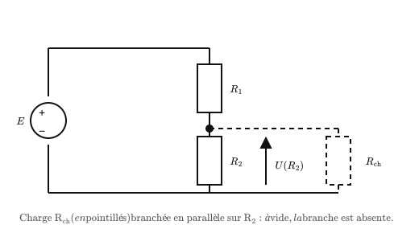
</p>

<p align="center"><em>Pont diviseur R1, R2 alimenté par E, avec une charge $R_{ch}$ branchée en parallèle sur R2.</em></p>

**Déroulé détaillé**

1. **(15 min) Préparation : le diviseur à vide.** On prend E = 12 V, R₁ = R₂ = 1 kΩ, sans charge.
   - ❓ *Q1. Rappelez la formule du diviseur de tension (cours, équation 2). Calculez la tension de sortie attendue U(R₂) aux bornes de R2.*
   - ❓ *Q2. Calculez le courant qui traverse R1 et R2.*

   Réalisez le montage **sans $R_{ch}$**, réglez E = 12 V et mesurez U(R₂) et le courant I débité par l'alimentation.

   | Grandeur | E | U(R₂) | I |
   |---|---|---|---|
   | Valeur calculée | 12 V | | |
   | Valeur mesurée | | | |

   - ❓ *Q3. La mesure est-elle conforme au calcul ?*

2. **(40 min) Le diviseur en charge.** On branche maintenant une charge $R_{ch}$ **en parallèle sur R2** (voir le schéma), successivement de 10 kΩ, 1 kΩ, puis 100 Ω. Pour chaque charge, mesurez U(R₂) et le courant I débité par l'alimentation.

   | Charge $R_{ch}$ | Pas de charge | 10 kΩ | 1 kΩ | 100 Ω |
   |---|---|---|---|---|
   | U(R₂) mesurée | | | | |
   | I mesuré | | | | |
   | Écart à la valeur à vide (%) | 0 % | | | |

   - ❓ *Q4. Comment évolue U(R₂) quand la charge $R_{ch}$ diminue ? Et le courant débité ?*
   - ❓ *Q5. R2 et $R_{ch}$ sont en parallèle. Pour $R_{ch}$ = 1 kΩ, calculez la résistance équivalente R₂ // $R_{ch}$, puis la valeur théorique de U(R₂) avec la formule du diviseur. Comparez à votre mesure.*
   - ❓ *Q6. Pour quelle charge l'écart reste-t-il inférieur à 5 % ? Complétez la règle : « le diviseur fonctionne correctement si $R_{ch}$ est au moins … fois plus grande que R2 ».*
   - ❓ *Q7. Expliquez avec vos mots pourquoi la tension s'effondre avec $R_{ch}$ = 100 Ω. Indice : par où passe le courant ?*

3. **(25 min) Application : adapter un signal 5 V pour une entrée 3,3 V.** L'entrée d'un ESP32 a une très grande résistance (plusieurs MΩ) : c'est une charge presque nulle pour le pont.
   - ❓ *Q8. On garde R1 = 1 kΩ. Quelle valeur de R2 faut-il pour obtenir 3,3 V en sortie à partir de 5 V ? Choisissez la valeur normalisée disponible la plus proche (1 kΩ, 2,2 kΩ ou 10 kΩ) et calculez la tension obtenue.*
   - ❓ *Q9. Cette tension est-elle acceptable pour l'entrée (maximum 3,6 V) ?*

   Réalisez le montage avec E = 5 V et la valeur de R2 choisie. Mesurez U(R₂).

   | E | R1 | R2 choisie | U(R₂) calculée | U(R₂) mesurée |
   |---|---|---|---|---|
   | 5 V | 1 kΩ | | | |

   - ❓ *Q10. Pourquoi ce pont fonctionne-t-il bien ici, alors qu'il s'effondrait avec $R_{ch}$ = 100 Ω ? Utilisez la règle de la Q6.*

4. **(10 min) Bilan.**
   - ❓ *Q11. En deux phrases, rédigez la conclusion du TP en répondant à la problématique.*

- **Livrable :** schéma du montage, les trois tableaux complétés, réponses Q1 à Q11.
- **⚙ Si matériel insuffisant :** basculer sur la version simulée ci-dessous.

<a id="sec-version-simulee-du-tp-1-9-falstad"></a>

#### Version simulée du TP 1.9 (Falstad)

- **Principe :** construire soi-même les mêmes montages dans Falstad (voir la fiche outil en début de recueil). Les questions Q1 à Q11 et les tableaux sont les mêmes que pour la version matériel.

**Étape 1 (15 min) : le diviseur à vide.**

1. **Fichier → Nouveau circuit vide**. Répondre d'abord aux questions Q1 et Q2.
2. Placer le générateur : **Dessiner → Entrées et Générateurs → Ajouter Générateur de Tension (2 terminaux)**, à tracer verticalement à gauche. Double-clic et régler **12 V**.
3. Placer R₁ et R₂ **verticalement l'une au-dessus de l'autre**, à droite du générateur : **Dessiner → Ajouter Résistance** (raccourci **r**). Double-clic sur chacune et régler **1 kΩ** (saisir 1k).
4. Relier le haut de R₁ à la borne + et le bas de R₂ à la borne − avec **Dessiner → Ajouter Fils** (raccourci **w**).
5. Placer un voltmètre aux bornes de R₂ : **Dessiner → Sorties et Etiquettes → Ajouter Voltmètre/Sonde Oscilloscope**, une borne au point milieu entre R₁ et R₂, l'autre en bas de R₂.
6. Insérer un ampèremètre sur le fil qui part de la borne + : supprimer ce fil (clic droit → **Supprimer**) et le remplacer par **Dessiner → Sorties et Etiquettes → Ajouter Ampèremètre**.
7. Relever U(R₂) et I, remplir le premier tableau et répondre à la Q3.

**Étape 2 (40 min) : le diviseur en charge.**

1. Ajouter une résistance $R_{ch}$ **à droite de R₂, en parallèle** : sa borne haute reliée au point milieu, sa borne basse reliée au bas de R₂.
2. Double-clic sur $R_{ch}$ et régler successivement **10 kΩ**, **1 kΩ** puis **100 Ω**. Pour chaque valeur, relever U(R₂) et I dans le tableau.
3. Observer les points mobiles au point milieu : quand $R_{ch}$ devient petite, l'essentiel du courant part dans $R_{ch}$ au lieu de R₂. C'est la réponse visuelle à la Q7.
4. Répondre aux questions Q4 à Q7.

**Étape 3 (25 min) : adaptation 5 V vers 3,3 V.**

1. Supprimer $R_{ch}$ : l'entrée d'un ESP32 consomme si peu qu'on la considère comme absente.
2. Régler le générateur à **5 V**, garder R₁ = 1 kΩ, et donner à R₂ la valeur trouvée à la Q8.
3. Relever U(R₂), compléter le tableau et répondre aux questions Q9 et Q10.

**Étape 4 (10 min) : bilan.** Répondre à la Q11.

- **Livrable :** captures d'écran annotées des montages (à vide, en charge avec 100 Ω, adaptation 5 V vers 3,3 V), les trois tableaux complétés, réponses Q1 à Q11.

---

<div style="page-break-after: always;"></div>

&nbsp;

<div style="page-break-after: always;"></div>

<a id="sec-chapitre-2-mesures-et-incertitudes"></a>

## Chapitre 2 : Mesures et incertitudes

<a id="sec-tp-2-1-mesures-et-incertitudes"></a>

### TP 2.1 : Mesures et incertitudes

> **Durée :** 55 min · **Mode :** matériel (version tableur ci-dessous) · **Cours :** Chapitre 2, §2.1 · **Prérequis :** aucun
> **Objectif :** réaliser une série de mesures, calculer les incertitudes de type A et B et écrire correctement un résultat.

- **Objectifs :** réaliser une série de mesures répétées, calculer une incertitude-type de type A, comparer à la valeur nominale.
- **Matériel par poste :** 1 alimentation stabilisée, 2 multimètres, 3 résistances de valeurs différentes (avec tolérance affichée sur le corps de la résistance), cordons de connexion, feuille de mesures.
- **Sécurité :** alimentation réglée à une tension faible (≤ 6 V), pas de risque particulier ; vérifier le calibre du multimètre avant de mesurer (ohmmètre hors tension du circuit).

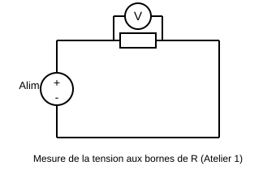

**Déroulé détaillé**

1. **(5 min) Consignes et lecture du code couleur.** Chaque poste reçoit une résistance non identifiée par écrit.
   - ❓ *Q1. Lisez le code couleur de votre résistance : quelle est sa valeur nominale et sa tolérance annoncée (ex. 220 Ω ± 5 %) ?*
2. **(10 min) Mesure directe à l'ohmmètre.** Mesurer une seule fois la résistance à l'ohmmètre, hors circuit.
   - Relevé attendu : valeur affichée = ______ Ω.
   - ❓ *Q2. Cette valeur mesurée est-elle comprise dans l'intervalle [valeur nominale − tolérance ; valeur nominale + tolérance] ? Montrez le calcul de l'intervalle.*
3. **(15 min) Série de 10 mesures répétées d'une tension.** Monter la résistance sous l'alimentation stabilisée (tension fixée, ex. 5,00 V affichés). Mesurer la tension à ses bornes au voltmètre, **10 fois de suite**, en débranchant/rebranchant légèrement les pointes de touche entre chaque mesure (pour retrouver la variabilité réelle d'une manipulation).
   - Tableau à compléter :

     | Mesure n° | 1 | 2 | 3 | 4 | 5 | 6 | 7 | 8 | 9 | 10 |
     |---|---|---|---|---|---|---|---|---|---|---|
     | U (V) | | | | | | | | | | |

   - ❓ *Q3. Les 10 valeurs sont-elles rigoureusement identiques ? Proposez au moins deux causes possibles de cette dispersion (contact, résolution de l'appareil, bruit, légère variation de l'alimentation…).*
4. **(15 min) Traitement statistique.** À l'aide de la calculatrice (mode statistique) ou à la main :
   - Calculer x̄ (moyenne) et s (écart-type de l'échantillon).
   - ❓ *Q4. Calculez $u_A = s/\sqrt{n}$. Notez la valeur.*
   - ❓ *Q5. À partir de la résolution du voltmètre (relevée sur l'appareil), calculez $u_B = \text{résolution}/\sqrt{12}$.*
   - ❓ *Q6. Calculez l'incertitude-type composée $u = \sqrt{u_A^2 + u_B^2}$, puis l'incertitude élargie $U = 2u$. Écrivez le résultat final sous la forme $U_{mesurée} = \bar{x} \pm U$ (unité, bon nombre de chiffres significatifs).*
5. **(10 min) Conclusion et question de synthèse.**
   - ❓ *Q7. Le résultat de mesure est-il compatible avec la tension affichée par l'alimentation ? Justifiez par le calcul (comparaison de l'écart à U).*
   - ❓ *Q8. Si vous aviez réalisé 40 mesures au lieu de 10 (même dispersion s), quel serait l'effet sur u_A ? Vérifiez par le calcul ($u_A \propto 1/\sqrt{n}$).*
- **Livrable :** tableau de mesures rempli + réponses aux questions Q1 à Q8 + résultat final encadré.
- **⚙ Si matériel insuffisant :** basculer sur la version informatique de cet TP (version simulée du TP 2.1).

---

<a id="sec-version-simulee-du-tp-2-1-tableur"></a>

#### Version simulée du TP 2.1 (tableur)

- **Principe :** au lieu de mesurer physiquement, les étudiants exploitent une série de mesures déjà fournie (préparée par le professeur, réaliste avec dispersion) ou générée aléatoirement par une formule tableur, pour se concentrer sur le traitement statistique : qui est la vraie compétence visée par cet TP.
- **Déroulé :** 5 min prise en main du fichier tableur fourni → 15 min l'étudiant génère ou récupère 10 valeurs de mesure (ex. avec une formule `=NORM.INV(ALEA();220;1,5)` pour simuler des mesures d'une résistance de 220 Ω avec 1,5 Ω d'écart-type réaliste) → 20 min calcul de x̄, s, u_A, u_B, u, U avec les formules du tableur (`MOYENNE`, `ECARTYPE.STANDARD`) → 15 min écriture du résultat final et test de compatibilité avec la valeur nominale.
- En modifiant l'écart-type simulé ou le nombre de mesures n dans la formule, on observe immédiatement l'effet de n sur u_A ($u_A$ diminue en $1/\sqrt{n}$).
- **Livrable :** fichier tableur avec formules visibles + résultat final rédigé.

---

<a id="sec-tp-2-2-incertitude-de-type-a-sur-100-mesures-automatiques"></a>

### TP 2.2 : Incertitude de type A sur 100 mesures automatiques (Arduino et Python) `BTS1` `BTS2`

> **Durée :** 2 h · **Mode :** TP informatisé, carte Arduino + Python (version simulée ci-dessous, Python seul) · **Cours :** Chapitre 2, §2.1 (incertitude de type A, type B, facteur d'élargissement k) · **Prérequis :** TP 2.1
> **Objectif :** faire acquérir 100 mesures par une carte Arduino, les traiter en Python (histogramme, moyenne, écart-type, $u_A$) et comprendre ce que signifie l'incertitude élargie $U = k \times u$.

**Problématique :** au TP 2.1, relever 10 mesures à la main prenait un quart d'heure. Une carte à microcontrôleur en fait 100 en deux secondes. Plus de mesures, est-ce forcément un résultat plus précis ? Et que dit vraiment le « ± » d'un résultat ?

- **Matériel par binôme (× 8) :** 1 carte Arduino Uno (ou compatible) et son câble USB, 1 plaque d'essai, fils de câblage mâle-mâle, 1 ordinateur avec l'IDE Arduino et Python 3 (bibliothèques `pyserial`, `numpy`, `matplotlib` ; Thonny ou Anaconda conviennent).
- **Composants par binôme (à prévoir) :** 2 résistances 10 kΩ (1/4 W, 5 %), 1 photorésistance (LDR type GL5528), 1 résistance 10 kΩ supplémentaire pour le pont de la LDR.
- **Sécurité :** la carte est alimentée par le port USB (5 V) : aucun risque électrique. Ne jamais relier directement la broche 5V à la broche GND (court-circuit du port USB).

<p align="center">
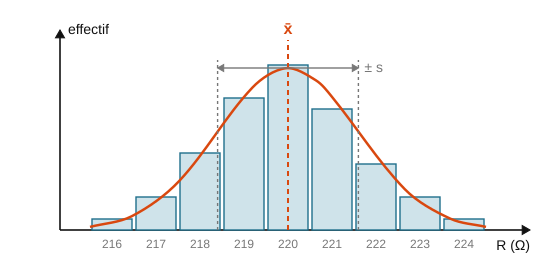
</p>

<p align="center"><em>Histogramme de mesures répétées : la largeur de la « cloche » est mesurée par l'écart-type s.</em></p>

**Rappels utiles :** le convertisseur analogique-numérique (CAN) de l'Arduino Uno code une tension de 0 à 5 V sur 10 bits, soit un nombre $N$ entre 0 et 1023. La tension vaut $u = N \times \dfrac{5}{1023}$. Le pas $q = \dfrac{5}{1023}$ V est la **résolution** du CAN.

**Déroulé détaillé**

1. **(15 min) Préparation.**
   - ❓ *Q1. Calculez la résolution $q$ du CAN en millivolts. En déduire l'incertitude-type de type B due à la résolution, $u_B = q/\sqrt{12}$.*
   - ❓ *Q2. On réalise un pont diviseur avec deux résistances de 10 kΩ alimenté par le 5 V de la carte. Quelle tension attend-on au point milieu ? Quelle valeur de $N$ la carte devrait-elle afficher ?*

2. **(20 min) Montage et programme Arduino.**
   - **Série A (signal stable) :** pont de deux résistances 10 kΩ entre la broche **5V** et la broche **GND**, point milieu relié à l'entrée **A0**.
   - **Série B (signal bruité) :** remplacer la résistance du haut par la photorésistance (LDR entre 5V et A0, 10 kΩ entre A0 et GND). Poser le montage à plat, sous l'éclairage de la salle.
   - Téléverser le programme suivant (IDE Arduino, menu **Croquis → Téléverser**) :

```cpp
// TP 2.2 : envoi de mesures de tension sur le port série
void setup() {
  Serial.begin(9600);
}

void loop() {
  int N = analogRead(A0);          // nombre entre 0 et 1023
  float u = N * 5.0 / 1023.0;      // conversion en volts
  Serial.println(u, 4);            // envoi avec 4 décimales
  delay(20);                       // une mesure toutes les 20 ms
}
```

   - Ouvrir le **Moniteur série** (loupe en haut à droite, 9600 bauds) : les tensions défilent. **Fermer le moniteur série** avant de lancer Python (un seul programme peut utiliser le port à la fois).
   - Noter le nom du port (menu **Outils → Port** : COM3, COM4… sous Windows).

3. **(25 min) Acquisition et traitement en Python.** Dans Thonny (ou un autre éditeur), créer le fichier `tp22.py`, remplacer `COM3` par votre port, puis exécuter :

```python
# TP 2.2 : acquisition de 100 mesures et traitement statistique
import time
import serial
import numpy as np
import matplotlib.pyplot as plt

PORT = "COM3"        # à adapter
n = 100

liaison = serial.Serial(PORT, 9600, timeout=2)
time.sleep(2)                         # la carte redémarre à l'ouverture du port
liaison.reset_input_buffer()
liaison.readline()                    # on jette une ligne éventuellement incomplète
mesures = []
while len(mesures) < n:
    ligne = liaison.readline().decode(errors="ignore").strip()
    if ligne:
        mesures.append(float(ligne))
liaison.close()

u = np.array(mesures)
moyenne = np.mean(u)
s = np.std(u, ddof=1)                 # écart-type de l'échantillon (n - 1)
uA = s / np.sqrt(n)
print(f"moyenne = {moyenne:.4f} V   s = {s*1000:.2f} mV   uA = {uA*1000:.3f} mV")

for k in (1, 2, 3):
    dedans = np.sum(np.abs(u - moyenne) <= k * s)
    print(f"k = {k} : {dedans} mesures sur {n} dans [moyenne - {k}s ; moyenne + {k}s]")

np.savetxt("serie.csv", u, fmt="%.4f")
plt.hist(u, bins=15, edgecolor="black")
plt.axvline(moyenne, color="red", label="moyenne")
plt.xlabel("Tension mesurée (V)")
plt.ylabel("Nombre de mesures")
plt.legend()
plt.show()
```

   Faire l'acquisition pour la **série A**, puis pour la **série B**. Conserver les deux histogrammes (capture d'écran) et les fichiers `serie.csv` (les renommer `serieA.csv` et `serieB.csv`).

   | Série | Moyenne $\bar{u}$ (V) | $s$ (mV) | $u_A = s/\sqrt{n}$ (mV) | $u_B$ (mV) | $u = \sqrt{u_A^2 + u_B^2}$ (mV) |
   |---|---|---|---|---|---|
   | A : pont 10 kΩ / 10 kΩ | | | | | |
   | B : LDR / 10 kΩ | | | | | |

   - ❓ *Q3. Comparez l'allure des deux histogrammes. Pourquoi l'histogramme de la série A ne comporte-t-il que deux ou trois barres ?*
   - ❓ *Q4. Pour chaque série, quelle est la contribution dominante dans $u$ : le type A (dispersion) ou le type B (résolution) ?*
   - ❓ *Q5. Pour la série B, proposez au moins deux causes physiques de la dispersion (éclairage, bruit électrique…).*

4. **(20 min) Le facteur d'élargissement k.** Le programme compte combien de mesures tombent dans les intervalles $\bar{u} \pm s$, $\bar{u} \pm 2s$ et $\bar{u} \pm 3s$.

   | Intervalle | $\bar{u} \pm s$ | $\bar{u} \pm 2s$ | $\bar{u} \pm 3s$ |
   |---|---|---|---|
   | Nombre de mesures (série B) sur 100 | | | |
   | Proportion attendue (loi normale) | ≈ 68 % | ≈ 95 % | ≈ 99,7 % |

   - ❓ *Q6. Vos proportions sont-elles proches des proportions attendues ? Que signifie alors « k = 2, niveau de confiance 95 % » ?*
   - ❓ *Q7. Écrivez le résultat de la série B sous la forme $\bar{u} \pm U$ avec $U = 2u$, en respectant les règles d'arrondi (incertitude à 1 ou 2 chiffres significatifs).*
   - ❓ *Q8. Attention à ne pas confondre : l'intervalle $\bar{u} \pm 2s$ contient 95 % des **mesures individuelles** ; l'intervalle $\bar{u} \pm 2u_A$ encadre la **valeur moyenne**. Lequel est le plus étroit ? Pourquoi ?*

5. **(20 min) Effet du nombre de mesures.** Modifier `n = 100` en `n = 10`, puis `n = 400`, et relancer l'acquisition sur la série B.

   | n | 10 | 100 | 400 |
   |---|---|---|---|
   | $s$ (mV) | | | |
   | $u_A$ (mV) | | | |

   - ❓ *Q9. L'écart-type $s$ dépend-il beaucoup de n ? Et $u_A$ ? Vérifiez que passer de 100 à 400 mesures divise $u_A$ par environ 2.*
   - ❓ *Q10. Pour la série A, est-il utile de faire 400 mesures ? Justifiez avec la Q4.*

6. **(20 min) Bilan.**
   - ❓ *Q11. Répondez à la problématique en trois phrases : que gagne-t-on à multiplier les mesures, et quelle limite ne peut-on pas dépasser ?*

- **Livrable :** les deux histogrammes, les trois tableaux complétés, le résultat final de la série B, réponses Q1 à Q11.
- **⚙ Si les cartes Arduino manquent :** basculer sur la version simulée ci-dessous.

<a id="sec-version-simulee-du-tp-2-2-python"></a>

#### Version simulée du TP 2.2 (Python)

- **Principe :** les 100 mesures sont générées par Python, avec une dispersion réaliste et la même résolution que le CAN de l'Arduino. Les questions Q1 à Q11 et les tableaux sont les mêmes.

**Étape 1 (15 min) : préparation.** Répondre aux questions Q1 et Q2.

**Étape 2 (25 min) : générer et traiter les mesures.** Créer le fichier `tp22_simule.py` et l'exécuter :

```python
# TP 2.2, version simulée : mesures générées puis traitées
import numpy as np
import matplotlib.pyplot as plt

n = 100
q = 5 / 1023                 # résolution du CAN Arduino (V)
VRAIE = 2.50                 # tension « vraie » (V)
BRUIT = 0.0005               # écart-type du bruit (V) : série A

alea = np.random.default_rng()
u = VRAIE + alea.normal(0, BRUIT, n)    # mesures bruitées
u = np.round(u / q) * q                 # arrondi au pas du CAN

moyenne = np.mean(u)
s = np.std(u, ddof=1)
uA = s / np.sqrt(n)
print(f"moyenne = {moyenne:.4f} V   s = {s*1000:.2f} mV   uA = {uA*1000:.3f} mV")
for k in (1, 2, 3):
    dedans = np.sum(np.abs(u - moyenne) <= k * s)
    print(f"k = {k} : {dedans} mesures sur {n} dans l'intervalle moyenne ± {k}s")

plt.hist(u, bins=15, edgecolor="black")
plt.axvline(moyenne, color="red", label="moyenne")
plt.xlabel("Tension mesurée (V)")
plt.ylabel("Nombre de mesures")
plt.legend()
plt.show()
```

1. Exécuter le programme avec `BRUIT = 0.0005` : c'est la **série A** (signal stable, bruit plus petit que la résolution).
2. Remplacer par `BRUIT = 0.025` : c'est la **série B** (signal bruité). Exécuter à nouveau.
3. Remplir le premier tableau et répondre aux questions Q3 à Q5 (pour la Q5, imaginer ce qui fait fluctuer la tension d'une photorésistance éclairée par les lampes de la salle).

**Étape 3 (20 min) : facteur k.** Avec la série B, remplir le tableau des intervalles et répondre aux questions Q6 à Q8.

**Étape 4 (20 min) : effet de n.** Toujours avec `BRUIT = 0.025`, exécuter le programme avec `n = 10`, `n = 100` et `n = 400`. Relancer deux ou trois fois chaque cas : les résultats changent légèrement à chaque exécution, comme une vraie série de mesures. Remplir le tableau et répondre aux questions Q9 et Q10.

**Étape 5 (20 min) : bilan.** Répondre à la Q11. Pour aller plus loin : supprimer la ligne d'arrondi au pas du CAN avec `BRUIT = 0.0005` et observer l'histogramme. Que montre-t-il que l'Arduino ne pouvait pas voir ?

- **Livrable :** histogrammes des séries A et B, les trois tableaux complétés, résultat final de la série B, réponses Q1 à Q11.

---

<a id="sec-tp-2-3-recette-d-un-lot-de-cartes-arduino-uno"></a>

### TP 2.3 : Recette d'un lot de cartes Arduino Uno `BTS1` `BTS2`

> **Durée :** 2 h · **Mode :** TP informatisé, cartes Arduino Uno seules, sans aucun câblage (version de repli ci-dessous : relevés fournis) · **Cours :** Chapitre 2, §2.1 (justesse et fidélité, erreurs systématique et aléatoire, incertitudes de type A et B, incertitude composée et élargie, compatibilité) ; Chapitre 1, §1.1 (diviseur de tension) et §1.6 (LED) ; Chapitre 5, §5.6 (quantum d'un CAN) · **Prérequis :** TP 2.2 (IDE Arduino, moniteur série, Python et `pyserial`)
> **Objectif :** faire la recette d'un lot de cartes comme un service maintenance, mesurer avec la carte elle-même sa tension d'alimentation et la dérive de son horloge avec leurs incertitudes, et conclure par un procès-verbal de recette.
> **Livrable :** le **procès-verbal de recette** du binôme ([modèle à imprimer](Documents_TP/PV_Recette_Lot_Arduino_modele.md)), rempli au fil des étapes, et les réponses aux questions Q1 à Q12 (BTS2 : Q13 à Q16).

**Problématique :** l'école possède une cinquantaine de cartes Arduino Uno, achetées en plusieurs fois et parfois malmenées. Avant de les confier aux prochains TP, le service maintenance (la classe) doit en faire la **recette**, c'est-à-dire le contrôle de réception, sans multimètre, sans fil ni composant. Une carte peut-elle se tester elle-même, et quelle confiance accorder à ses propres mesures ?

- **Matériel par binôme (× 8) :** 1 PC avec l'IDE Arduino 2.x et Python 3 (bibliothèque `pyserial`) ; 1 câble USB A-B **de données**, repéré par une étiquette ; environ 6 cartes du lot dans leurs sachets ; un feutre et des étiquettes ; le procès-verbal de recette imprimé. Aucun fil, aucun composant, aucun appareil de mesure.
- **Unité utile :** une **partie par million** vaut $1\ \text{ppm} = 10^{-6} = 0{,}0001\ \%$. Une horloge qui dérive de 1 ppm se décale de $86\,400 \times 10^{-6} \approx 0{,}086$ s par jour.

> ⚠ **Sécurité et bonnes pratiques**
> - Poser la carte sur son sachet ou sur un support isolant : **jamais** sur une table métallique, une vis, un trombone ou une agrafe. Les soudures dépassent sous la carte : un objet métallique les met en court-circuit, cause classique de panne.
> - Tenir la carte par les bords, sans toucher les composants ni les broches (décharges électrostatiques) ; toucher d'abord le boîtier métallique du PC pour se décharger.
> - Ne rien insérer dans les connecteurs : tous les tests se font sans câblage.
> - Brancher et débrancher le câble USB en tenant le connecteur, pas le câble.
> - Une carte qui chauffe, sent le brûlé ou fait disparaître les périphériques USB du PC : la débrancher immédiatement, la mettre de côté avec l'étiquette « HORS SERVICE : échauffement », ne pas la rebrancher.

**Critères de verdict** (repris dans le référentiel du procès-verbal) :

| Verdict | Critères | Décision |
|---|---|---|
| **BONNE** | port COM détecté, téléversement réussi, LED L fonctionnelle ; autotest : toutes les broches OK (D13 « non concluant » accepté, voir Q5), CAN OK, EEPROM sans erreur | étiquette « BONNE », rangée dans le stock des cartes vérifiées |
| **BONNE AVEC RÉSERVE** | 1 à 3 broches HS ou reliées par un pont de soudure, ou LED L hors service ; tout le reste OK | étiquette « RÉSERVE » portant la liste des broches à éviter ; utilisable pour les TP qui n'en ont pas besoin |
| **HORS SERVICE** | LED ON éteinte, aucun port COM ou téléversement impossible, avec un câble et un port connus bons ; ou 4 broches HS ou plus ; ou erreur EEPROM ; ou CAN défaillant (voie de masse ou référence interne hors plage, confirmé sur un second port USB) | étiquette « HORS SERVICE » avec la panne constatée, rangée à part (réparation ou recyclage décidés par le responsable) |

**Organisation :** la première carte est étudiée en détail (étapes 1 à 3), les suivantes passent à la chaîne (étape 4). Le procès-verbal se remplit au fur et à mesure et se conclut à l'étape 5.

**Déroulé détaillé**

1. **(15 min) Étape 1 : identification et traçabilité.** Remplir d'abord le cartouche, le périmètre et les moyens d'essai du procès-verbal.
   - Sortir la première carte en la tenant par les bords et la comparer à la figure ci-dessous.

<p align="center">
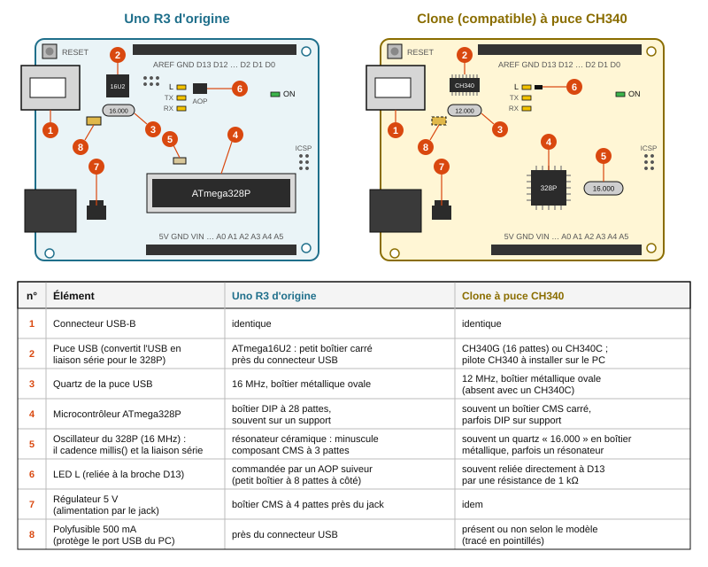
</p>

<p align="center"><em>Une Uno R3 d'origine et un clone à puce CH340 : la puce USB et l'oscillateur de l'ATmega328P permettent de les distinguer.</em></p>

   - ❓ *Q1. Repérez sur votre carte les éléments 1 à 8 de la figure. S'agit-il d'une Uno d'origine ou d'un clone, et quel élément permet de trancher à coup sûr ? Pourquoi le boîtier métallique ovale situé près du connecteur USB d'une Uno d'origine n'est-il pas l'oscillateur de l'ATmega328P ?* Une carte **Uno R4** (connecteur USB-C) n'entre pas dans cette recette : la noter dans les exclusions du procès-verbal.
   - **Branchement et identifiant.** Carte posée sur son sachet, câble de données branché : la LED **ON** s'allume et un nouveau port apparaît dans le **Gestionnaire de périphériques**, rubrique **Ports (COM et LPT)** (« Arduino Uno », « Périphérique série USB » ou « USB-SERIAL CH340 »). Dans un terminal, la commande `python -m serial.tools.list_ports -v` décrit chaque port, par exemple :

```text
COM5
    desc: Arduino Uno (COM5)
    hwid: USB VID:PID=2341:0043 SER=XXXXXXXXXXXXXXXXXXXX LOCATION=1-4:x.0
```

   Le couple **VID:PID** identifie le fabricant de la puce USB (2341 : Arduino ; 1A86 : WCH, fabricant du CH340). Sur une Uno d'origine, l'ATmega16U2 transmet un **numéro de série unique** (champ `SER`) : ses 6 derniers caractères servent d'identifiant. Un CH340 n'en a pas : numéroter la carte au feutre, sur une étiquette collée sur le connecteur USB et sur son sachet.
   - ❓ *Q2. Pourquoi un identifiant unique est-il indispensable à un service maintenance, et pourquoi le numéro du port COM ne convient-il pas ?*
   - **Premier téléversement.** Ouvrir **Fichier → Exemples → 01.Basics → Blink**, remplacer le premier `delay(1000);` par `delay(100);` et le second par `delay(900);` (un éclair bref par seconde), choisir **Outils → Carte → Arduino AVR Boards → Arduino Uno** et le port, puis **Croquis → Téléverser**.
   - ❓ *Q3. Les cartes neuves sont souvent livrées avec le Blink d'origine déjà chargé (1 s allumée, 1 s éteinte) : pourquoi faut-il modifier le rythme avant de téléverser ? En cas d'échec à une étape, suivez l'arbre de diagnostic ci-dessous et décrivez la panne dans une fiche d'anomalie du procès-verbal.*
   - Reporter dans le procès-verbal les cas de test CT-01 (identification), CT-02 (alimentation et port COM) et CT-03 (téléversement).

<p align="center">
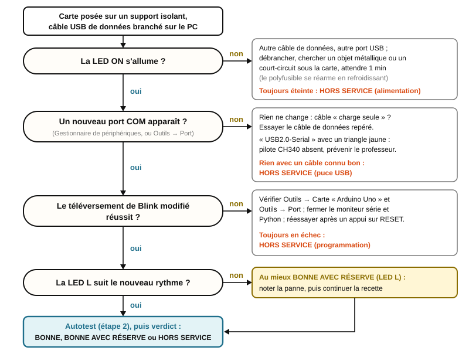
</p>

<p align="center"><em>Arbre de diagnostic d'une carte : chaque question élimine une cause avant de conclure ; une carte n'est déclarée hors service qu'avec un câble et un port connus bons.</em></p>

2. **(20 min) Étape 2 : autotest sans aucun fil.**
   - **Principe.** Une broche peut être une **sortie** (elle impose LOW, 0 V, ou HIGH, Vcc) ou une **entrée**, éventuellement tirée vers Vcc par une **résistance de rappel** interne de 20 à 50 kΩ (mode `INPUT_PULLUP`). La fonction `digitalRead` lit le niveau **réel** de la broche (registre PINx), même quand c'est une sortie. Sur D2 à D13 et A0 à A5, le programme réalise donc : **test a**, toutes les broches en entrée avec rappel doivent lire HIGH ; **test b**, chaque broche, seule et pendant quelques microsecondes, doit imposer LOW puis HIGH ; **test c**, une seule broche à LOW, toutes les autres doivent rester à HIGH. Il vérifie aussi le **CAN** (A0 à A5 avec rappel : $N \approx 1023$ ; en sortie à LOW : $N \approx 0$ ; voies internes : masse et **référence de tension de 1,1 V**), l'**EEPROM** (1024 octets écrits avec 0x55 puis 0xAA, relus, puis restaurés) et la **LED L** (D13 en entrée avec rappel pendant 3 s).
   - Coller le programme ci-dessous dans un nouveau croquis enregistré sous le nom `autotest_uno`, le téléverser, puis ouvrir le **Moniteur série** à **115200 bauds** : la carte redémarre et affiche son rapport en 15 s environ. Reporter les cas de test CT-04 à CT-07 dans le procès-verbal.

```cpp
// autotest_uno.ino : recette d'une carte Arduino Uno, sans aucun câblage
// TP 2.3 de physique, BTS CIEL
// Carte à choisir dans l'IDE : « Arduino Uno » (ATmega328P, 16 MHz)
// Moniteur série : 115200 bauds. Ne rien brancher sur la carte.
//
// Au démarrage : autotest complet (environ 15 s), puis attente d'une commande
//   a : relancer l'autotest
//   v : 100 mesures de la référence interne de 1,1 V (tension d'alimentation)
//   h : mode horloge, millis() chaque seconde (une lettre pour arrêter)
//   t : capteur de température interne, 10 mesures (prolongement BTS2)

#include <EEPROM.h>

// ---------- Broches testées ----------
// D2 à D13, puis A0 à A5 (aussi appelées D14 à D19).
// D0 et D1 ne sont pas testées : elles portent la liaison série avec le PC.
const uint8_t NB_BROCHES = 18;
const uint8_t BROCHES[NB_BROCHES] = {2, 3, 4, 5, 6, 7, 8, 9, 10, 11, 12, 13,
                                     A0, A1, A2, A3, A4, A5};
const uint8_t INDICE_D13 = 11;   // place de D13 dans le tableau
const uint8_t INDICE_A0 = 12;    // place de A0 dans le tableau

// État final d'une broche
const uint8_t BROCHE_OK = 0;
const uint8_t BROCHE_HS = 1;
const uint8_t NON_CONCLUANT = 2; // seulement pour D13

// Réglages du registre ADMUX (fiche technique, tableaux 24-3 et 24-4)
// REFS1 REFS0 = 0 1 : référence AVcc (la tension d'alimentation Vcc)
// REFS1 REFS0 = 1 1 : référence interne de 1,1 V
// MUX3 à MUX0 = 1111 : masse interne (0 V) ; 1110 : référence 1,1 V
// (bandgap) ; 1000 : capteur de température
const uint8_t REGLAGE_MASSE = _BV(REFS0) | 0x0F;
const uint8_t REGLAGE_BANDGAP = _BV(REFS0) | 0x0E;
const uint8_t REGLAGE_TEMPERATURE = _BV(REFS1) | _BV(REFS0) | 0x08;

// ---------- Résultats ----------
bool okRappel[NB_BROCHES];     // test a : lit HIGH avec la résistance de rappel
bool okSortie[NB_BROCHES];     // test b : la sortie impose LOW puis HIGH
bool enPont[NB_BROCHES];       // test c : broche reliée à une autre broche
bool okAnalogique[NB_BROCHES]; // A0 à A5 : CAN à environ 1023 puis 0
uint8_t etat[NB_BROCHES];      // BROCHE_OK, BROCHE_HS ou NON_CONCLUANT
int nHaut[6];                  // CAN avec rappel (attendu : environ 1023)
int nBas[6];                   // CAN en sortie à LOW (attendu : environ 0)

const uint8_t MAX_PONTS = 8;
uint8_t pontA[MAX_PONTS];      // paires de broches reliées (indices)
uint8_t pontB[MAX_PONTS];
uint8_t nbPonts = 0;

uint8_t nbHS = 0;              // nombre de broches hors service
float nMasse = 0;              // voie interne 0 V (attendu : 0)
float nRef = 0;                // voie interne 1,1 V (environ 225 sous 5 V)
float vccEstimee = 0;          // tension d'alimentation estimée (V)
bool canOk = false;
unsigned int erreursEeprom = 0;
float nTemperature = 0;        // voie interne 8 : capteur de température
uint8_t verdict = 0;           // 0 : BONNE ; 1 : RÉSERVE ; 2 : HORS SERVICE

unsigned int mesures[100];     // 100 conversions de la commande v

bool modeHorloge = false;
unsigned long prochainEnvoi = 0;
bool ledAllumee = false;

// ---------- Affichage ----------

// Affiche le nom d'une broche (D2 à D13, A0 à A5) sur 3 caractères
void ecrireNom(uint8_t broche) {
  if (broche >= A0) {
    Serial.print('A');
    Serial.print(broche - A0);
    Serial.print(' ');
  } else {
    Serial.print('D');
    Serial.print(broche);
    if (broche < 10) Serial.print(' ');
  }
}

// Affiche un nombre avec une virgule décimale (tableur réglé en français)
void ecrireDecimal(float x, uint8_t decimales) {
  if (x < 0) {
    Serial.print('-');
    x = -x;
  }
  unsigned long facteur = 1;
  for (uint8_t k = 0; k < decimales; k++) facteur *= 10;
  // arrondi au plus proche
  unsigned long entier = (unsigned long)(x * facteur + 0.5);
  Serial.print(entier / facteur);
  if (decimales > 0) {
    Serial.print(',');
    unsigned long reste = entier % facteur;
    // zéros après la virgule (par exemple 5,05 et non 5,5)
    for (unsigned long p = facteur / 10; p > 1 && reste < p; p /= 10) {
      Serial.print('0');
    }
    Serial.print(reste);
  }
}

void ligne() {
  Serial.println(F("------------------------------------------------------------"));
}

// Liste des broches HS séparées par des espaces, ou « - » s'il n'y en a pas
void ecrireListeHS() {
  if (nbHS == 0) {
    Serial.print('-');
    return;
  }
  bool premier = true;
  for (uint8_t i = 0; i < NB_BROCHES; i++) {
    if (etat[i] == BROCHE_HS) {
      if (!premier) Serial.print(' ');
      if (BROCHES[i] >= A0) {
        Serial.print('A');
        Serial.print(BROCHES[i] - A0);
      } else {
        Serial.print('D');
        Serial.print(BROCHES[i]);
      }
      premier = false;
    }
  }
}

// ---------- Convertisseur analogique numérique (CAN), par registres ----------

// Lance une conversion sur la voie choisie dans ADMUX, renvoie 0 à 1023
unsigned int convertir() {
  ADCSRA |= _BV(ADSC);                   // ADSC = 1 : départ de la conversion
  while (bit_is_set(ADCSRA, ADSC)) { }   // ADSC repasse à 0 à la fin
  return ADC;                            // registre de 16 bits (ADCL, ADCH)
}

// Choisit la référence et la voie, attend la stabilisation,
// jette deux conversions, puis renvoie la moyenne de n conversions
float lireVoieInterne(uint8_t reglage, unsigned int attenteMs, uint8_t n) {
  ADMUX = reglage;
  delay(attenteMs);
  // la fiche technique conseille de jeter les premières conversions
  convertir();
  convertir();
  unsigned long somme = 0;
  for (uint8_t k = 0; k < n; k++) somme += convertir();
  return (float)somme / n;
}

// Remet le CAN dans l'état attendu par analogRead() : référence AVcc
void restaurerCan() {
  ADMUX = _BV(REFS0);      // référence AVcc, voie A0
  delay(5);                // le condensateur de la broche AREF remonte à Vcc
  convertir();             // conversion jetée
}

// ---------- Tests des broches ----------

// Mémorise un pont entre les broches d'indices i et j (une fois par paire)
void noterPont(uint8_t i, uint8_t j) {
  uint8_t petit = (i < j) ? i : j;
  uint8_t grand = (i < j) ? j : i;
  for (uint8_t k = 0; k < nbPonts; k++) {
    if (pontA[k] == petit && pontB[k] == grand) return;   // déjà notée
  }
  if (nbPonts < MAX_PONTS) {
    pontA[nbPonts] = petit;
    pontB[nbPonts] = grand;
    nbPonts++;
  }
}

void testerBroches() {
  // a) toutes les broches en entrée avec la résistance de rappel interne
  //    (20 à 50 kΩ vers Vcc) : chacune doit lire HIGH
  for (uint8_t i = 0; i < NB_BROCHES; i++) {
    pinMode(BROCHES[i], INPUT_PULLUP);
    enPont[i] = false;
    okAnalogique[i] = true;              // modifié plus loin pour A0 à A5
  }
  delay(10);
  for (uint8_t i = 0; i < NB_BROCHES; i++) {
    // LOW malgré le rappel : broche reliée à la masse ?
    okRappel[i] = (digitalRead(BROCHES[i]) == HIGH);
  }

  // b) chaque broche, seule, devient une sortie : elle doit imposer LOW,
  //    puis HIGH. digitalRead lit le niveau réel de la broche (registre
  //    PINx), et non l'ordre donné.
  for (uint8_t i = 0; i < NB_BROCHES; i++) {
    uint8_t b = BROCHES[i];
    digitalWrite(b, LOW);                // coupe la résistance de rappel
    pinMode(b, OUTPUT);                  // sortie au niveau bas
    delayMicroseconds(10);
    bool bas = (digitalRead(b) == LOW);
    digitalWrite(b, HIGH);               // sortie au niveau haut
    delayMicroseconds(10);
    bool haut = (digitalRead(b) == HIGH);
    pinMode(b, INPUT_PULLUP);            // retour en entrée après 30 µs
    okSortie[i] = bas && haut;
  }

  // c) ponts de soudure : une seule broche à LOW,
  //    toutes les autres doivent rester à HIGH
  nbPonts = 0;
  for (uint8_t i = 0; i < NB_BROCHES; i++) {
    uint8_t b = BROCHES[i];
    digitalWrite(b, LOW);
    pinMode(b, OUTPUT);
    delayMicroseconds(20);
    for (uint8_t j = 0; j < NB_BROCHES; j++) {
      // une broche déjà à LOW au test a ne prouve rien
      if (j == i || !okRappel[j]) continue;
      // j suit i : les deux broches sont reliées
      if (digitalRead(BROCHES[j]) == LOW) {
        enPont[i] = true;
        enPont[j] = true;
        noterPont(i, j);
      }
    }
    pinMode(b, INPUT_PULLUP);
  }
  delay(2);
}

// A0 à A5 : le CAN doit lire environ 1023 avec la résistance de rappel,
// puis environ 0 quand la broche est une sortie à LOW
void testerAnalogiques() {
  for (uint8_t k = 0; k < 6; k++) {
    uint8_t i = INDICE_A0 + k;
    uint8_t b = BROCHES[i];
    pinMode(b, INPUT_PULLUP);
    delay(2);
    analogRead(b);                       // conversion jetée (changement de voie)
    nHaut[k] = analogRead(b);
    digitalWrite(b, LOW);
    pinMode(b, OUTPUT);
    delayMicroseconds(10);
    nBas[k] = analogRead(b);
    pinMode(b, INPUT_PULLUP);
    okAnalogique[i] = (nHaut[k] >= 1000) && (nBas[k] <= 20);
  }
}

void evaluerBroches() {
  nbHS = 0;
  for (uint8_t i = 0; i < NB_BROCHES; i++) {
    if (okRappel[i] && okSortie[i] && !enPont[i] && okAnalogique[i]) {
      etat[i] = BROCHE_OK;
    } else if (i == INDICE_D13 && !okRappel[i] && okSortie[i] && !enPont[i]) {
      etat[i] = NON_CONCLUANT;           // LED L reliée directement à D13 (Q5)
    } else {
      etat[i] = BROCHE_HS;
      nbHS++;
    }
  }
}

void afficherBroches() {
  Serial.println(F("1) Broches D2 à D13 et A0 à A5"));
  Serial.print(F("   a : entrée avec rappel (attendu HIGH) ; "));
  Serial.println(F("b : sortie LOW puis HIGH ; c : pont"));
  for (uint8_t i = 0; i < NB_BROCHES; i++) {
    Serial.print(F("   "));
    ecrireNom(BROCHES[i]);
    Serial.print(F(" : a "));
    Serial.print(okRappel[i] ? F("ok ") : F("NON"));
    Serial.print(F("  b "));
    Serial.print(okSortie[i] ? F("ok ") : F("NON"));
    Serial.print(F("  c "));
    Serial.print(enPont[i] ? F("PONT") : F("ok  "));
    if (i >= INDICE_A0) {
      Serial.print(F("  CAN "));
      Serial.print(nHaut[i - INDICE_A0]);
      Serial.print(F(" / "));
      Serial.print(nBas[i - INDICE_A0]);
    }
    Serial.print(F("  -> "));
    if (etat[i] == BROCHE_OK) {
      Serial.println(F("OK"));
    } else if (etat[i] == NON_CONCLUANT) {
      Serial.println(F("NON CONCLUANT (LED L reliée directement à D13 ?)"));
    } else {
      Serial.println(F("HS"));
    }
  }
  for (uint8_t k = 0; k < nbPonts; k++) {
    Serial.print(F("   Pont détecté entre "));
    ecrireNom(BROCHES[pontA[k]]);
    Serial.print(F("et "));
    ecrireNom(BROCHES[pontB[k]]);
    Serial.println();
  }
}

// ---------- CAN : voies internes ----------

void testerCanInterne() {
  nMasse = lireVoieInterne(REGLAGE_MASSE, 2, 10);
  nRef = lireVoieInterne(REGLAGE_BANDGAP, 2, 50);
  // le « voltmètre caché » : Vcc = 1,1 x 1023 / N
  vccEstimee = (nRef > 1.0) ? 1.1 * 1023.0 / nRef : 0.0;
  canOk = (nMasse <= 5.0) && (nRef >= 170.0) && (nRef <= 310.0);
}

// ---------- EEPROM : 1024 octets, au moins 100 000 écritures par octet ----------

unsigned int testerEeprom() {
  unsigned int erreurs = 0;
  unsigned int taille = EEPROM.length();   // 1024 sur l'ATmega328P
  for (unsigned int i = 0; i < taille; i++) {
    uint8_t sauvegarde = EEPROM.read(i);   // contenu d'origine de l'octet
    // update n'écrit que si la valeur change (moins d'usure)
    EEPROM.update(i, 0x55);                // 0101 0101
    if (EEPROM.read(i) != 0x55) erreurs++;
    EEPROM.update(i, 0xAA);                // 1010 1010
    if (EEPROM.read(i) != 0xAA) erreurs++;
    EEPROM.update(i, sauvegarde);          // restauration du contenu d'origine
    if (EEPROM.read(i) != sauvegarde) erreurs++;
    if (i % 64 == 63) Serial.print('.');   // un point tous les 64 octets
  }
  return erreurs;
}

// ---------- Capteur de température interne (prolongement BTS2) ----------

void testerTemperature() {
  // changement de référence (AVcc vers 1,1 V) : 100 ms pour que
  // le condensateur de la broche AREF se décharge
  nTemperature = lireVoieInterne(REGLAGE_TEMPERATURE, 100, 20);
  restaurerCan();
}

// Formule empirique répandue pour l'ATmega328P : capteur NON étalonné,
// erreur possible de 10 °C ou plus sur la valeur absolue
float estimerTemperature(float n) {
  return (n - 324.31) / 1.22;
}

// ---------- LED L ----------

void observerLedL() {
  Serial.print(F("5) LED L : D13 en entrée avec rappel pendant 3 s, "));
  Serial.println(F("regardez la LED L"));
  Serial.print(F("   (vive : commandée par un AOP ; "));
  Serial.println(F("faible lueur : reliée directement à D13)"));
  pinMode(13, INPUT_PULLUP);
  delay(3000);
  digitalWrite(13, LOW);
  pinMode(13, OUTPUT);                   // LED L éteinte
  ledAllumee = false;
}

// ---------- Autotest complet et verdict ----------

void calculerVerdict() {
  if (!canOk || erreursEeprom > 0 || nbHS >= 4) {
    verdict = 2;                         // HORS SERVICE
  } else if (nbHS >= 1) {
    verdict = 1;                         // BONNE AVEC RÉSERVE
  } else {
    verdict = 0;                         // BONNE
  }
}

void autotest() {
  modeHorloge = false;
  ligne();
  Serial.print(F("AUTOTEST ARDUINO UNO (TP 2.3) : "));
  Serial.println(F("ne rien brancher sur la carte"));
  ligne();

  testerBroches();
  testerAnalogiques();
  evaluerBroches();
  afficherBroches();

  Serial.println(F("2) Convertisseur analogique numérique : voies internes"));
  testerCanInterne();
  Serial.print(F("   Masse interne (attendu 0) : N = "));
  ecrireDecimal(nMasse, 1);
  Serial.println(nMasse <= 5.0 ? F("  -> OK") : F("  -> ANORMAL"));
  Serial.print(F("   Référence interne 1,1 V : N moyen = "));
  ecrireDecimal(nRef, 2);
  bool refOk = (nRef >= 170.0) && (nRef <= 310.0);
  Serial.println(refOk ? F("  -> OK") : F("  -> HORS PLAGE"));
  Serial.print(F("   Tension d'alimentation estimée : "));
  Serial.print(F("Vcc = 1,1 x 1023 / N = "));
  ecrireDecimal(vccEstimee, 2);
  Serial.println(F(" V"));
  Serial.print(F("   (non étalonnée : la référence vaut "));
  Serial.println(F("entre 1,0 et 1,2 V selon les puces)"));
  if (!canOk) {
    Serial.print(F("   Refaire le test sur un autre port USB ; "));
    Serial.println(F("si le défaut persiste : CAN HS"));
  }
  if (canOk && vccEstimee < 4.3) {
    Serial.print(F("   Vcc estimée basse : "));
    Serial.println(F("refaire la mesure sur un autre port USB"));
  }

  Serial.println(F("3) EEPROM : 1024 octets, motifs 0x55 et 0xAA (environ 10 s)"));
  Serial.print(F("   "));
  erreursEeprom = testerEeprom();
  Serial.print(' ');
  Serial.print(erreursEeprom);
  Serial.println(erreursEeprom == 0 ? F(" erreur -> OK") : F(" erreur(s) -> HS"));

  Serial.print(F("4) Capteur de température interne "));
  Serial.println(F("(non étalonné : ±10 °C au mieux)"));
  testerTemperature();
  Serial.print(F("   N brut = "));
  ecrireDecimal(nTemperature, 1);
  Serial.print(F(" ; estimation très approximative : "));
  ecrireDecimal(estimerTemperature(nTemperature), 0);
  Serial.println(F(" °C"));

  observerLedL();

  calculerVerdict();
  ligne();
  Serial.print(F("VERDICT : "));
  if (verdict == 0) Serial.println(F("BONNE"));
  else if (verdict == 1) Serial.println(F("BONNE AVEC RÉSERVE"));
  else Serial.println(F("HORS SERVICE"));
  if (nbHS > 0) {
    Serial.print(F("Broches HS, à éviter : "));
    ecrireListeHS();
    Serial.println();
  }
  if (etat[INDICE_D13] == NON_CONCLUANT) {
    Serial.print(F("D13 non concluant : normal si la LED L "));
    Serial.println(F("est reliée directement à D13 (Q5)"));
  }
  ligne();
  Serial.println(F("Ligne à copier dans le tableur de la classe :"));
  Serial.print(F("nb_hs;broches_hs;d13;can;n_bg;"));
  Serial.println(F("vcc_est_v;eeprom_err;temp_brut;verdict"));
  Serial.print(nbHS);
  Serial.print(';');
  ecrireListeHS();
  Serial.print(';');
  if (etat[INDICE_D13] == BROCHE_OK) Serial.print(F("OK"));
  else if (etat[INDICE_D13] == NON_CONCLUANT) Serial.print(F("NC"));
  else Serial.print(F("HS"));
  Serial.print(';');
  Serial.print(canOk ? F("OK") : F("HS"));
  Serial.print(';');
  ecrireDecimal(nRef, 2);
  Serial.print(';');
  ecrireDecimal(vccEstimee, 2);
  Serial.print(';');
  Serial.print(erreursEeprom);
  Serial.print(';');
  ecrireDecimal(nTemperature, 0);
  Serial.print(';');
  if (verdict == 0) Serial.println(F("BONNE"));
  else if (verdict == 1) Serial.println(F("RESERVE"));
  else Serial.println(F("HS"));
  ligne();
}

// ---------- Commande v : 100 mesures de la référence interne ----------

void mesurerReference() {
  Serial.print(F("100 conversions de la référence interne 1,1 V "));
  Serial.println(F("(référence du CAN : Vcc)"));
  ADMUX = REGLAGE_BANDGAP;
  delay(2);
  convertir();                           // conversions jetées
  convertir();
  for (uint8_t k = 0; k < 100; k++) {
    mesures[k] = convertir();
    Serial.print(mesures[k]);
    Serial.print((k % 10 == 9) ? '\n' : ' ');   // 10 valeurs par ligne
    delay(10);                           // une conversion toutes les 10 ms
  }
  restaurerCan();

  unsigned long somme = 0;
  unsigned int nMin = 1023;
  unsigned int nMax = 0;
  for (uint8_t k = 0; k < 100; k++) {
    somme += mesures[k];
    if (mesures[k] < nMin) nMin = mesures[k];
    if (mesures[k] > nMax) nMax = mesures[k];
  }
  float moyenne = somme / 100.0;
  float sommeCarres = 0;
  for (uint8_t k = 0; k < 100; k++) {
    float e = mesures[k] - moyenne;
    sommeCarres += e * e;
  }
  // écart-type de l'échantillon (division par n - 1 = 99)
  float s = sqrt(sommeCarres / 99.0);

  Serial.print(F("N moyen = "));
  ecrireDecimal(moyenne, 2);
  Serial.print(F(" ; s = "));
  ecrireDecimal(s, 2);
  Serial.print(F(" ; N min = "));
  Serial.print(nMin);
  Serial.print(F(" ; N max = "));
  Serial.println(nMax);
  if (moyenne > 1.0) {
    Serial.print(F("Vcc estimée = 1,1 x 1023 / N moyen = "));
    ecrireDecimal(1.1 * 1023.0 / moyenne, 3);
    Serial.println(F(" V"));
  }
}

// ---------- Commande t : capteur de température (prolongement BTS2) ----------

void mesurerTemperature() {
  Serial.print(F("Capteur de température interne : "));
  Serial.println(F("10 mesures, une par seconde"));
  for (uint8_t k = 0; k < 10; k++) {
    unsigned int attente = (k == 0) ? 100 : 2;  // 100 ms au changement de référence
    float n = lireVoieInterne(REGLAGE_TEMPERATURE, attente, 20);
    Serial.print(F("N brut = "));
    ecrireDecimal(n, 1);
    Serial.print(F(" ; estimation très approximative : "));
    ecrireDecimal(estimerTemperature(n), 0);
    Serial.println(F(" °C"));
    delay(1000);
  }
  restaurerCan();
}

// ---------- Commande h : mode horloge ----------

void demarrerHorloge() {
  Serial.print(F("Mode horloge : une ligne H;millis par seconde "));
  Serial.println(F("(une lettre pour arrêter)"));
  modeHorloge = true;
  prochainEnvoi = millis();
}

void envoyerHorloge() {
  if ((long)(millis() - prochainEnvoi) >= 0) {
    // temps de la carte en ms, compté par son propre oscillateur
    unsigned long t = millis();
    Serial.print(F("H;"));
    Serial.println(t);
    // grille fixe : les retards d'envoi ne s'accumulent pas
    prochainEnvoi += 1000;
    // la LED L change d'état à chaque envoi
    ledAllumee = !ledAllumee;
    digitalWrite(13, ledAllumee ? HIGH : LOW);
  }
}

void afficherMenu() {
  Serial.println(F("Commandes (taper la lettre puis Entrée) :"));
  Serial.println(F("  a : relancer l'autotest"));
  Serial.print(F("  v : 100 mesures de la référence interne "));
  Serial.println(F("(tension d'alimentation)"));
  Serial.print(F("  h : mode horloge, millis() toutes les secondes "));
  Serial.println(F("(une lettre pour arrêter)"));
  Serial.println(F("  t : capteur de température interne, 10 mesures (BTS2)"));
  Serial.println(F("PRET"));
}

// ---------- Programme principal ----------

void setup() {
  Serial.begin(115200);
  delay(100);
  autotest();
  afficherMenu();
}

void loop() {
  if (Serial.available() > 0) {
    char c = Serial.read();
    if (c != '\n' && c != '\r' && c != ' ') {   // fins de ligne ignorées
      modeHorloge = false;                      // une lettre arrête l'horloge
      if (c == 'a' || c == 'A') {
        autotest();
        afficherMenu();
      } else if (c == 'v' || c == 'V') {
        mesurerReference();
        afficherMenu();
      } else if (c == 'h' || c == 'H') {
        demarrerHorloge();
      } else if (c == 't' || c == 'T') {
        mesurerTemperature();
        afficherMenu();
      } else {
        afficherMenu();
      }
    }
  }
  if (modeHorloge) envoyerHorloge();
}
```

   - ❓ *Q4. Pour chacun des tests a, b et c, quelle panne détecte-t-il (broche reliée à la masse, étage de sortie détruit, pont de soudure entre deux broches) ? Pourquoi suffit-il de lire la broche avec `digitalRead` pendant qu'elle est en sortie pour vérifier son étage de sortie ? Pourquoi D0 et D1 ne sont-elles pas testées ?*
   - ❓ *Q5. Le piège de D13. Sur beaucoup de clones, la LED L et sa résistance de 1 kΩ sont reliées directement à D13 (figure ci-dessous). Le test a peut alors lire LOW sans que la broche soit en panne : le programme affiche « NON CONCLUANT » au lieu de « HS ». À très faible courant (0,1 mA environ), la tension aux bornes de la LED L vaut environ 1,7 V. (a) Calculez le courant dans la branche D13, résistance, LED pour une résistance de rappel de 20 kΩ, puis de 50 kΩ (loi des mailles et loi d'Ohm, comme pour un diviseur de tension). (b) Calculez la tension U(D13) dans les deux cas. (c) La fiche technique de l'ATmega328P garantit la lecture LOW si U < 0,3 Vcc et HIGH si U > 0,6 Vcc : calculez ces deux seuils pour Vcc = 5 V et concluez. (d) Pourquoi le test passe-t-il sur une Uno R3 d'origine, où la LED est commandée par un AOP suiveur ? (e) Qu'avez-vous observé sur la LED L pendant les 3 s de la phase 5 ? Est-ce cohérent avec la Q1 ?*

<p align="center">
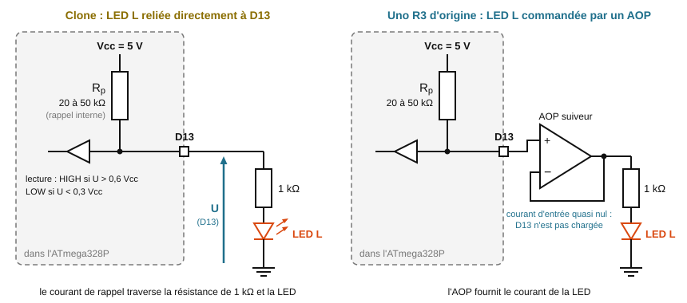
</p>

<p align="center"><em>D13 en entrée avec rappel : sur un clone, la résistance de rappel interne, la résistance de 1 kΩ et la LED L forment une seule branche parcourue par un courant ; sur l'Uno R3 d'origine, l'AOP suiveur ne consomme presque rien.</em></p>

   - ❓ *Q6. Le « voltmètre caché ». Pour la voie interne de 1,1 V (fonction `testerCanInterne()` du programme), le CAN compare la tension $V_{BG}$ de la référence interne à sa propre référence, qui est la tension d'alimentation Vcc : $N = V_{BG} \times \dfrac{1023}{V_{cc}}$. (a) Montrez que $V_{cc} = \dfrac{1{,}1 \times 1023}{N}$ si l'on suppose $V_{BG} = 1{,}1$ V. (b) Calculez Vcc pour N = 224, 225 et 226 : de combien Vcc varie-t-elle pour un pas du CAN ? (c) Expliquez pourquoi on parle de voltmètre caché.*

3. **(35 min) Étape 3 : mesures et incertitudes.**

   **a) Tension d'alimentation mesurée par la référence interne.** Dans le moniteur série, taper `v` puis Entrée : la carte fait 100 conversions de la voie 1,1 V, les affiche, puis donne la moyenne, l'écart-type $s$, les valeurs extrêmes et Vcc estimée. Faire la mesure sur un port USB à l'arrière du PC (port P1), puis débrancher la carte, la rebrancher sur un port en façade ou sur un concentrateur USB (port P2), rouvrir le moniteur série et recommencer.

   | Port | N moyen | $s$ | N min | N max | $u_A(N) = s/\sqrt{100}$ | Vcc estimée (V) |
   |---|---|---|---|---|---|---|
   | P1 : arrière du PC | | | | | | |
   | P2 : façade ou concentrateur | | | | | | |

   - ❓ *Q7. Port P1. (a) Calculez $u_A(N)$. (b) Le CAN ne rend que des entiers : sa résolution est d'un pas, d'où une incertitude-type $u_{res}(N) = 1/\sqrt{12}$. Quelle contribution domine ? (c) Vcc est inversement proportionnelle à N ; pour un quotient, les incertitudes relatives sont égales : $\dfrac{u(V_{cc})}{V_{cc}} = \dfrac{u(N)}{N}$. Calculez l'écart relatif sur Vcc dû à un seul pas du CAN (environ 0,4 % pour N ≈ 225), puis $u(V_{cc})$ en millivolts due au type A et à la résolution. (d) La fiche technique de l'ATmega328P indique que la référence interne vaut entre 1,0 et 1,2 V selon les puces (1,1 V typique). Calculez l'incertitude-type de type B correspondante (tolérance ± a : $u = a/\sqrt{3}$), en valeur relative. (e) Composez les trois incertitudes relatives (type A, résolution, référence), calculez $u(V_{cc})$, puis $U = 2u$, et écrivez le résultat $V_{cc} = (\ldots \pm \ldots)$ V avec un arrondi correct. (f) Quelle source domine, et de combien ? Concluez avec le vocabulaire du cours (figure 20) : la carte, utilisée comme voltmètre, est-elle fidèle ? est-elle juste ?*
   - ❓ *Q8. La norme USB 2.0 impose 5 V ± 5 % sur le connecteur du PC. Entre ce connecteur et la broche 5V de la carte, le câble, le polyfusible et le transistor de commutation de la carte font perdre quelques dizaines de millivolts, parfois plus d'une centaine selon le câble. (a) Donnez l'intervalle de tension attendu sur la carte. (b) Votre résultat de la Q7 est-il compatible avec cet intervalle ? (c) Cette mesure permet-elle de déclarer un port USB « hors norme » ? Que faudrait-il faire une fois pour toutes, avec un appareil de référence, pour rendre la carte juste ?*

   > **Si un multimètre est disponible (facultatif) : étalonner la référence d'une carte.** Pendant la commande `v`, mesurer Vcc au multimètre (calibre 20 V continu) en posant les pointes de touche, sans rien insérer, sur les broches 2 (5V) et 6 (GND) du connecteur ICSP voisin de l'ATmega328P (la broche 1 est repérée par un point ou un chiffre). La référence de **cette** carte vaut alors $V_{BG} = V_{cc,\,mes} \times \dfrac{N}{1023}$. Ensuite, la carte mesure sa tension d'alimentation par $V_{cc} = V_{BG} \times \dfrac{1023}{N}$ : l'incertitude ne vient plus de la fiche technique (± 0,1 V sur la référence) mais du multimètre, environ dix fois plus juste. C'est le principe de l'**étalonnage** : comparer une fois l'instrument à une référence plus juste, puis corriger toutes ses mesures.

   - ❓ *Q9. (a) Montrez que $\dfrac{V_{cc2}}{V_{cc1}} = \dfrac{N_1}{N_2}$ : la valeur exacte de la référence interne n'intervient plus. (b) Calculez l'écart relatif $\dfrac{V_{cc2} - V_{cc1}}{V_{cc1}}$ et son incertitude élargie, en ne gardant que le type A et la résolution des deux mesures (composition quadratique des incertitudes relatives). (c) L'écart est-il significatif ? Quel port choisir pour un banc de test, et pourquoi un port en façade ou un concentrateur non alimenté peut-il fournir moins ? (d) Quel type d'erreur une telle mesure relative élimine-t-elle ?*
   - Reporter le résultat de la Q7 (valeur, incertitude élargie, unité, k = 2) dans le cas de test CT-08 du procès-verbal.

   **b) Horloge de la carte.** Le programme de la carte compte le temps avec `millis()`, à partir de son oscillateur de 16 MHz. En mode horloge (commande `h`), il envoie une ligne `H;millis` chaque seconde ; le programme Python ci-dessous horodate chaque ligne avec l'horloge du PC et calcule, par régression linéaire, l'écart relatif de fréquence de la carte, sa **dérive**. **Fermer le moniteur série**, créer le fichier `horloge_uno.py`, adapter `PORT` et `CARTE`, puis l'exécuter (environ 3 min 15 s).

```python
# TP 2.3 : dérive de l'horloge d'une carte Arduino Uno, comparée au PC
# La carte doit contenir autotest_uno.ino (commande h : mode horloge).
# Fermer le moniteur série de l'IDE avant de lancer ce programme.
import csv
import statistics
import time

import serial

PORT = "COM3"        # à adapter : Outils → Port dans l'IDE Arduino
CARTE = "07"         # identifiant de la carte (fiche de recette)
DUREE = 180          # durée de la mesure en secondes (180 s = 3 min)

liaison = serial.Serial(PORT, 115200, timeout=2)

# 1. L'ouverture du port redémarre la carte :
#    on attend la fin de son autotest (ligne PRET)
print("Attente de la fin de l'autotest de la carte (environ 15 s)...")
pret = False
debut = time.perf_counter()
while not pret and time.perf_counter() - debut < 40:
    ligne = liaison.readline().decode(errors="ignore").strip()
    pret = (ligne == "PRET")
if not pret:
    print("Ligne PRET non reçue : le mode horloge est demandé quand même.")
liaison.write(b"h\n")                      # passage en mode horloge

# 2. Acquisition : chaque ligne H;millis est horodatée dès sa réception
t_pc = []         # instants de réception mesurés par l'horloge du PC (s)
t_carte = []      # temps de la carte : millis() / 1000 (s)
t0 = time.perf_counter()
print(f"Mesure pendant {DUREE} s : ne pas débrancher la carte...")
while time.perf_counter() - t0 < DUREE:
    ligne = liaison.readline().decode(errors="ignore").strip()
    instant = time.perf_counter()          # horodatage immédiat
    if ligne.startswith("H;"):
        try:
            valeur = int(ligne[2:]) / 1000
        except ValueError:
            continue                       # ligne abîmée : ignorée
        t_carte.append(valeur)
        t_pc.append(instant - t0)
liaison.write(b"x\n")                      # fin du mode horloge
liaison.close()

# 3. Régression linéaire t_pc = a × t_carte + b (moindres carrés)
n = len(t_pc)
if n < 10:
    raise SystemExit("Trop peu de lignes reçues : vérifier le port "
                     "et le programme de la carte.")
xm = statistics.mean(t_carte)
ym = statistics.mean(t_pc)
sxx = sum((x - xm) ** 2 for x in t_carte)
sxy = sum((x - xm) * (y - ym) for x, y in zip(t_carte, t_pc))
a = sxy / sxx
b = ym - a * xm
residus = [y - (a * x + b) for x, y in zip(t_carte, t_pc)]
# gigue de la liaison USB : écart-type des résidus (s)
s_res = (sum(r ** 2 for r in residus) / (n - 2)) ** 0.5
u_a = s_res / sxx ** 0.5                   # incertitude-type sur la pente

# 4. Dérive de l'horloge de la carte, positive si la carte avance
derive = (1 / a - 1) * 1e6                 # en ppm (parties par million)
u_derive = u_a / a ** 2 * 1e6
duree = t_pc[-1] - t_pc[0]
print(f"{n} lignes sur {duree:.0f} s ; "
      f"gigue (écart-type des résidus) : {s_res * 1000:.1f} ms")
print(f"pente a = {a:.7f} ; u(a) = {u_a:.7f}")
print(f"dérive = {derive:.0f} ppm ; "
      f"incertitude élargie U (k = 2) = {2 * u_derive:.0f} ppm")
print(f"soit {derive * 86400e-6:+.1f} s par jour "
      "(+ : la carte avance ; - : elle retarde)")

# 5. Sauvegarde des points (séparateur ; et virgule décimale, pour le tableur)
nom_fichier = f"horloge_carte_{CARTE}.csv"
with open(nom_fichier, "w", newline="") as fichier:
    ecrivain = csv.writer(fichier, delimiter=";")
    ecrivain.writerow(["t_carte_s", "t_pc_s", "residu_ms"])
    for x, y, r in zip(t_carte, t_pc, residus):
        ecrivain.writerow([f"{x:.3f}".replace(".", ","),
                           f"{y:.4f}".replace(".", ","),
                           f"{r * 1000:.2f}".replace(".", ",")])
print(f"Points enregistrés dans {nom_fichier}")
```

   - ❓ *Q10. (a) Relevez la dérive, son incertitude élargie et l'avance ou le retard par jour. Le résonateur céramique d'une Uno d'origine est donné pour une tolérance de ± 0,5 % (5 000 ppm), un quartz courant pour quelques dizaines de ppm. D'après votre mesure, l'ATmega328P de votre carte est-il cadencé par un résonateur ou par un quartz ? Est-ce cohérent avec l'observation de la Q1 ? (b) Le programme affiche la gigue (écart-type des résidus de la régression), de l'ordre de quelques millisecondes : d'où vient-elle (transfert USB par paquets, puce USB, système d'exploitation) ? (c) Avec seulement la première et la dernière ligne, séparées de 180 s, quelle incertitude une gigue de 5 ms donnerait-elle sur la dérive, en ppm ? Pourquoi la régression sur 180 points fait-elle beaucoup mieux ? (d) La référence est l'horloge du PC, elle-même juste à quelques dizaines de ppm près au plus. Peut-on affirmer qu'une carte à quartz dérive de 20 ppm ? Quelle règle en tirer sur le choix d'un instrument de référence ?*
   - ❓ *Q11. (a) Une carte doit horodater les relevés d'un capteur de salle serveurs pendant une semaine, sans jamais être remise à l'heure. Calculez l'erreur sur l'heure au bout d'une semaine pour votre carte, puis pour une carte à quartz qui dérive de +21 ppm. Est-ce acceptable pour corréler des journaux d'événements ? (b) Votre carte peut-elle chronométrer une épreuve d'environ 12 s au centième de seconde ? (c) Quelle solution un technicien propose-t-il pour des journaux horodatés fiables ?*
   - **Repli sans Python :** dans le moniteur série, activer l'horodatage (bouton en forme d'horloge, « Afficher l'horodatage » dans l'IDE 1.8), taper `h`, noter l'heure du PC et la valeur de `millis` de la première ligne, attendre 10 min et noter la dernière ligne. La dérive vaut $\left(\dfrac{\Delta t_{carte}}{\Delta t_{PC}} - 1\right) \times 10^6$ ppm. L'horodatage du moniteur n'est précis qu'à quelques dizaines de millisecondes : sur 600 s, l'incertitude est de l'ordre de 50 à 100 ppm, assez pour reconnaître un résonateur, pas pour mesurer un quartz.
   - Reporter la dérive (valeur, incertitude élargie, k = 2) et la décision de la Q11 dans le cas de test CT-09 du procès-verbal.

4. **(30 min) Étape 4 : recette à la chaîne et bilan du lot.**

   **a) Recette à la chaîne des autres cartes**, deux par deux sur deux ports USB du PC. Le téléversement de l'autotest prouve le port et la programmation, et la LED L clignote en mode horloge : Blink devient inutile.

   1. Observer la carte, noter son identifiant et son état visuel (CT-01).
   2. La brancher : LED ON, port COM, VID:PID et numéro de série (CT-02).
   3. Téléverser `autotest_uno.ino`, lire le rapport, regarder la LED L pendant la phase 5 (CT-03 à CT-08).
   4. Fermer le moniteur série et lancer `horloge_uno.py` sur ce port (3 min) ; pendant ce temps, commencer la carte suivante sur l'autre port (CT-09).
   5. Remplir la ligne de la carte dans le tableau des résultats du procès-verbal, une fiche d'anomalie si un cas de test est KO, la ligne du tableur commun, puis poser l'étiquette et ranger la carte.

   **Tableur commun de la classe** (une ligne par carte, séparateur `;`, virgule décimale), dont la première ligne est préparée par le professeur :

   | Colonne | Contenu | Exemple |
   |---|---|---|
   | `id`, `binome` | identifiant de la carte, numéro du binôme | 07 ; B3 |
   | `puce_usb`, `oscillateur` | 16U2 ou CH340 ; R (résonateur) ou Q (quartz), d'après l'observation | 16U2 ; R |
   | `port`, `led_l` | OK ou HS | OK ; OK |
   | `nb_hs` à `verdict` | les neuf champs de la ligne affichée à la fin de l'autotest, dans l'ordre | 0;-;OK;OK;223,90;5,03;0;352;BONNE |
   | `derive_ppm`, `U_derive_ppm` | dérive d'horloge et son incertitude élargie (vides si non mesurées) | -1182 ; 8 |

   **b) Bilan du lot**, au tableur, sur les lignes de toute la classe : compter les verdicts (`NB.SI`), calculer moyennes et écarts-types (`MOYENNE`, `ECARTYPE.STANDARD`), tracer les histogrammes de `vcc_est_v` et de `derive_ppm` (**Insertion → Graphique → Histogramme**). Les résultats vont dans la synthèse chiffrée du procès-verbal.

   - ❓ *Q12. (a) Donnez la proportion de cartes de chaque verdict. (b) Commentez l'histogramme des Vcc estimées : moyenne, écart-type ; quelles cartes s'écartent de la moyenne de plus de deux écarts-types ? (c) Combien de familles l'histogramme des dérives fait-il apparaître ? Reliez-les au type d'oscillateur ; quelles cartes sont hors tolérance (plus de 5 000 ppm en valeur absolue pour un résonateur, plus de 100 ppm pour un quartz) ? (d) L'écart-type des Vcc estimées du lot est bien plus grand que l'écart entre deux ports mesuré à la Q9 sur une même carte : d'où vient l'essentiel de cette dispersion, et que montre le lot qu'une seule carte ne pouvait pas montrer ?*

5. **(20 min) Étape 5 : procès-verbal de recette.** Compléter la synthèse chiffrée (chaque résultat écrit selon les règles du chapitre 2 : valeur, incertitude élargie, unité, facteur k, conformité au critère), cocher la décision de recette, rédiger la liste des réserves, viser le document et le remettre au professeur, qui joue le responsable du parc matériel.

**Prolongements BTS2**

- ❓ *Q13. EEPROM. Écrivez 0x55 et 0xAA en binaire. Pourquoi ces deux motifs mettent-ils chaque bit de chaque octet à 0 puis à 1, avec des bits voisins toujours opposés ? Pourquoi le programme sauvegarde-t-il puis restaure-t-il chaque octet, et utilise-t-il `EEPROM.update` (qui n'écrit que si la valeur change) ? La fiche technique garantit au moins 100 000 cycles d'écriture par octet : un autotest consommant au plus 3 cycles par octet, combien d'autotests une carte peut-elle subir ?*
- ❓ *Q14. Capteur de température interne. Brancher une carte restée débranchée depuis longtemps, taper `t` dans le moniteur série, puis recommencer au bout de 10 min. (a) Relevez la valeur brute N au début et à la fin et calculez ΔN. (b) La fiche technique donne une sensibilité d'environ 1 mV/°C ; le pas du CAN vaut ici $1{,}1/1023$ V. Convertissez ΔN en élévation de température de la puce. (c) La fiche technique annonce ± 10 °C sur la valeur absolue, d'où l'affichage « estimation très approximative » : pourquoi la variation est-elle beaucoup plus fiable que la valeur absolue ? Quelle erreur s'élimine dans une mesure relative ?*
- ❓ *Q15. Débit de la liaison série. L'ATmega328P tire le débit de sa liaison série de son horloge f = 16 MHz par un diviseur entier UBRR. En mode double vitesse (bit U2X, choisi par la bibliothèque Arduino à 115 200 bauds), le débit vaut $D = \dfrac{f}{8\,(UBRR + 1)}$. (a) Calculez la valeur de UBRR qui donnerait exactement 115 200 bauds, puis le débit réel avec l'entier retenu, UBRR = 16. Quel est l'écart relatif ? (b) Sur une Uno d'origine, l'ATmega16U2 utilise le même diviseur avec un quartz de 16 MHz ; un CH340 produit 115 200 bauds presque exactement. Dans chaque cas, estimez l'écart de débit entre les deux puces, en tenant compte de la dérive mesurée à la Q10. (c) D'après la fiche technique, en double vitesse et pour des trames de 8 bits, le récepteur tolère au total un écart d'environ 4 %, et il est recommandé de rester sous 1,5 %. La liaison à 115 200 bauds est-elle sûre avec un clone ? Pourquoi 9 600 bauds (UBRR = 207) ne pose-t-il aucun problème ?*
- ❓ *Q16. Sur l'ensemble du lot, k cartes sont HORS SERVICE sur n testées. (a) Calculez la proportion $p = k/n$, son incertitude-type $u(p) = \sqrt{\dfrac{p\,(1-p)}{n}}$, puis $U = 2u$. (b) L'école envisage de commander 200 cartes au même fournisseur : combien de cartes hors service peut-on prévoir, avec quelle incertitude ? (c) Un lot de 50 cartes suffit-il pour estimer finement cette proportion ? Combien de cartes faudrait-il tester pour diviser U par 2 ?*

- **Livrable :** le procès-verbal de recette complété et visé (cas de test, résultats par carte, fiches d'anomalie, synthèse chiffrée, décision et réserves), les étiquettes posées, les lignes du lot dans le tableur commun, réponses Q1 à Q12 (BTS2 : Q13 à Q16).
- **⚙ Si l'IDE ou Python ne sont pas utilisables sur les postes :** basculer sur la version de repli ci-dessous.

<a id="sec-version-de-repli-du-tp-2-3-releves-fournis"></a>

#### Version de repli du TP 2.3 (relevés fournis)

- **Principe :** les relevés ci-dessous proviennent de la recette d'un lot de 16 cartes avec les programmes du TP. Les questions sont les mêmes ; le procès-verbal porte sur les cartes 01 à 06 du lot, comme si le binôme les avait testées.

**Étape 1 (15 min) : identification.** Répondre à la Q1 à l'aide de la figure d'identification (comparer les deux cartes dessinées), puis aux questions Q2 et Q3 avec les sorties suivantes :

```text
COM5
    desc: Arduino Uno (COM5)
    hwid: USB VID:PID=2341:0043 SER=75830333239351F0E1A1 LOCATION=1-4:x.0
COM7
    desc: USB-SERIAL CH340 (COM7)
    hwid: USB VID:PID=1A86:7523 LOCATION=1-3
```

**Étape 2 (20 min) : autotest.** Extraits des rapports de deux cartes du lot. Carte 07 (Uno d'origine) :

```text
   D7  : a ok   b ok   c ok    -> OK
   D13 : a ok   b ok   c ok    -> OK
   A0  : a ok   b ok   c ok    CAN 1023 / 0  -> OK
   Masse interne (attendu 0) : N = 0,0  -> OK
   Référence interne 1,1 V : N moyen = 223,90  -> OK
   ................ 0 erreur -> OK
VERDICT : BONNE
0;-;OK;OK;223,90;5,03;0;352;BONNE
```

Carte 03 (clone CH340) :

```text
   D7  : a ok   b NON  c ok    -> HS
   D13 : a NON  b ok   c ok    -> NON CONCLUANT (LED L reliée directement à D13 ?)
   A0  : a ok   b ok   c ok    CAN 1022 / 0  -> OK
   Masse interne (attendu 0) : N = 0,0  -> OK
   Référence interne 1,1 V : N moyen = 218,90  -> OK
   ................ 0 erreur -> OK
VERDICT : BONNE AVEC RÉSERVE
Broches HS, à éviter : D7
1;D7;NC;OK;218,90;5,14;0;341;RESERVE
```

Pendant la phase 5, la LED L de la carte 07 s'allume franchement ; celle de la carte 03 luit faiblement. Répondre aux questions Q4 à Q6.

**Étape 3 (35 min) : mesures et incertitudes.** Carte 07, commande `v` (100 conversions), effectif de chaque valeur de N :

| Port | N = 223 | N = 224 | N = 225 | N = 228 | N = 229 | N = 230 |
|---|---|---|---|---|---|---|
| P1 : arrière du PC | 18 | 74 | 8 | 0 | 0 | 0 |
| P2 : façade du PC | 0 | 0 | 0 | 40 | 58 | 2 |

Calculer pour chaque port la moyenne, l'écart-type $s$ (mode statistique de la calculatrice ou tableur) et Vcc estimée, puis répondre aux questions Q7 à Q9.

Mode horloge, une ligne retenue par minute pendant 10 min (temps de la carte $t_{carte}$ = `millis()`/1000 ; instant de réception $t_{PC}$ mesuré par le PC) :

| Ligne | Carte 07 : $t_{carte}$ (s) | Carte 07 : $t_{PC}$ (s) | Carte 11 : $t_{carte}$ (s) | Carte 11 : $t_{PC}$ (s) |
|---|---|---|---|---|
| 0 | 14,731 | 0,421 | 14,229 | 0,403 |
| 1 | 74,731 | 60,488 | 74,229 | 60,407 |
| 2 | 134,731 | 120,562 | 134,229 | 120,399 |
| 3 | 194,731 | 180,637 | 194,229 | 180,402 |
| 4 | 254,731 | 240,704 | 254,229 | 240,397 |
| 5 | 314,731 | 300,775 | 314,229 | 300,395 |
| 6 | 374,731 | 360,841 | 374,229 | 360,400 |
| 7 | 434,731 | 420,919 | 434,229 | 420,399 |
| 8 | 494,731 | 480,988 | 494,229 | 480,397 |
| 9 | 554,731 | 541,060 | 554,229 | 540,389 |
| 10 | 614,731 | 601,130 | 614,229 | 600,391 |

Au tableur, pour chaque carte, `=DROITEREG(plage_des_tPC;plage_des_tcarte;VRAI;VRAI)` validé par **Ctrl+Maj+Entrée** sur une zone de 2 lignes × 2 colonnes donne la pente $a$ (droite $t_{PC} = a \times t_{carte} + b$) et son incertitude-type $u(a)$. La dérive vaut $\left(\dfrac{1}{a} - 1\right) \times 10^6$ ppm et son incertitude-type $\dfrac{u(a)}{a^2} \times 10^6$ ppm. Répondre aux questions Q10 et Q11 (pour la Q10, la gigue vaut environ 3 ms).

**Étapes 4 et 5 (50 min) : bilan du lot et procès-verbal.** Lignes du tableur de la classe, réduites aux colonnes utiles. Toutes les Vcc ont été estimées sur des ports à l'arrière des PC ; les clones CH340 du lot ont tous la LED L reliée directement à D13 (D13 « NON CONCLUANT ») et une LED L qui clignote normalement en mode horloge.

| id | Puce USB | Oscillateur | Verdict | Broches HS | Vcc estimée (V) | Dérive (ppm) |
|---|---|---|---|---|---|---|
| 01 | 16U2 | R | BONNE | - | 4,90 | -640 |
| 02 | CH340 | Q | BONNE | - | 5,25 | 18 |
| 03 | CH340 | Q | RESERVE | D7 | 5,14 | -12 |
| 04 | 16U2 | R | BONNE | - | 4,76 | -2050 |
| 05 | CH340 | Q | BONNE | - | 4,96 | 35 |
| 06 | CH340 | R | BONNE | - | 5,10 | 870 |
| 07 | 16U2 | R | BONNE | - | 5,03 | -1182 |
| 08 | CH340 | Q | HS | pas de port COM | | |
| 09 | CH340 | Q | RESERVE | A4 A5 (pont) | 4,87 | 6 |
| 10 | 16U2 | R | BONNE | - | 5,29 | -310 |
| 11 | CH340 | Q | BONNE | - | 5,01 | 21 |
| 12 | CH340 | Q | HS | EEPROM : 37 erreurs | 5,12 | -21 |
| 13 | 16U2 | R | RESERVE | D3 | 4,95 | -1530 |
| 14 | CH340 | Q | BONNE | - | 4,82 | -8 |
| 15 | CH340 | Q | BONNE | - | 4,93 | 41 |
| 16 | 16U2 | R | BONNE | - | 5,00 | -960 |

Répondre à la Q12, puis remplir le procès-verbal de recette pour les cartes 01 à 06 (cas de test, résultats par carte, fiche d'anomalie de la carte 03, synthèse chiffrée sur ces 6 cartes et sur le lot entier, les mesures détaillées de Vcc, de l'écart entre ports et de la dérive portant sur la carte 07, décision).

**Prolongements BTS2.** Q13 : sans changement. Q14 : sur la carte 07, la commande `t` donne N = 349 juste après le branchement et N = 354 au bout de 10 min. Q15 : sans changement. Q16 : utiliser le lot ci-dessus (2 cartes HS sur 16), puis le cas d'un lot de 50 cartes avec 4 cartes HS.

- **Livrable :** le procès-verbal de recette des cartes 01 à 06, les calculs d'incertitude, le résultat $V_{cc} = (\ldots \pm \ldots)$ V de la carte 07, les dérives des cartes 07 et 11 avec leur incertitude, les histogrammes du lot, réponses Q1 à Q12 (BTS2 : Q13 à Q16).

---

<div style="page-break-after: always;"></div>

&nbsp;

<div style="page-break-after: always;"></div>

<a id="sec-chapitre-3-ondes-et-propagation"></a>

## Chapitre 3 : Ondes et propagation

<a id="sec-tp-3-0-prise-en-main-du-gbf-et-de-l-oscilloscope"></a>

### TP 3.0 : Prise en main du GBF et de l'oscilloscope `BTS1` `BTS2`

> **Durée :** 2 h · **Mode :** matériel en poste tournant (version Falstad ci-dessous) · **Cours :** Chapitre 3, §3.3 (lecture d'une onde à l'oscilloscope, déphasage) ; Chapitre 5, §5.1 (valeur moyenne, valeur efficace) ; Chapitre 2, §2.1 (incertitudes) · **Prérequis :** aucun
> **Objectif :** régler un GBF (forme, fréquence, amplitude, décalage), lire un signal à l'oscilloscope aux divisions puis avec les mesures automatiques, savoir ce que mesure un voltmètre en position AC et en position DC (et jusqu'à quelle fréquence), mesurer un déphasage et l'observer en mode XY.

**Problématique :** face à une carte qui fonctionne mal (horloge, liaison série, alimentation), le premier réflexe d'un technicien CIEL est de « regarder le signal ». Mais un oscilloscope mal réglé peut afficher une tension dix fois trop grande, un signal recentré à tort ou une image qui défile, et un multimètre en position AC peut annoncer une valeur fausse sans prévenir. Quels réglages faut-il maîtriser, et quelle confiance accorder à chaque appareil ?

- **Organisation (poste tournant) :** la classe dispose d'un seul banc GBF + oscilloscope, câblé une fois pour toutes. Chaque binôme y passe environ 12 min pour les étapes marquées **(au banc)**, avec son multimètre. Le reste du temps, il avance la préparation, la version Falstad (qui reprend les mêmes étapes, voir plus bas) et l'exploitation. Les tableaux et les questions servent aux deux versions : on les remplit avec les mesures du banc pour les étapes faites au banc, avec Falstad et les relevés fournis sinon.
- **Matériel du banc (1 par classe) :** GBF Feeltech FY6900 (2 voies), oscilloscope Rigol DS1054Z (4 voies), 2 câbles BNC-pinces crocodiles.
- **Matériel par binôme :** 1 multimètre (utilisé en voltmètre) avec ses cordons, munis si possible de pinces crocodiles.
- **Matériel par étudiant :** 1 sonde et 1 câble BNC. Aucun composant n'est nécessaire.
- **Sécurité :** aucun risque électrique (toutes les tensions restent inférieures à 10 V). Ne jamais relier entre elles les deux pinces d'une même sortie du GBF (court-circuit de la sortie). Les masses des voies de l'oscilloscope sont reliées entre elles et à la terre : la pince de masse d'une sonde se branche toujours sur une masse.

<p align="center">
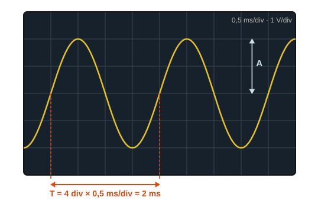
</p>

<p align="center"><em>Lecture à l'oscilloscope : une durée vaut (nombre de divisions) × (base de temps), une tension vaut (nombre de divisions) × (calibre vertical).</em></p>

<p align="center">
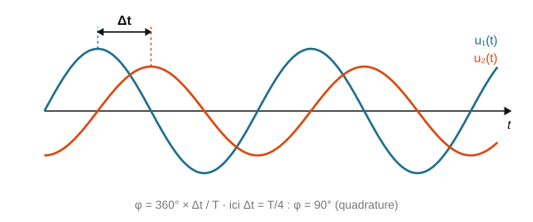
</p>

<p align="center"><em>Décalage temporel Δt entre deux signaux de même période : ici Δt = T/4, soit un déphasage de 90°.</em></p>

**Montage du banc (décrit en texte) :** la sortie CH1 du GBF est prolongée par un câble BNC-pinces crocodiles : la pince rouge porte le signal, la pince noire la masse. Sur ces deux pinces s'accrochent la sonde de la voie 1 de l'oscilloscope (crochet sur la pince rouge, pince de masse sur la pince noire) et, à partir de l'étape 3, les cordons du voltmètre (borne COM sur la pince noire). La sortie CH2 du GBF est reliée de la même façon à la sonde de la voie 2. Les sondes sont réglées sur **×10** et le menu de chaque voie (touche **CH1** ou **CH2** → **Probe**) sur **10X** : le commutateur de la sonde et le menu doivent toujours correspondre.

**Rappels :**

- L'écran du DS1054Z compte 12 divisions horizontales et 8 verticales ; les axes centraux sont gradués tous les 0,2 division. Une durée vaut (nombre de divisions) × (base de temps en s/div), une tension vaut (nombre de divisions) × (calibre en V/div).
- Le FY6900 règle l'amplitude **crête à crête** $U_{pp}$ (du creux au sommet). Pour un signal centré sur 0, l'amplitude vaut $U_{max} = U_{pp}/2$.
- Le **décalage** (*offset*) ajoute une tension continue au signal : la valeur moyenne $\langle u \rangle$ d'un sinus décalé est égale au décalage.
- Valeur efficace d'un signal centré d'amplitude $U_{max}$ : sinus $U_{eff} = \dfrac{U_{max}}{\sqrt{2}}$ ; triangle $U_{eff} = \dfrac{U_{max}}{\sqrt{3}}$ ; carré : à établir en Q2.
- Déphasage entre deux signaux de même période : $\varphi = 360 \times \dfrac{\Delta t}{T}$ (en degrés).

**Déroulé détaillé**

1. **(15 min) Préparation (à la place).** Le signal de référence du TP est un sinus de fréquence $f$ = 1 kHz et d'amplitude crête à crête $U_{pp}$ = 4 V, sans décalage.
   - ❓ *Q1. Calculez la période T, l'amplitude $U_{max}$ et la valeur moyenne de ce signal. Avec une base de temps de 200 µs/div et un calibre de 1 V/div, combien de divisions occupent une période ? Et la hauteur crête à crête ? Combien de périodes sont visibles sur les 12 divisions de l'écran ?*
   - ❓ *Q2. Pour un carré centré, $u(t)$ vaut $+U_{max}$ ou $-U_{max}$ : que vaut $u^2(t)$ à chaque instant ? Déduisez-en $U_{eff}$. Calculez la valeur efficace d'un sinus, d'un carré et d'un triangle de $U_{max}$ = 2 V et reportez-les dans la colonne « théorique » du tableau de l'étape 4.*
   - ❓ *Q3. On ajoute au sinus un décalage de 1 V. Entre quelles valeurs la tension varie-t-elle ? Que vaut sa valeur moyenne ? Qu'indiquera un voltmètre en position DC (notée « V= » ou « DC ») ?*
   - ❓ *Q4. Deux sinus de 1 kHz sont déphasés de 0°, 45°, 90° puis 180°. Calculez le décalage temporel Δt attendu dans chaque cas et reportez-le dans le tableau de l'étape 5.*

2. **(au banc, 4 min) Régler le GBF et lire un sinus.**
   - **GBF, voie CH1 :** touche **CH1**, puis forme (**WAVE**) : sinus ; fréquence (**FREQ**) : 1 kHz ; amplitude (**AMPL**) : 4 V ; décalage (**OFFS**) : 0 V. Les flèches choisissent le chiffre à modifier, la molette le change. Vérifier que la sortie CH1 est activée.
   - **Oscilloscope :** appuyer sur **AUTO**, puis régler à la main : voie 1 en couplage **DC** (touche **CH1** → **Coupling**) ; calibre vertical **1 V/div** (bouton **SCALE** de la zone verticale) ; base de temps **200 µs/div** (bouton **SCALE** de la zone horizontale) ; déclenchement (zone **TRIGGER**, touche **MENU**) : type **Edge**, source **CH1**, front montant, mode **Auto**, niveau 0 V (bouton **LEVEL**). Placer le repère de 0 V de la voie 1 sur la ligne centrale (bouton **POSITION** de la zone verticale).
   - **Lecture aux divisions :** compter les divisions occupées par **deux périodes**, puis par la hauteur crête à crête.
   - **Mesures automatiques :** touche **Measure**, source **CH1**, puis choisir dans la colonne de mesures à gauche de l'écran : **Period**, **Freq**, **Vpp**, **Vavg** et **Vrms** (l'écran en affiche cinq au plus).
   - **Déclenchement :** tourner le bouton **LEVEL** pour placer le niveau au-dessus du sommet du signal et observer l'image ; le ramener ensuite à 0 V.

   | Grandeur | Lecture aux divisions | Valeur lue | Mesure automatique | Valeur attendue |
   |---|---|---|---|---|
   | Période $T$ | $2T$ = ______ div × 200 µs/div | $T$ = | Period = | |
   | Fréquence $f$ | $f = 1/T$ | $f$ = | Freq = | 1 kHz |
   | Crête à crête $U_{pp}$ | ______ div × 1 V/div | | Vpp = | 4 V |
   | Amplitude $U_{max}$ | $U_{pp}/2$ | | Vpp/2 = | |
   | Valeur moyenne | milieu de la courbe : ______ div × 1 V/div | | Vavg = | |
   | Valeur efficace | $U_{max}/\sqrt{2}$, avec $U_{max}$ lue | | Vrms = | |

3. **(au banc, 2 min) Décalage, couplage et voltmètre DC.**
   - GBF : décalage (**OFFS**) : 1 V. Remplacer les mesures automatiques par **Vmax**, **Vmin**, **Vavg** et **Vrms** (touche **Measure** → **Clear** pour effacer les précédentes). Relever les mesures en couplage **DC**.
   - Accrocher les cordons du voltmètre aux pinces de la sortie CH1 (COM sur la pince noire). Relever son indication en position **DC**, puis en position **AC** (notée « V~ » ou « AC »).
   - Passer la voie 1 en couplage **AC** (touche **CH1** → **Coupling**) : observer la courbe et relever les mesures. Revenir en couplage **DC** et remettre le décalage à 0 V.

   | Couplage de la voie 1 | Vmax (V) | Vmin (V) | Vavg (V) | Vrms (V) |
   |---|---|---|---|---|
   | DC | | | | |
   | AC | | | | |

   Voltmètre sur la sortie CH1 (sinus de 1 kHz, 4 V crête à crête, décalage 1 V) : position DC : ________ V ; position AC : ________ V.

4. **(au banc, 3 min) Valeur efficace : ce que mesure vraiment le voltmètre.** Noter le modèle du multimètre et s'il porte la mention **TRMS** (ou *True RMS*) : ________________.
   - GBF : fréquence 100 Hz, décalage 0 V ; oscilloscope : base de temps 2 ms/div. Voltmètre en position AC.
   - Choisir successivement les formes sinus, carré et triangle (même amplitude de 4 V crête à crête). Pour chacune, relever l'indication du voltmètre et la mesure **Vrms** de l'oscilloscope.

   | Forme (4 V crête à crête, 100 Hz) | $U_{eff}$ théorique (Q2) | Vrms de l'oscilloscope | Voltmètre AC | Écart voltmètre / théorique (%) |
   |---|---|---|---|---|
   | Sinus | | | | |
   | Carré | | | | |
   | Triangle | | | | |

   - Revenir au sinus. Sans toucher à l'amplitude, modifier la fréquence du GBF et relever l'indication du voltmètre (l'oscilloscope n'est pas utile ici).

   | $f$ | 20 Hz | 50 Hz | 100 Hz | 500 Hz | 1 kHz | 2 kHz | 5 kHz | 10 kHz | 20 kHz | 50 kHz | 100 kHz |
   |---|---|---|---|---|---|---|---|---|---|---|---|
   | Voltmètre AC (V) | | | | | | | | | | | |
   | Écart à la valeur à 100 Hz (%) | | | | | | | | | | | |

5. **(au banc, 3 min) Deux voies déphasées, mode XY.**
   - GBF : voie CH1 sur sinus, 1 kHz, 4 V, décalage 0 V. Touche **CH2** : mêmes réglages (sinus, 1 kHz, 4 V, 0 V), puis phase (**PHAS**) : 90°. Activer la sortie CH2.
   - Oscilloscope : afficher la voie 2 (touche **CH2**), calibre 1 V/div, repère de 0 V sur la ligne centrale comme la voie 1 ; base de temps 100 µs/div.
   - Mesurer Δt entre deux passages par zéro **montants** correspondants des deux courbes : aux divisions, puis avec les curseurs (touche **Cursor** → mode **Manual**, type **X** ; placer les curseurs A et B avec la molette et lire ΔX). Ajouter la mesure automatique **Phase** (touche **Measure**, sources A = CH1 et B = CH2 dans le sous-menu de réglage des mesures).
   - Régler la phase de CH2 à 45°, puis à 180°, et relever chaque fois Δt et la mesure automatique.
   - **Mode XY :** zone horizontale, touche **MENU** → **Time Base** : **XY**. La voie 1 pilote l'axe horizontal, la voie 2 l'axe vertical. Régler la phase de CH2 à 0°, 45°, 90° puis 180° et dessiner chaque figure. Revenir en mode **YT**.

   | Phase réglée sur CH2 | 0° | 45° | 90° | 180° |
   |---|---|---|---|---|
   | Δt attendu (Q4) | | | | |
   | Δt mesuré | | | | |
   | $\varphi = 360 \times \Delta t / T$ (°) | | | | |
   | Mesure automatique de phase (°) | | | | |
   | Figure en mode XY (croquis) | | | | |

6. **(au banc, 1 min, facultatif) Spectre d'un carré.** GBF, voie CH1 : carré, 1 kHz, 4 V crête à crête. Oscilloscope : base de temps 1 ms/div, touche **Math** → **FFT**, source **CH1**, unité **Vrms**. Relever la fréquence et la valeur efficace des raies visibles entre 0 et 8 kHz (curseurs, source Math).

   | Raie (kHz) | 1 | 2 | 3 | 4 | 5 | 6 | 7 |
   |---|---|---|---|---|---|---|---|
   | Valeur efficace de la raie (V) | | | | | | | |

   **Avant de quitter le banc :** remettre les deux voies du GBF sur sinus, 1 kHz, 4 V, décalage 0 V, phase de CH2 à 0° ; oscilloscope en mode YT, FFT désactivée, couplage DC sur les deux voies.

7. **(25 min) Exploitation (à la place).**
   - ❓ *Q5. À partir de vos lectures aux divisions, calculez T et f. Calculez l'écart relatif entre la fréquence lue et la fréquence réglée au GBF, puis entre la mesure automatique et la fréquence réglée.*
   - ❓ *Q6. On estime qu'une longueur lue entre deux points de l'écran est connue à $\pm a$ près, avec $a$ = 0,2 division. Avec la formule du cours pour un intervalle $\pm a$, $u = a/\sqrt{3}$, puis $U = 2u$, calculez l'incertitude élargie sur T (attention : vous avez lu deux périodes) et sur $U_{pp}$. Écrivez les deux résultats sous la forme valeur ± incertitude. Les valeurs réglées au GBF sont-elles compatibles avec vos mesures ?*
   - ❓ *Q7. Pourquoi a-t-on lu la durée de deux périodes plutôt que d'une seule ? Que vaudrait l'incertitude sur T avec une seule période ?*
   - ❓ *Q8. La mesure automatique Vpp affiche trois chiffres, souvent un peu plus que 4 V : le bruit superposé au signal « gonfle » les crêtes. La fiche technique de l'oscilloscope annonce une justesse verticale de ± 3 % de la pleine échelle (8 divisions). Calculez l'incertitude élargie correspondante sur Vpp au calibre 1 V/div. La mesure automatique de Vpp est-elle plus précise que votre lecture ? Et la mesure automatique de fréquence ? Quel choix de calibre améliorerait la mesure de tension ?*
   - ❓ *Q9. Décalage et couplage. a) Quel est l'effet du couplage AC sur la courbe et sur Vavg ? b) Un signal logique varie entre 0 et 3,3 V : comment apparaît-il en couplage AC ? Pourquoi est-ce un piège lors d'un dépannage ? c) Que mesure le voltmètre en position DC ? En position AC, a-t-il « vu » le décalage ? d) Vérifiez qu'en couplage DC, $\text{Vrms}^2 \approx \text{Vavg}^2 + U_{eff,AC}^2$, où $U_{eff,AC}$ est la valeur Vrms mesurée en couplage AC.*
   - ❓ *Q10. Un voltmètre non TRMS mesure en réalité la valeur moyenne de $|u(t)|$ et la multiplie par 1,11, coefficient qui ne donne la valeur efficace exacte que pour un sinus. Pour un carré, $\langle |u| \rangle = U_{max}$ ; pour un triangle, $\langle |u| \rangle = U_{max}/2$. Calculez ce qu'afficherait un voltmètre non TRMS pour le carré et le triangle de l'étape 4. Votre voltmètre est-il TRMS ? Est-ce cohérent avec l'inscription relevée ? Quel appareil du banc donne la vraie valeur efficace quelle que soit la forme du signal ?*
   - ❓ *Q11. Jusqu'à quelle fréquence l'indication de votre voltmètre reste-t-elle à moins de 5 % de sa valeur à 100 Hz ? Comparez à la plage de fréquence annoncée dans la notice du multimètre (souvent quelques centaines de hertz seulement). Que se passe-t-il à 20 Hz ? Pour mesurer la valeur efficace d'un signal de 20 kHz, quel appareil faut-il utiliser ?*
   - ❓ *Q12. Calculez φ pour chaque phase réglée, puis comparez à la phase réglée sur le GBF et à la mesure automatique. Sur l'écran, la voie 2 est-elle en avance ou en retard sur la voie 1 ? (Un signal en avance passe par zéro plus tôt : il est décalé vers la gauche.)*
   - ❓ *Q13. Décrivez les figures obtenues en mode XY pour 0°, 90° et 180°. Justifiez-les avec $x = U_{max}\sin(\omega t)$ et $y = U_{max}\sin(\omega t + \varphi)$ : que vaut $y$ en fonction de $x$ pour φ = 0° et pour φ = 180° ? Pour φ = 90°, montrez que $x^2 + y^2 = U_{max}^2$.*
   - ❓ *Q14 (si l'étape 6 a été faite). Quelles raies sont présentes dans le spectre du carré ? Calculez le rapport entre la valeur de la raie à 3 kHz et celle de la raie à 1 kHz, et comparez-le à 1/3. (Le spectre des signaux est étudié en détail au TP 5.4.)*

8. **(10 min) Bilan.**
   - ❓ *Q15. Complétez le tableau de dépannage suivant : pour chaque symptôme, indiquez le réglage en cause et la correction.*

   | Symptôme | Réglage en cause | Correction |
   |---|---|---|
   | L'image défile ou se dédouble | | |
   | Toutes les tensions sont 10 fois trop grandes (ou trop petites) | | |
   | Un signal qui varie de 0 à 5 V apparaît centré sur 0 V | | |
   | La courbe sort de l'écran par le haut et par le bas | | |
   | On ne voit qu'une bande épaisse au lieu d'une sinusoïde | | |
   | Le voltmètre AC indique 2,22 V pour un carré de 4 V crête à crête | | |
   | Le voltmètre AC indique une tension trop faible pour un sinus de 20 kHz | | |

- **Livrable :** les tableaux complétés, les croquis XY annotés (calibres des deux voies), le tableau de dépannage, réponses Q1 à Q15.
- **⚙ Si le banc n'est pas disponible :** remplir les tableaux avec la version Falstad et les relevés fournis ci-dessous.

<a id="sec-version-simulee-du-tp-3-0-falstad"></a>

#### Version simulée du TP 3.0 (Falstad)

- **Principe :** Falstad contient un générateur de signaux et un oscilloscope virtuels : on y refait les étapes du banc. Les questions Q1 à Q15 et les tableaux sont les mêmes. Un vrai multimètre ne se simule pas (il n'est jamais parfait) : pour les mesures au voltmètre, on utilise les relevés fournis à la fin de cette version, obtenus avec un multimètre d'entrée de gamme. Falstad est utilisé en français (voir la fiche outil en début de recueil) ; la touche **/** permet de chercher un composant par son nom.

**Étape 0 (15 min) : préparation.** Répondre aux questions Q1 à Q4.

**Étape 1 (10 min) : construire le « banc » virtuel.**

1. **Fichier → Nouveau circuit vide**.
2. Placer le GBF : **Dessiner → Entrées et Générateurs → Ajouter Générateur de Tension A/C (2 sorties)**, tracé verticalement (cliquer-glisser vers le bas).
3. Placer une masse : **Dessiner → Sorties et Etiquettes → Ajouter Masse**, reliée à la borne basse du générateur.
4. Placer un voltmètre : **Dessiner → Sorties et Etiquettes → Ajouter Voltmètre/Sonde Oscilloscope**, à droite du générateur, et relier ses bornes à celles du générateur avec **Dessiner → Ajouter Fils** (raccourci **w**). Double-clic sur la sonde : cocher l'affichage de la valeur.
5. Double-clic sur le générateur : forme d'onde **A/C** (sinus), **Fréquence** 1000 Hz, **Tension maximale** 2 V, **Décalage continu** 0 V. ⚠ Falstad demande l'amplitude $U_{max}$, alors que le GBF du banc demande la valeur crête à crête : 4 V crête à crête correspondent à 2 V de tension maximale.
6. Clic droit sur le générateur → **Voir dans un nouvel oscilloscope** (selon la version : « Voir dans l'oscilloscope »). Clic droit sur l'oscilloscope → **Propriétés…** : cocher l'affichage de l'échelle (*Scale*), de la valeur crête (*Peak*), de la valeur crête négative (*Negative Peak*), de la fréquence (*Frequency*), de la valeur efficace (*RMS*) et, si la case existe, de la moyenne (*Average*). Les intitulés exacts varient selon la version.

**Étape 2 (10 min) : lire le sinus (étape 2 du banc).**

1. Dans les propriétés de l'oscilloscope, régler la vitesse de défilement pour voir deux à trois périodes. L'échelle affichée indique la durée d'une division (H = … s/div) et la tension d'une division (V = … V/div).
2. L'oscilloscope de Falstad n'a pas de déclenchement : il défile en continu, comme un oscilloscope réel dont le déclenchement est mal réglé. Cliquer sur **Arrêter** (panneau de droite) pour figer l'image.
3. **Lecture aux divisions :** compter les divisions occupées par deux périodes et par la hauteur crête à crête. Survoler ensuite la courbe : Falstad affiche le temps et la tension du point survolé, comme les curseurs d'un oscilloscope.
4. **Mesures automatiques :** relever les valeurs affichées par l'oscilloscope (fréquence, crête, crête négative, RMS, moyenne) ; Vpp = crête − crête négative. Remplir le premier tableau, puis relancer la simulation.

**Étape 3 (5 min) : décalage et couplage (étape 3 du banc).**

1. Double-clic sur le générateur : **Décalage continu** 1 V. Observer et relever les mesures (ligne « DC » du tableau).
2. Dans les propriétés de l'oscilloscope, cocher **Couplage AC** (*AC Coupled*) si votre version le propose ; relever les mesures (ligne « AC »). Décocher, puis remettre le décalage à 0 V.
3. Pour les indications du voltmètre, prendre les relevés fournis.

**Étape 4 (10 min) : valeur efficace (étape 4 du banc).**

1. Double-clic sur le générateur : **Fréquence** 100 Hz ; forme d'onde successivement **A/C** (sinus), **Carré** et **Triangle**, toujours avec une tension maximale de 2 V. Relever chaque fois la valeur efficace (RMS) affichée par l'oscilloscope. Le carré peut aussi être obtenu avec **Dessiner → Entrées et Générateurs → Ajouter Générateur Signal Carre**.
2. Si la sonde propose, dans sa fenêtre de réglage (double-clic), d'afficher la **tension efficace** (*RMS*), la choisir : elle se comporte alors comme un voltmètre TRMS parfait.
3. Remplir le tableau de l'étape 4 : colonne « Vrms de l'oscilloscope » avec Falstad, colonne « Voltmètre AC » avec les relevés fournis.
4. Revenir au sinus et monter la fréquence jusqu'à 100 kHz : la valeur efficace calculée par Falstad ne change pas. Au-delà de 5 kHz, réduire le pas de temps (**Options → Autres options…**, champ **Pas de temps**, saisir **0.1u**), sinon la sinusoïde est dessinée avec trop peu de points. Le tableau en fréquence se remplit avec les relevés fournis.

**Étape 5 (15 min) : deux voies déphasées, mode XY (étape 5 du banc).**

1. Remettre le générateur sur sinus, 1000 Hz, 2 V, décalage 0 V. Sélectionner le générateur, sa masse et sa sonde (cadre tracé à la souris), puis **Édition → Copier** et **Édition → Coller** : on obtient une deuxième « voie ».
2. Double-clic sur le second générateur : **Décalage de phase** 90° (champ *Phase Offset*, en degrés).
3. Clic droit sur le second générateur → **Voir dans un nouvel oscilloscope**. Faire glisser ce second oscilloscope sur le premier (ou clic droit → **Combiner**, selon la version) : les deux courbes sont superposées.
4. Arrêter la simulation et survoler deux passages par zéro montants correspondants : la différence des temps affichés donne Δt. Recommencer avec 0°, 45° et 180°. Falstad ne propose pas de mesure automatique de phase : laisser cette ligne du tableau vide.
5. **Mode XY :** dans les propriétés de l'oscilloscope combiné, cocher **Tracer X/Y** (*Plot X/Y*) : la première courbe donne l'axe horizontal, la seconde l'axe vertical. Relancer et dessiner les figures pour 0°, 45°, 90° et 180°.

**Étape 6 (5 min, facultatif) : spectre d'un carré.** Régler le premier générateur en carré, 1000 Hz, et cocher l'affichage du spectre (*Show Spectrum* ou *FFT*) dans les propriétés de son oscilloscope. Repérer les fréquences des raies et comparer leurs hauteurs.

**Étape 7 (30 min) : exploitation et bilan.** Répondre aux questions Q5 à Q15 avec vos relevés Falstad et les relevés fournis. Pour la Q8, raisonner sur le relevé fourni (Vpp = 4,08 V) : dans Falstad, il n'y a pas de bruit et Vpp vaut exactement 4 V.

**Relevés fournis (banc FY6900 + DS1054Z, multimètre d'entrée de gamme non TRMS)**

- Mesures automatiques de l'oscilloscope, sinus de 1 kHz et 4 V crête à crête : Period = 1,000 ms ; Freq = 1,000 kHz ; Vpp = 4,08 V ; Vavg = 0,01 V ; Vrms = 1,42 V.
- Voltmètre sur la sortie, sinus de 1 kHz et 4 V crête à crête, décalage 1 V : position DC : 1,00 V ; position AC : 1,41 V.
- Voltmètre en position AC, signaux de 4 V crête à crête à 100 Hz : sinus 1,41 V ; carré 2,22 V ; triangle 1,11 V.
- Voltmètre en position AC, sinus de 4 V crête à crête, fréquence variable :

| $f$ | 20 Hz | 50 Hz | 100 Hz | 500 Hz | 1 kHz | 2 kHz | 5 kHz | 10 kHz | 20 kHz | 50 kHz | 100 kHz |
|---|---|---|---|---|---|---|---|---|---|---|---|
| Voltmètre AC (V) | 1,37 à 1,45 (instable) | 1,41 | 1,41 | 1,41 | 1,41 | 1,38 | 1,24 | 0,95 | 0,58 | 0,25 | 0,13 |

- **Livrable :** captures d'écran annotées (sinus lu aux divisions, décalage en couplage DC et AC, les trois formes, les figures XY), tableaux complétés, tableau de dépannage, réponses Q1 à Q15.

---

<a id="sec-tp-3-1-ondes-gbf-et-oscilloscope"></a>

### TP 3.1 : Ondes : GBF et oscilloscope

> **Durée :** 55 min · **Mode :** matériel (version Falstad ci-dessous) · **Cours :** Chapitre 3, §3.2-3.3 · **Prérequis :** aucun
> **Objectif :** régler un GBF, lire période, fréquence et amplitude à l'oscilloscope, mesurer un déphasage.

- **Objectifs :** prise en main du GBF et de l'oscilloscope, mesure de période/fréquence/amplitude, observation d'un déphasage.
- **Matériel par poste :** 1 GBF, 1 oscilloscope 2 voies, 1 résistance + 1 condensateur (circuit RC), cordons BNC et sondes.
- **Sécurité :** amplitude du GBF limitée à quelques volts, aucun risque particulier.

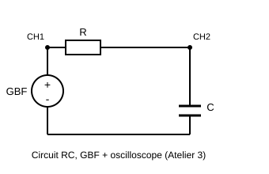

**Déroulé détaillé**

1. **(5 min) Repérage des commandes.**
   - ❓ *Q1. Sur votre oscilloscope, repérez et notez le rôle des réglages TIME/DIV (base de temps) et VOLTS/DIV (sensibilité verticale). Sur le GBF, repérez les réglages fréquence, amplitude et forme du signal.*
2. **(15 min) Mesure d'un signal sinusoïdal simple.** Régler le GBF sur un signal sinusoïdal, 1 kHz affiché, 2 V crête-à-crête affiché. Visualiser à l'oscilloscope.
   - Relever : base de temps utilisée, nombre de divisions occupées par une période, sensibilité verticale, nombre de divisions occupées par l'amplitude crête-à-crête.

     | Grandeur | Base de temps (s/div) | Nb div / période | T mesuré | $f_{mesurée} = 1/T$ | f affichée au GBF | Écart relatif |
     |---|---|---|---|---|---|---|
     | Valeur | | | | | 1 kHz | |

   - ❓ *Q2. Calculez l'écart relatif entre la fréquence mesurée à l'oscilloscope et celle affichée par le GBF. D'où peut venir cet écart (résolution de lecture, tolérance des appareils) ?*
   - ❓ *Q3. Faites de même pour l'amplitude : comparez l'amplitude mesurée sur l'écran à celle affichée par le GBF.*
3. **(20 min) Circuit RC et déphasage.** Monter en série R et C ; visualiser en voie 1 la tension d'entrée (aux bornes du générateur) et en voie 2 la tension aux bornes de C. Répéter la mesure pour trois fréquences différentes (ex. 100 Hz, 1 kHz, 10 kHz), amplitude d'entrée constante.

     | Fréquence | Décalage temporel Δt entre les 2 courbes | Déphasage $\varphi = 360 \times \Delta t / T$ (°) | Amplitude de $U_C$ (V) |
     |---|---|---|---|
     | 100 Hz | | | |
     | 1 kHz | | | |
     | 10 kHz | | | |

   - ❓ *Q4. Comment évolue l'amplitude de $U_C$ quand la fréquence augmente ? Comment évolue le déphasage ?*
   - ❓ *Q5. Ce comportement correspond à un filtre passe-bas ou passe-haut ? Justifiez à partir de vos observations (et pas seulement du cours).*
4. **(15 min) Lien avec la fréquence de coupure.**
   - ❓ *Q6. À partir des valeurs de R et C de votre montage, calculez la fréquence de coupure théorique $f_c = \dfrac{1}{2\pi RC}$.*
   - ❓ *Q7. Cette fréquence se situe-t-elle entre vos trois points de mesure ? Le comportement observé en Q4/Q5 change-t-il de nature autour de f_c ?*
- **Livrable :** tableaux de mesures remplis, réponses Q1 à Q7, captures ou schémas d'écran annotés si possible.
- **⚙ Si matériel insuffisant :** basculer sur la version informatique de cet TP (version simulée du TP 3.1) : c'est d'ailleurs l'TP qui se simule le mieux, le simulateur intègre GBF et oscillo virtuels.

---

<a id="sec-version-simulee-du-tp-3-1-falstad-gbf-et-oscilloscope-integres"></a>

#### Version simulée du TP 3.1 (Falstad, GBF et oscilloscope intégrés)

- **Principe :** Falstad propose directement un générateur de signal et un oscilloscope virtuels sur le même circuit, ce qui en fait l'TP le plus fidèle à sa version physique.
- **Déroulé :** 10 min prise en main → 20 min réglage d'un générateur sinusoïdal, lecture de période/fréquence/amplitude sur le scope virtuel → 20 min montage d'un circuit RC, observation et mesure du déphasage entrée/sortie → 5 min bilan.
- **Livrable :** captures d'écran du scope virtuel annotées, calculs de fréquence et de déphasage, comparaison avec les valeurs réglées sur le générateur.

---

<a id="sec-tp-3-2-celerite-des-ultrasons"></a>

### TP 3.2 : Célérité des ultrasons `BTS1` `BTS2`

> **Durée :** 1 h 30 · **Mode :** matériel en poste tournant (version simulée ci-dessous) · **Cours :** Chapitre 3, §3.1, §3.2 et §3.4 (célérité, longueur d'onde, ondes sonores) · **Prérequis :** TP 3.1
> **Objectif :** mesurer la célérité des ultrasons dans l'air par deux méthodes (longueur d'onde et retard de propagation) et comprendre le principe d'un télémètre à ultrasons.

**Problématique :** un capteur de stationnement ou un module HC-SR04 mesure une distance en chronométrant l'écho d'une salve d'ultrasons. Pour transformer un temps en distance, il faut connaître la célérité du son dans l'air. Peut-on la mesurer précisément avec un GBF et un oscilloscope ?

- **Organisation (poste tournant) :** la classe dispose d'un seul banc GBF + oscilloscope. Le banc est câblé une fois pour toutes ; chaque binôme y passe environ 10 min pour les mesures marquées **(au banc)**, pendant que les autres binômes avancent la version simulée. La préparation et l'exploitation se font à la place.
- **Matériel du banc (1 par classe) :** GBF Feeltech FY6900, oscilloscope Rigol DS1054Z, 1 règle graduée de 50 cm (ou mètre ruban) fixée sur la table, 2 supports (pinces ou pâte adhésive) pour tenir les transducteurs face à face, à la même hauteur.
- **Matériel par étudiant :** 1 sonde et 1 câble BNC.
- **Composants à prévoir :** 1 paire de transducteurs ultrasonores 40 kHz (émetteur T40 et récepteur R40, diamètre 16 mm), 1 câble BNC-pinces crocodiles, 1 adaptateur BNC en T, 1 thermomètre d'ambiance.
- **Sécurité :** aucun risque électrique (amplitude ≤ 10 V crête à crête). Les ultrasons à 40 kHz sont inaudibles et sans danger à ce niveau.

<p align="center">
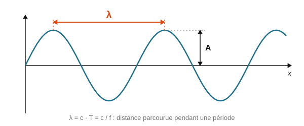
</p>

<p align="center"><em>La longueur d'onde λ est la distance parcourue par l'onde pendant une période : λ = c × T = c / f.</em></p>

**Montage du banc (décrit en texte) :** la sortie CH1 du GBF alimente l'émetteur ultrasonore ; un T BNC renvoie aussi ce signal sur la voie 1 de l'oscilloscope. Le récepteur, placé face à l'émetteur le long de la règle, est relié à la voie 2 par une sonde. La distance $d$ est mesurée entre les faces avant des deux transducteurs.

**Déroulé détaillé**

1. **(10 min) Préparation.** On prend $c \approx 343$ m/s (air à 20 °C).
   - ❓ *Q1. Calculez la longueur d'onde λ d'une onde ultrasonore de fréquence 40 kHz. Est-elle de l'ordre du millimètre, du centimètre ou du mètre ?*
   - ❓ *Q2. Calculez la durée mise par l'onde pour parcourir 30 cm.*
   - ❓ *Q3. La célérité du son dans l'air dépend de la température : $c \approx 331{,}3 + 0{,}606 \times \theta$ (θ en °C). Relevez la température de la salle et calculez la célérité attendue.*

2. **(au banc, 5 min) Méthode 1 : mesure de la longueur d'onde.** Régler le GBF : sinus, 40 kHz, 10 V crête à crête, sans décalage. Placer le récepteur à environ 10 cm de l'émetteur.
   - Ajuster finement la fréquence entre 39 et 41 kHz pour obtenir l'amplitude maximale sur la voie 2 (fréquence de résonance des transducteurs). Noter cette fréquence $f_0$.
   - Déplacer le récepteur jusqu'à ce que les deux sinusoïdes soient **en phase** (sommets alignés). Noter sa position $x_0$.
   - Éloigner lentement le récepteur en comptant les coïncidences : à chaque fois que les courbes se retrouvent en phase, le récepteur a reculé d'une longueur d'onde. Après **10** coïncidences, noter la position $x_{10}$.

   | $f_0$ (kHz) | $x_0$ (cm) | $x_{10}$ (cm) | $D = x_{10} - x_0$ (cm) | $\lambda = D/10$ (mm) | $c = \lambda \times f_0$ (m/s) |
   |---|---|---|---|---|---|
   | | | | | | |

   - ❓ *Q4. Pourquoi mesure-t-on 10 longueurs d'onde plutôt qu'une seule ?*

3. **(au banc, 5 min) Méthode 2 : mesure du retard d'une salve.** Passer le GBF en **modulation ASK** (touche de modulation, type ASK, source interne, fréquence de modulation 50 Hz) : l'émetteur envoie alors des salves de sinusoïde séparées par des silences. Régler l'oscilloscope : déclenchement sur la voie 1, front montant, base de temps 200 µs/div.
   - Pour chaque distance $d$, mesurer le retard $\Delta t$ entre le début de la salve émise (voie 1) et le début de la salve reçue (voie 2), avec les curseurs de l'oscilloscope (touche **Cursor**, mode manuel, curseurs verticaux).

   | $d$ (cm) | 10 | 20 | 30 | 40 |
   |---|---|---|---|---|
   | $\Delta t$ (µs) | | | | |
   | $d / \Delta t$ (m/s) | | | | |

4. **(25 min) Exploitation (à la place).**
   - ❓ *Q5. Calculez $c = d / \Delta t$ pour chaque distance. Les valeurs sont-elles constantes ? Sont-elles plutôt trop grandes ou trop petites par rapport à la Q3 ?*
   - ❓ *Q6. Tracez $\Delta t$ en fonction de $d$ (tableur ou papier millimétré). Les points sont-ils alignés ? La droite passe-t-elle par l'origine ?*
   - ❓ *Q7. Le récepteur met quelques périodes à « démarrer » (il vibre progressivement) : cela ajoute un retard constant $t_0$ à toutes les mesures. Montrez que la pente de la droite $\Delta t = d/c + t_0$ donne $1/c$ sans être faussée par $t_0$. Calculez $c$ à partir de la pente.*
   - ❓ *Q8. Comparez les deux méthodes et la valeur attendue de la Q3 : calculez les écarts relatifs. Quelle méthode vous paraît la plus fiable ?*

5. **(15 min) Application : le télémètre.**
   - ❓ *Q9. Un module HC-SR04 envoie une salve vers un mur et mesure un écho au bout de 5,83 ms. À quelle distance est le mur ? Attention : l'onde fait un aller-retour.*
   - ❓ *Q10. Si la température passe de 20 °C à 35 °C et que le programme utilise toujours $c = 343$ m/s, quelle erreur commet-on sur une distance de 1 m ?*

- **Livrable :** les deux tableaux de mesures, le graphe $\Delta t = f(d)$ avec la droite et sa pente, réponses Q1 à Q10.
- **⚙ Si le banc n'est pas disponible :** basculer sur la version simulée ci-dessous.

<a id="sec-version-simulee-du-tp-3-2-exploitation-de-releves"></a>

#### Version simulée du TP 3.2 (exploitation de relevés, tableur ou Python)

- **Principe :** les mesures ci-dessous ont été relevées sur le banc du lycée (température de la salle : 20 °C). On les exploite comme si on les avait prises soi-même. Les questions sont les mêmes.

**Étape 1 (10 min) : préparation.** Répondre aux questions Q1 à Q3 (avec θ = 20 °C).

**Étape 2 (15 min) : méthode 1.** Relevé : $f_0$ = 40,0 kHz, $x_0$ = 12,0 cm, $x_{10}$ = 20,6 cm. Compléter le premier tableau et répondre à la Q4.

**Étape 3 (35 min) : méthode 2.** Relevé des retards de salves :

| $d$ (cm) | 10 | 15 | 20 | 25 | 30 | 35 | 40 |
|---|---|---|---|---|---|---|---|
| $\Delta t$ (µs) | 408 | 560 | 700 | 852 | 990 | 1143 | 1284 |

1. Saisir les deux lignes dans un tableur (en mètres et en secondes), calculer $d/\Delta t$ pour chaque colonne, puis tracer le nuage de points $\Delta t$ en fonction de $d$ (**Insertion → Graphique → Nuage de points**).
2. Ajouter une **courbe de tendance linéaire** (clic droit sur les points → **Ajouter une courbe de tendance**, cocher **Afficher l'équation**). Ou, en Python :

```python
import numpy as np
d = np.array([10, 15, 20, 25, 30, 35, 40]) / 100          # en m
dt = np.array([408, 560, 700, 852, 990, 1143, 1284]) * 1e-6  # en s
pente, origine = np.polyfit(d, dt, 1)
print(f"pente = {pente*1e3:.3f} ms/m   c = {1/pente:.0f} m/s   t0 = {origine*1e6:.0f} µs")
```

3. Répondre aux questions Q5 à Q8.

**Étape 4 (15 min) : le télémètre.** Répondre aux questions Q9 et Q10.

**Étape 5 (15 min, pour aller plus loin) : visualiser l'onde.** Ouvrir le simulateur en ligne PhET **« Interférences d'ondes »** (onglet **Son**, en français). Mesurer avec le mètre la distance entre deux fronts d'onde successifs pour une fréquence donnée, puis vérifier que $\lambda \times f$ reste constant quand on change la fréquence.

- **Livrable :** fichier tableur (ou programme Python) avec le graphe et l'équation de la droite, réponses Q1 à Q10.

---

<a id="sec-tp-3-3-reflexions-sur-une-ligne-coaxiale"></a>

### TP 3.3 : Réflexions sur une ligne coaxiale `BTS2`

> **Durée :** 1 h 30 · **Mode :** matériel en poste tournant (version Falstad ci-dessous) · **Cours :** Chapitre 3, §3.10 et §3.11 (ligne de transmission, impédance caractéristique, coefficient de réflexion) · **Prérequis :** TP 3.1
> **Objectif :** observer l'aller-retour d'un front de tension sur un câble coaxial, mesurer la célérité dans le câble et vérifier le coefficient de réflexion pour une ligne ouverte, en court-circuit et adaptée.

**Problématique :** un testeur de câble réseau indique « coupure à 37 m » sans qu'on ouvre les goulottes. Comment un simple signal électrique peut-il localiser un défaut ? Et pourquoi met-on des bouchons de 50 Ω au bout des câbles coaxiaux ?

- **Organisation (poste tournant) :** un seul banc GBF + oscilloscope ; chaque binôme y passe environ 10 min pour les mesures marquées **(au banc)**, les autres avancent la version Falstad.
- **Matériel du banc (1 par classe) :** GBF Feeltech FY6900, oscilloscope Rigol DS1054Z.
- **Matériel par étudiant :** 1 sonde et 1 câble BNC (le câble BNC court sert à relier le GBF au T).
- **Composants à prévoir :** 1 câble coaxial 50 Ω (RG58) de **20 m** muni de fiches BNC (ou deux câbles de 10 m et un raccord BNC femelle-femelle), 1 câble coaxial « mystère » de longueur inconnue des étudiants (par exemple 10 m), 1 adaptateur BNC en T, 1 bouchon BNC 50 Ω, 1 bouchon de court-circuit BNC (ou une fiche BNC dont l'âme est soudée à la masse), 1 adaptateur BNC femelle vers bornier à vis, résistances 22 Ω et 100 Ω (1/4 W).
- **Sécurité :** aucun risque (tensions ≤ 4 V).

<p align="center">
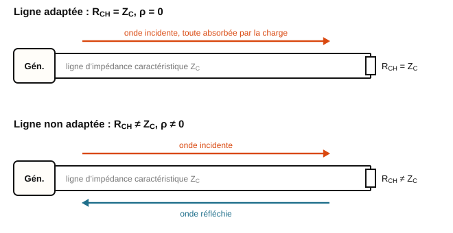
</p>

<p align="center"><em>Ligne adaptée (une seule onde, vers la charge) et ligne non adaptée (une onde réfléchie revient vers la source).</em></p>

**Montage du banc (décrit en texte) :** GBF (voie CH1) → câble BNC court → T BNC branché directement sur l'entrée CH1 de l'oscilloscope → câble coaxial de 20 m → extrémité de la ligne (laissée ouverte, court-circuitée, ou fermée sur une résistance). On observe la tension **à l'entrée de la ligne**.

**Principe :** le GBF a une résistance interne de 50 Ω. Au moment du front montant, la ligne se comporte comme une résistance égale à son impédance caractéristique $Z_C = 50$ Ω : l'entrée monte d'abord à la **moitié** de la tension à vide $E$ du GBF. Ce front parcourt la ligne, se réfléchit au bout avec le coefficient $\rho$, et revient à l'entrée après un aller-retour, où il s'ajoute : le palier final vaut $\dfrac{E}{2}(1 + \rho)$.

**Déroulé détaillé**

1. **(15 min) Préparation.** Câble RG58 : coefficient de vélocité $k \approx 0{,}66$.
   - ❓ *Q1. Calculez la célérité attendue $v = k \times c_0$ dans le câble, puis la durée d'un aller-retour sur 20 m.*
   - ❓ *Q2. Calculez $\rho = \dfrac{R_{CH} - Z_C}{R_{CH} + Z_C}$ pour une ligne ouverte, en court-circuit, fermée sur 50 Ω, sur 100 Ω et sur 22 Ω.*
   - ❓ *Q3. Avec $E = 4$ V, calculez dans chaque cas le palier initial $E/2$ et le palier final $\dfrac{E}{2}(1 + \rho)$. Reportez vos prévisions dans la ligne « calculé » du tableau.*

2. **(au banc, 10 min) Observations.** Régler le GBF : signal carré, 500 kHz, amplitude 4 V crête à crête, décalage 2 V (le signal va de 0 à 4 V à vide). Oscilloscope : voie 1, 1 V/div, base de temps 100 ns/div, déclenchement sur front montant.
   - Ligne **ouverte** : observer le palier à 2 V puis la marche jusqu'à 4 V. Mesurer aux curseurs la durée $\Delta t$ du premier palier.
   - Visser successivement au bout de la ligne : le **court-circuit**, le **bouchon 50 Ω**, puis la résistance **100 Ω** et la résistance **22 Ω** sur l'adaptateur à bornier. Relever les deux paliers.

   | Terminaison | Ouverte | Court-circuit | 50 Ω | 100 Ω | 22 Ω |
   |---|---|---|---|---|---|
   | Palier initial (V) | | | | | |
   | Palier final calculé (V) | | | | | |
   | Palier final mesuré (V) | | | | | |
   | $\rho$ mesuré | | | | | |

   - Remplacer le câble de 20 m par le câble **mystère**, ligne ouverte, et mesurer la durée $\Delta t'$ du premier palier : $\Delta t'$ = ________ ns.

3. **(30 min) Exploitation (à la place).**
   - ❓ *Q4. À partir de $\Delta t$ (ligne ouverte, 20 m), calculez la célérité $v$ dans le câble et le coefficient de vélocité $k = v/c_0$. Comparez à la Q1.*
   - ❓ *Q5. Calculez $\rho$ mesuré pour chaque terminaison avec $\rho = \dfrac{V_{final} - V_{initial}}{V_{initial}}$. Comparez aux valeurs de la Q2.*
   - ❓ *Q6. Avec le bouchon 50 Ω, la tension reste-t-elle à 2 V ? Que signifie « ligne adaptée » sur l'oscillogramme ?*
   - ❓ *Q7. Avec le câble mystère, calculez sa longueur. C'est exactement le principe du réflectomètre (TDR) : expliquez comment il localise une coupure et la distingue d'un court-circuit.*

4. **(15 min) Bilan.**
   - ❓ *Q8. Pourquoi les réseaux en câble coaxial (anciens réseaux Ethernet 10BASE2, antennes, instruments de mesure) imposent-ils une terminaison de 50 Ω au bout de la ligne ? Que se passerait-il pour des données numériques sans ce bouchon ?*
   - ❓ *Q9. Pour un câble de 1 m, la durée d'un aller-retour serait d'environ 10 ns. Pourquoi ne voit-on pas de réflexion dans les montages habituels de TP, à 1 kHz, avec des câbles de 1 m ?*

- **Livrable :** croquis des oscillogrammes (ouverte, court-circuit, adaptée), tableau complété, longueur du câble mystère, réponses Q1 à Q9.
- **⚙ Si le banc n'est pas disponible :** basculer sur la version Falstad ci-dessous.

<a id="sec-version-simulee-du-tp-3-3-falstad"></a>

#### Version simulée du TP 3.3 (Falstad)

- **Principe :** Falstad possède un composant « ligne de transmission » dont on règle le retard et l'impédance caractéristique. Les questions Q1 à Q9 restent valables ; seule l'échelle de temps change (voir l'étape 1).

**Étape 0 (5 min) : préparation.** Répondre aux questions Q1 à Q3.

**Étape 1 (20 min) : construire la ligne.**

1. **Fichier → Nouveau circuit vide**.
2. Placer la source : **Dessiner → Entrées et Générateurs → Ajouter Générateur Signal Carre** (source à une seule borne, référencée à la masse). Double-clic : **Fréquence** 20 Hz, **Amplitude** 2 V, **Décalage continu** 2 V : le signal va de 0 à 4 V.
3. Placer la résistance interne du générateur : **Dessiner → Ajouter Résistance**, réglée à **50 Ω**, à la suite de la source.
4. Placer la ligne : **Dessiner → Composants Passifs → Ajouter Ligne de transmission** (ou touche **/** puis taper « ligne »). Elle se dessine comme deux conducteurs parallèles, avec deux bornes à chaque extrémité. Relier la borne haute de gauche à la résistance de 50 Ω.
5. Placer une masse : **Dessiner → Sorties et Etiquettes → Ajouter Masse**, et y relier la borne basse de gauche de la ligne (le blindage du câble).
6. Double-clic sur la ligne : régler **Impédance caractéristique** à **50 Ω** et **Retard** à **5 ms** (attention à l'unité indiquée dans la fenêtre : si elle est en nanosecondes, saisir 5000000). Remarque : Falstad calcule par pas de quelques microsecondes ; on « allonge » donc artificiellement la ligne (5 ms au lieu de 100 ns). Le comportement est identique, seule l'échelle de temps change.
7. Placer **Dessiner → Sorties et Etiquettes → Ajouter Voltmètre/Sonde Oscilloscope** entre l'entrée de la ligne (borne haute de gauche) et la masse, puis clic droit sur la sonde → **Voir dans un nouvel oscilloscope**.

**Étape 2 (25 min) : les terminaisons.**

1. **Ligne ouverte :** ne rien brancher au bout. Observer l'oscillogramme : palier à 2 V, puis 4 V. Mesurer la durée du premier palier en survolant la courbe (le temps et la tension s'affichent). Vérifier qu'elle vaut deux fois le retard réglé.
2. **Court-circuit :** relier les deux bornes de droite par un fil (**Dessiner → Ajouter Fils**). Relever les paliers.
3. **Ligne adaptée :** remplacer le fil par une résistance de **50 Ω**. Puis essayer **100 Ω** et **22 Ω**.
4. Remplir le tableau (en remplaçant 100 ns par 5 ms dans le raisonnement) et répondre aux questions Q5 et Q6.

**Étape 3 (20 min) : localiser un défaut.**

1. Un camarade règle en secret le retard de la ligne (entre 1 ms et 10 ms) et laisse la ligne ouverte. Mesurer la durée du premier palier et en déduire le retard réglé.
2. Sachant qu'en réalité le câble a une célérité de $2{,}0 \times 10^8$ m/s et que 5 ms de Falstad représentent 100 ns réelles, convertir ce retard en une longueur de câble réelle. Répondre à la Q7.

**Étape 4 (15 min) : bilan.** Répondre aux questions Q4 (avec la durée de l'étape 2 convertie en temps réel), Q8 et Q9.

- **Livrable :** captures d'écran annotées (ouverte, court-circuit, adaptée), tableau complété, réponses Q1 à Q9.

---

<a id="sec-tp-3-4-mesurer-la-celerite-du-son-avec-un-arduino"></a>

### TP 3.4 : Mesurer la célérité du son avec un Arduino `BTS1` `BTS2`

> **Durée :** 2 h · **Mode :** TP informatisé, carte Arduino et capteur HC-SR04 (version simulée ci-dessous : Wokwi et relevés fournis) · **Cours :** Chapitre 3, §3.1, §3.2 et §3.4 (célérité, ondes sonores) ; Chapitre 2, §2.1 (incertitudes de type A et B, compatibilité) · **Prérequis :** TP 2.2 (Arduino, moniteur série) ; TP 3.2 conseillé
> **Objectif :** mesurer avec un capteur HC-SR04 la durée de l'aller-retour d'une salve d'ultrasons à plusieurs distances, en déduire la célérité du son par régression linéaire avec son incertitude, et connaître les limites d'un télémètre à ultrasons.

**Problématique :** un radar de recul, ou un détecteur de présence fixé au-dessus de la porte d'une salle serveurs, ne mesure pas directement une distance : il chronomètre l'écho d'une salve d'ultrasons et utilise une valeur supposée de la célérité du son. Un module HC-SR04 coûte quelques euros : peut-on s'en servir pour mesurer cette célérité, avec quelle incertitude, et dans quelles situations se trompe-t-il ?

- **Matériel (à confirmer), par binôme (× 8) :** 1 carte Arduino Uno (ou compatible) et son câble USB, 1 capteur à ultrasons HC-SR04, 4 câbles Dupont mâle-femelle, 1 règle de 1 m ou un mètre ruban, 1 obstacle plan et rigide (livre, carton d'au moins 20 cm × 30 cm), 1 ordinateur avec l'IDE Arduino (et, si possible, Python 3 avec `numpy` et `matplotlib`, ou un tableur). En option : 1 capteur de température (DS18B20 ou DHT11) ; à défaut, un thermomètre d'ambiance pour la salle.
- **Sécurité :** la carte est alimentée par le port USB (5 V) : aucun risque électrique. Débrancher le câble USB avant toute modification du câblage ; ne jamais relier la broche 5V à la broche GND. Les ultrasons à 40 kHz du module sont inaudibles et sans danger.

**Principe du HC-SR04 :**

1. La carte envoie une impulsion d'au moins 10 µs sur la broche **Trig** du module.
2. Le module émet alors une salve de 8 périodes d'ultrasons à 40 kHz par sa capsule émettrice (marquée T).
3. La broche **Echo** passe à l'état haut et y reste jusqu'à ce que la capsule réceptrice (marquée R) détecte l'écho renvoyé par l'obstacle.
4. La durée $t$ de l'état haut d'Echo est donc la durée de l'aller-retour de l'onde, qui a parcouru $2d$ :

$2d = v \times t \qquad \text{soit} \qquad d = \dfrac{v \times t}{2}$

La fonction Arduino `pulseIn(ECHO, HIGH)` renvoie cette durée en microsecondes.

**Déroulé détaillé**

1. **(15 min) Préparation.**
   - ❓ *Q1. Pourquoi la distance vaut-elle $d = v\,t/2$ et non $v\,t$ ? Avec $v$ = 343 m/s (air à 20 °C), calculez la durée $t$ attendue pour un obstacle à 50 cm.*
   - ❓ *Q2. Relevez la température θ de la salle et calculez la célérité attendue $v = 331{,}3 + 0{,}606\,\theta$ (θ en °C, $v$ en m/s).*
   - ❓ *Q3. La salve dure 8 périodes à 40 kHz : calculez sa durée. Tant que l'émetteur « chante », le récepteur ne peut pas distinguer l'écho : quelle distance minimale peut-on espérer mesurer ? La notice annonce une portée de 2 cm à 4 m : calculez la durée de l'écho pour un obstacle à 4 m et justifiez la pause de 200 ms entre deux mesures dans le programme ci-dessous.*

2. **(20 min) Câblage et programme.** Câbler **câble USB débranché**, avec les câbles Dupont :

   | Broche du HC-SR04 | Broche de l'Arduino | Rôle |
   |---|---|---|
   | VCC | 5V | alimentation du module (5 V obligatoire) |
   | Trig | 9 | ordre de mesure (sortie de la carte) |
   | Echo | 10 | durée de l'écho (entrée de la carte) |
   | GND | GND | masse commune |

   Surélever le capteur d'une dizaine de centimètres (boîte, pile de livres) au bord de la table, capsules dirigées vers l'obstacle, pour que la table ne renvoie pas d'écho. Le zéro des distances est la face avant des capsules ; poser la règle le long de l'axe du capteur.

   Brancher le câble USB, ouvrir l'IDE Arduino, choisir la carte et le port (menu **Outils**), puis téléverser le programme suivant (**Croquis → Téléverser**) :

```cpp
// TP 3.4 : mesure de la durée d'écho d'un capteur HC-SR04
const int TRIG = 9;          // broche reliée à Trig
const int ECHO = 10;         // broche reliée à Echo
const float V_SON = 343.0;   // célérité supposée (m/s), utilisée pour afficher la distance

void setup() {
  pinMode(TRIG, OUTPUT);
  pinMode(ECHO, INPUT);
  digitalWrite(TRIG, LOW);
  Serial.begin(9600);
  Serial.println("duree_us;distance_cm");
}

void loop() {
  // 1. impulsion de 10 µs sur Trig : le module émet une salve à 40 kHz
  digitalWrite(TRIG, LOW);
  delayMicroseconds(2);
  digitalWrite(TRIG, HIGH);
  delayMicroseconds(10);
  digitalWrite(TRIG, LOW);

  // 2. durée de l'état haut d'Echo = durée de l'aller-retour (en µs)
  //    30 000 µs au maximum : au-delà, pulseIn renvoie 0 (pas d'écho)
  unsigned long t = pulseIn(ECHO, HIGH, 30000UL);

  // 3. affichage dans le moniteur série : durée, puis distance
  if (t == 0) {
    Serial.println("pas d'echo");
  } else {
    float d = V_SON * t * 1e-6 / 2 * 100;   // distance en cm
    Serial.print(t);
    Serial.print(";");
    Serial.println(d, 1);
  }
  delay(200);   // pause : laisse s'éteindre les échos de la salve précédente
}
```

   Ouvrir le **Moniteur série** (loupe en haut à droite, 9600 bauds) : une ligne « durée;distance » s'affiche toutes les 200 ms. Placer l'obstacle à 30 cm et vérifier que la distance affichée est voisine de 30 cm.
   - ❓ *Q4. Dans la ligne qui calcule `d`, expliquez le rôle de chaque facteur : 343, `1e-6`, la division par 2 et la multiplication par 100.*

3. **(15 min) Mesures répétées : incertitude de type A.** Placer l'obstacle à $d$ = 50,0 cm, bien perpendiculaire à l'axe du capteur. Relever 10 durées successives dans le moniteur série.

   | Mesure n° | 1 | 2 | 3 | 4 | 5 | 6 | 7 | 8 | 9 | 10 |
   |---|---|---|---|---|---|---|---|---|---|---|
   | $t$ (µs) | | | | | | | | | | |

   - ❓ *Q5. Calculez la moyenne $\bar{t}$, l'écart-type $s$ et l'incertitude-type de type A $u_A = s/\sqrt{10}$. La résolution de `pulseIn` est de 1 µs : calculez $u_B = 1/\sqrt{12}$ µs. Quelle contribution domine ? Écrivez le résultat $t = \bar{t} \pm U$ avec $u = \sqrt{u_A^2 + u_B^2}$ et $U = 2u$.*
   - ❓ *Q6. Calculez la célérité $v = 2d/\bar{t}$ à partir de cette seule distance et comparez-la à la valeur attendue de la Q2. L'écart s'explique-t-il par l'incertitude sur $\bar{t}$ ?*

4. **(25 min) Série de distances : la pente donne la célérité.** Pour chaque distance, relever cinq durées successives et noter leur moyenne.

   | $d$ (cm) | 10 | 20 | 30 | 40 | 50 | 60 | 70 | 80 | 90 | 100 |
   |---|---|---|---|---|---|---|---|---|---|---|
   | $2d$ (m) | | | | | | | | | | |
   | $t$ moyenne (µs) | | | | | | | | | | |

   **Au tableur :** saisir $2d$ (en m) et $t$ (en s), tracer le nuage de points $t$ en fonction de $2d$ (**Insertion → Graphique → Nuage de points**), puis ajouter une **courbe de tendance linéaire** avec son équation. Pour les incertitudes, sélectionner une zone vide de 2 lignes × 2 colonnes, taper `=DROITEREG(plage_des_t;plage_des_2d;VRAI;VRAI)` et valider avec **Ctrl+Maj+Entrée** : la première ligne donne la pente $a$ et l'ordonnée à l'origine $b$, la deuxième ligne leurs incertitudes-types $u(a)$ et $u(b)$. **Ou en Python :**

```python
# TP 3.4 : régression t = a × (2d) + b et incertitude sur la pente
import numpy as np
import matplotlib.pyplot as plt

d = np.array([10, 20, 30, 40, 50, 60, 70, 80, 90, 100]) / 100   # distances (m)
t = np.array([0, 0, 0, 0, 0, 0, 0, 0, 0, 0]) * 1e-6            # remplacer les 0 par vos durées moyennes (µs)

x = 2 * d
(a, b), cov = np.polyfit(x, t, 1, cov=True)
ua = np.sqrt(cov[0, 0])              # incertitude-type sur la pente
v = 1 / a
uv = v * ua / a                      # quotient : incertitudes relatives égales
print(f"a = {a*1e6:.1f} µs/m   b = {b*1e6:.1f} µs   u(a) = {ua*1e6:.2f} µs/m")
print(f"v = {v:.1f} m/s   u(v) = {uv:.2f} m/s   U(v) = {2*uv:.2f} m/s")

plt.plot(x, t * 1e6, "o", label="mesures")
plt.plot(x, (a * x + b) * 1e6, label="droite de régression")
plt.xlabel("2d (m)")
plt.ylabel("t (µs)")
plt.legend()
plt.show()
```

   - ❓ *Q7. Les points sont-ils alignés ? La droite passe-t-elle par l'origine ? Donnez la pente $a$ et l'ordonnée à l'origine $b$ avec leurs unités.*
   - ❓ *Q8. Le récepteur ne réagit qu'après une ou deux périodes de l'écho, ce qui ajoute un retard constant $t_0$ : $t = \dfrac{2d}{v} + t_0$. Montrez que la pente vaut $1/v$ quelle que soit la valeur de $t_0$. Calculez $v$. Que représente $b$ ?*
   - ❓ *Q9. Pour un quotient, les incertitudes relatives se composent (cours, §2.1) : ici $\dfrac{u(v)}{v} = \dfrac{u(a)}{a}$. Calculez $u(v)$, puis $U(v) = 2u(v)$, et écrivez le résultat $v = \ldots \pm \ldots$ m/s. Est-il compatible avec la valeur attendue de la Q2 ? Calculez l'écart relatif.*
   - ❓ *Q10. Donnez deux raisons pour lesquelles la célérité tirée de la pente est plus fiable que celle de la Q6.*

5. **(15 min) Limites du capteur.** Réaliser les essais du tableau en observant le moniteur série.

   | Essai | Ce qu'affiche le moniteur série (stable, instable, « pas d'echo », valeur fausse) |
   |---|---|
   | Obstacle perpendiculaire à l'axe, à 50 cm (référence) | |
   | Obstacle incliné d'environ 45°, à 50 cm | |
   | Obstacle à 1 cm, puis à 3 cm du capteur | |
   | Surface absorbante à 50 cm (pull en laine, mousse, rideau) | |
   | Petit objet (stylo vertical) à 50 cm dans l'axe, puis décalé de 15 cm sur le côté | |
   | Une personne debout à 1 m | |

   - ❓ *Q11. Expliquez chaque observation du tableau en vous aidant de la figure ci-dessous : réflexion sur une surface inclinée, durée de la salve (Q3), absorption, ouverture du faisceau (la notice annonce un cône d'environ 15°).*
   - ❓ *Q12. Le programme utilise toujours $v$ = 343 m/s. Dans l'allée chaude d'une salle serveurs, l'air est à 40 °C. Quelle distance le capteur affiche-t-il pour un obstacle situé réellement à 2,00 m ? Quelle est l'erreur ? Proposez une correction. (Option : si vous disposez d'un capteur de température, modifiez le programme pour calculer la célérité à partir de θ, voir l'extrait ci-dessous, et refaites la mesure à 50 cm.)*

<p align="center">
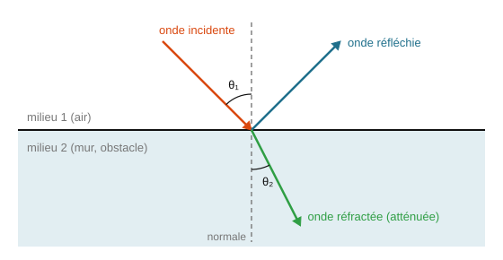
</p>

<p align="center"><em>Réflexion d'une onde sur un obstacle : l'onde réfléchie repart avec un angle égal à l'angle d'incidence. Si l'obstacle est incliné, l'écho ne revient pas vers le capteur.</em></p>

```cpp
// Option : célérité corrigée par la température (capteur DHT11, bibliothèque « DHT sensor library » d'Adafruit)
// câblage du DHT11 : VCC sur 5V, GND sur GND, DATA sur la broche 2
#include <DHT.h>
DHT dht(2, DHT11);
// dans setup(), ajouter : dht.begin();
// dans loop(), avant le calcul de la distance :
float theta = dht.readTemperature();        // température de l'air (°C)
float v = 331.3 + 0.606 * theta;            // célérité corrigée (m/s)
// puis remplacer V_SON par v dans le calcul de d, et afficher aussi theta
```

6. **(15 min) Application CIEL et bilan.**
   - ❓ *Q13. Détection de présence : un HC-SR04 est fixé au plafond, au-dessus de la porte d'une salle serveurs, à 2,20 m du sol. Calculez la durée de l'écho quand le passage est libre, puis quand une personne de 1,80 m passe dessous. Proposez un seuil de durée pour enregistrer un « passage » dans le journal d'accès. La notice conseille au moins 60 ms entre deux mesures : combien de mesures par seconde peut-on faire, et est-ce suffisant pour voir passer quelqu'un ?*
   - ❓ *Q14. Radar de recul : le bip s'accélère quand l'obstacle se rapproche. Décrivez en deux ou trois phrases la logique du programme. Pourquoi un tel radar détecte-t-il mal un poteau fin ou un grillage ?*

- **Livrable :** schéma ou photo du câblage, programme utilisé, les trois tableaux complétés, le graphique $t = f(2d)$ avec la droite de régression, le résultat $v = \ldots \pm \ldots$ m/s, réponses Q1 à Q14.
- **⚙ Si les cartes ou les capteurs manquent :** basculer sur la version simulée ci-dessous.

<a id="sec-version-simulee-du-tp-3-4-wokwi-et-releves-fournis"></a>

#### Version simulée du TP 3.4 (Wokwi et relevés fournis)

- **Principe :** Wokwi (**wokwi.com**) est un simulateur d'Arduino gratuit, en ligne et sans installation, qui contient le capteur HC-SR04 : on y câble le même montage et on y exécute le même programme. Le simulateur calcule la durée de l'écho à partir de la distance choisie, sans aucune dispersion : il valide le câblage et le programme, mais ne remplace pas une vraie mesure. Pour les incertitudes et les limites du capteur, on exploite les relevés fournis plus bas (capteur réel, salle à 21 °C). Les questions Q1 à Q14 sont les mêmes.

**Étape 0 (15 min) : préparation.** Répondre aux questions Q1 à Q3 (avec θ = 21 °C).

**Étape 1 (20 min) : câblage et programme dans Wokwi.**

1. Ouvrir **wokwi.com** et choisir **Arduino Uno** pour démarrer un nouveau projet (l'interface est en anglais ; un compte n'est utile que pour sauvegarder son projet).
2. Ajouter le capteur : bouton **+** (*Add a new part*) au-dessus du schéma, puis rechercher **HC-SR04** (*Ultrasonic Distance Sensor*).
3. Câbler comme dans le tableau de l'étape 2 : cliquer sur une broche du capteur, puis sur la broche de l'Arduino, pour tirer un fil (VCC → 5V, TRIG → 9, ECHO → 10, GND → GND).
4. Remplacer tout le contenu de l'onglet `sketch.ino` par le programme du TP, puis lancer la simulation (bouton ▶ vert). Le moniteur série s'affiche sous le schéma.
5. Pendant la simulation, cliquer sur le capteur : un curseur permet de régler la distance de l'obstacle. La régler à 30 cm et vérifier la distance affichée. Répondre à la Q4.

**Étape 2 (15 min) : série de distances dans Wokwi.** Régler successivement la distance de 10 à 100 cm et relever la durée affichée. Tracer $t$ en fonction de $2d$ et déterminer la pente (tableur ou Python, voir l'étape 4 du TP). Les durées changent-elles d'une mesure à l'autre ? La droite passe-t-elle par l'origine ? La célérité obtenue est celle que le simulateur utilise dans ses calculs : un simulateur ne « mesure » rien.

**Étape 3 (30 min) : exploitation de relevés réels.** Relevés typiques obtenus avec un HC-SR04 et une carte Arduino Uno, dans une salle à 21 °C, avec le programme du TP :

- dix durées successives, obstacle à 50,0 cm (en µs) : 2943 ; 2927 ; 2941 ; 2936 ; 2944 ; 2937 ; 2940 ; 2938 ; 2939 ; 2939 ;
- moyennes de cinq durées pour chaque distance :

| $d$ (cm) | 10 | 20 | 30 | 40 | 50 | 60 | 70 | 80 | 90 | 100 |
|---|---|---|---|---|---|---|---|---|---|---|
| $t$ (µs) | 628 | 1200 | 1774 | 2361 | 2938 | 3520 | 4105 | 4684 | 5272 | 5843 |

1. Répondre aux questions Q5 et Q6 avec la première série.
2. Saisir le tableau dans un tableur, ou dans le programme Python de l'étape 4 avec la ligne `t = np.array([628, 1200, 1774, 2361, 2938, 3520, 4105, 4684, 5272, 5843]) * 1e-6`. Tracer $t$ en fonction de $2d$, déterminer $a$, $b$ et $u(a)$, puis répondre aux questions Q7 à Q10.

**Étape 4 (20 min) : limites et application.** Observations typiques avec le même capteur :

| Essai | Ce qu'affiche le moniteur série |
|---|---|
| Obstacle perpendiculaire à 50 cm (référence) | 2935 à 2945 µs, stable |
| Obstacle incliné d'environ 45° | « pas d'echo », ou des durées de 6000 à 20 000 µs qui changent à chaque mesure |
| Obstacle à 1 cm | valeurs instables, sans rapport avec la distance réelle |
| Obstacle à 3 cm | 205 à 230 µs, à peu près stable |
| Pull en laine à 50 cm | durées dispersées (2930 à 3010 µs) et quelques « pas d'echo » |
| Stylo vertical à 50 cm dans l'axe | environ 2940 µs, avec des sauts |
| Stylo décalé de 15 cm sur le côté | environ 11 000 µs : écho du mur de la salle, situé à 1,9 m |
| Personne debout à 1 m | 5800 à 5900 µs, un peu instable |

Répondre aux questions Q11 à Q14 (pour la Q12, sans l'option du capteur de température).

- **Livrable :** captures d'écran de Wokwi (câblage, moniteur série), tableaux complétés, graphique $t = f(2d)$ avec la droite de régression (relevés réels), résultat $v = \ldots \pm \ldots$ m/s, réponses Q1 à Q14.

---

<div style="page-break-after: always;"></div>

&nbsp;

<div style="page-break-after: always;"></div>

<a id="sec-chapitre-4-systemes-boucles-et-asservissement"></a>

## Chapitre 4 : Systèmes bouclés et asservissement

<a id="sec-tp-4-1-boucle-ouverte-boucle-fermee"></a>

### TP 4.1 : Boucle ouverte / boucle fermée

**Avant de commencer (pour tout le sous-groupe, 5 min)**

1. Ouvrir un navigateur et aller sur **falstad.com/circuit**.
2. Le simulateur ouvre toujours un circuit d'exemple : le vider entièrement par le menu **Fichier → Nouveau circuit vide**, ou sélectionner tout et supprimer. L'écran doit être vide.
3. Repérer les trois zones : la **zone de dessin** (grande grille), le **panneau de droite** (bouton Run/Stop, curseur de vitesse de simulation), et le **menu du haut** (Fichier, Édition, Dessiner, Oscilloscopes, Options).
4. Deux gestes à connaître :
   - **Placer un composant** : menu **Dessiner** (*Draw*), choisir le composant, puis **cliquer-glisser** sur la grille pour le tracer (la longueur du glissement donne la taille du composant).
   - **Modifier une valeur** : **clic droit** sur le composant → **Éditer…**, saisir la valeur, valider.
   - **Effacer** : clic droit sur le composant → **Supprimer** (*Delete*).
5. Astuce de lecture : une fois la simulation lancée, Falstad affiche des **points mobiles** sur les fils (le courant) et un **code couleur** de tension (vert = potentiel positif, rouge = négatif, gris = 0 V). Survoler un composant affiche sa tension et son courant dans le bandeau inférieur.

> ⚠ Le simulateur est utilisé **en français** (le choix de la langue se fait dans le menu **Options**).

---

<a id="sec-option-a-tracer-la-caracteristique-d-une-diode"></a>

#### Option A : tracer la caractéristique d'une diode

**Objectif :** construire un circuit diode + résistance de protection, relever point par point le couple $(V_{diode},\, I)$, tracer $I = f(V_{diode})$ et en déduire la tension de seuil.

Vous aurez besoin des racourcie clavier : https://defkey.com/fr/falstad-circuit-simulator-raccourcis-clavier. Si il n'y a pas de raccourcie cherchez dans le menu dessiner en hau à gauche.

**Étape 1 (10 min) : construire le circuit**

Le circuit à reproduire est celui de l'atelier 4 option A : une source de tension continue, une résistance de protection de 1 kΩ et une diode en série, le tout refermé sur la masse.

1. **Placer la source** : menu **Ajouter une source de tension (2 bornes)** (*Draw → Inputs and Sources → Add Voltage Source (2-terminal)*). Tracer un segment **vertical** à gauche de l'écran (glisser du bas vers le haut).
2. **Régler la source** : clic droit dessus → **Éditer…**. Choisir une source **continue (DC)** et mettre la tension à **0,5 V** pour commencer.
3. **Placer la résistance** : **Ajouter une résistance** (*Draw → Passive Components → Add Resistor*). La tracer **horizontalement**, à partir de la borne du haut de la source.
4. **Régler la résistance** : clic droit → **Éditer…** → **1000 Ω** (1 kΩ).
5. **Placer la diode** : **Ajouter une diode**. La tracer horizontalement, dans le prolongement de la résistance. Vérifier le sens : la barre du symbole (la cathode) doit être **à droite**, côté masse. Si le sens est inversé, clic droit → **Inverser les bornes** , ou refaire le tracé dans l'autre sens.

   **Choisir le modèle de la diode** : clic droit sur la diode → **Éditer…** → dans la liste **Modèle** (*Model*), choisir **1N4148**, puis valider. Ne modifier aucun autre paramètre.

   > **Pourquoi ce réglage ?** Le modèle proposé par défaut (*default*) est une diode générique, beaucoup moins raide qu'une vraie diode au silicium : il donne environ 0,45 V à 1 mA et fait apparaître un « seuil » vers 0,4 V. Le modèle **1N4148** reprend les paramètres de la diode réelle du TP matériel : environ 0,6 V à 1 mA, comme annoncé en cours.
6. **Placer la masse** : **Ajouter une masse** . La placer sous la borne du bas de la source, et la relier.
7. **Fermer le circuit** : **Ajouter un fil**w pour relier la sortie de la diode jusqu'à la masse.
8. **Vérifier avant de lancer** : le circuit doit former une boucle fermée unique : source → résistance → diode → masse → source. Aucun fil ne doit rester en l'air.

- ❓ *Q1. Reproduisez sur votre compte-rendu le schéma que vous avez construit, avec les valeurs. Pourquoi place-t-on une résistance de protection en série avec la diode ? Que se passerait-il, dans le simulateur comme en réel, si on la supprimait ?*

**Étape 2 (10 min) : observer le sens bloqué**

9. Inverser la diode (clic droit → **Inverser les bornes**) : elle est maintenant montée **en sens bloqué**.
10. Lancer la simulation (bouton **Marche / Run** dans le panneau de droite s'il est sur Arrêt).
11. Faire varier la tension de la source de 0 V à 5 V (clic droit → **Éditer…**, ou ajouter un curseur : clic droit → **Curseurs…** (*Sliders…*) pour régler la tension en continu).
12. Survoler la diode pour lire le courant qui la traverse, à chaque valeur de tension.

- ❓ *Q2. Le courant en sens bloqué est-il rigoureusement nul ? Notez son ordre de grandeur (attention aux unités : le simulateur affiche souvent des nanoampères ou des picoampères). Comparez-le au courant que vous mesurerez en sens passant à l'étape suivante.*

**Étape 3 (25 min) : relevé point par point en sens passant**

13. Remettre la diode dans le **bon sens** (clic droit → **Inverser les bornes**).
14. Pour chaque valeur de tension de source indiquée dans le tableau, éditer la source, laisser la simulation se stabiliser une seconde, puis **survoler la diode** pour lire $V_{diode}$ et $I$.
15. Compléter le tableau ci-dessous (les valeurs de source sont resserrées autour du seuil attendu) :

| Tension de la source (V) | 0,50 | 0,60 | 0,70 | 0,80 | 1,00 | 1,50 | 2,00 | 3,00 | 5,00 |
|---|---|---|---|---|---|---|---|---|---|
| $V_{diode}$ mesurée (V) | | | | | | | | | |
| $I$ mesuré (mA) | | | | | | | | | |

16. **Tracer la caractéristique** $I = f(V_{diode})$ : sur papier millimétré, ou dans un tableur en reportant les deux lignes du tableau.

- ❓ *Q3. À partir de quelle tension $V_{diode}$ le courant commence-t-il à croître significativement ? Cette valeur est-elle cohérente avec les 0,6 à 0,7 V annoncés en cours pour le silicium ?*
- ❓ *Q4. Quand la tension de la source passe de 2 V à 5 V, de combien varie $V_{diode}$ ? Et le courant $I$ ? Qu'en concluez-vous sur le modèle simplifié « la diode passante impose environ 0,7 V à ses bornes » ?*
- ❓ *Q5. La progression du courant est-elle linéaire, ou de plus en plus rapide ? Que cela indique-t-il sur la nature de la caractéristique $I(V)$ d'une diode ? Une diode obéit-elle à la loi d'Ohm ?*

**Étape 4 (10 min) : vérification par le calcul et bilan**

17. Reprendre trois points du tableau (par exemple sources à 1 V, 2 V et 5 V) et vérifier la cohérence par la loi des mailles : la tension aux bornes de la résistance vaut $U_R = E - V_{diode}$, et le courant doit valoir $I = U_R / R$.

- ❓ *Q6. Pour chacun des trois points, comparez le courant calculé $I = (E - V_{diode})/R$ au courant lu dans le simulateur. Les deux concordent-ils ?*
- ❓ *Q7. Citez une application où la diode est utilisée dans une carte électronique*

**Livrable option A :** schéma du circuit construit, tableau de mesures complet, graphe $I = f(V_{diode})$ tracé et annoté (seuil repéré), réponses Q1 à Q7, capture d'écran du circuit sous Falstad.

---

<a id="sec-option-b-boucle-ouverte-contre-boucle-fermee"></a>

#### Option B : boucle ouverte contre boucle fermée

**Objectif :** construire deux circuits de régulation de tension, l'un sans retour (boucle ouverte), l'autre avec retour (boucle fermée), puis comparer leur réaction à une même perturbation.

**Étape 1 (10 min) : construire le montage en boucle ouverte**

Un potentiomètre règle « à la main » une tension de sortie, sans jamais vérifier le résultat obtenu.

1. **Placer une source de tension** (**Dessiner → Entrées et sources → Ajouter une source de tension (2 terminaux)**), verticale à gauche, réglée sur **12 V** en continu. Relier sa borne basse à une **masse** (**Dessiner → Sorties et étiquettes → Ajouter une masse**).
2. **Placer un potentiomètre** : **Dessiner → Composants passifs → Ajouter un potentiomètre**, tracé verticalement à droite de la source. Clic droit → **Éditer…** → résistance totale **10 kΩ**.
3. Relier la borne haute du potentiomètre au **+12 V** de la source, sa borne basse à la **masse**. Le curseur (la troisième borne, sur le côté) constitue la **sortie**.
4. **Placer la résistance de charge** de **1 kΩ** entre le curseur et la masse. Ce n'est pas un composant particulier du menu : c'est une **résistance ordinaire** (**Dessiner → Composants passifs → Ajouter une résistance**), appelée « de charge » parce qu'elle représente le « système » alimenté en sortie.
5. **Afficher la sortie** : clic droit sur la résistance de charge → **Voir dans un nouvel oscilloscope** pour suivre sa tension, ou survoler pour la lire directement.
6. Lancer la simulation et régler le curseur du potentiomètre (le curseur apparaît dans le panneau de droite) pour obtenir exactement **5,0 V** aux bornes de la charge : c'est la **consigne**.

**Étape 2 (10 min) : appliquer une perturbation**

7. **Sans toucher au potentiomètre**, éditer la source et faire passer la tension de **12 V à 9 V** (chute de l'alimentation : c'est la perturbation).
8. Relever la nouvelle tension de sortie.

| | Tension d'alimentation | Tension de sortie | Écart avec la consigne 5,0 V |
|---|---|---|---|
| Avant perturbation | 12 V | 5,0 V | 0 V |
| Après perturbation (boucle ouverte) | 9 V | | |

- ❓ *Q1. La sortie a-t-elle suivi la perturbation ? Quel est l'écart obtenu par rapport à la consigne ? Le système s'est-il corrigé tout seul ?*

**Étape 3 (20 min) : construire le montage en boucle fermée**

On remplace le réglage manuel par un montage qui **mesure sa propre sortie** et la compare en permanence à une consigne : un amplificateur opérationnel monté en suiveur/amplificateur non inverseur réalise exactement cette comparaison.

9. Créer un nouveau circuit (**Fichier → Nouveau circuit vide**), ou travailler à côté du précédent.
10. **Placer la consigne** : une source de tension continue réglée à **5 V**, reliée à la masse. C'est la valeur que l'on veut obtenir en sortie.
11. **Placer l'amplificateur opérationnel** : **Dessiner → Blocs Fonctionels actifs → Ajouter un Amplificateur Operationnel Réel**. Le tracer au centre de l'écran. Repérer ses cinq broches : les deux **entrées** (+ et −) à gauche, la **sortie** à droite, et les deux broches d'**alimentation** (**V+** et **V−**).
12. **Alimenter l'AOP** : placer une seconde source de tension continue réglée à **12 V**, reliée à la masse, puis relier le **+12 V** à la broche **V+** de l'AOP et la broche **V−** à la **masse**. Contrairement à l'AOP idéal (alimenté en interne, sans broche visible), l'**amplificateur opérationnel réel doit être alimenté explicitement** : sans ce câblage, il ne délivrera aucune tension en sortie.

13. **Câbler la consigne sur l'entrée +** : relier la source 5 V à l'entrée **non inverseuse** de l'AOP.
14. **Câbler le retour sur l'entrée −** : relier directement la **sortie** de l'AOP à son entrée **inverseuse** (montage suiveur). **C'est ce fil qui constitue la boucle de retour** : l'AOP compare en permanence sa sortie à la consigne.
15. **Placer la résistance de charge** de **1 kΩ** (une résistance ordinaire, comme à l'étape 1) entre la sortie de l'AOP et la masse.
16. Lancer la simulation et vérifier que la sortie vaut bien **5,0 V**.

<p align="center">
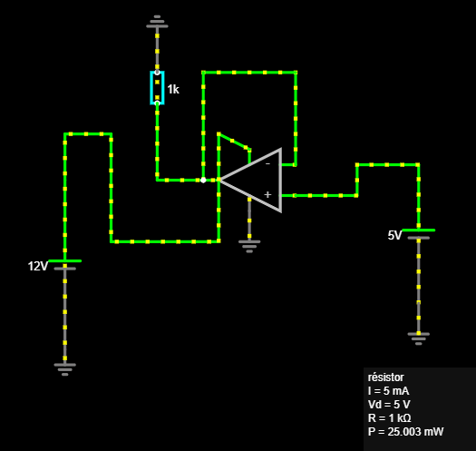
</p>w

- ❓ *Q2. Repérez et nommez sur votre schéma : la consigne, la grandeur mesurée (le retour), l'écart (la différence entre les deux entrées de l'AOP), et l'actionneur (l'étage de sortie de l'AOP). Reproduisez le schéma-bloc correspondant (consigne → comparateur → correcteur → actionneur → sortie, avec la boucle de retour).*

**Étape 4 (10 min) : même perturbation, comparaison**

1.  Appliquer **exactement la même perturbation** qu'en boucle ouverte : éditer la source qui alimente l'AOP (broche **V+**) et faire passer sa tension de **12 V à 9 V**. Ne pas toucher à la source de consigne, qui reste à 5 V.
2.  Relever la nouvelle tension de sortie.

| | Tension d'alimentation | Tension de sortie | Écart avec la consigne 5,0 V |
|---|---|---|---|
| Avant perturbation | 12 V | 5,0 V | 0 V |
| Après perturbation (boucle fermée) | 9 V | | |

19. Pousser le test : faire varier la charge (remplacer la résistance de 1 kΩ par 470 Ω) et observer si la sortie bouge.

- ❓ *Q3. Comparez les deux tableaux (boucle ouverte et boucle fermée). Lequel des deux montages tient sa consigne malgré la perturbation ?*
- ❓ *Q4. Expliquez, avec vos mots, **pourquoi** la boucle fermée corrige automatiquement : que « voit » l'AOP quand la sortie commence à baisser ?*
- ❓ *Q5. Jusqu'où la correction fonctionne-t-elle ? Baissez progressivement l'alimentation de l'AOP (8 V, 7 V, 6 V, 5 V) : à partir de quelle valeur la sortie ne tient-elle plus les 5 V ? Pourquoi un asservissement ne peut-il pas compenser n'importe quelle perturbation ?*
- ❓ *Q6. Citez un exemple de système bouclé rencontré dans la vie courante ou dans un équipement CIEL (régulation de température d'un serveur, alimentation régulée, servomoteur, régulateur de vitesse…).*

**Livrable option B :** les deux schémas construits (boucle ouverte et boucle fermée), les deux tableaux de mesures remplis, le schéma-bloc annoté, les réponses Q1 à Q6, et les captures d'écran des deux circuits.

---

<a id="sec-tp-4-2-reponse-indicielle-d-un-circuit-rc"></a>

### TP 4.2 : Réponse indicielle d'un circuit RC `BTS1` `BTS2`

> **Durée :** 1 h 30 · **Mode :** matériel en poste tournant (version Falstad ci-dessous) · **Cours :** Chapitre 4, §4.3 et §4.6 (système du premier ordre, constante de temps, temps de réponse à 5 %) · **Prérequis :** TP 3.1
> **Objectif :** relever la réponse d'un circuit RC à un échelon de tension, mesurer sa constante de temps par deux méthodes et vérifier que le temps de réponse à 5 % vaut $3\tau$.

**Problématique :** quand on appuie sur le bouton reset d'une carte, quand on allume un serveur ou qu'on chauffe un local, la grandeur de sortie n'atteint pas sa valeur finale instantanément. Comment caractériser cette « lenteur » par un seul nombre, et à partir de quand peut-on considérer que le régime permanent est atteint ?

- **Organisation (poste tournant) :** un seul banc GBF + oscilloscope ; le circuit RC est câblé sur une plaque d'essai à côté du banc. Chaque binôme y passe environ 10 min pour les mesures marquées **(au banc)**, les autres avancent la version Falstad.
- **Matériel du banc (1 par classe) :** GBF Feeltech FY6900, oscilloscope Rigol DS1054Z, 1 plaque d'essai.
- **Matériel par étudiant :** 1 sonde et 1 câble BNC.
- **Composants à prévoir :** résistance 10 kΩ (1/4 W, 5 %), condensateurs film 100 nF et 47 nF (non polarisés, tolérance 5 ou 10 %), 1 câble BNC-pinces crocodiles, fils de câblage.
- **Sécurité :** aucun risque (tension ≤ 5 V).

<p align="center">

</p>

<p align="center"><em>Circuit RC série : tension d'entrée sur la voie 1, tension aux bornes du condensateur sur la voie 2.</em></p>

**Rappels :** pour un échelon de 0 à $E$, la tension du condensateur vaut $u_C(t) = E\left(1 - e^{-t/\tau}\right)$ avec $\tau = RC$. À $t = \tau$, $u_C$ atteint 63 % de $E$ ; à $t = 3\tau$, elle atteint 95 % de $E$.

**Déroulé détaillé**

1. **(15 min) Préparation.** R = 10 kΩ, C = 100 nF, échelon de 0 à $E = 5$ V.
   - ❓ *Q1. Calculez la constante de temps $\tau = RC$. Calculez la valeur de $u_C$ à $t = \tau$ et à $t = 3\tau$.*
   - ❓ *Q2. Un signal carré est une suite d'échelons montants et descendants. Pour que le condensateur ait le temps de se charger complètement (au moins $5\tau$) pendant chaque demi-période, quelle fréquence maximale faut-il choisir ? Vérifiez que 50 Hz convient.*
   - ❓ *Q3. Complétez la ligne « calculé » du tableau de l'étape 3 avec $u_C(t) = 5\left(1 - e^{-t/\tau}\right)$.*

2. **(au banc, 4 min) Réglages.** GBF : signal carré, 50 Hz, amplitude 5 V crête à crête, décalage 2,5 V (le signal va de 0 à 5 V). Oscilloscope : voie 1 sur l'entrée du circuit, voie 2 aux bornes du condensateur, 1 V/div pour les deux voies, base de temps 1 ms/div, déclenchement sur la voie 1, front montant. Décaler le déclenchement pour placer le front montant sur le bord gauche de l'écran.

3. **(au banc, 6 min) Relevé de la charge.** Avec les curseurs (touche **Cursor**, mode manuel), relever $u_C$ aux instants indiqués après le front montant, puis mesurer directement :
   - l'instant où $u_C$ atteint 63 % de 5 V, soit 3,16 V : c'est $\tau$ ;
   - l'instant où $u_C$ atteint 95 % de 5 V, soit 4,75 V : c'est $t_{R5\%}$.

   | $t$ (ms) | 0 | 0,5 | 1 | 2 | 3 | 4 | 5 |
   |---|---|---|---|---|---|---|---|
   | $u_C$ calculée (V) | | | | | | | |
   | $u_C$ mesurée (V) | | | | | | | |

   | Grandeur | $\tau$ (à 63 %) | $t_{R5\%}$ (à 95 %) | $t_{R5\%} / \tau$ |
   |---|---|---|---|
   | Valeur mesurée | | | |

   - Remplacer le condensateur de 100 nF par celui de **47 nF** et mesurer à nouveau $\tau$ : $\tau'$ = ________ ms.

4. **(30 min) Exploitation (à la place).**
   - ❓ *Q4. Tracez $u_C(t)$ à partir du tableau (papier millimétré ou tableur). Tracez la tangente à l'origine : elle coupe l'asymptote $u_C = 5$ V à l'instant $t = \tau$. Comparez cette deuxième mesure de $\tau$ à celle des 63 %.*
   - ❓ *Q5. Comparez $\tau$ mesurée à $RC$ calculée (écart relatif). L'écart est-il compatible avec la tolérance du condensateur (± 10 %) ?*
   - ❓ *Q6. Le rapport $t_{R5\%}/\tau$ vaut-il bien environ 3 ?*
   - ❓ *Q7. Avec 47 nF, la constante de temps a-t-elle été divisée par environ 2 ? Que doit-on changer pour rendre un système du premier ordre plus rapide ?*
   - ❓ *Q8. Observez la décharge (front descendant du carré) : à quelle tension $u_C$ est-elle arrivée au bout de $\tau$ ? Justifiez par le calcul (37 % de 5 V).*

5. **(15 min) Bilan et lien avec l'asservissement.**
   - ❓ *Q9. Le circuit RC présente-t-il un dépassement ? Quel type de système (cours §4.7) reconnaît-on à une réponse sans dépassement avec une tangente à l'origine non nulle ?*
   - ❓ *Q10. Un circuit de reset de microcontrôleur utilise R = 10 kΩ et C = 1 µF. Combien de temps faut-il pour que la tension atteigne 95 % de sa valeur finale ?*

- **Livrable :** tableaux complétés, courbe $u_C(t)$ avec la tangente à l'origine et les points à 63 % et 95 % repérés, réponses Q1 à Q10.
- **⚙ Si le banc n'est pas disponible :** basculer sur la version Falstad ci-dessous.

<a id="sec-version-simulee-du-tp-4-2-falstad"></a>

#### Version simulée du TP 4.2 (Falstad)

- **Principe :** construire le même circuit RC dans Falstad avec un générateur de signal carré et l'oscilloscope intégré. Les questions Q1 à Q10 et les tableaux sont les mêmes.

**Étape 0 (15 min) : préparation.** Répondre aux questions Q1 à Q3.

**Étape 1 (15 min) : construire le circuit.**

1. **Fichier → Nouveau circuit vide**.
2. Placer la source : **Dessiner → Entrées et Générateurs → Ajouter Générateur de Tension (2 terminaux)**, tracée verticalement à gauche. Double-clic : choisir la forme d'onde **Carré**, **Fréquence** 50 Hz, **Tension maximale** 2,5 V, **Décalage continu** 2,5 V : le signal va de 0 à 5 V.
3. Placer R : **Dessiner → Ajouter Résistance** (raccourci **r**), horizontalement depuis la borne + de la source. Double-clic : **10k**.
4. Placer C : **Dessiner → Composants Passifs → Ajouter Condensateur** (raccourci **c**), verticalement entre la fin de R et la borne − de la source. Double-clic : **100n** (100 nF).
5. Fermer le circuit avec **Dessiner → Ajouter Fils** (raccourci **w**).
6. Clic droit sur le condensateur → **Voir dans un nouvel oscilloscope**. Faire de même sur la source : sa tension s'affiche dans un deuxième oscilloscope sous le premier. On peut aussi regrouper les deux courbes sur un même écran (clic droit sur un oscilloscope → **Combiner**, si votre version le propose).

**Étape 2 (25 min) : relevé de la charge.**

1. Ralentir la simulation avec le curseur **Vitesse de simulation** du panneau de droite, puis cliquer sur **Arrêter** juste après un front montant pour figer l'écran.
2. Survoler la courbe de $u_C$ : Falstad affiche le temps et la tension au point survolé. Relever $u_C$ aux instants 0,5 ms, 1 ms, 2 ms… après le front montant, puis repérer les instants où $u_C$ vaut 3,16 V et 4,75 V.
3. Remplir les tableaux. Changer le condensateur en **47n** et mesurer $\tau'$.

**Étape 3 (20 min) : exploitation.** Répondre aux questions Q4 à Q8. Pour la Q8, regarder le front descendant.

**Étape 4 (15 min) : bilan.** Répondre aux questions Q9 et Q10. Pour vérifier la Q10, régler C à **1u** (1 µF) et la fréquence du carré à **5 Hz**, puis mesurer $t_{R5\%}$.

- **Livrable :** captures d'écran annotées (charge avec 100 nF, charge avec 47 nF), tableaux complétés, courbe $u_C(t)$, réponses Q1 à Q10.

---

<a id="sec-tp-4-3-regulation-de-luminosite-avec-arduino"></a>

### TP 4.3 : Régulation de luminosité avec Arduino `BTS2`

> **Durée :** 2 h · **Mode :** matériel, carte Arduino par binôme (version simulée ci-dessous, Python) · **Cours :** Chapitre 4, §4.1 (boucle ouverte, boucle fermée, consigne, perturbation, erreur statique) · **Prérequis :** TP 4.1
> **Objectif :** réaliser une boucle de régulation réelle (capteur, correcteur programmé, actionneur), comparer boucle ouverte et boucle fermée face à une perturbation, et observer l'effet du gain du correcteur.

**Problématique :** l'écran d'un smartphone ou l'éclairage d'un open-space ajuste sa luminosité selon la lumière ambiante. Une LED commandée « à l'aveugle » peut-elle garder un éclairement constant quand on allume une lampe à côté ? Que faut-il ajouter ?

- **Matériel par binôme (× 8) :** 1 carte Arduino Uno et son câble USB, 1 plaque d'essai, fils de câblage, 1 ordinateur avec l'IDE Arduino (le **Traceur série** de l'IDE affiche les courbes).
- **Composants par binôme (à prévoir) :** 1 LED blanche ou rouge haute luminosité 5 mm (LED « commandée »), 1 LED identique pour la perturbation, 2 résistances 220 Ω, 1 photorésistance GL5528, 1 résistance 10 kΩ, 1 interrupteur à glissière (ou un bouton-poussoir), 1 morceau de gaine thermorétractable noire ou un petit tube de carton noir (environ 3 cm) pour coiffer ensemble la LED et la photorésistance.
- **Sécurité :** alimentation par USB (5 V), aucun risque électrique. Ne pas fixer longtemps une LED haute luminosité de près.

**Montage (décrit en texte) :**

| Élément | Branchement |
|---|---|
| LED commandée (actionneur) | broche 9 (sortie MLI, « PWM ») → résistance 220 Ω → anode de la LED ; cathode → GND |
| Photorésistance (capteur) | 5V → photorésistance → point A0 → résistance 10 kΩ → GND |
| LED de perturbation | 5V → interrupteur → résistance 220 Ω → LED → GND |

La LED commandée est placée **face à la photorésistance**, à environ 1 cm, et les deux sont coiffées par le tube noir pour les isoler de l'éclairage de la salle. La LED de perturbation éclaire l'intérieur du tube par une ouverture latérale. Plus la photorésistance reçoit de lumière, plus la tension sur A0 est élevée.

**Déroulé détaillé**

1. **(15 min) Préparation : identifier la chaîne.**
   - ❓ *Q1. Dans ce montage, identifiez : la grandeur réglée, le capteur, l'actionneur, la perturbation, la consigne.*
   - ❓ *Q2. La sortie MLI de l'Arduino reçoit un nombre de 0 à 255 (`analogWrite`). Quelle tension moyenne obtient-on pour la valeur 128 ?*

2. **(25 min) Caractéristique statique en boucle ouverte.** Câbler le montage, perturbation éteinte. Téléverser le programme suivant :

```cpp
// TP 4.3 : boucle ouverte et boucle fermée
const int MODE = 0;        // 0 : boucle ouverte ; 1 : correcteur P ; 2 : correcteur I
const int CONSIGNE = 600;  // mesure visée (0 à 1023)
const int PWM_BO = 200;    // commande fixe en boucle ouverte
const float KP = 1.0;      // gain proportionnel
const float KI = 0.2;      // gain intégral

float integrale = PWM_BO;

void setup() {
  Serial.begin(115200);
}

void loop() {
  int mesure = analogRead(A0);
  int erreur = CONSIGNE - mesure;
  float commande;
  if (MODE == 0) {
    commande = PWM_BO;
  } else if (MODE == 1) {
    commande = PWM_BO + KP * erreur;
  } else {
    integrale = integrale + KI * erreur;
    integrale = constrain(integrale, 0, 255);
    commande = integrale;
  }
  commande = constrain(commande, 0, 255);
  analogWrite(9, (int)commande);
  Serial.print("consigne:"); Serial.print(CONSIGNE);
  Serial.print(" mesure:");  Serial.print(mesure);
  Serial.print(" commande:"); Serial.println((int)commande);
  delay(10);
}
```

   - Avec `MODE = 0`, modifier `PWM_BO` (0, 50, 100, 150, 200, 255), téléverser à chaque fois et relever la mesure dans le **Moniteur série** (vitesse réglée à 115200 bauds, en bas de la fenêtre).

   | PWM_BO | 0 | 50 | 100 | 150 | 200 | 255 |
   |---|---|---|---|---|---|---|
   | Mesure (0 à 1023) | | | | | | |

   - ❓ *Q3. Tracez la mesure en fonction de PWM_BO. Estimez la pente $G$ (en points de mesure par unité de commande) autour du point de fonctionnement.*
   - Choisir la valeur de `PWM_BO` qui donne une mesure proche de 600 (on l'appelle $PWM_0$) et l'écrire dans le programme. Mettre `CONSIGNE` égale à la mesure obtenue.

3. **(15 min) Boucle ouverte face à une perturbation.** Fermer le moniteur série et ouvrir le **Traceur série** (**Outils → Traceur série**, 115200 bauds). Allumer la LED de perturbation, attendre 3 s, l'éteindre.

   | Mode | Mesure sans perturbation | Mesure avec perturbation | Erreur avec perturbation (consigne − mesure) |
   |---|---|---|---|
   | Boucle ouverte | | | |
   | Correcteur P, KP = 1 | | | |
   | Correcteur P, KP = 2 | | | |
   | Correcteur I, KI = 0,2 | | | |

   - ❓ *Q4. En boucle ouverte, la commande change-t-elle quand la perturbation apparaît ? Et la mesure ?*

4. **(25 min) Boucle fermée : correcteur proportionnel.** Passer `MODE = 1`, `KP = 1`, téléverser. Refaire l'essai de perturbation, puis avec `KP = 2`, puis `KP = 5`.
   - ❓ *Q5. Que fait la commande quand la perturbation apparaît ? Expliquez le signe de cette réaction à partir de l'erreur.*
   - ❓ *Q6. L'erreur avec perturbation est-elle nulle ? Comment varie-t-elle quand KP augmente ?*
   - ❓ *Q7. Que se passe-t-il avec KP = 5 (observez le Traceur série) ? Quel est le défaut d'un gain trop élevé ?*

5. **(20 min) Boucle fermée : correcteur intégral.** Passer `MODE = 2`, `KI = 0.2`, téléverser. Refaire l'essai.
   - ❓ *Q8. L'erreur finale avec perturbation est-elle nulle ? Expliquez pourquoi : tant que l'erreur n'est pas nulle, que fait la variable `integrale` ?*
   - ❓ *Q9. Allumez la perturbation, puis approchez une lampe de téléphone de l'ouverture. Que vaut la commande ? Pourquoi la régulation finit-elle par décrocher ?*

6. **(20 min) Bilan.**
   - ❓ *Q10. Dessinez le schéma-bloc de la boucle (consigne, comparateur, correcteur, actionneur, système, capteur, perturbation) en nommant les éléments réels du montage.*
   - ❓ *Q11. Rédigez la conclusion : comparez boucle ouverte, correcteur P et correcteur I sur deux critères (erreur avec perturbation, stabilité).*

- **Livrable :** schéma du montage, tableaux complétés, captures du Traceur série (boucle ouverte, P avec KP = 1 et KP = 5, I), schéma-bloc, réponses Q1 à Q11.
- **⚙ Si les cartes Arduino manquent :** basculer sur la version simulée ci-dessous.

<a id="sec-version-simulee-du-tp-4-3-python"></a>

#### Version simulée du TP 4.3 (Python)

- **Principe :** le programme simule le montage : une LED qui éclaire une photorésistance, une perturbation lumineuse qui apparaît à $t = 5$ s, et le même correcteur que la carte Arduino. Les questions sont les mêmes.

**Étape 1 (15 min) : préparation.** Répondre aux questions Q1 et Q2.

**Étape 2 (20 min) : le programme.** Créer le fichier `tp43_simule.py` :

```python
# TP 4.3, version simulée : régulation de luminosité
import random
import matplotlib.pyplot as plt

MODE = 0          # 0 : boucle ouverte ; 1 : correcteur P ; 2 : correcteur I
CONSIGNE = 600
PWM_BO = 205
KP = 1.0
KI = 0.2
PERTURBATION = 180          # lumière ajoutée à t = 5 s (en points de mesure)

DT = 0.01                   # période de la boucle : 10 ms
TAU = 0.05                  # temps de réaction de la photorésistance (s)

def eclairement(commande, perturbation):
    """Mesure en régime permanent : lumière ambiante + LED + perturbation."""
    return 150 + 2.2 * commande + perturbation

mesure_reelle = eclairement(PWM_BO, 0)
commande = PWM_BO
integrale = PWM_BO
temps, mesures, commandes = [], [], []

for i in range(1000):                       # 1000 pas de 10 ms = 10 s
    t = i * DT
    p = PERTURBATION if t >= 5 else 0
    cible = eclairement(commande, p)
    mesure_reelle += (cible - mesure_reelle) * DT / TAU     # le capteur suit avec retard
    mesure = round(min(1023, max(0, mesure_reelle + random.gauss(0, 2))))
    erreur = CONSIGNE - mesure
    if MODE == 0:
        commande = PWM_BO
    elif MODE == 1:
        commande = PWM_BO + KP * erreur
    else:
        integrale = min(255, max(0, integrale + KI * erreur))
        commande = integrale
    commande = round(min(255, max(0, commande)))
    temps.append(t); mesures.append(mesure); commandes.append(commande)

print("mesure à t = 4,9 s :", mesures[490], "  mesure à t = 9,9 s :", mesures[990])
print("commande à t = 4,9 s :", commandes[490], "  commande à t = 9,9 s :", commandes[990])
plt.plot(temps, mesures, label="mesure")
plt.plot(temps, commandes, label="commande")
plt.axhline(CONSIGNE, color="gray", linestyle="--", label="consigne")
plt.xlabel("t (s)")
plt.legend()
plt.show()
```

**Étape 3 (15 min) : caractéristique statique.** Dans la fonction `eclairement`, la mesure vaut $150 + 2{,}2 \times$ commande. Remplir le tableau de l'étape 2 par le calcul et répondre à la Q3 (la pente $G$ se lit directement dans la formule). Vérifier que PWM_BO = 205 donne une mesure proche de 600.

**Étape 4 (40 min) : les essais.** Exécuter le programme avec `MODE = 0`, puis `MODE = 1` (KP = 1, 2 et 5), puis `MODE = 2` (KI = 0.2). Pour chaque essai, relever la mesure à 4,9 s (sans perturbation) et à 9,9 s (avec perturbation), remplir le tableau de l'étape 3 et répondre aux questions Q4 à Q8.

**Étape 5 (10 min) : décrochage.** Avec `MODE = 2`, porter `PERTURBATION` à 600 et répondre à la Q9.

**Étape 6 (20 min) : bilan.** Répondre aux questions Q10 et Q11.

- **Livrable :** captures des courbes (boucle ouverte, P avec KP = 1 et KP = 5, I), tableaux complétés, schéma-bloc, réponses Q1 à Q11.

---

<div style="page-break-after: always;"></div>

&nbsp;

<div style="page-break-after: always;"></div>

<a id="sec-chapitre-5-traitement-du-signal"></a>

## Chapitre 5 : Traitement du signal

<a id="sec-tp-5-1-mesure-de-gain-et-d-attenuation-d-un-quadripole"></a>

### TP 5.1 : Mesure de gain et d'atténuation d'un quadripôle

> **Durée :** 2 h (une ou deux séances) · **Mode :** matériel, ou Falstad · **Cours :** Chapitre 1 §1.3 et Chapitre 5 §5.3 · **Prérequis :** TP 1.6, TP 3.1
> **Objectif :** relever le gain d'un filtre RC en fonction de la fréquence et le tracer en dB.

- **Objectifs :** mesurer expérimentalement le gain d'un quadripôle à partir de tensions d'entrée/sortie, calculer ce gain en dB, observer comment il varie avec la fréquence, et faire le lien avec la fréquence de coupure vue à l'TP Ondes (§Partie 1).
- **Matériel par poste :** 1 GBF, 1 oscilloscope 2 voies, le circuit RC déjà utilisé à l'TP Ondes (réemployé ici comme quadripôle sous test), cordons BNC. *(Variante : un atténuateur résistif fixe simple, R1/R2 en pont diviseur, pour un gain constant indépendant de la fréquence : utile si l'on veut isoler la notion de dB de celle de filtrage.)*
- **Sécurité :** aucun risque particulier, amplitude GBF limitée à quelques volts.

**Déroulé détaillé**

1. **(10 min) Prévision théorique.** Avant toute mesure, avec les valeurs de R et C de votre circuit RC :
   - ❓ *Q1. Rappelez la fréquence de coupure théorique $f_c = \dfrac{1}{2\pi RC}$ calculée à l'TP Ondes.*
   - ❓ *Q2. À très basse fréquence (f << f_c), quel gain en tension attendez-vous entre l'entrée et la sortie du circuit ? Exprimez-le en dB.*
2. **(20 min) Mesure du gain en basse fréquence.** Régler le GBF sur une fréquence nettement inférieure à f_c (par exemple f_c/10). Mesurer à l'oscilloscope l'amplitude d'entrée V_e (voie 1) et de sortie V_s (voie 2).

     | Grandeur | Valeur |
     |---|---|
     | Fréquence réglée | |
     | V_e (crête ou crête-à-crête, à préciser) | |
     | V_s | |
     | Gain linéaire $A_v = V_s/V_e$ | |
     | Gain en dB $= 20 \times \log_{10}(A_v)$ | |

   - ❓ *Q3. Ce résultat est-il cohérent avec la prévision de la Q2 ?*
3. **(40 min) Balayage en fréquence.** Répéter la mesure de V_e et V_s pour une série de fréquences croissantes couvrant largement f_c (par exemple : f_c/10, f_c/3, f_c/2, f_c, 2×f_c, 5×f_c, 10×f_c).

     | Fréquence | V_e | V_s | $A_v = V_s/V_e$ | Gain (dB) |
     |---|---|---|---|---|
     | f_c/10 | | | | |
     | f_c/3 | | | | |
     | f_c/2 | | | | |
     | f_c | | | | |
     | 2×f_c | | | | |
     | 5×f_c | | | | |
     | 10×f_c | | | | |

   - Tracer le graphe du gain en dB en fonction de la fréquence (papier semi-log si possible, ou tableur).
   - ❓ *Q4. À quelle fréquence mesurée le gain vaut-il environ −3 dB ? Comparez cette fréquence à f_c calculée en Q1.*
   - ❓ *Q5. Que devient le gain (en dB) quand la fréquence est multipliée par 10, au-delà de f_c ? Estimez la pente de la courbe en dB par décade.*
4. **(20 min, bonus si le temps le permet) Mise en cascade.** Placer en série deux quadripôles RC identiques (le vôtre, plus celui d'un poste voisin, ou remonter un second RC en cascade).
   - ❓ *Q6. Prévoyez le gain total en dB à la fréquence f_c, en utilisant la propriété d'addition des gains en cascade (cours §5.1). Vérifiez par la mesure.*
5. **(10 min) Bilan.**
   - ❓ *Q7. Un tel circuit RC est appelé filtre passe-bas. Pourquoi ce nom est-il cohérent avec la courbe de gain que vous avez tracée ?*
   - ❓ *Q8. Citer une situation professionnelle CIEL où l'on a besoin de connaître le gain/l'atténuation d'une liaison en dB (Wi-Fi, câblage réseau, fibre optique...).*
- **Livrable :** tableaux de mesures remplis, graphe du gain en dB en fonction de la fréquence, réponses Q1 à Q8.
- **⚙ Si matériel insuffisant :** ce TP se transpose bien sur Falstad Circuit Simulator (§ Partie 1, alternative C) : le circuit RC, le GBF et l'oscilloscope y sont déjà virtuels, il suffit de relever V_e et V_s pour chaque fréquence testée et de calculer le gain en dB de la même façon.

---

---

<a id="sec-tp-5-2-filtre-rc-et-diagramme-de-bode"></a>

### TP 5.2 : Filtre RC et diagramme de Bode `BTS1` `BTS2`

> **Durée :** 2 h · **Mode :** matériel en poste tournant (version Falstad ci-dessous) · **Cours :** Chapitre 5, §5.3 et §5.5 (transmittance, gain en dB, diagramme de Bode, fréquence de coupure) · **Prérequis :** TP 3.1, TP 5.1
> **Objectif :** tracer le diagramme de Bode complet (gain et phase) d'un filtre RC passe-bas, en déduire sa fréquence de coupure et la pente de son asymptote, et observer la courbe de gain d'un seul coup grâce au balayage en fréquence du GBF.

**Problématique :** un capteur fournit un signal utile lent, pollué par un parasite à quelques dizaines de kilohertz (alimentation à découpage, moteur). Un simple filtre RC suffit-il à l'éliminer ? Comment prévoir, et vérifier, l'atténuation qu'il apporte à chaque fréquence ?

- **Organisation (poste tournant) :** un seul banc GBF + oscilloscope ; le filtre est câblé sur une plaque d'essai à côté du banc. Chaque binôme y passe environ 12 min pour les mesures marquées **(au banc)**, les autres avancent la version Falstad.
- **Matériel du banc (1 par classe) :** GBF Feeltech FY6900, oscilloscope Rigol DS1054Z, 1 plaque d'essai.
- **Matériel par étudiant :** 1 sonde et 1 câble BNC.
- **Composants à prévoir :** résistance 1 kΩ (1/4 W, 5 %), condensateur film 100 nF (5 ou 10 %), 1 câble BNC-pinces crocodiles, fils de câblage.
- **Sécurité :** aucun risque (amplitude ≤ 4 V crête à crête).

<p align="center">

</p>

<p align="center"><em>Filtre RC passe-bas : tension d'entrée u<sub>E</sub> sur la voie 1, tension de sortie u<sub>S</sub> (aux bornes de C) sur la voie 2.</em></p>

**Rappels :** pour ce filtre, $T = \dfrac{U_S}{U_E} = \dfrac{1}{\sqrt{1 + (f/f_c)^2}}$, $G = 20\log_{10}(T)$, déphasage $\varphi = -\arctan(f/f_c)$, avec $f_c = \dfrac{1}{2\pi RC}$.

**Déroulé détaillé**

1. **(15 min) Préparation.** R = 1 kΩ, C = 100 nF.
   - ❓ *Q1. Calculez la fréquence de coupure $f_c$.*
   - ❓ *Q2. Que valent $T$, $G$ et $\varphi$ à $f = f_c$ ? Et pour $f = 10\,f_c$ ?*
   - ❓ *Q3. Complétez la ligne « G calculé » du tableau de l'étape 3.*

2. **(au banc, 2 min) Réglages.** GBF : sinus, amplitude 4 V crête à crête, sans décalage. Oscilloscope : voie 1 sur l'entrée du filtre, voie 2 sur la sortie, mesures automatiques **Vpp** sur les deux voies (touche **Measure**) et mesure de **délai** (ou de phase) entre les voies 1 et 2. Déclenchement sur la voie 1.

3. **(au banc, 8 min) Relevé point par point.** Pour chaque fréquence, adapter la base de temps pour voir 2 à 3 périodes, puis relever $U_E$, $U_S$ (crête à crête) et le décalage $\Delta t$ entre les deux courbes.

   | f (Hz) | 100 | 200 | 500 | 1 000 | 1 600 | 2 000 | 5 000 | 10 000 | 20 000 | 50 000 |
   |---|---|---|---|---|---|---|---|---|---|---|
   | $U_E$ (V) | | | | | | | | | | |
   | $U_S$ (V) | | | | | | | | | | |
   | $T = U_S/U_E$ | | | | | | | | | | |
   | G mesuré (dB) | | | | | | | | | | |
   | G calculé (dB) | | | | | | | | | | |
   | $\Delta t$ | | | | | | | | | | |
   | $\varphi = -360 \times f \times \Delta t$ (°) | | | | | | | | | | |

4. **(au banc, 2 min) Balayage en fréquence.** Sur le GBF, activer le **balayage** (*sweep*) : de 100 Hz à 50 kHz, mode **logarithmique**, durée 1 s. Oscilloscope : voie 2 seule, base de temps 100 ms/div. On voit l'enveloppe de la tension de sortie : c'est l'allure de la courbe de gain, obtenue d'un seul coup. Faire une photo de l'écran.

5. **(40 min) Exploitation (à la place).**
   - Tracer G (dB) en fonction de f sur papier semi-logarithmique (ou tableur, axe des abscisses en échelle logarithmique), puis $\varphi$ en fonction de f.
   - ❓ *Q4. À quelle fréquence le gain vaut-il −3 dB ? À quelle fréquence le déphasage vaut-il −45° ? Comparez ces deux valeurs à $f_c$ calculée.*
   - ❓ *Q5. Tracez les deux asymptotes du gain : horizontale à 0 dB en basse fréquence, et droite passant par vos points à 10 kHz et 50 kHz en haute fréquence. Mesurez la pente de cette dernière en dB par décade. Où se croisent les deux asymptotes ?*
   - ❓ *Q6. Vers quelle valeur tend le déphasage à très haute fréquence ?*
   - ❓ *Q7. Comparez la photo du balayage à votre courbe de gain. Pourquoi l'enveloppe ressemble-t-elle à une courbe tracée en échelle logarithmique ?*

6. **(20 min) Application et bilan.**
   - ❓ *Q8. Le signal utile du capteur a une fréquence de 100 Hz et le parasite une fréquence de 50 kHz, avec la même amplitude à l'entrée. Avec ce filtre, de combien de dB le parasite est-il atténué ? Combien de fois plus petit est-il en sortie ? Le signal utile est-il déformé ?*
   - ❓ *Q9. On veut une coupure à 160 Hz en gardant C = 100 nF. Quelle résistance faut-il ?*
   - ❓ *Q10 (pour aller plus loin). On permute R et C (la sortie est prise aux bornes de R). Prévoyez la nature du filtre obtenu et vérifiez par une mesure à 100 Hz et à 20 kHz.*

- **Livrable :** tableau complété, diagramme de Bode (gain avec asymptotes, phase), photo du balayage, réponses Q1 à Q10.
- **⚙ Si le banc n'est pas disponible :** basculer sur la version Falstad ci-dessous.

<a id="sec-version-simulee-du-tp-5-2-falstad"></a>

#### Version simulée du TP 5.2 (Falstad)

- **Principe :** construire le même filtre dans Falstad avec un générateur sinusoïdal et l'oscilloscope intégré. Les questions Q1 à Q10 et le tableau sont les mêmes (sauf l'étape de balayage, remplacée par l'étape 3 ci-dessous).

**Étape 0 (15 min) : préparation.** Répondre aux questions Q1 à Q3.

**Étape 1 (15 min) : construire le filtre.**

1. **Fichier → Nouveau circuit vide**.
2. Placer la source : **Dessiner → Entrées et Générateurs → Ajouter Générateur de Tension A/C (2 sorties)**, tracée verticalement à gauche. Double-clic : **Tension maximale** 2 V (soit 4 V crête à crête), **Fréquence** 100 Hz.
3. Placer R : **Dessiner → Ajouter Résistance**, horizontalement depuis la borne haute de la source, réglée à **1k**.
4. Placer C : **Dessiner → Composants Passifs → Ajouter Condensateur**, verticalement entre la fin de R et la borne basse de la source, réglé à **100n**.
5. Fermer le circuit avec **Dessiner → Ajouter Fils**.
6. Clic droit sur la source → **Voir dans un nouvel oscilloscope** ; clic droit sur le condensateur → **Voir dans un nouvel oscilloscope**. Dans chaque oscilloscope, clic droit → **Propriétés…** et cocher l'affichage de la **valeur crête** (ou crête à crête) : la valeur s'inscrit à côté de la courbe.

**Étape 2 (40 min) : relevé point par point.**

1. Pour chaque fréquence du tableau, double-clic sur la source et changer la **Fréquence**. Attendre que l'affichage se stabilise (quelques périodes) et relever $U_E$ et $U_S$.
2. Pour les fréquences supérieures à 5 kHz, réduire le pas de temps de la simulation (**Options → Autres options…**, champ **Pas de temps**, saisir **1u**), sinon la sinusoïde est dessinée avec trop peu de points.
3. Pour le déphasage, arrêter la simulation (bouton **Arrêter**) et survoler les deux courbes pour lire l'instant d'un même passage par zéro (montant) : la différence donne $\Delta t$.
4. Remplir le tableau.

**Étape 3 (10 min) : vérification à la fréquence de coupure.** Régler la source exactement à la valeur de $f_c$ calculée en Q1. Vérifier que $U_S/U_E \approx 0{,}71$ et que le décalage vaut un huitième de période (−45°). Cette étape remplace la Q7.

**Étape 4 (40 min) : exploitation et bilan.** Tracer le diagramme de Bode (tableur, abscisses en échelle logarithmique) et répondre aux questions Q4 à Q6, puis Q8 à Q10. Pour la Q10, permuter R et C dans Falstad et observer la tension aux bornes de R.

- **Livrable :** captures d'écran à 100 Hz, à $f_c$ et à 10 kHz, tableau complété, diagramme de Bode, réponses Q1 à Q10.

---

<a id="sec-tp-5-3-echantillonnage-repliement-de-spectre-et-filtre-numerique"></a>

### TP 5.3 : Échantillonnage, repliement de spectre et filtre numérique `BTS2`

> **Durée :** 2 h · **Mode :** TP informatisé, Python (démonstration au banc ci-dessous, oscilloscope Rigol) · **Cours :** Chapitre 5, §5.6 (échantillonnage, condition de Shannon, repliement) et §5.5 (filtrage) · **Prérequis :** TP 5.2 (filtre RC)
> **Objectif :** voir ce que devient un sinus quand on l'échantillonne trop lentement, vérifier la condition de Shannon, puis programmer deux filtres numériques (moyenne glissante et « RC numérique ») et les comparer.

**Problématique :** une carte d'acquisition ne connaît du signal que des échantillons pris à intervalles réguliers. Peut-elle se tromper sur la fréquence d'un signal ? Et, une fois les nombres en mémoire, peut-on les filtrer par un simple calcul, sans résistance ni condensateur ?

- **Matériel par binôme (× 8) :** 1 ordinateur avec Python 3 (`numpy`, `matplotlib` ; Thonny, Anaconda ou une plateforme en ligne comme Capytale).
- **Démonstration au banc (poste tournant, environ 8 min par binôme) :** GBF Feeltech FY6900 et oscilloscope Rigol DS1054Z, 1 câble BNC. Aucun composant à acheter.
- **Sécurité :** aucun risque particulier.

**Déroulé détaillé**

1. **(10 min) Préparation.**
   - ❓ *Q1. Rappelez la condition de Shannon. Un sinus de 1 kHz est échantillonné : quelle fréquence d'échantillonnage minimale faut-il ?*
   - ❓ *Q2. Un CD audio est échantillonné à 44,1 kHz. Jusqu'à quelle fréquence peut-il restituer le son ? Pourquoi ce choix, sachant que l'oreille entend jusqu'à environ 20 kHz ?*

2. **(30 min) Échantillonner un sinus.** Créer le fichier `tp53_echantillonnage.py` :

```python
# TP 5.3, partie 1 : échantillonnage d'un sinus de 1 kHz
import numpy as np
import matplotlib.pyplot as plt

F0 = 1000          # fréquence du signal (Hz)
FE = 5000          # fréquence d'échantillonnage (Hz) : à modifier
DUREE = 0.01       # on observe 10 ms

t_fin = np.arange(0, DUREE, 1e-6)          # signal « analogique » : un point par µs
t_ech = np.arange(0, DUREE, 1 / FE)        # instants d'échantillonnage
x_fin = np.cos(2 * np.pi * F0 * t_fin)
x_ech = np.cos(2 * np.pi * F0 * t_ech)

# fréquence apparente : raie la plus haute du spectre des échantillons
N = 4096
spectre = np.abs(np.fft.rfft(np.cos(2 * np.pi * F0 * np.arange(N) / FE)))
freqs = np.fft.rfftfreq(N, 1 / FE)
print(f"fe = {FE} Hz : fréquence apparente ≈ {freqs[np.argmax(spectre)]:.0f} Hz")

plt.plot(t_fin * 1000, x_fin, label="signal analogique (1 kHz)")
plt.plot(t_ech * 1000, x_ech, "o-", label=f"échantillons reliés (fe = {FE} Hz)")
plt.xlabel("t (ms)")
plt.legend()
plt.show()
```

   Exécuter le programme pour chaque valeur de `FE` du tableau.

   | $f_e$ (Hz) | 20 000 | 5 000 | 2 500 | 1 500 | 1 200 | 1 000 | 900 |
   |---|---|---|---|---|---|---|---|
   | Shannon respecté ? (oui / non) | | | | | | | |
   | Fréquence apparente (Hz) | | | | | | | |
   | Calcul de $\lvert f_0 - k\,f_e \rvert$ (k entier le mieux choisi) | | | | | | | |

   - ❓ *Q3. Pour quelles fréquences d'échantillonnage les échantillons reliés « ressemblent-ils » au sinus de 1 kHz ? Pour lesquelles voit-on un sinus plus lent ?*
   - ❓ *Q4. Vérifiez que la fréquence apparente vaut $\lvert f_0 - k\,f_e \rvert$ pour un entier k bien choisi : c'est le **repliement de spectre**. Que voit-on pour $f_e = 1\,000$ Hz ? Pourquoi ?*
   - ❓ *Q5. Pourquoi place-t-on un filtre passe-bas analogique (anti-repliement) **avant** le convertisseur, et pas après ?*

3. **(40 min) Filtrer numériquement.** Le signal utile (sinus de 50 Hz, amplitude 1) est pollué par un parasite à 2 kHz (amplitude 0,5). Il est échantillonné à $f_e$ = 10 kHz. Créer le fichier `tp53_filtre.py` :

```python
# TP 5.3, partie 2 : moyenne glissante et filtre RC numérique
import numpy as np
import matplotlib.pyplot as plt

FE = 10000
F_PARASITE = 2000
t = np.arange(0, 0.1, 1 / FE)                     # 0,1 s : 1000 échantillons
x = np.sin(2 * np.pi * 50 * t) + 0.5 * np.sin(2 * np.pi * F_PARASITE * t)

# filtre 1 : moyenne glissante sur N échantillons
N = 5
moy = np.convolve(x, np.ones(N) / N, mode="same")

# filtre 2 : « RC numérique » de fréquence de coupure FC
FC = 200
tau = 1 / (2 * np.pi * FC)
a = (1 / FE) / (tau + 1 / FE)
rc = np.zeros_like(x)
for n in range(1, len(x)):
    rc[n] = rc[n - 1] + a * (x[n] - rc[n - 1])

def amplitude(signal, f):
    """Amplitude de la composante de fréquence f, calculée par FFT."""
    X = np.fft.rfft(signal)
    freqs = np.fft.rfftfreq(len(signal), 1 / FE)
    return 2 * np.abs(X[np.argmin(np.abs(freqs - f))]) / len(signal)

for nom, s in (("entrée", x), ("moyenne glissante", moy), ("RC numérique", rc)):
    print(f"{nom:18s} : 50 Hz -> {amplitude(s, 50):.3f}   {F_PARASITE} Hz -> {amplitude(s, F_PARASITE):.3f}")

plt.plot(t * 1000, x, label="entrée")
plt.plot(t * 1000, moy, label=f"moyenne glissante N = {N}")
plt.plot(t * 1000, rc, label=f"RC numérique fc = {FC} Hz")
plt.xlabel("t (ms)")
plt.legend()
plt.show()
```

   | Filtre | Amplitude à 50 Hz | Amplitude à 2 kHz | Atténuation du parasite (dB) |
   |---|---|---|---|
   | Entrée (sans filtre) | | | 0 |
   | Moyenne glissante, N = 5 | | | |
   | Moyenne glissante, N = 10 | | | |
   | RC numérique, $f_c$ = 200 Hz | | | |

   - ❓ *Q6. Expliquez en une phrase ce que calcule la moyenne glissante. Pourquoi élimine-t-elle presque parfaitement le parasite à 2 kHz avec N = 5 ? (Indice : combien de périodes du parasite contiennent 5 échantillons à 10 kHz ?)*
   - ❓ *Q7. Le « RC numérique » applique la relation $y_n = y_{n-1} + a\,(x_n - y_{n-1})$. Comparez l'amplitude du parasite en sortie à celle que donnerait un vrai filtre RC de coupure 200 Hz (calculez $T$ à 2 kHz avec la formule du TP 5.2).*
   - ❓ *Q8. Remplacez `F_PARASITE = 2000` par `2500`. Quel filtre se dégrade le plus ? Pourquoi la moyenne glissante est-elle moins « universelle » ?*

4. **(20 min) Bilan.**
   - ❓ *Q9. Citez deux avantages d'un filtre numérique sur un filtre RC câblé (réglage, dérive, encombrement…) et une limite (penser à la Q5).*
   - ❓ *Q10. Un capteur de température est lu 10 fois par seconde par un microcontrôleur. Proposez un filtre numérique simple pour lisser la mesure, et dites ce qu'il coûte (retard de la mesure filtrée).*

- **Livrable :** captures des courbes pour $f_e$ = 5 000 Hz et $f_e$ = 1 200 Hz, captures du filtrage, les deux tableaux complétés, réponses Q1 à Q10.

<a id="sec-demonstration-au-banc-du-tp-5-3-oscilloscope-rigol"></a>

#### Démonstration au banc du TP 5.3 (oscilloscope Rigol, poste tournant)

- **Principe :** un oscilloscope numérique est lui-même un échantillonneur. Si l'on choisit une base de temps trop lente, il échantillonne trop lentement et peut afficher un signal faux. Durée : environ 8 min par binôme.

1. Relier la sortie CH1 du GBF à la voie 1 de l'oscilloscope par un câble BNC. Oscilloscope : touche **Acquire**, profondeur mémoire (**Mem Depth**) réglée à **12k**, base de temps **20 ms/div**. Lire la fréquence d'échantillonnage affichée en haut de l'écran (en Sa/s, par exemple 50 kSa/s) et la noter : $f_e$ = ________.
2. GBF : sinus, 2 V crête à crête, fréquence réglée à $f_e + 10$ Hz (par exemple 50,010 kHz). Observer l'écran à 20 ms/div.
3. Passer la base de temps à **20 µs/div** : l'oscilloscope échantillonne alors beaucoup plus vite. Observer le vrai signal.
4. ❓ *Q11. À 20 ms/div, quelle fréquence semble avoir le signal à l'écran ? Vérifiez avec $\lvert f_0 - k\,f_e \rvert$. Qu'affiche l'oscilloscope à 20 µs/div ?*
5. Revenir à 20 ms/div et activer la FFT (touche **Math** → **FFT**, source CH1). Faire varier la fréquence du GBF de 10 kHz à 40 kHz : la raie avance jusqu'à $f_e/2$, puis « repart en arrière ».
6. ❓ *Q12. Pourquoi un technicien doit-il toujours se méfier d'un affichage d'oscilloscope numérique à base de temps lente ? Quel réflexe adopter ?*

---

<a id="sec-tp-5-4-spectre-d-un-signal-a-la-fft-de-l-oscilloscope"></a>

### TP 5.4 : Spectre d'un signal à la FFT de l'oscilloscope `BTS1` `BTS2`

> **Durée :** 1 h 30 · **Mode :** matériel en poste tournant (version simulée ci-dessous, Python) · **Cours :** Chapitre 5, §5.2 (théorème de Fourier, spectre de raies, valeur efficace, taux de distorsion) · **Prérequis :** TP 3.1
> **Objectif :** observer le spectre de signaux sinusoïdal, carré, triangulaire et rectangulaire à la FFT de l'oscilloscope, relever les amplitudes des harmoniques et les comparer aux valeurs théoriques.

**Problématique :** un signal d'horloge carré à 1 MHz rayonne des parasites bien au-delà de 1 MHz et perturbe le Wi-Fi d'à côté. Pourquoi un signal de fréquence donnée contient-il d'autres fréquences ? Lesquelles, et avec quelle amplitude ?

- **Organisation (poste tournant) :** un seul banc GBF + oscilloscope ; chaque binôme y passe environ 10 min pour les relevés marqués **(au banc)**, les autres avancent la version simulée.
- **Matériel du banc (1 par classe) :** GBF Feeltech FY6900, oscilloscope Rigol DS1054Z, 1 câble BNC-BNC.
- **Matériel par étudiant :** 1 sonde et 1 câble BNC. Aucun composant à acheter.
- **Sécurité :** aucun risque.

**Rappels :** un signal carré d'amplitude $A$ (de $-A$ à $+A$) ne contient que des harmoniques de rang impair, d'amplitude $\dfrac{4A}{n\pi}$. Un signal triangulaire d'amplitude $A$ ne contient aussi que des harmoniques impairs, d'amplitude $\dfrac{8A}{\pi^2 n^2}$. L'oscilloscope affiche les raies en **dBV** : niveau $= 20\log_{10}\left(\dfrac{U_{eff}}{1\ \text{V}}\right)$, avec $U_{eff} = \dfrac{\text{amplitude}}{\sqrt{2}}$.

**Déroulé détaillé**

1. **(15 min) Préparation.** Signaux de fréquence $f_0$ = 1 kHz et d'amplitude $A$ = 1 V (2 V crête à crête).
   - ❓ *Q1. Calculez l'amplitude des harmoniques de rang 1, 3, 5 et 7 du signal carré, puis leur niveau en dBV. Faites de même pour le triangle.*
   - ❓ *Q2. Quel est le niveau en dBV d'un sinus d'amplitude 1 V ?*

2. **(au banc, 3 min) Réglages.** Relier la sortie CH1 du GBF à la voie 1 par un câble BNC. GBF : sinus, 1 kHz, 2 V crête à crête, sans décalage. Oscilloscope : base de temps 1 ms/div, puis touche **Math** → **FFT**, source CH1, fenêtre **Hanning**, unité **dB** (dBV efficace). Régler le centre du spectre à 5 kHz et l'échelle horizontale à 1 kHz/div pour voir de 0 à 10 kHz environ. Utiliser les curseurs (touche **Cursor**, source Math) pour lire la fréquence et le niveau de chaque raie.

3. **(au banc, 7 min) Relevés.** Pour chaque forme de signal (même fréquence, même amplitude), relever le niveau des raies. Pour le rectangle, choisir le signal carré et régler son **rapport cyclique** à 25 %.

   | Raie (kHz) | 1 | 2 | 3 | 4 | 5 | 6 | 7 |
   |---|---|---|---|---|---|---|---|
   | Sinus (dBV) | | | | | | | |
   | Carré (dBV) | | | | | | | |
   | Carré, théorique (dBV) | | | | | | | |
   | Triangle (dBV) | | | | | | | |
   | Triangle, théorique (dBV) | | | | | | | |
   | Rectangle 25 % (dBV) | | | | | | | |

   - Revenir au carré et passer la fréquence à 2 kHz : noter où se placent les raies.

4. **(35 min) Exploitation (à la place).**
   - ❓ *Q3. Le sinus du GBF présente-t-il des harmoniques ? À quel niveau, comparé au fondamental ? Que peut-on dire de la pureté du GBF ?*
   - ❓ *Q4. Pour le carré, les raies paires sont-elles présentes ? Comparez les niveaux mesurés aux niveaux théoriques de la Q1.*
   - ❓ *Q5. Calculez, pour le carré puis pour le triangle, l'écart en dB entre l'harmonique 3 et le fondamental. Lequel des deux signaux a les harmoniques qui décroissent le plus vite ? Reliez ce résultat à l'allure du signal (fronts raides ou pentes douces).*
   - ❓ *Q6. Pour le rectangle à 25 %, quelle raie a disparu ? Ce signal contient-il des harmoniques pairs ?*
   - ❓ *Q7. Quand la fréquence du carré passe à 2 kHz, comment se déplacent les raies ? Énoncez la règle.*
   - ❓ *Q8. La valeur efficace du carré vaut 1 V. Calculez la valeur efficace reconstituée avec les seuls harmoniques 1, 3, 5 et 7 (cours, équation 37). Quel pourcentage de la valeur efficace porte-t-elle ?*

5. **(15 min) Bilan.**
   - ❓ *Q9. Revenez à la problématique : pourquoi une horloge carrée à 1 MHz peut-elle perturber une liaison à 2,4 GHz ? Quelle solution limite ce problème (penser aux TP 5.2 et 5.3) ?*

- **Livrable :** captures ou photos des spectres (sinus, carré, triangle, rectangle), tableau complété, réponses Q1 à Q9.
- **⚙ Si le banc n'est pas disponible :** basculer sur la version simulée ci-dessous.

<a id="sec-version-simulee-du-tp-5-4-python"></a>

#### Version simulée du TP 5.4 (Python)

- **Principe :** Python fabrique les quatre signaux et calcule leur spectre par FFT, exactement comme le fait l'oscilloscope. Les questions Q1 à Q9 et le tableau sont les mêmes.

**Étape 0 (15 min) : préparation.** Répondre aux questions Q1 et Q2.

**Étape 1 (15 min) : le programme.** Créer le fichier `tp54_spectre.py` :

```python
# TP 5.4, version simulée : spectre d'un signal par FFT
import numpy as np
import matplotlib.pyplot as plt

FORME = "carre"        # "sinus", "carre", "triangle" ou "rectangle25"
F0 = 1000              # fréquence du signal (Hz)
FE = 100 * F0          # 100 échantillons par période
N = 10000              # 100 périodes analysées

pos = (np.arange(N) % 100) / 100          # position dans la période (0 à 1)
if FORME == "sinus":
    x = np.sin(2 * np.pi * pos)
elif FORME == "carre":
    x = np.where(pos < 0.5, 1.0, -1.0)
elif FORME == "triangle":
    x = 2 / np.pi * np.arcsin(np.sin(2 * np.pi * pos))
else:
    x = np.where(pos < 0.25, 1.0, -1.0)

X = np.fft.rfft(x)
freqs = np.fft.rfftfreq(N, 1 / FE)
amplitude = 2 * np.abs(X) / N
amplitude[0] = amplitude[0] / 2           # la composante continue n'est pas doublée
niveau = 20 * np.log10(amplitude / np.sqrt(2) + 1e-9)     # en dBV efficace

for n in range(1, 8):
    k = np.argmin(np.abs(freqs - n * F0))
    print(f"raie {n} ({n*F0/1000:.0f} kHz) : amplitude {amplitude[k]:.3f} V   niveau {niveau[k]:6.1f} dBV")

plt.subplot(2, 1, 1)
plt.plot(np.arange(300) / FE * 1000, x[:300])
plt.xlabel("t (ms)")
plt.subplot(2, 1, 2)
plt.plot(freqs, niveau)
plt.xlim(0, 10 * F0)
plt.ylim(-80, 5)
plt.xlabel("f (Hz)")
plt.ylabel("niveau (dBV)")
plt.tight_layout()
plt.show()
```

**Étape 2 (35 min) : relevés.** Exécuter le programme avec `FORME = "sinus"`, puis `"carre"`, `"triangle"` et `"rectangle25"`. Remplir le tableau avec les niveaux affichés. Puis, avec le carré, passer `F0 = 2000` et observer où se placent les raies.

**Étape 3 (25 min) : exploitation et bilan.** Répondre aux questions Q3 à Q9. Pour la Q3, noter que le sinus calculé par Python est parfait : le spectre ne montre que du « bruit de calcul » vers −180 dBV (limité ici à −80 dBV par l'axe).

- **Livrable :** captures des quatre spectres, tableau complété, réponses Q1 à Q9.

---

<div style="page-break-after: always;"></div>

&nbsp;

<div style="page-break-after: always;"></div>

<a id="sec-chapitre-6-optique"></a>

## Chapitre 6 : Optique

*(Voir aussi TP 1.7 et TP 1.8 pour la LED et la photodiode.)*

<a id="sec-tp-6-1-refraction-et-reflexion-totale"></a>

### TP 6.1 : Réfraction et réflexion totale `BTS1` `BTS2`

> **Durée :** 1 h 30 · **Mode :** matériel en rotation (version simulée ci-dessous, simulateur PhET) · **Cours :** Chapitre 6, §6.1 et §6.2 (indice de réfraction, loi de Snell-Descartes, réflexion totale) · **Prérequis :** aucun
> **Objectif :** vérifier la loi de Snell-Descartes, mesurer l'indice de réfraction du plexiglas et mesurer l'angle limite de réflexion totale, principe du guidage de la lumière dans une fibre optique.

**Problématique :** une fibre optique transporte la lumière sur des kilomètres, même quand elle est courbée. Pourquoi la lumière ne s'échappe-t-elle pas par les côtés ? Une simple expérience avec un demi-cylindre de plexiglas permet de le comprendre.

- **Organisation (rotation) :** 4 postes optiques ; la moitié des binômes travaille sur les postes pendant 40 min pendant que l'autre moitié fait la version simulée, puis on échange.
- **Matériel par poste (4 postes) :** 1 pointeur laser rouge de **classe 2** (puissance < 1 mW, 650 nm), 1 demi-cylindre en plexiglas (diamètre 60 à 90 mm, épaisseur 15 à 20 mm), 1 disque gradué en degrés (rapporteur de 360° imprimé sur papier, diamètre au moins 20 cm), 1 support ou pâte adhésive pour tenir le laser à plat.
- **Matériel à prévoir :** les 4 pointeurs laser classe 2, les 4 demi-cylindres en plexiglas, l'impression des disques gradués.
- **Sécurité :** **ne jamais diriger le faisceau laser vers un œil**, ni le sien ni celui d'un camarade, même par réflexion. Travailler à plat sur la table, faisceau horizontal, pas d'objets brillants sur la table. Éteindre le laser dès qu'on ne mesure pas.

**Montage (décrit en texte) :** le demi-cylindre est posé à plat sur le disque gradué, la face plane exactement sur le diamètre 90°/270° et le centre de la face plane au centre du disque. La **normale** à la face plane est donc la ligne 0°/180°. Le laser, posé à plat, envoie son faisceau en rasant le papier : on voit la trace du rayon sur le disque et on lit les angles par rapport à la normale.

**Déroulé détaillé**

1. **(10 min) Préparation.**
   - ❓ *Q1. Écrivez la loi de Snell-Descartes. Un rayon passe de l'air (n = 1,00) dans le plexiglas (n ≈ 1,49) avec un angle d'incidence de 30°. Calculez l'angle de réfraction.*
   - ❓ *Q2. Pourquoi un rayon qui arrive sur la face **courbe** du demi-cylindre en visant son centre n'est-il pas dévié ?*

2. **(25 min) Partie A : de l'air vers le plexiglas.** Le laser éclaire la **face plane**, au centre du disque. Le rayon réfracté traverse le plexiglas et sort par la face courbe sans être dévié. Pour chaque angle d'incidence $\theta_1$ (dans l'air), lire l'angle de réfraction $\theta_2$ (dans le plexiglas).

   | $\theta_1$ (°) | 0 | 10 | 20 | 30 | 40 | 50 | 60 | 70 | 80 |
   |---|---|---|---|---|---|---|---|---|---|
   | $\theta_2$ mesuré (°) | | | | | | | | | |
   | $\sin\theta_1$ | | | | | | | | | |
   | $\sin\theta_2$ | | | | | | | | | |

   - ❓ *Q3. Le rayon se rapproche-t-il ou s'éloigne-t-il de la normale en entrant dans le plexiglas ? Observez aussi le rayon réfléchi : que vaut l'angle de réflexion ?*
   - ❓ *Q4. Tracez $\sin\theta_1$ en fonction de $\sin\theta_2$. Les points sont-ils alignés sur une droite passant par l'origine ? Déduisez de la pente l'indice $n$ du plexiglas.*

3. **(25 min) Partie B : du plexiglas vers l'air, réflexion totale.** Faire tourner le demi-cylindre de 180° : le laser éclaire maintenant la **face courbe** en visant le centre. Le rayon arrive sans déviation sur la face plane, depuis l'intérieur du plexiglas, avec l'angle $\theta_1$ ; il ressort dans l'air avec l'angle $\theta_2$.

   | $\theta_1$ (°) dans le plexiglas | 0 | 10 | 20 | 30 | 35 | 40 | 45 | 50 |
   |---|---|---|---|---|---|---|---|---|
   | $\theta_2$ mesuré (°) dans l'air | | | | | | | | |
   | $\theta_2$ calculé (°) | | | | | | | | |
   | Rayon réfracté présent ? (oui / non) | | | | | | | | |

   - Augmenter très lentement $\theta_1$ à partir de 35° et noter l'angle pour lequel le rayon réfracté rase la face plane et disparaît : $\theta_{lim}$ mesuré = ________°.
   - ❓ *Q5. Que devient la luminosité du rayon réfléchi quand le rayon réfracté disparaît ?*
   - ❓ *Q6. Calculez l'angle limite théorique $\theta_{lim}$ tel que $\sin\theta_{lim} = \dfrac{1}{n}$ avec l'indice trouvé à la Q4. Comparez à la mesure.*
   - ❓ *Q7. Pourquoi la réflexion totale est-elle impossible quand la lumière passe de l'air vers le plexiglas (partie A) ?*

4. **(20 min) Lien avec la fibre optique.**
   - ❓ *Q8. Dans une fibre en plastique, le cœur a un indice $n_1 = 1{,}49$ et la gaine un indice $n_2 = 1{,}40$. Calculez l'angle limite à l'interface cœur/gaine. Un rayon qui frappe la gaine sous 80° par rapport à la normale reste-t-il guidé ?*
   - ❓ *Q9. On montre que l'ouverture numérique vaut $ON = \sqrt{n_1^2 - n_2^2}$. Calculez-la, puis l'angle d'acceptance $\theta_0$ tel que $ON = \sin\theta_0$. Que se passe-t-il pour un rayon qui entre dans la fibre avec un angle plus grand ?*

5. **(10 min) Bilan.**
   - ❓ *Q10. En deux phrases, répondez à la problématique : à quelles conditions la lumière reste-t-elle piégée dans le cœur d'une fibre ?*

- **Livrable :** les deux tableaux, le graphe $\sin\theta_1 = f(\sin\theta_2)$ avec la valeur de $n$, l'angle limite mesuré et calculé, réponses Q1 à Q10.
- **⚙ Si les postes optiques ne sont pas disponibles :** basculer sur la version simulée ci-dessous.

<a id="sec-version-simulee-du-tp-6-1-phet-courber-la-lumiere"></a>

#### Version simulée du TP 6.1 (PhET « Courber la lumière »)

- **Principe :** le simulateur gratuit PhET **« Courber la lumière »** (*Bending Light*, Université du Colorado, en français) reproduit le laser, deux milieux et un rapporteur virtuel. Les questions Q1 à Q10 et les tableaux sont les mêmes.

**Étape 0 (5 min) : ouverture.** Rechercher « PhET Courber la lumière » dans un navigateur, ouvrir la simulation en français et choisir l'écran **Intro**. Le laser est en haut à gauche, l'interface entre les deux milieux est horizontale, la normale est en pointillés.

**Étape 1 (10 min) : préparation.** Répondre aux questions Q1 et Q2 (pour la Q2, raisonner sur le schéma du montage matériel).

**Étape 2 (25 min) : de l'air vers un milieu plus réfringent.**

1. Milieu du haut : **Air**. Milieu du bas : choisir **Personnalisé** (ou « Autre ») et régler le curseur d'indice à **1,49** (plexiglas).
2. Allumer le laser (bouton rouge). Sortir le **rapporteur** de la boîte à outils et le centrer sur le point d'impact.
3. Faire pivoter le laser en le saisissant par l'arrière pour régler $\theta_1$ (0°, 10°, 20°… 80°), et lire $\theta_2$ sur le rapporteur. Remplir le tableau de la partie A.
4. Répondre aux questions Q3 et Q4.
5. Choisir ensuite **Mystère A** comme milieu du bas. Mesurer $\theta_2$ pour $\theta_1$ = 30° et 60° et en déduire son indice. Vérifier : repasser en **Personnalisé** et chercher l'indice qui donne le même rayon réfracté.

**Étape 3 (25 min) : réflexion totale.**

1. Inverser les milieux : milieu du haut **Personnalisé** à 1,49, milieu du bas **Air**. La lumière passe maintenant du plexiglas vers l'air.
2. Remplir le tableau de la partie B. Pour $\theta_1$ proche de 42°, avancer degré par degré : repérer l'angle où le rayon réfracté disparaît.
3. Observer l'épaisseur (l'intensité) du rayon réfléchi avant et après cet angle. Répondre aux questions Q5 à Q7.
4. Remplacer le plexiglas par **Eau** (n = 1,33) : l'angle limite augmente-t-il ou diminue-t-il ? Vérifier par le calcul.

**Étape 4 (25 min) : fibre optique et bilan.** Répondre aux questions Q8 à Q10. Pour visualiser la Q8, régler le milieu du haut à 1,49 et celui du bas à 1,40 (deux milieux **Personnalisé** si la version le permet) et vérifier l'angle limite.

- **Livrable :** captures d'écran (réfraction à 30°, angle limite, réflexion totale), les deux tableaux, indice du matériau Mystère A, réponses Q1 à Q10.

---

<a id="sec-tp-6-2-liaison-par-fibre-optique"></a>

### TP 6.2 : Liaison par fibre optique `BTS1` `BTS2`

> **Durée :** 2 h · **Mode :** matériel en poste tournant (version simulée ci-dessous, Python) · **Cours :** Chapitre 6, §6.3 et §6.4 (fibre optique, atténuation, bande passante) ; Chapitre 1, §1.6 et §1.8 (LED, photodiode) · **Prérequis :** TP 1.7, TP 6.1
> **Objectif :** transmettre un signal numérique par fibre optique plastique, mesurer l'atténuation linéique de la fibre et estimer le débit maximal de la liaison.

**Problématique :** les liaisons entre baies d'un datacenter ou d'un véhicule (réseau multimédia embarqué) utilisent souvent de la fibre plastique. Quelle distance peut-on couvrir, et à quel débit, avec une LED rouge, une fibre plastique et une photodiode ?

- **Organisation (poste tournant) :** un seul banc GBF + oscilloscope ; chaque binôme y passe environ 12 min pour les mesures marquées **(au banc)**, les autres avancent la version simulée.
- **Matériel du banc (1 par classe) :** GBF Feeltech FY6900, oscilloscope Rigol DS1054Z, 1 plaque d'essai.
- **Matériel par étudiant :** 1 sonde (utilisée en position ×10 sur la voie 2) et 1 câble BNC.
- **Composants à prévoir :** 1 LED rouge 650 nm à connexion directe pour fibre plastique (type IF-E96E), 1 photodiode PIN à connexion directe pour fibre plastique (type IF-D91), fibre optique plastique (POF) 1 mm gainée 2,2 mm : 1 tronçon de **1 m** et 1 tronçon de **5 m**, coupés proprement au cutter, 1 résistance 100 Ω, 1 résistance 10 kΩ, 1 pile 9 V avec son coupleur à fils, 1 câble BNC-pinces crocodiles, fils de câblage. *(Variante économique : LED rouge 5 mm et photodiode BPW34, la fibre étant maintenue contre les composants par de la gaine thermorétractable.)*
- **Sécurité :** la LED rouge est sans danger, mais ne pas regarder de près l'extrémité éclairée de la fibre. Respecter la polarité de la pile.

<p align="center">
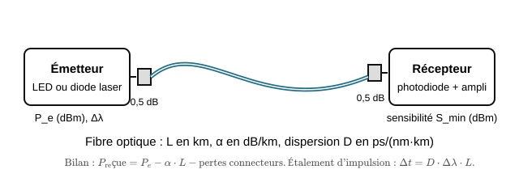
</p>

<p align="center"><em>Chaîne de transmission optique : émetteur (LED), fibre, récepteur (photodiode).</em></p>

**Montage (décrit en texte) :**

| Partie | Branchement |
|---|---|
| Émetteur | sortie CH1 du GBF → résistance 100 Ω → anode de la LED ; cathode → masse du GBF. Voie 1 de l'oscilloscope sur la sortie du GBF. |
| Fibre | extrémités engagées à fond dans la LED et dans la photodiode, écrous serrés à la main. |
| Récepteur | + de la pile 9 V → cathode de la photodiode ; anode → résistance 10 kΩ → − de la pile. La photodiode est donc polarisée en inverse. Voie 2 (sonde ×10) aux bornes de la résistance de 10 kΩ, masse de la sonde côté − de la pile. |

La tension aux bornes de la résistance de 10 kΩ vaut $U_R = R \times I_{ph}$ : elle est proportionnelle au photocourant, donc à la **puissance lumineuse reçue**.

**Déroulé détaillé**

1. **(15 min) Préparation.**
   - ❓ *Q1. Le GBF délivre un signal carré de 0 à 5 V. La LED a une tension de seuil d'environ 2,0 V et le GBF une résistance interne de 50 Ω. Calculez le courant dans la LED quand le signal est à 5 V.*
   - ❓ *Q2. Pourquoi la photodiode est-elle polarisée en inverse ? (Revoir le TP 1.8.)*
   - ❓ *Q3. Attention aux décibels : $U_R$ est proportionnelle à la puissance optique. Pour calculer une atténuation optique à partir de deux tensions $U_1$ et $U_2$ mesurées sur cette résistance, faut-il utiliser $10\log_{10}(U_1/U_2)$ ou $20\log_{10}(U_1/U_2)$ ? Justifiez.*

2. **(au banc, 3 min) Transmission d'un signal.** GBF : signal carré, 1 kHz, amplitude 5 V crête à crête, décalage 2,5 V. Oscilloscope : voie 1 à 2 V/div, voie 2 à 200 mV/div, base de temps 200 µs/div. Fibre de 1 m.
   - Vérifier que le signal reçu (voie 2) reproduit le signal émis. Mesurer l'amplitude $U_1$ du signal reçu.
   - Masquer l'extrémité de la fibre ou éclairer la photodiode avec la lampe d'un téléphone : le signal est-il perturbé ?

3. **(au banc, 4 min) Atténuation.** Remplacer la fibre de 1 m par la fibre de 5 m (mêmes connexions, écrous serrés de la même façon). Mesurer $U_5$. Puis enrouler la fibre de 5 m en cinq spires serrées autour d'un stylo et mesurer $U_{courbée}$.

   | Situation | Fibre 1 m | Fibre 5 m | Fibre 5 m enroulée sur un stylo |
   |---|---|---|---|
   | Amplitude reçue (V) | | | |

4. **(au banc, 5 min) Débit maximal.** Revenir à la fibre de 1 m. Base de temps 1 µs/div. À 10 kHz, mesurer le **temps de montée** $t_r$ du signal reçu (de 10 % à 90 % de l'amplitude ; mesure automatique **Rise Time** de l'oscilloscope). Puis augmenter la fréquence (50 kHz, 100 kHz, 200 kHz, 500 kHz, 1 MHz) et noter la fréquence $f_{max}$ au-delà de laquelle le signal reçu n'atteint plus son palier (il devient triangulaire).

   | Fréquence | 10 kHz | 50 kHz | 100 kHz | 200 kHz | 500 kHz | 1 MHz |
   |---|---|---|---|---|---|---|
   | Le signal reçu atteint-il son palier ? | | | | | | |

   $t_r$ = ________ µs ; $f_{max}$ = ________ kHz.

5. **(35 min) Exploitation (à la place).**
   - ❓ *Q4. Calculez l'atténuation linéique de la fibre, en dB/m, à partir de $U_1$ et $U_5$ (méthode dite « de la fibre coupée » : la différence porte sur 4 m de fibre, les pertes de connexion sont les mêmes dans les deux cas). Comparez à la valeur typique d'une fibre plastique à 650 nm (environ 0,15 à 0,2 dB/m).*
   - ❓ *Q5. Pourquoi ne peut-on pas calculer l'atténuation linéique avec la seule fibre de 1 m, en comparant le signal reçu à la tension du GBF ?*
   - ❓ *Q6. Calculez la perte due aux courbures, en dB. Expliquez-la avec la réflexion totale (TP 6.1).*
   - ❓ *Q7. Avec l'atténuation trouvée, quelle longueur de fibre diviserait la puissance reçue par 10 (perte de 10 dB) ? La fibre plastique convient-elle pour relier deux bâtiments distants de 500 m ?*
   - ❓ *Q8. Calculez la bande passante de la liaison $BP = \dfrac{0{,}35}{t_r}$. Avec un codage où chaque demi-période du carré porte un bit, estimez le débit maximal $D \approx 2 f_{max}$ en bit/s.*
   - ❓ *Q9. Sur 1 m de fibre, la dispersion modale est négligeable. Quel élément limite alors le débit ? (Indice : la photodiode a une capacité de quelques dizaines de picofarads, en série avec quoi ?) Proposez une modification du récepteur pour augmenter le débit, et dites ce qu'on y perd.*

6. **(20 min) Bilan.**
   - ❓ *Q10. Pourquoi utilise-t-on une LED **rouge** avec une fibre plastique, alors que les fibres en silice des réseaux longue distance travaillent dans l'infrarouge (850 nm, 1 310 nm, 1 550 nm) ?*
   - ❓ *Q11. Citez deux avantages de la fibre optique sur un câble en cuivre, dont un que vous avez observé à l'étape 2.*

- **Livrable :** schéma de la liaison, oscillogrammes émis/reçu (1 kHz et $f_{max}$), tableaux complétés, réponses Q1 à Q11.
- **⚙ Si le banc n'est pas disponible :** basculer sur la version simulée ci-dessous.

<a id="sec-version-simulee-du-tp-6-2-python"></a>

#### Version simulée du TP 6.2 (Python)

- **Principe :** on exploite des mesures relevées sur le banc du lycée, puis un programme Python simule le signal reçu pour trouver le débit maximal. Les questions Q1 à Q11 sont les mêmes.

**Étape 1 (15 min) : préparation.** Répondre aux questions Q1 à Q3.

**Étape 2 (20 min) : atténuation.** Relevés du banc (signal carré 1 kHz, mêmes connexions) :

| Situation | Fibre 1 m | Fibre 5 m | Fibre 5 m enroulée sur un stylo |
|---|---|---|---|
| Amplitude reçue (V) | 1,20 | 1,02 | 0,78 |

Répondre aux questions Q4 à Q7.

**Étape 3 (35 min) : débit.** Le récepteur se comporte comme un filtre RC : résistance de 10 kΩ et capacité totale d'environ 40 pF (photodiode + sonde). Créer le fichier `tp62_debit.py` :

```python
# TP 6.2, version simulée : signal reçu en sortie de la photodiode
import numpy as np
import matplotlib.pyplot as plt

R = 10e3            # résistance de charge (ohms)
C = 40e-12          # capacité photodiode + sonde (F)
U_MAX = 1.2         # amplitude reçue en régime établi (V)
F = 100e3           # fréquence du carré émis (Hz) : à modifier

tau = R * C
FE = 1e9                             # pas de calcul : 1 ns
t = np.arange(0, 3 / F, 1 / FE)      # 3 périodes
emis = np.where((t * F) % 1 < 0.5, 1.0, 0.0)
a = (1 / FE) / (tau + 1 / FE)
recu = np.zeros_like(t)
for n in range(1, len(t)):
    recu[n] = recu[n - 1] + a * (U_MAX * emis[n] - recu[n - 1])

# temps de montée de 10 % à 90 % sur le premier front montant
t10 = t[np.argmax(recu >= 0.1 * U_MAX)]
t90 = t[np.argmax(recu >= 0.9 * U_MAX)] if recu.max() >= 0.9 * U_MAX else None
if t90 is None:
    print("Le signal reçu n'atteint jamais 90 % de U_MAX : fréquence trop élevée")
else:
    print(f"temps de montée tr = {(t90 - t10)*1e6:.2f} µs")

plt.plot(t * 1e6, U_MAX * emis, label="émis (image de la puissance de la LED)")
plt.plot(t * 1e6, recu, label="reçu (tension sur 10 kΩ)")
plt.xlabel("t (µs)")
plt.ylabel("U (V)")
plt.legend()
plt.show()
```

1. Exécuter avec `F = 10e3` : relever le temps de montée $t_r$ (zoomer sur un front avec la loupe de la fenêtre graphique).
2. Recommencer avec `F = 50e3`, `100e3`, `200e3`, `500e3`, `1e6`, et remplir le tableau de l'étape 4 de la version matériel. Noter $f_{max}$.
3. Répondre aux questions Q8 et Q9. Pour vérifier la proposition de la Q9, diviser `R` par 10 (et `U_MAX` par 10, puisque $U = R \times I_{ph}$) et relancer : que deviennent $t_r$ et $f_{max}$ ? Quel est l'inconvénient ?

**Étape 4 (20 min) : bilan.** Répondre aux questions Q10 et Q11.

- **Livrable :** captures des signaux reçus à 10 kHz et à $f_{max}$, tableaux complétés, réponses Q1 à Q11.

---

<div style="page-break-after: always;"></div>

&nbsp;

<div style="page-break-after: always;"></div>

<a id="sec-chapitre-7-preparation-a-l-epreuve"></a>

## Chapitre 7 : Préparation à l'épreuve

*(À compléter au fil de l'année : exploitation de relevés type annale, analyse de documents techniques, exercices de mesure en temps limité.)*

---

<div style="page-break-after: always;"></div>

&nbsp;

<div style="page-break-after: always;"></div>

<a id="sec-projet-memoire-64-bits"></a>

## TP : Mémoire de 64 bits

<a id="sec-mem-projet-de-tp-construire-une-memoire-de-64-bits"></a>

# Projet de TP : Construire une mémoire de 64 bits

## Physique appliquée à l'informatique : Bac +1 / Bac +2

### Journal des modifications (version 2)

Cette version corrige deux défauts de conception de la version initiale et deux erreurs de
quantité dans les tableaux de matériel. Les sections concernées portent une note encadrée
expliquant le changement ; ces notes peuvent être supprimées une fois le dossier stabilisé.

| § | Nature | Raison |
|---|---|---|
| 1.3, 3.6 | Résistance de limitation obligatoire sur la bobine | Une bobine bobinée à la main est un quasi-court-circuit sous 5 V : fusible d'ampèremètre détruit, échauffement |
| 2.1 | Carte Arduino : Uno **ou** Mega 2560 | Le Mega convient et offre plus de broches |
| 2.1, 2.3 | Supports tulipe supprimés, extracteurs ajoutés | Inutiles sur breadboard, où ils ajoutent un point de panne |
| 2.2 | Références relais élargies | Le SRD-05VDC-SL-C n'est pas distribué partout |
| 2.3, 2.4, 2.5 | 74HC244/245 → **74HC541**, quantité 3 → **9** | Erreur de quantité rendant le TP3 irréalisable ; brochage plus lisible |
| 2.4, 5.8 | 74HC138 : 2 → **3** (deux en service) | Architecture à deux décodeurs |
| 4.9 | Buffer de lecture intégré au bloc du groupe | Cohérence avec l'interface exigée au §5.9 |
| 5.8 | Validation de l'écriture par l'entrée E3 | Sans cela, un front WRITE écrivait dans les 8 registres |
| 5.9 | Interface : SELECT dédoublé en SELECT_W / SELECT_R | Conséquence de l'architecture à deux décodeurs |
| 5.11, 5.12 | Buffers et chronogramme réécrits | Substitution de composant ; la capture a lieu en fin de pulse |
| 5.19 | Trois pannes et une question ajoutées | Nouveaux modes de défaillance |
| 7.5 | Trois entrées de vocabulaire | Notions introduites par la nouvelle architecture |

### Organisation générale

Ce projet est conçu pour un co-enseignement entre physique appliquée et
informatique.

La progression est volontairement concrète :

1.  **TP 1 : fabriquer et étudier un bit physique** à l'aide d'une
    bobine, d'un relais et d'une boucle de maintien.
2.  **TP 2 : construire un octet électronique** à l'aide de quatre
    circuits 74HC74.
3.  **TP 3 : réunir les octets de la classe** pour construire une
    mémoire collective de 64 bits.

> Le projet permet de passer progressivement du phénomène physique à
> l'architecture informatique : courant, champ magnétique, commutation,
> logique binaire, bascule, registre, adresse, bus et lecture/écriture.

------------------------------------------------------------------------

<a id="sec-mem-sommaire"></a>

# Sommaire

-   [1. Présentation du projet](#1-présentation-du-projet)
-   [2. Matériel général](#2-matériel-général)
-   [3. TP 1 : Un bit physique](#3-tp-1--un-bit-physique)
-   [4. TP 2 : Un octet électronique](#4-tp-2--un-octet-électronique)
-   [5. TP 3 : Une mémoire collective de 64
    bits](#5-tp-3--une-mémoire-collective-de-64-bits)
-   [6. Évaluation](#6-évaluation)
-   [7. Annexes techniques](#7-annexes-techniques)

------------------------------------------------------------------------

<a id="sec-mem-1-presentation-du-projet"></a>

# 1. Présentation du projet

## 1.1 Problématique générale

> Comment une information peut-elle être représentée par une grandeur
> physique, mémorisée dans un circuit, puis organisée avec d'autres
> informations pour former une mémoire informatique ?

## 1.2 Compétences visées

### Physique

-   Mesurer une tension, un courant et une résistance.
-   Utiliser la loi d'Ohm.
-   Comprendre le rôle d'une bobine.
-   Mettre en évidence un champ magnétique.
-   Étudier la commutation d'un contact.
-   Observer les temps de réponse d'un système.
-   Comprendre les notions d'énergie, de puissance et de dissipation.

### Électronique

-   Identifier les niveaux logiques.
-   Utiliser une breadboard.
-   Alimenter correctement un circuit intégré.
-   Comprendre une boucle de rétroaction.
-   Utiliser une bascule D.
-   Générer un signal d'horloge.
-   Utiliser un bus et des sorties trois états.

### Informatique

-   Représenter une information en binaire.
-   Manipuler des bits et des octets.
-   Comprendre un registre.
-   Comprendre l'adressage mémoire.
-   Comprendre les opérations READ et WRITE.
-   Programmer un microcontrôleur pour tester un circuit matériel.
-   Diagnostiquer une panne dans un système composé de plusieurs blocs.

## 1.3 Précautions générales

-   Utiliser une alimentation stabilisée de **5 V** pour les circuits
    logiques.
-   Ne jamais brancher directement une sortie Arduino sur une tension
    supérieure à 5 V.
-   Ne jamais court-circuiter deux sorties logiques.
-   Ne jamais laisser les entrées CMOS flottantes.
-   Ajouter un condensateur de découplage de **100 nF** près de chaque
    circuit intégré.
-   Vérifier le câblage avant la mise sous tension.
-   Pour les bobines, prévoir une diode de roue libre lorsque la bobine
    est commandée par un transistor ou une sortie électronique.
-   Ne jamais alimenter une bobine bobinée à la main directement sous
    5 V : sa résistance de quelques dixièmes d'ohm en ferait un
    court-circuit. Toujours insérer la résistance de limitation prévue
    au §3.6.
-   Ne pas alimenter une bobine directement avec une sortie Arduino sans
    étage de commande.

------------------------------------------------------------------------

<a id="sec-mem-2-materiel-general"></a>

# 2. Matériel général

> **Base de calcul retenue pour tout ce dossier : 16 élèves = 8 binômes.** C'est un point fort de ce projet : 8 binômes construisent chacun un octet au TP2, et les 8 octets s'assemblent naturellement en une mémoire de 64 bits au TP3 (8 × 8 = 64). Les quantités ci-dessous sont calculées pour ce format, avec une marge de sécurité (composants qui grillent, fils qui cassent, oublis) d'environ 15 à 20 %.

## 2.1 Matériel commun aux trois TP

| Matériel | Référence / caractéristique conseillée | Quantité pour 16 élèves | Répartition |
|---|---|---|---|
| Carte Arduino | Uno R3, Uno R4 **ou Mega 2560** (ou compatible) | **8** | 1 par binôme, réutilisé aux 3 TP |
| Breadboard | 830 points, format standard | **9** | 1 par binôme + 1 pour le bus commun du TP3 |
| Fils de câblage Dupont mâle-mâle | Kit assorti, longueurs variées | **9 lots** (≈ 65 fils/lot) | 1 par binôme + 1 lot pour le bus commun |
| Alimentation 5 V stabilisée | Module régulateur 5 V/1 A minimum, ou bloc secteur 5 V | **8** (idéal) ou 4 si mutualisées 2 par 2 | 1 par binôme si possible |
| Multimètre | Mesure V/A/Ω, avec pointes de touche | **8** | 1 par binôme |
| Oscilloscope | 2 voies minimum, bande passante ≥ 20 MHz | **2 à 4** | En rotation entre binômes (TP1 Partie D, TP2 Partie D) |
| Générateur de fonctions (GBF) | 0-1 MHz au moins | **1** (facultatif) | Pour comparer un signal d'horloge propre à un bouton |
| LED 5 mm | Rouge ou vert, standard | **90** | 64 pour les 8 registres (TP2), 16 pour indicateurs TP1, marge |
| Résistances 220 Ω à 1 kΩ (LED) | 1/4 W | **90** | Une par LED |
| Résistances 10 kΩ (rappel/pull-up) | 1/4 W | **40** | Bascules, boutons, entrées non utilisées |
| Condensateurs céramique 100 nF | Découplage, un par circuit intégré | **45** | 32 pour les 74HC74, ~10 pour décodeur/buffers, marge |
| Boutons-poussoirs | Type breadboard 4 pattes | **30** | SET/RESET (TP1), CLOCK/WRITE (TP2) |
| DIP-switch 8 positions | Pas 2,54 mm (breadboard) | **8** | 1 par binôme, sert d'entrée de données au TP2 puis reste en place au TP3 |
| Pince à dénuder / pince coupante | : | **8** | 1 par binôme (utile dès le TP1 pour le fil émaillé) |
| Extracteur de circuits intégrés | Pince en U pour boîtiers DIL | **2** | Mutualisés pour la classe (voir note ci-dessous) |

> **Choix de la carte.** Le Mega 2560 convient parfaitement et offre davantage de broches, ce qui
> simplifie le TP3. Les codes de ce dossier fonctionnent tels quels sur les deux familles. Sur Mega
> comme sur Uno, la broche analogique A0 utilisée en sortie numérique s'écrit bien `A0` dans le code
> (et non `14`). Les binômes peuvent avoir des cartes différentes sans que cela pose problème,
> chaque registre étant piloté indépendamment avant l'assemblage collectif.

> **Pourquoi pas de supports tulipe.** Les supports de circuit intégré sont utiles sur circuit
> imprimé soudé, pas sur breadboard : la breadboard *est* déjà un support à contacts. Les ajouter
> revient à insérer un étage de contacts supplémentaire, donc un point de panne intermittente de
> plus : exactement ce qu'on cherche à éviter dans un montage qui comporte 5 boîtiers par poste et
> 8 postes interconnectés. Le seul risque réel est de tordre des broches en extrayant un boîtier
> d'une breadboard serrée : deux extracteurs partagés par la classe règlent le problème.

## 2.2 Matériel spécifique au TP 1 (par binôme × 8)

| Matériel | Référence / caractéristique conseillée | Quantité pour 8 binômes |
|---|---|---|
| Fil de cuivre émaillé | Diamètre 0,3 à 0,5 mm, bobine de 15-20 m | **8 bobines** |
| Noyau ferromagnétique | Clou ou vis en fer/acier, 4-6 cm, ou noyau ferrite de récupération | **8 à 16** (2 par binôme conseillé, pour recommencer si besoin) |
| Relais électromécanique 5 V | Bobine 5 Vcc, contact 1 RT (SPDT), montage sur CI. Références possibles : **Songle SRD-05VDC-SL-C** (bobine 55 Ω), **Finder 36.11-5** (70 Ω), **Omron G5V1-5** (167 Ω) | **16** (2 par binôme : 1 pour le montage manuel, 1 pour la commande Arduino) + 2 de rechange |
| Diode de roue libre | 1N4001, 1N4004 ou 1N4148 | **20** (2 par binôme + marge) |
| Transistor NPN | 2N2222 ou BC547, boîtier TO-92 | **16** (2 par binôme + marge) |
| Résistance 1 kΩ (base transistor) | 1/4 W | **16** |
| Petites pièces métalliques (test d'attraction) | Trombones ou vis courtes | **40** (5 par binôme) |
| Fil de connexion souple (relais → breadboard) | Section fine, si le relais n'est pas au pas 2,54 mm | **8 jeux** |
| **Résistance de puissance** | **10 Ω / 5 W (bobinée ou céramique)** | **10** (1 par binôme + marge) |

> **Choix du relais.** Ces trois références sont interchangeables pour ce TP. Le critère à respecter
> est la bobine 5 Vcc et un contact inverseur (1 RT / SPDT) donnant accès à COM, NO et NC. Le Finder
> et le Songle, plus volumineux, produisent un « clac » franchement audible : ce qui a une vraie
> valeur pédagogique dans un TP dont l'objet est justement de rendre la commutation sensible. Le
> Omron, plus compact et à bobine plus sensible (30 mA contre 70-90 mA), se pique plus facilement
> sur breadboard mais reste discret.
>
> **Ne pas commander de « module relais Arduino ».** Ces platines intègrent déjà le transistor, la
> diode et parfois un optocoupleur, et ne donnent pas accès aux broches de la bobine. La boucle de
> maintien du §3.8 y est impossible à câbler, et tout l'intérêt du TP disparaît.

> **La résistance de puissance n'est pas facultative.** Voir §3.6 : une bobine bricolée présente
> une résistance de l'ordre de 0,3 à 1 Ω et se comporte quasiment comme un court-circuit sous 5 V.

## 2.3 Matériel spécifique au TP 2 (par binôme × 8)

| Matériel | Référence / caractéristique conseillée | Quantité pour 8 binômes |
|---|---|---|
| Circuit intégré 74HC74 | Double bascule D, boîtier DIP-14 | **36** (4 par binôme + 4 de rechange) |
| LED (voir tableau général) | : | 64 (8 par binôme) |
| Résistance LED (voir tableau général) | : | 64 |
| DIP-switch 8 positions (voir tableau général) | Entrée de données D0-D7 | 8 (1 par binôme) |
| Bouton-poussoir CLOCK/WRITE | : | 8 (1 par binôme) |
| Condensateur 100 nF (voir tableau général) | 1 par 74HC74 | 32 |
| Circuit intégré **74HC541** | Buffer octal 3 états, brochage *flow-through*, DIP-20 | **9** (1 par binôme + 1 de rechange) |
| Arduino (voir tableau général) | Génération de WRITE, lecture des Q | 8 (réutilisé du TP1) |

> **Le buffer de lecture est construit dès le TP2.** Le §5.9 exige que chaque groupe livre « une
> sortie de lecture désactivable ». Ce buffer appartient donc au bloc du groupe et non à la
> breadboard commune : il est monté et testé en même temps que le registre, ce qui allège d'autant
> la séance d'assemblage collectif. Voir §4.9.

## 2.4 Matériel supplémentaire au TP 3 (mutualisé pour la classe entière)

| Matériel | Référence / caractéristique conseillée | Quantité pour la classe (8 groupes) |
|---|---|---|
| Registres 8 bits (TP2) | Réutilisés tels quels | 8 (1 par groupe, déjà construits) |
| Circuit intégré 74HC138 | Décodeur 3 vers 8, boîtier DIP-16 | **3** (décodeur d'écriture + décodeur de lecture + 1 rechange) |
| Buffers 74HC541 | Déjà montés sur le bloc de chaque groupe au TP2 (§4.9) | : (voir §2.3) |
| Résistances de rappel 10 kΩ | Selon montage (voir tableau général) | Puisées dans le stock général |
| Bornier à vis ou barrette de connexion 13 points | Interface standardisée par groupe (VCC, GND, DATA0-7, SELECT_W, SELECT_R, RESET) | **8 jeux** |
| Plaque ou breadboard commune | Support du décodeur, des buffers et du bus partagé | **1** (la 9ᵉ breadboard du tableau général) |
| Fils de bus repérés par couleur | 8 lignes DATA communes + 8 lignes SELECT_W + 8 lignes SELECT_R + RESET commun | **≈ 25 fils**, à prévoir dans un code couleur dédié (cf. §7.1) |
| Arduino "contrôleur" | Un des 8 Arduino du binôme désigné pour piloter adresse + bus | 1 (pris sur le stock général) |

> **Pourquoi 9 buffers et non 3.** L'architecture du §5.11 place un buffer par registre : chacun des
> 8 groupes doit pouvoir isoler sa sortie du bus commun indépendamment des autres. Avec 3 boîtiers,
> seuls trois groupes peuvent se connecter au bus et la mémoire collective ne peut pas fonctionner.
>
> **Pourquoi le 74HC541 plutôt que le 74HC244 ou le 74HC245.** Les trois remplissent la même
> fonction (buffer octal à sorties trois états). Le 74HC245 est un émetteur-récepteur bidirectionnel :
> il ajoute une broche DIR dont ce montage n'a pas l'usage, la liaison registre → bus étant
> unidirectionnelle. Le 74HC244 est unidirectionnel mais alterne entrées et sorties de part et
> d'autre du boîtier, ce qui produit huit fils croisés sur breadboard. Le 74HC541 a un brochage dit
> *flow-through* : les huit entrées d'un côté, les huit sorties de l'autre. Les fils vont tout droit
> du registre vers le bus. Sur un montage 8 bits câblé par des étudiants qui découvrent la notion,
> c'est un gain de temps de dépannage considérable.
>
> **Pourquoi 3 décodeurs et non 2.** L'architecture retenue (§5.8) utilise deux décodeurs en
> service : l'un valide par WRITE, l'autre par READ. Cette solution rend inutile toute porte
> logique de validation supplémentaire.

## 2.5 Synthèse budgétaire des composants actifs à commander

Pour ne rien oublier lors de la commande, voici le total des composants actifs (hors passifs génériques déjà dans le tableau 2.1) :

| Composant | Référence | Quantité totale à commander |
|---|---|---|
| Relais 5 V 1 RT | SRD-05VDC-SL-C, Finder 36.11-5 ou Omron G5V1-5 | 18 (16 + 2 rechange) |
| Diode roue libre | 1N4001/1N4004/1N4148 | 20 |
| Transistor NPN | 2N2222 ou BC547 | 16 |
| Résistance de puissance | 10 Ω / 5 W | 10 |
| Circuit 74HC74 | Double bascule D, DIP-14 | 36 |
| Circuit 74HC138 | Décodeur 3→8, DIP-16 | 3 |
| Circuit **74HC541** | Buffer 3 états *flow-through*, DIP-20 | 9 |
| Carte Arduino | Uno R3/R4, Mega 2560 ou compatible | 8 |

> **Où commander.** Ces boîtiers logiques sont des articles de catalogue permanent chez les
> distributeurs français (Gotronic, TME, Reichelt, RS). Les lots à bas prix vendus par des
> revendeurs tiers sur les places de marché proviennent souvent de déstockage, sans réassort ni
> traçabilité : un 74HC74 remarqué produit un défaut intermittent qu'aucun binôme ne saura
> diagnostiquer, et peut coûter une séance entière. Gotronic accepte par ailleurs le paiement
> différé par mandat administratif sur bon de commande, ce qui convient à une commande passée par
> l'intendance.

## 2.6 Alternative numérique (si le matériel manque ou pour préparer le câblage en amont)

Ce projet mobilise des composants relativement spécifiques et coûteux en quantité (36 circuits 74HC74, 18 relais, décodeur, buffers...). Si l'établissement ne dispose pas encore de tout ce matériel, ou si l'on veut sécuriser la logique avant de câbler en vrai, chaque TP a un équivalent numérique fiable. La bonne pratique consiste souvent à faire valider le montage en simulation d'abord, puis à câbler en réel ensuite : les élèves arrivent à l'établi avec un schéma déjà fonctionnel, ce qui réduit fortement le temps perdu en dépannage.

### Outils utilisés

| Outil | Usage dans ce projet | Accès |
|---|---|---|
| Logisim Evolution | Simulateur de logique numérique : bascules D, registres, décodeurs, bus, sorties 3 états, horloge. C'est l'outil le plus adapté aux TP2 et TP3. | logisim-evolution.github.io (gratuit, à installer, existe aussi en version "Logisim Evolution Web" jouable dans le navigateur) |
| Falstad Circuit Simulator | Simulateur de circuits analogiques/électromécaniques : relais, bobines, transistors, diodes. Le plus adapté au TP1. | falstad.com/circuit |
| PhET : "Aimants et électroaimants" | Simulation qualitative du champ magnétique produit par une bobine, avec variation du courant et du nombre de spires. | phet.colorado.edu |
| Tinkercad Circuits | Simulateur de breadboard avec Arduino intégré et exécution réelle du code C++. Utile pour valider les programmes Arduino des TP2/TP3 avant le câblage réel. | tinkercad.com/circuits (compte gratuit) |

### Alternative numérique : TP1 (bit physique)

Le TP1 a une forte dimension "manipulation physique" (bobiner du fil, sentir l'attraction magnétique, entendre le clic du relais) qui ne se remplace pas entièrement par une simulation. Deux niveaux de repli sont proposés selon ce qui manque réellement :

- **S'il manque seulement les relais** (le plus probable, car ce sont les composants les moins courants d'un labo) : Falstad Circuit Simulator possède un composant "relais" dans sa bibliothèque. Câbler le circuit SET/RESET exactement comme au §3.8, en repérant bien le contact NO simulé. Le simulateur affiche l'état du contact en temps réel (couleur du fil), ce qui rend la boucle de maintien très visuelle, y compris pour les groupes qui ont eu du mal à la comprendre en réel.
- **S'il manque le fil de cuivre et les noyaux** (partie A, l'électroaimant lui-même) : utiliser la simulation PhET "Aimants et électroaimants", qui permet de faire varier le nombre de spires et le courant, et d'observer l'intensité du champ magnétique représenté par des lignes de champ. Cela ne remplace pas le geste de bobiner, mais permet de retrouver les mêmes observations qualitatives (Q1 à Q4 du §3.6) si le matériel n'arrive pas à temps.
- **Partie E (commande Arduino du relais)** : entièrement simulable sur Tinkercad Circuits, qui propose un relais et un transistor dans sa bibliothèque de composants, avec le code Arduino exécuté virtuellement.

### Alternative numérique : TP2 (registre 8 bits)

C'est le TP qui se simule le mieux, car Logisim Evolution propose directement les bascules D, l'horloge et les entrées/sorties logiques en composants prêts à l'emploi.

1. Ouvrir un nouveau circuit dans Logisim Evolution.
2. Dans la bibliothèque "Memory", placer 8 bascules D ("D Flip-Flop"), les nommer D0 à D7.
3. Dans la bibliothèque "Wiring", ajouter une horloge ("Clock") et la relier à l'entrée CLK de chaque bascule (équivalent de la ligne WRITE commune du §4.9).
4. Ajouter 8 entrées ("Input Pin") reliées chacune à l'entrée D d'une bascule : elles jouent le rôle du DIP-switch physique.
5. Ajouter 8 sorties ("Output Pin", ou directement des LED de la bibliothèque "I/O") reliées aux sorties Q : elles jouent le rôle des LED physiques.
6. Simuler : cliquer sur les entrées pour changer les bits, déclencher un front d'horloge (bouton ou clic sur l'horloge en mode pas-à-pas), vérifier que les sorties ne changent qu'au moment du front : exactement le comportement observé au tableau du §4.7.
7. Une fois le comportement validé en simulation, le câblage réel avec les 4 boîtiers 74HC74 reproduit exactement ce schéma logique (chaque 74HC74 = 2 bascules D de la simulation).

Logisim permet d'afficher la valeur du registre directement en décimal ou en hexadécimal via un composant "Hex Digit Display", ce qui permet de vérifier très vite qu'un octet écrit correspond bien à la valeur attendue, sans avoir à décoder 8 LED à l'œil.

### Alternative numérique : TP3 (mémoire collective de 64 bits)

Le TP3 est le plus ambitieux à câbler en réel (8 groupes + décodeur + bus), et c'est aussi celui où une simulation collective préalable rassure le plus les élèves avant l'assemblage physique.

1. Reprendre dans Logisim Evolution le registre 8 bits validé au TP2 (on peut le transformer en "sous-circuit" réutilisable 8 fois, via le menu "Project > Add Circuit", pour éviter de tout redessiner).
2. Ajouter un composant "Decoder" (bibliothèque "Plexers") réglé sur 3 bits de sélection, qui reproduit directement le 74HC138 du §5.8 : chacune de ses 8 sorties active un sous-circuit registre.
3. Ajouter des composants "Tristate Buffer" (bibliothèque "Wiring") sur la sortie de chaque registre, commandés par la ligne SELECT_R issue du second décodeur : c'est l'équivalent exact des 74HC541 du §5.11, et Logisim affiche explicitement l'état haute impédance (en général en couleur différente sur le fil), ce qui rend le concept de conflit de bus très concret.

   Le composant "Decoder" de la bibliothèque *Plexers* possède une entrée `Enable` qui joue exactement le rôle de l'entrée E3 du 74HC138. Placer **deux** décodeurs partageant les mêmes trois bits de sélection, l'un validé par un bouton WRITE, l'autre par un bouton READ, reproduit fidèlement le montage matériel du §5.8 : y compris le fait qu'un conflit de bus devienne impossible par construction.
4. Relier les 8 sorties trois états sur un même bus DATA commun, et vérifier en simulation qu'un conflit apparaît (couleur d'erreur) si deux sorties sont activées en même temps par erreur : c'est exactement l'erreur décrite en §5.10, mais sans risquer d'endommager un vrai circuit intégré pour la démonstration.
5. Piloter l'adresse avec 3 entrées "Input Pin", et vérifier qu'on peut écrire puis relire chacun des 8 octets indépendamment, avant de reproduire l'architecture validée avec le matériel réel le jour de l'assemblage collectif (§5.9, montage détaillé pas à pas).

Même si le matériel physique est disponible pour toute la classe, préparer et valider l'architecture en Logisim par binôme avant le jour de l'assemblage collectif permet de gagner du temps : les erreurs de logique (mauvais sens du décodeur, oubli d'un buffer) sont corrigées à l'écran plutôt que découvertes au milieu de 8 breadboards interconnectées.

------------------------------------------------------------------------

<a id="sec-mem-3-tp-1-un-bit-physique"></a>

# 3. TP 1 : Un bit physique

## 3.1 Titre

**Fabriquer et étudier une cellule mémoire électromécanique**

## 3.2 Durée

Environ **3 heures**.

## 3.3 Problématique

> Comment un circuit électrique peut-il conserver un état après la
> disparition de l'action initiale ?

## 3.4 Objectifs

À la fin du TP, l'étudiant doit être capable de :

-   Mesurer la résistance d'une bobine.
-   Relier tension, courant et résistance.
-   Expliquer le rôle du champ magnétique.
-   Construire un électroaimant simple.
-   Utiliser un relais électromécanique.
-   Réaliser une fonction SET/RESET.
-   Expliquer une boucle de maintien.
-   Identifier les limites d'une mémoire volatile.

------------------------------------------------------------------------

## 3.5 Rappels théoriques

### Loi d'Ohm

La relation entre tension, courant et résistance est :

\[ U = R I \]

Avec :

-   \(U\) en volts ;
-   \(R\) en ohms ;
-   \(I\) en ampères.

### Puissance électrique

\[ P = U I = R I\^2 = `\frac{U^2}{R}`{=tex} \]

Une bobine alimentée dissipe une partie de l'énergie sous forme de
chaleur.

### Champ magnétique

Une bobine parcourue par un courant produit un champ magnétique. Le
champ peut attirer une armature métallique et provoquer le déplacement
d'un contact.

### Principe de la mémoire

Un état binaire peut être représenté par deux situations :

-   Relais au repos : `0`.
-   Relais activé : `1`.

La mémoire existe lorsque le circuit possède un mécanisme permettant de
conserver cet état sans maintenir le bouton appuyé.

------------------------------------------------------------------------

## 3.6 Partie A : Fabriquer un électroaimant

### Matériel

-   Fil de cuivre émaillé.
-   Noyau ferromagnétique.
-   Alimentation 5 V.
-   **Résistance de puissance 10 Ω / 5 W** (limitation de courant, obligatoire).
-   Multimètre.
-   Quelques trombones.

### Travail demandé

1.  Enrouler le fil de cuivre autour du noyau.
2.  Dénuder les deux extrémités du fil.
3.  Mesurer la résistance de la bobine.
4.  Alimenter la bobine avec une tension limitée.
5.  Observer l'attraction des trombones.
6.  Modifier le nombre de spires ou le courant.
7.  Comparer les résultats.

### Montage détaillé pas à pas

1.  **Préparer le noyau.** Choisir un clou ou une vis en fer d'environ 5 cm. Nettoyer la surface si nécessaire (pas de peinture ni de rouille).
2.  **Bobiner 50 premières spires.** En partant à 5 cm d'une extrémité du fil (pour avoir de quoi dénuder ensuite), enrouler le fil de cuivre bien serré autour du noyau, spire contre spire, toujours dans le même sens. Compter les spires à voix haute ou par groupes de 10. Laisser à nouveau 5 cm de fil libre à l'autre extrémité avant de couper.
3.  **Fixer l'enroulement.** Un tour de ruban adhésif à chaque extrémité de l'enroulement empêche les spires de se défaire pendant la manipulation.
4.  **Dénuder les deux extrémités.** Le fil de cuivre émaillé est isolé par un vernis, invisible à l'œil nu : il faut le gratter avec un cutter, du papier de verre fin, ou le brûler légèrement à la flamme d'un briquet puis frotter, jusqu'à voir le cuivre brillant sur 1 à 2 cm.
5.  **Vérifier le contact.** Au multimètre en mode continuité (ou ohmmètre), toucher les deux extrémités dénudées : une valeur de résistance stable et non infinie confirme que le dénudage est correct des deux côtés.
6.  **Mesurer la résistance à froid.** Relever R₀ avec le multimètre, bobine non alimentée.
7.  **Câbler l'alimentation avec sa résistance de limitation.** Monter en série : borne +5 V de l'alimentation → **résistance de puissance 10 Ω / 5 W** → bobine → multimètre en mode ampèremètre (calibre 10 A) → borne 0 V. La résistance n'est pas facultative : sans elle, la bobine se comporte quasiment comme un court-circuit.
8.  **Mettre sous tension progressivement.** Si l'alimentation dispose d'un réglage de limitation de courant, la régler à 0,5 A avant d'allumer. Sinon, monter la tension par paliers depuis 0 V en surveillant le courant. Couper dès que la résistance de puissance ou la bobine deviennent chaudes au toucher : ces essais se font par séquences de quelques secondes.
9.  **Tester l'attraction.** Approcher un trombone de l'extrémité du noyau : il doit être attiré et rester collé.
10. **Compter le nombre de trombones maximum** que le montage peut soutenir en chaîne.
11. **Recommencer avec un nombre de spires différent** (par exemple 100 spires) et comparer le nombre de trombones tenus, à courant comparable.
12. **Couper l'alimentation entre chaque essai** pour éviter l'échauffement prolongé.

### Tableau de mesures

  --------------------------------------------------------------------------
       Nombre de     Résistance        Tension        Courant      Nombre de
          spires                                                   trombones
  -------------- -------------- -------------- -------------- --------------
                                                              

                                                              

                                                              
  --------------------------------------------------------------------------

### Questions

1.  La résistance augmente-t-elle avec le nombre de spires ?
2.  Que se passe-t-il lorsque le courant augmente ?
3.  Pourquoi le noyau métallique renforce-t-il l'effet magnétique ?
4.  La bobine chauffe-t-elle ? Pourquoi ?
5.  Vérifier expérimentalement la loi d'Ohm.
6.  Calculer la puissance dissipée.
7.  Mesurez la résistance de votre bobine seule. Quel courant circulerait
    sous 5 V **sans** la résistance de limitation ? Comparez au calibre de
    votre ampèremètre : que se passerait-il concrètement ?
8.  Avec la résistance de 10 Ω en série, calculez le courant théorique puis
    comparez à la mesure. Quelle fraction de la tension totale se retrouve
    aux bornes de la bobine ? Qu'est-ce que cela dit sur la répartition des
    tensions dans un diviseur ?

> **Note pour le professeur.** Les questions 7 et 8 transforment une contrainte matérielle en
> contenu de cours : le diviseur de tension et la lecture d'un calibre d'ampèremètre sont au
> programme, et l'élève les rencontre ici sur un cas où l'erreur a une conséquence physique
> visible. La valeur de 10 Ω est un ordre de grandeur : elle est à ajuster après mesure d'un
> bobinage témoin réalisé en préparation de séance.

------------------------------------------------------------------------

## 3.7 Partie B : Utiliser un relais

### Principe

Un relais possède généralement :

-   Une bobine.
-   Un contact commun `COM`.
-   Un contact normalement ouvert `NO`.
-   Un contact normalement fermé `NC`.

Lorsque la bobine est alimentée, le contact change de position.

### Schéma de principe

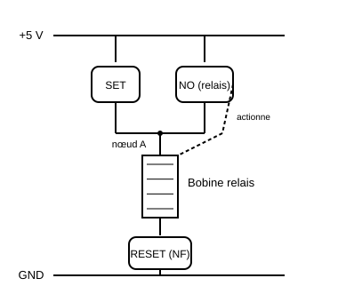

Ce schéma représente le principe de maintien (détaillé en Partie C). Le câblage exact dépend du relais utilisé.

### Attention

Le contact du relais ne doit pas être confondu avec la bobine :

-   La bobine est la partie électromagnétique.
-   Le contact est un interrupteur commandé mécaniquement.
-   Les deux parties sont électriquement isolées dans un relais
    classique.

------------------------------------------------------------------------

## 3.8 Partie C : Construire une mémoire SET/RESET

### Principe fonctionnel

-   Appuyer sur `SET` active le relais.
-   Le contact auxiliaire maintient la bobine alimentée.
-   Relâcher `SET` ne désactive pas le relais.
-   Appuyer sur `RESET` coupe la boucle de maintien.
-   Le relais revient à l'état de repos.

### Schéma logique


### Manipulation

1.  Mettre le circuit hors tension.
2.  Vérifier le câblage.
3.  Alimenter le circuit.
4.  Appuyer sur `SET`.
5.  Relâcher `SET`.
6.  Vérifier que le relais reste activé.
7.  Appuyer sur `RESET`.
8.  Vérifier que le relais retombe.
9.  Répéter plusieurs fois.

### Montage détaillé pas à pas (câblage sur breadboard)

Avant de commencer, identifier les 5 broches du relais avec le multimètre en mode continuité, hors tension : deux broches correspondent à la bobine (résistance de quelques dizaines à centaines d'ohms), les trois autres au contact (COM, NO, NC : COM relié à NO quand le relais est activé, à NC au repos).

1.  **Placer le relais** à cheval sur la rainure centrale de la breadboard (ou sur une zone dégagée s'il est trop gros, avec des fils volants).
2.  **Câbler la bobine du relais** : une broche vers le rail (+), l'autre vers un point de jonction commun appelé nœud A (pas encore vers le rail (−) directement).
3.  **Câbler le bouton SET** entre le rail (+) et le nœud A : ainsi, appuyer sur SET amène le (+) sur la bobine via le nœud A.
4.  **Câbler le contact NO du relais** entre le rail (+) et le nœud A également (en parallèle du bouton SET) : c'est la boucle de maintien : une fois le relais activé, son propre contact NO reproduit l'action du bouton SET.
5.  **Relier le nœud A à une broche de la bobine**, l'autre broche de la bobine allant au rail (−) *via* le bouton RESET (normalement fermé/non appuyé = circuit passant).
6.  **Vérifier avant mise sous tension** : au repos, SET et RESET relâchés, le multimètre en continuité doit indiquer un circuit ouvert entre (+) et (−) à travers la bobine (le contact NO n'est pas encore fermé, seul un appui sur SET peut amorcer la boucle).
7.  **Mettre sous tension** l'alimentation 5 V.
8.  **Appuyer brièvement sur SET** : le relais doit s'activer (clic audible), le contact NO se ferme et prend le relais du bouton.
9.  **Relâcher SET** : le relais doit rester activé (LED témoin allumée si vous en avez ajouté une sur la sortie Q, ou clic maintenu).
10. **Appuyer sur RESET** : la boucle de maintien est coupée, le relais retombe.
11. **Répéter l'essai 5 fois** pour vérifier la reproductibilité, en notant si le relais "colle" parfois (signe d'un contact usé ou d'un mauvais câblage).

> **⚠ Point de vigilance :** l'erreur la plus fréquente est d'oublier de relier le contact NO en **parallèle** du bouton SET (et non en série). Si le montage ne "tient" pas après relâchement de SET, c'est presque toujours ce point qu'il faut vérifier en premier.

### Questions

1.  Où est stockée l'information ?
2.  Pourquoi le relais reste-t-il activé ?
3.  Quel rôle joue la rétroaction ?
4.  Que se passe-t-il si l'alimentation est coupée ?
5.  Cette mémoire est-elle volatile ?
6.  Peut-on écrire et lire simultanément ?
7.  Quelle différence entre un bouton et une mémoire ?

------------------------------------------------------------------------

## 3.9 Partie D : Mesures dynamiques

### Mesures possibles

-   Résistance de la bobine.
-   Courant d'activation.
-   Tension de la bobine.
-   Temps d'activation.
-   Temps de retombée.
-   Tension sur le contact.
-   Rebond du contact.

### Oscilloscope

Brancher :

-   Voie 1 : tension de commande.
-   Voie 2 : tension sur la sortie du relais.

Observer le décalage entre la commande et le changement de sortie.

### Questions

1.  Pourquoi la sortie ne change-t-elle pas instantanément ?
2.  Qu'est-ce que le temps de propagation ?
3.  Pourquoi un contact mécanique peut-il rebondir ?
4.  Pourquoi un bouton peut-il générer plusieurs transitions ?

------------------------------------------------------------------------

## 3.10 Partie E : Commande par Arduino

### Objectif

Utiliser l'Arduino pour commander le relais sans alimenter directement
sa bobine depuis une sortie.

### Schéma de câblage

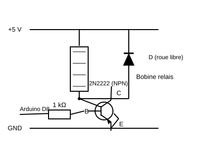

### Explication

Le transistor joue le rôle d'interrupteur électronique. La sortie
Arduino commande la base du transistor, tandis que le courant de la
bobine circule dans le transistor.

La diode protège le transistor contre la surtension produite lors de la
coupure du courant dans la bobine.

### Code Arduino

``` cpp
const byte RELAY_PIN = 8;
const byte SET_PIN = 2;
const byte RESET_PIN = 3;

void setup() {
  pinMode(RELAY_PIN, OUTPUT);
  pinMode(SET_PIN, INPUT_PULLUP);
  pinMode(RESET_PIN, INPUT_PULLUP);

  digitalWrite(RELAY_PIN, LOW);
}

void loop() {
  if (digitalRead(SET_PIN) == LOW) {
    digitalWrite(RELAY_PIN, HIGH);
  }

  if (digitalRead(RESET_PIN) == LOW) {
    digitalWrite(RELAY_PIN, LOW);
  }
}
```

### Remarque

Ce programme commande le relais, mais la conservation de l'état doit
être réalisée par le circuit physique de maintien. Si l'Arduino est
réinitialisé ou débranché, il ne faut pas confondre l'état logiciel avec
l'état physique.

------------------------------------------------------------------------

## 3.11 Bilan du TP 1

L'étudiant doit être capable de compléter la phrase suivante :

> Un bit peut être représenté par deux états physiques distincts. Dans
> notre montage, l'état est conservé grâce à une boucle de rétroaction
> utilisant un contact de relais.

### Production attendue

-   Schéma électrique annoté.
-   Tableau de mesures.
-   Calculs de résistance et de puissance.
-   Réponses aux questions.
-   Conclusion d'une dizaine de lignes.

------------------------------------------------------------------------

<a id="sec-mem-4-tp-2-un-octet-electronique"></a>

# 4. TP 2 : Un octet électronique

## 4.1 Titre

**Construire un registre 8 bits avec des bascules D 74HC74**

## 4.2 Durée

Environ **3 à 4 heures**.

## 4.3 Problématique

> Comment mémoriser huit bits simultanément et les relire sous la forme
> d'un octet ?

## 4.4 Objectifs

-   Comprendre le fonctionnement d'une bascule D.
-   Identifier les broches D, CLK, Q, PRE et CLR.
-   Comprendre le rôle du front d'horloge.
-   Construire un registre 8 bits.
-   Utiliser des boutons ou un DIP-switch pour fournir les données.
-   Utiliser l'Arduino pour générer WRITE.
-   Lire les sorties avec des LED ou l'Arduino.
-   Comprendre la différence entre entrée et sortie mémorisée.

------------------------------------------------------------------------

## 4.5 Présentation du 74HC74

Le 74HC74 contient deux bascules D indépendantes.

Chaque bascule possède notamment :

-   `D` : entrée de donnée.
-   `CLK` : entrée d'horloge.
-   `Q` : sortie mémorisée.
-   `!Q` : sortie complémentaire.
-   `PRE` : preset asynchrone.
-   `CLR` : clear asynchrone.

Les entrées `PRE` et `CLR` sont généralement actives à l'état bas. Il
faut donc les maintenir à l'état haut lorsqu'elles ne sont pas
utilisées.

### Principe

``` text
D --------------------+
                      |
                      v
                 +---------+
CLK ------------>|  D FF   |--------> Q
                 +---------+
```

La bascule capture la valeur de D sur un front montant de CLK.

------------------------------------------------------------------------

## 4.6 Brochage utile du 74HC74

Le brochage exact doit toujours être vérifié dans la datasheet du
fabricant utilisé.

Pour un 74HC74 classique en boîtier DIP-14 :

    Broche Fonction
  -------- ----------
         1 1CLR
         2 1D
         3 1CLK
         4 1PRE
         5 1Q
         6 1!Q
         7 GND
         8 2!Q
         9 2Q
        10 2PRE
        11 2CLK
        12 2D
        13 2CLR
        14 VCC

------------------------------------------------------------------------

## 4.7 Partie A : Tester une bascule D

### Matériel

-   1 × 74HC74.
-   1 LED.
-   1 résistance de LED.
-   1 bouton DATA.
-   1 bouton CLOCK.
-   Résistances de rappel.
-   Alimentation 5 V.

### Schéma de principe

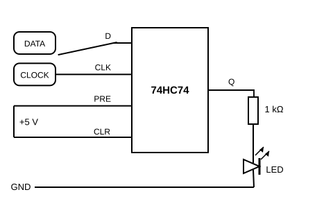

### Manipulation

1.  Mettre DATA à 0.
2.  Générer un front montant.
3.  Observer Q.
4.  Mettre DATA à 1.
5.  Observer que Q ne change pas immédiatement.
6.  Générer un front montant.
7.  Observer Q passer à 1.
8.  Remettre DATA à 0.
9.  Vérifier que Q reste à 1 jusqu'au prochain front.

### Montage détaillé pas à pas (câblage sur breadboard)

1.  **Placer le 74HC74** à cheval sur la rainure centrale de la breadboard, repère (encoche ou point) vers la gauche pour orienter correctement le comptage des broches.
2.  **Alimenter le circuit en premier**, avant tout autre câblage : broche 14 (VCC) vers le rail (+5 V), broche 7 (GND) vers le rail (0 V).
3.  **Placer le condensateur de découplage 100 nF** directement entre les broches 14 et 7, au plus près du boîtier (les deux pattes du condensateur peuvent aller dans les mêmes colonnes que VCC et GND).
4.  **Câbler PRE et CLR au repos actif haut** : relier la broche 4 (1PRE) et la broche 1 (1CLR) directement au rail +5 V (elles sont actives à l'état bas, donc il faut les maintenir hautes pour ne pas perturber la bascule).
5.  **Câbler l'entrée D (broche 2)** : un DIP-switch ou un bouton avec résistance de rappel de 10 kΩ vers +5 V, permettant de forcer D à 0 ou 1.
6.  **Câbler l'entrée CLK (broche 3)** : un bouton-poussoir entre CLK et +5 V, avec une résistance de rappel de 10 kΩ entre CLK et GND (état bas au repos, front montant à l'appui).
7.  **Câbler la sortie Q (broche 5)** : une résistance de 1 kΩ en série vers l'anode de la LED, la cathode de la LED vers GND.
8.  **Vérifier tout le câblage avant mise sous tension** : suivre chaque fil du doigt en le comparant au schéma.
9.  **Mettre sous tension** et observer l'état initial de la LED (aléatoire tant qu'aucun front n'a eu lieu).
10. **Dérouler le tableau d'observation ci-dessous**, en actionnant DATA puis CLK dans l'ordre indiqué.

### Tableau d'observation

    D avant le front CLK                Q après le front
  ------------------ --------------- -------------------
                   0 Front montant                     0
                   1 Front montant                     1
                   0 Pas de front      Valeur précédente
                   1 Pas de front      Valeur précédente

### Questions

1.  À quel instant la donnée est-elle mémorisée ?
2.  Pourquoi Q ne suit-il pas directement D ?
3.  Quel est le rôle de CLK ?
4.  Pourquoi les entrées PRE et CLR ne doivent-elles pas rester
    flottantes ?
5.  Pourquoi utiliser une résistance de rappel ?

------------------------------------------------------------------------

## 4.8 Partie B : Construire un registre 8 bits

### Principe

Un octet est composé de huit bits :

``` text
D7 D6 D5 D4 D3 D2 D1 D0
```

Il faut donc huit bascules D.

Un 74HC74 contient deux bascules. Il faut donc :

``` text
8 bascules / 2 bascules par circuit = 4 circuits
```

### Architecture

``` text
D0 ---> [Bascule 0] ---> Q0
D1 ---> [Bascule 1] ---> Q1
D2 ---> [Bascule 2] ---> Q2
D3 ---> [Bascule 3] ---> Q3
D4 ---> [Bascule 4] ---> Q4
D5 ---> [Bascule 5] ---> Q5
D6 ---> [Bascule 6] ---> Q6
D7 ---> [Bascule 7] ---> Q7

CLK commun à toutes les bascules
RESET commun à toutes les bascules
```

### Schéma de principe

``` text
                    WRITE / CLK
                         |
       +-----------------+-----------------+
       |                 |                 |
       v                 v                 v
   +--------+        +--------+        +--------+
D0 |  FF 0  | Q0  D1 |  FF 1  | Q1  ...|  FF 7  | Q7
-->|        |------->|        |------->|        |--->
   +--------+        +--------+        +--------+
       |                 |                 |
       +-----------------+-----------------+
                         |
                       RESET
```

------------------------------------------------------------------------

## 4.9 Câblage du registre

### Alimentation

Pour chacun des quatre circuits :

-   VCC vers +5 V.
-   GND vers la masse.
-   Un condensateur de 100 nF entre VCC et GND.

### Entrées asynchrones

Pour chaque bascule :

-   PRE vers +5 V.
-   CLR vers +5 V en fonctionnement normal.
-   Un bouton RESET peut tirer CLR vers GND.

### Horloge

Toutes les entrées CLK sont reliées à une ligne commune `WRITE`.

### Données

Chaque entrée D est reliée à une entrée indépendante :

-   DIP-switch.
-   Bouton avec résistance de rappel.
-   Ou sortie Arduino.

### Sorties

Chaque Q commande une LED via une résistance.

### Buffer de lecture (74HC541)

Chaque registre se termine par un buffer octal à sorties trois états, qui l'isole du bus commun.
Il est monté et testé dès le TP2, en même temps que le registre.

Brochage du 74HC541 (boîtier DIP-20) :

| Broche | Fonction | Broche | Fonction |
|---|---|---|---|
| 1 | OE1 (validation, active basse) | 20 | VCC |
| 2 à 9 | A1 à A8 (entrées) | 19 | OE2 (validation, active basse) |
| 10 | GND | 18 à 11 | Y1 à Y8 (sorties) |

Câblage :

1.  **Alimenter le boîtier** : broche 20 vers +5 V, broche 10 vers 0 V, condensateur 100 nF entre
    les deux au plus près.
2.  **Relier les sorties Q0 à Q7** du registre aux entrées A1 à A8 (broches 2 à 9).
3.  **Relier les sorties Y1 à Y8** (broches 18 à 11) au connecteur DATA du groupe. **Attention à
    l'ordre** : A1 (broche 2) ressort en Y1 (broche 18), A2 (broche 3) en Y2 (broche 17), et ainsi
    de suite. Les sorties sont numérotées à rebours des broches.
4.  **Relier les deux broches de validation** (1 et 19) ensemble : elles sont combinées par une
    porte NON-OU interne, et il faut donc les mettre toutes les deux à l'état bas pour que les
    sorties conduisent.

**Pendant le TP2, en autonomie**, relier ce point commun directement à GND : le buffer est alors
toujours actif et les LED reflètent en permanence le contenu du registre. **Au TP3**, ce même point
deviendra l'entrée `SELECT_R` du groupe, pilotée par le décodeur de lecture (§5.8).

### Montage détaillé pas à pas (construction complète du registre)

On utilise 4 circuits 74HC74, numérotés IC1 à IC4, chacun portant 2 bascules (1 et 2). Convention retenue : IC1 → bits D0-D1, IC2 → D2-D3, IC3 → D4-D5, IC4 → D6-D7.

1.  **Placer les 4 boîtiers 74HC74** en ligne sur la breadboard, chacun à cheval sur la rainure centrale, espacés d'au moins une colonne pour pouvoir câbler entre eux.
2.  **Alimenter chaque boîtier** : broche 14 (VCC) de chacun des 4 IC vers le rail +5 V, broche 7 (GND) de chacun vers le rail 0 V. Placer un condensateur 100 nF entre VCC et GND au plus près de chaque boîtier (4 condensateurs au total).
3.  **Relier tous les PRE et tous les CLR (broches 1, 4, 10, 13 de chaque IC) au rail +5 V.** Il y a 16 broches PRE/CLR au total (2 par bascule × 8 bascules) : toutes vont au +5 V, sauf si l'on souhaite ajouter un bouton RESET général (voir variante ci-dessous).
4.  **Variante avec RESET général :** au lieu de relier CLR directement au +5 V, insérer une ligne commune CLR_COMMON reliée à toutes les broches CLR, elle-même tirée au +5 V par une résistance de 10 kΩ, et reliée à GND via un bouton-poussoir RESET. Un appui sur RESET force alors instantanément toutes les sorties Q à 0.
5.  **Créer la ligne WRITE commune.** Sur une ligne libre de la breadboard, relier ensemble les 8 broches CLK (une par bascule, soit broches 3 et 11 de chaque IC). Câbler un bouton-poussoir entre cette ligne WRITE et le +5 V, avec une résistance de rappel 10 kΩ vers GND (ou relier directement à une sortie Arduino, voir §4.10).
6.  **Câbler les 8 entrées de données.** Sur le DIP-switch 8 positions, chaque interrupteur correspond à un bit D0 à D7 : relier la sortie de l'interrupteur 0 à la broche D de la bascule 1 d'IC1, l'interrupteur 1 à la bascule 2 d'IC1, l'interrupteur 2 à la bascule 1 d'IC2, et ainsi de suite jusqu'à l'interrupteur 7 sur la bascule 2 d'IC4. Alimenter le DIP-switch en +5 V/GND selon sa notice (certains modèles ont une résistance de rappel intégrée, sinon en ajouter une de 10 kΩ par entrée).
7.  **Câbler les 8 sorties.** Chaque sortie Q (broches 5 et 9 de chaque IC) attaque une résistance de 1 kΩ puis une LED vers GND, dans le même ordre D0 à D7 que les entrées, pour que la lecture visuelle corresponde directement à l'octet affiché.
8.  **Vérifier l'ensemble du câblage** boîtier par boîtier avant la mise sous tension : alimentation, PRE/CLR, WRITE, D, Q pour chacun des 4 IC.
9.  **Mettre sous tension et tester bit par bit** : positionner le DIP-switch sur une valeur simple (par exemple 00000001), appuyer sur WRITE, vérifier qu'une seule LED s'allume et que c'est la bonne. Répéter avec 2 ou 3 valeurs différentes avant de passer à la suite.
10. **Monter le 74HC541** conformément au paragraphe « Buffer de lecture » ci-dessus, broches 1 et 19 reliées à GND pour cette phase. Vérifier au multimètre que les 8 sorties Y recopient bien les 8 sorties Q. Le bloc du groupe est alors complet et conforme à l'interface exigée au §5.9.

------------------------------------------------------------------------

## 4.10 Schéma de câblage Arduino : écriture d'un octet

Dans cette version, l'Arduino fournit les huit bits et le signal WRITE.

``` text
Arduino                         Registre 8 bits

D2  --------------------------> D0
D3  --------------------------> D1
D4  --------------------------> D2
D5  --------------------------> D3
D6  --------------------------> D4
D7  --------------------------> D5
D8  --------------------------> D6
D9  --------------------------> D7

D10 --------------------------> CLK de toutes les bascules

GND --------------------------> GND commun
5 V  -------------------------> VCC des 74HC74
```

### Important

Les sorties Arduino doivent être configurées en sortie et ne doivent pas
être connectées à des sorties Q du registre pendant une lecture
simultanée.

------------------------------------------------------------------------

## 4.11 Code Arduino : écrire un octet

``` cpp
const byte DATA_PINS[8] = {
  2, 3, 4, 5, 6, 7, 8, 9
};

const byte WRITE_PIN = 10;

void setup() {
  for (byte i = 0; i < 8; i++) {
    pinMode(DATA_PINS[i], OUTPUT);
  }

  pinMode(WRITE_PIN, OUTPUT);
  digitalWrite(WRITE_PIN, LOW);
}

void writeByte(byte value) {
  for (byte i = 0; i < 8; i++) {
    digitalWrite(DATA_PINS[i], (value >> i) & 0x01);
  }

  // Front montant : capture de l'octet
  digitalWrite(WRITE_PIN, LOW);
  delayMicroseconds(10);
  digitalWrite(WRITE_PIN, HIGH);
  delayMicroseconds(10);
  digitalWrite(WRITE_PIN, LOW);
}

void loop() {
  writeByte(0b10101010);
  delay(1000);

  writeByte(0b11001100);
  delay(1000);

  writeByte(0b11110000);
  delay(1000);

  writeByte(0b00001111);
  delay(1000);
}
```

### Questions

1.  Pourquoi les données doivent-elles être stables avant le front
    d'horloge ?
2.  Pourquoi les sorties Q conservent-elles leur valeur après WRITE ?
3.  Que se passe-t-il si un bit DATA est inversé ?
4.  Quelle est la fréquence maximale théorique d'écriture ?
5.  Quels phénomènes limitent la vitesse réelle ?

------------------------------------------------------------------------

## 4.12 Partie C : Lire les sorties avec l'Arduino

### Câblage

``` text
Q0 --------------------------> Arduino A0
Q1 --------------------------> Arduino A1
Q2 --------------------------> Arduino A2
Q3 --------------------------> Arduino A3
Q4 --------------------------> Arduino A4
Q5 --------------------------> Arduino A5
Q6 --------------------------> Arduino A6 ou entrée disponible
Q7 --------------------------> Arduino A7 ou entrée disponible
```

Les broches analogiques peuvent être utilisées comme entrées numériques
sur les cartes compatibles.

### Code de lecture

``` cpp
const byte Q_PINS[8] = {
  A0, A1, A2, A3, A4, A5, 11, 12
};

byte readByte() {
  byte value = 0;

  for (byte i = 0; i < 8; i++) {
    if (digitalRead(Q_PINS[i]) == HIGH) {
      value |= (1 << i);
    }
  }

  return value;
}

void setup() {
  Serial.begin(115200);

  for (byte i = 0; i < 8; i++) {
    pinMode(Q_PINS[i], INPUT);
  }
}

void loop() {
  byte value = readByte();

  Serial.print("Décimal : ");
  Serial.println(value);

  Serial.print("Binaire : ");

  for (int i = 7; i >= 0; i--) {
    Serial.print((value >> i) & 0x01);
  }

  Serial.println();
  delay(500);
}
```

------------------------------------------------------------------------

## 4.13 Partie D : Étudier les boutons et les rebonds

### Problématique

Un bouton mécanique peut produire plusieurs transitions rapides lors
d'un seul appui.

### Manipulation

1.  Connecter un bouton à l'entrée CLOCK.
2.  Observer le signal à l'oscilloscope.
3.  Appuyer une seule fois.
4.  Relever les rebonds.
5.  Comparer avec une horloge générée par Arduino.

### Questions

1.  Pourquoi les rebonds peuvent-ils provoquer plusieurs écritures ?
2.  Comment peut-on supprimer les rebonds ?
3.  Quelle différence entre un anti-rebond logiciel et matériel ?

### Solution logicielle simple

``` cpp
void writeByteDebounced(byte value) {
  static unsigned long lastWrite = 0;

  if (millis() - lastWrite < 30) {
    return;
  }

  lastWrite = millis();
  writeByte(value);
}
```

------------------------------------------------------------------------

## 4.14 Bilan du TP 2

### Production attendue

-   Schéma de câblage du registre.
-   Registre 8 bits fonctionnel.
-   Programme Arduino d'écriture.
-   Programme Arduino de lecture.
-   Tableau de tests.
-   Réponses aux questions.
-   Conclusion expliquant le rôle d'une bascule D.

### Question de synthèse

> Pourquoi peut-on considérer quatre circuits 74HC74 comme un registre 8
> bits ?

------------------------------------------------------------------------

<a id="sec-mem-5-tp-3-une-memoire-collective-de-64-bits"></a>

# 5. TP 3 : Une mémoire collective de 64 bits

## 5.1 Titre

**Assembler huit registres pour construire une mémoire adressable**

## 5.2 Durée

Environ **4 heures**.

## 5.3 Organisation

-   8 groupes.
-   Chaque groupe est responsable d'un registre 8 bits.
-   Chaque groupe reçoit une adresse mémoire.
-   L'ensemble de la classe construit une mémoire de 8 octets.

## 5.4 Problématique

> Comment réunir plusieurs registres pour former une mémoire dans
> laquelle chaque octet possède une adresse propre ?

## 5.5 Objectifs

-   Comprendre l'adressage mémoire.
-   Utiliser un décodeur 3 vers 8.
-   Comprendre un bus de données.
-   Comprendre les sorties trois états.
-   Éviter les conflits électriques.
-   Tester une mémoire composée de plusieurs blocs.
-   Documenter une interface matérielle.
-   Diagnostiquer des pannes.

------------------------------------------------------------------------

## 5.6 Architecture générale

``` text
                         +----------------------+
                         |       ARDUINO        |
                         |                      |
                         | A2 A1 A0            |
                         | DATA[7..0]           |
                         | WRITE / READ         |
                         +----------+-----------+
                                    |
                  +-----------------+-----------------+
                  |                                   |
                  v                                   v
          +---------------+                  +---------------+
          | Décodeur 3->8 |                  | Bus DATA      |
          | 74HC138       |                  | D7 ... D0     |
          +-------+-------+                  +---------------+
                  |
       +----------+----------+----------+----------+
       |          |          |          |          |
       v          v          v          v          v
   +-------+  +-------+  +-------+  +-------+  +-------+
   |Octet 0|  |Octet 1|  |Octet 2|  |Octet 3|  | ...   |
   | 8 bit |  | 8 bit |  | 8 bit |  | 8 bit |  |       |
   +-------+  +-------+  +-------+  +-------+  +-------+
       |          |          |          |          |
       +----------+----------+----------+----------+
                              |
                              v
                         Bus de lecture
```

------------------------------------------------------------------------

## 5.7 Répartition des adresses

  Groupe   Adresse binaire     Adresse décimale Octet
  -------- ----------------- ------------------ ---------
  1        `000`                              0 Octet 0
  2        `001`                              1 Octet 1
  3        `010`                              2 Octet 2
  4        `011`                              3 Octet 3
  5        `100`                              4 Octet 4
  6        `101`                              5 Octet 5
  7        `110`                              6 Octet 6
  8        `111`                              7 Octet 7

------------------------------------------------------------------------

## 5.8 Pourquoi utiliser un décodeur ?

Un décodeur 3 vers 8 transforme trois bits d'adresse en huit lignes de
sélection.

Pour chaque combinaison d'adresse, une seule sortie est activée.

``` text
A2 A1 A0 = 000 -> Y0 actif
A2 A1 A0 = 001 -> Y1 actif
A2 A1 A0 = 010 -> Y2 actif
A2 A1 A0 = 011 -> Y3 actif
A2 A1 A0 = 100 -> Y4 actif
A2 A1 A0 = 101 -> Y5 actif
A2 A1 A0 = 110 -> Y6 actif
A2 A1 A0 = 111 -> Y7 actif
```

### Attention au 74HC138

Les sorties du 74HC138 sont **actives à l'état bas**. Cette convention
n'est pas une gêne : elle s'accorde directement avec les entrées de
validation du 74HC541, elles aussi actives à l'état bas. Aucune
inversion logique n'est nécessaire dans tout le montage.

### Deux décodeurs, et non un seul

Une ligne WRITE unique attaquant les entrées CLK des huit registres
écrirait **dans les huit registres à la fois** : l'adressage en écriture
ne servirait alors à rien. Il faut donc que le front d'horloge ne
parvienne qu'au registre adressé.

La solution retenue ici n'ajoute **aucune porte logique**. Elle exploite
l'entrée de validation `E3` du 74HC138, prévue exactement pour cet usage.
Le montage utilise deux décodeurs partageant les mêmes trois lignes
d'adresse :

-   **Décodeur d'écriture** : son entrée `E3` reçoit le signal `WRITE`.
    Ses sorties fournissent les lignes `SELECT_W`.
-   **Décodeur de lecture** : son entrée `E3` reçoit le signal `READ`.
    Ses sorties fournissent les lignes `SELECT_R`.

### Comment l'écriture devient sélective

| Instant | WRITE | Sortie Yn du groupe adressé | Sorties des 7 autres |
|---|---|---|---|
| Repos | 0 | 1 (haute) | 1 (hautes) |
| Pendant le pulse | 1 | 0 (basse) : front descendant, sans effet | 1 (inchangées) |
| Fin du pulse | 0 | 1 : **front montant : capture** | 1 (inchangées) |

La ligne `SELECT_W` du groupe adressé attaque directement les entrées CLK
de ses huit bascules. Les sept autres groupes ne voient aucune
transition : leur contenu est intact. La donnée est encore présente sur
le bus au moment du front montant, puisque l'Arduino ne la modifie
qu'après avoir relâché WRITE.

Les bascules D du 74HC74 étant sensibles au **front montant**, c'est donc
la *fin* du pulse WRITE qui mémorise la donnée, et non son début. Ce
point est repris au chronogramme du §5.12.

### Comment la lecture devient sélective

Les sorties du décodeur de lecture sont actives à l'état bas ; les
entrées de validation du 74HC541 sont actives à l'état bas. La sortie Yn
se relie donc **directement** aux broches 1 et 19 du buffer du groupe n,
sans aucune inversion. Quand READ est bas, les huit sorties Yn sont
hautes et les huit buffers sont en haute impédance : le bus est libre.

> Cette symétrie est le principal intérêt de l'architecture : l'élève
> constate que la même logique active-bas se propage du décodeur jusqu'au
> buffer sans adaptation, et qu'un seul groupe à la fois peut
> matériellement parler sur le bus.

### Montage détaillé pas à pas (câblage des décodeurs, sur la breadboard commune)

Brochage utile du 74HC138 (boîtier DIP-16) :

| Broche | Fonction | Broche | Fonction |
|---|---|---|---|
| 1, 2, 3 | A0, A1, A2 (adresse) | 16 | VCC |
| 4, 5 | E1, E2 (validation, actives basses) | 15 | Y0 |
| 6 | E3 (validation, active haute) | 14 à 9 | Y1 à Y6 |
| 8 | GND | 7 | Y7 |

1.  **Placer les deux 74HC138** sur la breadboard commune, à cheval sur la rainure centrale.
2.  **Alimenter chacun** : broche 16 (VCC) vers +5 V, broche 8 (GND) vers 0 V, condensateur 100 nF
    entre les deux au plus près du boîtier.
3.  **Sur les deux boîtiers, relier E1 et E2** (broches 4 et 5) à GND.
4.  **Câbler les entrées d'adresse A0, A1, A2** (broches 1 à 3) des **deux** décodeurs en parallèle
    vers les 3 broches Arduino d'adresse. Les deux décodeurs voient donc toujours la même adresse.
5.  **Sur le décodeur d'écriture**, relier E3 (broche 6) à la broche Arduino `WRITE`.
6.  **Sur le décodeur de lecture**, relier E3 (broche 6) à la broche Arduino `READ`.
7.  **Repérer les 8 sorties Y0 à Y7** (attention : l'ordre des broches n'est pas l'ordre naturel
    autour du boîtier : vérifier sur la datasheet du composant utilisé).
8.  **Câbler chaque sortie Yn du décodeur d'écriture** vers l'entrée `SELECT_W` du groupe n
    correspondant (cf. tableau de répartition des adresses, §5.7).
9.  **Câbler chaque sortie Yn du décodeur de lecture** vers l'entrée `SELECT_R` du groupe n.
10. **Vérifier avec une LED témoin** avant de connecter les 8 groupes : brancher provisoirement une
    LED (avec résistance) entre une sortie Yn et le +5 V : la sortie étant active à l'état bas, la
    LED s'allume quand Yn est sélectionnée. Forcer E3 à l'état haut, faire varier l'adresse depuis
    l'Arduino et vérifier qu'une seule LED s'allume à la fois, dans le bon ordre. **Répéter
    l'opération sur le second décodeur.**

------------------------------------------------------------------------

## 5.9 Partie A : Définir l'interface d'un groupe

Chaque groupe doit respecter exactement la même interface.

### Connecteur de groupe

``` text
+-----------------------------+
| Interface registre 8 bits   |
+-----------------------------+
| VCC                         |
| GND                         |
| DATA0                       |
| DATA1                       |
| DATA2                       |
| DATA3                       |
| DATA4                       |
| DATA5                       |
| DATA6                       |
| DATA7                       |
| SELECT_W                    |
| SELECT_R                    |
| RESET                       |
+-----------------------------+
```

`SELECT_W` : horloge d'écriture du groupe, capture sur **front montant**.
`SELECT_R` : validation de lecture, **active à l'état bas**.

### Règle d'intégration

Chaque groupe doit fournir :

-   Un registre 8 bits (4 × 74HC74).
-   Un buffer de sortie 74HC541 câblé conformément au §4.9.
-   Une entrée SELECT_W attaquant les huit entrées CLK.
-   Une entrée SELECT_R attaquant les deux broches de validation du buffer.
-   Une entrée RESET attaquant les huit entrées CLR.
-   Une documentation du brochage de son connecteur.

> **Ce qui disparaît par rapport à une architecture à ligne WRITE partagée.** Les signaux WRITE et
> READ ne descendent plus jusqu'aux groupes : ils s'arrêtent aux entrées E3 des deux décodeurs, sur
> la breadboard commune. Chaque groupe ne reçoit plus que ses deux lignes de sélection dédiées, ce
> qui réduit le câblage collectif et supprime le mode de panne le plus fréquent : un groupe qui tire
> une ligne commune à la masse et bloque toute la classe.

### Montage détaillé pas à pas (intégration collective, jour de l'assemblage)

Cette étape se déroule idéalement en une seule séance, tous les groupes présents, pour limiter le temps où le bus commun est à moitié câblé.

1.  **Chaque binôme apporte son bloc déjà testé** : registre 8 bits **et** buffer 74HC541 (LED, DIP-switch, WRITE fonctionnels, testés en autonomie au TP2).
2.  **Les deux décodeurs sont déjà installés et validés** sur la breadboard commune, avec l'adresse pilotée par l'Arduino contrôleur (cf. §5.8). Les buffers, eux, sont sur le bloc de chaque groupe depuis le TP2.
3.  **Poser les 8 breadboards des groupes autour de la breadboard commune**, de préférence dans l'ordre des adresses (groupe 0 à groupe 7) pour limiter la longueur des fils et les croisements.
4.  **Raccorder en premier les alimentations** : VCC et GND de chaque groupe vers les rails de la breadboard commune (ou vers l'alimentation générale si elle est unique pour toute la classe).
5.  **Raccorder les 8 lignes DATA communes** (D0 à D7) vers les entrées/sorties correspondantes de chaque registre.
6.  **Raccorder la sortie Yn du décodeur d'écriture** vers l'entrée `SELECT_W` du groupe n correspondant : une ligne différente pour chaque groupe.
7.  **Raccorder la sortie Yn du décodeur de lecture** vers l'entrée `SELECT_R` du groupe n. Vérifier avant mise sous tension qu'aucune ligne SELECT_R ne se retrouve reliée à GND en permanence : c'est le câblage qui provoquerait deux buffers actifs simultanément.
8.  **Vérifier l'exclusion mutuelle avant d'activer la lecture.** Sonder à l'ohmmètre, hors tension, que les 8 lignes SELECT_R sont bien indépendantes les unes des autres. L'exclusion est ensuite garantie par construction du décodeur (§5.11), mais une erreur de câblage peut toujours la contourner.
9.  **Tester groupe par groupe, dans l'ordre des adresses** : depuis l'Arduino contrôleur, sélectionner l'adresse 0, écrire un octet de test, vérifier sur les LED du groupe 0 que la bonne valeur apparaît, puis relire cette valeur pour confirmer la cohérence, avant de passer à l'adresse 1.
10. **Une fois les 8 groupes validés individuellement**, exécuter le programme de test automatique complet (§5.16 ou équivalent) qui parcourt les 8 adresses.

------------------------------------------------------------------------

## 5.10 Partie B : Comprendre les conflits de bus

### Problème

Si deux registres commandent simultanément la même ligne DATA, l'un peut
essayer de produire `1` pendant que l'autre produit `0`.

Cela crée un conflit électrique.

### Exemple interdit

``` text
Q du registre 0 --------+
                        |
                        +------ DATA0
                        |
Q du registre 1 --------+
```

### Solution

Utiliser des buffers trois états.

Un buffer trois états possède :

-   Une entrée.
-   Une sortie.
-   Une entrée d'activation.

Lorsque le buffer est désactivé, sa sortie est en haute impédance `Z`.

``` text
Q registre ---> [ Buffer 3 états ] ---> Bus DATA
                       ^
                       |
                   SELECT_R  (active bas)
```

------------------------------------------------------------------------

## 5.11 Partie C : Ajouter les buffers de lecture

Le buffer de chaque groupe est un **74HC541**, déjà monté et testé au TP2
(§4.9). Il isole les sorties du registre du bus commun.

### Principe

``` text
Registre 0 Q[7..0] ---> 74HC541 (groupe 0) ---+
                              ^               |
                          SELECT_R 0          |
                                              |
Registre 1 Q[7..0] ---> 74HC541 (groupe 1) ---+---- Bus DATA[7..0]
                              ^               |
                          SELECT_R 1          |
                                              |
          ...                             ... |
                                              |
Registre 7 Q[7..0] ---> 74HC541 (groupe 7) ---+
                              ^
                          SELECT_R 7
```

Un seul buffer doit être actif à la fois.

### Signal de lecture

``` text
SELECT_R n = sortie Yn du décodeur de lecture (validé par READ)
```

Cette exclusion est garantie **matériellement** par le décodeur : par
construction, un 74HC138 n'active jamais deux sorties simultanément.

> **Point à souligner en séance.** C'est une différence de nature entre
> une garantie logicielle et une garantie matérielle. Un programme peut se
> tromper d'adresse ; le décodeur, lui, ne *peut pas* activer deux sorties.
> Faire remarquer aux étudiants que la sécurité du bus ne repose pas sur la
> correction du code Arduino est un des acquis importants de ce TP.

------------------------------------------------------------------------

## 5.12 Partie D : Écriture dans un octet sélectionné

### Séquence d'écriture

1.  Placer l'adresse sur A2, A1 et A0.
2.  Placer la donnée sur DATA7 à DATA0.
3.  Laisser le temps aux lignes de se stabiliser.
4.  Activer WRITE (état haut) : la ligne SELECT_W du groupe adressé descend.
5.  Désactiver WRITE (état bas) : SELECT_W remonte, **le front montant capture la donnée**.
6.  Seulement ensuite, modifier l'adresse ou la donnée.

### Schéma temporel simplifié

``` text
Adresse    : ----[ adresse stable                  ]----------
Donnée     : ----[ donnée stable                   ]----------
WRITE      : ________/‾‾‾‾‾‾‾‾‾‾‾‾‾\_______________________
SELECT_W n : ‾‾‾‾‾‾‾‾\_____________/‾‾‾‾‾‾‾‾‾‾‾‾‾‾‾‾‾‾‾‾‾‾‾
                                   ^
                                capture
```

Les sept autres lignes SELECT_W restent hautes pendant toute la séquence :
aucun autre registre ne voit de front.

### Questions

1.  Pourquoi l'adresse doit-elle être stable pendant toute la durée du
    pulse WRITE ?
2.  À quel instant précis la donnée est-elle capturée : au début ou à la
    fin du pulse ? Justifiez à partir du chronogramme.
3.  Que se passerait-il si le programme changeait la donnée entre l'étape
    4 et l'étape 5 ?
4.  Pourquoi les sept registres non adressés ne voient-ils aucun front
    d'horloge ?
5.  Quelle différence entre sélectionner un registre en écriture et le
    sélectionner en lecture ?

------------------------------------------------------------------------

## 5.13 Partie E : Lire un octet sélectionné

### Séquence de lecture

1.  Placer l'adresse.
2.  Activer le buffer du registre sélectionné.
3.  Lire les huit lignes DATA.
4.  Désactiver le buffer.

``` text
Adresse ---> Décodeur ---> Sélection d'un registre
                              |
                              v
                       Buffer activé
                              |
                              v
                         Bus DATA
```

------------------------------------------------------------------------

## 5.14 Schéma Arduino global

``` text
Arduino                         Mémoire 64 bits

D2  --------------------------> DATA0
D3  --------------------------> DATA1
D4  --------------------------> DATA2
D5  --------------------------> DATA3
D6  --------------------------> DATA4
D7  --------------------------> DATA5
D8  --------------------------> DATA6
D9  --------------------------> DATA7

D10 --------------------------> WRITE
D11 --------------------------> READ

D12 --------------------------> A0
D13 --------------------------> A1
A0 ---------------------------> A2

GND --------------------------> GND commun
5 V  -------------------------> VCC
```

### Remarque

Les broches exactes peuvent être modifiées selon la carte Arduino et les
broches utilisées. Le principe reste identique : huit lignes de données,
trois lignes d'adresse et des lignes de commande.

------------------------------------------------------------------------

## 5.15 Code Arduino : fonctions d'adressage

``` cpp
const byte DATA_PINS[8] = {
  2, 3, 4, 5, 6, 7, 8, 9
};

const byte WRITE_PIN = 10;
const byte READ_PIN = 11;

const byte ADDRESS_PINS[3] = {
  12, 13, A0
};

void setAddress(byte address) {
  for (byte i = 0; i < 3; i++) {
    digitalWrite(ADDRESS_PINS[i], (address >> i) & 0x01);
  }
}

void setDataBus(byte value) {
  for (byte i = 0; i < 8; i++) {
    digitalWrite(DATA_PINS[i], (value >> i) & 0x01);
  }
}

void writeMemory(byte address, byte value) {
  setAddress(address);
  setDataBus(value);

  digitalWrite(WRITE_PIN, LOW);
  delayMicroseconds(10);
  digitalWrite(WRITE_PIN, HIGH);
  delayMicroseconds(10);
  digitalWrite(WRITE_PIN, LOW);
}
```

------------------------------------------------------------------------

## 5.16 Code Arduino : lecture du bus

``` cpp
void setDataBusAsInput() {
  for (byte i = 0; i < 8; i++) {
    pinMode(DATA_PINS[i], INPUT);
  }
}

void setDataBusAsOutput() {
  for (byte i = 0; i < 8; i++) {
    pinMode(DATA_PINS[i], OUTPUT);
  }
}

byte readDataBus() {
  byte value = 0;

  for (byte i = 0; i < 8; i++) {
    if (digitalRead(DATA_PINS[i]) == HIGH) {
      value |= (1 << i);
    }
  }

  return value;
}

byte readMemory(byte address) {
  setAddress(address);

  setDataBusAsInput();

  digitalWrite(READ_PIN, HIGH);
  delayMicroseconds(10);

  byte value = readDataBus();

  digitalWrite(READ_PIN, LOW);

  return value;
}
```

### Important

Le code ci-dessus suppose que le circuit de sélection et les buffers
sont conçus pour que `READ_PIN` active uniquement le registre
sélectionné.

Si chaque groupe possède sa propre ligne de sélection, l'Arduino ou le
décodeur doit produire une sélection unique.

------------------------------------------------------------------------

## 5.17 Programme de test complet

``` cpp
void setup() {
  Serial.begin(115200);

  for (byte i = 0; i < 8; i++) {
    pinMode(DATA_PINS[i], OUTPUT);
  }

  pinMode(WRITE_PIN, OUTPUT);
  pinMode(READ_PIN, OUTPUT);

  for (byte i = 0; i < 3; i++) {
    pinMode(ADDRESS_PINS[i], OUTPUT);
  }

  digitalWrite(WRITE_PIN, LOW);
  digitalWrite(READ_PIN, LOW);
}

void loop() {
  writeMemory(0, 0b10101010);
  writeMemory(1, 0b11001100);
  writeMemory(2, 0b11110000);
  writeMemory(3, 0b00001111);
  writeMemory(4, 0b00110011);
  writeMemory(5, 0b01010101);
  writeMemory(6, 0b10011001);
  writeMemory(7, 0b01100110);

  delay(500);

  for (byte address = 0; address < 8; address++) {
    byte value = readMemory(address);

    Serial.print("Adresse ");
    Serial.print(address);
    Serial.print(" : ");

    for (int bit = 7; bit >= 0; bit--) {
      Serial.print((value >> bit) & 0x01);
    }

    Serial.print(" = ");
    Serial.println(value);
  }

  Serial.println("--------------------");
  delay(2000);
}
```

------------------------------------------------------------------------

## 5.18 Partie F : Défi collectif

### Cahier des charges

La classe doit construire une mémoire de 64 bits capable de :

-   Stocker huit octets.
-   Écrire une valeur à une adresse donnée.
-   Lire une valeur à une adresse donnée.
-   Conserver les valeurs tant que l'alimentation est présente.
-   Ne jamais activer simultanément deux sorties de lecture.
-   Signaler une erreur si une valeur lue est différente de la valeur
    écrite.

### Jeu de test

  Adresse   Valeur attendue
  --------- -----------------
  0         `10101010`
  1         `11001100`
  2         `11110000`
  3         `00001111`
  4         `00110011`
  5         `01010101`
  6         `10011001`
  7         `01100110`

### Test automatique

``` cpp
const byte expectedValues[8] = {
  0b10101010,
  0b11001100,
  0b11110000,
  0b00001111,
  0b00110011,
  0b01010101,
  0b10011001,
  0b01100110
};

void testMemory() {
  for (byte address = 0; address < 8; address++) {
    writeMemory(address, expectedValues[address]);
  }

  bool success = true;

  for (byte address = 0; address < 8; address++) {
    byte value = readMemory(address);

    if (value != expectedValues[address]) {
      success = false;

      Serial.print("Erreur à l'adresse ");
      Serial.println(address);
    }
  }

  if (success) {
    Serial.println("TEST OK : mémoire 64 bits fonctionnelle");
  } else {
    Serial.println("TEST ECHEC");
  }
}
```

------------------------------------------------------------------------

## 5.19 Partie G : Diagnostic de pannes

Chaque groupe reçoit une panne volontaire.

### Exemples

-   Une ligne DATA est débranchée.
-   Un bit d'adresse est inversé.
-   Le signal WRITE n'arrive pas au registre.
-   Une entrée CLR reste à l'état bas.
-   Un buffer reste activé.
-   Une LED est montée à l'envers.
-   Une masse est absente.
-   Un condensateur de découplage manque.
-   Deux sorties sont actives en même temps.
-   L'entrée E3 d'un décodeur est laissée en l'air (symptôme : plus
    aucune écriture ne fonctionne, ou écritures erratiques).
-   Une seule des deux broches de validation d'un 74HC541 est reliée à
    SELECT_R, l'autre est en l'air (symptôme : le groupe ne parle jamais
    sur le bus, alors que ses LED affichent la bonne valeur).
-   Les lignes d'adresse ne sont câblées que sur un seul des deux
    décodeurs (symptôme : on écrit à une adresse et on relit à une autre).

### Méthode de diagnostic

1.  Reproduire le problème.
2.  Identifier si le problème concerne l'entrée, la mémorisation ou la
    sortie.
3.  Mesurer les tensions.
4.  Vérifier l'adresse.
5.  Vérifier le signal WRITE.
6.  Vérifier le signal READ.
7.  Vérifier la sélection du registre.
8.  Documenter la panne et la correction.

### Questions

1.  Pourquoi une mémoire peut-elle fonctionner seule mais pas dans le
    système collectif ?
2.  Pourquoi une erreur d'adresse peut-elle faire croire qu'un registre
    est défectueux ?
3.  Pourquoi un conflit de bus peut-il endommager un circuit ?
4.  Pourquoi faut-il tester chaque bloc avant l'intégration ?
5.  Pourquoi une interface commune est-elle nécessaire ?
6.  Un groupe affiche la bonne valeur sur ses LED mais ne renvoie rien
    sur le bus. Où chercher en premier, et pourquoi les LED ne
    suffisent-elles pas à valider un groupe ?

------------------------------------------------------------------------

## 5.20 Partie H : Extension : mémoire de 256 bits

Si le temps le permet, proposer le défi suivant :

> Comment modifier l'architecture pour passer de 8 octets à 32 octets ?

Il faut alors :

-   5 lignes d'adresse au lieu de 3.
-   Un décodeur 5 vers 32 ou plusieurs décodeurs en cascade.
-   32 registres de 8 bits.
-   Un bus de données de 8 bits.

### Question

> Combien de circuits 74HC74 faut-il pour construire 256 bits ?

Réponse :

``` text
256 / 8 = 32 registres de 8 bits
32 × 4 = 128 circuits 74HC74
```

------------------------------------------------------------------------

## 5.21 Bilan du TP 3

### Production attendue

-   Schéma global de la mémoire.
-   Schéma de l'interface d'un groupe.
-   Tableau d'adressage.
-   Programme d'écriture et de lecture.
-   Résultats du test automatique.
-   Rapport de panne.
-   Conclusion collective.

### Question de synthèse

> Expliquez comment huit registres de 8 bits peuvent former une mémoire
> de 64 bits adressable.

------------------------------------------------------------------------

<a id="sec-mem-6-evaluation"></a>

# 6. Évaluation

## 6.1 Proposition de barème

  Compétence                                   TP 1     TP 2     TP 3
  ---------------------------------------- -------- -------- --------
  Mesures et exploitation des résultats           5        3        2
  Compréhension physique et électronique          5        5        4
  Réalisation du câblage                          4        4        4
  Programmation et tests                          1        3        4
  Travail en équipe et documentation              3        3        6
  **Total**                                  **18**   **18**   **20**

## 6.2 Critères de réussite

### TP 1

-   La bobine fonctionne.
-   Le relais commute.
-   La fonction SET/RESET est démontrée.
-   Les mesures sont cohérentes.
-   L'étudiant explique la rétroaction.

### TP 2

-   Le registre mémorise huit bits.
-   Les données sont correctement écrites.
-   Les sorties sont correctement lues.
-   Le câblage est documenté.
-   Le programme Arduino est fonctionnel.

### TP 3

-   Les huit registres sont intégrés.
-   Les adresses sélectionnent le bon octet.
-   Les données sont conservées.
-   Les conflits de bus sont évités.
-   Le test automatique est réussi.
-   Le groupe participe au diagnostic collectif.

------------------------------------------------------------------------

<a id="sec-mem-7-annexes-techniques"></a>

# 7. Annexes techniques

## 7.1 Règles de câblage breadboard

-   Relier les rails d'alimentation à une source stable.
-   Vérifier si les rails sont coupés au milieu.
-   Placer les circuits intégrés à cheval sur la rainure centrale.
-   Mettre un condensateur de 100 nF près de chaque circuit intégré.
-   Relier toutes les masses.
-   Ne jamais laisser une entrée logique non connectée.
-   Utiliser des fils courts pour les signaux d'horloge.
-   Repérer les fils par couleur :
    -   Rouge : +5 V.
    -   Noir : GND.
    -   Bleu : données.
    -   Jaune : horloge.
    -   Vert : adresse.
    -   Blanc : lecture/écriture.

## 7.2 Résistances de LED

Pour une LED :

``` text
+5 V ----[ Résistance ]----|>|---- GND
```

Une résistance de 220 Ω à 1 kΩ convient généralement pour une LED
indicatrice.

## 7.3 Entrées flottantes

Une entrée CMOS flottante peut prendre un état imprévisible.

Exemple de résistance de rappel :

``` text
+5 V
 |
[10 kΩ]
 |
 +------> Entrée logique
 |
Bouton
 |
GND
```

Dans ce montage :

-   Bouton relâché : entrée à 1.
-   Bouton appuyé : entrée à 0.

## 7.4 Différence entre mémoire volatile et non volatile

Les montages de ce projet sont des mémoires **volatiles** :

-   Elles conservent leur état tant que l'alimentation est présente.
-   Elles perdent leur état lorsque l'alimentation est coupée.

Cela permet de faire le lien avec :

-   Les registres.
-   La SRAM.
-   La DRAM.
-   Les mémoires flash.
-   Les supports de stockage.

## 7.5 Vocabulaire

### Termes introduits par l'architecture à deux décodeurs

| Terme | Définition |
|---|---|
| Entrée de validation (*enable*) | Entrée qui autorise ou inhibe globalement le fonctionnement d'un circuit, indépendamment de ses autres entrées |
| Logique active basse | Convention où un signal est considéré actif lorsqu'il est à l'état bas (0 V) |
| Brochage *flow-through* | Disposition d'un boîtier où toutes les entrées sont d'un côté et toutes les sorties de l'autre, facilitant le tracé des liaisons |

### Vocabulaire général

  -----------------------------------------------------------------------
  Terme                               Définition
  ----------------------------------- -----------------------------------
  Bit                                 Information binaire pouvant valoir
                                      0 ou 1

  Octet                               Groupe de 8 bits

  Bascule D                           Circuit mémorisant une donnée sur
                                      un front d'horloge

  Registre                            Ensemble de bascules utilisées pour
                                      stocker plusieurs bits

  Bus                                 Ensemble de lignes de communication
                                      communes

  Adresse                             Numéro identifiant une case mémoire

  Décodeur                            Circuit qui active une sortie parmi
                                      plusieurs

  Haute impédance                     État dans lequel une sortie est
                                      électriquement déconnectée

  READ                                Opération de lecture

  WRITE                               Opération d'écriture

  Rétroaction                         Retour d'une sortie vers une partie
                                      du circuit d'entrée
  -----------------------------------------------------------------------

## 7.6 Questions de conclusion générale

1.  Comment un courant peut-il représenter un bit ?
2.  Pourquoi une mémoire doit-elle avoir deux états stables ?
3.  Quelle différence entre une bascule D et un simple fil ?
4.  Pourquoi un registre 8 bits est-il un octet ?
5.  Pourquoi faut-il une adresse pour sélectionner un octet ?
6.  Pourquoi faut-il éviter les conflits de bus ?
7.  Quel est le rôle de l'Arduino dans le projet ?
8.  Quelles parties du système sont physiques et quelles parties sont
    logiques ?
9.  Pourquoi la mémoire perd-elle ses données lorsque l'alimentation est
    coupée ?
10. Comment passer de 64 bits à 1 Ko ?

------------------------------------------------------------------------

<a id="sec-mem-conclusion-du-projet"></a>

# Conclusion du projet

Ce projet permet de faire comprendre que la mémoire informatique n'est
pas un objet abstrait.

Elle repose sur une succession de niveaux :

``` text
Courant électrique
        ↓
Champ magnétique ou état électronique
        ↓
Commutation
        ↓
Bit
        ↓
Bascule
        ↓
Registre
        ↓
Octet
        ↓
Adresse mémoire
        ↓
Mémoire de 64 bits
        ↓
Architecture informatique
```

La phrase à retenir pour les étudiants est :

> **Une mémoire de 64 bits n'est pas un composant magique : c'est un
> ensemble de cellules identiques, organisées selon une architecture et
> reliées par une interface commune.**

------------------------------------------------------------------------

## Annexe : lexique des composants utilisés dans ce TP

| Composant | Ce que c'est | Ce qu'il fait dans ce montage |
|---|---|---|
| **Résistance** | Composant passif qui s'oppose au passage du courant (loi d'Ohm : U = R×I). | Limite le courant dans une LED, fixe un état par défaut (résistance de rappel/pull-up), limite le courant de base d'un transistor. |
| **Condensateur** (100 nF) | Composant passif qui stocke de l'énergie électrique sous forme de charge, et la restitue très rapidement en cas de besoin. | Placé au plus près de chaque circuit intégré ("découplage"), il absorbe les micro-chutes de tension lors des commutations et évite les dysfonctionnements aléatoires. |
| **Diode** (1N4001/1N4004/1N4148) | Composant à semi-conducteur qui ne laisse passer le courant que dans un seul sens. | Utilisée en "diode de roue libre" en parallèle d'une bobine (relais) : elle absorbe la surtension produite à la coupure du courant et protège le transistor ou l'Arduino. |
| **LED** (diode électroluminescente) | Diode qui émet de la lumière quand elle est parcourue par un courant dans le bon sens. | Indicateur visuel de l'état logique d'une sortie (allumée = 1, éteinte = 0). |
| **Transistor NPN** (2N2222, BC547) | Composant à semi-conducteur à 3 broches (base, collecteur, émetteur) qui fonctionne comme un interrupteur commandé électriquement. | Permet à une sortie Arduino (faible courant) de commander une bobine de relais (courant plus important), sans jamais faire circuler le courant du relais directement dans l'Arduino. |
| **Relais électromécanique** | Interrupteur mécanique commandé par une bobine : quand la bobine est alimentée, elle attire une armature qui fait basculer un contact. | Réalise concrètement la fonction mémoire du TP1 : le contact NO (normalement ouvert), une fois fermé, peut "s'auto-alimenter" et maintenir l'état après relâchement de la commande (boucle de maintien SET/RESET). |
| **Bobine / électroaimant** | Fil de cuivre enroulé qui produit un champ magnétique lorsqu'il est parcouru par un courant. | Construit "à la main" au TP1 pour comprendre le principe physique qui se cache, en version miniaturisée, dans la bobine du relais. |
| **74HC74** | Circuit intégré numérique contenant 2 bascules D indépendantes. | Chaque bascule mémorise 1 bit sur un front montant d'horloge (CLK) : 4 boîtiers = 8 bascules = 1 registre de 8 bits (1 octet). |
| **74HC138** | Circuit intégré numérique "décodeur 3 vers 8" : à partir de 3 bits d'adresse, il active une seule sortie parmi 8. Son entrée de validation E3 permet d'inhiber toutes les sorties d'un coup. | Sélectionne, parmi les 8 groupes/registres de la classe, celui qui doit être lu ou écrit à un instant donné. Le montage en utilise **deux** : l'un validé par WRITE, l'autre par READ (§5.8). |
| **74HC541** | Circuit intégré "buffer" octal à sorties trois états : chaque sortie peut valoir 0, 1, ou être totalement déconnectée électriquement ("haute impédance"). Son brochage *flow-through* place les 8 entrées d'un côté et les 8 sorties de l'autre. | Permet à plusieurs registres de partager les mêmes fils de bus DATA sans se marcher dessus : seul le registre sélectionné "prend la parole" sur le bus, les autres se mettent en haute impédance. Équivalents possibles : 74HC244, 74HC245 (brochage moins commode). |
| **DIP-switch 8 positions** | Bloc de 8 petits interrupteurs indépendants, au pas standard des breadboards. | Sert à fixer manuellement les 8 bits d'un octet avant de les écrire dans le registre (entrée de données D0 à D7). |
| **Bouton-poussoir** | Interrupteur momentané : fermé uniquement pendant l'appui. | Génère un front (SET, RESET, CLOCK/WRITE) au moment précis où l'utilisateur appuie. |
| **Breadboard** (plaque d'essai) | Support de prototypage sans soudure, avec des rangées de trous électriquement reliés par groupes. | Permet de câbler et modifier rapidement tous les montages du projet sans souder. |
| **Arduino** | Carte à microcontrôleur programmable, avec des broches d'entrée/sortie numériques et analogiques. | Génère les signaux d'adresse, de WRITE et de lecture du bus ; remplace à terme les boutons manuels pour piloter le système de façon automatique et reproductible. |
| **Multimètre** | Appareil de mesure polyvalent (tension, courant, résistance, continuité). | Vérifie le câblage avant mise sous tension, mesure la résistance de la bobine, contrôle les tensions du montage. |
| **Oscilloscope** | Appareil qui affiche l'évolution d'une tension dans le temps. | Observe les temps de commutation du relais, les rebonds d'un bouton, ou la forme exacte d'un signal d'horloge. |
| **Résistance de rappel (pull-up/pull-down)** | Résistance (souvent 10 kΩ) qui fixe un état par défaut (haut ou bas) à une entrée logique quand rien d'autre ne la pilote. | Évite qu'une entrée CMOS (D, CLK, PRE, CLR...) reste "flottante", ce qui provoquerait un comportement imprévisible. |